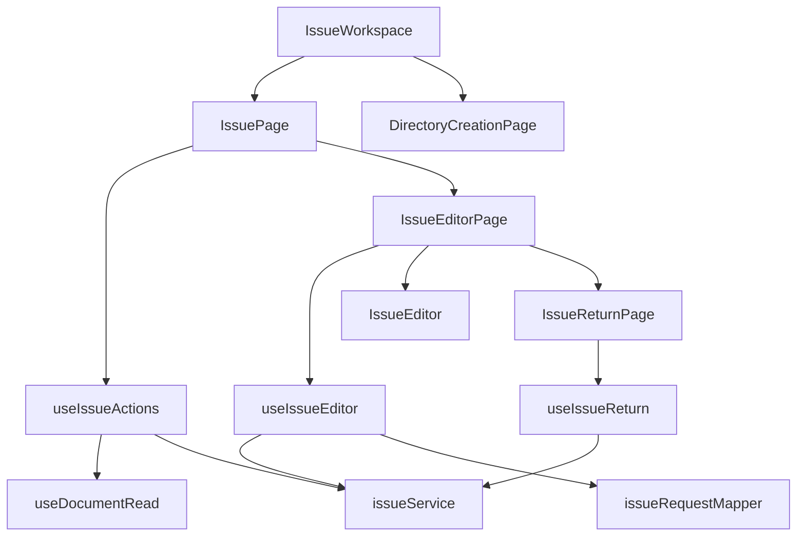
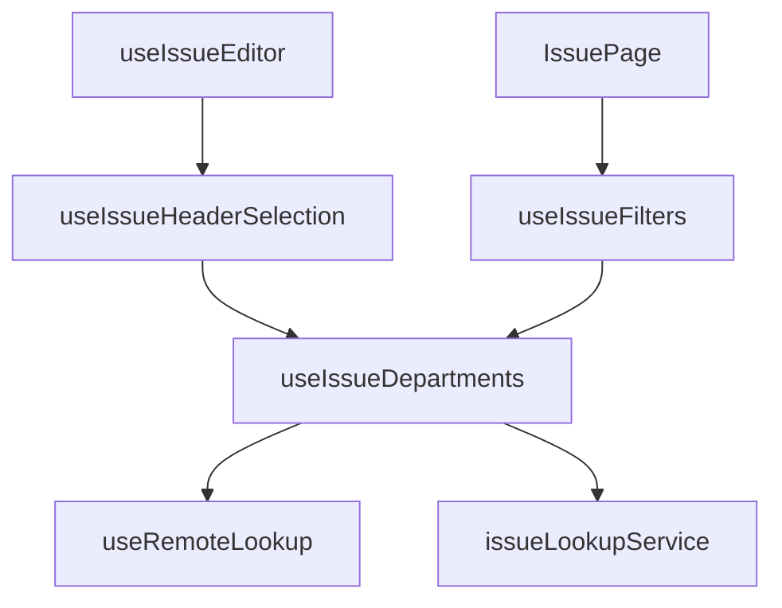

# Salidas, surtido y devolución: componentes

**Identificador:** `DIA-VUE-COMP-007`. **Pregunta:** ¿qué dependencias separan apertura, captura y devolución?
**Fuentes:** [IssueWorkspace.vue](../../../../../src/app/pages/IssueWorkspace.vue), [IssuePage.vue](../../../../../src/modules/issues/pages/IssuePage.vue), [issueService.ts](../../../../../src/modules/issues/services/issueService.ts), [issueRequestMapper.ts](../../../../../src/modules/issues/mappers/issueRequestMapper.ts).
**Notación:** [mapa de dependencias](../../diagram-reading.md#componentes-y-dependencias).

**Identificador:** `DIA-VUE-COMP-012`. **Pregunta:** ¿qué comparten encabezado y filtros al resolver el área operativa?
**Fuentes:** [useIssueEditor.ts](../../../../../src/modules/issues/composables/useIssueEditor.ts), [useIssueHeaderSelection.ts](../../../../../src/modules/issues/composables/useIssueHeaderSelection.ts), [useRemoteLookup.ts](../../../../../src/shared/composables/useRemoteLookup.ts), [issueLookupService.ts](../../../../../src/modules/issues/services/issueLookupService.ts).
**Notación:** [mapa de dependencias](../../diagram-reading.md#componentes-y-dependencias).

Vue/Vuetify presentan valores y bloqueos. `useIssueDepartments` comparte precarga y
restricción; cada consumidor conserva su selección. `IssueEditor` y `IssueFilters`
reciben props sin consultar sesión ni conceder permisos. El
[proceso de área](../../processes/07-issues/04-department-scope.md) precisa alta, edición y filtros.
