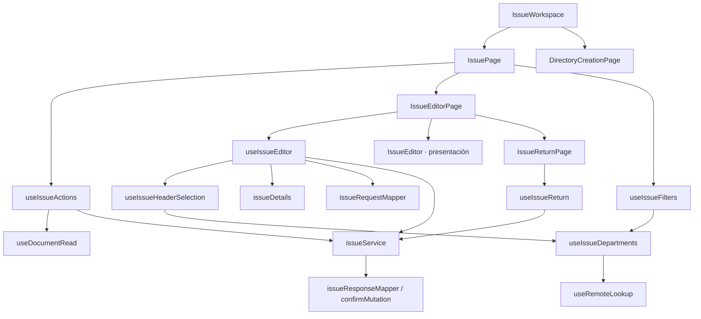

# Salidas, surtido y devolución: componentes

**Identificador:** `DIA-VUE-COMP-007`. **Pregunta:** ¿Qué colaboradores tienen responsabilidad propia y qué contratos los conectan?

**Fuente:** IssueWorkspace, IssuePage, useIssueActions, useIssueEditor, useIssueHeaderSelection, useIssueFilters, useIssueDepartments, useIssueReturn y mappers. **Notación y alcance:** Las flechas indican dependencia o consumo; no orden temporal ni herencia.

**Lectura visual:** [formas, límites y flechas del mapa](../../diagram-reading.md#mapas-y-actividades).

El corte representa elementos del cliente, no clases ni procesos desplegados. La [vista de procesos](../../processes/index.md) detalla orden, validación, rechazo y recuperación. Los contratos de props/eventos se localizan en la [referencia generada](../../development/code-reference.md).

`useIssueDepartments` comparte la precarga y el bloqueo entre encabezado y filtros.
Cada consumidor conserva su selección: el alta puede asignar una vacía y la edición
mantiene el área original. `IssueEditor` y `IssueFilters` reciben valores y estado de
bloqueo mediante props; no consultan la sesión ni resuelven permisos en presentación.
