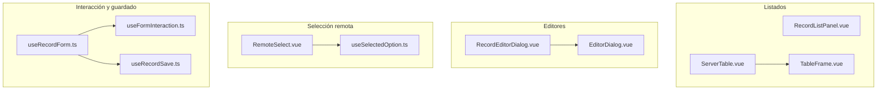

# Composición visual compartida

Los componentes propios encapsulan el marco de listas, tablas, formularios y selectores.
Vue controla su estado visual; Vuetify aporta los controles y SweetAlert2 los avisos.

`DocumentReadDialog` compone la carga y el error de una lectura con Vuetify.
Conserva el bloqueo del fondo hasta reintentar o cancelar; el estado y el aborto
pertenecen al lector de la página. SweetAlert2 mantiene confirmaciones y avisos de resultado.
Los fallos generales de envío usan `FormErrorDialog`; su interacción se define en
el [estándar de interfaz](../../../interface-standards.md#carga-y-recuperación).

`DetailEntryRow` presenta la captura de Compras y Salidas con las columnas que
entrega la tabla. Usa un único conjunto de controles: fila alineada en escritorio
y campos apilados en móvil; el estado permanece en los composables del módulo.

## Dependencias de presentación

**Identificador:** `DIA-VUE-COMP-009`. **Pregunta:** ¿qué piezas propias componen los
marcos compartidos? **Fuentes:** `RecordListPanel.vue`, `ServerTable.vue`,
`TableFrame.vue`, `RecordEditorDialog.vue`, `EditorDialog.vue` y `RemoteSelect.vue`.
El ciclo de formulario se compone en [useRecordForm.ts](../../../../../src/shared/composables/useRecordForm.ts).
**Notación:** [mapa de dependencias](../../diagram-reading.md#componentes-y-dependencias).

`RecordListPanel` recibe contenido por slots: no importa cada tabla de dominio.
Los controles externos no son componentes propios del modelo; las fuentes completas
y los imports se consultan en la [referencia de código](../../development/code-reference.md).

## Tema, estilos y controles

| Fuente propia | Aplicación |
| --- | --- |
| `app/plugins/vuetify.ts` | Fondos gris verdoso, texto oscuro, tabla verde con subencabezado ámbar, cabeceras de modal y menú oscuros, y selección celeste. |
| `shared/ui/controlDefaults.ts` | Densidad, variante, bordes y mensajes, aplicados por los proveedores de defaults de layout y modal. |
| `shared/ui/warehouse.css` | Foco, contornos, consulta y adaptación común de controles; conserva los mensajes de validación. |
| `shared/utils/formatNumbers.ts` | Presentación numérica compartida: dos decimales para m², precisión de otras cantidades e importes. |
| `style.css` | Variables tipográficas Montserrat Variable, incorporada en los assets con Fontsource. |
| `RecordListPanel` / `ListFilters` | Marco, título, acciones, errores, contador y panel plegable de filtros. |
| `ServerTable` / `TableFrame` | Datos remotos, encabezados agrupados, slots de celdas, bordes, filas alternas y desplazamiento horizontal. `PersonForm` reutiliza el marco para asignaciones locales. |
| `RecordEditorDialog` / `EditorDialog` | Cabecera, cuerpo desplazable y acciones visibles. El editor de registro contiene tablas anchas sin estirar campos. |
| `FormErrorDialog` | Aviso modal de error compartido por `EditorDialog` y Login; recibe el mensaje y el estado de envío, sin conocer servicios ni permisos. |
| `TableAction` / `StateBadge` | Nombre, icono, tooltip, bloqueo pendiente y presentación uniforme de estado. |
| `PurchaseTotals` | Resumen del documento y de la corrección, con etiquetas de Compras. |
| `shared/ui/feedback.ts` | Confirmación, espera y reintento explícito; texto mediante `titleText`/`text`. Su consumidor cancela la petición y cierra su aviso al desmontarse. |

El [estándar de interfaz](../../../interface-standards.md) fija reglas de uso, CSS,
teclado y comportamiento del menú. Los [modos funcionales](../../../../requirements/requirements-specification/06-operation-modes-and-effects.md)
y los [contratos de formularios](../../../contracts/form-and-event-contracts.md)
definen campos modificables, props, eventos y callbacks.

## Selección remota y foco

`RemoteSelect` presenta opciones, búsqueda y carga. En detalles, `selectedTitle`
muestra el nombre seleccionado mientras las opciones conservan su descripción completa.
Las selecciones largas ocupan varias líneas. `WrappingTextField` ajusta la altura
de los campos de texto largos y mantiene el valor en una sola línea en el formulario.
La búsqueda permanece en el campo y se consulta tras 500 ms sin escribir. Sus
[eventos](../../../contracts/form-and-event-contracts.md#eventos-de-interacción) permiten
consultar o solicitar un alta. La [creación
contextual](../../development/design-and-construction-patterns/09-contextual-creation.md)
explica el editor auxiliar; la [secuencia de
lookup](../../processes/02-shared-runtime/03-remote-lookup.md), las consultas.

`controlDefaults` aplica `autocomplete="suppress"` de Vuetify a `VAutocomplete` y
`VSelect`. Los selectores excluyen el historial nativo y conservan la selección por ID;
los campos de texto mantienen su autocompletado.

En la cancelación de un detalle de compra, el editor de consulta libera temporalmente
la retención de foco y bloquea sus acciones mientras SweetAlert2 controla la confirmación.
Los demás diálogos conservan la retención de foco habitual. Las reglas de teclado y
foco se consultan en el [estándar de interfaz](../../../interface-standards.md#teclado-y-distribución).

Las columnas de detalle siguen identificación → captura → resultados → acciones.
Compras muestra el costo por presentación y agrupa la cantidad convertida con su unidad.
Salidas ubica **Costo máximo unitario** después de **Conversión**, como en Existencias,
y selecciona seguimiento y saldos según consulta, surtido o devolución.
`RecordTotals` presenta los totales de ambos módulos con el mismo formato.
`DetailEntryRow` recibe las columnas aplanadas de la misma tabla, y las fichas
reciben sus encabezados: reordenar conserva la correspondencia de campo y dato.

En Almacén, `inventoryDisplay.ts` mantiene los nombres compartidos por tabla y
formulario. `inventorySections` construye una sección por clave tipada y las devuelve en el
orden declarativo de la operación; las referencias se presentan con `dl`, sin
inputs adicionales ni campos nuevos en el payload.
