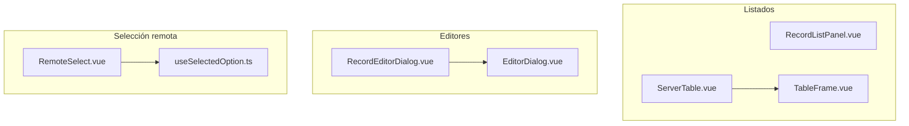

# Composición visual compartida

Los componentes propios encapsulan el marco de listas, tablas, formularios y selectores.
Vue controla su estado visual; Vuetify aporta los controles y SweetAlert2 los avisos.
La decisión de herramientas pertenece a [ADR-VUE-006](../../../decisions.md).

## Dependencias de presentación

**Identificador:** `DIA-VUE-COMP-009`. **Pregunta:** ¿qué piezas propias componen los
marcos compartidos? **Fuentes:** `RecordListPanel.vue`, `ServerTable.vue`,
`TableFrame.vue`, `RecordEditorDialog.vue`, `EditorDialog.vue` y `RemoteSelect.vue`.
**Notación:** [mapa de dependencias](../../diagram-reading.md#componentes-y-dependencias).

`RecordListPanel` recibe contenido por slots: no importa cada tabla de dominio.
Los controles externos no son componentes propios del modelo; las fuentes completas
y los imports se consultan en la [referencia de código](../../development/code-reference.md).

## Tema, estilos y controles

| Fuente propia | Aplicación |
| --- | --- |
| `app/plugins/vuetify.ts` | Tema y paleta: tabla verde, subencabezado ámbar, modal/menú oscuros, franja ámbar y selección celeste. |
| `shared/ui/controlDefaults.ts` | Densidad, variante, bordes y mensajes, aplicados por los proveedores de defaults de layout y modal. |
| `shared/ui/warehouse.css` | Foco, contornos, consulta y adaptación común de controles; conserva los mensajes de validación. |
| `style.css` | Variables tipográficas Montserrat Variable, incorporada en los assets con Fontsource. |
| `RecordListPanel` / `ListFilters` | Marco, título, acciones, errores, contador y panel plegable de filtros. |
| `ServerTable` / `TableFrame` | Datos remotos, encabezados agrupados, slots de celdas, bordes, filas alternas y desplazamiento horizontal. `PersonForm` reutiliza el marco para asignaciones locales. |
| `RecordEditorDialog` / `EditorDialog` | Cabecera, cuerpo desplazable y acciones visibles. El editor de registro contiene tablas anchas sin estirar campos. |
| `TableAction` / `StateBadge` | Nombre, icono, tooltip, bloqueo pendiente y presentación uniforme de estado. |
| `PurchaseTotals` | Resumen del documento y de la corrección, con etiquetas de Compras. |
| `shared/ui/feedback.ts` | Confirmación, espera y reintento explícito; texto mediante `titleText`/`text`. Su consumidor cancela la petición y cierra su aviso al desmontarse. |

El [estándar de interfaz](../../../interface-standards.md) fija reglas de uso, CSS,
teclado y comportamiento del menú. Los [modos funcionales](../../../../requirements/requirements-specification/06-operation-modes-and-effects.md)
y los [contratos de formularios](../../../contracts/form-and-event-contracts.md)
definen campos modificables, props, eventos y callbacks.

## Selección remota y foco

`RemoteSelect` presenta las opciones, la búsqueda y las acciones de carga. Su
contrato de [eventos](../../../contracts/form-and-event-contracts.md#eventos-de-interacción)
permite al contenedor conectar la consulta o solicitar un alta auxiliar. El
[patrón de alta contextual](../../development/design-and-construction-patterns/09-contextual-creation.md)
describe la composición de ese editor; la [secuencia de lookup](../../processes/02-shared-runtime/03-remote-lookup.md),
la carga de opciones.

En la cancelación de un detalle de compra, el editor de consulta libera temporalmente
la retención de foco y bloquea sus acciones mientras SweetAlert2 controla la confirmación.
Los demás diálogos conservan la retención de foco habitual. Las reglas de teclado y
foco se consultan en el [estándar de interfaz](../../../interface-standards.md#teclado-y-distribución).
