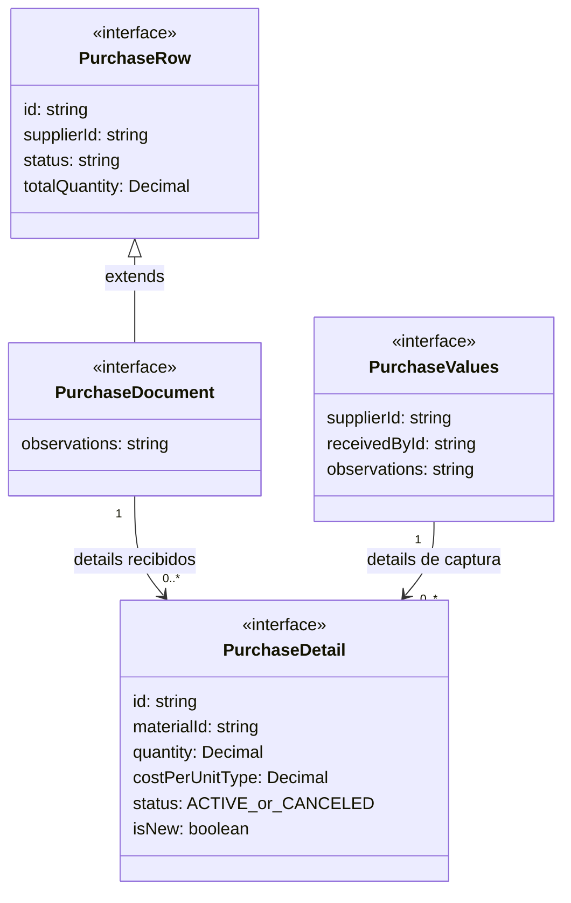
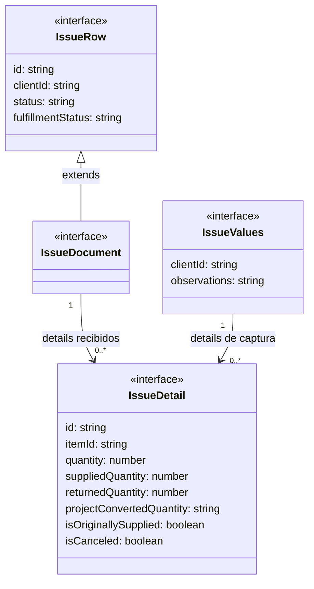

# Contratos y relaciones de datos

Los diagramas representan interfaces TypeScript, con atributos seleccionados y
multiplicidades de sus colecciones. No describen tablas SQL ni clases instanciables.
Las asociaciones expresan referencias/colecciones; no se atribuye destrucción en cascada.
La serialización y validación de JSON corresponden a mappers/servicios.

**Identificador:** `DIA-VUE-DAT-001`. **Pregunta:** ¿Cómo se separan fila, documento, detalle y captura de compra?

**Fuente:** purchase.ts y purchaseRequestMapper.ts. **Notación y alcance:** UML de interfaces y asociaciones con multiplicidades; extends representa la extensión TypeScript real.

**Identificador:** `DIA-VUE-DAT-002`. **Pregunta:** ¿Qué datos de surtido y devolución pertenecen a un detalle de salida?

**Fuente:** issue.ts, issueRequestMapper.ts e issueRules.ts. **Notación y alcance:** UML de interfaces y asociaciones; no representa el estado autorizado de la API.

`PurchaseTarget` discrimina create/edit/view; `IssueTarget` discrimina create/edit/header/supply/view/return. Esas uniones se explican mediante decisiones y secuencias, no como herencia de clases inexistente.
