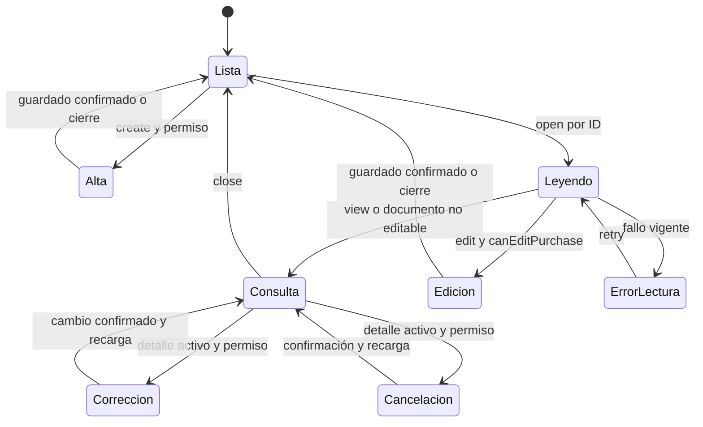
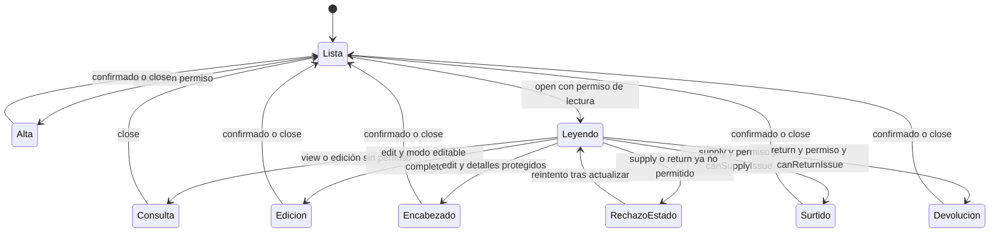
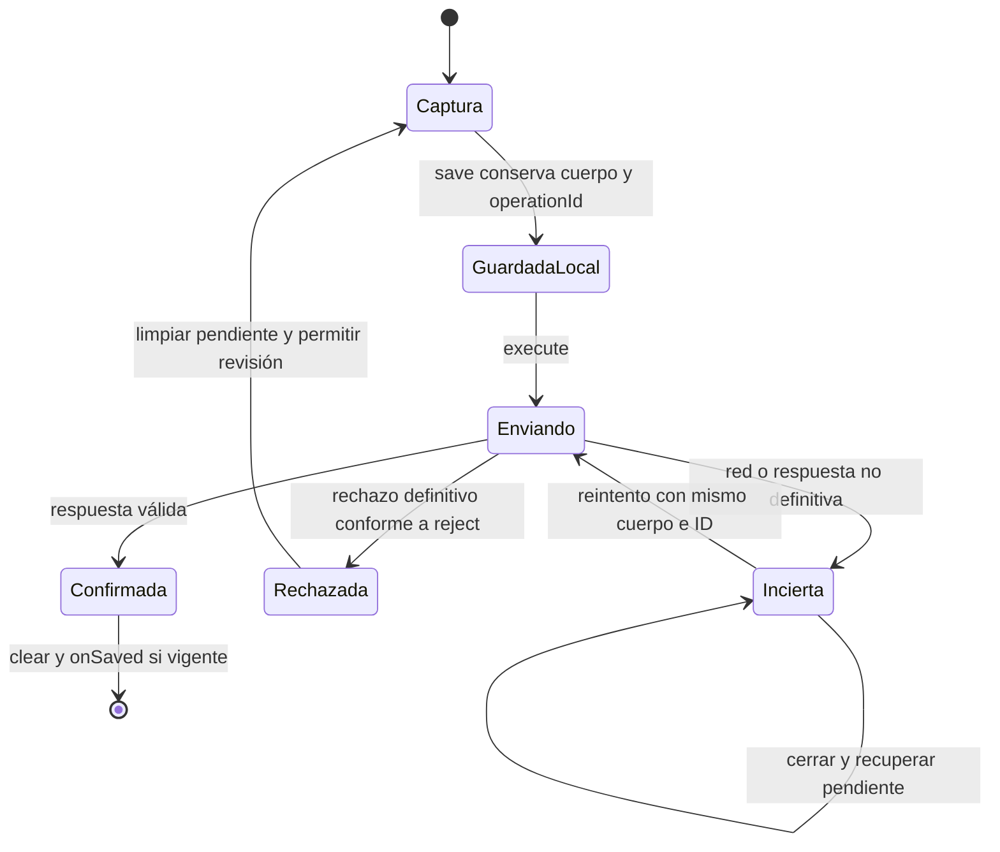

# Estados de documento y captura

## Lectura del modelo

Las transiciones siguientes representan modos/resoluciones del cliente. Los estados
persistidos llegan de la API y ésta vuelve a comprobar cada operación. Abrir un modo
no cambia inventario ni constituye una aprobación de negocio.

**Identificador:** `DIA-VUE-EST-001`. **Pregunta:** ¿Cómo se decide consulta o edición de una compra?

**Fuente:** usePurchaseActions, canEditPurchase y useDocumentRead. **Notación y alcance:** Diagrama de estados de interacción; los nombres no son valores de status del servidor.

**Identificador:** `DIA-VUE-EST-002`. **Pregunta:** ¿Qué modo abre una salida y qué acciones quedan protegidas?

**Fuente:** useIssueActions, resolveIssueEditMode, canSupplyIssue y canReturnIssue. **Notación y alcance:** Estados de interacción del cliente; las guardas representan decisiones del código, no permisos inferidos por la figura.

**Identificador:** `DIA-VUE-EST-003`. **Pregunta:** ¿Cuándo se conserva la captura de merma y cuándo se libera?

**Fuente:** useInventoryEditor y createPendingWasteOperation. **Notación y alcance:** Estados de la captura recuperable, sin afirmar que una cancelación del navegador revierta SQL.

La [secuencia de merma](../processes/09-waste-pending.md) explica almacenamiento bloqueado, rechazo definitivo y respuesta tardía.
