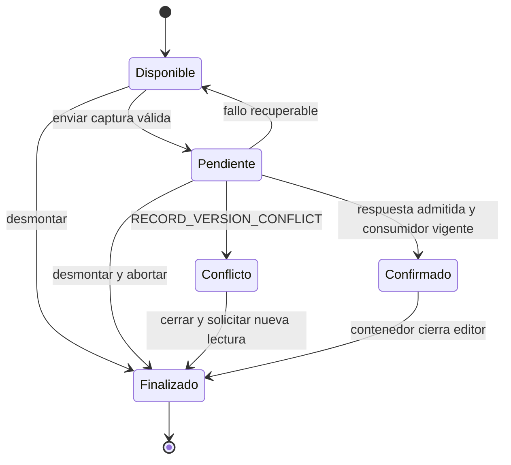

# Estado, propiedad y ciclo de vida

## Inventario de propietarios

| Estado | Propietario | Alcance y salida |
| --- | --- | --- |
| Identidad y permisos | `createAuthSession` proporcionado desde `main.ts`. | Una instancia por aplicación; carga compartida pendiente, usuario readonly. |
| Consulta aplicada/filas | `usePagedList` por listado. | Cada pantalla conserva query, conteo y carga/error; desmontar aborta/invalida. |
| Búsqueda borrador | `useListSearch` y filtros de dominio. | Se aplica explícitamente, sin mutar resultados por cada tecla. |
| Captura y errores | Composable de editor y VeeValidate. | Cada apertura tiene su instancia; precarga no cuenta como interacción. |
| Opción seleccionada | `useSelectedOption`. | Persiste fuera de la página remota mientras su ID esté vigente. |
| Pendiente de escritura | `useRecordSave`. | Bloquea duplicados, conserva error/conflicto e invalida al desmontar. |
| Captura incierta de merma | `pendingWasteOperation`. | Conserva clave/cuerpo para recuperación según contrato; no guarda credenciales. |
| Diálogo auxiliar | Workspace de aplicación. | Se abre por intención y devuelve alta confirmada; no guarda el principal. |
| Aviso/popup | Helper de feedback. | Cancela/limpia el popup al terminar su consumidor. |

## Decisión de estado compartido

El estado de sesión se comparte mediante provide/inject con una InjectionKey tipada.
Formularios, listas y selección tienen propietarios por instancia. No hay un store
Pinia en el código actual. Introducir uno requiere un estado transversal con varios
consumidores, transiciones y vida útil que no resuelva la composición vigente; no se
crea un store por modal o para reemplazar props/eventos.

## Ciclo de guardado

**ID:** `DIA-VUE-ARQ-003`. **Pregunta:** ¿qué impide confirmar una captura antigua o
cerrada? **Fuente:** `useRecordSave.ts` y editores consumidores. Diagrama de estados
selectivo del coordinador, no del estado persistido del documento.

El conflicto conserva la captura y bloquea otra escritura desde esa instancia. La
confirmación sólo se propaga si no se abortó. Abortar una solicitud no revierte una
transacción que ya completó la API; la recuperación debe consultar o reutilizar la
identidad idempotente cuando exista.

## Consulta y actualización

Una carga explícita muestra indicador; la recarga de fondo conserva filas y usa su
estado separado. `useVisibleRefresh` comprueba visibilidad, posibilidad de recargar y
antigüedad de 30 segundos por defecto. El listado decide si hay editor abierto o
consulta pendiente. Cada lectura recibe una secuencia y AbortSignal: sólo la vigente
puede publicar datos. Una respuesta vacía puede ajustar la página al último rango válido.

## Evidencia

`listInteractionTest.ts`, `selectedOptionTest.ts`, las pruebas de formularios y los
recorridos de catálogo/almacén/documentos cubren estados observables. La [matriz](../../../testing/04-use-case-coverage.md)
identifica representantes y límites de persistencia.
