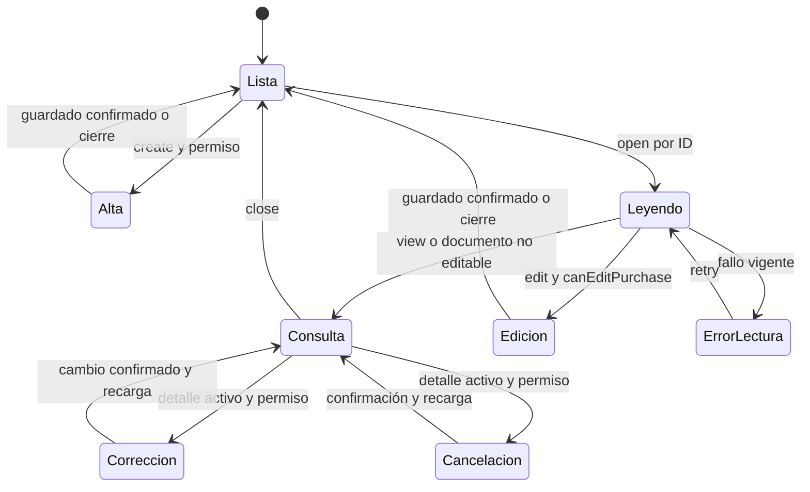

# Compras: modos y acciones

**Identificador:** `DIA-VUE-EST-001`. **Pregunta:** ¿Cómo se decide consulta o edición y cuándo se permite actuar sobre un detalle?

**Fuentes:** [usePurchaseActions.ts](../../../../../src/modules/purchases/composables/usePurchaseActions.ts), [purchaseRules.ts](../../../../../src/modules/purchases/purchaseRules.ts) y [useDocumentRead.ts](../../../../../src/shared/composables/useDocumentRead.ts).
**Notación:** estados de interacción del cliente, no valores de estado del servidor.

**Lectura visual:** [estados, transiciones e inicio/fin](../../diagram-reading.md#estados).

## Guardas y recuperación

`open` vuelve a leer el documento: `canEditPurchase` decide si la petición de edición
abre edición o consulta. `editableDetailDocument` exige modo consulta, documento
editable, detalle persistido y activo, permiso, consumidor vigente, sin cambio en curso,
sin lectura y sin una recarga pendiente. No basta con que el botón exista en la tabla.

La corrección es un subformulario; la cancelación, una confirmación con reintento
explícito. Tras confirmar el cambio, `handleDetailSaved` marca `needsReload` y vuelve
a leer. Si esa lectura falla, no se habilita otra acción usando el saldo antiguo.
`retry` repite la última apertura; `close` no cierra durante `isChanging`.

La figura resume modos y recorridos satisfactorios, no todas las combinaciones de flags.
El cierre de un subformulario sin guardar conserva la consulta; un fallo de escritura
conserva el contexto y no se presenta como confirmación. La
[secuencia de cancelación](../../processes/06-purchases/04-purchase-cancel.md)
detalla aviso, fallo y reintento; el [modelo de tipos](../class-and-type-models/07-purchases.md)
separa fila, documento, captura y detalle.
