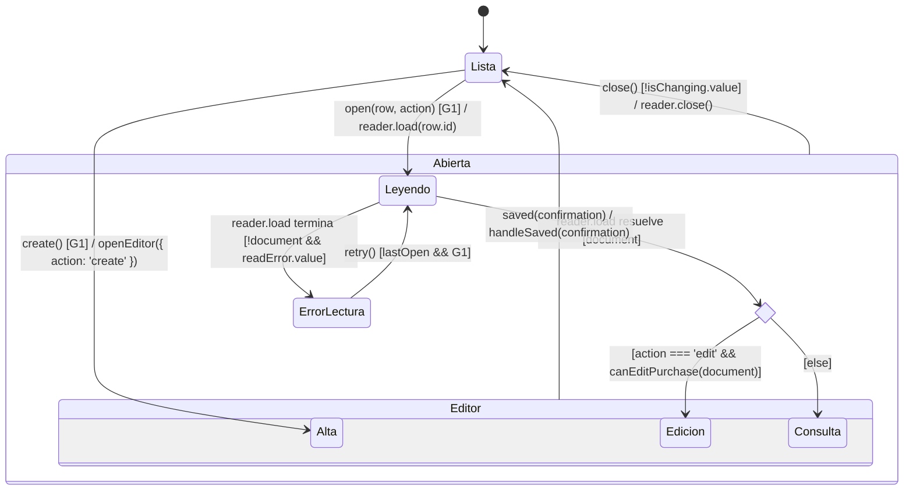
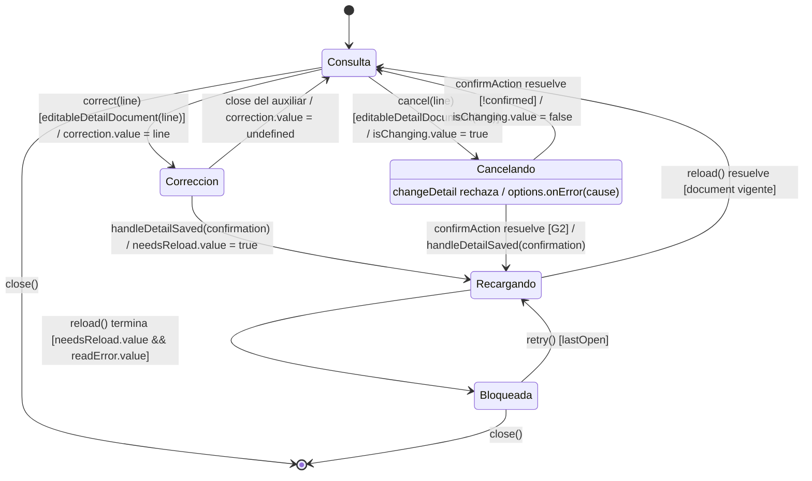

# Compras: apertura y acciones sobre detalles

## Apertura del documento

**Identificador:** `DIA-VUE-EST-001`. **Pregunta:** ¿qué lectura resuelve consulta o
edición? **Fuentes:** [usePurchaseActions.ts](../../../../../src/modules/purchases/composables/usePurchaseActions.ts),
[purchaseRules.ts](../../../../../src/modules/purchases/purchaseRules.ts) y
[useDocumentRead.ts](../../../../../src/shared/composables/useDocumentRead.ts).
**Estado observado:** destino del editor y lectura vigente. **Notación:**
[evento, guarda y efecto](../../diagram-reading.md#estados).

| Condición o resultado | Correspondencia con el código |
| --- | --- |
| `G1` | `options.canManage() && !controller.signal.aborted && !isChanging.value`. La falta de permiso o el desmontaje no inicia la lectura. |
| `canEditPurchase(document)` | Estado recibido `Confirmada` o `Abierta`. Una solicitud de edición no editable termina en consulta. |
| Resolver → Consulta/Edición | `editorState.openEditor({ action, document })`; se incrementa `editorKey` y se libera `needsReload`. El rombo es una decisión inmediata, no un modo de formulario. |
| `handleSaved` | Cierra, actualiza el listado y muestra el mensaje confirmado. Un rechazo de escritura no dispara este callback; véase el [guardado compartido](04-state-ownership-and-save.md#ciclo-de-guardado). |
| `Abierta` / `Editor` | Estados compuestos para el cierre común y los modos visibles. `saved` procede del alta o edición; consulta no lo emite. |

La [lectura compartida](04-state-ownership-and-save.md#consulta-y-actualización)
define cancelación, respuestas tardías y `readError`.

## Corrección, cancelación y relectura

**Identificador:** `DIA-VUE-EST-004`. **Pregunta:** ¿por qué un cambio confirmado
puede dejar bloqueadas las acciones hasta recuperar la lectura?
**Fuentes:** `usePurchaseActions.ts` y `PurchasePage.vue`.
**Estado observado:** acción auxiliar y vigencia del documento de consulta.

| Guarda o efecto | Aplicación |
| --- | --- |
| `editableDetailDocument(line)` | Consulta de documento editable; detalle persistido y `ACTIVE`; permiso y consumidor vigente; sin lectura, cambio o `needsReload`. |
| `G2` | `confirmed && confirmation && !controller.signal.aborted`. Cancelar el aviso no ejecuta `handleDetailSaved`. |
| `handleDetailSaved` | Limpia `correction`, marca `needsReload`, actualiza el listado, muestra el éxito y ejecuta `reload()`. Sólo `open()` con documento admitido libera el bloqueo. |
| Error de cancelación | La confirmación conserva el aviso para reintentar o cancelar; no abandona `Cancelando` por un rechazo del submit. |
| `close()` | No cierra mientras `isChanging`; invalida la lectura al cerrar. El cierre del auxiliar de corrección sólo limpia `correction`. |

Las [secuencias de corrección y cancelación](../../processes/06-purchases/index.md)
detallan confirmación, errores y transporte. Los modos aquí descritos no cambian por
sí mismos el stock ni sustituyen el estado recibido de la API.
