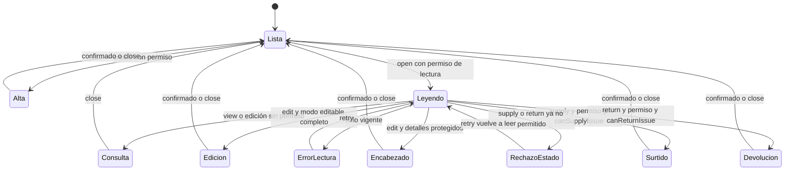

# Salidas: resolución del modo

**Identificador:** `DIA-VUE-EST-002`. **Pregunta:** ¿Qué decisiones separan editar, consultar, surtir y devolver?

**Fuentes:** [useIssueActions.ts](../../../../../src/modules/issues/composables/useIssueActions.ts), [issueRules.ts](../../../../../src/modules/issues/issueRules.ts) y [useIssueEditor.ts](../../../../../src/modules/issues/composables/useIssueEditor.ts).
**Notación:** estados de interacción del cliente, no valores de estado del servidor.

**Lectura visual:** [estados, transiciones e inicio/fin](../../diagram-reading.md#estados).

## Guardas y recuperación

La lectura precede a la decisión. Si se pide editar sin capacidad de gestión se abre
consulta. Con gestión, `resolveIssueEditMode` decide edición completa o encabezado.
Pedir surtido/devolución exige `canSupply` y la regla del documento vigente; si falla,
se muestra el rechazo sin abrir el editor solicitado. `retry` vuelve a leer la última
fila/modo, también después de un rechazo de estado.

Consulta y devolución no guardan desde el editor general. Surtido limita cambios a sus
campos; devolución utiliza su formulario y servicio específico. Un error de escritura
no cierra automáticamente la captura ni descuenta stock en memoria como si hubiera
confirmación. La figura representa modos de UI; `status` y `fulfillmentStatus` son
datos recibidos de la API y sus transiciones definitivas pertenecen al servidor.

Las [secuencias de salidas](../../processes/07-issues/index.md) desarrollan los mensajes;
el [modelo de tipos](../class-and-type-models/08-issues.md) precisa qué payload admite cada modo.
