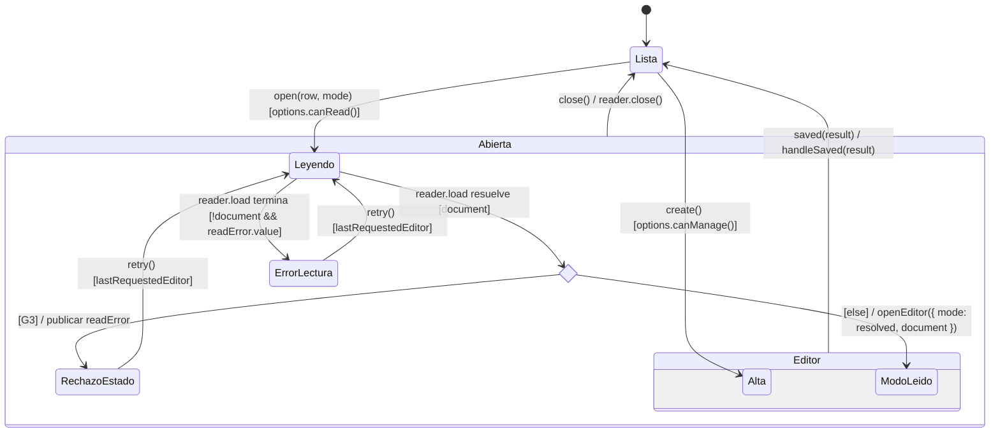
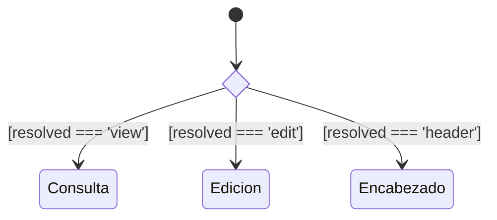
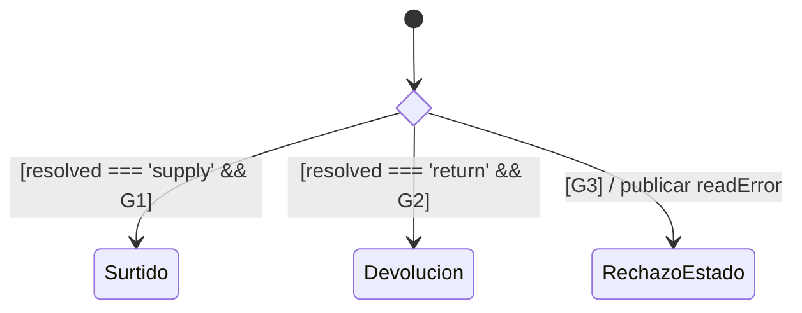

# Salidas: resolución del modo

**Identificador:** `DIA-VUE-EST-002`. **Pregunta:** ¿qué decisiones separan editar,
consultar, surtir y devolver? **Fuentes:** [useIssueActions.ts](../../../../../src/modules/issues/composables/useIssueActions.ts),
[issueRules.ts](../../../../../src/modules/issues/issueRules.ts) y
[useIssueEditor.ts](../../../../../src/modules/issues/composables/useIssueEditor.ts).
**Estado observado:** lectura y `IssueTarget.mode`. **Notación:**
[evento, guarda y efecto](../../diagram-reading.md#estados).

| Dato/guarda | Definición en la implementación |
| --- | --- |
| `resolved` | Para `mode === 'edit'`: `options.canManage() ? resolveIssueEditMode(document) : 'view'`. En otros casos conserva el modo solicitado. |
| `resolveIssueEditMode` | No editable → `view`; editable y cumplimiento pendiente → `edit`; editable con detalles protegidos → `header`. |
| `G1` | `options.canSupply() && canSupplyIssue(document)`. Aprobada, no cancelada y con cumplimiento pendiente o parcial. |
| `G2` | `options.canSupply() && canReturnIssue(document)`. Aprobada, no cancelada y con cumplimiento completo. |
| Lectura vigente | El lector admite sólo la secuencia actual y no abortada; captura el rechazo HTTP y devuelve `undefined` con `readError`. `retry()` repite fila/modo, incluso tras el rechazo de estado. |
| `G3` | `(resolved === 'supply' && !G1) || (resolved === 'return' && !G2)`. El rechazo publica `readError` y no abre el modo pedido. |
| `Abierta` / `Editor` | Estados compuestos para cierre común y editor. `ModoLeido` agrupa los cinco modos que desarrollan las figuras siguientes. El alta usa `{ mode: 'create' }`; consulta no emite `saved`. |

`handleSaved` cierra, recarga y muestra la confirmación. Devolución usa su formulario
específico; consulta no envía desde el editor. Un error de escritura conserva captura
y no simula el descuento de stock. Las [secuencias](../../processes/07-issues/index.md)
y los [contratos por modo](../class-and-type-models/08-issues.md) desarrollan esas operaciones.

## Consulta y edición del documento leído

**Identificador:** `DIA-VUE-EST-005`. **Pregunta:** ¿qué valor de `resolved` abre
consulta, edición completa o sólo encabezado? **Fuente:** `useIssueActions.ts` y
`issueRules.ts`. **Alcance:** apertura solicitada como `view` o `edit`, después de
la lectura vigente; el cierre y guardado están en `DIA-VUE-EST-002`.

Las condiciones de `resolved` y `resolveIssueEditMode` se definen en la tabla anterior.
Estos destinos son los submodos de `ModoLeido`, no estados persistidos de la salida.

## Surtido y devolución del documento leído

**Identificador:** `DIA-VUE-EST-006`. **Pregunta:** ¿qué permiso y estado admiten el
modo operativo? **Fuente:** `useIssueActions.ts` y `issueRules.ts`.
**Alcance:** solicitud de `supply` o `return` después de leer el documento.

`G1`, `G2` y `G3` conservan la definición de la tabla. El rechazo vuelve al ciclo
de lectura/reintento de `DIA-VUE-EST-002`; no crea un editor de surtido o devolución.
