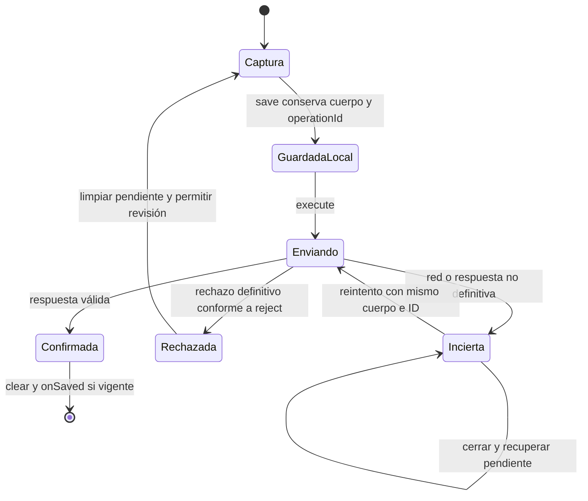

# Merma: captura pendiente y confirmación

**Identificador:** `DIA-VUE-EST-003`. **Pregunta:** ¿Cuándo se conserva la captura recuperable y cuándo se libera?

**Fuentes:** [useInventoryEditor.ts](../../../../../src/modules/warehouse/composables/useInventoryEditor.ts).
**Notación:** estados de interacción del cliente, no valores de estado del servidor.

**Lectura visual:** [estados, transiciones e inicio/fin](../../diagram-reading.md#estados).

## Guardas y recuperación

El cuerpo y `operationId` permanecen asociados durante un reintento de respuesta
incierta. Cerrar el modal o perder la conexión no acredita que el servidor haya
revertido ni que la operación no exista. La recuperación no genera un ID nuevo para
la misma escritura pendiente. Un rechazo definitivo libera la captura conforme a la
política implementada; una confirmación válida la limpia y notifica al consumidor vigente.

La figura describe la captura local recuperable, no los estados persistentes de la
merma ni un log transaccional del navegador. La
[secuencia de pendiente](../../processes/05-warehouse/02-waste-pending.md)
explica errores de almacenamiento, rechazo y reintento. La
[recuperación de duplicado](../../processes/05-warehouse/03-waste-duplicate.md)
es otra colaboración: permite abrir una entrada sobre la merma identificada.
