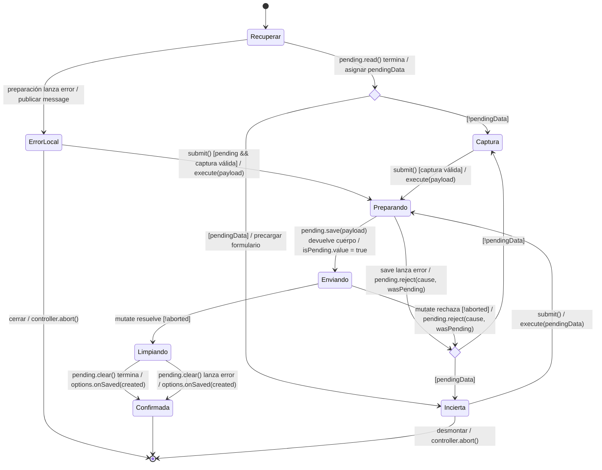

# Merma: captura pendiente y confirmación

**Identificador:** `DIA-VUE-EST-003`. **Pregunta:** ¿cuándo se conserva el cuerpo con
su `operationId` y cuándo se intenta liberarlo? **Fuentes:**
[useInventoryEditor.ts](../../../../../src/modules/warehouse/composables/useInventoryEditor.ts)
y [pendingWasteOperation.ts](../../../../../src/modules/warehouse/services/pendingWasteOperation.ts).
**Estado observado:** alta/entrada idempotente de merma, `pendingData` y petición.
**Notación:** [evento, guarda y efecto](../../diagram-reading.md#estados).

| Condición o excepción | Correspondencia con el código |
| --- | --- |
| Alcance idempotente | Sólo `resource === 'wastes'` con `create` o `add-stock`. La clave local incluye usuario, acción y entidad. |
| Preparación | `save` reutiliza el cuerpo local y su ID, o añade `crypto.randomUUID()` antes de enviarlo. Si no hay almacenamiento utilizable no se envía la mutación. |
| Liberación por rechazo | `reject` limpia ante `meta.operationRejected === true`, o primer intento con error HTTP 4xx distinto de `OPERATION_KEY_CONFLICT`. En otros casos conserva el pendiente. |
| Incertidumbre | Fallo de red, respuesta no definitiva o captura recuperada. Reintentar no cambia el cuerpo ni genera otro ID. |
| Error al leer/limpiar Storage | Publica el error de preparación o conserva la captura cuando no puede limpiar. Si la fábrica no pudo preparar `pending`, se necesita reabrir con Storage disponible. No se atribuye limpieza exitosa ni rollback de API a esa excepción. |
| `RevisarPendiente` | Evalúa `pendingData` después del intento de `reject` y `read`; si Storage vuelve a fallar, el catch conserva el cuerpo que ya tenía en memoria. |
| Confirmación con `clear` fallido | Se notifica la confirmación vigente; si se recupera el cuerpo local, repetir su ID permite recuperar el resultado ya confirmado. |
| Desmontaje | Puede ocurrir en cualquier etapa: aborta y bloquea callbacks tardíos. El final mostrado cierra esa instancia, no elimina el pendiente ni revierte la API. Al reabrir se vuelve a `read()`. |

La [secuencia del pendiente](../../processes/05-warehouse/02-waste-pending.md)
detalla almacenamiento, envío y errores. La
[recuperación de duplicado](../../processes/05-warehouse/03-waste-duplicate.md)
es otra colaboración: puede abrir una entrada sobre la merma identificada.
