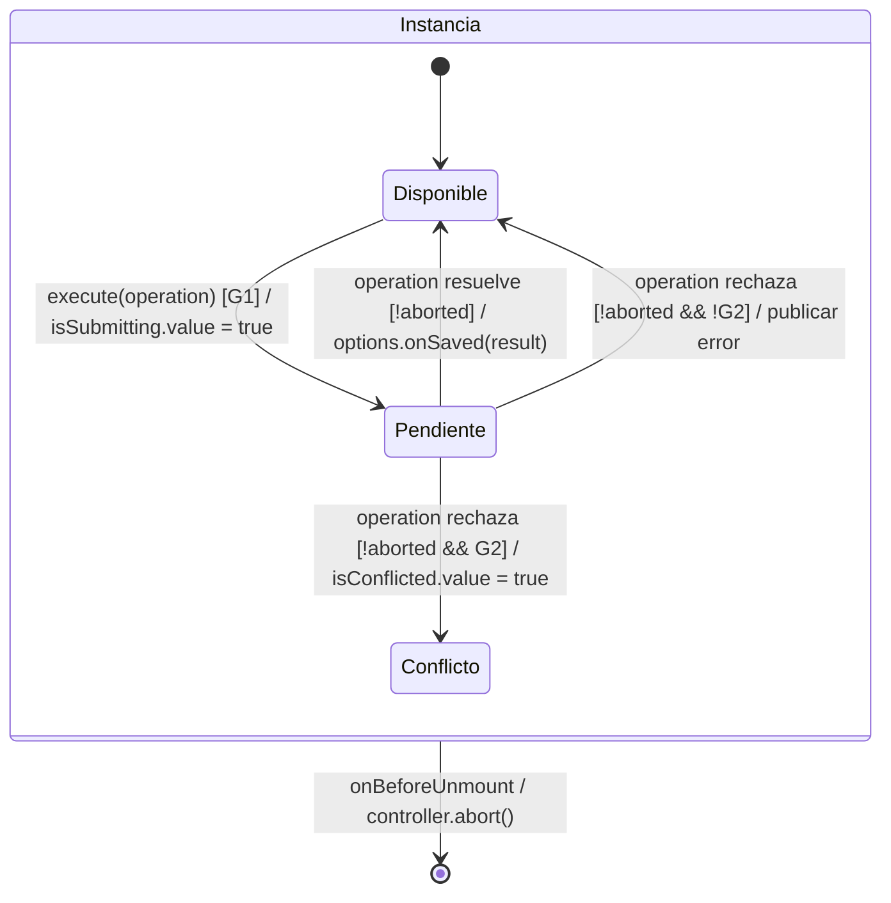

# Estado, propiedad y ciclo de vida

## Inventario de propietarios

| Estado | Propietario | Alcance y salida |
| --- | --- | --- |
| Identidad y permisos | `createAuthSession`, `shallowRef` readonly proporcionada desde `main.ts`. | Una instancia por aplicación; carga compartida pendiente, usuario readonly. |
| Preferencia de login | `useLoginForm`. | `nexus.rememberedUser` conserva el nombre tras el éxito; precarga sólo si es válido. Storage es opcional y su fallo no impide ingresar. |
| Consulta aplicada/filas | `usePagedList`, `shallowRef<Row[]>` por listado. | Conserva query, conteos y carga/error; mantiene las filas si el JSON no cambió; desmontar aborta/invalida. |
| Documento leído | `useDocumentRead`, `shallowRef`. | Sólo la respuesta vigente sustituye el documento. |
| Opciones remotas | `useRemoteLookup`, `computed<LookupState>`. | Deriva opciones, carga y error; el ID seleccionado pertenece a la captura o filtro. |
| Búsqueda borrador | `useListSearch` y filtros de dominio. | Se aplica explícitamente, sin mutar resultados por cada tecla. |
| Captura y errores | Composable de editor y `form.values` reactivo de VeeValidate. | Cada apertura tiene su instancia; precarga no cuenta como interacción. |
| Opción seleccionada | `useSelectedOption`. | Persiste fuera de la página remota mientras su ID esté vigente. |
| Pendiente de escritura | `useRecordSave`. | Bloquea duplicados, conserva error/conflicto e invalida al desmontar. |
| Captura incierta de merma | `pendingWasteOperation`. | Conserva clave/cuerpo para recuperación según contrato; no guarda credenciales. |
| Diálogo auxiliar | Workspace de aplicación. | Se abre por intención y devuelve alta confirmada; no guarda el principal. |
| Aviso/popup | Helper de feedback. | Cancela/limpia el popup al terminar su consumidor. |

## Ciclo de guardado

**ID:** `DIA-VUE-ARQ-003`. **Pregunta:** ¿qué impide confirmar una captura antigua o
cerrada? **Fuente:** `useRecordSave.ts` y editores consumidores. Diagrama de estados
selectivo del coordinador, no del estado persistido del documento.

**Estado observado:** `isSubmitting`, `isConflicted` y vigencia del consumidor.
**Lectura visual:** [evento, guarda y efecto](../../diagram-reading.md#estados).

| Guarda o efecto | Correspondencia |
| --- | --- |
| `G1` | `!isSubmitting.value && !isConflicted.value && !controller.signal.aborted`. Si falla, `execute` retorna sin iniciar otra escritura. |
| `G2` | `cause instanceof ApiError && cause.code === 'RECORD_VERSION_CONFLICT'`. Esa instancia queda bloqueada; cerrarla y abrir otra permite una lectura nueva. |
| `aborted` | Abreviatura de `controller.signal.aborted`, no otro flag. El desmontaje termina la instancia desde cualquiera de sus estados. |
| Publicar error | Asigna `message`; para `ApiError` llama a `setErrors`, y para estado HTTP 401/403, a `onDenied`. La captura pertenece al editor consumidor. |
| Fin de operación | `finally` libera `isSubmitting` tanto en éxito como en rechazo. La confirmación invoca `onSaved` sólo si sigue vigente; ese callback puede cerrar el editor, no lo impone el helper. |

El retorno a Disponible no es una confirmación persistida ni termina la aplicación.
Abortar no revierte una transacción que ya completó la API; la recuperación consulta
el resultado o reutiliza la identidad idempotente cuando el contrato lo permite.

## Consulta y actualización

| Condición | Resultado |
| --- | --- |
| Lectura sustituida o abortada | La secuencia y `AbortSignal` impiden publicar el resultado anterior. |
| `useDocumentRead.load` rechazado | Devuelve `undefined` y publica `readError`; no propaga el rechazo HTTP. |
| Carga explícita / recarga de fondo | La primera muestra indicador; la segunda conserva filas y usa su estado separado. |
| Recarga automática | `useVisibleRefresh` comprueba visibilidad, disponibilidad y antigüedad de 30 segundos por defecto. El listado decide si un editor o una consulta la impiden. |
| Página vacía fuera de rango | El listado puede ajustar la página al último rango válido. |
