# Contratos TypeScript: app

Generado con `npm run docs:generate`. No editar manualmente.

[Alcance y notación](index.md#alcance-y-notación).

## AppNavigation.defineProps

**Fuente:** [src/app/components/AppNavigation.vue](../../../../../src/app/components/AppNavigation.vue) · línea 12, columna 27. **Declaración:** SFC contract.

| Miembro | Firma completa |
| --- | --- |
| `userName` | `userName: string;` |
| `groups` | `groups: readonly NavigationGroup[];` |
| `activeGroup` | `activeGroup: string;` |
| `isCompact` | `isCompact: boolean;` |
| `isTemporary` | `isTemporary: boolean;` |

| Relación | Destino | Origen de la referencia |
| --- | --- | --- |
| association | [NavigationGroup](../../../../../src/app/navigation.ts) | `groups` |

**Figura:** `DIA-VUE-TS-APP-1-1`.

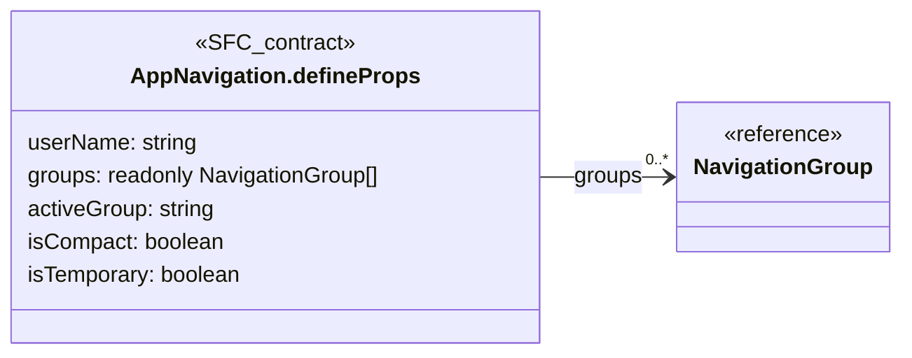

## AppNavigation.defineEmits

**Fuente:** [src/app/components/AppNavigation.vue](../../../../../src/app/components/AppNavigation.vue) · línea 19, columna 26. **Declaración:** SFC contract.

| Miembro | Firma completa |
| --- | --- |
| `navigate` | `navigate: [];` |
| `expand` | `expand: []` |

**Figura:** `DIA-VUE-TS-APP-2-1`.

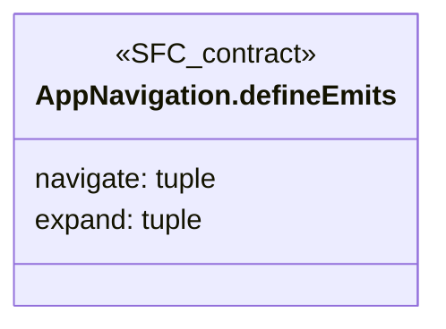

## NavigationLink

**Fuente:** [src/app/navigation.ts](../../../../../src/app/navigation.ts) · línea 32, columna 1. **Declaración:** interface.

| Miembro | Firma completa |
| --- | --- |
| `title` | `title: string;` |
| `to` | `to: string;` |
| `icon` | `icon: string;` |

**Figura:** `DIA-VUE-TS-APP-3-1`.

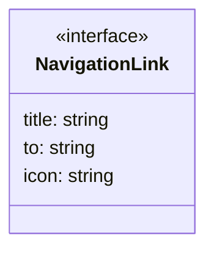

## NavigationGroup

**Fuente:** [src/app/navigation.ts](../../../../../src/app/navigation.ts) · línea 38, columna 1. **Declaración:** interface.

| Miembro | Firma completa |
| --- | --- |
| `id` | `id: string;` |
| `title` | `title: string;` |
| `icon` | `icon: string;` |
| `links` | `links: readonly (NavigationLink & { permission: string })[];` |

| Relación | Destino | Origen de la referencia |
| --- | --- | --- |
| dependency | [NavigationLink](../../../../../src/app/navigation.ts) | `links` |
| dependency | [NavigationGroup.links@42:39](../../../../../src/app/navigation.ts) | `links` |

**Figura:** `DIA-VUE-TS-APP-4-1`.

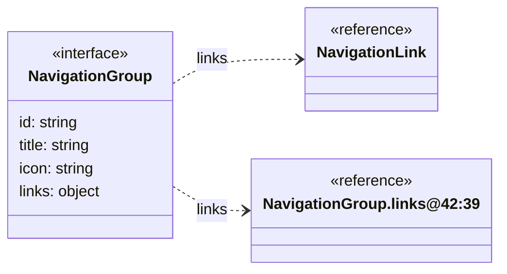

## NavigationGroup.links@42:39

**Fuente:** [src/app/navigation.ts](../../../../../src/app/navigation.ts) · línea 42, columna 39. **Declaración:** inline object.

| Miembro | Firma completa |
| --- | --- |
| `permission` | `permission: string` |

**Figura:** `DIA-VUE-TS-APP-5-1`.

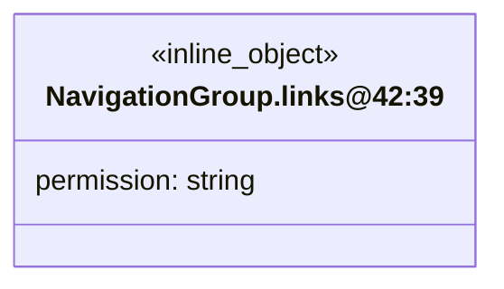

## AccessErrorPage.defineProps

**Fuente:** [src/app/pages/AccessErrorPage.vue](../../../../../src/app/pages/AccessErrorPage.vue) · línea 6, columna 13. **Declaración:** SFC contract.

| Miembro | Firma completa |
| --- | --- |
| `isUnavailable` | `isUnavailable?: boolean` |

**Figura:** `DIA-VUE-TS-APP-6-1`.

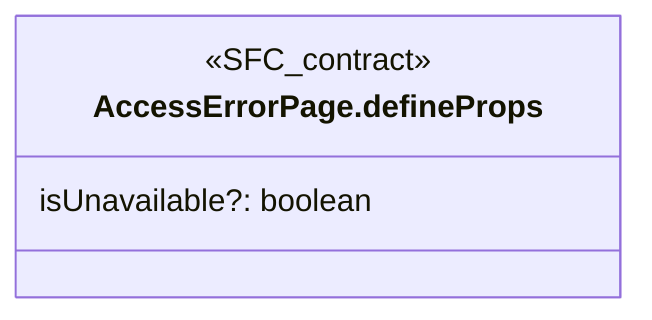

## DirectoryCreationPage.defineProps

**Fuente:** [src/app/pages/DirectoryCreationPage.vue](../../../../../src/app/pages/DirectoryCreationPage.vue) · línea 9, columna 27. **Declaración:** SFC contract.

| Miembro | Firma completa |
| --- | --- |
| `resource` | `resource: DirectoryResource;` |
| `request` | `request: LookupCreation` |

| Relación | Destino | Origen de la referencia |
| --- | --- | --- |
| dependency | [DirectoryResource](../../../../../src/modules/directory/directory.ts) | `resource` |
| association | [LookupCreation](../../../../../src/shared/lookup.ts) | `request` |

**Figura:** `DIA-VUE-TS-APP-7-1`.

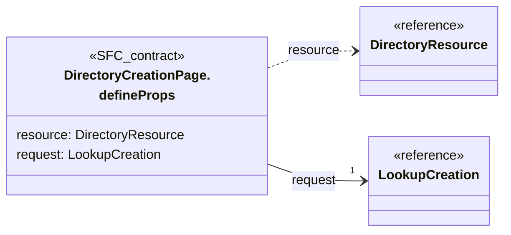

## DirectoryCreationPage.defineEmits

**Fuente:** [src/app/pages/DirectoryCreationPage.vue](../../../../../src/app/pages/DirectoryCreationPage.vue) · línea 10, columna 26. **Declaración:** SFC contract.

| Miembro | Firma completa |
| --- | --- |
| `close` | `close: []` |

**Figura:** `DIA-VUE-TS-APP-8-1`.

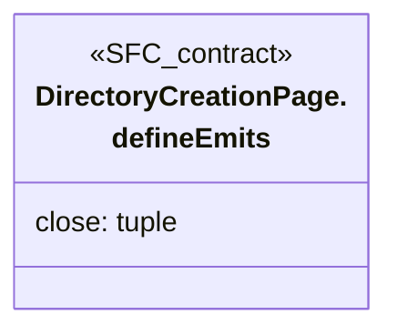

## InventoryWorkspace.defineProps

**Fuente:** [src/app/pages/InventoryWorkspace.vue](../../../../../src/app/pages/InventoryWorkspace.vue) · línea 10, columna 27. **Declaración:** SFC contract.

| Miembro | Firma completa |
| --- | --- |
| `resource` | `resource: InventoryResource` |

| Relación | Destino | Origen de la referencia |
| --- | --- | --- |
| dependency | [InventoryResource](../../../../../src/modules/warehouse/inventory.ts) | `resource` |

**Figura:** `DIA-VUE-TS-APP-9-1`.


## IssueWorkspace.defineProps

**Fuente:** [src/app/pages/IssueWorkspace.vue](../../../../../src/app/pages/IssueWorkspace.vue) · línea 10, columna 13. **Declaración:** SFC contract.

| Miembro | Firma completa |
| --- | --- |
| `resource` | `resource: IssueResource` |

| Relación | Destino | Origen de la referencia |
| --- | --- | --- |
| dependency | [IssueResource](../../../../../src/modules/issues/issue.ts) | `resource` |

**Figura:** `DIA-VUE-TS-APP-10-1`.

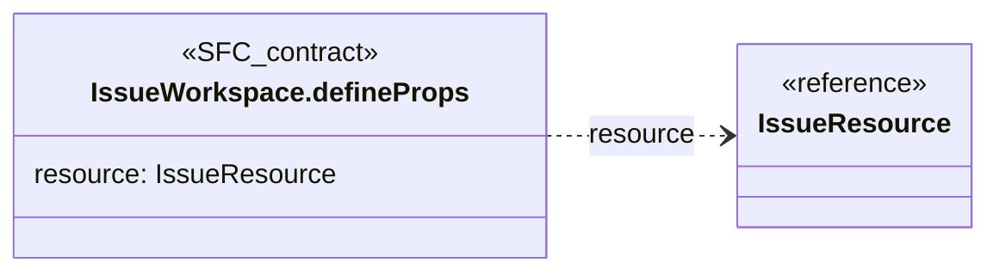

## PurchaseWorkspace.defineProps

**Fuente:** [src/app/pages/PurchaseWorkspace.vue](../../../../../src/app/pages/PurchaseWorkspace.vue) · línea 11, columna 27. **Declaración:** SFC contract.

| Miembro | Firma completa |
| --- | --- |
| `resource` | `resource: PurchaseResource` |

| Relación | Destino | Origen de la referencia |
| --- | --- | --- |
| dependency | [PurchaseResource](../../../../../src/modules/purchases/purchase.ts) | `resource` |

**Figura:** `DIA-VUE-TS-APP-11-1`.

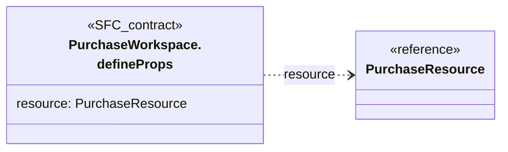

## auxiliary@14:6

**Fuente:** [src/app/pages/PurchaseWorkspace.vue](../../../../../src/app/pages/PurchaseWorkspace.vue) · línea 14, columna 6. **Declaración:** inline object.

| Miembro | Firma completa |
| --- | --- |
| `kind` | `kind: 'supplier'` |

**Figura:** `DIA-VUE-TS-APP-12-1`.

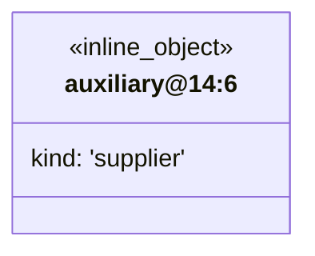

## auxiliary@14:48

**Fuente:** [src/app/pages/PurchaseWorkspace.vue](../../../../../src/app/pages/PurchaseWorkspace.vue) · línea 14, columna 48. **Declaración:** inline object.

| Miembro | Firma completa |
| --- | --- |
| `kind` | `kind: 'item'` |

**Figura:** `DIA-VUE-TS-APP-13-1`.

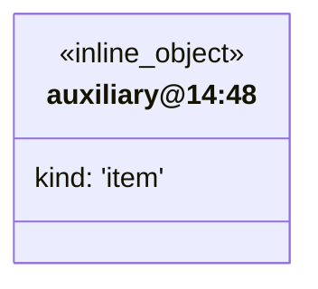

## usePageAccess.return

**Fuente:** [src/app/composables/usePageAccess.ts](../../../../../src/app/composables/usePageAccess.ts) · línea 6, columna 30. **Declaración:** inferred return.

| Miembro | Firma completa |
| --- | --- |
| `session` | `"session": { user: Readonly<Ref<{ readonly id: string; readonly name: string; readonly permissions: readonly string[]; } \| null, { readonly id: string; readonly name: string; readonly permissions: readonly string[]; } \| null>>; load: () => Promise<SessionUser>; };` |
| `has` | `"has": (permission: string) => boolean;` |
| `onDenied` | `"onDenied": (status: number) => void;` |
| `onError` | `"onError": (cause: unknown) => void;` |

| Relación | Destino | Origen de la referencia |
| --- | --- | --- |
| dependency | [usePageAccess.return.session.shape1](../../../../../src/app/composables/usePageAccess.ts) | `session` |

**Figura:** `DIA-VUE-TS-APP-14-1`.

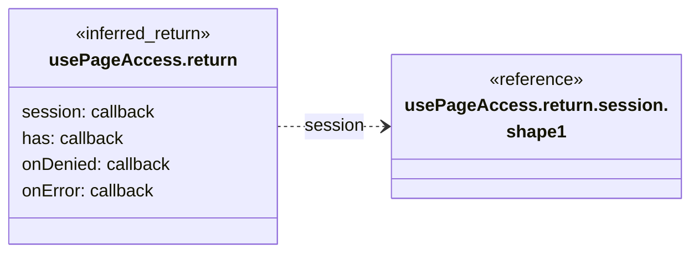

## usePageAccess.return.session.shape1

**Fuente:** [src/app/composables/usePageAccess.ts](../../../../../src/app/composables/usePageAccess.ts) · línea 6, columna 30. **Declaración:** inferred object.

| Miembro | Firma completa |
| --- | --- |
| `user` | `user: Readonly<Ref<{ readonly id: string; readonly name: string; readonly permissions: readonly string[]; } \| null, { readonly id: string; readonly name: string; readonly permissions: readonly string[]; } \| null>>;` |
| `load` | `load: () => Promise<SessionUser>;` |

| Relación | Destino | Origen de la referencia |
| --- | --- | --- |
| dependency | [usePageAccess.return.session.user.shape2](../../../../../src/app/composables/usePageAccess.ts) | `user` |
| dependency | [usePageAccess.return.session.user.shape3](../../../../../src/app/composables/usePageAccess.ts) | `user` |

**Figura:** `DIA-VUE-TS-APP-15-1`.

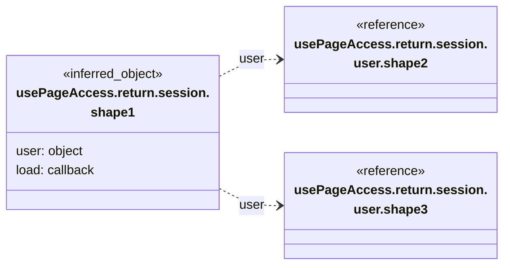

## usePageAccess.return.session.user.shape2

**Fuente:** [src/app/composables/usePageAccess.ts](../../../../../src/app/composables/usePageAccess.ts) · línea 6, columna 30. **Declaración:** inferred object.

| Miembro | Firma completa |
| --- | --- |
| `id` | `readonly id: string;` |
| `name` | `readonly name: string;` |
| `permissions` | `readonly permissions: readonly string[];` |

**Figura:** `DIA-VUE-TS-APP-16-1`.

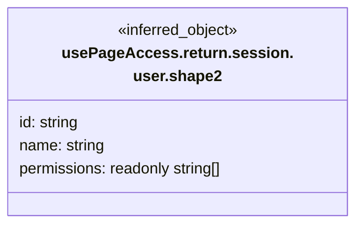

## usePageAccess.return.session.user.shape3

**Fuente:** [src/app/composables/usePageAccess.ts](../../../../../src/app/composables/usePageAccess.ts) · línea 6, columna 30. **Declaración:** inferred object.

| Miembro | Firma completa |
| --- | --- |
| `id` | `readonly id: string;` |
| `name` | `readonly name: string;` |
| `permissions` | `readonly permissions: readonly string[];` |

**Figura:** `DIA-VUE-TS-APP-17-1`.


## APP_ICONS

**Fuente:** [src/app/icons.ts](../../../../../src/app/icons.ts) · línea 26, columna 14. **Declaración:** inferred export.

| Miembro | Firma completa |
| --- | --- |
| `issues` | `"issues": string;` |
| `warehouse` | `"warehouse": string;` |
| `purchases` | `"purchases": string;` |
| `movements` | `"movements": string;` |
| `materials` | `"materials": string;` |
| `consumables` | `"consumables": string;` |
| `wastes` | `"wastes": string;` |
| `catalogs` | `"catalogs": string;` |
| `departments` | `"departments": string;` |
| `roles` | `"roles": string;` |
| `presentations` | `"presentations": string;` |
| `unit-measures` | `"unit-measures": string;` |
| `reasons` | `"reasons": string;` |
| `fulfillment-statuses` | `"fulfillment-statuses": string;` |
| `identity` | `"identity": string;` |
| `persons` | `"persons": string;` |
| `users` | `"users": string;` |
| `directory` | `"directory": string;` |
| `clients` | `"clients": string;` |
| `suppliers` | `"suppliers": string;` |
| `logout` | `"logout": string;` |

**Figura:** `DIA-VUE-TS-APP-18-1`. Parte 1/2.

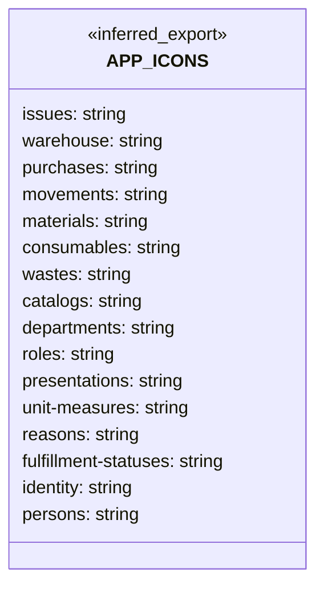

**Figura:** `DIA-VUE-TS-APP-18-2`. Parte 2/2.

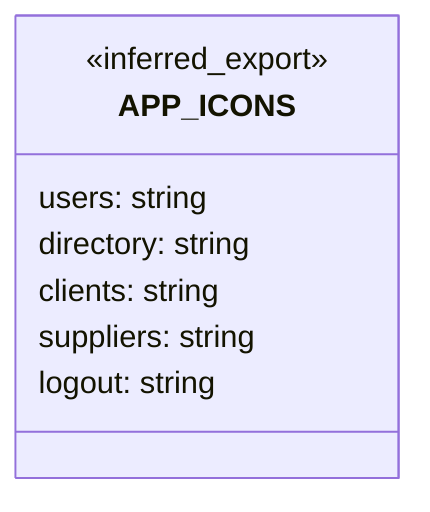

## createAppRouter.return

**Fuente:** [src/app/router/index.ts](../../../../../src/app/router/index.ts) · línea 13, columna 32. **Declaración:** inferred return.

| Miembro | Firma completa |
| --- | --- |
| `options` | `"options": RouterOptions;` |
| `addRoute` | `"addRoute": { (parentName: NonNullable<RouteRecordNameGeneric>, route: RouteRecordRaw): () => void; (route: RouteRecordRaw): () => void; };` |
| `removeRoute` | `"removeRoute": (name: NonNullable<RouteRecordNameGeneric>) => void;` |
| `clearRoutes` | `"clearRoutes": () => void;` |
| `currentRoute` | `"currentRoute": ShallowRef<RouteLocationNormalizedLoadedGeneric>;` |
| `listening` | `"listening": boolean;` |
| `hasRoute` | `"hasRoute": (name: NonNullable<RouteRecordNameGeneric>) => boolean;` |
| `getRoutes` | `"getRoutes": () => RouteRecordNormalized[];` |
| `resolve` | `"resolve": { <Name extends keyof RouteMap = string \| symbol>(to: RouteLocationAsRelativeTyped<RouteMap, Name>, currentLocation?: RouteLocationNormalizedLoaded): RouteLocationResolved<Name>; (to: RouteLocationAsString \| RouteLocationAsRelative \| RouteLocationAsPath, currentLocation?: RouteLocationNormalizedLoaded): RouteLocationResolved; };` |
| `push` | `"push": (to: RouteLocationRaw) => Promise<NavigationFailure \| void \| undefined>;` |
| `replace` | `"replace": (to: RouteLocationRaw) => Promise<NavigationFailure \| void \| undefined>;` |
| `back` | `"back": () => void;` |
| `forward` | `"forward": () => void;` |
| `go` | `"go": (delta: number) => void;` |
| `beforeEach` | `"beforeEach": (guard: NavigationGuardWithThis<undefined>) => () => void;` |
| `beforeResolve` | `"beforeResolve": (guard: _NavigationGuardResolved) => () => void;` |
| `afterEach` | `"afterEach": (guard: NavigationHookAfter) => () => void;` |
| `onError` | `"onError": (handler: _ErrorListener) => () => void;` |
| `isReady` | `"isReady": () => Promise<void>;` |
| `install` | `"install": (app: App) => void;` |
| `__@LOADER_ENTRIES_KEY@8831` | `"__@LOADER_ENTRIES_KEY@8831": _DefineLoaderEntryMap<DataLoaderEntryBase<unknown, unknown, unknown>>;` |
| `__@PENDING_LOCATION_KEY@8833` | `"__@PENDING_LOCATION_KEY@8833": RouteLocationNormalizedLoadedGeneric \| null;` |
| `__@APP_KEY@8835` | `"__@APP_KEY@8835": App<unknown>;` |
| `__@IS_SSR_KEY@8837` | `"__@IS_SSR_KEY@8837": boolean;` |
| `__@DATA_LOADERS_EFFECT_SCOPE_KEY@8839` | `"__@DATA_LOADERS_EFFECT_SCOPE_KEY@8839": EffectScope;` |
| `__@SERVER_INITIAL_DATA_KEY@8841` | `"__@SERVER_INITIAL_DATA_KEY@8841"?: false \| Record<string, unknown> \| undefined;` |
| `__@INITIAL_DATA_KEY@8843` | `"__@INITIAL_DATA_KEY@8843"?: false \| Record<string, unknown> \| undefined;` |

| Relación | Destino | Origen de la referencia |
| --- | --- | --- |
| dependency | [createAppRouter.return.addRoute.shape1](../../../../../src/app/router/index.ts) | `addRoute` |
| association | [createAppRouter.return.resolve.shape2](../../../../../src/app/router/index.ts) | `resolve` |

**Figura:** `DIA-VUE-TS-APP-19-1`. Parte 1/2.

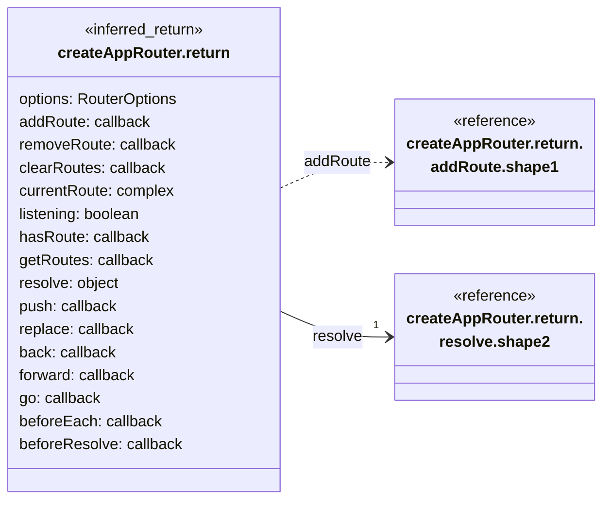

**Figura:** `DIA-VUE-TS-APP-19-2`. Parte 2/2.

```mermaid
classDiagram
    direction LR
    class Subject["createAppRouter.return"] {
        <<inferred_return>>
        afterEach: callback
        onError: callback
        isReady: callback
        install: callback
        __@LOADER_ENTRIES_KEY@8831: complex
        __@PENDING_LOCATION_KEY@8833: RouteLocationNormalizedLoadedGeneric | null
        __@APP_KEY@8835: App~unknown~
        __@IS_SSR_KEY@8837: boolean
        __@DATA_LOADERS_EFFECT_SCOPE_KEY@8839: EffectScope
        __@SERVER_INITIAL_DATA_KEY@8841?: false | Record~string, unknown~ | undefined
        __@INITIAL_DATA_KEY@8843?: false | Record~string, unknown~ | undefined
    }
```

## createAppRouter.return.addRoute.shape1

**Fuente:** [src/app/router/index.ts](../../../../../src/app/router/index.ts) · línea 13, columna 32. **Declaración:** inferred object.

| Miembro | Firma completa |
| --- | --- |
| `signature` | `(parentName: NonNullable<RouteRecordNameGeneric>, route: RouteRecordRaw): () => void;` |
| `signature` | `(route: RouteRecordRaw): () => void;` |

**Figura:** `DIA-VUE-TS-APP-20-1`.

```mermaid
classDiagram
    direction LR
    class Subject["createAppRouter.return.<br/>addRoute.shape1"] {
        <<inferred_object>>
        signature: callback
        signature: callback
    }
```

## createAppRouter.return.resolve.shape2

**Fuente:** [src/app/router/index.ts](../../../../../src/app/router/index.ts) · línea 13, columna 32. **Declaración:** inferred object.

| Miembro | Firma completa |
| --- | --- |
| `signature` | `<Name extends keyof RouteMap = string \| symbol>(to: RouteLocationAsRelativeTyped<RouteMap, Name>, currentLocation?: RouteLocationNormalizedLoaded): RouteLocationResolved<Name>;` |
| `signature` | `(to: RouteLocationAsString \| RouteLocationAsRelative \| RouteLocationAsPath, currentLocation?: RouteLocationNormalizedLoaded): RouteLocationResolved;` |

**Figura:** `DIA-VUE-TS-APP-21-1`.

```mermaid
classDiagram
    direction LR
    class Subject["createAppRouter.return.<br/>resolve.shape2"] {
        <<inferred_object>>
        signature: RouteLocationResolved~Name~
        signature: RouteLocationResolved
    }
```
