# Contratos TypeScript: auth

Generado con `npm run docs:generate`. No editar manualmente.

Cada figura incluye hasta ocho miembros y dos relaciones; las partes reúnen el contrato completo.
Los destinos sin atributos son referencias: su definición completa aparece en su propia ficha.
Los objetos inline declarados muestran contexto, línea y columna. Las formas inferidas usan shapeN dentro del contrato padre; su fuente apunta al export o función original. No son clases instanciadas.

[Lectura y cobertura](index.md).

## LoginForm.defineProps

**Fuente:** [src/modules/auth/components/LoginForm.vue](../../../../../src/modules/auth/components/LoginForm.vue) · línea 7, columna 13. **Declaración:** SFC contract.

**Definición completa:**

```typescript
LoginFormProps
```

| Relación | Destino | Origen de la referencia |
| --- | --- | --- |
| dependency | [LoginFormProps](../../../../../src/modules/auth/login.ts) | `type` |

**Figura:** `DIA-VUE-TS-AUTH-1-1`. Parte 1/1.

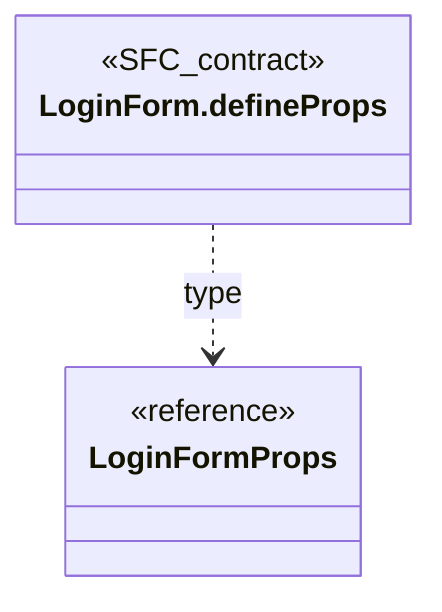

## LoginForm.defineEmits

**Fuente:** [src/modules/auth/components/LoginForm.vue](../../../../../src/modules/auth/components/LoginForm.vue) · línea 8, columna 26. **Declaración:** SFC contract.

**Definición completa:**

```typescript
LoginFormEmits
```

| Relación | Destino | Origen de la referencia |
| --- | --- | --- |
| dependency | [LoginFormEmits](../../../../../src/modules/auth/login.ts) | `type` |

**Figura:** `DIA-VUE-TS-AUTH-2-1`. Parte 1/1.

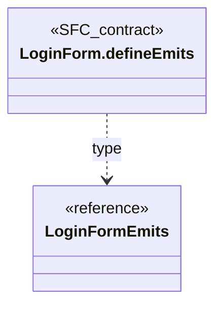

## LoginFormOptions

**Fuente:** [src/modules/auth/composables/useLoginForm.ts](../../../../../src/modules/auth/composables/useLoginForm.ts) · línea 11, columna 1. **Declaración:** interface.

| Miembro | Firma completa |
| --- | --- |
| `onSuccess` | `onSuccess: () => void;` |
| `request` | `request?: typeof loginRequest;` |

| Relación | Destino | Origen de la referencia |
| --- | --- | --- |
| dependency | `loginRequest` | `request typeof` |

**Figura:** `DIA-VUE-TS-AUTH-3-1`. Parte 1/1.

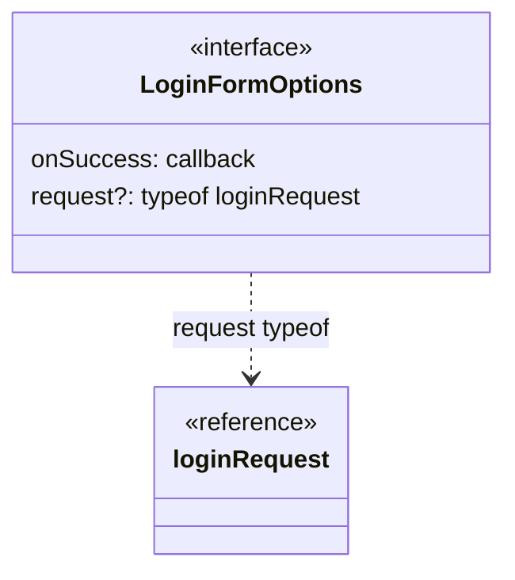

## LoginCredentials

**Fuente:** [src/modules/auth/login.ts](../../../../../src/modules/auth/login.ts) · línea 1, columna 1. **Declaración:** interface.

| Miembro | Firma completa |
| --- | --- |
| `name` | `name: string;` |
| `password` | `password: string;` |

**Figura:** `DIA-VUE-TS-AUTH-4-1`. Parte 1/1.

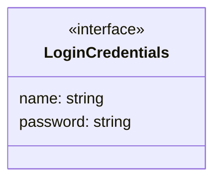

## LoginField

**Fuente:** [src/modules/auth/login.ts](../../../../../src/modules/auth/login.ts) · línea 6, columna 1. **Declaración:** type.

**Definición completa:**

```typescript
keyof LoginCredentials
```

| Relación | Destino | Origen de la referencia |
| --- | --- | --- |
| dependency | [LoginCredentials](../../../../../src/modules/auth/login.ts) | `type` |

**Figura:** `DIA-VUE-TS-AUTH-5-1`. Parte 1/1.

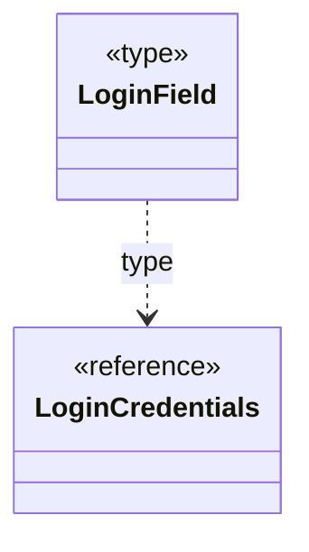

## LoginFieldErrors

**Fuente:** [src/modules/auth/login.ts](../../../../../src/modules/auth/login.ts) · línea 7, columna 1. **Declaración:** type.

**Definición completa:**

```typescript
Partial<Record<LoginField, string>>
```

| Relación | Destino | Origen de la referencia |
| --- | --- | --- |
| dependency | [LoginFieldErrors.expanded](../../../../../src/modules/auth/login.ts) | `evaluated structure` |
| dependency | `Partial` | `type` |
| dependency | `Record` | `type` |
| dependency | [LoginField](../../../../../src/modules/auth/login.ts) | `type` |

**Figura:** `DIA-VUE-TS-AUTH-6-1`. Parte 1/2.

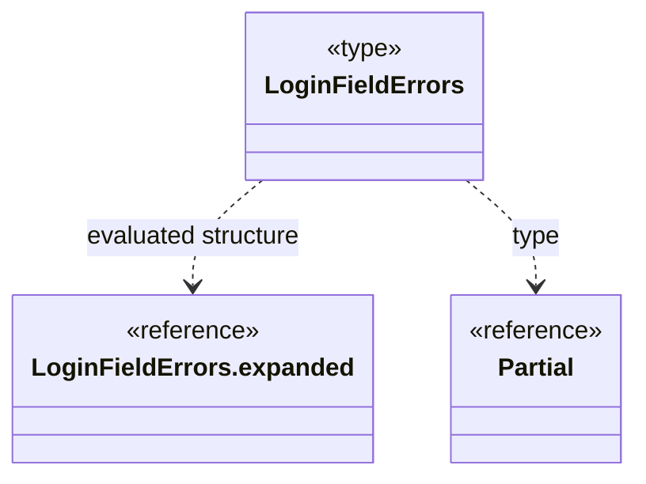

**Figura:** `DIA-VUE-TS-AUTH-6-2`. Parte 2/2.

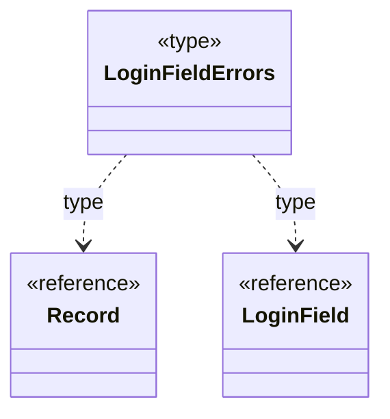

## LoginFormProps

**Fuente:** [src/modules/auth/login.ts](../../../../../src/modules/auth/login.ts) · línea 9, columna 1. **Declaración:** interface.

**Extensión/implementación:** `extends LoginCredentials`.

| Miembro | Firma completa |
| --- | --- |
| `errors` | `errors: LoginFieldErrors;` |
| `isPasswordVisible` | `isPasswordVisible: boolean;` |
| `shouldRememberUser` | `shouldRememberUser: boolean;` |
| `isSubmitting` | `isSubmitting: boolean;` |
| `message` | `message: string;` |

| Relación | Destino | Origen de la referencia |
| --- | --- | --- |
| inheritance | [LoginCredentials](../../../../../src/modules/auth/login.ts) | `extends` |
| dependency | [LoginFieldErrors](../../../../../src/modules/auth/login.ts) | `errors` |

**Figura:** `DIA-VUE-TS-AUTH-7-1`. Parte 1/1.

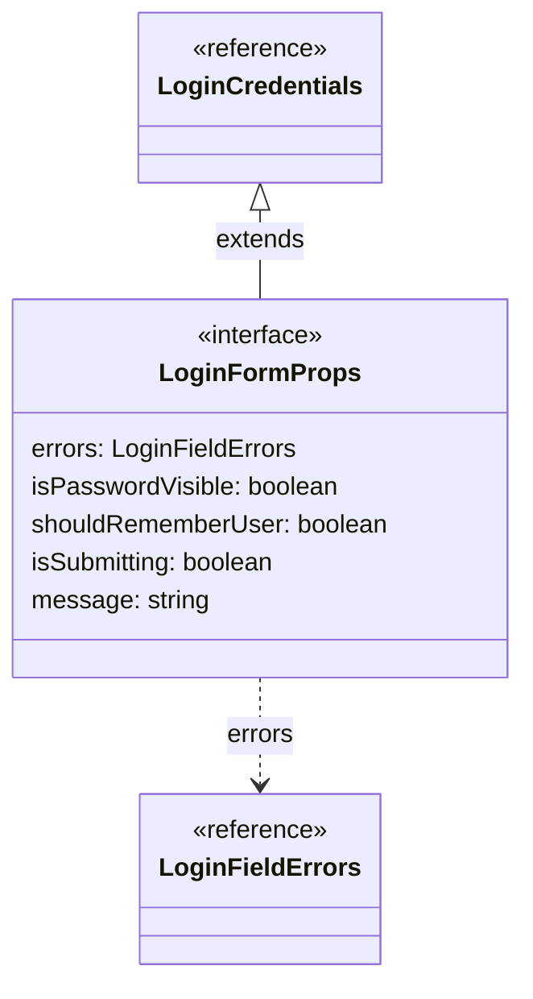

## LoginFormEmits

**Fuente:** [src/modules/auth/login.ts](../../../../../src/modules/auth/login.ts) · línea 17, columna 1. **Declaración:** interface.

| Miembro | Firma completa |
| --- | --- |
| `update:name` | `'update:name': [name: string];` |
| `update:password` | `'update:password': [password: string];` |
| `update:shouldRememberUser` | `'update:shouldRememberUser': [shouldRememberUser: boolean];` |
| `blur` | `blur: [field: LoginField];` |
| `togglePassword` | `togglePassword: [];` |
| `submit` | `submit: [];` |

| Relación | Destino | Origen de la referencia |
| --- | --- | --- |
| dependency | [LoginField](../../../../../src/modules/auth/login.ts) | `blur` |

**Figura:** `DIA-VUE-TS-AUTH-8-1`. Parte 1/1.

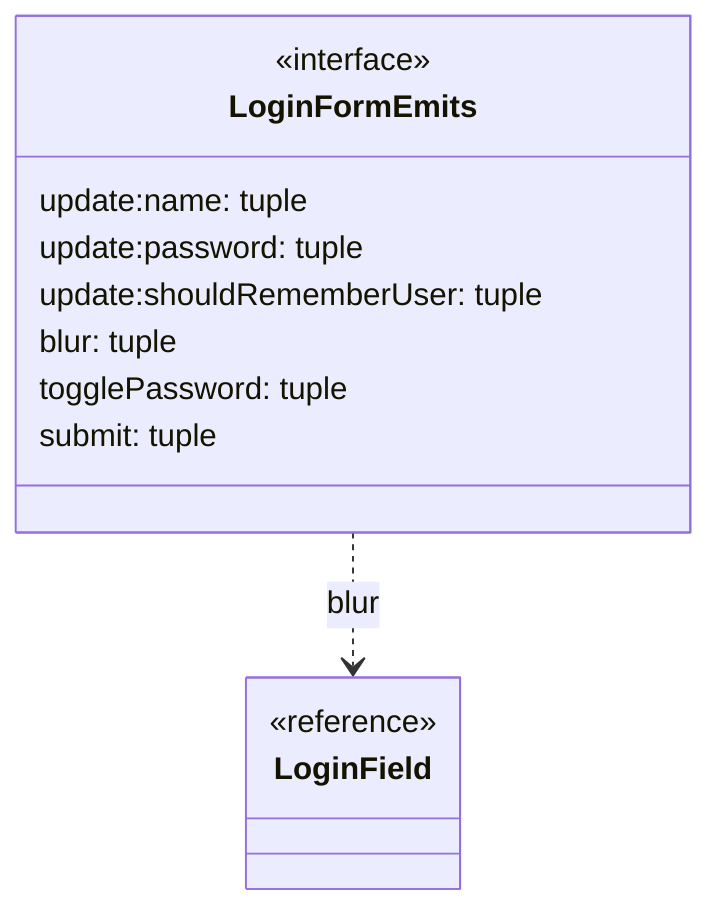

## LoginRequestError

**Fuente:** [src/modules/auth/services/authService.ts](../../../../../src/modules/auth/services/authService.ts) · línea 8, columna 1. **Declaración:** class.

**Extensión/implementación:** `extends Error`.

| Miembro | Firma completa |
| --- | --- |
| `constructor` | `constructor( message: string, public fieldErrors: LoginFieldErrors = {}, )` |
| `fieldErrors` | `public fieldErrors: LoginFieldErrors = {}` |

| Relación | Destino | Origen de la referencia |
| --- | --- | --- |
| inheritance | `Error` | `extends` |
| dependency | [LoginFieldErrors](../../../../../src/modules/auth/login.ts) | `constructor.fieldErrors` |
| dependency | [LoginFieldErrors](../../../../../src/modules/auth/login.ts) | `fieldErrors` |

**Figura:** `DIA-VUE-TS-AUTH-9-1`. Parte 1/2.

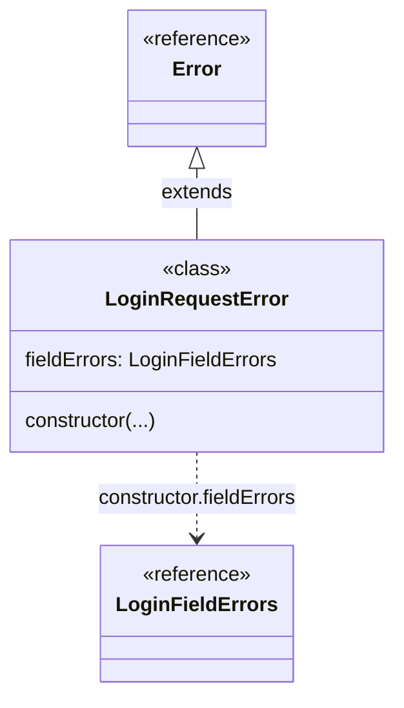

**Figura:** `DIA-VUE-TS-AUTH-9-2`. Parte 2/2.

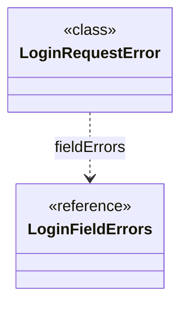

## apiClient.request@23:46

**Fuente:** [src/modules/auth/services/authService.ts](../../../../../src/modules/auth/services/authService.ts) · línea 23, columna 46. **Declaración:** inline object.

| Miembro | Firma completa |
| --- | --- |
| `code` | `code: string` |

**Figura:** `DIA-VUE-TS-AUTH-10-1`. Parte 1/1.

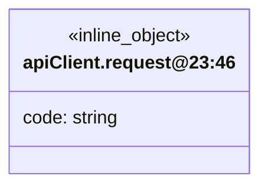

## SessionUser

**Fuente:** [src/modules/auth/session.ts](../../../../../src/modules/auth/session.ts) · línea 6, columna 1. **Declaración:** interface.

| Miembro | Firma completa |
| --- | --- |
| `id` | `id: string;` |
| `name` | `name: string;` |
| `permissions` | `permissions: readonly string[];` |

**Figura:** `DIA-VUE-TS-AUTH-11-1`. Parte 1/1.

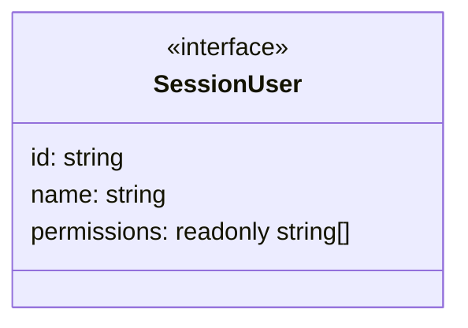

## request@17:29

**Fuente:** [src/modules/auth/session.ts](../../../../../src/modules/auth/session.ts) · línea 17, columna 29. **Declaración:** inline object.

| Miembro | Firma completa |
| --- | --- |
| `user` | `user: unknown` |

**Figura:** `DIA-VUE-TS-AUTH-12-1`. Parte 1/1.

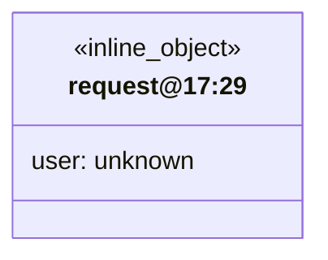

## AuthSession

**Fuente:** [src/modules/auth/session.ts](../../../../../src/modules/auth/session.ts) · línea 49, columna 1. **Declaración:** type.

**Definición completa:**

```typescript
ReturnType<typeof createAuthSession>
```

| Relación | Destino | Origen de la referencia |
| --- | --- | --- |
| dependency | [AuthSession.expanded](../../../../../src/modules/auth/session.ts) | `evaluated structure` |
| dependency | `ReturnType` | `type` |
| dependency | `createAuthSession` | `type typeof` |

**Figura:** `DIA-VUE-TS-AUTH-13-1`. Parte 1/2.

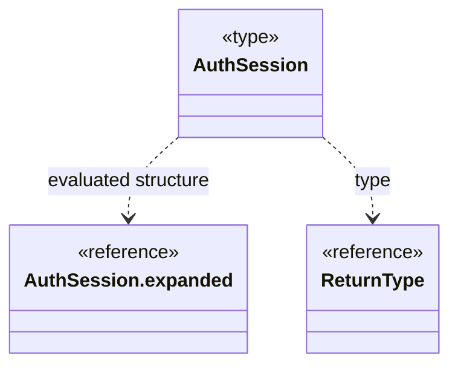

**Figura:** `DIA-VUE-TS-AUTH-13-2`. Parte 2/2.

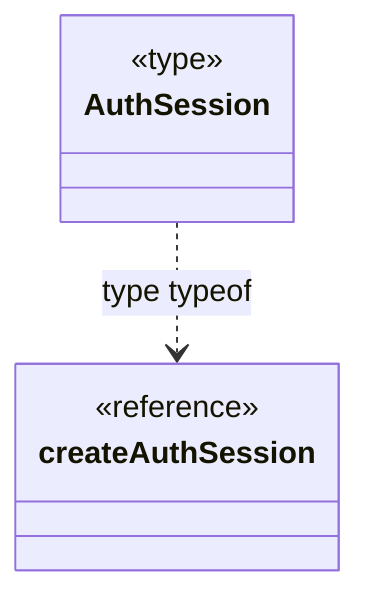

## useLoginForm.return

**Fuente:** [src/modules/auth/composables/useLoginForm.ts](../../../../../src/modules/auth/composables/useLoginForm.ts) · línea 16, columna 29. **Declaración:** inferred return.

| Miembro | Firma completa |
| --- | --- |
| `values` | `"values": LoginCredentials;` |
| `name` | `"name": Ref<string, string>;` |
| `password` | `"password": Ref<string, string>;` |
| `errors` | `"errors": ComputedRef<Partial<Record<"" \| "name" \| "password", string \| undefined>>>;` |
| `isSubmitting` | `"isSubmitting": Ref<boolean, boolean>;` |
| `isPasswordVisible` | `"isPasswordVisible": Ref<boolean, boolean>;` |
| `shouldRememberUser` | `"shouldRememberUser": Ref<boolean, boolean>;` |
| `message` | `"message": Ref<string, string>;` |
| `updateField` | `"updateField": (field: keyof LoginCredentials, value: string) => void;` |
| `blurField` | `"blurField": (field: keyof LoginCredentials) => Promise<unknown> \| undefined;` |
| `submit` | `"submit": () => Promise<Promise<void> \| undefined> \| undefined;` |

| Relación | Destino | Origen de la referencia |
| --- | --- | --- |
| association | [LoginCredentials](../../../../../src/modules/auth/login.ts) | `values` |
| dependency | `Ref` | `name` |
| dependency | `Ref` | `password` |
| dependency | `ComputedRef` | `errors` |
| dependency | `Partial` | `errors` |
| dependency | `Record` | `errors` |
| dependency | `Ref` | `isSubmitting` |
| dependency | `Ref` | `isPasswordVisible` |
| dependency | `Ref` | `shouldRememberUser` |
| dependency | `Ref` | `message` |
| dependency | [LoginCredentials](../../../../../src/modules/auth/login.ts) | `updateField` |
| dependency | [LoginCredentials](../../../../../src/modules/auth/login.ts) | `blurField` |
| dependency | `Promise` | `blurField` |
| dependency | `Promise` | `submit` |

**Figura:** `DIA-VUE-TS-AUTH-14-1`. Parte 1/7.

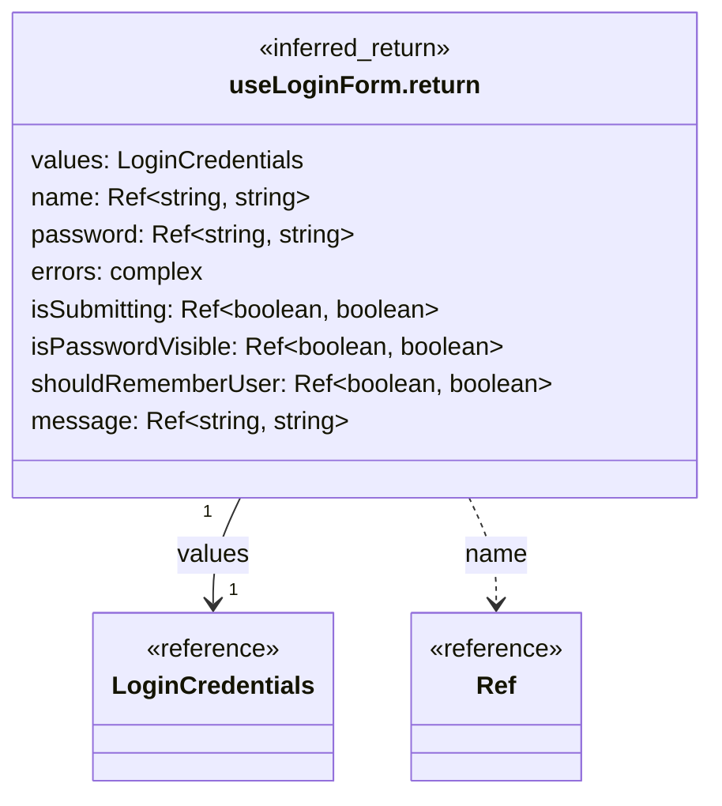

**Figura:** `DIA-VUE-TS-AUTH-14-2`. Parte 2/7.

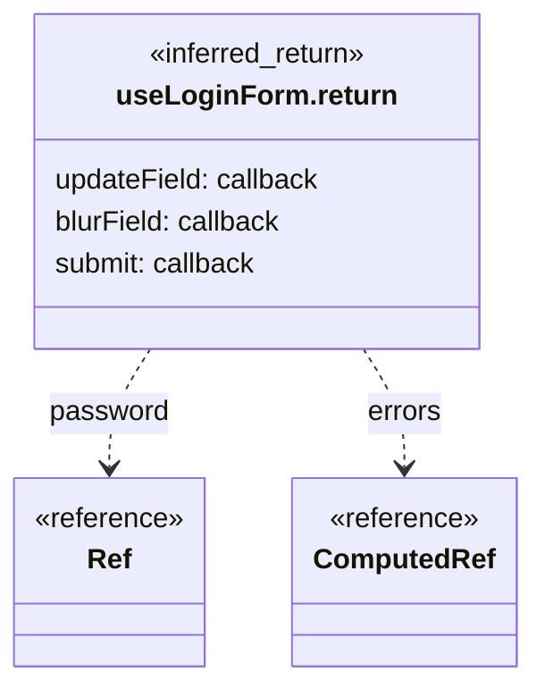

**Figura:** `DIA-VUE-TS-AUTH-14-3`. Parte 3/7.

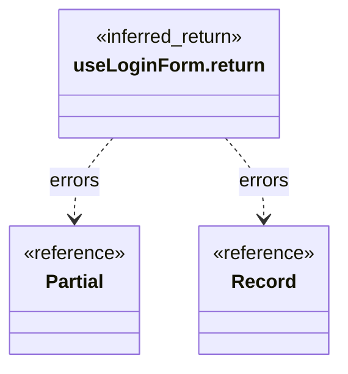

**Figura:** `DIA-VUE-TS-AUTH-14-4`. Parte 4/7.

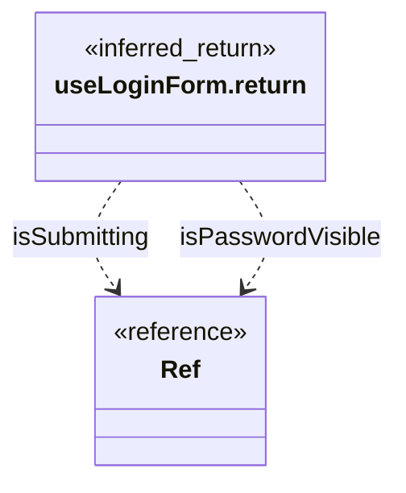

**Figura:** `DIA-VUE-TS-AUTH-14-5`. Parte 5/7.

```mermaid
classDiagram
    direction TB
    class Subject["useLoginForm.return"] {
        <<inferred_return>>
    }
    class R0["Ref"] {
        <<reference>>
    }
    Subject ..> R0 : shouldRememberUser
    Subject ..> R0 : message
```

**Figura:** `DIA-VUE-TS-AUTH-14-6`. Parte 6/7.

```mermaid
classDiagram
    direction TB
    class Subject["useLoginForm.return"] {
        <<inferred_return>>
    }
    class R0["LoginCredentials"] {
        <<reference>>
    }
    Subject ..> R0 : updateField
    Subject ..> R0 : blurField
```

**Figura:** `DIA-VUE-TS-AUTH-14-7`. Parte 7/7.

```mermaid
classDiagram
    direction TB
    class Subject["useLoginForm.return"] {
        <<inferred_return>>
    }
    class R0["Promise"] {
        <<reference>>
    }
    Subject ..> R0 : blurField
    Subject ..> R0 : submit
```

## LoginFieldErrors.expanded

**Fuente:** [src/modules/auth/login.ts](../../../../../src/modules/auth/login.ts) · línea 7, columna 1. **Declaración:** evaluated alias.

| Miembro | Firma completa |
| --- | --- |
| `name` | `"name"?: string \| undefined;` |
| `password` | `"password"?: string \| undefined;` |

**Figura:** `DIA-VUE-TS-AUTH-15-1`. Parte 1/1.

```mermaid
classDiagram
    direction TB
    class Subject["LoginFieldErrors.expanded"] {
        <<evaluated_alias>>
        name?: string | undefined
        password?: string | undefined
    }
```

## createAuthSession.return

**Fuente:** [src/modules/auth/session.ts](../../../../../src/modules/auth/session.ts) · línea 12, columna 34. **Declaración:** inferred return.

| Miembro | Firma completa |
| --- | --- |
| `user` | `"user": Readonly<Ref<{ readonly id: string; readonly name: string; readonly permissions: readonly string[]; } \| null, { readonly id: string; readonly name: string; readonly permissions: readonly string[]; } \| null>>;` |
| `load` | `"load": () => Promise<SessionUser>;` |

| Relación | Destino | Origen de la referencia |
| --- | --- | --- |
| dependency | `Readonly` | `user` |
| dependency | `Ref` | `user` |
| dependency | [createAuthSession.return.user.shape1](../../../../../src/modules/auth/session.ts) | `user` |
| dependency | [createAuthSession.return.user.shape2](../../../../../src/modules/auth/session.ts) | `user` |
| dependency | `Promise` | `load` |
| dependency | [SessionUser](../../../../../src/modules/auth/session.ts) | `load` |

**Figura:** `DIA-VUE-TS-AUTH-16-1`. Parte 1/3.

```mermaid
classDiagram
    direction TB
    class Subject["createAuthSession.return"] {
        <<inferred_return>>
        user: object
        load: callback
    }
    class R0["Readonly"] {
        <<reference>>
    }
    class R1["Ref"] {
        <<reference>>
    }
    Subject ..> R0 : user
    Subject ..> R1 : user
```

**Figura:** `DIA-VUE-TS-AUTH-16-2`. Parte 2/3.

```mermaid
classDiagram
    direction TB
    class Subject["createAuthSession.return"] {
        <<inferred_return>>
    }
    class R0["createAuthSession.return.<br/>user.shape1"] {
        <<reference>>
    }
    class R1["createAuthSession.return.<br/>user.shape2"] {
        <<reference>>
    }
    Subject ..> R0 : user
    Subject ..> R1 : user
```

**Figura:** `DIA-VUE-TS-AUTH-16-3`. Parte 3/3.

```mermaid
classDiagram
    direction TB
    class Subject["createAuthSession.return"] {
        <<inferred_return>>
    }
    class R0["Promise"] {
        <<reference>>
    }
    class R1["SessionUser"] {
        <<reference>>
    }
    Subject ..> R0 : load
    Subject ..> R1 : load
```

## createAuthSession.return.user.shape1

**Fuente:** [src/modules/auth/session.ts](../../../../../src/modules/auth/session.ts) · línea 12, columna 34. **Declaración:** inferred object.

| Miembro | Firma completa |
| --- | --- |
| `id` | `readonly id: string;` |
| `name` | `readonly name: string;` |
| `permissions` | `readonly permissions: readonly string[];` |

**Figura:** `DIA-VUE-TS-AUTH-17-1`. Parte 1/1.

```mermaid
classDiagram
    direction TB
    class Subject["createAuthSession.return.<br/>user.shape1"] {
        <<inferred_object>>
        id: string
        name: string
        permissions: readonly string[]
    }
```

## createAuthSession.return.user.shape2

**Fuente:** [src/modules/auth/session.ts](../../../../../src/modules/auth/session.ts) · línea 12, columna 34. **Declaración:** inferred object.

| Miembro | Firma completa |
| --- | --- |
| `id` | `readonly id: string;` |
| `name` | `readonly name: string;` |
| `permissions` | `readonly permissions: readonly string[];` |

**Figura:** `DIA-VUE-TS-AUTH-18-1`. Parte 1/1.

```mermaid
classDiagram
    direction TB
    class Subject["createAuthSession.return.<br/>user.shape2"] {
        <<inferred_object>>
        id: string
        name: string
        permissions: readonly string[]
    }
```

## AuthSession.expanded

**Fuente:** [src/modules/auth/session.ts](../../../../../src/modules/auth/session.ts) · línea 49, columna 1. **Declaración:** evaluated alias.

| Miembro | Firma completa |
| --- | --- |
| `user` | `"user": Readonly<Ref<{ readonly id: string; readonly name: string; readonly permissions: readonly string[]; } \| null, { readonly id: string; readonly name: string; readonly permissions: readonly string[]; } \| null>>;` |
| `load` | `"load": () => Promise<SessionUser>;` |

| Relación | Destino | Origen de la referencia |
| --- | --- | --- |
| dependency | `Readonly` | `user` |
| dependency | `Ref` | `user` |
| dependency | [AuthSession.expanded.user.shape1](../../../../../src/modules/auth/session.ts) | `user` |
| dependency | [AuthSession.expanded.user.shape2](../../../../../src/modules/auth/session.ts) | `user` |
| dependency | `Promise` | `load` |
| dependency | [SessionUser](../../../../../src/modules/auth/session.ts) | `load` |

**Figura:** `DIA-VUE-TS-AUTH-19-1`. Parte 1/3.

```mermaid
classDiagram
    direction TB
    class Subject["AuthSession.expanded"] {
        <<evaluated_alias>>
        user: object
        load: callback
    }
    class R0["Readonly"] {
        <<reference>>
    }
    class R1["Ref"] {
        <<reference>>
    }
    Subject ..> R0 : user
    Subject ..> R1 : user
```

**Figura:** `DIA-VUE-TS-AUTH-19-2`. Parte 2/3.

```mermaid
classDiagram
    direction TB
    class Subject["AuthSession.expanded"] {
        <<evaluated_alias>>
    }
    class R0["AuthSession.expanded.user.<br/>shape1"] {
        <<reference>>
    }
    class R1["AuthSession.expanded.user.<br/>shape2"] {
        <<reference>>
    }
    Subject ..> R0 : user
    Subject ..> R1 : user
```

**Figura:** `DIA-VUE-TS-AUTH-19-3`. Parte 3/3.

```mermaid
classDiagram
    direction TB
    class Subject["AuthSession.expanded"] {
        <<evaluated_alias>>
    }
    class R0["Promise"] {
        <<reference>>
    }
    class R1["SessionUser"] {
        <<reference>>
    }
    Subject ..> R0 : load
    Subject ..> R1 : load
```

## AuthSession.expanded.user.shape1

**Fuente:** [src/modules/auth/session.ts](../../../../../src/modules/auth/session.ts) · línea 49, columna 1. **Declaración:** inferred object.

| Miembro | Firma completa |
| --- | --- |
| `id` | `readonly id: string;` |
| `name` | `readonly name: string;` |
| `permissions` | `readonly permissions: readonly string[];` |

**Figura:** `DIA-VUE-TS-AUTH-20-1`. Parte 1/1.

```mermaid
classDiagram
    direction TB
    class Subject["AuthSession.expanded.user.<br/>shape1"] {
        <<inferred_object>>
        id: string
        name: string
        permissions: readonly string[]
    }
```

## AuthSession.expanded.user.shape2

**Fuente:** [src/modules/auth/session.ts](../../../../../src/modules/auth/session.ts) · línea 49, columna 1. **Declaración:** inferred object.

| Miembro | Firma completa |
| --- | --- |
| `id` | `readonly id: string;` |
| `name` | `readonly name: string;` |
| `permissions` | `readonly permissions: readonly string[];` |

**Figura:** `DIA-VUE-TS-AUTH-21-1`. Parte 1/1.

```mermaid
classDiagram
    direction TB
    class Subject["AuthSession.expanded.user.<br/>shape2"] {
        <<inferred_object>>
        id: string
        name: string
        permissions: readonly string[]
    }
```
