# Contratos TypeScript: catalogs

Generado con `npm run docs:generate`. No editar manualmente.

[Alcance y notación](index.md#alcance-y-notación).

## CatalogName

**Fuente:** [src/modules/catalogs/catalog.ts](../../../../../src/modules/catalogs/catalog.ts) · línea 3, columna 1. **Declaración:** type.

**Definición completa:**

```typescript
keyof typeof PUBLIC_CATALOGS
```

**Figura:** `DIA-VUE-TS-CATALOGS-1-1`.

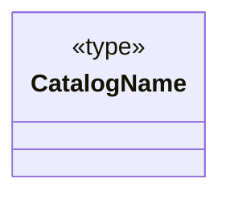

## CatalogField

**Fuente:** [src/modules/catalogs/catalog.ts](../../../../../src/modules/catalogs/catalog.ts) · línea 4, columna 1. **Declaración:** type.

**Definición completa:**

```typescript
'name' | 'symbol' | 'isActive'
```

**Figura:** `DIA-VUE-TS-CATALOGS-2-1`.

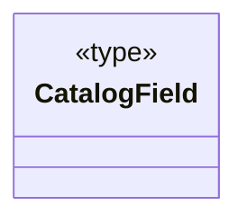

## CatalogValues

**Fuente:** [src/modules/catalogs/catalog.ts](../../../../../src/modules/catalogs/catalog.ts) · línea 5, columna 1. **Declaración:** interface.

| Miembro | Firma completa |
| --- | --- |
| `name` | `name: string;` |
| `symbol` | `symbol: string;` |
| `isActive` | `isActive: boolean;` |

**Figura:** `DIA-VUE-TS-CATALOGS-3-1`.

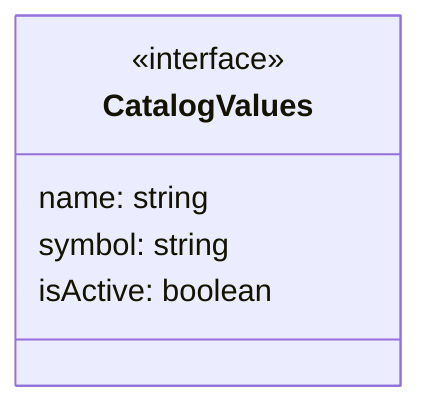

## CatalogEntry

**Fuente:** [src/modules/catalogs/catalog.ts](../../../../../src/modules/catalogs/catalog.ts) · línea 10, columna 1. **Declaración:** interface.

**Extensión/implementación:** `extends CatalogValues`.

| Miembro | Firma completa |
| --- | --- |
| `id` | `id: string;` |
| `version` | `version: number;` |

| Relación | Destino | Origen de la referencia |
| --- | --- | --- |
| inheritance | [CatalogValues](../../../../../src/modules/catalogs/catalog.ts) | `extends` |

**Figura:** `DIA-VUE-TS-CATALOGS-4-1`.

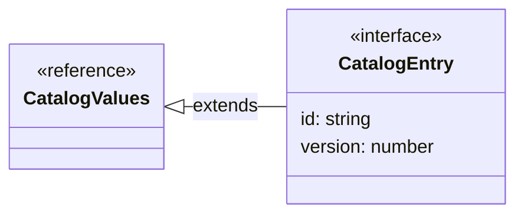

## CatalogQuery

**Fuente:** [src/modules/catalogs/catalog.ts](../../../../../src/modules/catalogs/catalog.ts) · línea 14, columna 1. **Declaración:** interface.

| Miembro | Firma completa |
| --- | --- |
| `search` | `search: string;` |
| `page` | `page: number;` |
| `length` | `length: number;` |

**Figura:** `DIA-VUE-TS-CATALOGS-5-1`.

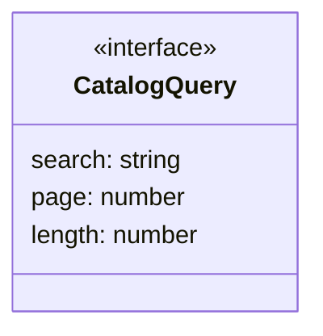

## CatalogTarget

**Fuente:** [src/modules/catalogs/catalog.ts](../../../../../src/modules/catalogs/catalog.ts) · línea 19, columna 1. **Declaración:** type.

**Definición completa:**

```typescript
{ action: 'create' } | { action: 'edit'; row: CatalogEntry }
```

| Relación | Destino | Origen de la referencia |
| --- | --- | --- |
| dependency | [CatalogTarget@19:29](../../../../../src/modules/catalogs/catalog.ts) | `type` |
| dependency | [CatalogTarget@19:52](../../../../../src/modules/catalogs/catalog.ts) | `type` |

**Figura:** `DIA-VUE-TS-CATALOGS-6-1`.

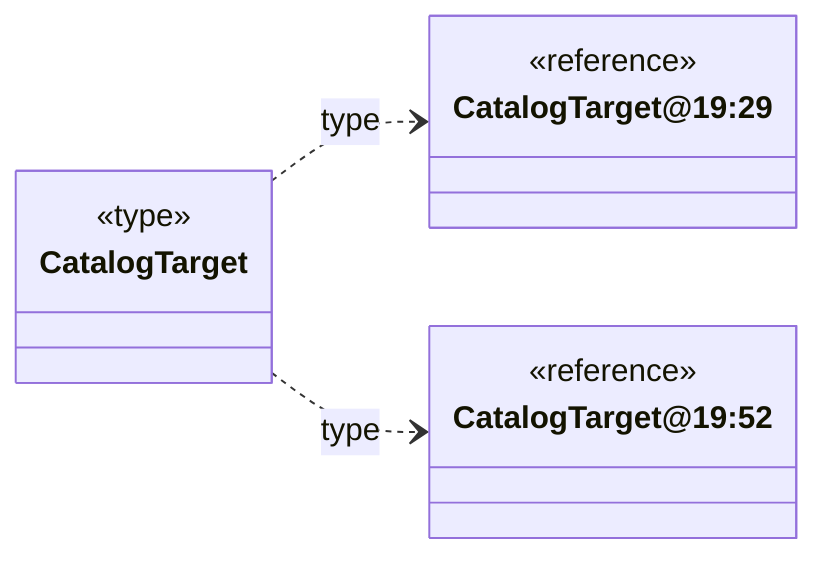

## CatalogTarget@19:29

**Fuente:** [src/modules/catalogs/catalog.ts](../../../../../src/modules/catalogs/catalog.ts) · línea 19, columna 29. **Declaración:** inline object.

| Miembro | Firma completa |
| --- | --- |
| `action` | `action: 'create'` |

**Figura:** `DIA-VUE-TS-CATALOGS-7-1`.

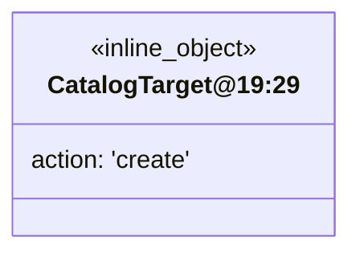

## CatalogTarget@19:52

**Fuente:** [src/modules/catalogs/catalog.ts](../../../../../src/modules/catalogs/catalog.ts) · línea 19, columna 52. **Declaración:** inline object.

| Miembro | Firma completa |
| --- | --- |
| `action` | `action: 'edit';` |
| `row` | `row: CatalogEntry` |

| Relación | Destino | Origen de la referencia |
| --- | --- | --- |
| association | [CatalogEntry](../../../../../src/modules/catalogs/catalog.ts) | `row` |

**Figura:** `DIA-VUE-TS-CATALOGS-8-1`.

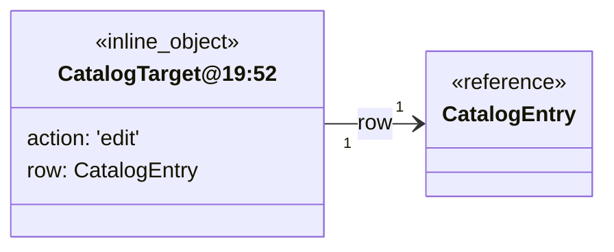

## maxLengths@23:23

**Fuente:** [src/modules/catalogs/catalog.ts](../../../../../src/modules/catalogs/catalog.ts) · línea 23, columna 23. **Declaración:** inline object.

| Miembro | Firma completa |
| --- | --- |
| `name` | `name: number;` |
| `symbol` | `symbol?: number` |

**Figura:** `DIA-VUE-TS-CATALOGS-9-1`.

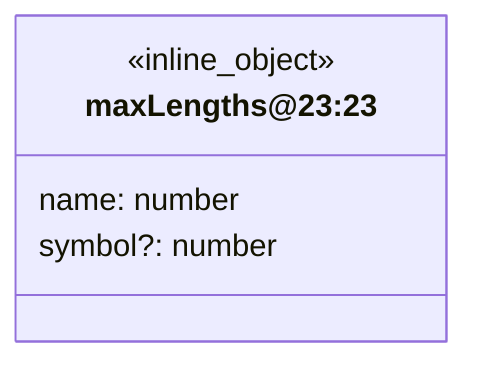

## CatalogForm.defineProps

**Fuente:** [src/modules/catalogs/components/CatalogForm.vue](../../../../../src/modules/catalogs/components/CatalogForm.vue) · línea 7, columna 13. **Declaración:** SFC contract.

| Miembro | Firma completa |
| --- | --- |
| `title` | `title: string;` |
| `values` | `values: CatalogValues;` |
| `errors` | `errors: Partial<Record<CatalogField, string>>;` |
| `message` | `message: string;` |
| `isSubmitting` | `isSubmitting: boolean;` |
| `isConflicted` | `isConflicted: boolean;` |
| `hasSymbol` | `hasSymbol: boolean;` |
| `maxNameLength` | `maxNameLength: number;` |
| `maxSymbolLength` | `maxSymbolLength?: number;` |
| `isEditing` | `isEditing: boolean;` |

| Relación | Destino | Origen de la referencia |
| --- | --- | --- |
| association | [CatalogValues](../../../../../src/modules/catalogs/catalog.ts) | `values` |
| dependency | [CatalogField](../../../../../src/modules/catalogs/catalog.ts) | `errors` |

**Figura:** `DIA-VUE-TS-CATALOGS-10-1`.

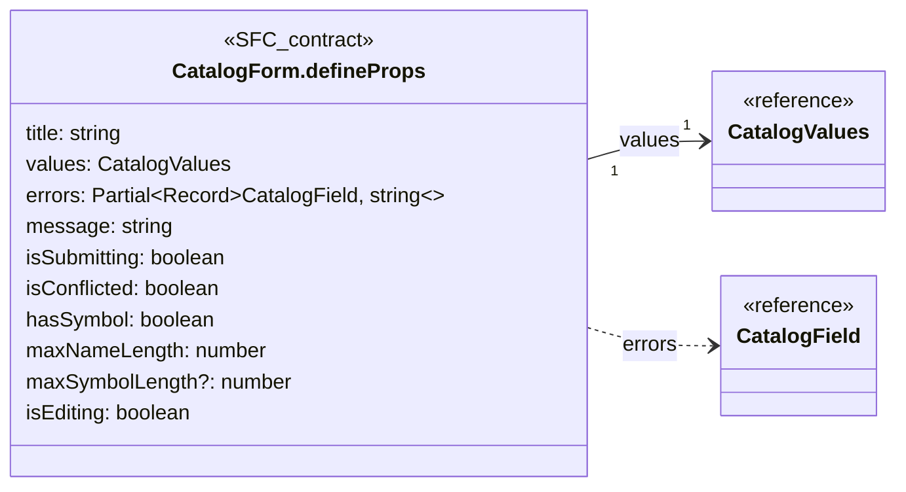

## CatalogForm.defineEmits

**Fuente:** [src/modules/catalogs/components/CatalogForm.vue](../../../../../src/modules/catalogs/components/CatalogForm.vue) · línea 19, columna 26. **Declaración:** SFC contract.

| Miembro | Firma completa |
| --- | --- |
| `update` | `update: [field: CatalogField, value: string \| boolean];` |
| `blur` | `blur: [field: CatalogField];` |
| `submit` | `submit: [];` |
| `close` | `close: [];` |
| `reload` | `reload: [];` |

| Relación | Destino | Origen de la referencia |
| --- | --- | --- |
| dependency | [CatalogField](../../../../../src/modules/catalogs/catalog.ts) | `update` |
| dependency | [CatalogField](../../../../../src/modules/catalogs/catalog.ts) | `blur` |

**Figura:** `DIA-VUE-TS-CATALOGS-11-1`.

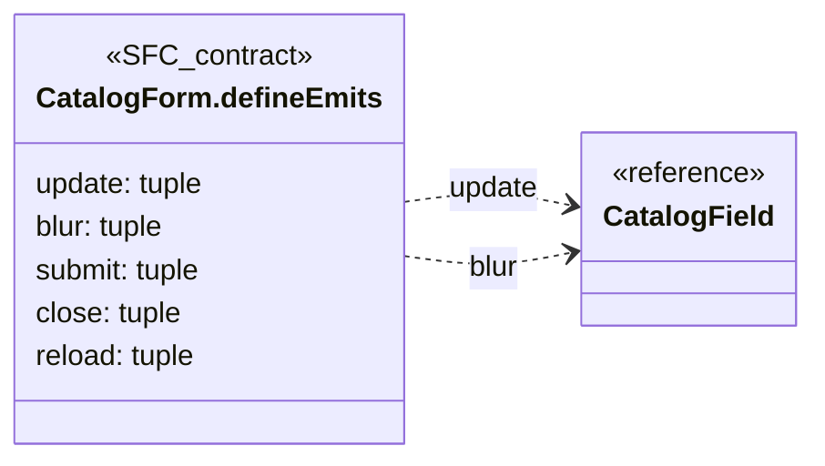

## CatalogTable.defineProps

**Fuente:** [src/modules/catalogs/components/CatalogTable.vue](../../../../../src/modules/catalogs/components/CatalogTable.vue) · línea 8, columna 27. **Declaración:** SFC contract.

| Miembro | Firma completa |
| --- | --- |
| `rows` | `rows: CatalogEntry[];` |
| `total` | `total: number;` |
| `query` | `query: CatalogQuery;` |
| `isLoading` | `isLoading: boolean;` |
| `hasSymbol` | `hasSymbol: boolean;` |

| Relación | Destino | Origen de la referencia |
| --- | --- | --- |
| association | [CatalogEntry](../../../../../src/modules/catalogs/catalog.ts) | `rows` |
| association | [CatalogQuery](../../../../../src/modules/catalogs/catalog.ts) | `query` |

**Figura:** `DIA-VUE-TS-CATALOGS-12-1`.

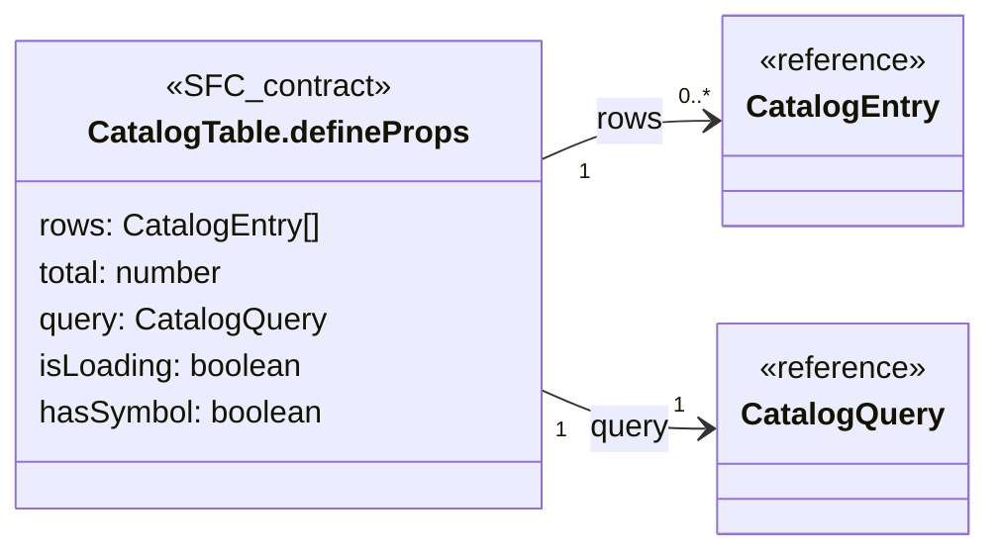

## CatalogTable.defineEmits

**Fuente:** [src/modules/catalogs/components/CatalogTable.vue](../../../../../src/modules/catalogs/components/CatalogTable.vue) · línea 15, columna 26. **Declaración:** SFC contract.

| Miembro | Firma completa |
| --- | --- |
| `edit` | `edit: [row: CatalogEntry];` |
| `query` | `query: [query: Partial<CatalogQuery>]` |

| Relación | Destino | Origen de la referencia |
| --- | --- | --- |
| dependency | [CatalogEntry](../../../../../src/modules/catalogs/catalog.ts) | `edit` |
| dependency | [CatalogQuery](../../../../../src/modules/catalogs/catalog.ts) | `query` |

**Figura:** `DIA-VUE-TS-CATALOGS-13-1`.

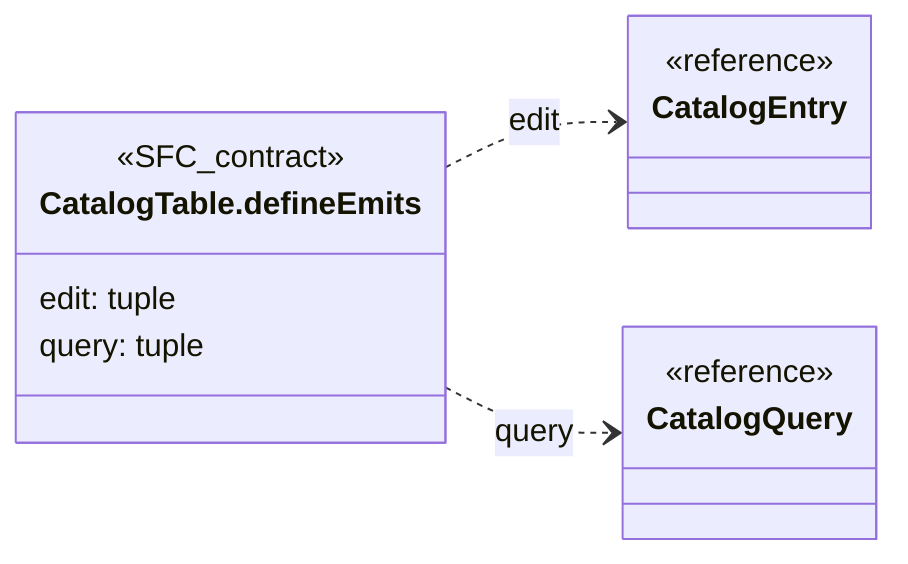

## useCatalogEditor.options@9:43

**Fuente:** [src/modules/catalogs/composables/useCatalogEditor.ts](../../../../../src/modules/catalogs/composables/useCatalogEditor.ts) · línea 9, columna 43. **Declaración:** inline object.

| Miembro | Firma completa |
| --- | --- |
| `catalog` | `catalog: CatalogName;` |
| `target` | `target: CatalogTarget;` |
| `onSaved` | `onSaved: () => void;` |
| `onDenied` | `onDenied: (status: number) => void;` |

| Relación | Destino | Origen de la referencia |
| --- | --- | --- |
| dependency | [CatalogName](../../../../../src/modules/catalogs/catalog.ts) | `catalog` |
| dependency | [CatalogTarget](../../../../../src/modules/catalogs/catalog.ts) | `target` |

**Figura:** `DIA-VUE-TS-CATALOGS-14-1`.

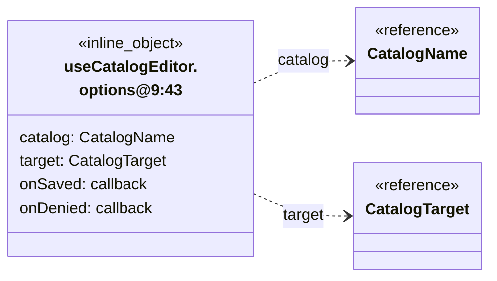

## CatalogEditorPage.defineProps

**Fuente:** [src/modules/catalogs/pages/CatalogEditorPage.vue](../../../../../src/modules/catalogs/pages/CatalogEditorPage.vue) · línea 7, columna 27. **Declaración:** SFC contract.

| Miembro | Firma completa |
| --- | --- |
| `catalog` | `catalog: CatalogName;` |
| `target` | `target: CatalogTarget` |

| Relación | Destino | Origen de la referencia |
| --- | --- | --- |
| dependency | [CatalogName](../../../../../src/modules/catalogs/catalog.ts) | `catalog` |
| dependency | [CatalogTarget](../../../../../src/modules/catalogs/catalog.ts) | `target` |

**Figura:** `DIA-VUE-TS-CATALOGS-15-1`.

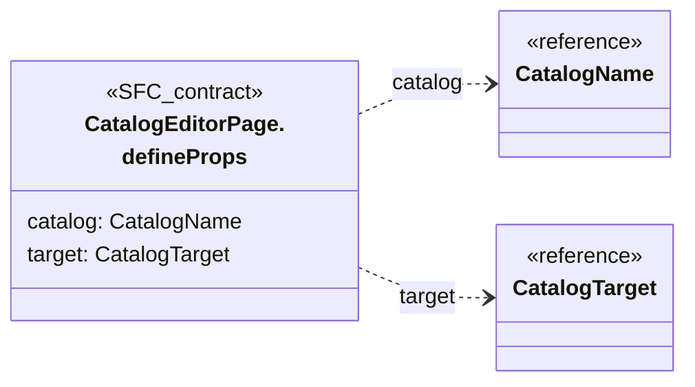

## CatalogEditorPage.defineEmits

**Fuente:** [src/modules/catalogs/pages/CatalogEditorPage.vue](../../../../../src/modules/catalogs/pages/CatalogEditorPage.vue) · línea 8, columna 26. **Declaración:** SFC contract.

| Miembro | Firma completa |
| --- | --- |
| `saved` | `saved: [];` |
| `close` | `close: [];` |
| `reload` | `reload: [];` |
| `denied` | `denied: [status: number]` |

**Figura:** `DIA-VUE-TS-CATALOGS-16-1`.

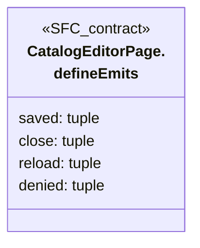

## CatalogPage.defineProps

**Fuente:** [src/modules/catalogs/pages/CatalogPage.vue](../../../../../src/modules/catalogs/pages/CatalogPage.vue) · línea 15, columna 27. **Declaración:** SFC contract.

| Miembro | Firma completa |
| --- | --- |
| `catalog` | `catalog: CatalogName` |

| Relación | Destino | Origen de la referencia |
| --- | --- | --- |
| dependency | [CatalogName](../../../../../src/modules/catalogs/catalog.ts) | `catalog` |

**Figura:** `DIA-VUE-TS-CATALOGS-17-1`.

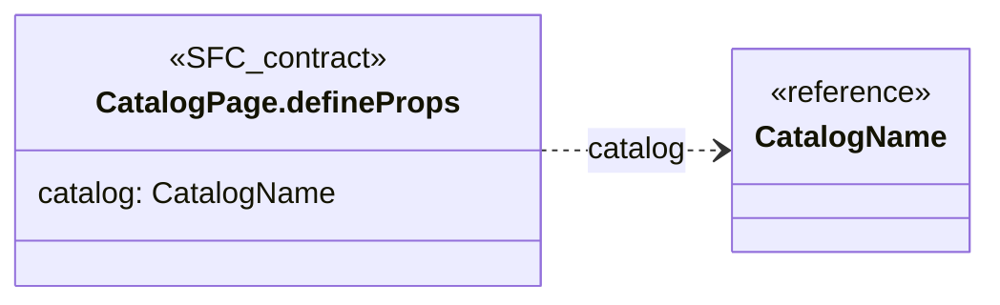

## apiClient.request@48:48

**Fuente:** [src/modules/catalogs/services/catalogService.ts](../../../../../src/modules/catalogs/services/catalogService.ts) · línea 48, columna 48. **Declaración:** inline object.

| Miembro | Firma completa |
| --- | --- |
| `code` | `code: string;` |
| `data` | `data: unknown` |

**Figura:** `DIA-VUE-TS-CATALOGS-18-1`.

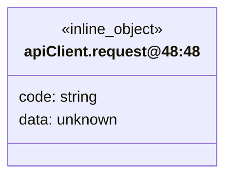

## catalogDefinition.return.variant1

**Fuente:** [src/modules/catalogs/catalog.ts](../../../../../src/modules/catalogs/catalog.ts) · línea 21, columna 34. **Declaración:** inferred return.

| Miembro | Firma completa |
| --- | --- |
| `name` | `"name": "departments" \| "roles" \| "presentations" \| "unit-measures" \| "reasons" \| "fulfillment-statuses";` |
| `maxLengths` | `"maxLengths": { name: number; symbol?: number; };` |
| `fields` | `"fields": string[];` |
| `label` | `"label": string;` |
| `entityLabel` | `"entityLabel": string;` |
| `createButtonLabel` | `"createButtonLabel": string;` |

| Relación | Destino | Origen de la referencia |
| --- | --- | --- |
| association | [catalogDefinition.return.variant1.maxLengths.shape1](../../../../../src/modules/catalogs/catalog.ts) | `maxLengths` |

**Figura:** `DIA-VUE-TS-CATALOGS-19-1`.

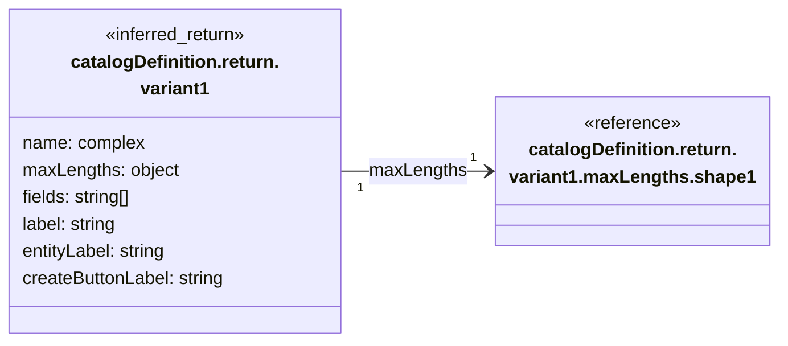

## catalogDefinition.return.variant1.maxLengths.shape1

**Fuente:** [src/modules/catalogs/catalog.ts](../../../../../src/modules/catalogs/catalog.ts) · línea 21, columna 34. **Declaración:** inferred object.

| Miembro | Firma completa |
| --- | --- |
| `name` | `name: number;` |
| `symbol` | `symbol?: number;` |

**Figura:** `DIA-VUE-TS-CATALOGS-20-1`.

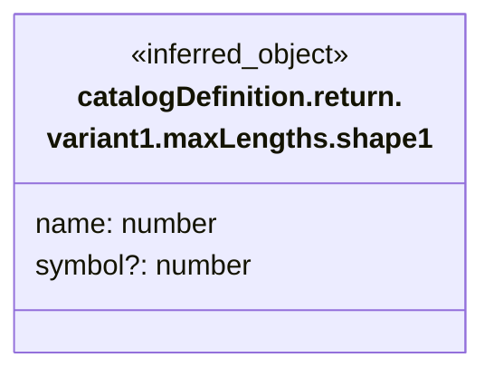

## catalogDefinition.return.variant2

**Fuente:** [src/modules/catalogs/catalog.ts](../../../../../src/modules/catalogs/catalog.ts) · línea 21, columna 34. **Declaración:** inferred return.

| Miembro | Firma completa |
| --- | --- |
| `name` | `"name": "departments" \| "roles" \| "presentations" \| "unit-measures" \| "reasons" \| "fulfillment-statuses";` |
| `maxLengths` | `"maxLengths": { name: number; symbol?: number; };` |
| `fields` | `"fields": string[];` |
| `label` | `"label": string;` |
| `entityLabel` | `"entityLabel": string;` |
| `createButtonLabel` | `"createButtonLabel": string;` |

| Relación | Destino | Origen de la referencia |
| --- | --- | --- |
| association | [catalogDefinition.return.variant2.maxLengths.shape1](../../../../../src/modules/catalogs/catalog.ts) | `maxLengths` |

**Figura:** `DIA-VUE-TS-CATALOGS-21-1`.

```mermaid
classDiagram
    direction LR
    class Subject["catalogDefinition.return.<br/>variant2"] {
        <<inferred_return>>
        name: complex
        maxLengths: object
        fields: string[]
        label: string
        entityLabel: string
        createButtonLabel: string
    }
    class R0["catalogDefinition.return.<br/>variant2.maxLengths.shape1"] {
        <<reference>>
    }
    Subject "1" --> "1" R0 : maxLengths
```

## catalogDefinition.return.variant2.maxLengths.shape1

**Fuente:** [src/modules/catalogs/catalog.ts](../../../../../src/modules/catalogs/catalog.ts) · línea 21, columna 34. **Declaración:** inferred object.

| Miembro | Firma completa |
| --- | --- |
| `name` | `name: number;` |
| `symbol` | `symbol?: number;` |

**Figura:** `DIA-VUE-TS-CATALOGS-22-1`.

```mermaid
classDiagram
    direction LR
    class Subject["catalogDefinition.return.<br/>variant2.maxLengths.shape1"] {
        <<inferred_object>>
        name: number
        symbol?: number
    }
```

## catalogDefinition.return.variant3

**Fuente:** [src/modules/catalogs/catalog.ts](../../../../../src/modules/catalogs/catalog.ts) · línea 21, columna 34. **Declaración:** inferred return.

| Miembro | Firma completa |
| --- | --- |
| `name` | `"name": "departments" \| "roles" \| "presentations" \| "unit-measures" \| "reasons" \| "fulfillment-statuses";` |
| `maxLengths` | `"maxLengths": { name: number; symbol?: number; };` |
| `fields` | `"fields": string[];` |
| `label` | `"label": string;` |
| `entityLabel` | `"entityLabel": string;` |
| `createButtonLabel` | `"createButtonLabel": string;` |

| Relación | Destino | Origen de la referencia |
| --- | --- | --- |
| association | [catalogDefinition.return.variant3.maxLengths.shape1](../../../../../src/modules/catalogs/catalog.ts) | `maxLengths` |

**Figura:** `DIA-VUE-TS-CATALOGS-23-1`.

```mermaid
classDiagram
    direction LR
    class Subject["catalogDefinition.return.<br/>variant3"] {
        <<inferred_return>>
        name: complex
        maxLengths: object
        fields: string[]
        label: string
        entityLabel: string
        createButtonLabel: string
    }
    class R0["catalogDefinition.return.<br/>variant3.maxLengths.shape1"] {
        <<reference>>
    }
    Subject "1" --> "1" R0 : maxLengths
```

## catalogDefinition.return.variant3.maxLengths.shape1

**Fuente:** [src/modules/catalogs/catalog.ts](../../../../../src/modules/catalogs/catalog.ts) · línea 21, columna 34. **Declaración:** inferred object.

| Miembro | Firma completa |
| --- | --- |
| `name` | `name: number;` |
| `symbol` | `symbol?: number;` |

**Figura:** `DIA-VUE-TS-CATALOGS-24-1`.

```mermaid
classDiagram
    direction LR
    class Subject["catalogDefinition.return.<br/>variant3.maxLengths.shape1"] {
        <<inferred_object>>
        name: number
        symbol?: number
    }
```

## catalogDefinition.return.variant4

**Fuente:** [src/modules/catalogs/catalog.ts](../../../../../src/modules/catalogs/catalog.ts) · línea 21, columna 34. **Declaración:** inferred return.

| Miembro | Firma completa |
| --- | --- |
| `name` | `"name": "departments" \| "roles" \| "presentations" \| "unit-measures" \| "reasons" \| "fulfillment-statuses";` |
| `maxLengths` | `"maxLengths": { name: number; symbol?: number; };` |
| `fields` | `"fields": string[];` |
| `label` | `"label": string;` |
| `entityLabel` | `"entityLabel": string;` |
| `createButtonLabel` | `"createButtonLabel": string;` |

| Relación | Destino | Origen de la referencia |
| --- | --- | --- |
| association | [catalogDefinition.return.variant4.maxLengths.shape1](../../../../../src/modules/catalogs/catalog.ts) | `maxLengths` |

**Figura:** `DIA-VUE-TS-CATALOGS-25-1`.

```mermaid
classDiagram
    direction LR
    class Subject["catalogDefinition.return.<br/>variant4"] {
        <<inferred_return>>
        name: complex
        maxLengths: object
        fields: string[]
        label: string
        entityLabel: string
        createButtonLabel: string
    }
    class R0["catalogDefinition.return.<br/>variant4.maxLengths.shape1"] {
        <<reference>>
    }
    Subject "1" --> "1" R0 : maxLengths
```

## catalogDefinition.return.variant4.maxLengths.shape1

**Fuente:** [src/modules/catalogs/catalog.ts](../../../../../src/modules/catalogs/catalog.ts) · línea 21, columna 34. **Declaración:** inferred object.

| Miembro | Firma completa |
| --- | --- |
| `name` | `name: number;` |
| `symbol` | `symbol?: number;` |

**Figura:** `DIA-VUE-TS-CATALOGS-26-1`.

```mermaid
classDiagram
    direction LR
    class Subject["catalogDefinition.return.<br/>variant4.maxLengths.shape1"] {
        <<inferred_object>>
        name: number
        symbol?: number
    }
```

## catalogDefinition.return.variant5

**Fuente:** [src/modules/catalogs/catalog.ts](../../../../../src/modules/catalogs/catalog.ts) · línea 21, columna 34. **Declaración:** inferred return.

| Miembro | Firma completa |
| --- | --- |
| `name` | `"name": "departments" \| "roles" \| "presentations" \| "unit-measures" \| "reasons" \| "fulfillment-statuses";` |
| `maxLengths` | `"maxLengths": { name: number; symbol?: number; };` |
| `fields` | `"fields": string[];` |
| `label` | `"label": string;` |
| `entityLabel` | `"entityLabel": string;` |
| `createButtonLabel` | `"createButtonLabel": string;` |

| Relación | Destino | Origen de la referencia |
| --- | --- | --- |
| association | [catalogDefinition.return.variant5.maxLengths.shape1](../../../../../src/modules/catalogs/catalog.ts) | `maxLengths` |

**Figura:** `DIA-VUE-TS-CATALOGS-27-1`.

```mermaid
classDiagram
    direction LR
    class Subject["catalogDefinition.return.<br/>variant5"] {
        <<inferred_return>>
        name: complex
        maxLengths: object
        fields: string[]
        label: string
        entityLabel: string
        createButtonLabel: string
    }
    class R0["catalogDefinition.return.<br/>variant5.maxLengths.shape1"] {
        <<reference>>
    }
    Subject "1" --> "1" R0 : maxLengths
```

## catalogDefinition.return.variant5.maxLengths.shape1

**Fuente:** [src/modules/catalogs/catalog.ts](../../../../../src/modules/catalogs/catalog.ts) · línea 21, columna 34. **Declaración:** inferred object.

| Miembro | Firma completa |
| --- | --- |
| `name` | `name: number;` |
| `symbol` | `symbol?: number;` |

**Figura:** `DIA-VUE-TS-CATALOGS-28-1`.

```mermaid
classDiagram
    direction LR
    class Subject["catalogDefinition.return.<br/>variant5.maxLengths.shape1"] {
        <<inferred_object>>
        name: number
        symbol?: number
    }
```

## catalogDefinition.return.variant6

**Fuente:** [src/modules/catalogs/catalog.ts](../../../../../src/modules/catalogs/catalog.ts) · línea 21, columna 34. **Declaración:** inferred return.

| Miembro | Firma completa |
| --- | --- |
| `name` | `"name": "departments" \| "roles" \| "presentations" \| "unit-measures" \| "reasons" \| "fulfillment-statuses";` |
| `maxLengths` | `"maxLengths": { name: number; symbol?: number; };` |
| `fields` | `"fields": string[];` |
| `label` | `"label": string;` |
| `entityLabel` | `"entityLabel": string;` |
| `createButtonLabel` | `"createButtonLabel": string;` |

| Relación | Destino | Origen de la referencia |
| --- | --- | --- |
| association | [catalogDefinition.return.variant6.maxLengths.shape1](../../../../../src/modules/catalogs/catalog.ts) | `maxLengths` |

**Figura:** `DIA-VUE-TS-CATALOGS-29-1`.

```mermaid
classDiagram
    direction LR
    class Subject["catalogDefinition.return.<br/>variant6"] {
        <<inferred_return>>
        name: complex
        maxLengths: object
        fields: string[]
        label: string
        entityLabel: string
        createButtonLabel: string
    }
    class R0["catalogDefinition.return.<br/>variant6.maxLengths.shape1"] {
        <<reference>>
    }
    Subject "1" --> "1" R0 : maxLengths
```

## catalogDefinition.return.variant6.maxLengths.shape1

**Fuente:** [src/modules/catalogs/catalog.ts](../../../../../src/modules/catalogs/catalog.ts) · línea 21, columna 34. **Declaración:** inferred object.

| Miembro | Firma completa |
| --- | --- |
| `name` | `name: number;` |
| `symbol` | `symbol?: number;` |

**Figura:** `DIA-VUE-TS-CATALOGS-30-1`.

```mermaid
classDiagram
    direction LR
    class Subject["catalogDefinition.return.<br/>variant6.maxLengths.shape1"] {
        <<inferred_object>>
        name: number
        symbol?: number
    }
```

## buildCatalogPayload.return

**Fuente:** [src/modules/catalogs/catalog.ts](../../../../../src/modules/catalogs/catalog.ts) · línea 27, columna 36. **Declaración:** inferred return.

| Miembro | Firma completa |
| --- | --- |
| `expectedVersion` | `"expectedVersion"?: number \| undefined;` |
| `isActive` | `"isActive": boolean;` |
| `symbol` | `"symbol"?: string \| undefined;` |
| `name` | `"name": string;` |

**Figura:** `DIA-VUE-TS-CATALOGS-31-1`.

```mermaid
classDiagram
    direction LR
    class Subject["buildCatalogPayload.return"] {
        <<inferred_return>>
        expectedVersion?: number | undefined
        isActive: boolean
        symbol?: string | undefined
        name: string
    }
```

## useCatalogEditor.return

**Fuente:** [src/modules/catalogs/composables/useCatalogEditor.ts](../../../../../src/modules/catalogs/composables/useCatalogEditor.ts) · línea 9, columna 33. **Declaración:** inferred return.

| Miembro | Firma completa |
| --- | --- |
| `isSubmitting` | `"isSubmitting": Ref<boolean, boolean>;` |
| `update` | `"update": (field: CatalogField, value: string \| boolean) => void;` |
| `blur` | `"blur": (field: CatalogField) => Promise<unknown> \| undefined;` |
| `submit` | `"submit": () => Promise<Promise<void> \| undefined> \| undefined;` |
| `message` | `"message": Ref<string, string>;` |
| `isConflicted` | `"isConflicted": Ref<boolean, boolean>;` |
| `execute` | `"execute": (operation: (signal: AbortSignal) => Promise<unknown>) => Promise<void>;` |
| `signal` | `"signal": AbortSignal;` |
| `isDisposed` | `"isDisposed": () => boolean;` |
| `values` | `"values": CatalogValues;` |
| `errors` | `"errors": ComputedRef<Partial<Record<"" \| "symbol" \| "name" \| "isActive", string \| undefined>>>;` |

| Relación | Destino | Origen de la referencia |
| --- | --- | --- |
| dependency | [CatalogField](../../../../../src/modules/catalogs/catalog.ts) | `update` |
| dependency | [CatalogField](../../../../../src/modules/catalogs/catalog.ts) | `blur` |
| association | [CatalogValues](../../../../../src/modules/catalogs/catalog.ts) | `values` |

**Figura:** `DIA-VUE-TS-CATALOGS-32-1`.

```mermaid
classDiagram
    direction LR
    class Subject["useCatalogEditor.return"] {
        <<inferred_return>>
        isSubmitting: Ref~boolean, boolean~
        update: callback
        blur: callback
        submit: callback
        message: Ref~string, string~
        isConflicted: Ref~boolean, boolean~
        execute: callback
        signal: AbortSignal
        isDisposed: callback
        values: CatalogValues
        errors: complex
    }
    class R0["CatalogField"] {
        <<reference>>
    }
    class R1["CatalogValues"] {
        <<reference>>
    }
    Subject ..> R0 : update
    Subject ..> R0 : blur
    Subject "1" --> "1" R1 : values
```

## useCatalogList.return

**Fuente:** [src/modules/catalogs/composables/useCatalogList.ts](../../../../../src/modules/catalogs/composables/useCatalogList.ts) · línea 6, columna 31. **Declaración:** inferred return.

| Miembro | Firma completa |
| --- | --- |
| `query` | `"query": ShallowReactive<CatalogQuery>;` |
| `rows` | `"rows": ShallowRef<CatalogEntry[], CatalogEntry[]>;` |
| `total` | `"total": Ref<number, number>;` |
| `isLoading` | `"isLoading": Ref<boolean, boolean>;` |
| `isRefreshing` | `"isRefreshing": Ref<boolean, boolean>;` |
| `error` | `"error": Ref<string, string>;` |
| `load` | `"load": () => Promise<void>;` |
| `refresh` | `"refresh": () => Promise<void>;` |
| `applyQuery` | `"applyQuery": (changes: Partial<CatalogQuery>) => void;` |

| Relación | Destino | Origen de la referencia |
| --- | --- | --- |
| dependency | [CatalogQuery](../../../../../src/modules/catalogs/catalog.ts) | `query` |
| dependency | [CatalogEntry](../../../../../src/modules/catalogs/catalog.ts) | `rows` |
| dependency | [CatalogQuery](../../../../../src/modules/catalogs/catalog.ts) | `applyQuery` |

**Figura:** `DIA-VUE-TS-CATALOGS-33-1`.

```mermaid
classDiagram
    direction LR
    class Subject["useCatalogList.return"] {
        <<inferred_return>>
        query: ShallowReactive~CatalogQuery~
        rows: ShallowRef~CatalogEntry[], CatalogEntry[]~
        total: Ref~number, number~
        isLoading: Ref~boolean, boolean~
        isRefreshing: Ref~boolean, boolean~
        error: Ref~string, string~
        load: callback
        refresh: callback
        applyQuery: callback
    }
    class R0["CatalogQuery"] {
        <<reference>>
    }
    class R1["CatalogEntry"] {
        <<reference>>
    }
    Subject ..> R0 : query
    Subject ..> R1 : rows
    Subject ..> R0 : applyQuery
```

## catalogService

**Fuente:** [src/modules/catalogs/services/catalogService.ts](../../../../../src/modules/catalogs/services/catalogService.ts) · línea 32, columna 14. **Declaración:** inferred export.

| Miembro | Firma completa |
| --- | --- |
| `list` | `"list": (catalog: CatalogName, query: CatalogQuery, signal?: AbortSignal) => Promise<{ data: CatalogEntry[]; recordsFiltered: number; recordsTotal: number; }>;` |
| `save` | `"save": (catalog: CatalogName, target: CatalogTarget, payload: Record<string, unknown>, signal?: AbortSignal) => Promise<CatalogEntry>;` |

| Relación | Destino | Origen de la referencia |
| --- | --- | --- |
| dependency | [CatalogName](../../../../../src/modules/catalogs/catalog.ts) | `list` |
| dependency | [CatalogQuery](../../../../../src/modules/catalogs/catalog.ts) | `list` |
| dependency | [catalogService.list.shape1](../../../../../src/modules/catalogs/services/catalogService.ts) | `list` |
| dependency | [CatalogName](../../../../../src/modules/catalogs/catalog.ts) | `save` |
| dependency | [CatalogTarget](../../../../../src/modules/catalogs/catalog.ts) | `save` |
| dependency | [CatalogEntry](../../../../../src/modules/catalogs/catalog.ts) | `save` |

**Figura:** `DIA-VUE-TS-CATALOGS-34-1`. Parte 1/2.

```mermaid
classDiagram
    direction LR
    class Subject["catalogService"] {
        <<inferred_export>>
        list: callback
        save: callback
    }
    class R0["CatalogName"] {
        <<reference>>
    }
    class R1["CatalogQuery"] {
        <<reference>>
    }
    class R2["catalogService.list.shape1"] {
        <<reference>>
    }
    class R3["CatalogTarget"] {
        <<reference>>
    }
    Subject ..> R0 : list
    Subject ..> R1 : list
    Subject ..> R2 : list
    Subject ..> R0 : save
    Subject ..> R3 : save
```

**Figura:** `DIA-VUE-TS-CATALOGS-34-2`. Parte 2/2.

```mermaid
classDiagram
    direction LR
    class Subject["catalogService"] {
        <<inferred_export>>
        save: callback
    }
    class R0["CatalogEntry"] {
        <<reference>>
    }
    Subject ..> R0 : save
```

## catalogService.list.shape1

**Fuente:** [src/modules/catalogs/services/catalogService.ts](../../../../../src/modules/catalogs/services/catalogService.ts) · línea 32, columna 14. **Declaración:** inferred object.

| Miembro | Firma completa |
| --- | --- |
| `data` | `data: CatalogEntry[];` |
| `recordsFiltered` | `recordsFiltered: number;` |
| `recordsTotal` | `recordsTotal: number;` |

| Relación | Destino | Origen de la referencia |
| --- | --- | --- |
| association | [CatalogEntry](../../../../../src/modules/catalogs/catalog.ts) | `data` |

**Figura:** `DIA-VUE-TS-CATALOGS-35-1`.

```mermaid
classDiagram
    direction LR
    class Subject["catalogService.list.shape1"] {
        <<inferred_object>>
        data: CatalogEntry[]
        recordsFiltered: number
        recordsTotal: number
    }
    class R0["CatalogEntry"] {
        <<reference>>
    }
    Subject "1" --> "0..*" R0 : data
```
