# Contratos TypeScript: directory

Generado con `npm run docs:generate`. No editar manualmente.

Cada figura incluye hasta ocho miembros y dos relaciones; las partes reúnen el contrato completo.
Los destinos sin atributos son referencias: su definición completa aparece en su propia ficha.
Los objetos inline declarados muestran contexto, línea y columna. Las formas inferidas usan shapeN dentro del contrato padre; su fuente apunta al export o función original. No son clases instanciadas.

[Lectura y cobertura](index.md).

## DirectoryForm.defineProps

**Fuente:** [src/modules/directory/components/DirectoryForm.vue](../../../../../src/modules/directory/components/DirectoryForm.vue) · línea 7, columna 13. **Declaración:** SFC contract.

| Miembro | Firma completa |
| --- | --- |
| `resource` | `resource: DirectoryResource;` |
| `title` | `title: string;` |
| `values` | `values: DirectoryValues;` |
| `errors` | `errors: Partial<Record<DirectoryField, string>>;` |
| `message` | `message: string;` |
| `isSubmitting` | `isSubmitting: boolean;` |
| `isConflicted` | `isConflicted: boolean;` |
| `isEditing` | `isEditing: boolean;` |

| Relación | Destino | Origen de la referencia |
| --- | --- | --- |
| dependency | [DirectoryResource](../../../../../src/modules/directory/directory.ts) | `resource` |
| association | [DirectoryValues](../../../../../src/modules/directory/directory.ts) | `values` |
| dependency | `Partial` | `errors` |
| dependency | `Record` | `errors` |
| dependency | [DirectoryField](../../../../../src/modules/directory/directory.ts) | `errors` |

**Figura:** `DIA-VUE-TS-DIRECTORY-1-1`. Parte 1/3.

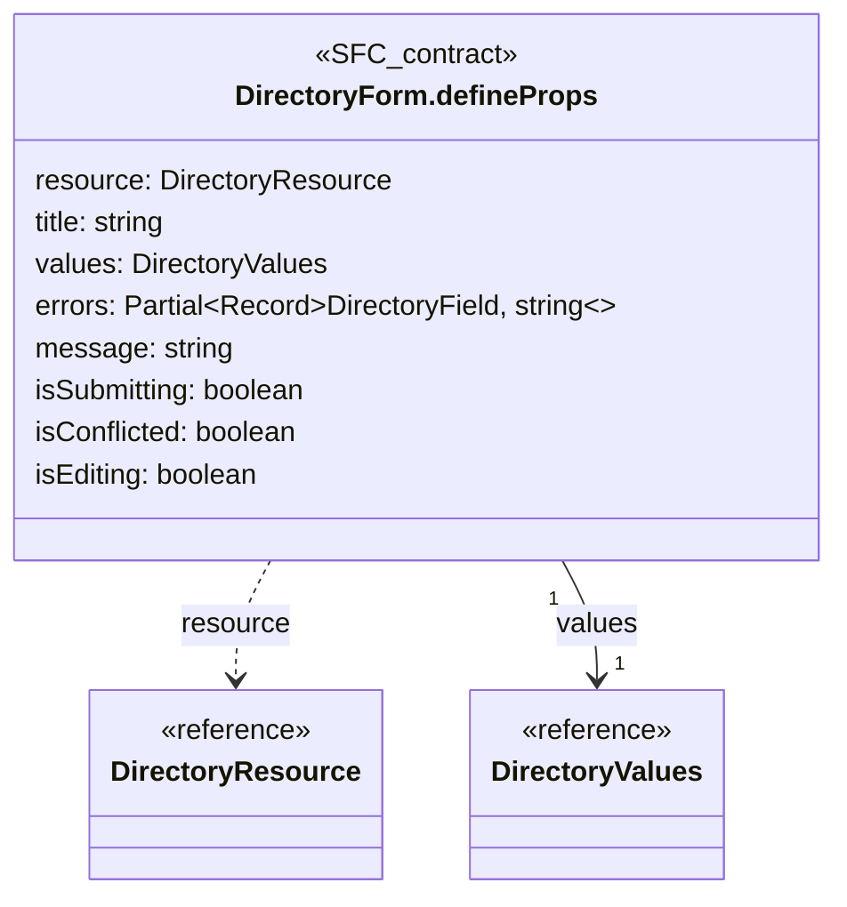

**Figura:** `DIA-VUE-TS-DIRECTORY-1-2`. Parte 2/3.

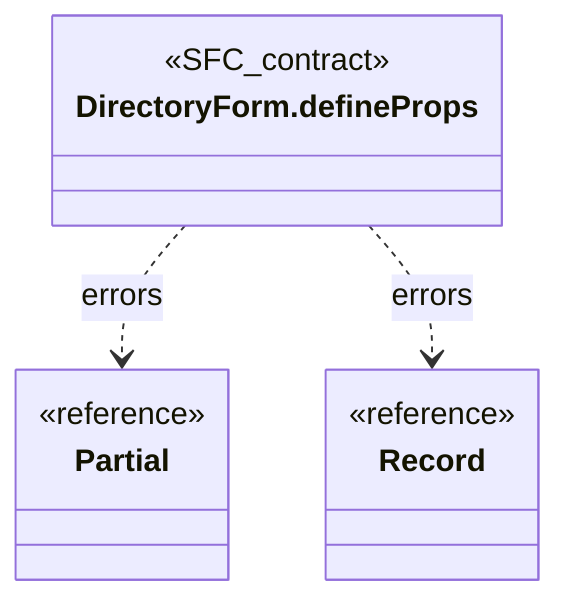

**Figura:** `DIA-VUE-TS-DIRECTORY-1-3`. Parte 3/3.

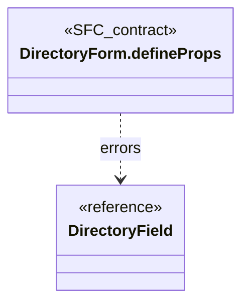

## DirectoryForm.defineEmits

**Fuente:** [src/modules/directory/components/DirectoryForm.vue](../../../../../src/modules/directory/components/DirectoryForm.vue) · línea 17, columna 26. **Declaración:** SFC contract.

| Miembro | Firma completa |
| --- | --- |
| `update` | `update: [field: DirectoryField, value: string \| boolean];` |
| `blur` | `blur: [field: DirectoryField];` |
| `submit` | `submit: [];` |
| `close` | `close: [];` |
| `reload` | `reload: [];` |

| Relación | Destino | Origen de la referencia |
| --- | --- | --- |
| dependency | [DirectoryField](../../../../../src/modules/directory/directory.ts) | `update` |
| dependency | [DirectoryField](../../../../../src/modules/directory/directory.ts) | `blur` |

**Figura:** `DIA-VUE-TS-DIRECTORY-2-1`. Parte 1/1.

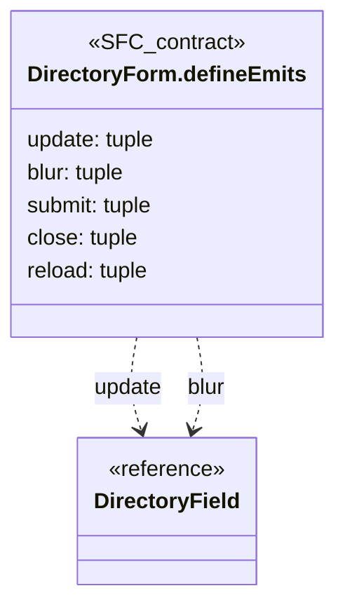

## DirectoryTable.defineProps

**Fuente:** [src/modules/directory/components/DirectoryTable.vue](../../../../../src/modules/directory/components/DirectoryTable.vue) · línea 11, columna 27. **Declaración:** SFC contract.

| Miembro | Firma completa |
| --- | --- |
| `resource` | `resource: DirectoryResource;` |
| `rows` | `rows: DirectoryEntry[];` |
| `query` | `query: RecordQuery;` |
| `total` | `total: number;` |
| `isLoading` | `isLoading: boolean;` |
| `canEdit` | `canEdit: boolean;` |
| `canSeeState` | `canSeeState: boolean;` |

| Relación | Destino | Origen de la referencia |
| --- | --- | --- |
| dependency | [DirectoryResource](../../../../../src/modules/directory/directory.ts) | `resource` |
| association | [DirectoryEntry](../../../../../src/modules/directory/directory.ts) | `rows` |
| association | [RecordQuery](../../../../../src/shared/list.ts) | `query` |

**Figura:** `DIA-VUE-TS-DIRECTORY-3-1`. Parte 1/2.

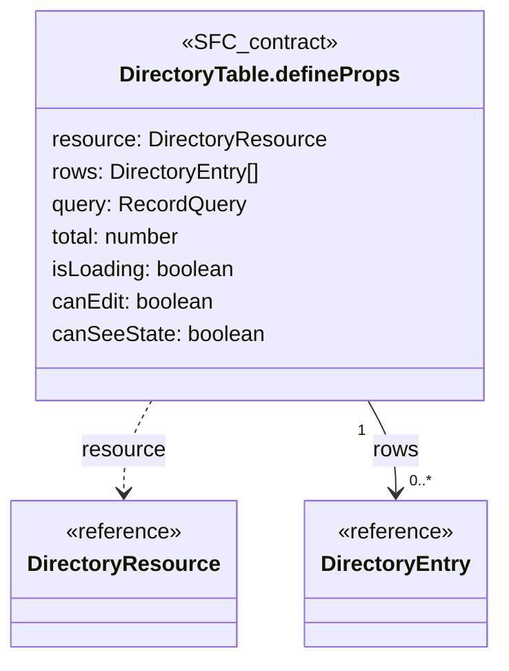

**Figura:** `DIA-VUE-TS-DIRECTORY-3-2`. Parte 2/2.

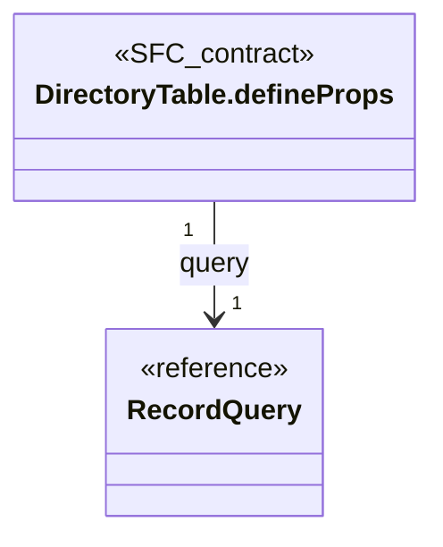

## DirectoryTable.defineEmits

**Fuente:** [src/modules/directory/components/DirectoryTable.vue](../../../../../src/modules/directory/components/DirectoryTable.vue) · línea 20, columna 26. **Declaración:** SFC contract.

| Miembro | Firma completa |
| --- | --- |
| `edit` | `edit: [row: DirectoryEntry];` |
| `query` | `query: [changes: Partial<RecordQuery>]` |

| Relación | Destino | Origen de la referencia |
| --- | --- | --- |
| dependency | [DirectoryEntry](../../../../../src/modules/directory/directory.ts) | `edit` |
| dependency | `Partial` | `query` |
| dependency | [RecordQuery](../../../../../src/shared/list.ts) | `query` |

**Figura:** `DIA-VUE-TS-DIRECTORY-4-1`. Parte 1/2.

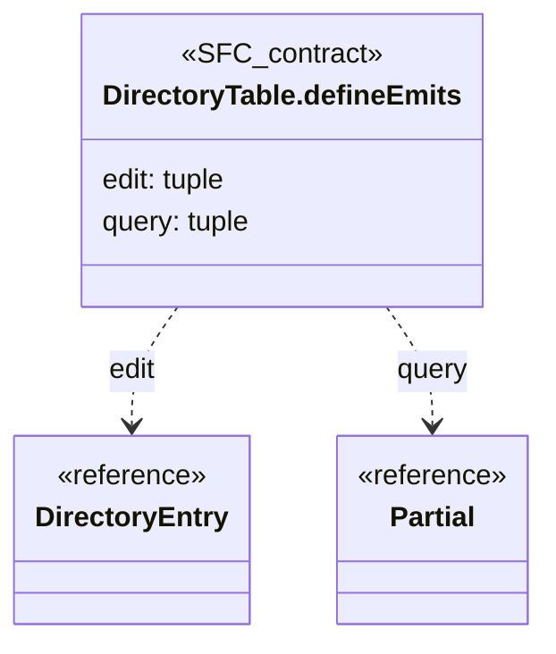

**Figura:** `DIA-VUE-TS-DIRECTORY-4-2`. Parte 2/2.

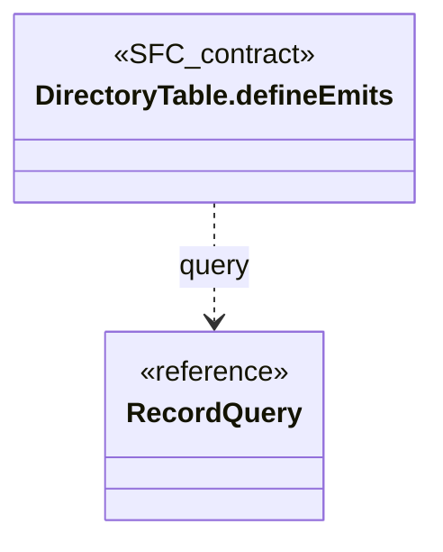

## useDirectoryEditor.options@15:45

**Fuente:** [src/modules/directory/composables/useDirectoryEditor.ts](../../../../../src/modules/directory/composables/useDirectoryEditor.ts) · línea 15, columna 45. **Declaración:** inline object.

| Miembro | Firma completa |
| --- | --- |
| `resource` | `resource: DirectoryResource;` |
| `target` | `target: DirectoryTarget;` |
| `onSaved` | `onSaved: (entry?: DirectoryEntry) => void;` |
| `onDenied` | `onDenied: (status: number) => void;` |

| Relación | Destino | Origen de la referencia |
| --- | --- | --- |
| dependency | [DirectoryResource](../../../../../src/modules/directory/directory.ts) | `resource` |
| dependency | [DirectoryTarget](../../../../../src/modules/directory/directory.ts) | `target` |
| dependency | [DirectoryEntry](../../../../../src/modules/directory/directory.ts) | `onSaved` |

**Figura:** `DIA-VUE-TS-DIRECTORY-5-1`. Parte 1/2.

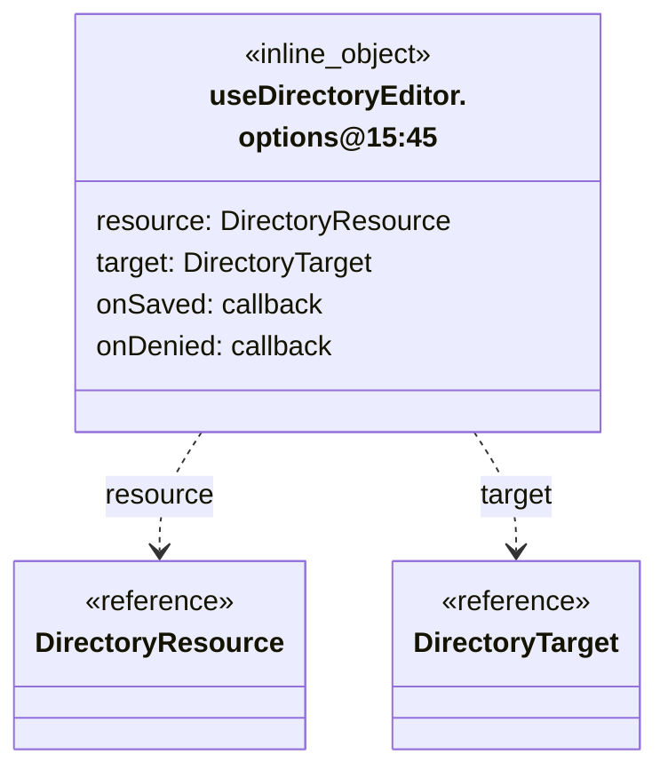

**Figura:** `DIA-VUE-TS-DIRECTORY-5-2`. Parte 2/2.

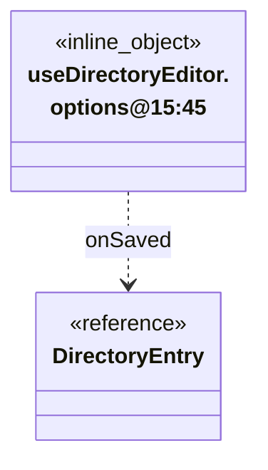

## DirectoryResource

**Fuente:** [src/modules/directory/directory.ts](../../../../../src/modules/directory/directory.ts) · línea 3, columna 1. **Declaración:** type.

**Definición completa:**

```typescript
'clients' | 'suppliers'
```

**Figura:** `DIA-VUE-TS-DIRECTORY-6-1`. Parte 1/1.

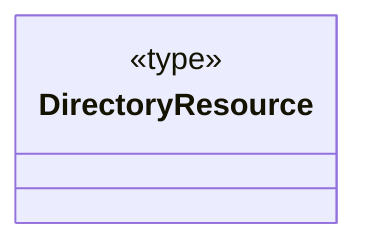

## DirectoryValues

**Fuente:** [src/modules/directory/directory.ts](../../../../../src/modules/directory/directory.ts) · línea 4, columna 1. **Declaración:** interface.

| Miembro | Firma completa |
| --- | --- |
| `name` | `name: string;` |
| `legalName` | `legalName: string;` |
| `tradeName` | `tradeName: string;` |
| `isActive` | `isActive: boolean;` |

**Figura:** `DIA-VUE-TS-DIRECTORY-7-1`. Parte 1/1.

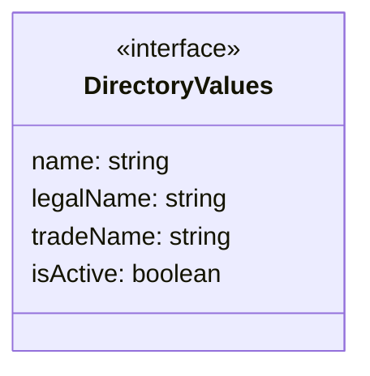

## DirectoryEntry

**Fuente:** [src/modules/directory/directory.ts](../../../../../src/modules/directory/directory.ts) · línea 10, columna 1. **Declaración:** interface.

**Extensión/implementación:** `extends DirectoryValues`.

| Miembro | Firma completa |
| --- | --- |
| `id` | `id: string;` |
| `version` | `version: number;` |

| Relación | Destino | Origen de la referencia |
| --- | --- | --- |
| inheritance | [DirectoryValues](../../../../../src/modules/directory/directory.ts) | `extends` |

**Figura:** `DIA-VUE-TS-DIRECTORY-8-1`. Parte 1/1.

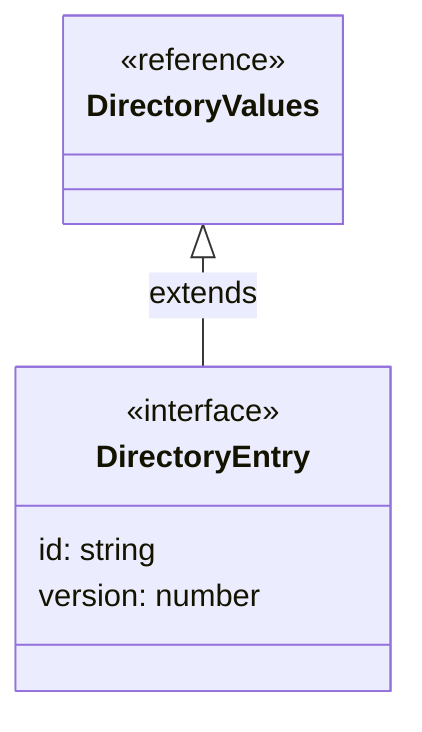

## DirectoryTarget

**Fuente:** [src/modules/directory/directory.ts](../../../../../src/modules/directory/directory.ts) · línea 14, columna 1. **Declaración:** type.

**Definición completa:**

```typescript
{ action: 'create'; initialName?: string } | { action: 'edit'; row: DirectoryEntry }
```

| Relación | Destino | Origen de la referencia |
| --- | --- | --- |
| dependency | [DirectoryTarget@15:5](../../../../../src/modules/directory/directory.ts) | `type` |
| dependency | [DirectoryTarget@15:50](../../../../../src/modules/directory/directory.ts) | `type` |

**Figura:** `DIA-VUE-TS-DIRECTORY-9-1`. Parte 1/1.

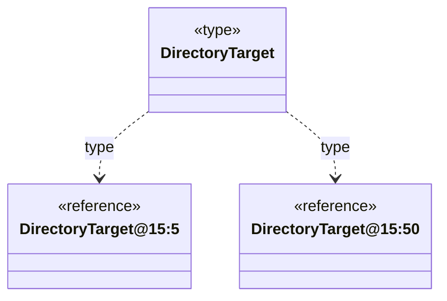

## DirectoryTarget@15:5

**Fuente:** [src/modules/directory/directory.ts](../../../../../src/modules/directory/directory.ts) · línea 15, columna 5. **Declaración:** inline object.

| Miembro | Firma completa |
| --- | --- |
| `action` | `action: 'create';` |
| `initialName` | `initialName?: string` |

**Figura:** `DIA-VUE-TS-DIRECTORY-10-1`. Parte 1/1.

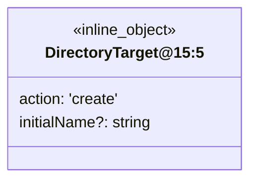

## DirectoryTarget@15:50

**Fuente:** [src/modules/directory/directory.ts](../../../../../src/modules/directory/directory.ts) · línea 15, columna 50. **Declaración:** inline object.

| Miembro | Firma completa |
| --- | --- |
| `action` | `action: 'edit';` |
| `row` | `row: DirectoryEntry` |

| Relación | Destino | Origen de la referencia |
| --- | --- | --- |
| association | [DirectoryEntry](../../../../../src/modules/directory/directory.ts) | `row` |

**Figura:** `DIA-VUE-TS-DIRECTORY-11-1`. Parte 1/1.

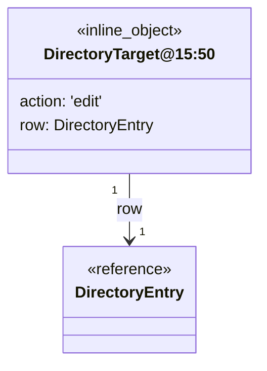

## DirectoryField

**Fuente:** [src/modules/directory/directory.ts](../../../../../src/modules/directory/directory.ts) · línea 16, columna 1. **Declaración:** type.

**Definición completa:**

```typescript
keyof DirectoryValues
```

| Relación | Destino | Origen de la referencia |
| --- | --- | --- |
| dependency | [DirectoryValues](../../../../../src/modules/directory/directory.ts) | `type` |

**Figura:** `DIA-VUE-TS-DIRECTORY-12-1`. Parte 1/1.

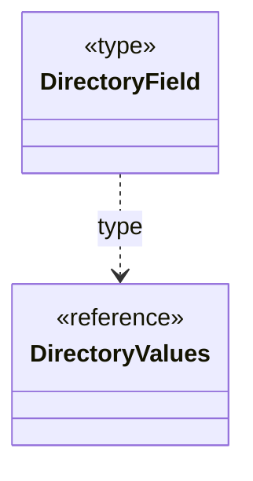

## DirectoryEditorPage.defineProps

**Fuente:** [src/modules/directory/pages/DirectoryEditorPage.vue](../../../../../src/modules/directory/pages/DirectoryEditorPage.vue) · línea 7, columna 27. **Declaración:** SFC contract.

| Miembro | Firma completa |
| --- | --- |
| `resource` | `resource: DirectoryResource;` |
| `target` | `target: DirectoryTarget` |

| Relación | Destino | Origen de la referencia |
| --- | --- | --- |
| dependency | [DirectoryResource](../../../../../src/modules/directory/directory.ts) | `resource` |
| dependency | [DirectoryTarget](../../../../../src/modules/directory/directory.ts) | `target` |

**Figura:** `DIA-VUE-TS-DIRECTORY-13-1`. Parte 1/1.

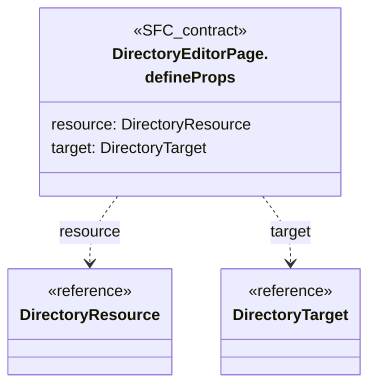

## DirectoryEditorPage.defineEmits

**Fuente:** [src/modules/directory/pages/DirectoryEditorPage.vue](../../../../../src/modules/directory/pages/DirectoryEditorPage.vue) · línea 8, columna 26. **Declaración:** SFC contract.

| Miembro | Firma completa |
| --- | --- |
| `saved` | `saved: [entry?: DirectoryEntry];` |
| `close` | `close: [];` |
| `reload` | `reload: [];` |
| `denied` | `denied: [status: number];` |

| Relación | Destino | Origen de la referencia |
| --- | --- | --- |
| dependency | [DirectoryEntry](../../../../../src/modules/directory/directory.ts) | `saved` |

**Figura:** `DIA-VUE-TS-DIRECTORY-14-1`. Parte 1/1.

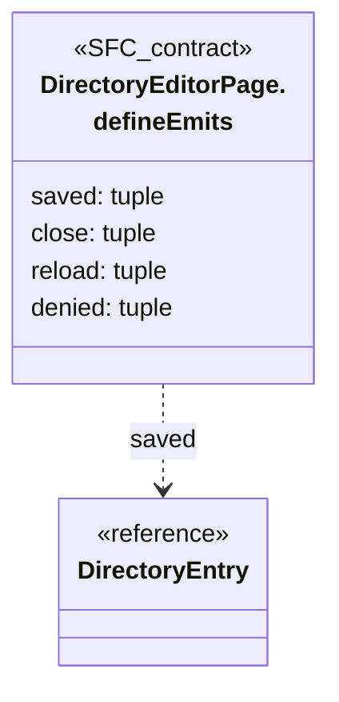

## DirectoryPage.defineProps

**Fuente:** [src/modules/directory/pages/DirectoryPage.vue](../../../../../src/modules/directory/pages/DirectoryPage.vue) · línea 20, columna 27. **Declaración:** SFC contract.

| Miembro | Firma completa |
| --- | --- |
| `resource` | `resource: DirectoryResource` |

| Relación | Destino | Origen de la referencia |
| --- | --- | --- |
| dependency | [DirectoryResource](../../../../../src/modules/directory/directory.ts) | `resource` |

**Figura:** `DIA-VUE-TS-DIRECTORY-15-1`. Parte 1/1.

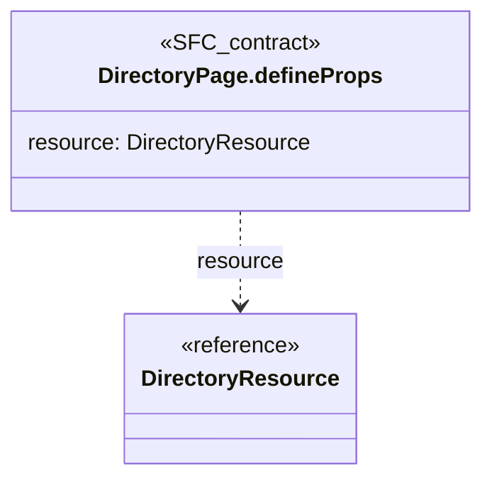

## useDirectoryEditor.return

**Fuente:** [src/modules/directory/composables/useDirectoryEditor.ts](../../../../../src/modules/directory/composables/useDirectoryEditor.ts) · línea 15, columna 35. **Declaración:** inferred return.

| Miembro | Firma completa |
| --- | --- |
| `submit` | `"submit": () => Promise<Promise<void> \| undefined> \| undefined;` |
| `update` | `"update": (field: keyof DirectoryValues, value: string \| boolean) => void;` |
| `blur` | `"blur": (field: keyof DirectoryValues) => Promise<unknown> \| undefined;` |
| `message` | `"message": Ref<string, string>;` |
| `isSubmitting` | `"isSubmitting": Ref<boolean, boolean>;` |
| `isConflicted` | `"isConflicted": Ref<boolean, boolean>;` |
| `execute` | `"execute": (operation: (signal: AbortSignal) => Promise<unknown>) => Promise<void>;` |
| `signal` | `"signal": AbortSignal;` |
| `isDisposed` | `"isDisposed": () => boolean;` |
| `values` | `"values": DirectoryValues;` |
| `errors` | `"errors": ComputedRef<Partial<Record<"" \| "name" \| "isActive" \| "legalName" \| "tradeName", string \| undefined>>>;` |

| Relación | Destino | Origen de la referencia |
| --- | --- | --- |
| dependency | `Promise` | `submit` |
| dependency | [DirectoryValues](../../../../../src/modules/directory/directory.ts) | `update` |
| dependency | [DirectoryValues](../../../../../src/modules/directory/directory.ts) | `blur` |
| dependency | `Promise` | `blur` |
| dependency | `Ref` | `message` |
| dependency | `Ref` | `isSubmitting` |
| dependency | `Ref` | `isConflicted` |
| dependency | `AbortSignal` | `execute` |
| dependency | `Promise` | `execute` |
| dependency | `AbortSignal` | `signal` |
| association | [DirectoryValues](../../../../../src/modules/directory/directory.ts) | `values` |
| dependency | `ComputedRef` | `errors` |
| dependency | `Partial` | `errors` |
| dependency | `Record` | `errors` |

**Figura:** `DIA-VUE-TS-DIRECTORY-16-1`. Parte 1/7.

```mermaid
classDiagram
    direction TB
    class Subject["useDirectoryEditor.return"] {
        <<inferred_return>>
        submit: callback
        update: callback
        blur: callback
        message: Ref~string, string~
        isSubmitting: Ref~boolean, boolean~
        isConflicted: Ref~boolean, boolean~
        execute: callback
        signal: AbortSignal
    }
    class R0["Promise"] {
        <<reference>>
    }
    class R1["DirectoryValues"] {
        <<reference>>
    }
    Subject ..> R0 : submit
    Subject ..> R1 : update
```

**Figura:** `DIA-VUE-TS-DIRECTORY-16-2`. Parte 2/7.

```mermaid
classDiagram
    direction TB
    class Subject["useDirectoryEditor.return"] {
        <<inferred_return>>
        isDisposed: callback
        values: DirectoryValues
        errors: complex
    }
    class R0["DirectoryValues"] {
        <<reference>>
    }
    class R1["Promise"] {
        <<reference>>
    }
    Subject ..> R0 : blur
    Subject ..> R1 : blur
```

**Figura:** `DIA-VUE-TS-DIRECTORY-16-3`. Parte 3/7.

```mermaid
classDiagram
    direction TB
    class Subject["useDirectoryEditor.return"] {
        <<inferred_return>>
    }
    class R0["Ref"] {
        <<reference>>
    }
    Subject ..> R0 : message
    Subject ..> R0 : isSubmitting
```

**Figura:** `DIA-VUE-TS-DIRECTORY-16-4`. Parte 4/7.

```mermaid
classDiagram
    direction TB
    class Subject["useDirectoryEditor.return"] {
        <<inferred_return>>
    }
    class R0["Ref"] {
        <<reference>>
    }
    class R1["AbortSignal"] {
        <<reference>>
    }
    Subject ..> R0 : isConflicted
    Subject ..> R1 : execute
```

**Figura:** `DIA-VUE-TS-DIRECTORY-16-5`. Parte 5/7.

```mermaid
classDiagram
    direction TB
    class Subject["useDirectoryEditor.return"] {
        <<inferred_return>>
    }
    class R0["Promise"] {
        <<reference>>
    }
    class R1["AbortSignal"] {
        <<reference>>
    }
    Subject ..> R0 : execute
    Subject ..> R1 : signal
```

**Figura:** `DIA-VUE-TS-DIRECTORY-16-6`. Parte 6/7.

```mermaid
classDiagram
    direction TB
    class Subject["useDirectoryEditor.return"] {
        <<inferred_return>>
    }
    class R0["DirectoryValues"] {
        <<reference>>
    }
    class R1["ComputedRef"] {
        <<reference>>
    }
    Subject "1" --> "1" R0 : values
    Subject ..> R1 : errors
```

**Figura:** `DIA-VUE-TS-DIRECTORY-16-7`. Parte 7/7.

```mermaid
classDiagram
    direction TB
    class Subject["useDirectoryEditor.return"] {
        <<inferred_return>>
    }
    class R0["Partial"] {
        <<reference>>
    }
    class R1["Record"] {
        <<reference>>
    }
    Subject ..> R0 : errors
    Subject ..> R1 : errors
```

## DIRECTORY_CONFIG

**Fuente:** [src/modules/directory/directory.ts](../../../../../src/modules/directory/directory.ts) · línea 18, columna 14. **Declaración:** inferred export.

| Miembro | Firma completa |
| --- | --- |
| `clients` | `"clients": { readonly title: "Clientes"; readonly singular: "cliente"; readonly createLabel: "Nuevo cliente"; readonly read: "clients:read"; readonly create: "clients:create"; readonly update: "clients:update"; readonly report: "client:reports-read"; readonly path: "/api/sales/clients"; readonly reportPath: "/api/sales/reports/clients/excel"; };` |
| `suppliers` | `"suppliers": { readonly title: "Proveedores"; readonly singular: "proveedor"; readonly createLabel: "Nuevo proveedor"; readonly read: "suppliers:read"; readonly create: "suppliers:manage"; readonly update: "suppliers:update"; readonly report: "supplier:reports-read"; readonly path: "/api/warehouse/suppliers"; readonly reportPath: "/api/warehouse/reports/suppliers/excel"; };` |

| Relación | Destino | Origen de la referencia |
| --- | --- | --- |
| association | [DIRECTORY_CONFIG.clients.shape1](../../../../../src/modules/directory/directory.ts) | `clients` |
| association | [DIRECTORY_CONFIG.suppliers.shape2](../../../../../src/modules/directory/directory.ts) | `suppliers` |

**Figura:** `DIA-VUE-TS-DIRECTORY-17-1`. Parte 1/1.

```mermaid
classDiagram
    direction TB
    class Subject["DIRECTORY_CONFIG"] {
        <<inferred_export>>
        clients: object
        suppliers: object
    }
    class R0["DIRECTORY_CONFIG.clients.<br/>shape1"] {
        <<reference>>
    }
    class R1["DIRECTORY_CONFIG.suppliers.<br/>shape2"] {
        <<reference>>
    }
    Subject "1" --> "1" R0 : clients
    Subject "1" --> "1" R1 : suppliers
```

## DIRECTORY_CONFIG.clients.shape1

**Fuente:** [src/modules/directory/directory.ts](../../../../../src/modules/directory/directory.ts) · línea 18, columna 14. **Declaración:** inferred object.

| Miembro | Firma completa |
| --- | --- |
| `title` | `readonly title: "Clientes";` |
| `singular` | `readonly singular: "cliente";` |
| `createLabel` | `readonly createLabel: "Nuevo cliente";` |
| `read` | `readonly read: "clients:read";` |
| `create` | `readonly create: "clients:create";` |
| `update` | `readonly update: "clients:update";` |
| `report` | `readonly report: "client:reports-read";` |
| `path` | `readonly path: "/api/sales/clients";` |
| `reportPath` | `readonly reportPath: "/api/sales/reports/clients/excel";` |

**Figura:** `DIA-VUE-TS-DIRECTORY-18-1`. Parte 1/2.

```mermaid
classDiagram
    direction TB
    class Subject["DIRECTORY_CONFIG.clients.<br/>shape1"] {
        <<inferred_object>>
        title: "Clientes"
        singular: "cliente"
        createLabel: "Nuevo cliente"
        read: "clients:read"
        create: "clients:create"
        update: "clients:update"
        report: "client:reports-read"
        path: "/api/sales/clients"
    }
```

**Figura:** `DIA-VUE-TS-DIRECTORY-18-2`. Parte 2/2.

```mermaid
classDiagram
    direction TB
    class Subject["DIRECTORY_CONFIG.clients.<br/>shape1"] {
        <<inferred_object>>
        reportPath: "/api/sales/reports/clients/excel"
    }
```

## DIRECTORY_CONFIG.suppliers.shape2

**Fuente:** [src/modules/directory/directory.ts](../../../../../src/modules/directory/directory.ts) · línea 18, columna 14. **Declaración:** inferred object.

| Miembro | Firma completa |
| --- | --- |
| `title` | `readonly title: "Proveedores";` |
| `singular` | `readonly singular: "proveedor";` |
| `createLabel` | `readonly createLabel: "Nuevo proveedor";` |
| `read` | `readonly read: "suppliers:read";` |
| `create` | `readonly create: "suppliers:manage";` |
| `update` | `readonly update: "suppliers:update";` |
| `report` | `readonly report: "supplier:reports-read";` |
| `path` | `readonly path: "/api/warehouse/suppliers";` |
| `reportPath` | `readonly reportPath: "/api/warehouse/reports/suppliers/excel";` |

**Figura:** `DIA-VUE-TS-DIRECTORY-19-1`. Parte 1/2.

```mermaid
classDiagram
    direction TB
    class Subject["DIRECTORY_CONFIG.suppliers.<br/>shape2"] {
        <<inferred_object>>
        title: "Proveedores"
        singular: "proveedor"
        createLabel: "Nuevo proveedor"
        read: "suppliers:read"
        create: "suppliers:manage"
        update: "suppliers:update"
        report: "supplier:reports-read"
        path: "/api/warehouse/suppliers"
    }
```

**Figura:** `DIA-VUE-TS-DIRECTORY-19-2`. Parte 2/2.

```mermaid
classDiagram
    direction TB
    class Subject["DIRECTORY_CONFIG.suppliers.<br/>shape2"] {
        <<inferred_object>>
        reportPath: "/api/warehouse/reports/suppliers/excel"
    }
```

## directoryPayload.return.variant1

**Fuente:** [src/modules/directory/directory.ts](../../../../../src/modules/directory/directory.ts) · línea 43, columna 33. **Declaración:** inferred return.

| Miembro | Firma completa |
| --- | --- |
| `expectedVersion` | `"expectedVersion"?: number \| undefined;` |
| `isActive` | `"isActive": boolean;` |
| `name` | `"name": string;` |

**Figura:** `DIA-VUE-TS-DIRECTORY-20-1`. Parte 1/1.

```mermaid
classDiagram
    direction TB
    class Subject["directoryPayload.return.<br/>variant1"] {
        <<inferred_return>>
        expectedVersion?: number | undefined
        isActive: boolean
        name: string
    }
```

## directoryPayload.return.variant2

**Fuente:** [src/modules/directory/directory.ts](../../../../../src/modules/directory/directory.ts) · línea 43, columna 33. **Declaración:** inferred return.

| Miembro | Firma completa |
| --- | --- |
| `expectedVersion` | `"expectedVersion"?: number \| undefined;` |
| `isActive` | `"isActive": boolean;` |
| `legalName` | `"legalName": string;` |
| `tradeName` | `"tradeName": string;` |

**Figura:** `DIA-VUE-TS-DIRECTORY-21-1`. Parte 1/1.

```mermaid
classDiagram
    direction TB
    class Subject["directoryPayload.return.<br/>variant2"] {
        <<inferred_return>>
        expectedVersion?: number | undefined
        isActive: boolean
        legalName: string
        tradeName: string
    }
```

## directoryService

**Fuente:** [src/modules/directory/services/directoryService.ts](../../../../../src/modules/directory/services/directoryService.ts) · línea 40, columna 14. **Declaración:** inferred export.

| Miembro | Firma completa |
| --- | --- |
| `list` | `"list": (resource: DirectoryResource, query: RecordQuery, signal?: AbortSignal) => Promise<{ data: DirectoryEntry[]; recordsFiltered: number; recordsTotal: number; }>;` |
| `save` | `"save": (resource: DirectoryResource, target: DirectoryTarget, payload: Record<string, unknown>, signal: AbortSignal) => Promise<DirectoryEntry>;` |
| `export` | `"export": (resource: DirectoryResource, query: RecordQuery, signal: AbortSignal) => Promise<Blob>;` |

| Relación | Destino | Origen de la referencia |
| --- | --- | --- |
| dependency | [DirectoryResource](../../../../../src/modules/directory/directory.ts) | `list` |
| dependency | [RecordQuery](../../../../../src/shared/list.ts) | `list` |
| dependency | `AbortSignal` | `list` |
| dependency | `Promise` | `list` |
| dependency | [directoryService.list.shape1](../../../../../src/modules/directory/services/directoryService.ts) | `list` |
| dependency | [DirectoryResource](../../../../../src/modules/directory/directory.ts) | `save` |
| dependency | [DirectoryTarget](../../../../../src/modules/directory/directory.ts) | `save` |
| dependency | `Record` | `save` |
| dependency | `AbortSignal` | `save` |
| dependency | `Promise` | `save` |
| dependency | [DirectoryEntry](../../../../../src/modules/directory/directory.ts) | `save` |
| dependency | [DirectoryResource](../../../../../src/modules/directory/directory.ts) | `export` |
| dependency | [RecordQuery](../../../../../src/shared/list.ts) | `export` |
| dependency | `AbortSignal` | `export` |
| dependency | `Promise` | `export` |
| dependency | `Blob` | `export` |

**Figura:** `DIA-VUE-TS-DIRECTORY-22-1`. Parte 1/8.

```mermaid
classDiagram
    direction TB
    class Subject["directoryService"] {
        <<inferred_export>>
        list: callback
        save: callback
        export: callback
    }
    class R0["DirectoryResource"] {
        <<reference>>
    }
    class R1["RecordQuery"] {
        <<reference>>
    }
    Subject ..> R0 : list
    Subject ..> R1 : list
```

**Figura:** `DIA-VUE-TS-DIRECTORY-22-2`. Parte 2/8.

```mermaid
classDiagram
    direction TB
    class Subject["directoryService"] {
        <<inferred_export>>
    }
    class R0["AbortSignal"] {
        <<reference>>
    }
    class R1["Promise"] {
        <<reference>>
    }
    Subject ..> R0 : list
    Subject ..> R1 : list
```

**Figura:** `DIA-VUE-TS-DIRECTORY-22-3`. Parte 3/8.

```mermaid
classDiagram
    direction TB
    class Subject["directoryService"] {
        <<inferred_export>>
    }
    class R0["directoryService.list.shape1"] {
        <<reference>>
    }
    class R1["DirectoryResource"] {
        <<reference>>
    }
    Subject ..> R0 : list
    Subject ..> R1 : save
```

**Figura:** `DIA-VUE-TS-DIRECTORY-22-4`. Parte 4/8.

```mermaid
classDiagram
    direction TB
    class Subject["directoryService"] {
        <<inferred_export>>
    }
    class R0["DirectoryTarget"] {
        <<reference>>
    }
    class R1["Record"] {
        <<reference>>
    }
    Subject ..> R0 : save
    Subject ..> R1 : save
```

**Figura:** `DIA-VUE-TS-DIRECTORY-22-5`. Parte 5/8.

```mermaid
classDiagram
    direction TB
    class Subject["directoryService"] {
        <<inferred_export>>
    }
    class R0["AbortSignal"] {
        <<reference>>
    }
    class R1["Promise"] {
        <<reference>>
    }
    Subject ..> R0 : save
    Subject ..> R1 : save
```

**Figura:** `DIA-VUE-TS-DIRECTORY-22-6`. Parte 6/8.

```mermaid
classDiagram
    direction TB
    class Subject["directoryService"] {
        <<inferred_export>>
    }
    class R0["DirectoryEntry"] {
        <<reference>>
    }
    class R1["DirectoryResource"] {
        <<reference>>
    }
    Subject ..> R0 : save
    Subject ..> R1 : export
```

**Figura:** `DIA-VUE-TS-DIRECTORY-22-7`. Parte 7/8.

```mermaid
classDiagram
    direction TB
    class Subject["directoryService"] {
        <<inferred_export>>
    }
    class R0["RecordQuery"] {
        <<reference>>
    }
    class R1["AbortSignal"] {
        <<reference>>
    }
    Subject ..> R0 : export
    Subject ..> R1 : export
```

**Figura:** `DIA-VUE-TS-DIRECTORY-22-8`. Parte 8/8.

```mermaid
classDiagram
    direction TB
    class Subject["directoryService"] {
        <<inferred_export>>
    }
    class R0["Promise"] {
        <<reference>>
    }
    class R1["Blob"] {
        <<reference>>
    }
    Subject ..> R0 : export
    Subject ..> R1 : export
```

## directoryService.list.shape1

**Fuente:** [src/modules/directory/services/directoryService.ts](../../../../../src/modules/directory/services/directoryService.ts) · línea 40, columna 14. **Declaración:** inferred object.

| Miembro | Firma completa |
| --- | --- |
| `data` | `data: DirectoryEntry[];` |
| `recordsFiltered` | `recordsFiltered: number;` |
| `recordsTotal` | `recordsTotal: number;` |

| Relación | Destino | Origen de la referencia |
| --- | --- | --- |
| association | [DirectoryEntry](../../../../../src/modules/directory/directory.ts) | `data` |

**Figura:** `DIA-VUE-TS-DIRECTORY-23-1`. Parte 1/1.

```mermaid
classDiagram
    direction TB
    class Subject["directoryService.list.shape1"] {
        <<inferred_object>>
        data: DirectoryEntry[]
        recordsFiltered: number
        recordsTotal: number
    }
    class R0["DirectoryEntry"] {
        <<reference>>
    }
    Subject "1" --> "0..*" R0 : data
```
