# Contratos TypeScript: identity

Generado con `npm run docs:generate`. No editar manualmente.

[Alcance y notación](index.md#alcance-y-notación).

## IdentityTable.defineProps

**Fuente:** [src/modules/identity/components/IdentityTable.vue](../../../../../src/modules/identity/components/IdentityTable.vue) · línea 11, columna 27. **Declaración:** SFC contract.

| Miembro | Firma completa |
| --- | --- |
| `resource` | `resource: IdentityResource;` |
| `rows` | `rows: IdentityEntry[];` |
| `total` | `total: number;` |
| `query` | `query: IdentityQuery;` |
| `isLoading` | `isLoading: boolean;` |
| `canEdit` | `canEdit: boolean;` |

| Relación | Destino | Origen de la referencia |
| --- | --- | --- |
| dependency | [IdentityResource](../../../../../src/modules/identity/identity.ts) | `resource` |
| association | [IdentityEntry](../../../../../src/modules/identity/identity.ts) | `rows` |
| association | [IdentityQuery](../../../../../src/modules/identity/identity.ts) | `query` |

**Figura:** `DIA-VUE-TS-IDENTITY-1-1`.

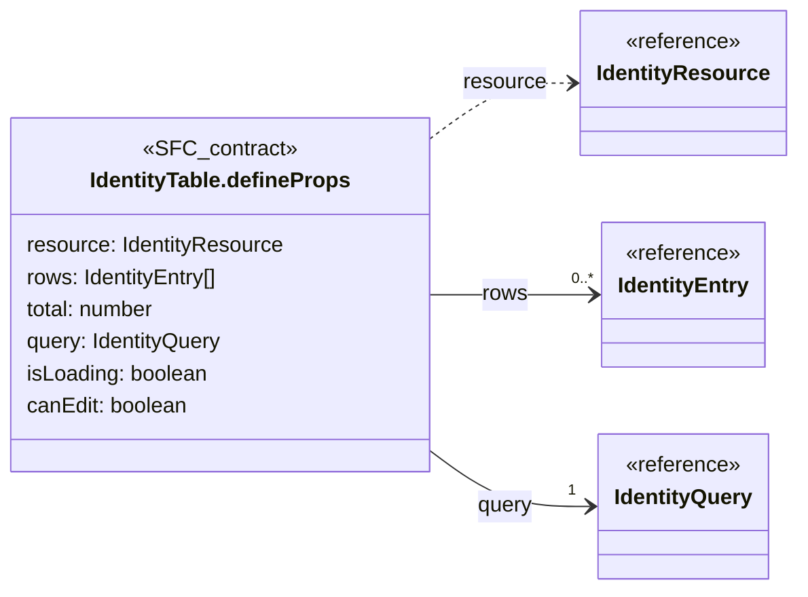

## IdentityTable.defineEmits

**Fuente:** [src/modules/identity/components/IdentityTable.vue](../../../../../src/modules/identity/components/IdentityTable.vue) · línea 19, columna 26. **Declaración:** SFC contract.

| Miembro | Firma completa |
| --- | --- |
| `edit` | `edit: [row: IdentityEntry];` |
| `password` | `password: [row: IdentityEntry];` |
| `query` | `query: [changes: Partial<IdentityQuery>];` |

| Relación | Destino | Origen de la referencia |
| --- | --- | --- |
| dependency | [IdentityEntry](../../../../../src/modules/identity/identity.ts) | `edit` |
| dependency | [IdentityEntry](../../../../../src/modules/identity/identity.ts) | `password` |
| dependency | [IdentityQuery](../../../../../src/modules/identity/identity.ts) | `query` |

**Figura:** `DIA-VUE-TS-IDENTITY-2-1`.

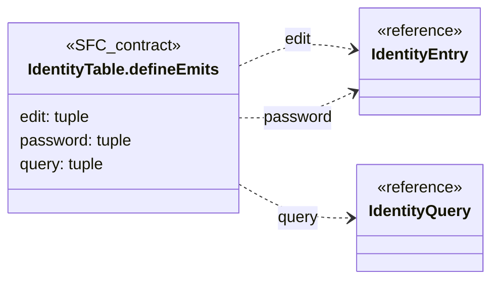

## PersonForm.defineProps

**Fuente:** [src/modules/identity/components/PersonForm.vue](../../../../../src/modules/identity/components/PersonForm.vue) · línea 13, columna 13. **Declaración:** SFC contract.

| Miembro | Firma completa |
| --- | --- |
| `title` | `title: string;` |
| `values` | `values: PersonValues;` |
| `errors` | `errors: { fullName?: string; accesses?: string };` |
| `departmentId` | `departmentId: string;` |
| `roleId` | `roleId: string;` |
| `accessError` | `accessError: string;` |
| `options` | `options: OrganizationState;` |
| `message` | `message: string;` |
| `isSubmitting` | `isSubmitting: boolean;` |
| `isConflicted` | `isConflicted: boolean;` |
| `isEditing` | `isEditing: boolean;` |

| Relación | Destino | Origen de la referencia |
| --- | --- | --- |
| association | [PersonValues](../../../../../src/modules/identity/identity.ts) | `values` |
| association | [PersonForm.errors@16:13](../../../../../src/modules/identity/components/PersonForm.vue) | `errors` |
| dependency | [OrganizationState](../../../../../src/shared/lookup.ts) | `options` |

**Figura:** `DIA-VUE-TS-IDENTITY-3-1`.

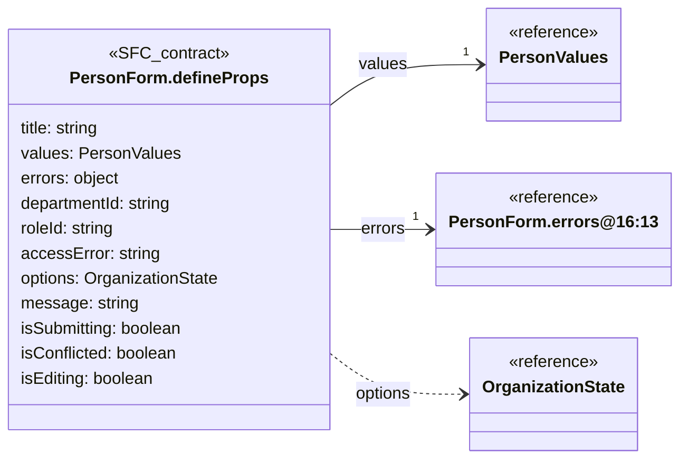

## PersonForm.errors@16:13

**Fuente:** [src/modules/identity/components/PersonForm.vue](../../../../../src/modules/identity/components/PersonForm.vue) · línea 16, columna 13. **Declaración:** inline object.

| Miembro | Firma completa |
| --- | --- |
| `fullName` | `fullName?: string;` |
| `accesses` | `accesses?: string` |

**Figura:** `DIA-VUE-TS-IDENTITY-4-1`.

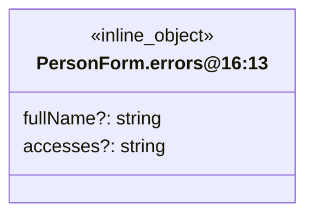

## PersonForm.defineEmits

**Fuente:** [src/modules/identity/components/PersonForm.vue](../../../../../src/modules/identity/components/PersonForm.vue) · línea 26, columna 26. **Declaración:** SFC contract.

| Miembro | Firma completa |
| --- | --- |
| `update` | `update: [field: 'fullName', value: string];` |
| `blur` | `blur: [field: 'fullName'];` |
| `draft` | `draft: [field: 'departmentId' \| 'roleId', value: string];` |
| `add` | `add: [];` |
| `remove` | `remove: [departmentId: string];` |
| `search` | `search: [resource: OrganizationResource, value: string];` |
| `more` | `more: [resource: OrganizationResource];` |
| `retry` | `retry: [resource: OrganizationResource];` |
| `submit` | `submit: [];` |
| `close` | `close: [];` |
| `reload` | `reload: [];` |

| Relación | Destino | Origen de la referencia |
| --- | --- | --- |
| dependency | [OrganizationResource](../../../../../src/shared/lookup.ts) | `search` |
| dependency | [OrganizationResource](../../../../../src/shared/lookup.ts) | `more` |
| dependency | [OrganizationResource](../../../../../src/shared/lookup.ts) | `retry` |

**Figura:** `DIA-VUE-TS-IDENTITY-5-1`.

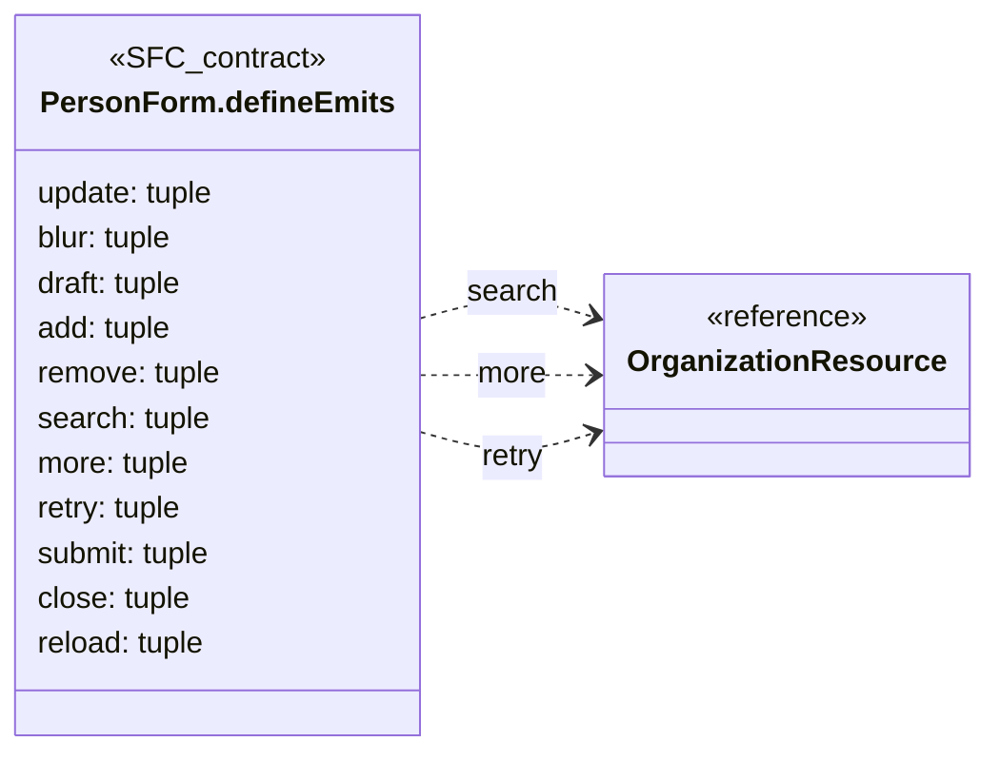

## UserForm.defineProps

**Fuente:** [src/modules/identity/components/UserForm.vue](../../../../../src/modules/identity/components/UserForm.vue) · línea 8, columna 13. **Declaración:** SFC contract.

| Miembro | Firma completa |
| --- | --- |
| `action` | `action: 'create' \| 'edit' \| 'password';` |
| `title` | `title: string;` |
| `values` | `values: UserValues;` |
| `errors` | `errors: Partial<Record<UserField, string>>;` |
| `options` | `options: OrganizationState;` |
| `row` | `row?: IdentityEntry;` |
| `message` | `message: string;` |
| `isSubmitting` | `isSubmitting: boolean;` |
| `isConflicted` | `isConflicted: boolean;` |

| Relación | Destino | Origen de la referencia |
| --- | --- | --- |
| association | [UserValues](../../../../../src/modules/identity/identity.ts) | `values` |
| dependency | [UserField](../../../../../src/modules/identity/identity.ts) | `errors` |
| dependency | [OrganizationState](../../../../../src/shared/lookup.ts) | `options` |
| association | [IdentityEntry](../../../../../src/modules/identity/identity.ts) | `row` |

**Figura:** `DIA-VUE-TS-IDENTITY-6-1`.

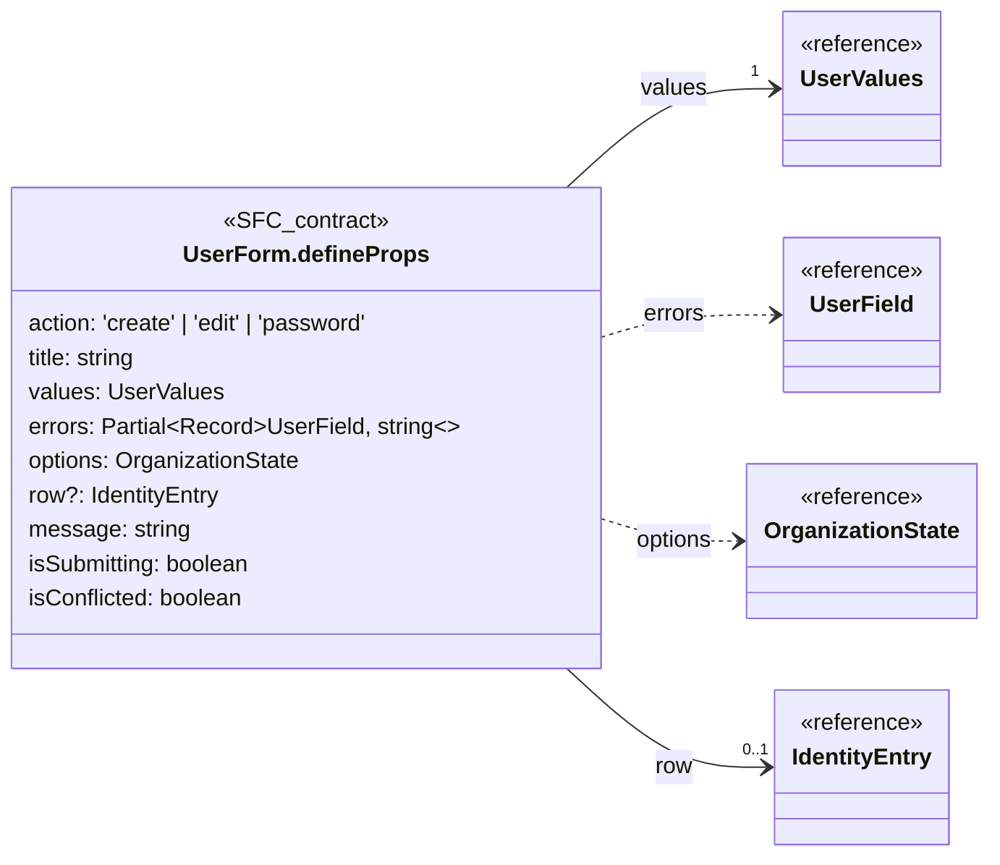

## UserForm.defineEmits

**Fuente:** [src/modules/identity/components/UserForm.vue](../../../../../src/modules/identity/components/UserForm.vue) · línea 19, columna 26. **Declaración:** SFC contract.

| Miembro | Firma completa |
| --- | --- |
| `update` | `update: [field: UserField, value: string];` |
| `blur` | `blur: [field: UserField];` |
| `submit` | `submit: [];` |
| `close` | `close: [];` |
| `reload` | `reload: [];` |
| `search` | `search: [resource: OrganizationResource, value: string];` |
| `more` | `more: [resource: OrganizationResource];` |
| `retry` | `retry: [resource: OrganizationResource];` |

| Relación | Destino | Origen de la referencia |
| --- | --- | --- |
| dependency | [UserField](../../../../../src/modules/identity/identity.ts) | `update` |
| dependency | [UserField](../../../../../src/modules/identity/identity.ts) | `blur` |
| dependency | [OrganizationResource](../../../../../src/shared/lookup.ts) | `search` |
| dependency | [OrganizationResource](../../../../../src/shared/lookup.ts) | `more` |
| dependency | [OrganizationResource](../../../../../src/shared/lookup.ts) | `retry` |

**Figura:** `DIA-VUE-TS-IDENTITY-7-1`.

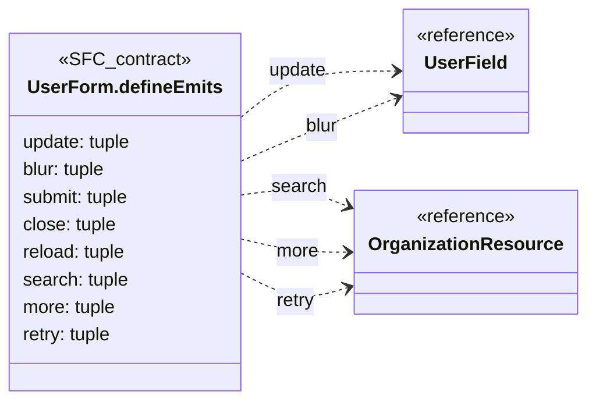

## usePersonEditor.options@12:42

**Fuente:** [src/modules/identity/composables/usePersonEditor.ts](../../../../../src/modules/identity/composables/usePersonEditor.ts) · línea 12, columna 42. **Declaración:** inline object.

| Miembro | Firma completa |
| --- | --- |
| `target` | `target: PersonTarget;` |
| `permissions` | `permissions: readonly string[];` |
| `onSaved` | `onSaved: () => void;` |
| `onDenied` | `onDenied: (status: number) => void;` |

| Relación | Destino | Origen de la referencia |
| --- | --- | --- |
| dependency | [PersonTarget](../../../../../src/modules/identity/identity.ts) | `target` |

**Figura:** `DIA-VUE-TS-IDENTITY-8-1`.

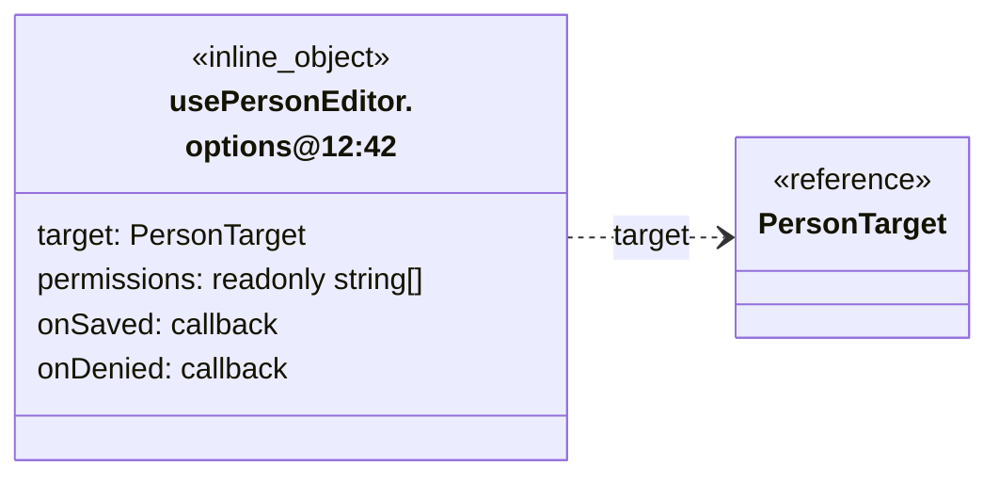

## useUserEditor.options@10:40

**Fuente:** [src/modules/identity/composables/useUserEditor.ts](../../../../../src/modules/identity/composables/useUserEditor.ts) · línea 10, columna 40. **Declaración:** inline object.

| Miembro | Firma completa |
| --- | --- |
| `target` | `target: IdentityTarget;` |
| `permissions` | `permissions: readonly string[];` |
| `onSaved` | `onSaved: () => void;` |
| `onDenied` | `onDenied: (status: number) => void;` |

| Relación | Destino | Origen de la referencia |
| --- | --- | --- |
| dependency | [IdentityTarget](../../../../../src/modules/identity/identity.ts) | `target` |

**Figura:** `DIA-VUE-TS-IDENTITY-9-1`.

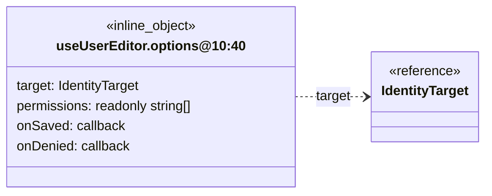

## IdentityQuery

**Fuente:** [src/modules/identity/identity.ts](../../../../../src/modules/identity/identity.ts) · línea 4, columna 1. **Declaración:** interface.

**Extensión/implementación:** `extends RecordQuery`.

| Miembro | Firma completa |
| --- | --- |
| `department` | `department: string;` |
| `role` | `role: string;` |

| Relación | Destino | Origen de la referencia |
| --- | --- | --- |
| inheritance | [RecordQuery](../../../../../src/shared/list.ts) | `extends` |

**Figura:** `DIA-VUE-TS-IDENTITY-10-1`.

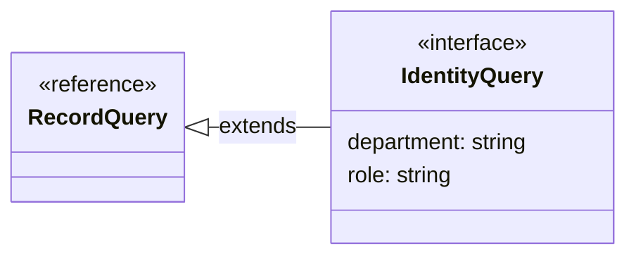

## IdentityResource

**Fuente:** [src/modules/identity/identity.ts](../../../../../src/modules/identity/identity.ts) · línea 9, columna 1. **Declaración:** type.

**Definición completa:**

```typescript
'persons' | 'users'
```

## PersonAccess

**Fuente:** [src/modules/identity/identity.ts](../../../../../src/modules/identity/identity.ts) · línea 10, columna 1. **Declaración:** interface.

| Miembro | Firma completa |
| --- | --- |
| `departmentId` | `departmentId: string;` |
| `roleId` | `roleId: string;` |
| `departmentName` | `departmentName: string;` |
| `roleName` | `roleName: string;` |

**Figura:** `DIA-VUE-TS-IDENTITY-12-1`.

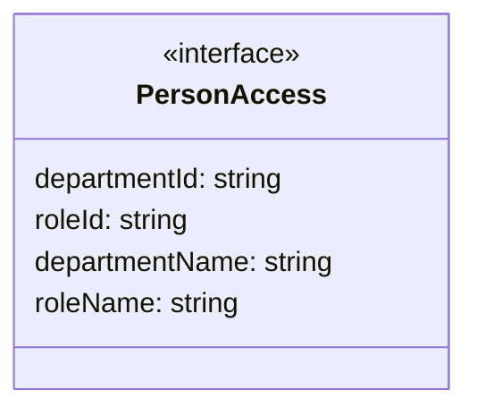

## IdentityEntry

**Fuente:** [src/modules/identity/identity.ts](../../../../../src/modules/identity/identity.ts) · línea 16, columna 1. **Declaración:** interface.

| Miembro | Firma completa |
| --- | --- |
| `id` | `id: string;` |
| `version` | `version: number;` |
| `name` | `name: string;` |
| `personName` | `personName: string;` |
| `departmentId` | `departmentId: string;` |
| `roleId` | `roleId: string;` |
| `departmentName` | `departmentName: string;` |
| `roleName` | `roleName: string;` |
| `accesses` | `accesses: PersonAccess[];` |

| Relación | Destino | Origen de la referencia |
| --- | --- | --- |
| association | [PersonAccess](../../../../../src/modules/identity/identity.ts) | `accesses` |

**Figura:** `DIA-VUE-TS-IDENTITY-13-1`.

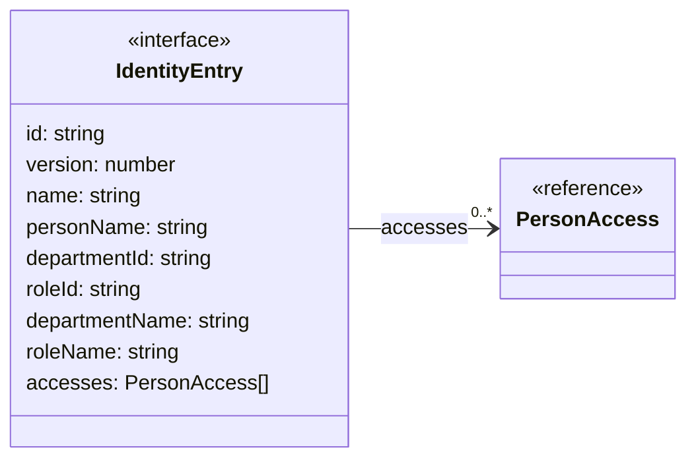

## PersonValues

**Fuente:** [src/modules/identity/identity.ts](../../../../../src/modules/identity/identity.ts) · línea 27, columna 1. **Declaración:** interface.

| Miembro | Firma completa |
| --- | --- |
| `fullName` | `fullName: string;` |
| `accesses` | `accesses: PersonAccess[];` |

| Relación | Destino | Origen de la referencia |
| --- | --- | --- |
| association | [PersonAccess](../../../../../src/modules/identity/identity.ts) | `accesses` |

**Figura:** `DIA-VUE-TS-IDENTITY-14-1`.

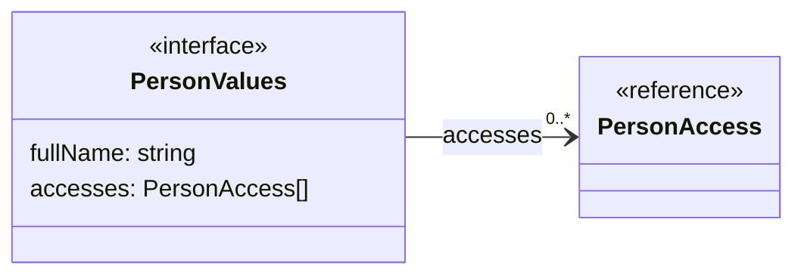

## UserValues

**Fuente:** [src/modules/identity/identity.ts](../../../../../src/modules/identity/identity.ts) · línea 31, columna 1. **Declaración:** interface.

| Miembro | Firma completa |
| --- | --- |
| `name` | `name: string;` |
| `password` | `password: string;` |
| `departmentId` | `departmentId: string;` |
| `roleId` | `roleId: string;` |

**Figura:** `DIA-VUE-TS-IDENTITY-15-1`.

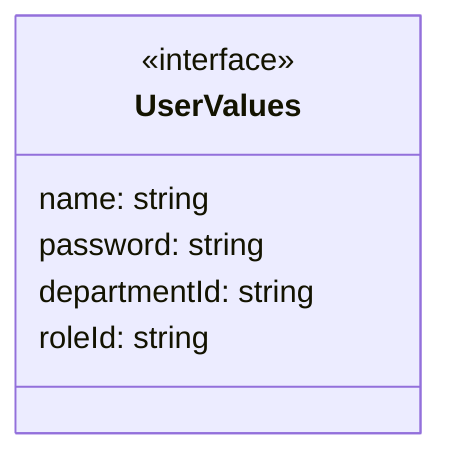

## UserField

**Fuente:** [src/modules/identity/identity.ts](../../../../../src/modules/identity/identity.ts) · línea 37, columna 1. **Declaración:** type.

**Definición completa:**

```typescript
keyof UserValues
```

| Relación | Destino | Origen de la referencia |
| --- | --- | --- |
| dependency | [UserValues](../../../../../src/modules/identity/identity.ts) | `type` |

**Figura:** `DIA-VUE-TS-IDENTITY-16-1`.

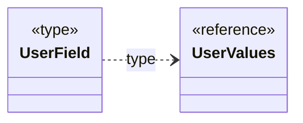

## PersonTarget

**Fuente:** [src/modules/identity/identity.ts](../../../../../src/modules/identity/identity.ts) · línea 38, columna 1. **Declaración:** type.

**Definición completa:**

```typescript
{ action: 'create' } | { action: 'edit'; row: IdentityEntry }
```

| Relación | Destino | Origen de la referencia |
| --- | --- | --- |
| dependency | [PersonTarget@38:28](../../../../../src/modules/identity/identity.ts) | `type` |
| dependency | [PersonTarget@38:51](../../../../../src/modules/identity/identity.ts) | `type` |

**Figura:** `DIA-VUE-TS-IDENTITY-17-1`.

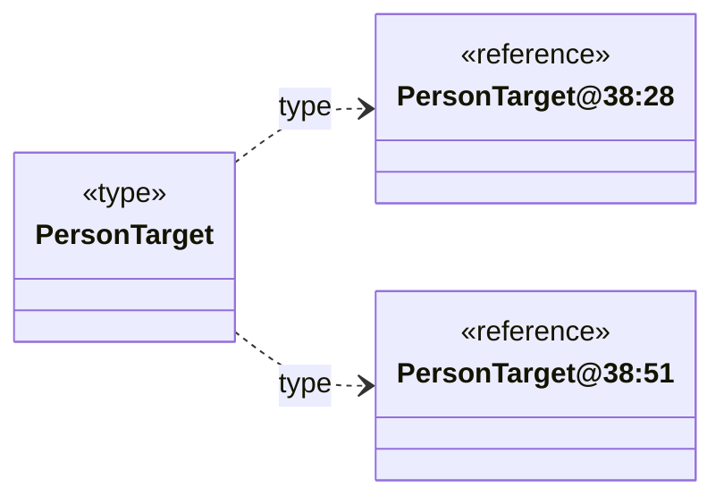

## PersonTarget@38:28

**Fuente:** [src/modules/identity/identity.ts](../../../../../src/modules/identity/identity.ts) · línea 38, columna 28. **Declaración:** inline object.

| Miembro | Firma completa |
| --- | --- |
| `action` | `action: 'create'` |

**Figura:** `DIA-VUE-TS-IDENTITY-18-1`.

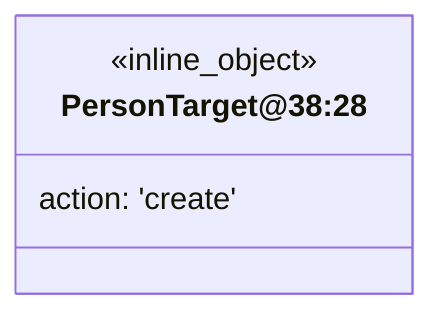

## PersonTarget@38:51

**Fuente:** [src/modules/identity/identity.ts](../../../../../src/modules/identity/identity.ts) · línea 38, columna 51. **Declaración:** inline object.

| Miembro | Firma completa |
| --- | --- |
| `action` | `action: 'edit';` |
| `row` | `row: IdentityEntry` |

| Relación | Destino | Origen de la referencia |
| --- | --- | --- |
| association | [IdentityEntry](../../../../../src/modules/identity/identity.ts) | `row` |

**Figura:** `DIA-VUE-TS-IDENTITY-19-1`.

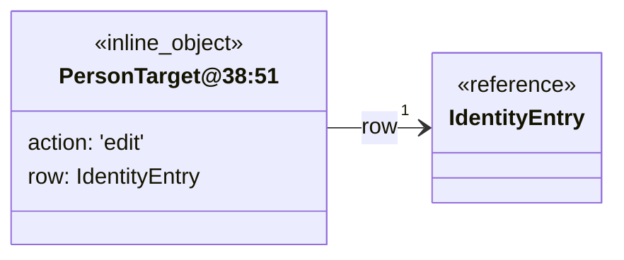

## IdentityTarget

**Fuente:** [src/modules/identity/identity.ts](../../../../../src/modules/identity/identity.ts) · línea 39, columna 1. **Declaración:** type.

**Definición completa:**

```typescript
PersonTarget | { action: 'password'; row: IdentityEntry }
```

| Relación | Destino | Origen de la referencia |
| --- | --- | --- |
| dependency | [PersonTarget](../../../../../src/modules/identity/identity.ts) | `type` |
| dependency | [IdentityTarget@39:45](../../../../../src/modules/identity/identity.ts) | `type` |

**Figura:** `DIA-VUE-TS-IDENTITY-20-1`.

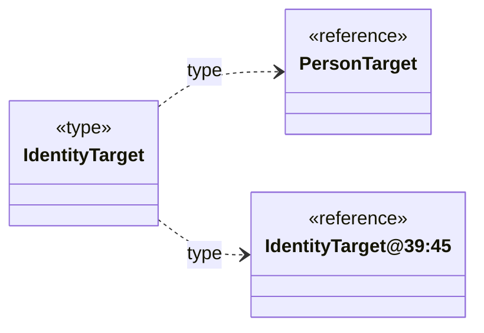

## IdentityTarget@39:45

**Fuente:** [src/modules/identity/identity.ts](../../../../../src/modules/identity/identity.ts) · línea 39, columna 45. **Declaración:** inline object.

| Miembro | Firma completa |
| --- | --- |
| `action` | `action: 'password';` |
| `row` | `row: IdentityEntry` |

| Relación | Destino | Origen de la referencia |
| --- | --- | --- |
| association | [IdentityEntry](../../../../../src/modules/identity/identity.ts) | `row` |

**Figura:** `DIA-VUE-TS-IDENTITY-21-1`.

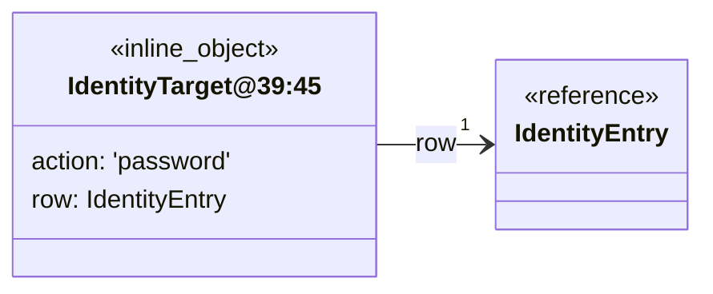

## IdentityPage.defineProps

**Fuente:** [src/modules/identity/pages/IdentityPage.vue](../../../../../src/modules/identity/pages/IdentityPage.vue) · línea 25, columna 27. **Declaración:** SFC contract.

| Miembro | Firma completa |
| --- | --- |
| `resource` | `resource: IdentityResource` |

| Relación | Destino | Origen de la referencia |
| --- | --- | --- |
| dependency | [IdentityResource](../../../../../src/modules/identity/identity.ts) | `resource` |

**Figura:** `DIA-VUE-TS-IDENTITY-22-1`.

```mermaid
classDiagram
    direction LR
    class Subject["IdentityPage.defineProps"] {
        <<SFC_contract>>
        resource: IdentityResource
    }
    class R0["IdentityResource"] {
        <<reference>>
    }
    Subject ..> R0 : resource
```

## PersonEditorPage.defineProps

**Fuente:** [src/modules/identity/pages/PersonEditorPage.vue](../../../../../src/modules/identity/pages/PersonEditorPage.vue) · línea 7, columna 27. **Declaración:** SFC contract.

| Miembro | Firma completa |
| --- | --- |
| `target` | `target: PersonTarget;` |
| `permissions` | `permissions: readonly string[]` |

| Relación | Destino | Origen de la referencia |
| --- | --- | --- |
| dependency | [PersonTarget](../../../../../src/modules/identity/identity.ts) | `target` |

**Figura:** `DIA-VUE-TS-IDENTITY-23-1`.

```mermaid
classDiagram
    direction LR
    class Subject["PersonEditorPage.defineProps"] {
        <<SFC_contract>>
        target: PersonTarget
        permissions: readonly string[]
    }
    class R0["PersonTarget"] {
        <<reference>>
    }
    Subject ..> R0 : target
```

## PersonEditorPage.defineEmits

**Fuente:** [src/modules/identity/pages/PersonEditorPage.vue](../../../../../src/modules/identity/pages/PersonEditorPage.vue) · línea 8, columna 26. **Declaración:** SFC contract.

| Miembro | Firma completa |
| --- | --- |
| `saved` | `saved: [];` |
| `close` | `close: [];` |
| `reload` | `reload: [];` |
| `denied` | `denied: [status: number]` |

**Figura:** `DIA-VUE-TS-IDENTITY-24-1`.

```mermaid
classDiagram
    direction LR
    class Subject["PersonEditorPage.defineEmits"] {
        <<SFC_contract>>
        saved: tuple
        close: tuple
        reload: tuple
        denied: tuple
    }
```

## UserEditorPage.defineProps

**Fuente:** [src/modules/identity/pages/UserEditorPage.vue](../../../../../src/modules/identity/pages/UserEditorPage.vue) · línea 7, columna 27. **Declaración:** SFC contract.

| Miembro | Firma completa |
| --- | --- |
| `target` | `target: IdentityTarget;` |
| `permissions` | `permissions: readonly string[]` |

| Relación | Destino | Origen de la referencia |
| --- | --- | --- |
| dependency | [IdentityTarget](../../../../../src/modules/identity/identity.ts) | `target` |

**Figura:** `DIA-VUE-TS-IDENTITY-25-1`.

```mermaid
classDiagram
    direction LR
    class Subject["UserEditorPage.defineProps"] {
        <<SFC_contract>>
        target: IdentityTarget
        permissions: readonly string[]
    }
    class R0["IdentityTarget"] {
        <<reference>>
    }
    Subject ..> R0 : target
```

## UserEditorPage.defineEmits

**Fuente:** [src/modules/identity/pages/UserEditorPage.vue](../../../../../src/modules/identity/pages/UserEditorPage.vue) · línea 8, columna 26. **Declaración:** SFC contract.

| Miembro | Firma completa |
| --- | --- |
| `saved` | `saved: [];` |
| `close` | `close: [];` |
| `reload` | `reload: [];` |
| `denied` | `denied: [status: number]` |

**Figura:** `DIA-VUE-TS-IDENTITY-26-1`.

```mermaid
classDiagram
    direction LR
    class Subject["UserEditorPage.defineEmits"] {
        <<SFC_contract>>
        saved: tuple
        close: tuple
        reload: tuple
        denied: tuple
    }
```

## usePersonEditor.return

**Fuente:** [src/modules/identity/composables/usePersonEditor.ts](../../../../../src/modules/identity/composables/usePersonEditor.ts) · línea 12, columna 32. **Declaración:** inferred return.

| Miembro | Firma completa |
| --- | --- |
| `organization` | `"organization": { departments: { state: ComputedRef<LookupState>; items: Ref<{ id: string; title: string; data: Record<string, unknown>; isDisabled?: boolean \| undefined; }[], LookupItem[] \| { id: string; title: string; data: Record<string, unknown>; isDisabled?: boolean \| undefined; }[]>; isLoading: Ref<boolean, boolean>; error: Ref<string, string>; search: Ref<string, string>; hasMore: Ref<boolean, boolean>; updateSearch: (value: string) => void; refresh: () => Promise<void>; loadMore: () => Promise<void> \| undefined; retry: () => Promise<void>; }; roles: { state: ComputedRef<LookupState>; items: Ref<{ id: string; title: string; data: Record<string, unknown>; isDisabled?: boolean \| undefined; }[], LookupItem[] \| { id: string; title: string; data: Record<string, unknown>; isDisabled?: boolean \| undefined; }[]>; isLoading: Ref<boolean, boolean>; error: Ref<string, string>; search: Ref<string, string>; hasMore: Ref<boolean, boolean>; updateSearch: (value: string) => void; refresh: () => Promise<void>; loadMore: () => Promise<void> \| undefined; retry: () => Promise<void>; }; state: ComputedRef<OrganizationState>; };` |
| `departmentId` | `"departmentId": Ref<string, string>;` |
| `roleId` | `"roleId": Ref<string, string>;` |
| `accessError` | `"accessError": Ref<string, string>;` |
| `addAccess` | `"addAccess": () => Promise<void>;` |
| `removeAccess` | `"removeAccess": (id: string) => Promise<void>;` |
| `submit` | `"submit": () => Promise<Promise<void> \| undefined> \| undefined;` |
| `update` | `"update": (field: "fullName", value: string) => void;` |
| `blur` | `"blur": (field: "fullName") => Promise<unknown> \| undefined;` |
| `message` | `"message": Ref<string, string>;` |
| `isSubmitting` | `"isSubmitting": Ref<boolean, boolean>;` |
| `isConflicted` | `"isConflicted": Ref<boolean, boolean>;` |
| `execute` | `"execute": (operation: (signal: AbortSignal) => Promise<unknown>) => Promise<void>;` |
| `signal` | `"signal": AbortSignal;` |
| `isDisposed` | `"isDisposed": () => boolean;` |
| `values` | `"values": PersonValues;` |
| `errors` | `"errors": ComputedRef<Partial<Record<"" \| "fullName" \| "accesses" \| accesses[${number}] \| accesses[${number}].departmentId \| accesses[${number}].roleId \| accesses[${number}].departmentName \| accesses[${number}].roleName, string \| undefined>>>;` |

| Relación | Destino | Origen de la referencia |
| --- | --- | --- |
| dependency | [usePersonEditor.return.organization.shape1](../../../../../src/modules/identity/composables/usePersonEditor.ts) | `organization` |
| association | [PersonValues](../../../../../src/modules/identity/identity.ts) | `values` |

**Figura:** `DIA-VUE-TS-IDENTITY-27-1`. Parte 1/2.

```mermaid
classDiagram
    direction LR
    class Subject["usePersonEditor.return"] {
        <<inferred_return>>
        organization: callback
        departmentId: Ref~string, string~
        roleId: Ref~string, string~
        accessError: Ref~string, string~
        addAccess: callback
        removeAccess: callback
        submit: callback
        update: callback
        blur: callback
        message: Ref~string, string~
        isSubmitting: Ref~boolean, boolean~
        isConflicted: Ref~boolean, boolean~
        execute: callback
        signal: AbortSignal
        isDisposed: callback
        values: PersonValues
    }
    class R0["usePersonEditor.return.<br/>organization.shape1"] {
        <<reference>>
    }
    class R1["PersonValues"] {
        <<reference>>
    }
    Subject ..> R0 : organization
    Subject --> "1" R1 : values
```

**Figura:** `DIA-VUE-TS-IDENTITY-27-2`. Parte 2/2.

```mermaid
classDiagram
    direction LR
    class Subject["usePersonEditor.return"] {
        <<inferred_return>>
        errors: object
    }
```

## usePersonEditor.return.organization.shape1

**Fuente:** [src/modules/identity/composables/usePersonEditor.ts](../../../../../src/modules/identity/composables/usePersonEditor.ts) · línea 12, columna 32. **Declaración:** inferred object.

| Miembro | Firma completa |
| --- | --- |
| `departments` | `departments: { state: ComputedRef<LookupState>; items: Ref<{ id: string; title: string; data: Record<string, unknown>; isDisabled?: boolean \| undefined; }[], LookupItem[] \| { id: string; title: string; data: Record<string, unknown>; isDisabled?: boolean \| undefined; }[]>; isLoading: Ref<boolean, boolean>; error: Ref<string, string>; search: Ref<string, string>; hasMore: Ref<boolean, boolean>; updateSearch: (value: string) => void; refresh: () => Promise<void>; loadMore: () => Promise<void> \| undefined; retry: () => Promise<void>; };` |
| `roles` | `roles: { state: ComputedRef<LookupState>; items: Ref<{ id: string; title: string; data: Record<string, unknown>; isDisabled?: boolean \| undefined; }[], LookupItem[] \| { id: string; title: string; data: Record<string, unknown>; isDisabled?: boolean \| undefined; }[]>; isLoading: Ref<boolean, boolean>; error: Ref<string, string>; search: Ref<string, string>; hasMore: Ref<boolean, boolean>; updateSearch: (value: string) => void; refresh: () => Promise<void>; loadMore: () => Promise<void> \| undefined; retry: () => Promise<void>; };` |
| `state` | `state: ComputedRef<OrganizationState>;` |

| Relación | Destino | Origen de la referencia |
| --- | --- | --- |
| dependency | [usePersonEditor.return.organization.departments.shape2](../../../../../src/modules/identity/composables/usePersonEditor.ts) | `departments` |
| dependency | [usePersonEditor.return.organization.roles.shape5](../../../../../src/modules/identity/composables/usePersonEditor.ts) | `roles` |

**Figura:** `DIA-VUE-TS-IDENTITY-28-1`.

```mermaid
classDiagram
    direction LR
    class Subject["usePersonEditor.return.<br/>organization.shape1"] {
        <<inferred_object>>
        departments: callback
        roles: callback
        state: ComputedRef~OrganizationState~
    }
    class R0["usePersonEditor.return.<br/>organization.departments.<br/>shape2"] {
        <<reference>>
    }
    class R1["usePersonEditor.return.<br/>organization.roles.shape5"] {
        <<reference>>
    }
    Subject ..> R0 : departments
    Subject ..> R1 : roles
```

## usePersonEditor.return.organization.departments.shape2

**Fuente:** [src/modules/identity/composables/usePersonEditor.ts](../../../../../src/modules/identity/composables/usePersonEditor.ts) · línea 12, columna 32. **Declaración:** inferred object.

| Miembro | Firma completa |
| --- | --- |
| `state` | `state: ComputedRef<LookupState>;` |
| `items` | `items: Ref<{ id: string; title: string; data: Record<string, unknown>; isDisabled?: boolean \| undefined; }[], LookupItem[] \| { id: string; title: string; data: Record<string, unknown>; isDisabled?: boolean \| undefined; }[]>;` |
| `isLoading` | `isLoading: Ref<boolean, boolean>;` |
| `error` | `error: Ref<string, string>;` |
| `search` | `search: Ref<string, string>;` |
| `hasMore` | `hasMore: Ref<boolean, boolean>;` |
| `updateSearch` | `updateSearch: (value: string) => void;` |
| `refresh` | `refresh: () => Promise<void>;` |
| `loadMore` | `loadMore: () => Promise<void> \| undefined;` |
| `retry` | `retry: () => Promise<void>;` |

| Relación | Destino | Origen de la referencia |
| --- | --- | --- |
| dependency | [usePersonEditor.return.organization.departments.items.shape3](../../../../../src/modules/identity/composables/usePersonEditor.ts) | `items` |
| dependency | [usePersonEditor.return.organization.departments.items.shape4](../../../../../src/modules/identity/composables/usePersonEditor.ts) | `items` |

**Figura:** `DIA-VUE-TS-IDENTITY-29-1`.

```mermaid
classDiagram
    direction LR
    class Subject["usePersonEditor.return.<br/>organization.departments.<br/>shape2"] {
        <<inferred_object>>
        state: ComputedRef~LookupState~
        items: object
        isLoading: Ref~boolean, boolean~
        error: Ref~string, string~
        search: Ref~string, string~
        hasMore: Ref~boolean, boolean~
        updateSearch: callback
        refresh: callback
        loadMore: callback
        retry: callback
    }
    class R0["usePersonEditor.return.<br/>organization.departments.<br/>items.shape3"] {
        <<reference>>
    }
    class R1["usePersonEditor.return.<br/>organization.departments.<br/>items.shape4"] {
        <<reference>>
    }
    Subject ..> R0 : items
    Subject ..> R1 : items
```

## usePersonEditor.return.organization.departments.items.shape3

**Fuente:** [src/modules/identity/composables/usePersonEditor.ts](../../../../../src/modules/identity/composables/usePersonEditor.ts) · línea 12, columna 32. **Declaración:** inferred object.

| Miembro | Firma completa |
| --- | --- |
| `id` | `id: string;` |
| `title` | `title: string;` |
| `data` | `data: Record<string, unknown>;` |
| `isDisabled` | `isDisabled?: boolean \| undefined;` |

**Figura:** `DIA-VUE-TS-IDENTITY-30-1`.

```mermaid
classDiagram
    direction LR
    class Subject["usePersonEditor.return.<br/>organization.departments.<br/>items.shape3"] {
        <<inferred_object>>
        id: string
        title: string
        data: Record~string, unknown~
        isDisabled?: boolean | undefined
    }
```

## usePersonEditor.return.organization.departments.items.shape4

**Fuente:** [src/modules/identity/composables/usePersonEditor.ts](../../../../../src/modules/identity/composables/usePersonEditor.ts) · línea 12, columna 32. **Declaración:** inferred object.

| Miembro | Firma completa |
| --- | --- |
| `id` | `id: string;` |
| `title` | `title: string;` |
| `data` | `data: Record<string, unknown>;` |
| `isDisabled` | `isDisabled?: boolean \| undefined;` |

**Figura:** `DIA-VUE-TS-IDENTITY-31-1`.

```mermaid
classDiagram
    direction LR
    class Subject["usePersonEditor.return.<br/>organization.departments.<br/>items.shape4"] {
        <<inferred_object>>
        id: string
        title: string
        data: Record~string, unknown~
        isDisabled?: boolean | undefined
    }
```

## usePersonEditor.return.organization.roles.shape5

**Fuente:** [src/modules/identity/composables/usePersonEditor.ts](../../../../../src/modules/identity/composables/usePersonEditor.ts) · línea 12, columna 32. **Declaración:** inferred object.

| Miembro | Firma completa |
| --- | --- |
| `state` | `state: ComputedRef<LookupState>;` |
| `items` | `items: Ref<{ id: string; title: string; data: Record<string, unknown>; isDisabled?: boolean \| undefined; }[], LookupItem[] \| { id: string; title: string; data: Record<string, unknown>; isDisabled?: boolean \| undefined; }[]>;` |
| `isLoading` | `isLoading: Ref<boolean, boolean>;` |
| `error` | `error: Ref<string, string>;` |
| `search` | `search: Ref<string, string>;` |
| `hasMore` | `hasMore: Ref<boolean, boolean>;` |
| `updateSearch` | `updateSearch: (value: string) => void;` |
| `refresh` | `refresh: () => Promise<void>;` |
| `loadMore` | `loadMore: () => Promise<void> \| undefined;` |
| `retry` | `retry: () => Promise<void>;` |

| Relación | Destino | Origen de la referencia |
| --- | --- | --- |
| dependency | [usePersonEditor.return.organization.roles.items.shape6](../../../../../src/modules/identity/composables/usePersonEditor.ts) | `items` |
| dependency | [usePersonEditor.return.organization.roles.items.shape7](../../../../../src/modules/identity/composables/usePersonEditor.ts) | `items` |

**Figura:** `DIA-VUE-TS-IDENTITY-32-1`.

```mermaid
classDiagram
    direction LR
    class Subject["usePersonEditor.return.<br/>organization.roles.shape5"] {
        <<inferred_object>>
        state: ComputedRef~LookupState~
        items: object
        isLoading: Ref~boolean, boolean~
        error: Ref~string, string~
        search: Ref~string, string~
        hasMore: Ref~boolean, boolean~
        updateSearch: callback
        refresh: callback
        loadMore: callback
        retry: callback
    }
    class R0["usePersonEditor.return.<br/>organization.roles.items.<br/>shape6"] {
        <<reference>>
    }
    class R1["usePersonEditor.return.<br/>organization.roles.items.<br/>shape7"] {
        <<reference>>
    }
    Subject ..> R0 : items
    Subject ..> R1 : items
```

## usePersonEditor.return.organization.roles.items.shape6

**Fuente:** [src/modules/identity/composables/usePersonEditor.ts](../../../../../src/modules/identity/composables/usePersonEditor.ts) · línea 12, columna 32. **Declaración:** inferred object.

| Miembro | Firma completa |
| --- | --- |
| `id` | `id: string;` |
| `title` | `title: string;` |
| `data` | `data: Record<string, unknown>;` |
| `isDisabled` | `isDisabled?: boolean \| undefined;` |

**Figura:** `DIA-VUE-TS-IDENTITY-33-1`.

```mermaid
classDiagram
    direction LR
    class Subject["usePersonEditor.return.<br/>organization.roles.items.<br/>shape6"] {
        <<inferred_object>>
        id: string
        title: string
        data: Record~string, unknown~
        isDisabled?: boolean | undefined
    }
```

## usePersonEditor.return.organization.roles.items.shape7

**Fuente:** [src/modules/identity/composables/usePersonEditor.ts](../../../../../src/modules/identity/composables/usePersonEditor.ts) · línea 12, columna 32. **Declaración:** inferred object.

| Miembro | Firma completa |
| --- | --- |
| `id` | `id: string;` |
| `title` | `title: string;` |
| `data` | `data: Record<string, unknown>;` |
| `isDisabled` | `isDisabled?: boolean \| undefined;` |

**Figura:** `DIA-VUE-TS-IDENTITY-34-1`.

```mermaid
classDiagram
    direction LR
    class Subject["usePersonEditor.return.<br/>organization.roles.items.<br/>shape7"] {
        <<inferred_object>>
        id: string
        title: string
        data: Record~string, unknown~
        isDisabled?: boolean | undefined
    }
```

## useUserEditor.return

**Fuente:** [src/modules/identity/composables/useUserEditor.ts](../../../../../src/modules/identity/composables/useUserEditor.ts) · línea 10, columna 30. **Declaración:** inferred return.

| Miembro | Firma completa |
| --- | --- |
| `organization` | `"organization": { departments: { state: ComputedRef<LookupState>; items: Ref<{ id: string; title: string; data: Record<string, unknown>; isDisabled?: boolean \| undefined; }[], LookupItem[] \| { id: string; title: string; data: Record<string, unknown>; isDisabled?: boolean \| undefined; }[]>; isLoading: Ref<boolean, boolean>; error: Ref<string, string>; search: Ref<string, string>; hasMore: Ref<boolean, boolean>; updateSearch: (value: string) => void; refresh: () => Promise<void>; loadMore: () => Promise<void> \| undefined; retry: () => Promise<void>; }; roles: { state: ComputedRef<LookupState>; items: Ref<{ id: string; title: string; data: Record<string, unknown>; isDisabled?: boolean \| undefined; }[], LookupItem[] \| { id: string; title: string; data: Record<string, unknown>; isDisabled?: boolean \| undefined; }[]>; isLoading: Ref<boolean, boolean>; error: Ref<string, string>; search: Ref<string, string>; hasMore: Ref<boolean, boolean>; updateSearch: (value: string) => void; refresh: () => Promise<void>; loadMore: () => Promise<void> \| undefined; retry: () => Promise<void>; }; state: ComputedRef<OrganizationState>; };` |
| `submit` | `"submit": () => Promise<Promise<void> \| undefined> \| undefined;` |
| `update` | `"update": (field: keyof UserValues, value: string) => void;` |
| `blur` | `"blur": (field: keyof UserValues) => Promise<unknown> \| undefined;` |
| `message` | `"message": Ref<string, string>;` |
| `isSubmitting` | `"isSubmitting": Ref<boolean, boolean>;` |
| `isConflicted` | `"isConflicted": Ref<boolean, boolean>;` |
| `execute` | `"execute": (operation: (signal: AbortSignal) => Promise<unknown>) => Promise<void>;` |
| `signal` | `"signal": AbortSignal;` |
| `isDisposed` | `"isDisposed": () => boolean;` |
| `values` | `"values": UserValues;` |
| `errors` | `"errors": ComputedRef<Partial<Record<"" \| "name" \| "password" \| "departmentId" \| "roleId", string \| undefined>>>;` |

| Relación | Destino | Origen de la referencia |
| --- | --- | --- |
| dependency | [useUserEditor.return.organization.shape1](../../../../../src/modules/identity/composables/useUserEditor.ts) | `organization` |
| dependency | [UserValues](../../../../../src/modules/identity/identity.ts) | `update` |
| dependency | [UserValues](../../../../../src/modules/identity/identity.ts) | `blur` |
| association | [UserValues](../../../../../src/modules/identity/identity.ts) | `values` |

**Figura:** `DIA-VUE-TS-IDENTITY-35-1`.

```mermaid
classDiagram
    direction LR
    class Subject["useUserEditor.return"] {
        <<inferred_return>>
        organization: callback
        submit: callback
        update: callback
        blur: callback
        message: Ref~string, string~
        isSubmitting: Ref~boolean, boolean~
        isConflicted: Ref~boolean, boolean~
        execute: callback
        signal: AbortSignal
        isDisposed: callback
        values: UserValues
        errors: complex
    }
    class R0["useUserEditor.return.<br/>organization.shape1"] {
        <<reference>>
    }
    class R1["UserValues"] {
        <<reference>>
    }
    Subject ..> R0 : organization
    Subject ..> R1 : update
    Subject ..> R1 : blur
    Subject --> "1" R1 : values
```

## useUserEditor.return.organization.shape1

**Fuente:** [src/modules/identity/composables/useUserEditor.ts](../../../../../src/modules/identity/composables/useUserEditor.ts) · línea 10, columna 30. **Declaración:** inferred object.

| Miembro | Firma completa |
| --- | --- |
| `departments` | `departments: { state: ComputedRef<LookupState>; items: Ref<{ id: string; title: string; data: Record<string, unknown>; isDisabled?: boolean \| undefined; }[], LookupItem[] \| { id: string; title: string; data: Record<string, unknown>; isDisabled?: boolean \| undefined; }[]>; isLoading: Ref<boolean, boolean>; error: Ref<string, string>; search: Ref<string, string>; hasMore: Ref<boolean, boolean>; updateSearch: (value: string) => void; refresh: () => Promise<void>; loadMore: () => Promise<void> \| undefined; retry: () => Promise<void>; };` |
| `roles` | `roles: { state: ComputedRef<LookupState>; items: Ref<{ id: string; title: string; data: Record<string, unknown>; isDisabled?: boolean \| undefined; }[], LookupItem[] \| { id: string; title: string; data: Record<string, unknown>; isDisabled?: boolean \| undefined; }[]>; isLoading: Ref<boolean, boolean>; error: Ref<string, string>; search: Ref<string, string>; hasMore: Ref<boolean, boolean>; updateSearch: (value: string) => void; refresh: () => Promise<void>; loadMore: () => Promise<void> \| undefined; retry: () => Promise<void>; };` |
| `state` | `state: ComputedRef<OrganizationState>;` |

| Relación | Destino | Origen de la referencia |
| --- | --- | --- |
| dependency | [useUserEditor.return.organization.departments.shape2](../../../../../src/modules/identity/composables/useUserEditor.ts) | `departments` |
| dependency | [useUserEditor.return.organization.roles.shape5](../../../../../src/modules/identity/composables/useUserEditor.ts) | `roles` |

**Figura:** `DIA-VUE-TS-IDENTITY-36-1`.

```mermaid
classDiagram
    direction LR
    class Subject["useUserEditor.return.<br/>organization.shape1"] {
        <<inferred_object>>
        departments: callback
        roles: callback
        state: ComputedRef~OrganizationState~
    }
    class R0["useUserEditor.return.<br/>organization.departments.<br/>shape2"] {
        <<reference>>
    }
    class R1["useUserEditor.return.<br/>organization.roles.shape5"] {
        <<reference>>
    }
    Subject ..> R0 : departments
    Subject ..> R1 : roles
```

## useUserEditor.return.organization.departments.shape2

**Fuente:** [src/modules/identity/composables/useUserEditor.ts](../../../../../src/modules/identity/composables/useUserEditor.ts) · línea 10, columna 30. **Declaración:** inferred object.

| Miembro | Firma completa |
| --- | --- |
| `state` | `state: ComputedRef<LookupState>;` |
| `items` | `items: Ref<{ id: string; title: string; data: Record<string, unknown>; isDisabled?: boolean \| undefined; }[], LookupItem[] \| { id: string; title: string; data: Record<string, unknown>; isDisabled?: boolean \| undefined; }[]>;` |
| `isLoading` | `isLoading: Ref<boolean, boolean>;` |
| `error` | `error: Ref<string, string>;` |
| `search` | `search: Ref<string, string>;` |
| `hasMore` | `hasMore: Ref<boolean, boolean>;` |
| `updateSearch` | `updateSearch: (value: string) => void;` |
| `refresh` | `refresh: () => Promise<void>;` |
| `loadMore` | `loadMore: () => Promise<void> \| undefined;` |
| `retry` | `retry: () => Promise<void>;` |

| Relación | Destino | Origen de la referencia |
| --- | --- | --- |
| dependency | [useUserEditor.return.organization.departments.items.shape3](../../../../../src/modules/identity/composables/useUserEditor.ts) | `items` |
| dependency | [useUserEditor.return.organization.departments.items.shape4](../../../../../src/modules/identity/composables/useUserEditor.ts) | `items` |

**Figura:** `DIA-VUE-TS-IDENTITY-37-1`.

```mermaid
classDiagram
    direction LR
    class Subject["useUserEditor.return.<br/>organization.departments.<br/>shape2"] {
        <<inferred_object>>
        state: ComputedRef~LookupState~
        items: object
        isLoading: Ref~boolean, boolean~
        error: Ref~string, string~
        search: Ref~string, string~
        hasMore: Ref~boolean, boolean~
        updateSearch: callback
        refresh: callback
        loadMore: callback
        retry: callback
    }
    class R0["useUserEditor.return.<br/>organization.departments.<br/>items.shape3"] {
        <<reference>>
    }
    class R1["useUserEditor.return.<br/>organization.departments.<br/>items.shape4"] {
        <<reference>>
    }
    Subject ..> R0 : items
    Subject ..> R1 : items
```

## useUserEditor.return.organization.departments.items.shape3

**Fuente:** [src/modules/identity/composables/useUserEditor.ts](../../../../../src/modules/identity/composables/useUserEditor.ts) · línea 10, columna 30. **Declaración:** inferred object.

| Miembro | Firma completa |
| --- | --- |
| `id` | `id: string;` |
| `title` | `title: string;` |
| `data` | `data: Record<string, unknown>;` |
| `isDisabled` | `isDisabled?: boolean \| undefined;` |

**Figura:** `DIA-VUE-TS-IDENTITY-38-1`.

```mermaid
classDiagram
    direction LR
    class Subject["useUserEditor.return.<br/>organization.departments.<br/>items.shape3"] {
        <<inferred_object>>
        id: string
        title: string
        data: Record~string, unknown~
        isDisabled?: boolean | undefined
    }
```

## useUserEditor.return.organization.departments.items.shape4

**Fuente:** [src/modules/identity/composables/useUserEditor.ts](../../../../../src/modules/identity/composables/useUserEditor.ts) · línea 10, columna 30. **Declaración:** inferred object.

| Miembro | Firma completa |
| --- | --- |
| `id` | `id: string;` |
| `title` | `title: string;` |
| `data` | `data: Record<string, unknown>;` |
| `isDisabled` | `isDisabled?: boolean \| undefined;` |

**Figura:** `DIA-VUE-TS-IDENTITY-39-1`.

```mermaid
classDiagram
    direction LR
    class Subject["useUserEditor.return.<br/>organization.departments.<br/>items.shape4"] {
        <<inferred_object>>
        id: string
        title: string
        data: Record~string, unknown~
        isDisabled?: boolean | undefined
    }
```

## useUserEditor.return.organization.roles.shape5

**Fuente:** [src/modules/identity/composables/useUserEditor.ts](../../../../../src/modules/identity/composables/useUserEditor.ts) · línea 10, columna 30. **Declaración:** inferred object.

| Miembro | Firma completa |
| --- | --- |
| `state` | `state: ComputedRef<LookupState>;` |
| `items` | `items: Ref<{ id: string; title: string; data: Record<string, unknown>; isDisabled?: boolean \| undefined; }[], LookupItem[] \| { id: string; title: string; data: Record<string, unknown>; isDisabled?: boolean \| undefined; }[]>;` |
| `isLoading` | `isLoading: Ref<boolean, boolean>;` |
| `error` | `error: Ref<string, string>;` |
| `search` | `search: Ref<string, string>;` |
| `hasMore` | `hasMore: Ref<boolean, boolean>;` |
| `updateSearch` | `updateSearch: (value: string) => void;` |
| `refresh` | `refresh: () => Promise<void>;` |
| `loadMore` | `loadMore: () => Promise<void> \| undefined;` |
| `retry` | `retry: () => Promise<void>;` |

| Relación | Destino | Origen de la referencia |
| --- | --- | --- |
| dependency | [useUserEditor.return.organization.roles.items.shape6](../../../../../src/modules/identity/composables/useUserEditor.ts) | `items` |
| dependency | [useUserEditor.return.organization.roles.items.shape7](../../../../../src/modules/identity/composables/useUserEditor.ts) | `items` |

**Figura:** `DIA-VUE-TS-IDENTITY-40-1`.

```mermaid
classDiagram
    direction LR
    class Subject["useUserEditor.return.<br/>organization.roles.shape5"] {
        <<inferred_object>>
        state: ComputedRef~LookupState~
        items: object
        isLoading: Ref~boolean, boolean~
        error: Ref~string, string~
        search: Ref~string, string~
        hasMore: Ref~boolean, boolean~
        updateSearch: callback
        refresh: callback
        loadMore: callback
        retry: callback
    }
    class R0["useUserEditor.return.<br/>organization.roles.items.<br/>shape6"] {
        <<reference>>
    }
    class R1["useUserEditor.return.<br/>organization.roles.items.<br/>shape7"] {
        <<reference>>
    }
    Subject ..> R0 : items
    Subject ..> R1 : items
```

## useUserEditor.return.organization.roles.items.shape6

**Fuente:** [src/modules/identity/composables/useUserEditor.ts](../../../../../src/modules/identity/composables/useUserEditor.ts) · línea 10, columna 30. **Declaración:** inferred object.

| Miembro | Firma completa |
| --- | --- |
| `id` | `id: string;` |
| `title` | `title: string;` |
| `data` | `data: Record<string, unknown>;` |
| `isDisabled` | `isDisabled?: boolean \| undefined;` |

**Figura:** `DIA-VUE-TS-IDENTITY-41-1`.

```mermaid
classDiagram
    direction LR
    class Subject["useUserEditor.return.<br/>organization.roles.items.<br/>shape6"] {
        <<inferred_object>>
        id: string
        title: string
        data: Record~string, unknown~
        isDisabled?: boolean | undefined
    }
```

## useUserEditor.return.organization.roles.items.shape7

**Fuente:** [src/modules/identity/composables/useUserEditor.ts](../../../../../src/modules/identity/composables/useUserEditor.ts) · línea 10, columna 30. **Declaración:** inferred object.

| Miembro | Firma completa |
| --- | --- |
| `id` | `id: string;` |
| `title` | `title: string;` |
| `data` | `data: Record<string, unknown>;` |
| `isDisabled` | `isDisabled?: boolean \| undefined;` |

**Figura:** `DIA-VUE-TS-IDENTITY-42-1`.

```mermaid
classDiagram
    direction LR
    class Subject["useUserEditor.return.<br/>organization.roles.items.<br/>shape7"] {
        <<inferred_object>>
        id: string
        title: string
        data: Record~string, unknown~
        isDisabled?: boolean | undefined
    }
```

## IDENTITY_CONFIG

**Fuente:** [src/modules/identity/identity.ts](../../../../../src/modules/identity/identity.ts) · línea 41, columna 14. **Declaración:** inferred export.

| Miembro | Firma completa |
| --- | --- |
| `persons` | `"persons": { readonly title: "Personas"; readonly createLabel: "Nueva persona"; readonly read: "persons:read"; readonly write: "persons:write"; readonly report: "person:reports-read"; };` |
| `users` | `"users": { readonly title: "Usuarios"; readonly createLabel: "Nuevo usuario"; readonly read: "users:manage"; readonly write: "users:manage"; readonly report: "admin:reports-read"; };` |

| Relación | Destino | Origen de la referencia |
| --- | --- | --- |
| association | [IDENTITY_CONFIG.persons.shape1](../../../../../src/modules/identity/identity.ts) | `persons` |
| association | [IDENTITY_CONFIG.users.shape2](../../../../../src/modules/identity/identity.ts) | `users` |

**Figura:** `DIA-VUE-TS-IDENTITY-43-1`.

```mermaid
classDiagram
    direction LR
    class Subject["IDENTITY_CONFIG"] {
        <<inferred_export>>
        persons: object
        users: object
    }
    class R0["IDENTITY_CONFIG.persons.<br/>shape1"] {
        <<reference>>
    }
    class R1["IDENTITY_CONFIG.users.shape2"] {
        <<reference>>
    }
    Subject --> "1" R0 : persons
    Subject --> "1" R1 : users
```

## IDENTITY_CONFIG.persons.shape1

**Fuente:** [src/modules/identity/identity.ts](../../../../../src/modules/identity/identity.ts) · línea 41, columna 14. **Declaración:** inferred object.

| Miembro | Firma completa |
| --- | --- |
| `title` | `readonly title: "Personas";` |
| `createLabel` | `readonly createLabel: "Nueva persona";` |
| `read` | `readonly read: "persons:read";` |
| `write` | `readonly write: "persons:write";` |
| `report` | `readonly report: "person:reports-read";` |

**Figura:** `DIA-VUE-TS-IDENTITY-44-1`.

```mermaid
classDiagram
    direction LR
    class Subject["IDENTITY_CONFIG.persons.<br/>shape1"] {
        <<inferred_object>>
        title: "Personas"
        createLabel: "Nueva persona"
        read: "persons:read"
        write: "persons:write"
        report: "person:reports-read"
    }
```

## IDENTITY_CONFIG.users.shape2

**Fuente:** [src/modules/identity/identity.ts](../../../../../src/modules/identity/identity.ts) · línea 41, columna 14. **Declaración:** inferred object.

| Miembro | Firma completa |
| --- | --- |
| `title` | `readonly title: "Usuarios";` |
| `createLabel` | `readonly createLabel: "Nuevo usuario";` |
| `read` | `readonly read: "users:manage";` |
| `write` | `readonly write: "users:manage";` |
| `report` | `readonly report: "admin:reports-read";` |

**Figura:** `DIA-VUE-TS-IDENTITY-45-1`.

```mermaid
classDiagram
    direction LR
    class Subject["IDENTITY_CONFIG.users.shape2"] {
        <<inferred_object>>
        title: "Usuarios"
        createLabel: "Nuevo usuario"
        read: "users:manage"
        write: "users:manage"
        report: "admin:reports-read"
    }
```

## personPayload.return

**Fuente:** [src/modules/identity/identity.ts](../../../../../src/modules/identity/identity.ts) · línea 58, columna 30. **Declaración:** inferred return.

| Miembro | Firma completa |
| --- | --- |
| `expectedVersion` | `"expectedVersion"?: number \| undefined;` |
| `fullName` | `"fullName": string;` |
| `accesses` | `"accesses": { departmentId: string; roleId: string; }[];` |

| Relación | Destino | Origen de la referencia |
| --- | --- | --- |
| association | [personPayload.return.accesses.shape1](../../../../../src/modules/identity/identity.ts) | `accesses` |

**Figura:** `DIA-VUE-TS-IDENTITY-46-1`.

```mermaid
classDiagram
    direction LR
    class Subject["personPayload.return"] {
        <<inferred_return>>
        expectedVersion?: number | undefined
        fullName: string
        accesses: object
    }
    class R0["personPayload.return.<br/>accesses.shape1"] {
        <<reference>>
    }
    Subject --> "0..*" R0 : accesses
```

## personPayload.return.accesses.shape1

**Fuente:** [src/modules/identity/identity.ts](../../../../../src/modules/identity/identity.ts) · línea 58, columna 30. **Declaración:** inferred object.

| Miembro | Firma completa |
| --- | --- |
| `departmentId` | `departmentId: string;` |
| `roleId` | `roleId: string;` |

**Figura:** `DIA-VUE-TS-IDENTITY-47-1`.

```mermaid
classDiagram
    direction LR
    class Subject["personPayload.return.<br/>accesses.shape1"] {
        <<inferred_object>>
        departmentId: string
        roleId: string
    }
```

## userPayload.return.variant1

**Fuente:** [src/modules/identity/identity.ts](../../../../../src/modules/identity/identity.ts) · línea 64, columna 28. **Declaración:** inferred return.

| Miembro | Firma completa |
| --- | --- |
| `password` | `"password": string;` |
| `expectedVersion` | `"expectedVersion": number;` |

**Figura:** `DIA-VUE-TS-IDENTITY-48-1`.

```mermaid
classDiagram
    direction LR
    class Subject["userPayload.return.variant1"] {
        <<inferred_return>>
        password: string
        expectedVersion: number
    }
```

## userPayload.return.variant2

**Fuente:** [src/modules/identity/identity.ts](../../../../../src/modules/identity/identity.ts) · línea 64, columna 28. **Declaración:** inferred return.

| Miembro | Firma completa |
| --- | --- |
| `password` | `"password": string;` |
| `name` | `"name": string;` |
| `departmentId` | `"departmentId": string;` |
| `roleId` | `"roleId": string;` |
| `expectedVersion` | `"expectedVersion"?: undefined;` |

**Figura:** `DIA-VUE-TS-IDENTITY-49-1`.

```mermaid
classDiagram
    direction LR
    class Subject["userPayload.return.variant2"] {
        <<inferred_return>>
        password: string
        name: string
        departmentId: string
        roleId: string
        expectedVersion?: undefined
    }
```

## userPayload.return.variant3

**Fuente:** [src/modules/identity/identity.ts](../../../../../src/modules/identity/identity.ts) · línea 64, columna 28. **Declaración:** inferred return.

| Miembro | Firma completa |
| --- | --- |
| `expectedVersion` | `"expectedVersion": number;` |
| `name` | `"name": string;` |
| `departmentId` | `"departmentId": string;` |
| `roleId` | `"roleId": string;` |
| `password` | `"password"?: undefined;` |

**Figura:** `DIA-VUE-TS-IDENTITY-50-1`.

```mermaid
classDiagram
    direction LR
    class Subject["userPayload.return.variant3"] {
        <<inferred_return>>
        expectedVersion: number
        name: string
        departmentId: string
        roleId: string
        password?: undefined
    }
```

## identityService

**Fuente:** [src/modules/identity/services/identityService.ts](../../../../../src/modules/identity/services/identityService.ts) · línea 73, columna 14. **Declaración:** inferred export.

| Miembro | Firma completa |
| --- | --- |
| `list` | `"list": (resource: IdentityResource, query: IdentityQuery, signal?: AbortSignal) => Promise<{ data: IdentityEntry[]; recordsFiltered: number; recordsTotal: number; }>;` |
| `save` | `"save": (resource: IdentityResource, target: IdentityTarget, payload: Record<string, unknown>, signal: AbortSignal) => Promise<void>;` |
| `export` | `"export": (resource: IdentityResource, query: IdentityQuery, signal: AbortSignal) => Promise<Blob>;` |

| Relación | Destino | Origen de la referencia |
| --- | --- | --- |
| dependency | [IdentityResource](../../../../../src/modules/identity/identity.ts) | `list` |
| dependency | [IdentityQuery](../../../../../src/modules/identity/identity.ts) | `list` |
| dependency | [identityService.list.shape1](../../../../../src/modules/identity/services/identityService.ts) | `list` |
| dependency | [IdentityResource](../../../../../src/modules/identity/identity.ts) | `save` |
| dependency | [IdentityTarget](../../../../../src/modules/identity/identity.ts) | `save` |
| dependency | [IdentityResource](../../../../../src/modules/identity/identity.ts) | `export` |
| dependency | [IdentityQuery](../../../../../src/modules/identity/identity.ts) | `export` |

**Figura:** `DIA-VUE-TS-IDENTITY-51-1`.

```mermaid
classDiagram
    direction LR
    class Subject["identityService"] {
        <<inferred_export>>
        list: callback
        save: callback
        export: callback
    }
    class R0["IdentityResource"] {
        <<reference>>
    }
    class R1["IdentityQuery"] {
        <<reference>>
    }
    class R2["identityService.list.shape1"] {
        <<reference>>
    }
    class R3["IdentityTarget"] {
        <<reference>>
    }
    Subject ..> R0 : list
    Subject ..> R1 : list
    Subject ..> R2 : list
    Subject ..> R0 : save
    Subject ..> R3 : save
    Subject ..> R0 : export
    Subject ..> R1 : export
```

## identityService.list.shape1

**Fuente:** [src/modules/identity/services/identityService.ts](../../../../../src/modules/identity/services/identityService.ts) · línea 73, columna 14. **Declaración:** inferred object.

| Miembro | Firma completa |
| --- | --- |
| `data` | `data: IdentityEntry[];` |
| `recordsFiltered` | `recordsFiltered: number;` |
| `recordsTotal` | `recordsTotal: number;` |

| Relación | Destino | Origen de la referencia |
| --- | --- | --- |
| association | [IdentityEntry](../../../../../src/modules/identity/identity.ts) | `data` |

**Figura:** `DIA-VUE-TS-IDENTITY-52-1`.

```mermaid
classDiagram
    direction LR
    class Subject["identityService.list.shape1"] {
        <<inferred_object>>
        data: IdentityEntry[]
        recordsFiltered: number
        recordsTotal: number
    }
    class R0["IdentityEntry"] {
        <<reference>>
    }
    Subject --> "0..*" R0 : data
```
