# Contratos TypeScript: issues

Generado con `npm run docs:generate`. No editar manualmente.

[Alcance y notación](index.md#alcance-y-notación).

## IssueDetailsTable.defineProps

**Fuente:** [src/modules/issues/components/IssueDetailsTable.vue](../../../../../src/modules/issues/components/IssueDetailsTable.vue) · línea 14, columna 27. **Declaración:** SFC contract.

| Miembro | Firma completa |
| --- | --- |
| `rows` | `rows: IssueDetail[];` |
| `mode` | `mode: IssueMode;` |
| `itemLabel` | `itemLabel: string;` |
| `isDisabled` | `isDisabled: boolean;` |

| Relación | Destino | Origen de la referencia |
| --- | --- | --- |
| association | [IssueDetail](../../../../../src/modules/issues/issue.ts) | `rows` |
| dependency | [IssueMode](../../../../../src/modules/issues/issue.ts) | `mode` |

**Figura:** `DIA-VUE-TS-ISSUES-1-1`.

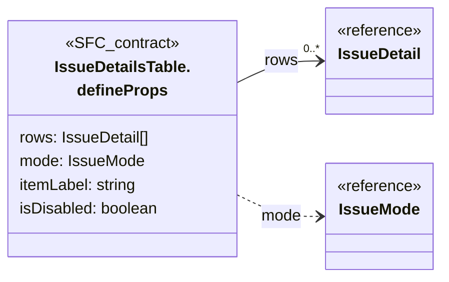

## IssueDetailsTable.defineEmits

**Fuente:** [src/modules/issues/components/IssueDetailsTable.vue](../../../../../src/modules/issues/components/IssueDetailsTable.vue) · línea 20, columna 26. **Declaración:** SFC contract.

| Miembro | Firma completa |
| --- | --- |
| `remove` | `remove: [id: string];` |
| `supply` | `supply: [ id: string, changes: Partial<Pick<IssueDetail, 'isSupplied' \| 'projectConvertedQuantity'>>, ];` |
| `return` | `return: [row: IssueDetail];` |

| Relación | Destino | Origen de la referencia |
| --- | --- | --- |
| dependency | [IssueDetail](../../../../../src/modules/issues/issue.ts) | `supply` |
| dependency | [IssueDetail](../../../../../src/modules/issues/issue.ts) | `return` |

**Figura:** `DIA-VUE-TS-ISSUES-2-1`.

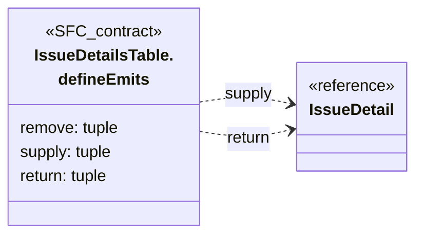

## IssueEditor.defineProps

**Fuente:** [src/modules/issues/components/IssueEditor.vue](../../../../../src/modules/issues/components/IssueEditor.vue) · línea 17, columna 13. **Declaración:** SFC contract.

| Miembro | Firma completa |
| --- | --- |
| `title` | `title: string;` |
| `values` | `values: IssueValues;` |
| `errors` | `errors: Partial<Record<IssueField, string>>;` |
| `message` | `message: string;` |
| `isSubmitting` | `isSubmitting: boolean;` |
| `isConflicted` | `isConflicted: boolean;` |
| `canEditHeader` | `canEditHeader: boolean;` |
| `canEditDetails` | `canEditDetails: boolean;` |
| `mode` | `mode: IssueMode;` |
| `itemLabel` | `itemLabel: string;` |
| `selects` | `selects: IssueHeaderSelect[];` |
| `canCreateClient` | `canCreateClient: boolean;` |

| Relación | Destino | Origen de la referencia |
| --- | --- | --- |
| association | [IssueValues](../../../../../src/modules/issues/issue.ts) | `values` |
| dependency | [IssueField](../../../../../src/modules/issues/issue.ts) | `errors` |
| dependency | [IssueMode](../../../../../src/modules/issues/issue.ts) | `mode` |
| association | [IssueHeaderSelect](../../../../../src/modules/issues/issue.ts) | `selects` |

**Figura:** `DIA-VUE-TS-ISSUES-3-1`.

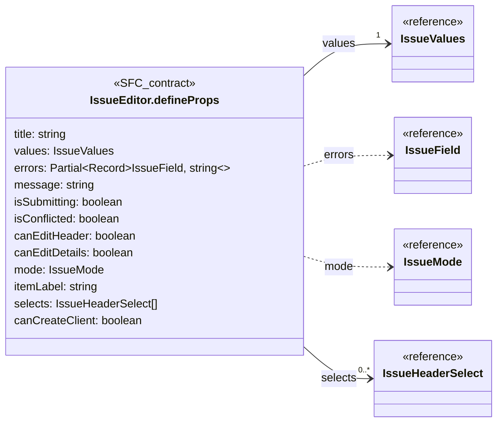

## IssueEditor.defineEmits

**Fuente:** [src/modules/issues/components/IssueEditor.vue](../../../../../src/modules/issues/components/IssueEditor.vue) · línea 31, columna 26. **Declaración:** SFC contract.

| Miembro | Firma completa |
| --- | --- |
| `update` | `update: [field: IssueField, value: string \| IssueDetail[]];` |
| `blur` | `blur: [field: IssueField];` |
| `search` | `search: [kind: IssueHeaderSelect['kind'], value: string];` |
| `more` | `more: [kind: IssueHeaderSelect['kind']];` |
| `retry` | `retry: [kind: IssueHeaderSelect['kind']];` |
| `remove` | `remove: [id: string];` |
| `supply` | `supply: [ id: string, changes: Partial<Pick<IssueDetail, 'isSupplied' \| 'projectConvertedQuantity'>>, ];` |
| `return` | `return: [detail: IssueDetail];` |
| `submit` | `submit: [];` |
| `close` | `close: [];` |
| `reload` | `reload: [];` |
| `createClient` | `createClient: [search: string];` |

| Relación | Destino | Origen de la referencia |
| --- | --- | --- |
| dependency | [IssueField](../../../../../src/modules/issues/issue.ts) | `update` |
| dependency | [IssueDetail](../../../../../src/modules/issues/issue.ts) | `update` |
| dependency | [IssueField](../../../../../src/modules/issues/issue.ts) | `blur` |
| dependency | [IssueHeaderSelect](../../../../../src/modules/issues/issue.ts) | `search` |
| dependency | [IssueHeaderSelect](../../../../../src/modules/issues/issue.ts) | `more` |
| dependency | [IssueHeaderSelect](../../../../../src/modules/issues/issue.ts) | `retry` |
| dependency | [IssueDetail](../../../../../src/modules/issues/issue.ts) | `supply` |
| dependency | [IssueDetail](../../../../../src/modules/issues/issue.ts) | `return` |

**Figura:** `DIA-VUE-TS-ISSUES-4-1`.

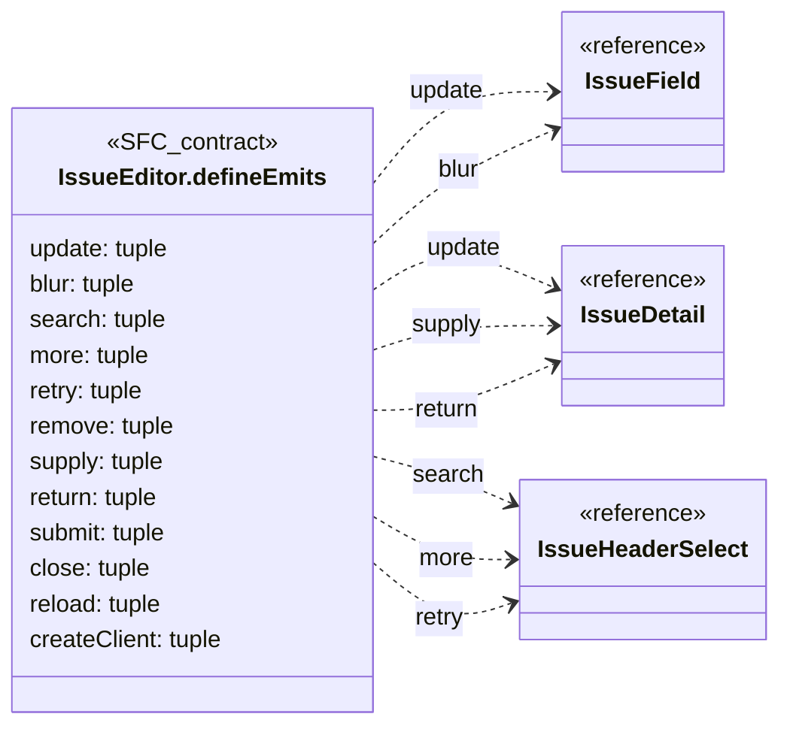

## IssueFilters.defineProps

**Fuente:** [src/modules/issues/components/IssueFilters.vue](../../../../../src/modules/issues/components/IssueFilters.vue) · línea 10, columna 27. **Declaración:** SFC contract.

| Miembro | Firma completa |
| --- | --- |
| `values` | `values: IssueFilters;` |
| `selects` | `selects: IssueFilterSelect[];` |
| `isLoading` | `isLoading: boolean;` |
| `isDepartmentLocked` | `isDepartmentLocked: boolean;` |
| `error` | `error: string;` |

| Relación | Destino | Origen de la referencia |
| --- | --- | --- |
| association | [IssueFilters](../../../../../src/modules/issues/issue.ts) | `values` |
| association | [IssueFilterSelect](../../../../../src/modules/issues/issue.ts) | `selects` |

**Figura:** `DIA-VUE-TS-ISSUES-5-1`.

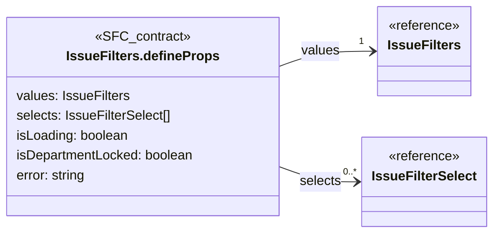

## IssueFilters.defineEmits

**Fuente:** [src/modules/issues/components/IssueFilters.vue](../../../../../src/modules/issues/components/IssueFilters.vue) · línea 17, columna 26. **Declaración:** SFC contract.

| Miembro | Firma completa |
| --- | --- |
| `update` | `update: [field: keyof IssueFilters, value: string];` |
| `apply` | `apply: [];` |
| `clear` | `clear: [];` |
| `refresh` | `refresh: [];` |
| `searchOptions` | `searchOptions: [kind: IssueFilterSelect['kind'], value: string];` |
| `more` | `more: [kind: IssueFilterSelect['kind']];` |
| `retry` | `retry: [kind: IssueFilterSelect['kind']];` |

| Relación | Destino | Origen de la referencia |
| --- | --- | --- |
| dependency | [IssueFilters](../../../../../src/modules/issues/issue.ts) | `update` |
| dependency | [IssueFilterSelect](../../../../../src/modules/issues/issue.ts) | `searchOptions` |
| dependency | [IssueFilterSelect](../../../../../src/modules/issues/issue.ts) | `more` |
| dependency | [IssueFilterSelect](../../../../../src/modules/issues/issue.ts) | `retry` |

**Figura:** `DIA-VUE-TS-ISSUES-6-1`.

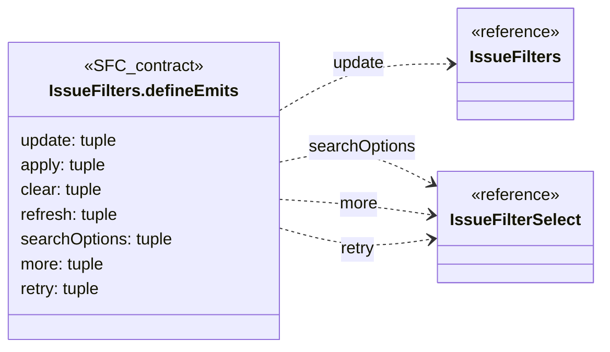

## IssueLineEntryForm.defineProps

**Fuente:** [src/modules/issues/components/IssueLineEntryForm.vue](../../../../../src/modules/issues/components/IssueLineEntryForm.vue) · línea 8, columna 13. **Declaración:** SFC contract.

| Miembro | Firma completa |
| --- | --- |
| `label` | `label: string;` |
| `values` | `values: { itemId: string; quantity: string };` |
| `errors` | `errors: Partial<Record<'itemId' \| 'quantity', string>>;` |
| `state` | `state: LookupState;` |
| `selected` | `selected?: LookupItem;` |
| `isDisabled` | `isDisabled: boolean;` |
| `minimum` | `minimum: string;` |

| Relación | Destino | Origen de la referencia |
| --- | --- | --- |
| association | [IssueLineEntryForm.values@10:13](../../../../../src/modules/issues/components/IssueLineEntryForm.vue) | `values` |
| association | [LookupState](../../../../../src/shared/lookup.ts) | `state` |
| association | [LookupItem](../../../../../src/shared/lookup.ts) | `selected` |

**Figura:** `DIA-VUE-TS-ISSUES-7-1`.

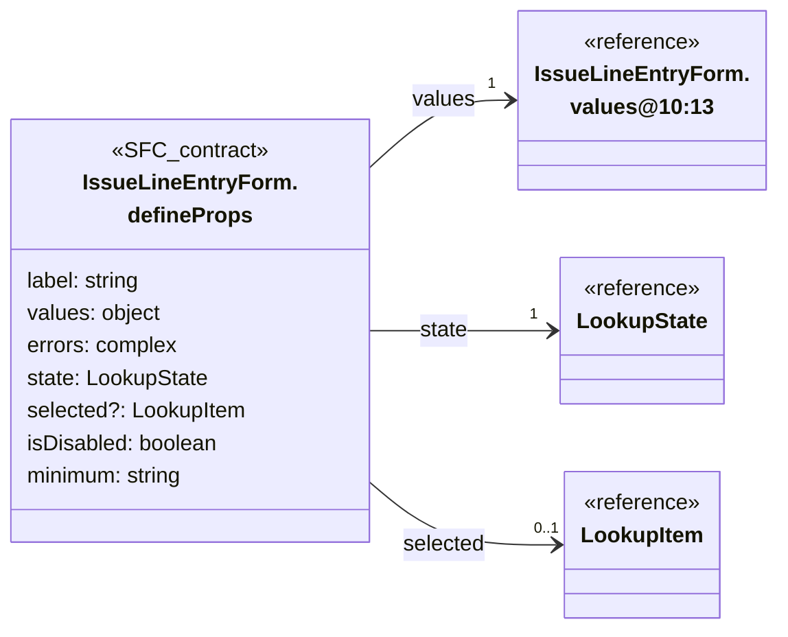

## IssueLineEntryForm.values@10:13

**Fuente:** [src/modules/issues/components/IssueLineEntryForm.vue](../../../../../src/modules/issues/components/IssueLineEntryForm.vue) · línea 10, columna 13. **Declaración:** inline object.

| Miembro | Firma completa |
| --- | --- |
| `itemId` | `itemId: string;` |
| `quantity` | `quantity: string` |

**Figura:** `DIA-VUE-TS-ISSUES-8-1`.

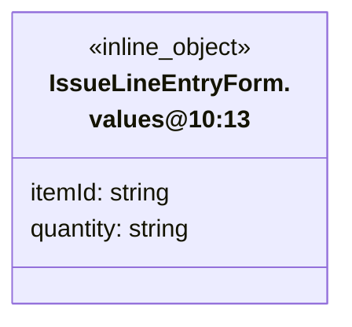

## IssueLineEntryForm.defineEmits

**Fuente:** [src/modules/issues/components/IssueLineEntryForm.vue](../../../../../src/modules/issues/components/IssueLineEntryForm.vue) · línea 17, columna 26. **Declaración:** SFC contract.

| Miembro | Firma completa |
| --- | --- |
| `update` | `update: [field: 'itemId' \| 'quantity', value: string];` |
| `blur` | `blur: [field: 'itemId' \| 'quantity'];` |
| `search` | `search: [value: string];` |
| `more` | `more: [];` |
| `retry` | `retry: [];` |
| `add` | `add: [];` |

**Figura:** `DIA-VUE-TS-ISSUES-9-1`.

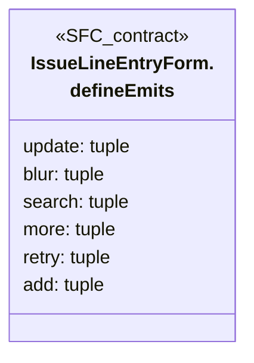

## IssueReturnForm.defineProps

**Fuente:** [src/modules/issues/components/IssueReturnForm.vue](../../../../../src/modules/issues/components/IssueReturnForm.vue) · línea 7, columna 13. **Declaración:** SFC contract.

| Miembro | Firma completa |
| --- | --- |
| `name` | `name: string;` |
| `supplied` | `supplied: number;` |
| `returned` | `returned: number;` |
| `available` | `available: number;` |
| `values` | `values: { returnQuantity: string; observations: string };` |
| `errors` | `errors: Partial<Record<'returnQuantity' \| 'observations', string>>;` |
| `message` | `message: string;` |
| `isSubmitting` | `isSubmitting: boolean;` |
| `isConflicted` | `isConflicted: boolean;` |

| Relación | Destino | Origen de la referencia |
| --- | --- | --- |
| association | [IssueReturnForm.values@12:13](../../../../../src/modules/issues/components/IssueReturnForm.vue) | `values` |

**Figura:** `DIA-VUE-TS-ISSUES-10-1`.

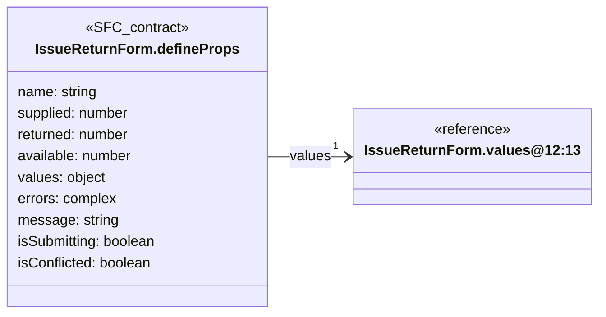

## IssueReturnForm.values@12:13

**Fuente:** [src/modules/issues/components/IssueReturnForm.vue](../../../../../src/modules/issues/components/IssueReturnForm.vue) · línea 12, columna 13. **Declaración:** inline object.

| Miembro | Firma completa |
| --- | --- |
| `returnQuantity` | `returnQuantity: string;` |
| `observations` | `observations: string` |

**Figura:** `DIA-VUE-TS-ISSUES-11-1`.

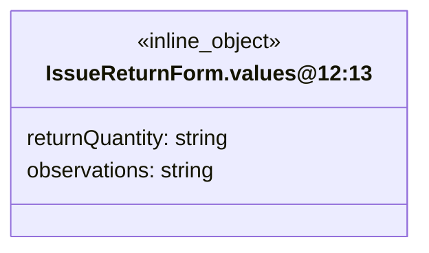

## IssueReturnForm.defineEmits

**Fuente:** [src/modules/issues/components/IssueReturnForm.vue](../../../../../src/modules/issues/components/IssueReturnForm.vue) · línea 18, columna 26. **Declaración:** SFC contract.

| Miembro | Firma completa |
| --- | --- |
| `update` | `update: [field: 'returnQuantity' \| 'observations', value: string];` |
| `blur` | `blur: [field: 'returnQuantity' \| 'observations'];` |
| `submit` | `submit: [];` |
| `close` | `close: [];` |
| `reload` | `reload: [];` |

**Figura:** `DIA-VUE-TS-ISSUES-12-1`.

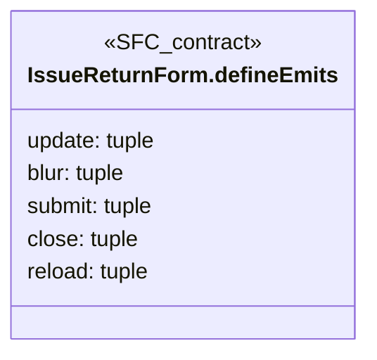

## IssueTable.defineProps

**Fuente:** [src/modules/issues/components/IssueTable.vue](../../../../../src/modules/issues/components/IssueTable.vue) · línea 10, columna 27. **Declaración:** SFC contract.

| Miembro | Firma completa |
| --- | --- |
| `rows` | `rows: IssueRow[];` |
| `query` | `query: IssueQuery;` |
| `total` | `total: number;` |
| `isLoading` | `isLoading: boolean;` |
| `isReading` | `isReading: boolean;` |
| `canManage` | `canManage: boolean;` |
| `canSupply` | `canSupply: boolean;` |
| `isWaste` | `isWaste: boolean;` |

| Relación | Destino | Origen de la referencia |
| --- | --- | --- |
| association | [IssueRow](../../../../../src/modules/issues/issue.ts) | `rows` |
| dependency | [IssueQuery](../../../../../src/modules/issues/issue.ts) | `query` |

**Figura:** `DIA-VUE-TS-ISSUES-13-1`.

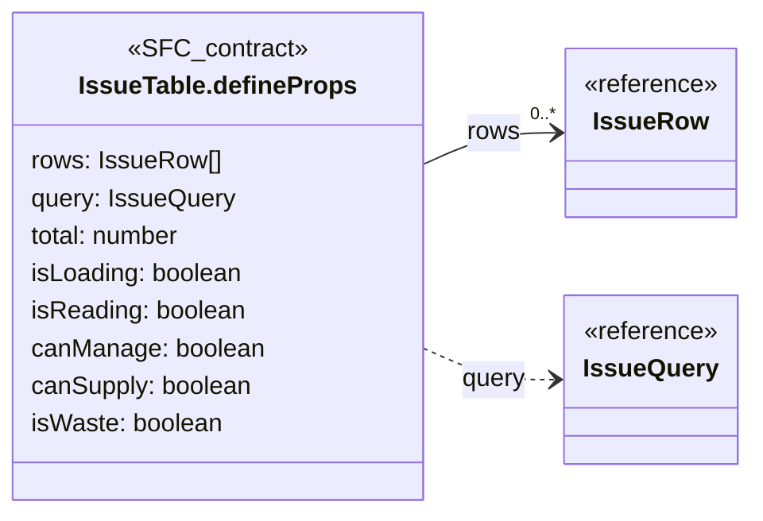

## IssueTable.defineEmits

**Fuente:** [src/modules/issues/components/IssueTable.vue](../../../../../src/modules/issues/components/IssueTable.vue) · línea 20, columna 26. **Declaración:** SFC contract.

| Miembro | Firma completa |
| --- | --- |
| `query` | `query: [changes: Partial<IssueQuery>];` |
| `open` | `open: [row: IssueRow, mode: IssueOpenMode];` |

| Relación | Destino | Origen de la referencia |
| --- | --- | --- |
| dependency | [IssueQuery](../../../../../src/modules/issues/issue.ts) | `query` |
| dependency | [IssueRow](../../../../../src/modules/issues/issue.ts) | `open` |
| dependency | [IssueOpenMode](../../../../../src/modules/issues/issue.ts) | `open` |

**Figura:** `DIA-VUE-TS-ISSUES-14-1`.

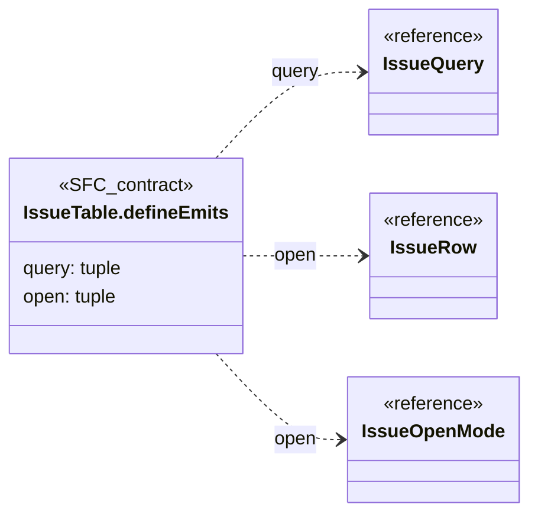

## useIssueActions.options@10:42

**Fuente:** [src/modules/issues/composables/useIssueActions.ts](../../../../../src/modules/issues/composables/useIssueActions.ts) · línea 10, columna 42. **Declaración:** inline object.

| Miembro | Firma completa |
| --- | --- |
| `resource` | `resource: IssueResource;` |
| `canManage` | `canManage: () => boolean;` |
| `canSupply` | `canSupply: () => boolean;` |
| `canRead` | `canRead: () => boolean;` |
| `reload` | `reload: () => unknown;` |
| `onError` | `onError: (cause: unknown) => void;` |

| Relación | Destino | Origen de la referencia |
| --- | --- | --- |
| dependency | [IssueResource](../../../../../src/modules/issues/issue.ts) | `resource` |

**Figura:** `DIA-VUE-TS-ISSUES-15-1`.

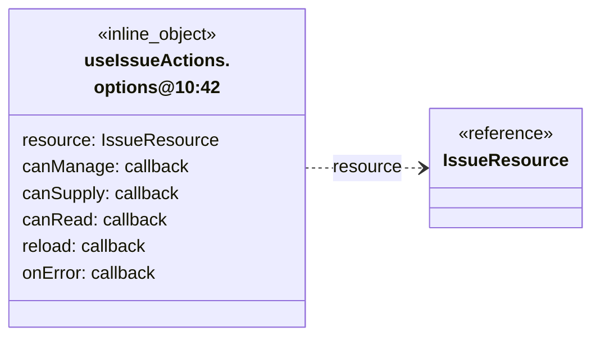

## lastRequestedEditor@28:30

**Fuente:** [src/modules/issues/composables/useIssueActions.ts](../../../../../src/modules/issues/composables/useIssueActions.ts) · línea 28, columna 30. **Declaración:** inline object.

| Miembro | Firma completa |
| --- | --- |
| `row` | `row: IssueRow;` |
| `mode` | `mode: IssueOpenMode` |

| Relación | Destino | Origen de la referencia |
| --- | --- | --- |
| association | [IssueRow](../../../../../src/modules/issues/issue.ts) | `row` |
| dependency | [IssueOpenMode](../../../../../src/modules/issues/issue.ts) | `mode` |

**Figura:** `DIA-VUE-TS-ISSUES-16-1`.

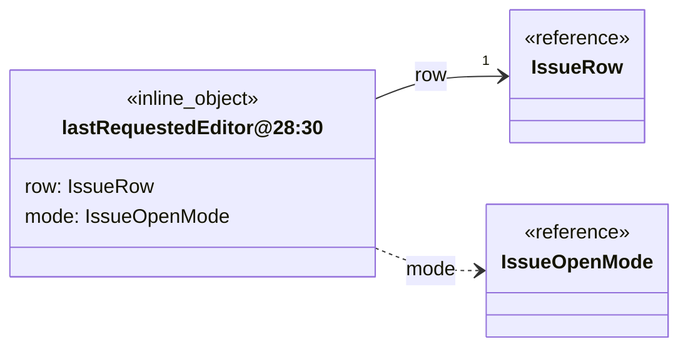

## useIssueDepartments.options@7:46

**Fuente:** [src/modules/issues/composables/useIssueDepartments.ts](../../../../../src/modules/issues/composables/useIssueDepartments.ts) · línea 7, columna 46. **Declaración:** inline object.

| Miembro | Firma completa |
| --- | --- |
| `resource` | `resource: IssueResource;` |
| `isEnabled` | `isEnabled: () => boolean;` |
| `getSelectedId` | `getSelectedId: () => string;` |
| `selectDefault` | `selectDefault: (id: string) => void;` |

| Relación | Destino | Origen de la referencia |
| --- | --- | --- |
| dependency | [IssueResource](../../../../../src/modules/issues/issue.ts) | `resource` |

**Figura:** `DIA-VUE-TS-ISSUES-17-1`.

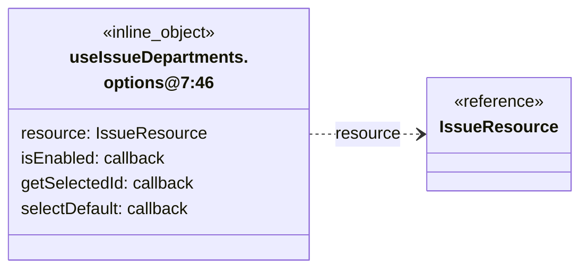

## useIssueEditor.options@14:41

**Fuente:** [src/modules/issues/composables/useIssueEditor.ts](../../../../../src/modules/issues/composables/useIssueEditor.ts) · línea 14, columna 41. **Declaración:** inline object.

| Miembro | Firma completa |
| --- | --- |
| `resource` | `resource: IssueResource;` |
| `target` | `target: IssueTarget;` |
| `has` | `has: (permission: string) => boolean;` |
| `onSaved` | `onSaved: (result: MutationConfirmation) => void;` |
| `onDenied` | `onDenied: (status: number) => void;` |

| Relación | Destino | Origen de la referencia |
| --- | --- | --- |
| dependency | [IssueResource](../../../../../src/modules/issues/issue.ts) | `resource` |
| dependency | [IssueTarget](../../../../../src/modules/issues/issue.ts) | `target` |
| dependency | [MutationConfirmation](../../../../../src/shared/http/recordContract.ts) | `onSaved` |

**Figura:** `DIA-VUE-TS-ISSUES-18-1`.

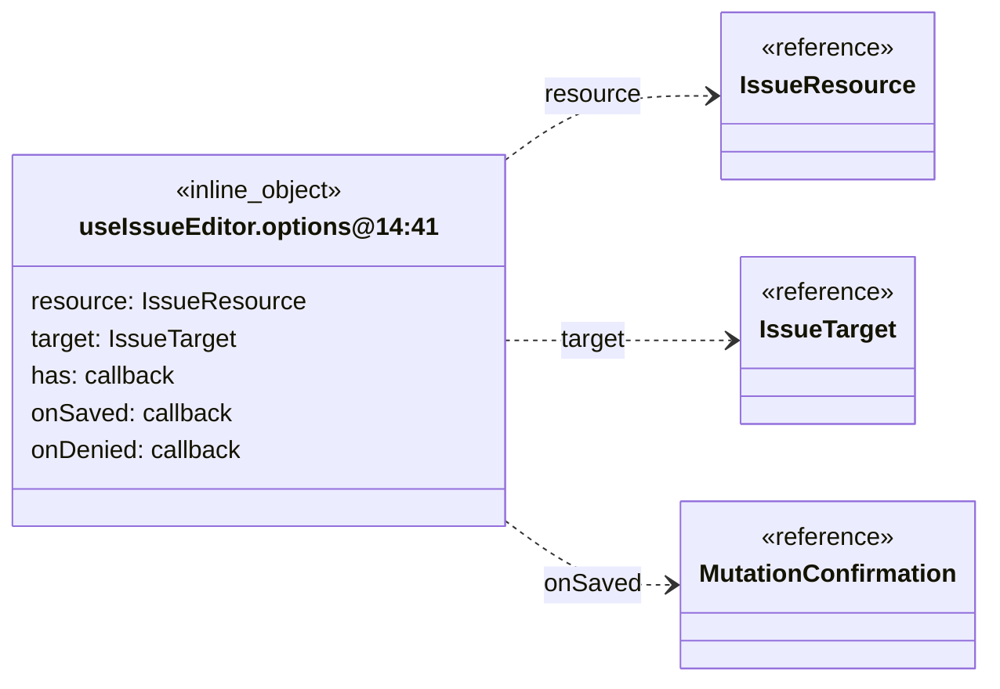

## useIssueHeaderSelection.options@15:50

**Fuente:** [src/modules/issues/composables/useIssueHeaderSelection.ts](../../../../../src/modules/issues/composables/useIssueHeaderSelection.ts) · línea 15, columna 50. **Declaración:** inline object.

| Miembro | Firma completa |
| --- | --- |
| `resource` | `resource: IssueResource;` |
| `values` | `values: IssueValues;` |
| `document` | `document?: IssueDocument;` |
| `isEnabled` | `isEnabled: () => boolean;` |
| `has` | `has: (permission: string) => boolean;` |
| `selectClient` | `selectClient: (id: string) => void;` |
| `setHeaderField` | `setHeaderField: ( field: 'advisorId' \| 'requesterId' \| 'projectNumber' \| 'departmentId', value: string, ) => void;` |

| Relación | Destino | Origen de la referencia |
| --- | --- | --- |
| dependency | [IssueResource](../../../../../src/modules/issues/issue.ts) | `resource` |
| association | [IssueValues](../../../../../src/modules/issues/issue.ts) | `values` |
| association | [IssueDocument](../../../../../src/modules/issues/issue.ts) | `document` |

**Figura:** `DIA-VUE-TS-ISSUES-19-1`.

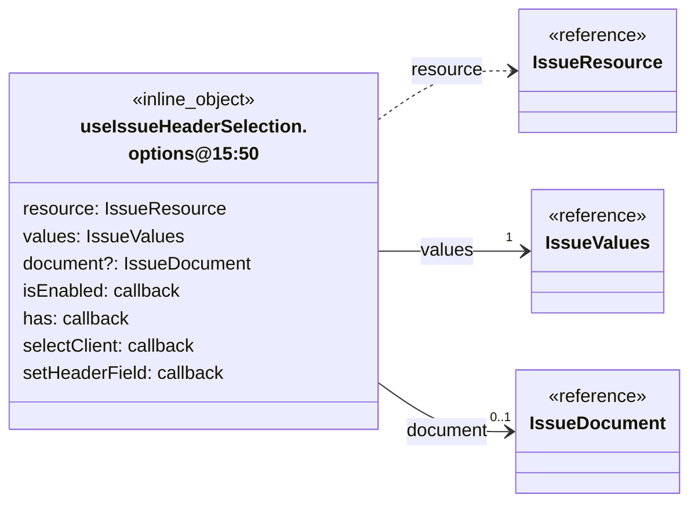

## useIssueLineEntry.options@14:44

**Fuente:** [src/modules/issues/composables/useIssueLineEntry.ts](../../../../../src/modules/issues/composables/useIssueLineEntry.ts) · línea 14, columna 44. **Declaración:** inline object.

| Miembro | Firma completa |
| --- | --- |
| `resource` | `resource: IssueResource;` |
| `isDisabled` | `isDisabled: () => boolean;` |
| `canRead` | `canRead: () => boolean;` |
| `onAdd` | `onAdd: (line: IssueDetail) => void;` |

| Relación | Destino | Origen de la referencia |
| --- | --- | --- |
| dependency | [IssueResource](../../../../../src/modules/issues/issue.ts) | `resource` |
| dependency | [IssueDetail](../../../../../src/modules/issues/issue.ts) | `onAdd` |

**Figura:** `DIA-VUE-TS-ISSUES-20-1`.

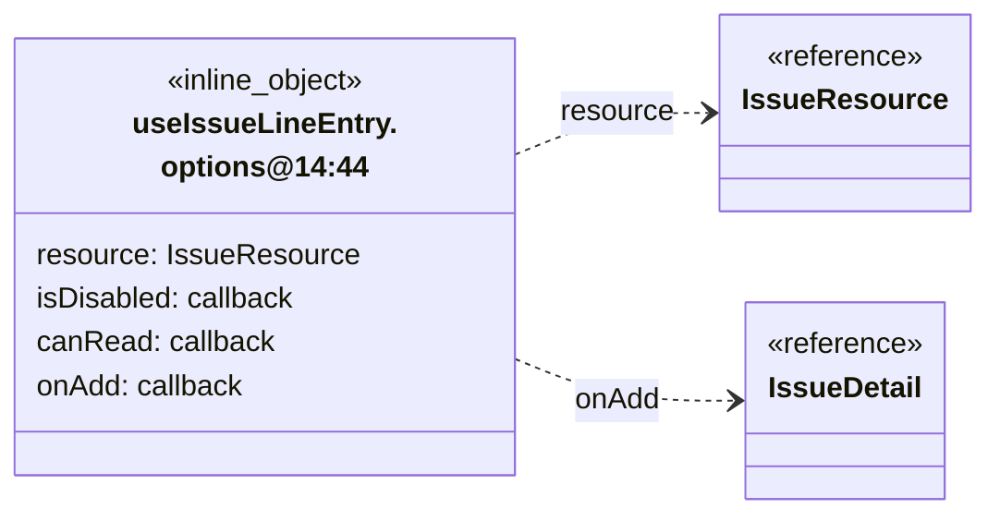

## useIssueReturn.options@11:41

**Fuente:** [src/modules/issues/composables/useIssueReturn.ts](../../../../../src/modules/issues/composables/useIssueReturn.ts) · línea 11, columna 41. **Declaración:** inline object.

| Miembro | Firma completa |
| --- | --- |
| `resource` | `resource: IssueResource;` |
| `document` | `document: IssueDocument;` |
| `detail` | `detail: IssueDetail;` |
| `onSaved` | `onSaved: (result: MutationConfirmation) => void;` |
| `onDenied` | `onDenied: (status: number) => void;` |

| Relación | Destino | Origen de la referencia |
| --- | --- | --- |
| dependency | [IssueResource](../../../../../src/modules/issues/issue.ts) | `resource` |
| association | [IssueDocument](../../../../../src/modules/issues/issue.ts) | `document` |
| association | [IssueDetail](../../../../../src/modules/issues/issue.ts) | `detail` |
| dependency | [MutationConfirmation](../../../../../src/shared/http/recordContract.ts) | `onSaved` |

**Figura:** `DIA-VUE-TS-ISSUES-21-1`.

```mermaid
classDiagram
    direction LR
    class Subject["useIssueReturn.options@11:41"] {
        <<inline_object>>
        resource: IssueResource
        document: IssueDocument
        detail: IssueDetail
        onSaved: callback
        onDenied: callback
    }
    class R0["IssueResource"] {
        <<reference>>
    }
    class R1["IssueDocument"] {
        <<reference>>
    }
    class R2["IssueDetail"] {
        <<reference>>
    }
    class R3["MutationConfirmation"] {
        <<reference>>
    }
    Subject ..> R0 : resource
    Subject --> "1" R1 : document
    Subject --> "1" R2 : detail
    Subject ..> R3 : onSaved
```

## IssueResource

**Fuente:** [src/modules/issues/issue.ts](../../../../../src/modules/issues/issue.ts) · línea 4, columna 1. **Declaración:** type.

**Definición completa:**

```typescript
'materials' | 'consumables' | 'wastes'
```

## IssueMode

**Fuente:** [src/modules/issues/issue.ts](../../../../../src/modules/issues/issue.ts) · línea 5, columna 1. **Declaración:** type.

**Definición completa:**

```typescript
'create' | 'edit' | 'header' | 'view' | 'supply' | 'return'
```

## IssueRow

**Fuente:** [src/modules/issues/issue.ts](../../../../../src/modules/issues/issue.ts) · línea 6, columna 1. **Declaración:** interface.

| Miembro | Firma completa |
| --- | --- |
| `id` | `id: string;` |
| `referenceNumber` | `referenceNumber: string;` |
| `requestDate` | `requestDate: string;` |
| `requesterId` | `requesterId: string;` |
| `requesterName` | `requesterName: string;` |
| `advisorId` | `advisorId: string;` |
| `advisorName` | `advisorName: string;` |
| `clientId` | `clientId: string;` |
| `clientName` | `clientName: string;` |
| `departmentId` | `departmentId: string;` |
| `departmentName` | `departmentName: string;` |
| `projectNumber` | `projectNumber: string;` |
| `observations` | `observations: string;` |
| `status` | `status: string;` |
| `fulfillmentStatus` | `fulfillmentStatus: string;` |

**Figura:** `DIA-VUE-TS-ISSUES-24-1`.

```mermaid
classDiagram
    direction LR
    class Subject["IssueRow"] {
        <<interface>>
        id: string
        referenceNumber: string
        requestDate: string
        requesterId: string
        requesterName: string
        advisorId: string
        advisorName: string
        clientId: string
        clientName: string
        departmentId: string
        departmentName: string
        projectNumber: string
        observations: string
        status: string
        fulfillmentStatus: string
    }
```

## IssueDetail

**Fuente:** [src/modules/issues/issue.ts](../../../../../src/modules/issues/issue.ts) · línea 23, columna 1. **Declaración:** interface.

| Miembro | Firma completa |
| --- | --- |
| `id` | `id: string;` |
| `itemId` | `itemId: string;` |
| `supplierId` | `supplierId: string;` |
| `name` | `name: string;` |
| `base` | `base: number \| null;` |
| `height` | `height: number \| null;` |
| `presentation` | `presentation: string;` |
| `unitMeasure` | `unitMeasure: string;` |
| `quantity` | `quantity: number;` |
| `convertedQuantity` | `convertedQuantity: number;` |
| `suppliedQuantity` | `suppliedQuantity: number;` |
| `returnedQuantity` | `returnedQuantity: number;` |
| `maxUnitCost` | `maxUnitCost: number \| null;` |
| `projectConvertedQuantity` | `projectConvertedQuantity: string;` |
| `isSupplied` | `isSupplied: boolean;` |
| `isOriginallySupplied` | `isOriginallySupplied: boolean;` |
| `isCanceled` | `isCanceled: boolean;` |

**Figura:** `DIA-VUE-TS-ISSUES-25-1`. Parte 1/2.

```mermaid
classDiagram
    direction LR
    class Subject["IssueDetail"] {
        <<interface>>
        id: string
        itemId: string
        supplierId: string
        name: string
        base: number | null
        height: number | null
        presentation: string
        unitMeasure: string
        quantity: number
        convertedQuantity: number
        suppliedQuantity: number
        returnedQuantity: number
        maxUnitCost: number | null
        projectConvertedQuantity: string
        isSupplied: boolean
        isOriginallySupplied: boolean
    }
```

**Figura:** `DIA-VUE-TS-ISSUES-25-2`. Parte 2/2.

```mermaid
classDiagram
    direction LR
    class Subject["IssueDetail"] {
        <<interface>>
        isCanceled: boolean
    }
```

## IssueDocument

**Fuente:** [src/modules/issues/issue.ts](../../../../../src/modules/issues/issue.ts) · línea 42, columna 1. **Declaración:** interface.

**Extensión/implementación:** `extends IssueRow`.

| Miembro | Firma completa |
| --- | --- |
| `details` | `details: IssueDetail[];` |

| Relación | Destino | Origen de la referencia |
| --- | --- | --- |
| inheritance | [IssueRow](../../../../../src/modules/issues/issue.ts) | `extends` |
| association | [IssueDetail](../../../../../src/modules/issues/issue.ts) | `details` |

**Figura:** `DIA-VUE-TS-ISSUES-26-1`.

```mermaid
classDiagram
    direction LR
    class Subject["IssueDocument"] {
        <<interface>>
        details: IssueDetail[]
    }
    class R0["IssueRow"] {
        <<reference>>
    }
    class R1["IssueDetail"] {
        <<reference>>
    }
    R0 <|-- Subject : extends
    Subject --> "0..*" R1 : details
```

## IssueValues

**Fuente:** [src/modules/issues/issue.ts](../../../../../src/modules/issues/issue.ts) · línea 45, columna 1. **Declaración:** interface.

| Miembro | Firma completa |
| --- | --- |
| `clientId` | `clientId: string;` |
| `advisorId` | `advisorId: string;` |
| `departmentId` | `departmentId: string;` |
| `requesterId` | `requesterId: string;` |
| `projectNumber` | `projectNumber: string;` |
| `requestDate` | `requestDate: string;` |
| `observations` | `observations: string;` |
| `details` | `details: IssueDetail[];` |

| Relación | Destino | Origen de la referencia |
| --- | --- | --- |
| association | [IssueDetail](../../../../../src/modules/issues/issue.ts) | `details` |

**Figura:** `DIA-VUE-TS-ISSUES-27-1`.

```mermaid
classDiagram
    direction LR
    class Subject["IssueValues"] {
        <<interface>>
        clientId: string
        advisorId: string
        departmentId: string
        requesterId: string
        projectNumber: string
        requestDate: string
        observations: string
        details: IssueDetail[]
    }
    class R0["IssueDetail"] {
        <<reference>>
    }
    Subject --> "0..*" R0 : details
```

## IssueField

**Fuente:** [src/modules/issues/issue.ts](../../../../../src/modules/issues/issue.ts) · línea 55, columna 1. **Declaración:** type.

**Definición completa:**

```typescript
keyof IssueValues
```

| Relación | Destino | Origen de la referencia |
| --- | --- | --- |
| dependency | [IssueValues](../../../../../src/modules/issues/issue.ts) | `type` |

**Figura:** `DIA-VUE-TS-ISSUES-28-1`.

```mermaid
classDiagram
    direction LR
    class Subject["IssueField"] {
        <<type>>
    }
    class R0["IssueValues"] {
        <<reference>>
    }
    Subject ..> R0 : type
```

## IssueWriteMode

**Fuente:** [src/modules/issues/issue.ts](../../../../../src/modules/issues/issue.ts) · línea 56, columna 1. **Declaración:** type.

**Definición completa:**

```typescript
'create' | 'edit' | 'header' | 'supply'
```

## IssueOpenMode

**Fuente:** [src/modules/issues/issue.ts](../../../../../src/modules/issues/issue.ts) · línea 57, columna 1. **Declaración:** type.

**Definición completa:**

```typescript
'edit' | 'view' | 'supply' | 'return'
```

## IssueWriteTarget

**Fuente:** [src/modules/issues/issue.ts](../../../../../src/modules/issues/issue.ts) · línea 58, columna 1. **Declaración:** type.

**Definición completa:**

```typescript
| { mode: 'create'; document?: never }
    | { mode: Exclude<IssueWriteMode, 'create'>; document: IssueDocument }
```

| Relación | Destino | Origen de la referencia |
| --- | --- | --- |
| dependency | [IssueWriteTarget@59:7](../../../../../src/modules/issues/issue.ts) | `type` |
| dependency | [IssueWriteTarget@60:7](../../../../../src/modules/issues/issue.ts) | `type` |

**Figura:** `DIA-VUE-TS-ISSUES-31-1`.

```mermaid
classDiagram
    direction LR
    class Subject["IssueWriteTarget"] {
        <<type>>
    }
    class R0["IssueWriteTarget@59:7"] {
        <<reference>>
    }
    class R1["IssueWriteTarget@60:7"] {
        <<reference>>
    }
    Subject ..> R0 : type
    Subject ..> R1 : type
```

## IssueWriteTarget@59:7

**Fuente:** [src/modules/issues/issue.ts](../../../../../src/modules/issues/issue.ts) · línea 59, columna 7. **Declaración:** inline object.

| Miembro | Firma completa |
| --- | --- |
| `mode` | `mode: 'create';` |
| `document` | `document?: never` |

**Figura:** `DIA-VUE-TS-ISSUES-32-1`.

```mermaid
classDiagram
    direction LR
    class Subject["IssueWriteTarget@59:7"] {
        <<inline_object>>
        mode: 'create'
        document?: never
    }
```

## IssueWriteTarget@60:7

**Fuente:** [src/modules/issues/issue.ts](../../../../../src/modules/issues/issue.ts) · línea 60, columna 7. **Declaración:** inline object.

| Miembro | Firma completa |
| --- | --- |
| `mode` | `mode: Exclude<IssueWriteMode, 'create'>;` |
| `document` | `document: IssueDocument` |

| Relación | Destino | Origen de la referencia |
| --- | --- | --- |
| dependency | [IssueWriteMode](../../../../../src/modules/issues/issue.ts) | `mode` |
| association | [IssueDocument](../../../../../src/modules/issues/issue.ts) | `document` |

**Figura:** `DIA-VUE-TS-ISSUES-33-1`.

```mermaid
classDiagram
    direction LR
    class Subject["IssueWriteTarget@60:7"] {
        <<inline_object>>
        mode: Exclude~IssueWriteMode, 'create'~
        document: IssueDocument
    }
    class R0["IssueWriteMode"] {
        <<reference>>
    }
    class R1["IssueDocument"] {
        <<reference>>
    }
    Subject ..> R0 : mode
    Subject --> "1" R1 : document
```

## IssueTarget

**Fuente:** [src/modules/issues/issue.ts](../../../../../src/modules/issues/issue.ts) · línea 61, columna 1. **Declaración:** type.

**Definición completa:**

```typescript
IssueWriteTarget | { mode: 'view' | 'return'; document: IssueDocument }
```

| Relación | Destino | Origen de la referencia |
| --- | --- | --- |
| dependency | [IssueWriteTarget](../../../../../src/modules/issues/issue.ts) | `type` |
| dependency | [IssueTarget@61:46](../../../../../src/modules/issues/issue.ts) | `type` |

**Figura:** `DIA-VUE-TS-ISSUES-34-1`.

```mermaid
classDiagram
    direction LR
    class Subject["IssueTarget"] {
        <<type>>
    }
    class R0["IssueWriteTarget"] {
        <<reference>>
    }
    class R1["IssueTarget@61:46"] {
        <<reference>>
    }
    Subject ..> R0 : type
    Subject ..> R1 : type
```

## IssueTarget@61:46

**Fuente:** [src/modules/issues/issue.ts](../../../../../src/modules/issues/issue.ts) · línea 61, columna 46. **Declaración:** inline object.

| Miembro | Firma completa |
| --- | --- |
| `mode` | `mode: 'view' \| 'return';` |
| `document` | `document: IssueDocument` |

| Relación | Destino | Origen de la referencia |
| --- | --- | --- |
| association | [IssueDocument](../../../../../src/modules/issues/issue.ts) | `document` |

**Figura:** `DIA-VUE-TS-ISSUES-35-1`.

```mermaid
classDiagram
    direction LR
    class Subject["IssueTarget@61:46"] {
        <<inline_object>>
        mode: 'view' | 'return'
        document: IssueDocument
    }
    class R0["IssueDocument"] {
        <<reference>>
    }
    Subject --> "1" R0 : document
```

## IssueFilters

**Fuente:** [src/modules/issues/issue.ts](../../../../../src/modules/issues/issue.ts) · línea 62, columna 1. **Declaración:** interface.

| Miembro | Firma completa |
| --- | --- |
| `startDate` | `startDate: string;` |
| `endDate` | `endDate: string;` |
| `clientId` | `clientId: string;` |
| `departmentId` | `departmentId: string;` |
| `personId` | `personId: string;` |
| `fulfillmentStatusId` | `fulfillmentStatusId: string;` |
| `observationsSearch` | `observationsSearch: string;` |

**Figura:** `DIA-VUE-TS-ISSUES-36-1`.

```mermaid
classDiagram
    direction LR
    class Subject["IssueFilters"] {
        <<interface>>
        startDate: string
        endDate: string
        clientId: string
        departmentId: string
        personId: string
        fulfillmentStatusId: string
        observationsSearch: string
    }
```

## IssueQuery

**Fuente:** [src/modules/issues/issue.ts](../../../../../src/modules/issues/issue.ts) · línea 71, columna 1. **Declaración:** type.

**Definición completa:**

```typescript
RecordQuery & IssueFilters
```

| Relación | Destino | Origen de la referencia |
| --- | --- | --- |
| dependency | [RecordQuery](../../../../../src/shared/list.ts) | `type` |
| dependency | [IssueFilters](../../../../../src/modules/issues/issue.ts) | `type` |

**Figura:** `DIA-VUE-TS-ISSUES-37-1`.

```mermaid
classDiagram
    direction LR
    class Subject["IssueQuery"] {
        <<type>>
    }
    class R0["RecordQuery"] {
        <<reference>>
    }
    class R1["IssueFilters"] {
        <<reference>>
    }
    Subject ..> R0 : type
    Subject ..> R1 : type
```

## IssueLookup

**Fuente:** [src/modules/issues/issue.ts](../../../../../src/modules/issues/issue.ts) · línea 72, columna 1. **Declaración:** type.

**Definición completa:**

```typescript
'clients' | 'departments' | 'persons' | 'statuses' | 'items'
```

## IssueHeaderSelect

**Fuente:** [src/modules/issues/issue.ts](../../../../../src/modules/issues/issue.ts) · línea 73, columna 1. **Declaración:** interface.

| Miembro | Firma completa |
| --- | --- |
| `field` | `field: 'clientId' \| 'advisorId' \| 'departmentId' \| 'requesterId';` |
| `kind` | `kind: 'clients' \| 'advisors' \| 'departments' \| 'requesters';` |
| `label` | `label: string;` |
| `state` | `state: LookupState;` |
| `initialOption` | `initialOption?: LookupItem;` |
| `isDisabled` | `isDisabled: boolean;` |
| `hint` | `hint: string;` |

| Relación | Destino | Origen de la referencia |
| --- | --- | --- |
| association | [LookupState](../../../../../src/shared/lookup.ts) | `state` |
| association | [LookupItem](../../../../../src/shared/lookup.ts) | `initialOption` |

**Figura:** `DIA-VUE-TS-ISSUES-39-1`.

```mermaid
classDiagram
    direction LR
    class Subject["IssueHeaderSelect"] {
        <<interface>>
        field: complex
        kind: complex
        label: string
        state: LookupState
        initialOption?: LookupItem
        isDisabled: boolean
        hint: string
    }
    class R0["LookupState"] {
        <<reference>>
    }
    class R1["LookupItem"] {
        <<reference>>
    }
    Subject --> "1" R0 : state
    Subject --> "0..1" R1 : initialOption
```

## IssueFilterSelect

**Fuente:** [src/modules/issues/issue.ts](../../../../../src/modules/issues/issue.ts) · línea 82, columna 1. **Declaración:** interface.

| Miembro | Firma completa |
| --- | --- |
| `field` | `field: 'clientId' \| 'departmentId' \| 'personId' \| 'fulfillmentStatusId';` |
| `kind` | `kind: 'clients' \| 'departments' \| 'persons' \| 'statuses';` |
| `label` | `label: string;` |
| `state` | `state: LookupState;` |
| `isDisabled` | `isDisabled: boolean;` |
| `hint` | `hint: string;` |

| Relación | Destino | Origen de la referencia |
| --- | --- | --- |
| association | [LookupState](../../../../../src/shared/lookup.ts) | `state` |

**Figura:** `DIA-VUE-TS-ISSUES-40-1`.

```mermaid
classDiagram
    direction LR
    class Subject["IssueFilterSelect"] {
        <<interface>>
        field: complex
        kind: complex
        label: string
        state: LookupState
        isDisabled: boolean
        hint: string
    }
    class R0["LookupState"] {
        <<reference>>
    }
    Subject --> "1" R0 : state
```

## createIssueValidationSchema.options@39:54

**Fuente:** [src/modules/issues/issueForm.ts](../../../../../src/modules/issues/issueForm.ts) · línea 39, columna 54. **Declaración:** inline object.

| Miembro | Firma completa |
| --- | --- |
| `resource` | `resource: IssueResource;` |
| `mode` | `mode: IssueMode;` |
| `getValues` | `getValues: () => IssueValues;` |

| Relación | Destino | Origen de la referencia |
| --- | --- | --- |
| dependency | [IssueResource](../../../../../src/modules/issues/issue.ts) | `resource` |
| dependency | [IssueMode](../../../../../src/modules/issues/issue.ts) | `mode` |
| dependency | [IssueValues](../../../../../src/modules/issues/issue.ts) | `getValues` |

**Figura:** `DIA-VUE-TS-ISSUES-41-1`.

```mermaid
classDiagram
    direction LR
    class Subject["createIssueValidationSchema.<br/>options@39:54"] {
        <<inline_object>>
        resource: IssueResource
        mode: IssueMode
        getValues: callback
    }
    class R0["IssueResource"] {
        <<reference>>
    }
    class R1["IssueMode"] {
        <<reference>>
    }
    class R2["IssueValues"] {
        <<reference>>
    }
    Subject ..> R0 : resource
    Subject ..> R1 : mode
    Subject ..> R2 : getValues
```

## IssueEditorPage.defineProps

**Fuente:** [src/modules/issues/pages/IssueEditorPage.vue](../../../../../src/modules/issues/pages/IssueEditorPage.vue) · línea 16, columna 27. **Declaración:** SFC contract.

| Miembro | Firma completa |
| --- | --- |
| `resource` | `resource: IssueResource;` |
| `target` | `target: IssueTarget` |

| Relación | Destino | Origen de la referencia |
| --- | --- | --- |
| dependency | [IssueResource](../../../../../src/modules/issues/issue.ts) | `resource` |
| dependency | [IssueTarget](../../../../../src/modules/issues/issue.ts) | `target` |

**Figura:** `DIA-VUE-TS-ISSUES-42-1`.

```mermaid
classDiagram
    direction LR
    class Subject["IssueEditorPage.defineProps"] {
        <<SFC_contract>>
        resource: IssueResource
        target: IssueTarget
    }
    class R0["IssueResource"] {
        <<reference>>
    }
    class R1["IssueTarget"] {
        <<reference>>
    }
    Subject ..> R0 : resource
    Subject ..> R1 : target
```

## IssueEditorPage.defineEmits

**Fuente:** [src/modules/issues/pages/IssueEditorPage.vue](../../../../../src/modules/issues/pages/IssueEditorPage.vue) · línea 17, columna 26. **Declaración:** SFC contract.

| Miembro | Firma completa |
| --- | --- |
| `saved` | `saved: [result: MutationConfirmation];` |
| `close` | `close: [];` |
| `reload` | `reload: [];` |
| `createClient` | `createClient: [request: LookupCreation];` |

| Relación | Destino | Origen de la referencia |
| --- | --- | --- |
| dependency | [MutationConfirmation](../../../../../src/shared/http/recordContract.ts) | `saved` |
| dependency | [LookupCreation](../../../../../src/shared/lookup.ts) | `createClient` |

**Figura:** `DIA-VUE-TS-ISSUES-43-1`.

```mermaid
classDiagram
    direction LR
    class Subject["IssueEditorPage.defineEmits"] {
        <<SFC_contract>>
        saved: tuple
        close: tuple
        reload: tuple
        createClient: tuple
    }
    class R0["MutationConfirmation"] {
        <<reference>>
    }
    class R1["LookupCreation"] {
        <<reference>>
    }
    Subject ..> R0 : saved
    Subject ..> R1 : createClient
```

## IssueLineEntryPage.defineProps

**Fuente:** [src/modules/issues/pages/IssueLineEntryPage.vue](../../../../../src/modules/issues/pages/IssueLineEntryPage.vue) · línea 7, columna 27. **Declaración:** SFC contract.

| Miembro | Firma completa |
| --- | --- |
| `resource` | `resource: IssueResource;` |
| `isDisabled` | `isDisabled: boolean;` |
| `canRead` | `canRead: boolean` |

| Relación | Destino | Origen de la referencia |
| --- | --- | --- |
| dependency | [IssueResource](../../../../../src/modules/issues/issue.ts) | `resource` |

**Figura:** `DIA-VUE-TS-ISSUES-44-1`.

```mermaid
classDiagram
    direction LR
    class Subject["IssueLineEntryPage.<br/>defineProps"] {
        <<SFC_contract>>
        resource: IssueResource
        isDisabled: boolean
        canRead: boolean
    }
    class R0["IssueResource"] {
        <<reference>>
    }
    Subject ..> R0 : resource
```

## IssueLineEntryPage.defineEmits

**Fuente:** [src/modules/issues/pages/IssueLineEntryPage.vue](../../../../../src/modules/issues/pages/IssueLineEntryPage.vue) · línea 8, columna 26. **Declaración:** SFC contract.

| Miembro | Firma completa |
| --- | --- |
| `add` | `add: [line: IssueDetail]` |

| Relación | Destino | Origen de la referencia |
| --- | --- | --- |
| dependency | [IssueDetail](../../../../../src/modules/issues/issue.ts) | `add` |

**Figura:** `DIA-VUE-TS-ISSUES-45-1`.

```mermaid
classDiagram
    direction LR
    class Subject["IssueLineEntryPage.<br/>defineEmits"] {
        <<SFC_contract>>
        add: tuple
    }
    class R0["IssueDetail"] {
        <<reference>>
    }
    Subject ..> R0 : add
```

## IssuePage.defineProps

**Fuente:** [src/modules/issues/pages/IssuePage.vue](../../../../../src/modules/issues/pages/IssuePage.vue) · línea 26, columna 27. **Declaración:** SFC contract.

| Miembro | Firma completa |
| --- | --- |
| `resource` | `resource: IssueResource` |

| Relación | Destino | Origen de la referencia |
| --- | --- | --- |
| dependency | [IssueResource](../../../../../src/modules/issues/issue.ts) | `resource` |

**Figura:** `DIA-VUE-TS-ISSUES-46-1`.

```mermaid
classDiagram
    direction LR
    class Subject["IssuePage.defineProps"] {
        <<SFC_contract>>
        resource: IssueResource
    }
    class R0["IssueResource"] {
        <<reference>>
    }
    Subject ..> R0 : resource
```

## IssuePage.defineEmits

**Fuente:** [src/modules/issues/pages/IssuePage.vue](../../../../../src/modules/issues/pages/IssuePage.vue) · línea 27, columna 26. **Declaración:** SFC contract.

| Miembro | Firma completa |
| --- | --- |
| `createClient` | `createClient: [request: LookupCreation]` |

| Relación | Destino | Origen de la referencia |
| --- | --- | --- |
| dependency | [LookupCreation](../../../../../src/shared/lookup.ts) | `createClient` |

**Figura:** `DIA-VUE-TS-ISSUES-47-1`.

```mermaid
classDiagram
    direction LR
    class Subject["IssuePage.defineEmits"] {
        <<SFC_contract>>
        createClient: tuple
    }
    class R0["LookupCreation"] {
        <<reference>>
    }
    Subject ..> R0 : createClient
```

## IssueReturnPage.defineProps

**Fuente:** [src/modules/issues/pages/IssueReturnPage.vue](../../../../../src/modules/issues/pages/IssueReturnPage.vue) · línea 7, columna 27. **Declaración:** SFC contract.

| Miembro | Firma completa |
| --- | --- |
| `resource` | `resource: IssueResource;` |
| `document` | `document: IssueDocument;` |
| `detail` | `detail: IssueDetail;` |

| Relación | Destino | Origen de la referencia |
| --- | --- | --- |
| dependency | [IssueResource](../../../../../src/modules/issues/issue.ts) | `resource` |
| association | [IssueDocument](../../../../../src/modules/issues/issue.ts) | `document` |
| association | [IssueDetail](../../../../../src/modules/issues/issue.ts) | `detail` |

**Figura:** `DIA-VUE-TS-ISSUES-48-1`.

```mermaid
classDiagram
    direction LR
    class Subject["IssueReturnPage.defineProps"] {
        <<SFC_contract>>
        resource: IssueResource
        document: IssueDocument
        detail: IssueDetail
    }
    class R0["IssueResource"] {
        <<reference>>
    }
    class R1["IssueDocument"] {
        <<reference>>
    }
    class R2["IssueDetail"] {
        <<reference>>
    }
    Subject ..> R0 : resource
    Subject --> "1" R1 : document
    Subject --> "1" R2 : detail
```

## IssueReturnPage.defineEmits

**Fuente:** [src/modules/issues/pages/IssueReturnPage.vue](../../../../../src/modules/issues/pages/IssueReturnPage.vue) · línea 12, columna 26. **Declaración:** SFC contract.

| Miembro | Firma completa |
| --- | --- |
| `saved` | `saved: [result: MutationConfirmation];` |
| `close` | `close: [];` |
| `denied` | `denied: [status: number];` |

| Relación | Destino | Origen de la referencia |
| --- | --- | --- |
| dependency | [MutationConfirmation](../../../../../src/shared/http/recordContract.ts) | `saved` |

**Figura:** `DIA-VUE-TS-ISSUES-49-1`.

```mermaid
classDiagram
    direction LR
    class Subject["IssueReturnPage.defineEmits"] {
        <<SFC_contract>>
        saved: tuple
        close: tuple
        denied: tuple
    }
    class R0["MutationConfirmation"] {
        <<reference>>
    }
    Subject ..> R0 : saved
```

## issueService.options@64:25

**Fuente:** [src/modules/issues/services/issueService.ts](../../../../../src/modules/issues/services/issueService.ts) · línea 64, columna 25. **Declaración:** inline object.

| Miembro | Firma completa |
| --- | --- |
| `resource` | `resource: IssueResource;` |
| `target` | `target: IssueWriteTarget;` |
| `payload` | `payload: Record<string, unknown>;` |
| `signal` | `signal: AbortSignal;` |

| Relación | Destino | Origen de la referencia |
| --- | --- | --- |
| dependency | [IssueResource](../../../../../src/modules/issues/issue.ts) | `resource` |
| dependency | [IssueWriteTarget](../../../../../src/modules/issues/issue.ts) | `target` |

**Figura:** `DIA-VUE-TS-ISSUES-50-1`.

```mermaid
classDiagram
    direction LR
    class Subject["issueService.options@64:25"] {
        <<inline_object>>
        resource: IssueResource
        target: IssueWriteTarget
        payload: Record~string, unknown~
        signal: AbortSignal
    }
    class R0["IssueResource"] {
        <<reference>>
    }
    class R1["IssueWriteTarget"] {
        <<reference>>
    }
    Subject ..> R0 : resource
    Subject ..> R1 : target
```

## issueService.options@86:33

**Fuente:** [src/modules/issues/services/issueService.ts](../../../../../src/modules/issues/services/issueService.ts) · línea 86, columna 33. **Declaración:** inline object.

| Miembro | Firma completa |
| --- | --- |
| `resource` | `resource: IssueResource;` |
| `documentId` | `documentId: string;` |
| `detailId` | `detailId: string;` |
| `payload` | `payload: Record<string, unknown>;` |
| `signal` | `signal: AbortSignal;` |

| Relación | Destino | Origen de la referencia |
| --- | --- | --- |
| dependency | [IssueResource](../../../../../src/modules/issues/issue.ts) | `resource` |

**Figura:** `DIA-VUE-TS-ISSUES-51-1`.

```mermaid
classDiagram
    direction LR
    class Subject["issueService.options@86:33"] {
        <<inline_object>>
        resource: IssueResource
        documentId: string
        detailId: string
        payload: Record~string, unknown~
        signal: AbortSignal
    }
    class R0["IssueResource"] {
        <<reference>>
    }
    Subject ..> R0 : resource
```

## useIssueActions.return

**Fuente:** [src/modules/issues/composables/useIssueActions.ts](../../../../../src/modules/issues/composables/useIssueActions.ts) · línea 10, columna 32. **Declaración:** inferred return.

| Miembro | Firma completa |
| --- | --- |
| `editor` | `"editor": ShallowRef<IssueTarget \| null, IssueTarget \| null>;` |
| `editorKey` | `"editorKey": Ref<number, number>;` |
| `open` | `"open": (row: IssueRow, mode: IssueOpenMode) => Promise<void>;` |
| `create` | `"create": () => void;` |
| `close` | `"close": () => void;` |
| `retry` | `"retry": () => Promise<void> \| undefined;` |
| `handleSaved` | `"handleSaved": (result: MutationConfirmation) => void;` |
| `document` | `"document": ShallowRef<IssueDocument \| undefined, IssueDocument \| undefined>;` |
| `isReading` | `"isReading": Ref<boolean, boolean>;` |
| `readError` | `"readError": Ref<string, string>;` |
| `load` | `"load": (id?: string) => Promise<IssueDocument \| undefined>;` |

| Relación | Destino | Origen de la referencia |
| --- | --- | --- |
| dependency | [IssueTarget](../../../../../src/modules/issues/issue.ts) | `editor` |
| dependency | [IssueRow](../../../../../src/modules/issues/issue.ts) | `open` |
| dependency | [IssueOpenMode](../../../../../src/modules/issues/issue.ts) | `open` |
| dependency | [MutationConfirmation](../../../../../src/shared/http/recordContract.ts) | `handleSaved` |

**Figura:** `DIA-VUE-TS-ISSUES-52-1`.

```mermaid
classDiagram
    direction LR
    class Subject["useIssueActions.return"] {
        <<inferred_return>>
        editor: complex
        editorKey: Ref~number, number~
        open: callback
        create: callback
        close: callback
        retry: callback
        handleSaved: callback
        document: complex
        isReading: Ref~boolean, boolean~
        readError: Ref~string, string~
        load: callback
    }
    class R0["IssueTarget"] {
        <<reference>>
    }
    class R1["IssueRow"] {
        <<reference>>
    }
    class R2["IssueOpenMode"] {
        <<reference>>
    }
    class R3["MutationConfirmation"] {
        <<reference>>
    }
    Subject ..> R0 : editor
    Subject ..> R1 : open
    Subject ..> R2 : open
    Subject ..> R3 : handleSaved
```

## useIssueDepartments.return

**Fuente:** [src/modules/issues/composables/useIssueDepartments.ts](../../../../../src/modules/issues/composables/useIssueDepartments.ts) · línea 7, columna 36. **Declaración:** inferred return.

| Miembro | Firma completa |
| --- | --- |
| `isLocked` | `"isLocked": ComputedRef<boolean>;` |
| `state` | `"state": ComputedRef<LookupState>;` |
| `items` | `"items": Ref<{ id: string; title: string; data: Record<string, unknown>; isDisabled?: boolean \| undefined; }[], LookupItem[] \| { id: string; title: string; data: Record<string, unknown>; isDisabled?: boolean \| undefined; }[]>;` |
| `isLoading` | `"isLoading": Ref<boolean, boolean>;` |
| `error` | `"error": Ref<string, string>;` |
| `search` | `"search": Ref<string, string>;` |
| `hasMore` | `"hasMore": Ref<boolean, boolean>;` |
| `updateSearch` | `"updateSearch": (value: string) => void;` |
| `refresh` | `"refresh": () => Promise<void>;` |
| `loadMore` | `"loadMore": () => Promise<void> \| undefined;` |
| `retry` | `"retry": () => Promise<void>;` |

| Relación | Destino | Origen de la referencia |
| --- | --- | --- |
| dependency | [useIssueDepartments.return.items.shape1](../../../../../src/modules/issues/composables/useIssueDepartments.ts) | `items` |
| dependency | [LookupItem](../../../../../src/shared/lookup.ts) | `items` |
| dependency | [useIssueDepartments.return.items.shape2](../../../../../src/modules/issues/composables/useIssueDepartments.ts) | `items` |

**Figura:** `DIA-VUE-TS-ISSUES-53-1`.

```mermaid
classDiagram
    direction LR
    class Subject["useIssueDepartments.return"] {
        <<inferred_return>>
        isLocked: ComputedRef~boolean~
        state: ComputedRef~LookupState~
        items: object
        isLoading: Ref~boolean, boolean~
        error: Ref~string, string~
        search: Ref~string, string~
        hasMore: Ref~boolean, boolean~
        updateSearch: callback
        refresh: callback
        loadMore: callback
        retry: callback
    }
    class R0["useIssueDepartments.return.<br/>items.shape1"] {
        <<reference>>
    }
    class R1["LookupItem"] {
        <<reference>>
    }
    class R2["useIssueDepartments.return.<br/>items.shape2"] {
        <<reference>>
    }
    Subject ..> R0 : items
    Subject ..> R1 : items
    Subject ..> R2 : items
```

## useIssueDepartments.return.items.shape1

**Fuente:** [src/modules/issues/composables/useIssueDepartments.ts](../../../../../src/modules/issues/composables/useIssueDepartments.ts) · línea 7, columna 36. **Declaración:** inferred object.

| Miembro | Firma completa |
| --- | --- |
| `id` | `id: string;` |
| `title` | `title: string;` |
| `data` | `data: Record<string, unknown>;` |
| `isDisabled` | `isDisabled?: boolean \| undefined;` |

**Figura:** `DIA-VUE-TS-ISSUES-54-1`.

```mermaid
classDiagram
    direction LR
    class Subject["useIssueDepartments.return.<br/>items.shape1"] {
        <<inferred_object>>
        id: string
        title: string
        data: Record~string, unknown~
        isDisabled?: boolean | undefined
    }
```

## useIssueDepartments.return.items.shape2

**Fuente:** [src/modules/issues/composables/useIssueDepartments.ts](../../../../../src/modules/issues/composables/useIssueDepartments.ts) · línea 7, columna 36. **Declaración:** inferred object.

| Miembro | Firma completa |
| --- | --- |
| `id` | `id: string;` |
| `title` | `title: string;` |
| `data` | `data: Record<string, unknown>;` |
| `isDisabled` | `isDisabled?: boolean \| undefined;` |

**Figura:** `DIA-VUE-TS-ISSUES-55-1`.

```mermaid
classDiagram
    direction LR
    class Subject["useIssueDepartments.return.<br/>items.shape2"] {
        <<inferred_object>>
        id: string
        title: string
        data: Record~string, unknown~
        isDisabled?: boolean | undefined
    }
```

## useIssueEditor.return

**Fuente:** [src/modules/issues/composables/useIssueEditor.ts](../../../../../src/modules/issues/composables/useIssueEditor.ts) · línea 14, columna 31. **Declaración:** inferred return.

| Miembro | Firma completa |
| --- | --- |
| `values` | `"values": IssueValues;` |
| `errors` | `"errors": ComputedRef<Partial<Record<"" \| "departmentId" \| "clientId" \| "advisorId" \| "requesterId" \| "projectNumber" \| "requestDate" \| "observations" \| "details" \| details[${number}] \| details[${number}].id \| details[${number}].name \| details[${number}].itemId \| details[${number}].supplierId \| details[${number}].base \| details[${number}].height \| details[${number}].presentation \| details[${number}].unitMeasure \| details[${number}].quantity \| details[${number}].convertedQuantity \| details[${number}].suppliedQuantity \| details[${number}].returnedQuantity \| details[${number}].maxUnitCost \| details[${number}].projectConvertedQuantity \| details[${number}].isSupplied \| details[${number}].isOriginallySupplied \| details[${number}].isCanceled, string \| undefined>>>;` |
| `isSubmitting` | `"isSubmitting": ComputedRef<boolean>;` |
| `isReadOnly` | `"isReadOnly": boolean;` |
| `canEditHeader` | `"canEditHeader": boolean;` |
| `canEditDetails` | `"canEditDetails": boolean;` |
| `headerSelection` | `"headerSelection": { selectCreatedClient: (item: LookupItem) => void; clients: { state: ComputedRef<LookupState>; items: Ref<{ id: string; title: string; data: Record<string, unknown>; isDisabled?: boolean \| undefined; }[], LookupItem[] \| { id: string; title: string; data: Record<string, unknown>; isDisabled?: boolean \| undefined; }[]>; isLoading: Ref<boolean, boolean>; error: Ref<string, string>; search: Ref<string, string>; hasMore: Ref<boolean, boolean>; updateSearch: (value: string) => void; refresh: () => Promise<void>; loadMore: () => Promise<void> \| undefined; retry: () => Promise<void>; }; departments: { isLocked: ComputedRef<boolean>; state: ComputedRef<LookupState>; items: Ref<{ id: string; title: string; data: Record<string, unknown>; isDisabled?: boolean \| undefined; }[], LookupItem[] \| { id: string; title: string; data: Record<string, unknown>; isDisabled?: boolean \| undefined; }[]>; isLoading: Ref<boolean, boolean>; error: Ref<string, string>; search: Ref<string, string>; hasMore: Ref<boolean, boolean>; updateSearch: (value: string) => void; refresh: () => Promise<void>; loadMore: () => Promise<void> \| undefined; retry: () => Promise<void>; }; advisors: { state: ComputedRef<LookupState>; items: Ref<{ id: string; title: string; data: Record<string, unknown>; isDisabled?: boolean \| undefined; }[], LookupItem[] \| { id: string; title: string; data: Record<string, unknown>; isDisabled?: boolean \| undefined; }[]>; isLoading: Ref<boolean, boolean>; error: Ref<string, string>; search: Ref<string, string>; hasMore: Ref<boolean, boolean>; updateSearch: (value: string) => void; refresh: () => Promise<void>; loadMore: () => Promise<void> \| undefined; retry: () => Promise<void>; }; requesters: { state: ComputedRef<LookupState>; items: Ref<{ id: string; title: string; data: Record<string, unknown>; isDisabled?: boolean \| undefined; }[], LookupItem[] \| { id: string; title: string; data: Record<string, unknown>; isDisabled?: boolean \| undefined; }[]>; isLoading: Ref<boolean, boolean>; error: Ref<string, string>; search: Ref<string, string>; hasMore: Ref<boolean, boolean>; updateSearch: (value: string) => void; refresh: () => Promise<void>; loadMore: () => Promise<void> \| undefined; retry: () => Promise<void>; }; initialOptions: ComputedRef<{ clientId: LookupItem \| undefined; departmentId: LookupItem \| undefined; advisorId: LookupItem \| undefined; requesterId: LookupItem \| undefined; }>; canReadClients: ComputedRef<boolean>; canReadDepartments: ComputedRef<boolean>; canReadPersons: ComputedRef<boolean>; };` |
| `addDetail` | `"addDetail": (line: IssueDetail) => void;` |
| `removeDetail` | `"removeDetail": (id: string) => void;` |
| `updateDetailSupply` | `"updateDetailSupply": (id: string, changes: Partial<Pick<IssueDetail, "isSupplied" \| "projectConvertedQuantity">>) => void;` |
| `submit` | `"submit": () => Promise<Promise<void> \| undefined> \| undefined;` |
| `update` | `"update": (field: keyof IssueValues, value: string \| IssueDetail[]) => void;` |
| `blur` | `"blur": (field: keyof IssueValues) => Promise<unknown> \| undefined;` |
| `message` | `"message": Ref<string, string>;` |
| `isConflicted` | `"isConflicted": Ref<boolean, boolean>;` |
| `execute` | `"execute": (operation: (signal: AbortSignal) => Promise<MutationConfirmation>) => Promise<void>;` |
| `signal` | `"signal": AbortSignal;` |
| `isDisposed` | `"isDisposed": () => boolean;` |

| Relación | Destino | Origen de la referencia |
| --- | --- | --- |
| association | [IssueValues](../../../../../src/modules/issues/issue.ts) | `values` |
| dependency | [useIssueEditor.return.headerSelection.shape1](../../../../../src/modules/issues/composables/useIssueEditor.ts) | `headerSelection` |
| dependency | [IssueDetail](../../../../../src/modules/issues/issue.ts) | `addDetail` |
| dependency | [IssueDetail](../../../../../src/modules/issues/issue.ts) | `updateDetailSupply` |
| dependency | [IssueValues](../../../../../src/modules/issues/issue.ts) | `update` |
| dependency | [IssueDetail](../../../../../src/modules/issues/issue.ts) | `update` |
| dependency | [IssueValues](../../../../../src/modules/issues/issue.ts) | `blur` |
| dependency | [MutationConfirmation](../../../../../src/shared/http/recordContract.ts) | `execute` |

**Figura:** `DIA-VUE-TS-ISSUES-56-1`. Parte 1/2.

```mermaid
classDiagram
    direction LR
    class Subject["useIssueEditor.return"] {
        <<inferred_return>>
        values: IssueValues
        errors: object
        isSubmitting: ComputedRef~boolean~
        isReadOnly: boolean
        canEditHeader: boolean
        canEditDetails: boolean
        headerSelection: callback
        addDetail: callback
        removeDetail: callback
        updateDetailSupply: callback
        submit: callback
        update: callback
        blur: callback
        message: Ref~string, string~
        isConflicted: Ref~boolean, boolean~
        execute: callback
    }
    class R0["IssueValues"] {
        <<reference>>
    }
    class R1["useIssueEditor.return.<br/>headerSelection.shape1"] {
        <<reference>>
    }
    class R2["IssueDetail"] {
        <<reference>>
    }
    class R3["MutationConfirmation"] {
        <<reference>>
    }
    Subject --> "1" R0 : values
    Subject ..> R1 : headerSelection
    Subject ..> R2 : addDetail
    Subject ..> R2 : updateDetailSupply
    Subject ..> R0 : update
    Subject ..> R2 : update
    Subject ..> R0 : blur
    Subject ..> R3 : execute
```

**Figura:** `DIA-VUE-TS-ISSUES-56-2`. Parte 2/2.

```mermaid
classDiagram
    direction LR
    class Subject["useIssueEditor.return"] {
        <<inferred_return>>
        signal: AbortSignal
        isDisposed: callback
    }
```

## useIssueEditor.return.headerSelection.shape1

**Fuente:** [src/modules/issues/composables/useIssueEditor.ts](../../../../../src/modules/issues/composables/useIssueEditor.ts) · línea 14, columna 31. **Declaración:** inferred object.

| Miembro | Firma completa |
| --- | --- |
| `selectCreatedClient` | `selectCreatedClient: (item: LookupItem) => void;` |
| `clients` | `clients: { state: ComputedRef<LookupState>; items: Ref<{ id: string; title: string; data: Record<string, unknown>; isDisabled?: boolean \| undefined; }[], LookupItem[] \| { id: string; title: string; data: Record<string, unknown>; isDisabled?: boolean \| undefined; }[]>; isLoading: Ref<boolean, boolean>; error: Ref<string, string>; search: Ref<string, string>; hasMore: Ref<boolean, boolean>; updateSearch: (value: string) => void; refresh: () => Promise<void>; loadMore: () => Promise<void> \| undefined; retry: () => Promise<void>; };` |
| `departments` | `departments: { isLocked: ComputedRef<boolean>; state: ComputedRef<LookupState>; items: Ref<{ id: string; title: string; data: Record<string, unknown>; isDisabled?: boolean \| undefined; }[], LookupItem[] \| { id: string; title: string; data: Record<string, unknown>; isDisabled?: boolean \| undefined; }[]>; isLoading: Ref<boolean, boolean>; error: Ref<string, string>; search: Ref<string, string>; hasMore: Ref<boolean, boolean>; updateSearch: (value: string) => void; refresh: () => Promise<void>; loadMore: () => Promise<void> \| undefined; retry: () => Promise<void>; };` |
| `advisors` | `advisors: { state: ComputedRef<LookupState>; items: Ref<{ id: string; title: string; data: Record<string, unknown>; isDisabled?: boolean \| undefined; }[], LookupItem[] \| { id: string; title: string; data: Record<string, unknown>; isDisabled?: boolean \| undefined; }[]>; isLoading: Ref<boolean, boolean>; error: Ref<string, string>; search: Ref<string, string>; hasMore: Ref<boolean, boolean>; updateSearch: (value: string) => void; refresh: () => Promise<void>; loadMore: () => Promise<void> \| undefined; retry: () => Promise<void>; };` |
| `requesters` | `requesters: { state: ComputedRef<LookupState>; items: Ref<{ id: string; title: string; data: Record<string, unknown>; isDisabled?: boolean \| undefined; }[], LookupItem[] \| { id: string; title: string; data: Record<string, unknown>; isDisabled?: boolean \| undefined; }[]>; isLoading: Ref<boolean, boolean>; error: Ref<string, string>; search: Ref<string, string>; hasMore: Ref<boolean, boolean>; updateSearch: (value: string) => void; refresh: () => Promise<void>; loadMore: () => Promise<void> \| undefined; retry: () => Promise<void>; };` |
| `initialOptions` | `initialOptions: ComputedRef<{ clientId: LookupItem \| undefined; departmentId: LookupItem \| undefined; advisorId: LookupItem \| undefined; requesterId: LookupItem \| undefined; }>;` |
| `canReadClients` | `canReadClients: ComputedRef<boolean>;` |
| `canReadDepartments` | `canReadDepartments: ComputedRef<boolean>;` |
| `canReadPersons` | `canReadPersons: ComputedRef<boolean>;` |

| Relación | Destino | Origen de la referencia |
| --- | --- | --- |
| dependency | [useIssueEditor.return.headerSelection.clients.shape2](../../../../../src/modules/issues/composables/useIssueEditor.ts) | `clients` |
| dependency | [useIssueEditor.return.headerSelection.departments.shape5](../../../../../src/modules/issues/composables/useIssueEditor.ts) | `departments` |
| dependency | [useIssueEditor.return.headerSelection.advisors.shape8](../../../../../src/modules/issues/composables/useIssueEditor.ts) | `advisors` |
| dependency | [useIssueEditor.return.headerSelection.requesters.shape11](../../../../../src/modules/issues/composables/useIssueEditor.ts) | `requesters` |
| dependency | [useIssueEditor.return.headerSelection.initialOptions.shape14](../../../../../src/modules/issues/composables/useIssueEditor.ts) | `initialOptions` |

**Figura:** `DIA-VUE-TS-ISSUES-57-1`. Parte 1/2.

```mermaid
classDiagram
    direction LR
    class Subject["useIssueEditor.return.<br/>headerSelection.shape1"] {
        <<inferred_object>>
        selectCreatedClient: callback
        clients: callback
        departments: callback
        advisors: callback
        requesters: callback
        canReadClients: ComputedRef~boolean~
        canReadDepartments: ComputedRef~boolean~
        canReadPersons: ComputedRef~boolean~
    }
    class R0["useIssueEditor.return.<br/>headerSelection.clients.<br/>shape2"] {
        <<reference>>
    }
    class R1["useIssueEditor.return.<br/>headerSelection.departments.<br/>shape5"] {
        <<reference>>
    }
    class R2["useIssueEditor.return.<br/>headerSelection.advisors.<br/>shape8"] {
        <<reference>>
    }
    class R3["useIssueEditor.return.<br/>headerSelection.requesters.<br/>shape11"] {
        <<reference>>
    }
    Subject ..> R0 : clients
    Subject ..> R1 : departments
    Subject ..> R2 : advisors
    Subject ..> R3 : requesters
```

**Figura:** `DIA-VUE-TS-ISSUES-57-2`. Parte 2/2.

```mermaid
classDiagram
    direction LR
    class Subject["useIssueEditor.return.<br/>headerSelection.shape1"] {
        <<inferred_object>>
        initialOptions: object
    }
    class R0["useIssueEditor.return.<br/>headerSelection.<br/>initialOptions.shape14"] {
        <<reference>>
    }
    Subject ..> R0 : initialOptions
```

## useIssueEditor.return.headerSelection.clients.shape2

**Fuente:** [src/modules/issues/composables/useIssueEditor.ts](../../../../../src/modules/issues/composables/useIssueEditor.ts) · línea 14, columna 31. **Declaración:** inferred object.

| Miembro | Firma completa |
| --- | --- |
| `state` | `state: ComputedRef<LookupState>;` |
| `items` | `items: Ref<{ id: string; title: string; data: Record<string, unknown>; isDisabled?: boolean \| undefined; }[], LookupItem[] \| { id: string; title: string; data: Record<string, unknown>; isDisabled?: boolean \| undefined; }[]>;` |
| `isLoading` | `isLoading: Ref<boolean, boolean>;` |
| `error` | `error: Ref<string, string>;` |
| `search` | `search: Ref<string, string>;` |
| `hasMore` | `hasMore: Ref<boolean, boolean>;` |
| `updateSearch` | `updateSearch: (value: string) => void;` |
| `refresh` | `refresh: () => Promise<void>;` |
| `loadMore` | `loadMore: () => Promise<void> \| undefined;` |
| `retry` | `retry: () => Promise<void>;` |

| Relación | Destino | Origen de la referencia |
| --- | --- | --- |
| dependency | [useIssueEditor.return.headerSelection.clients.items.shape3](../../../../../src/modules/issues/composables/useIssueEditor.ts) | `items` |
| dependency | [useIssueEditor.return.headerSelection.clients.items.shape4](../../../../../src/modules/issues/composables/useIssueEditor.ts) | `items` |

**Figura:** `DIA-VUE-TS-ISSUES-58-1`.

```mermaid
classDiagram
    direction LR
    class Subject["useIssueEditor.return.<br/>headerSelection.clients.<br/>shape2"] {
        <<inferred_object>>
        state: ComputedRef~LookupState~
        items: object
        isLoading: Ref~boolean, boolean~
        error: Ref~string, string~
        search: Ref~string, string~
        hasMore: Ref~boolean, boolean~
        updateSearch: callback
        refresh: callback
        loadMore: callback
        retry: callback
    }
    class R0["useIssueEditor.return.<br/>headerSelection.clients.<br/>items.shape3"] {
        <<reference>>
    }
    class R1["useIssueEditor.return.<br/>headerSelection.clients.<br/>items.shape4"] {
        <<reference>>
    }
    Subject ..> R0 : items
    Subject ..> R1 : items
```

## useIssueEditor.return.headerSelection.clients.items.shape3

**Fuente:** [src/modules/issues/composables/useIssueEditor.ts](../../../../../src/modules/issues/composables/useIssueEditor.ts) · línea 14, columna 31. **Declaración:** inferred object.

| Miembro | Firma completa |
| --- | --- |
| `id` | `id: string;` |
| `title` | `title: string;` |
| `data` | `data: Record<string, unknown>;` |
| `isDisabled` | `isDisabled?: boolean \| undefined;` |

**Figura:** `DIA-VUE-TS-ISSUES-59-1`.

```mermaid
classDiagram
    direction LR
    class Subject["useIssueEditor.return.<br/>headerSelection.clients.<br/>items.shape3"] {
        <<inferred_object>>
        id: string
        title: string
        data: Record~string, unknown~
        isDisabled?: boolean | undefined
    }
```

## useIssueEditor.return.headerSelection.clients.items.shape4

**Fuente:** [src/modules/issues/composables/useIssueEditor.ts](../../../../../src/modules/issues/composables/useIssueEditor.ts) · línea 14, columna 31. **Declaración:** inferred object.

| Miembro | Firma completa |
| --- | --- |
| `id` | `id: string;` |
| `title` | `title: string;` |
| `data` | `data: Record<string, unknown>;` |
| `isDisabled` | `isDisabled?: boolean \| undefined;` |

**Figura:** `DIA-VUE-TS-ISSUES-60-1`.

```mermaid
classDiagram
    direction LR
    class Subject["useIssueEditor.return.<br/>headerSelection.clients.<br/>items.shape4"] {
        <<inferred_object>>
        id: string
        title: string
        data: Record~string, unknown~
        isDisabled?: boolean | undefined
    }
```

## useIssueEditor.return.headerSelection.departments.shape5

**Fuente:** [src/modules/issues/composables/useIssueEditor.ts](../../../../../src/modules/issues/composables/useIssueEditor.ts) · línea 14, columna 31. **Declaración:** inferred object.

| Miembro | Firma completa |
| --- | --- |
| `isLocked` | `isLocked: ComputedRef<boolean>;` |
| `state` | `state: ComputedRef<LookupState>;` |
| `items` | `items: Ref<{ id: string; title: string; data: Record<string, unknown>; isDisabled?: boolean \| undefined; }[], LookupItem[] \| { id: string; title: string; data: Record<string, unknown>; isDisabled?: boolean \| undefined; }[]>;` |
| `isLoading` | `isLoading: Ref<boolean, boolean>;` |
| `error` | `error: Ref<string, string>;` |
| `search` | `search: Ref<string, string>;` |
| `hasMore` | `hasMore: Ref<boolean, boolean>;` |
| `updateSearch` | `updateSearch: (value: string) => void;` |
| `refresh` | `refresh: () => Promise<void>;` |
| `loadMore` | `loadMore: () => Promise<void> \| undefined;` |
| `retry` | `retry: () => Promise<void>;` |

| Relación | Destino | Origen de la referencia |
| --- | --- | --- |
| dependency | [useIssueEditor.return.headerSelection.departments.items.shape6](../../../../../src/modules/issues/composables/useIssueEditor.ts) | `items` |
| dependency | [useIssueEditor.return.headerSelection.departments.items.shape7](../../../../../src/modules/issues/composables/useIssueEditor.ts) | `items` |

**Figura:** `DIA-VUE-TS-ISSUES-61-1`.

```mermaid
classDiagram
    direction LR
    class Subject["useIssueEditor.return.<br/>headerSelection.departments.<br/>shape5"] {
        <<inferred_object>>
        isLocked: ComputedRef~boolean~
        state: ComputedRef~LookupState~
        items: object
        isLoading: Ref~boolean, boolean~
        error: Ref~string, string~
        search: Ref~string, string~
        hasMore: Ref~boolean, boolean~
        updateSearch: callback
        refresh: callback
        loadMore: callback
        retry: callback
    }
    class R0["useIssueEditor.return.<br/>headerSelection.departments.<br/>items.shape6"] {
        <<reference>>
    }
    class R1["useIssueEditor.return.<br/>headerSelection.departments.<br/>items.shape7"] {
        <<reference>>
    }
    Subject ..> R0 : items
    Subject ..> R1 : items
```

## useIssueEditor.return.headerSelection.departments.items.shape6

**Fuente:** [src/modules/issues/composables/useIssueEditor.ts](../../../../../src/modules/issues/composables/useIssueEditor.ts) · línea 14, columna 31. **Declaración:** inferred object.

| Miembro | Firma completa |
| --- | --- |
| `id` | `id: string;` |
| `title` | `title: string;` |
| `data` | `data: Record<string, unknown>;` |
| `isDisabled` | `isDisabled?: boolean \| undefined;` |

**Figura:** `DIA-VUE-TS-ISSUES-62-1`.

```mermaid
classDiagram
    direction LR
    class Subject["useIssueEditor.return.<br/>headerSelection.departments.<br/>items.shape6"] {
        <<inferred_object>>
        id: string
        title: string
        data: Record~string, unknown~
        isDisabled?: boolean | undefined
    }
```

## useIssueEditor.return.headerSelection.departments.items.shape7

**Fuente:** [src/modules/issues/composables/useIssueEditor.ts](../../../../../src/modules/issues/composables/useIssueEditor.ts) · línea 14, columna 31. **Declaración:** inferred object.

| Miembro | Firma completa |
| --- | --- |
| `id` | `id: string;` |
| `title` | `title: string;` |
| `data` | `data: Record<string, unknown>;` |
| `isDisabled` | `isDisabled?: boolean \| undefined;` |

**Figura:** `DIA-VUE-TS-ISSUES-63-1`.

```mermaid
classDiagram
    direction LR
    class Subject["useIssueEditor.return.<br/>headerSelection.departments.<br/>items.shape7"] {
        <<inferred_object>>
        id: string
        title: string
        data: Record~string, unknown~
        isDisabled?: boolean | undefined
    }
```

## useIssueEditor.return.headerSelection.advisors.shape8

**Fuente:** [src/modules/issues/composables/useIssueEditor.ts](../../../../../src/modules/issues/composables/useIssueEditor.ts) · línea 14, columna 31. **Declaración:** inferred object.

| Miembro | Firma completa |
| --- | --- |
| `state` | `state: ComputedRef<LookupState>;` |
| `items` | `items: Ref<{ id: string; title: string; data: Record<string, unknown>; isDisabled?: boolean \| undefined; }[], LookupItem[] \| { id: string; title: string; data: Record<string, unknown>; isDisabled?: boolean \| undefined; }[]>;` |
| `isLoading` | `isLoading: Ref<boolean, boolean>;` |
| `error` | `error: Ref<string, string>;` |
| `search` | `search: Ref<string, string>;` |
| `hasMore` | `hasMore: Ref<boolean, boolean>;` |
| `updateSearch` | `updateSearch: (value: string) => void;` |
| `refresh` | `refresh: () => Promise<void>;` |
| `loadMore` | `loadMore: () => Promise<void> \| undefined;` |
| `retry` | `retry: () => Promise<void>;` |

| Relación | Destino | Origen de la referencia |
| --- | --- | --- |
| dependency | [useIssueEditor.return.headerSelection.advisors.items.shape9](../../../../../src/modules/issues/composables/useIssueEditor.ts) | `items` |
| dependency | [useIssueEditor.return.headerSelection.advisors.items.shape10](../../../../../src/modules/issues/composables/useIssueEditor.ts) | `items` |

**Figura:** `DIA-VUE-TS-ISSUES-64-1`.

```mermaid
classDiagram
    direction LR
    class Subject["useIssueEditor.return.<br/>headerSelection.advisors.<br/>shape8"] {
        <<inferred_object>>
        state: ComputedRef~LookupState~
        items: object
        isLoading: Ref~boolean, boolean~
        error: Ref~string, string~
        search: Ref~string, string~
        hasMore: Ref~boolean, boolean~
        updateSearch: callback
        refresh: callback
        loadMore: callback
        retry: callback
    }
    class R0["useIssueEditor.return.<br/>headerSelection.advisors.<br/>items.shape9"] {
        <<reference>>
    }
    class R1["useIssueEditor.return.<br/>headerSelection.advisors.<br/>items.shape10"] {
        <<reference>>
    }
    Subject ..> R0 : items
    Subject ..> R1 : items
```

## useIssueEditor.return.headerSelection.advisors.items.shape9

**Fuente:** [src/modules/issues/composables/useIssueEditor.ts](../../../../../src/modules/issues/composables/useIssueEditor.ts) · línea 14, columna 31. **Declaración:** inferred object.

| Miembro | Firma completa |
| --- | --- |
| `id` | `id: string;` |
| `title` | `title: string;` |
| `data` | `data: Record<string, unknown>;` |
| `isDisabled` | `isDisabled?: boolean \| undefined;` |

**Figura:** `DIA-VUE-TS-ISSUES-65-1`.

```mermaid
classDiagram
    direction LR
    class Subject["useIssueEditor.return.<br/>headerSelection.advisors.<br/>items.shape9"] {
        <<inferred_object>>
        id: string
        title: string
        data: Record~string, unknown~
        isDisabled?: boolean | undefined
    }
```

## useIssueEditor.return.headerSelection.advisors.items.shape10

**Fuente:** [src/modules/issues/composables/useIssueEditor.ts](../../../../../src/modules/issues/composables/useIssueEditor.ts) · línea 14, columna 31. **Declaración:** inferred object.

| Miembro | Firma completa |
| --- | --- |
| `id` | `id: string;` |
| `title` | `title: string;` |
| `data` | `data: Record<string, unknown>;` |
| `isDisabled` | `isDisabled?: boolean \| undefined;` |

**Figura:** `DIA-VUE-TS-ISSUES-66-1`.

```mermaid
classDiagram
    direction LR
    class Subject["useIssueEditor.return.<br/>headerSelection.advisors.<br/>items.shape10"] {
        <<inferred_object>>
        id: string
        title: string
        data: Record~string, unknown~
        isDisabled?: boolean | undefined
    }
```

## useIssueEditor.return.headerSelection.requesters.shape11

**Fuente:** [src/modules/issues/composables/useIssueEditor.ts](../../../../../src/modules/issues/composables/useIssueEditor.ts) · línea 14, columna 31. **Declaración:** inferred object.

| Miembro | Firma completa |
| --- | --- |
| `state` | `state: ComputedRef<LookupState>;` |
| `items` | `items: Ref<{ id: string; title: string; data: Record<string, unknown>; isDisabled?: boolean \| undefined; }[], LookupItem[] \| { id: string; title: string; data: Record<string, unknown>; isDisabled?: boolean \| undefined; }[]>;` |
| `isLoading` | `isLoading: Ref<boolean, boolean>;` |
| `error` | `error: Ref<string, string>;` |
| `search` | `search: Ref<string, string>;` |
| `hasMore` | `hasMore: Ref<boolean, boolean>;` |
| `updateSearch` | `updateSearch: (value: string) => void;` |
| `refresh` | `refresh: () => Promise<void>;` |
| `loadMore` | `loadMore: () => Promise<void> \| undefined;` |
| `retry` | `retry: () => Promise<void>;` |

| Relación | Destino | Origen de la referencia |
| --- | --- | --- |
| dependency | [useIssueEditor.return.headerSelection.requesters.items.shape12](../../../../../src/modules/issues/composables/useIssueEditor.ts) | `items` |
| dependency | [useIssueEditor.return.headerSelection.requesters.items.shape13](../../../../../src/modules/issues/composables/useIssueEditor.ts) | `items` |

**Figura:** `DIA-VUE-TS-ISSUES-67-1`.

```mermaid
classDiagram
    direction LR
    class Subject["useIssueEditor.return.<br/>headerSelection.requesters.<br/>shape11"] {
        <<inferred_object>>
        state: ComputedRef~LookupState~
        items: object
        isLoading: Ref~boolean, boolean~
        error: Ref~string, string~
        search: Ref~string, string~
        hasMore: Ref~boolean, boolean~
        updateSearch: callback
        refresh: callback
        loadMore: callback
        retry: callback
    }
    class R0["useIssueEditor.return.<br/>headerSelection.requesters.<br/>items.shape12"] {
        <<reference>>
    }
    class R1["useIssueEditor.return.<br/>headerSelection.requesters.<br/>items.shape13"] {
        <<reference>>
    }
    Subject ..> R0 : items
    Subject ..> R1 : items
```

## useIssueEditor.return.headerSelection.requesters.items.shape12

**Fuente:** [src/modules/issues/composables/useIssueEditor.ts](../../../../../src/modules/issues/composables/useIssueEditor.ts) · línea 14, columna 31. **Declaración:** inferred object.

| Miembro | Firma completa |
| --- | --- |
| `id` | `id: string;` |
| `title` | `title: string;` |
| `data` | `data: Record<string, unknown>;` |
| `isDisabled` | `isDisabled?: boolean \| undefined;` |

**Figura:** `DIA-VUE-TS-ISSUES-68-1`.

```mermaid
classDiagram
    direction LR
    class Subject["useIssueEditor.return.<br/>headerSelection.requesters.<br/>items.shape12"] {
        <<inferred_object>>
        id: string
        title: string
        data: Record~string, unknown~
        isDisabled?: boolean | undefined
    }
```

## useIssueEditor.return.headerSelection.requesters.items.shape13

**Fuente:** [src/modules/issues/composables/useIssueEditor.ts](../../../../../src/modules/issues/composables/useIssueEditor.ts) · línea 14, columna 31. **Declaración:** inferred object.

| Miembro | Firma completa |
| --- | --- |
| `id` | `id: string;` |
| `title` | `title: string;` |
| `data` | `data: Record<string, unknown>;` |
| `isDisabled` | `isDisabled?: boolean \| undefined;` |

**Figura:** `DIA-VUE-TS-ISSUES-69-1`.

```mermaid
classDiagram
    direction LR
    class Subject["useIssueEditor.return.<br/>headerSelection.requesters.<br/>items.shape13"] {
        <<inferred_object>>
        id: string
        title: string
        data: Record~string, unknown~
        isDisabled?: boolean | undefined
    }
```

## useIssueEditor.return.headerSelection.initialOptions.shape14

**Fuente:** [src/modules/issues/composables/useIssueEditor.ts](../../../../../src/modules/issues/composables/useIssueEditor.ts) · línea 14, columna 31. **Declaración:** inferred object.

| Miembro | Firma completa |
| --- | --- |
| `clientId` | `clientId: LookupItem \| undefined;` |
| `departmentId` | `departmentId: LookupItem \| undefined;` |
| `advisorId` | `advisorId: LookupItem \| undefined;` |
| `requesterId` | `requesterId: LookupItem \| undefined;` |

**Figura:** `DIA-VUE-TS-ISSUES-70-1`.

```mermaid
classDiagram
    direction LR
    class Subject["useIssueEditor.return.<br/>headerSelection.<br/>initialOptions.shape14"] {
        <<inferred_object>>
        clientId: LookupItem | undefined
        departmentId: LookupItem | undefined
        advisorId: LookupItem | undefined
        requesterId: LookupItem | undefined
    }
```

## useIssueFilters.return

**Fuente:** [src/modules/issues/composables/useIssueFilters.ts](../../../../../src/modules/issues/composables/useIssueFilters.ts) · línea 10, columna 32. **Declaración:** inferred return.

| Miembro | Firma completa |
| --- | --- |
| `values` | `"values": { startDate: string; endDate: string; clientId: string; departmentId: string; personId: string; fulfillmentStatusId: string; observationsSearch: string; };` |
| `lookups` | `"lookups": { clients: { state: ComputedRef<LookupState>; items: Ref<{ id: string; title: string; data: Record<string, unknown>; isDisabled?: boolean \| undefined; }[], LookupItem[] \| { id: string; title: string; data: Record<string, unknown>; isDisabled?: boolean \| undefined; }[]>; isLoading: Ref<boolean, boolean>; error: Ref<string, string>; search: Ref<string, string>; hasMore: Ref<boolean, boolean>; updateSearch: (value: string) => void; refresh: () => Promise<void>; loadMore: () => Promise<void> \| undefined; retry: () => Promise<void>; }; departments: { isLocked: ComputedRef<boolean>; state: ComputedRef<LookupState>; items: Ref<{ id: string; title: string; data: Record<string, unknown>; isDisabled?: boolean \| undefined; }[], LookupItem[] \| { id: string; title: string; data: Record<string, unknown>; isDisabled?: boolean \| undefined; }[]>; isLoading: Ref<boolean, boolean>; error: Ref<string, string>; search: Ref<string, string>; hasMore: Ref<boolean, boolean>; updateSearch: (value: string) => void; refresh: () => Promise<void>; loadMore: () => Promise<void> \| undefined; retry: () => Promise<void>; }; persons: { state: ComputedRef<LookupState>; items: Ref<{ id: string; title: string; data: Record<string, unknown>; isDisabled?: boolean \| undefined; }[], LookupItem[] \| { id: string; title: string; data: Record<string, unknown>; isDisabled?: boolean \| undefined; }[]>; isLoading: Ref<boolean, boolean>; error: Ref<string, string>; search: Ref<string, string>; hasMore: Ref<boolean, boolean>; updateSearch: (value: string) => void; refresh: () => Promise<void>; loadMore: () => Promise<void> \| undefined; retry: () => Promise<void>; }; statuses: { state: ComputedRef<LookupState>; items: Ref<{ id: string; title: string; data: Record<string, unknown>; isDisabled?: boolean \| undefined; }[], LookupItem[] \| { id: string; title: string; data: Record<string, unknown>; isDisabled?: boolean \| undefined; }[]>; isLoading: Ref<boolean, boolean>; error: Ref<string, string>; search: Ref<string, string>; hasMore: Ref<boolean, boolean>; updateSearch: (value: string) => void; refresh: () => Promise<void>; loadMore: () => Promise<void> \| undefined; retry: () => Promise<void>; }; };` |
| `selects` | `"selects": ComputedRef<({ state: LookupState; isDisabled: boolean; hint: string; field: "clientId"; kind: "clients"; label: "Cliente"; permission: "clients:read"; } \| { state: LookupState; isDisabled: boolean; hint: string; field: "departmentId"; kind: "departments"; label: "Área"; permission: "departments:read"; } \| { state: LookupState; isDisabled: boolean; hint: string; field: "personId"; kind: "persons"; label: "Persona"; permission: "persons:read"; } \| { state: LookupState; isDisabled: boolean; hint: string; field: "fulfillmentStatusId"; kind: "statuses"; label: "Estado de surtido"; permission: "fulfillment:statuses-read"; })[]>;` |
| `clear` | `"clear": () => void;` |
| `isDepartmentLocked` | `"isDepartmentLocked": ComputedRef<boolean>;` |

| Relación | Destino | Origen de la referencia |
| --- | --- | --- |
| association | [useIssueFilters.return.values.shape1](../../../../../src/modules/issues/composables/useIssueFilters.ts) | `values` |
| dependency | [useIssueFilters.return.lookups.shape2](../../../../../src/modules/issues/composables/useIssueFilters.ts) | `lookups` |
| dependency | [useIssueFilters.return.selects.shape15](../../../../../src/modules/issues/composables/useIssueFilters.ts) | `selects` |
| dependency | [useIssueFilters.return.selects.shape16](../../../../../src/modules/issues/composables/useIssueFilters.ts) | `selects` |
| dependency | [useIssueFilters.return.selects.shape17](../../../../../src/modules/issues/composables/useIssueFilters.ts) | `selects` |
| dependency | [useIssueFilters.return.selects.shape18](../../../../../src/modules/issues/composables/useIssueFilters.ts) | `selects` |

**Figura:** `DIA-VUE-TS-ISSUES-71-1`. Parte 1/2.

```mermaid
classDiagram
    direction LR
    class Subject["useIssueFilters.return"] {
        <<inferred_return>>
        values: object
        lookups: callback
        selects: object
        clear: callback
        isDepartmentLocked: ComputedRef~boolean~
    }
    class R0["useIssueFilters.return.<br/>values.shape1"] {
        <<reference>>
    }
    class R1["useIssueFilters.return.<br/>lookups.shape2"] {
        <<reference>>
    }
    class R2["useIssueFilters.return.<br/>selects.shape15"] {
        <<reference>>
    }
    class R3["useIssueFilters.return.<br/>selects.shape16"] {
        <<reference>>
    }
    Subject --> "1" R0 : values
    Subject ..> R1 : lookups
    Subject ..> R2 : selects
    Subject ..> R3 : selects
```

**Figura:** `DIA-VUE-TS-ISSUES-71-2`. Parte 2/2.

```mermaid
classDiagram
    direction LR
    class Subject["useIssueFilters.return"] {
        <<inferred_return>>
        selects: object
    }
    class R0["useIssueFilters.return.<br/>selects.shape17"] {
        <<reference>>
    }
    class R1["useIssueFilters.return.<br/>selects.shape18"] {
        <<reference>>
    }
    Subject ..> R0 : selects
    Subject ..> R1 : selects
```

## useIssueFilters.return.values.shape1

**Fuente:** [src/modules/issues/composables/useIssueFilters.ts](../../../../../src/modules/issues/composables/useIssueFilters.ts) · línea 10, columna 32. **Declaración:** inferred object.

| Miembro | Firma completa |
| --- | --- |
| `startDate` | `startDate: string;` |
| `endDate` | `endDate: string;` |
| `clientId` | `clientId: string;` |
| `departmentId` | `departmentId: string;` |
| `personId` | `personId: string;` |
| `fulfillmentStatusId` | `fulfillmentStatusId: string;` |
| `observationsSearch` | `observationsSearch: string;` |

**Figura:** `DIA-VUE-TS-ISSUES-72-1`.

```mermaid
classDiagram
    direction LR
    class Subject["useIssueFilters.return.<br/>values.shape1"] {
        <<inferred_object>>
        startDate: string
        endDate: string
        clientId: string
        departmentId: string
        personId: string
        fulfillmentStatusId: string
        observationsSearch: string
    }
```

## useIssueFilters.return.lookups.shape2

**Fuente:** [src/modules/issues/composables/useIssueFilters.ts](../../../../../src/modules/issues/composables/useIssueFilters.ts) · línea 10, columna 32. **Declaración:** inferred object.

| Miembro | Firma completa |
| --- | --- |
| `clients` | `clients: { state: ComputedRef<LookupState>; items: Ref<{ id: string; title: string; data: Record<string, unknown>; isDisabled?: boolean \| undefined; }[], LookupItem[] \| { id: string; title: string; data: Record<string, unknown>; isDisabled?: boolean \| undefined; }[]>; isLoading: Ref<boolean, boolean>; error: Ref<string, string>; search: Ref<string, string>; hasMore: Ref<boolean, boolean>; updateSearch: (value: string) => void; refresh: () => Promise<void>; loadMore: () => Promise<void> \| undefined; retry: () => Promise<void>; };` |
| `departments` | `departments: { isLocked: ComputedRef<boolean>; state: ComputedRef<LookupState>; items: Ref<{ id: string; title: string; data: Record<string, unknown>; isDisabled?: boolean \| undefined; }[], LookupItem[] \| { id: string; title: string; data: Record<string, unknown>; isDisabled?: boolean \| undefined; }[]>; isLoading: Ref<boolean, boolean>; error: Ref<string, string>; search: Ref<string, string>; hasMore: Ref<boolean, boolean>; updateSearch: (value: string) => void; refresh: () => Promise<void>; loadMore: () => Promise<void> \| undefined; retry: () => Promise<void>; };` |
| `persons` | `persons: { state: ComputedRef<LookupState>; items: Ref<{ id: string; title: string; data: Record<string, unknown>; isDisabled?: boolean \| undefined; }[], LookupItem[] \| { id: string; title: string; data: Record<string, unknown>; isDisabled?: boolean \| undefined; }[]>; isLoading: Ref<boolean, boolean>; error: Ref<string, string>; search: Ref<string, string>; hasMore: Ref<boolean, boolean>; updateSearch: (value: string) => void; refresh: () => Promise<void>; loadMore: () => Promise<void> \| undefined; retry: () => Promise<void>; };` |
| `statuses` | `statuses: { state: ComputedRef<LookupState>; items: Ref<{ id: string; title: string; data: Record<string, unknown>; isDisabled?: boolean \| undefined; }[], LookupItem[] \| { id: string; title: string; data: Record<string, unknown>; isDisabled?: boolean \| undefined; }[]>; isLoading: Ref<boolean, boolean>; error: Ref<string, string>; search: Ref<string, string>; hasMore: Ref<boolean, boolean>; updateSearch: (value: string) => void; refresh: () => Promise<void>; loadMore: () => Promise<void> \| undefined; retry: () => Promise<void>; };` |

| Relación | Destino | Origen de la referencia |
| --- | --- | --- |
| dependency | [useIssueFilters.return.lookups.clients.shape3](../../../../../src/modules/issues/composables/useIssueFilters.ts) | `clients` |
| dependency | [useIssueFilters.return.lookups.departments.shape6](../../../../../src/modules/issues/composables/useIssueFilters.ts) | `departments` |
| dependency | [useIssueFilters.return.lookups.persons.shape9](../../../../../src/modules/issues/composables/useIssueFilters.ts) | `persons` |
| dependency | [useIssueFilters.return.lookups.statuses.shape12](../../../../../src/modules/issues/composables/useIssueFilters.ts) | `statuses` |

**Figura:** `DIA-VUE-TS-ISSUES-73-1`.

```mermaid
classDiagram
    direction LR
    class Subject["useIssueFilters.return.<br/>lookups.shape2"] {
        <<inferred_object>>
        clients: callback
        departments: callback
        persons: callback
        statuses: callback
    }
    class R0["useIssueFilters.return.<br/>lookups.clients.shape3"] {
        <<reference>>
    }
    class R1["useIssueFilters.return.<br/>lookups.departments.shape6"] {
        <<reference>>
    }
    class R2["useIssueFilters.return.<br/>lookups.persons.shape9"] {
        <<reference>>
    }
    class R3["useIssueFilters.return.<br/>lookups.statuses.shape12"] {
        <<reference>>
    }
    Subject ..> R0 : clients
    Subject ..> R1 : departments
    Subject ..> R2 : persons
    Subject ..> R3 : statuses
```

## useIssueFilters.return.lookups.clients.shape3

**Fuente:** [src/modules/issues/composables/useIssueFilters.ts](../../../../../src/modules/issues/composables/useIssueFilters.ts) · línea 10, columna 32. **Declaración:** inferred object.

| Miembro | Firma completa |
| --- | --- |
| `state` | `state: ComputedRef<LookupState>;` |
| `items` | `items: Ref<{ id: string; title: string; data: Record<string, unknown>; isDisabled?: boolean \| undefined; }[], LookupItem[] \| { id: string; title: string; data: Record<string, unknown>; isDisabled?: boolean \| undefined; }[]>;` |
| `isLoading` | `isLoading: Ref<boolean, boolean>;` |
| `error` | `error: Ref<string, string>;` |
| `search` | `search: Ref<string, string>;` |
| `hasMore` | `hasMore: Ref<boolean, boolean>;` |
| `updateSearch` | `updateSearch: (value: string) => void;` |
| `refresh` | `refresh: () => Promise<void>;` |
| `loadMore` | `loadMore: () => Promise<void> \| undefined;` |
| `retry` | `retry: () => Promise<void>;` |

| Relación | Destino | Origen de la referencia |
| --- | --- | --- |
| dependency | [useIssueFilters.return.lookups.clients.items.shape4](../../../../../src/modules/issues/composables/useIssueFilters.ts) | `items` |
| dependency | [useIssueFilters.return.lookups.clients.items.shape5](../../../../../src/modules/issues/composables/useIssueFilters.ts) | `items` |

**Figura:** `DIA-VUE-TS-ISSUES-74-1`.

```mermaid
classDiagram
    direction LR
    class Subject["useIssueFilters.return.<br/>lookups.clients.shape3"] {
        <<inferred_object>>
        state: ComputedRef~LookupState~
        items: object
        isLoading: Ref~boolean, boolean~
        error: Ref~string, string~
        search: Ref~string, string~
        hasMore: Ref~boolean, boolean~
        updateSearch: callback
        refresh: callback
        loadMore: callback
        retry: callback
    }
    class R0["useIssueFilters.return.<br/>lookups.clients.items.shape4"] {
        <<reference>>
    }
    class R1["useIssueFilters.return.<br/>lookups.clients.items.shape5"] {
        <<reference>>
    }
    Subject ..> R0 : items
    Subject ..> R1 : items
```

## useIssueFilters.return.lookups.clients.items.shape4

**Fuente:** [src/modules/issues/composables/useIssueFilters.ts](../../../../../src/modules/issues/composables/useIssueFilters.ts) · línea 10, columna 32. **Declaración:** inferred object.

| Miembro | Firma completa |
| --- | --- |
| `id` | `id: string;` |
| `title` | `title: string;` |
| `data` | `data: Record<string, unknown>;` |
| `isDisabled` | `isDisabled?: boolean \| undefined;` |

**Figura:** `DIA-VUE-TS-ISSUES-75-1`.

```mermaid
classDiagram
    direction LR
    class Subject["useIssueFilters.return.<br/>lookups.clients.items.shape4"] {
        <<inferred_object>>
        id: string
        title: string
        data: Record~string, unknown~
        isDisabled?: boolean | undefined
    }
```

## useIssueFilters.return.lookups.clients.items.shape5

**Fuente:** [src/modules/issues/composables/useIssueFilters.ts](../../../../../src/modules/issues/composables/useIssueFilters.ts) · línea 10, columna 32. **Declaración:** inferred object.

| Miembro | Firma completa |
| --- | --- |
| `id` | `id: string;` |
| `title` | `title: string;` |
| `data` | `data: Record<string, unknown>;` |
| `isDisabled` | `isDisabled?: boolean \| undefined;` |

**Figura:** `DIA-VUE-TS-ISSUES-76-1`.

```mermaid
classDiagram
    direction LR
    class Subject["useIssueFilters.return.<br/>lookups.clients.items.shape5"] {
        <<inferred_object>>
        id: string
        title: string
        data: Record~string, unknown~
        isDisabled?: boolean | undefined
    }
```

## useIssueFilters.return.lookups.departments.shape6

**Fuente:** [src/modules/issues/composables/useIssueFilters.ts](../../../../../src/modules/issues/composables/useIssueFilters.ts) · línea 10, columna 32. **Declaración:** inferred object.

| Miembro | Firma completa |
| --- | --- |
| `isLocked` | `isLocked: ComputedRef<boolean>;` |
| `state` | `state: ComputedRef<LookupState>;` |
| `items` | `items: Ref<{ id: string; title: string; data: Record<string, unknown>; isDisabled?: boolean \| undefined; }[], LookupItem[] \| { id: string; title: string; data: Record<string, unknown>; isDisabled?: boolean \| undefined; }[]>;` |
| `isLoading` | `isLoading: Ref<boolean, boolean>;` |
| `error` | `error: Ref<string, string>;` |
| `search` | `search: Ref<string, string>;` |
| `hasMore` | `hasMore: Ref<boolean, boolean>;` |
| `updateSearch` | `updateSearch: (value: string) => void;` |
| `refresh` | `refresh: () => Promise<void>;` |
| `loadMore` | `loadMore: () => Promise<void> \| undefined;` |
| `retry` | `retry: () => Promise<void>;` |

| Relación | Destino | Origen de la referencia |
| --- | --- | --- |
| dependency | [useIssueFilters.return.lookups.departments.items.shape7](../../../../../src/modules/issues/composables/useIssueFilters.ts) | `items` |
| dependency | [useIssueFilters.return.lookups.departments.items.shape8](../../../../../src/modules/issues/composables/useIssueFilters.ts) | `items` |

**Figura:** `DIA-VUE-TS-ISSUES-77-1`.

```mermaid
classDiagram
    direction LR
    class Subject["useIssueFilters.return.<br/>lookups.departments.shape6"] {
        <<inferred_object>>
        isLocked: ComputedRef~boolean~
        state: ComputedRef~LookupState~
        items: object
        isLoading: Ref~boolean, boolean~
        error: Ref~string, string~
        search: Ref~string, string~
        hasMore: Ref~boolean, boolean~
        updateSearch: callback
        refresh: callback
        loadMore: callback
        retry: callback
    }
    class R0["useIssueFilters.return.<br/>lookups.departments.items.<br/>shape7"] {
        <<reference>>
    }
    class R1["useIssueFilters.return.<br/>lookups.departments.items.<br/>shape8"] {
        <<reference>>
    }
    Subject ..> R0 : items
    Subject ..> R1 : items
```

## useIssueFilters.return.lookups.departments.items.shape7

**Fuente:** [src/modules/issues/composables/useIssueFilters.ts](../../../../../src/modules/issues/composables/useIssueFilters.ts) · línea 10, columna 32. **Declaración:** inferred object.

| Miembro | Firma completa |
| --- | --- |
| `id` | `id: string;` |
| `title` | `title: string;` |
| `data` | `data: Record<string, unknown>;` |
| `isDisabled` | `isDisabled?: boolean \| undefined;` |

**Figura:** `DIA-VUE-TS-ISSUES-78-1`.

```mermaid
classDiagram
    direction LR
    class Subject["useIssueFilters.return.<br/>lookups.departments.items.<br/>shape7"] {
        <<inferred_object>>
        id: string
        title: string
        data: Record~string, unknown~
        isDisabled?: boolean | undefined
    }
```

## useIssueFilters.return.lookups.departments.items.shape8

**Fuente:** [src/modules/issues/composables/useIssueFilters.ts](../../../../../src/modules/issues/composables/useIssueFilters.ts) · línea 10, columna 32. **Declaración:** inferred object.

| Miembro | Firma completa |
| --- | --- |
| `id` | `id: string;` |
| `title` | `title: string;` |
| `data` | `data: Record<string, unknown>;` |
| `isDisabled` | `isDisabled?: boolean \| undefined;` |

**Figura:** `DIA-VUE-TS-ISSUES-79-1`.

```mermaid
classDiagram
    direction LR
    class Subject["useIssueFilters.return.<br/>lookups.departments.items.<br/>shape8"] {
        <<inferred_object>>
        id: string
        title: string
        data: Record~string, unknown~
        isDisabled?: boolean | undefined
    }
```

## useIssueFilters.return.lookups.persons.shape9

**Fuente:** [src/modules/issues/composables/useIssueFilters.ts](../../../../../src/modules/issues/composables/useIssueFilters.ts) · línea 10, columna 32. **Declaración:** inferred object.

| Miembro | Firma completa |
| --- | --- |
| `state` | `state: ComputedRef<LookupState>;` |
| `items` | `items: Ref<{ id: string; title: string; data: Record<string, unknown>; isDisabled?: boolean \| undefined; }[], LookupItem[] \| { id: string; title: string; data: Record<string, unknown>; isDisabled?: boolean \| undefined; }[]>;` |
| `isLoading` | `isLoading: Ref<boolean, boolean>;` |
| `error` | `error: Ref<string, string>;` |
| `search` | `search: Ref<string, string>;` |
| `hasMore` | `hasMore: Ref<boolean, boolean>;` |
| `updateSearch` | `updateSearch: (value: string) => void;` |
| `refresh` | `refresh: () => Promise<void>;` |
| `loadMore` | `loadMore: () => Promise<void> \| undefined;` |
| `retry` | `retry: () => Promise<void>;` |

| Relación | Destino | Origen de la referencia |
| --- | --- | --- |
| dependency | [useIssueFilters.return.lookups.persons.items.shape10](../../../../../src/modules/issues/composables/useIssueFilters.ts) | `items` |
| dependency | [useIssueFilters.return.lookups.persons.items.shape11](../../../../../src/modules/issues/composables/useIssueFilters.ts) | `items` |

**Figura:** `DIA-VUE-TS-ISSUES-80-1`.

```mermaid
classDiagram
    direction LR
    class Subject["useIssueFilters.return.<br/>lookups.persons.shape9"] {
        <<inferred_object>>
        state: ComputedRef~LookupState~
        items: object
        isLoading: Ref~boolean, boolean~
        error: Ref~string, string~
        search: Ref~string, string~
        hasMore: Ref~boolean, boolean~
        updateSearch: callback
        refresh: callback
        loadMore: callback
        retry: callback
    }
    class R0["useIssueFilters.return.<br/>lookups.persons.items.<br/>shape10"] {
        <<reference>>
    }
    class R1["useIssueFilters.return.<br/>lookups.persons.items.<br/>shape11"] {
        <<reference>>
    }
    Subject ..> R0 : items
    Subject ..> R1 : items
```

## useIssueFilters.return.lookups.persons.items.shape10

**Fuente:** [src/modules/issues/composables/useIssueFilters.ts](../../../../../src/modules/issues/composables/useIssueFilters.ts) · línea 10, columna 32. **Declaración:** inferred object.

| Miembro | Firma completa |
| --- | --- |
| `id` | `id: string;` |
| `title` | `title: string;` |
| `data` | `data: Record<string, unknown>;` |
| `isDisabled` | `isDisabled?: boolean \| undefined;` |

**Figura:** `DIA-VUE-TS-ISSUES-81-1`.

```mermaid
classDiagram
    direction LR
    class Subject["useIssueFilters.return.<br/>lookups.persons.items.<br/>shape10"] {
        <<inferred_object>>
        id: string
        title: string
        data: Record~string, unknown~
        isDisabled?: boolean | undefined
    }
```

## useIssueFilters.return.lookups.persons.items.shape11

**Fuente:** [src/modules/issues/composables/useIssueFilters.ts](../../../../../src/modules/issues/composables/useIssueFilters.ts) · línea 10, columna 32. **Declaración:** inferred object.

| Miembro | Firma completa |
| --- | --- |
| `id` | `id: string;` |
| `title` | `title: string;` |
| `data` | `data: Record<string, unknown>;` |
| `isDisabled` | `isDisabled?: boolean \| undefined;` |

**Figura:** `DIA-VUE-TS-ISSUES-82-1`.

```mermaid
classDiagram
    direction LR
    class Subject["useIssueFilters.return.<br/>lookups.persons.items.<br/>shape11"] {
        <<inferred_object>>
        id: string
        title: string
        data: Record~string, unknown~
        isDisabled?: boolean | undefined
    }
```

## useIssueFilters.return.lookups.statuses.shape12

**Fuente:** [src/modules/issues/composables/useIssueFilters.ts](../../../../../src/modules/issues/composables/useIssueFilters.ts) · línea 10, columna 32. **Declaración:** inferred object.

| Miembro | Firma completa |
| --- | --- |
| `state` | `state: ComputedRef<LookupState>;` |
| `items` | `items: Ref<{ id: string; title: string; data: Record<string, unknown>; isDisabled?: boolean \| undefined; }[], LookupItem[] \| { id: string; title: string; data: Record<string, unknown>; isDisabled?: boolean \| undefined; }[]>;` |
| `isLoading` | `isLoading: Ref<boolean, boolean>;` |
| `error` | `error: Ref<string, string>;` |
| `search` | `search: Ref<string, string>;` |
| `hasMore` | `hasMore: Ref<boolean, boolean>;` |
| `updateSearch` | `updateSearch: (value: string) => void;` |
| `refresh` | `refresh: () => Promise<void>;` |
| `loadMore` | `loadMore: () => Promise<void> \| undefined;` |
| `retry` | `retry: () => Promise<void>;` |

| Relación | Destino | Origen de la referencia |
| --- | --- | --- |
| dependency | [useIssueFilters.return.lookups.statuses.items.shape13](../../../../../src/modules/issues/composables/useIssueFilters.ts) | `items` |
| dependency | [useIssueFilters.return.lookups.statuses.items.shape14](../../../../../src/modules/issues/composables/useIssueFilters.ts) | `items` |

**Figura:** `DIA-VUE-TS-ISSUES-83-1`.

```mermaid
classDiagram
    direction LR
    class Subject["useIssueFilters.return.<br/>lookups.statuses.shape12"] {
        <<inferred_object>>
        state: ComputedRef~LookupState~
        items: object
        isLoading: Ref~boolean, boolean~
        error: Ref~string, string~
        search: Ref~string, string~
        hasMore: Ref~boolean, boolean~
        updateSearch: callback
        refresh: callback
        loadMore: callback
        retry: callback
    }
    class R0["useIssueFilters.return.<br/>lookups.statuses.items.<br/>shape13"] {
        <<reference>>
    }
    class R1["useIssueFilters.return.<br/>lookups.statuses.items.<br/>shape14"] {
        <<reference>>
    }
    Subject ..> R0 : items
    Subject ..> R1 : items
```

## useIssueFilters.return.lookups.statuses.items.shape13

**Fuente:** [src/modules/issues/composables/useIssueFilters.ts](../../../../../src/modules/issues/composables/useIssueFilters.ts) · línea 10, columna 32. **Declaración:** inferred object.

| Miembro | Firma completa |
| --- | --- |
| `id` | `id: string;` |
| `title` | `title: string;` |
| `data` | `data: Record<string, unknown>;` |
| `isDisabled` | `isDisabled?: boolean \| undefined;` |

**Figura:** `DIA-VUE-TS-ISSUES-84-1`.

```mermaid
classDiagram
    direction LR
    class Subject["useIssueFilters.return.<br/>lookups.statuses.items.<br/>shape13"] {
        <<inferred_object>>
        id: string
        title: string
        data: Record~string, unknown~
        isDisabled?: boolean | undefined
    }
```

## useIssueFilters.return.lookups.statuses.items.shape14

**Fuente:** [src/modules/issues/composables/useIssueFilters.ts](../../../../../src/modules/issues/composables/useIssueFilters.ts) · línea 10, columna 32. **Declaración:** inferred object.

| Miembro | Firma completa |
| --- | --- |
| `id` | `id: string;` |
| `title` | `title: string;` |
| `data` | `data: Record<string, unknown>;` |
| `isDisabled` | `isDisabled?: boolean \| undefined;` |

**Figura:** `DIA-VUE-TS-ISSUES-85-1`.

```mermaid
classDiagram
    direction LR
    class Subject["useIssueFilters.return.<br/>lookups.statuses.items.<br/>shape14"] {
        <<inferred_object>>
        id: string
        title: string
        data: Record~string, unknown~
        isDisabled?: boolean | undefined
    }
```

## useIssueFilters.return.selects.shape15

**Fuente:** [src/modules/issues/composables/useIssueFilters.ts](../../../../../src/modules/issues/composables/useIssueFilters.ts) · línea 10, columna 32. **Declaración:** inferred object.

| Miembro | Firma completa |
| --- | --- |
| `state` | `state: LookupState;` |
| `isDisabled` | `isDisabled: boolean;` |
| `hint` | `hint: string;` |
| `field` | `field: "clientId";` |
| `kind` | `kind: "clients";` |
| `label` | `label: "Cliente";` |
| `permission` | `permission: "clients:read";` |

**Figura:** `DIA-VUE-TS-ISSUES-86-1`.

```mermaid
classDiagram
    direction LR
    class Subject["useIssueFilters.return.<br/>selects.shape15"] {
        <<inferred_object>>
        state: LookupState
        isDisabled: boolean
        hint: string
        field: "clientId"
        kind: "clients"
        label: "Cliente"
        permission: "clients:read"
    }
```

## useIssueFilters.return.selects.shape16

**Fuente:** [src/modules/issues/composables/useIssueFilters.ts](../../../../../src/modules/issues/composables/useIssueFilters.ts) · línea 10, columna 32. **Declaración:** inferred object.

| Miembro | Firma completa |
| --- | --- |
| `state` | `state: LookupState;` |
| `isDisabled` | `isDisabled: boolean;` |
| `hint` | `hint: string;` |
| `field` | `field: "departmentId";` |
| `kind` | `kind: "departments";` |
| `label` | `label: "Área";` |
| `permission` | `permission: "departments:read";` |

**Figura:** `DIA-VUE-TS-ISSUES-87-1`.

```mermaid
classDiagram
    direction LR
    class Subject["useIssueFilters.return.<br/>selects.shape16"] {
        <<inferred_object>>
        state: LookupState
        isDisabled: boolean
        hint: string
        field: "departmentId"
        kind: "departments"
        label: "Área"
        permission: "departments:read"
    }
```

## useIssueFilters.return.selects.shape17

**Fuente:** [src/modules/issues/composables/useIssueFilters.ts](../../../../../src/modules/issues/composables/useIssueFilters.ts) · línea 10, columna 32. **Declaración:** inferred object.

| Miembro | Firma completa |
| --- | --- |
| `state` | `state: LookupState;` |
| `isDisabled` | `isDisabled: boolean;` |
| `hint` | `hint: string;` |
| `field` | `field: "personId";` |
| `kind` | `kind: "persons";` |
| `label` | `label: "Persona";` |
| `permission` | `permission: "persons:read";` |

**Figura:** `DIA-VUE-TS-ISSUES-88-1`.

```mermaid
classDiagram
    direction LR
    class Subject["useIssueFilters.return.<br/>selects.shape17"] {
        <<inferred_object>>
        state: LookupState
        isDisabled: boolean
        hint: string
        field: "personId"
        kind: "persons"
        label: "Persona"
        permission: "persons:read"
    }
```

## useIssueFilters.return.selects.shape18

**Fuente:** [src/modules/issues/composables/useIssueFilters.ts](../../../../../src/modules/issues/composables/useIssueFilters.ts) · línea 10, columna 32. **Declaración:** inferred object.

| Miembro | Firma completa |
| --- | --- |
| `state` | `state: LookupState;` |
| `isDisabled` | `isDisabled: boolean;` |
| `hint` | `hint: string;` |
| `field` | `field: "fulfillmentStatusId";` |
| `kind` | `kind: "statuses";` |
| `label` | `label: "Estado de surtido";` |
| `permission` | `permission: "fulfillment:statuses-read";` |

**Figura:** `DIA-VUE-TS-ISSUES-89-1`.

```mermaid
classDiagram
    direction LR
    class Subject["useIssueFilters.return.<br/>selects.shape18"] {
        <<inferred_object>>
        state: LookupState
        isDisabled: boolean
        hint: string
        field: "fulfillmentStatusId"
        kind: "statuses"
        label: "Estado de surtido"
        permission: "fulfillment:statuses-read"
    }
```

## useIssueHeaderSelection.return

**Fuente:** [src/modules/issues/composables/useIssueHeaderSelection.ts](../../../../../src/modules/issues/composables/useIssueHeaderSelection.ts) · línea 15, columna 40. **Declaración:** inferred return.

| Miembro | Firma completa |
| --- | --- |
| `selectCreatedClient` | `"selectCreatedClient": (item: LookupItem) => void;` |
| `clients` | `"clients": { state: ComputedRef<LookupState>; items: Ref<{ id: string; title: string; data: Record<string, unknown>; isDisabled?: boolean \| undefined; }[], LookupItem[] \| { id: string; title: string; data: Record<string, unknown>; isDisabled?: boolean \| undefined; }[]>; isLoading: Ref<boolean, boolean>; error: Ref<string, string>; search: Ref<string, string>; hasMore: Ref<boolean, boolean>; updateSearch: (value: string) => void; refresh: () => Promise<void>; loadMore: () => Promise<void> \| undefined; retry: () => Promise<void>; };` |
| `departments` | `"departments": { isLocked: ComputedRef<boolean>; state: ComputedRef<LookupState>; items: Ref<{ id: string; title: string; data: Record<string, unknown>; isDisabled?: boolean \| undefined; }[], LookupItem[] \| { id: string; title: string; data: Record<string, unknown>; isDisabled?: boolean \| undefined; }[]>; isLoading: Ref<boolean, boolean>; error: Ref<string, string>; search: Ref<string, string>; hasMore: Ref<boolean, boolean>; updateSearch: (value: string) => void; refresh: () => Promise<void>; loadMore: () => Promise<void> \| undefined; retry: () => Promise<void>; };` |
| `advisors` | `"advisors": { state: ComputedRef<LookupState>; items: Ref<{ id: string; title: string; data: Record<string, unknown>; isDisabled?: boolean \| undefined; }[], LookupItem[] \| { id: string; title: string; data: Record<string, unknown>; isDisabled?: boolean \| undefined; }[]>; isLoading: Ref<boolean, boolean>; error: Ref<string, string>; search: Ref<string, string>; hasMore: Ref<boolean, boolean>; updateSearch: (value: string) => void; refresh: () => Promise<void>; loadMore: () => Promise<void> \| undefined; retry: () => Promise<void>; };` |
| `requesters` | `"requesters": { state: ComputedRef<LookupState>; items: Ref<{ id: string; title: string; data: Record<string, unknown>; isDisabled?: boolean \| undefined; }[], LookupItem[] \| { id: string; title: string; data: Record<string, unknown>; isDisabled?: boolean \| undefined; }[]>; isLoading: Ref<boolean, boolean>; error: Ref<string, string>; search: Ref<string, string>; hasMore: Ref<boolean, boolean>; updateSearch: (value: string) => void; refresh: () => Promise<void>; loadMore: () => Promise<void> \| undefined; retry: () => Promise<void>; };` |
| `initialOptions` | `"initialOptions": ComputedRef<{ clientId: LookupItem \| undefined; departmentId: LookupItem \| undefined; advisorId: LookupItem \| undefined; requesterId: LookupItem \| undefined; }>;` |
| `canReadClients` | `"canReadClients": ComputedRef<boolean>;` |
| `canReadDepartments` | `"canReadDepartments": ComputedRef<boolean>;` |
| `canReadPersons` | `"canReadPersons": ComputedRef<boolean>;` |

| Relación | Destino | Origen de la referencia |
| --- | --- | --- |
| dependency | [LookupItem](../../../../../src/shared/lookup.ts) | `selectCreatedClient` |
| dependency | [useIssueHeaderSelection.return.clients.shape1](../../../../../src/modules/issues/composables/useIssueHeaderSelection.ts) | `clients` |
| dependency | [useIssueHeaderSelection.return.departments.shape4](../../../../../src/modules/issues/composables/useIssueHeaderSelection.ts) | `departments` |
| dependency | [useIssueHeaderSelection.return.advisors.shape7](../../../../../src/modules/issues/composables/useIssueHeaderSelection.ts) | `advisors` |
| dependency | [useIssueHeaderSelection.return.requesters.shape10](../../../../../src/modules/issues/composables/useIssueHeaderSelection.ts) | `requesters` |
| dependency | [useIssueHeaderSelection.return.initialOptions.shape13](../../../../../src/modules/issues/composables/useIssueHeaderSelection.ts) | `initialOptions` |

**Figura:** `DIA-VUE-TS-ISSUES-90-1`. Parte 1/2.

```mermaid
classDiagram
    direction LR
    class Subject["useIssueHeaderSelection.<br/>return"] {
        <<inferred_return>>
        selectCreatedClient: callback
        clients: callback
        departments: callback
        advisors: callback
        canReadClients: ComputedRef~boolean~
        canReadDepartments: ComputedRef~boolean~
        canReadPersons: ComputedRef~boolean~
    }
    class R0["LookupItem"] {
        <<reference>>
    }
    class R1["useIssueHeaderSelection.<br/>return.clients.shape1"] {
        <<reference>>
    }
    class R2["useIssueHeaderSelection.<br/>return.departments.shape4"] {
        <<reference>>
    }
    class R3["useIssueHeaderSelection.<br/>return.advisors.shape7"] {
        <<reference>>
    }
    Subject ..> R0 : selectCreatedClient
    Subject ..> R1 : clients
    Subject ..> R2 : departments
    Subject ..> R3 : advisors
```

**Figura:** `DIA-VUE-TS-ISSUES-90-2`. Parte 2/2.

```mermaid
classDiagram
    direction LR
    class Subject["useIssueHeaderSelection.<br/>return"] {
        <<inferred_return>>
        requesters: callback
        initialOptions: object
    }
    class R0["useIssueHeaderSelection.<br/>return.requesters.shape10"] {
        <<reference>>
    }
    class R1["useIssueHeaderSelection.<br/>return.initialOptions.<br/>shape13"] {
        <<reference>>
    }
    Subject ..> R0 : requesters
    Subject ..> R1 : initialOptions
```

## useIssueHeaderSelection.return.clients.shape1

**Fuente:** [src/modules/issues/composables/useIssueHeaderSelection.ts](../../../../../src/modules/issues/composables/useIssueHeaderSelection.ts) · línea 15, columna 40. **Declaración:** inferred object.

| Miembro | Firma completa |
| --- | --- |
| `state` | `state: ComputedRef<LookupState>;` |
| `items` | `items: Ref<{ id: string; title: string; data: Record<string, unknown>; isDisabled?: boolean \| undefined; }[], LookupItem[] \| { id: string; title: string; data: Record<string, unknown>; isDisabled?: boolean \| undefined; }[]>;` |
| `isLoading` | `isLoading: Ref<boolean, boolean>;` |
| `error` | `error: Ref<string, string>;` |
| `search` | `search: Ref<string, string>;` |
| `hasMore` | `hasMore: Ref<boolean, boolean>;` |
| `updateSearch` | `updateSearch: (value: string) => void;` |
| `refresh` | `refresh: () => Promise<void>;` |
| `loadMore` | `loadMore: () => Promise<void> \| undefined;` |
| `retry` | `retry: () => Promise<void>;` |

| Relación | Destino | Origen de la referencia |
| --- | --- | --- |
| dependency | [useIssueHeaderSelection.return.clients.items.shape2](../../../../../src/modules/issues/composables/useIssueHeaderSelection.ts) | `items` |
| dependency | [LookupItem](../../../../../src/shared/lookup.ts) | `items` |
| dependency | [useIssueHeaderSelection.return.clients.items.shape3](../../../../../src/modules/issues/composables/useIssueHeaderSelection.ts) | `items` |

**Figura:** `DIA-VUE-TS-ISSUES-91-1`.

```mermaid
classDiagram
    direction LR
    class Subject["useIssueHeaderSelection.<br/>return.clients.shape1"] {
        <<inferred_object>>
        state: ComputedRef~LookupState~
        items: object
        isLoading: Ref~boolean, boolean~
        error: Ref~string, string~
        search: Ref~string, string~
        hasMore: Ref~boolean, boolean~
        updateSearch: callback
        refresh: callback
        loadMore: callback
        retry: callback
    }
    class R0["useIssueHeaderSelection.<br/>return.clients.items.shape2"] {
        <<reference>>
    }
    class R1["LookupItem"] {
        <<reference>>
    }
    class R2["useIssueHeaderSelection.<br/>return.clients.items.shape3"] {
        <<reference>>
    }
    Subject ..> R0 : items
    Subject ..> R1 : items
    Subject ..> R2 : items
```

## useIssueHeaderSelection.return.clients.items.shape2

**Fuente:** [src/modules/issues/composables/useIssueHeaderSelection.ts](../../../../../src/modules/issues/composables/useIssueHeaderSelection.ts) · línea 15, columna 40. **Declaración:** inferred object.

| Miembro | Firma completa |
| --- | --- |
| `id` | `id: string;` |
| `title` | `title: string;` |
| `data` | `data: Record<string, unknown>;` |
| `isDisabled` | `isDisabled?: boolean \| undefined;` |

**Figura:** `DIA-VUE-TS-ISSUES-92-1`.

```mermaid
classDiagram
    direction LR
    class Subject["useIssueHeaderSelection.<br/>return.clients.items.shape2"] {
        <<inferred_object>>
        id: string
        title: string
        data: Record~string, unknown~
        isDisabled?: boolean | undefined
    }
```

## useIssueHeaderSelection.return.clients.items.shape3

**Fuente:** [src/modules/issues/composables/useIssueHeaderSelection.ts](../../../../../src/modules/issues/composables/useIssueHeaderSelection.ts) · línea 15, columna 40. **Declaración:** inferred object.

| Miembro | Firma completa |
| --- | --- |
| `id` | `id: string;` |
| `title` | `title: string;` |
| `data` | `data: Record<string, unknown>;` |
| `isDisabled` | `isDisabled?: boolean \| undefined;` |

**Figura:** `DIA-VUE-TS-ISSUES-93-1`.

```mermaid
classDiagram
    direction LR
    class Subject["useIssueHeaderSelection.<br/>return.clients.items.shape3"] {
        <<inferred_object>>
        id: string
        title: string
        data: Record~string, unknown~
        isDisabled?: boolean | undefined
    }
```

## useIssueHeaderSelection.return.departments.shape4

**Fuente:** [src/modules/issues/composables/useIssueHeaderSelection.ts](../../../../../src/modules/issues/composables/useIssueHeaderSelection.ts) · línea 15, columna 40. **Declaración:** inferred object.

| Miembro | Firma completa |
| --- | --- |
| `isLocked` | `isLocked: ComputedRef<boolean>;` |
| `state` | `state: ComputedRef<LookupState>;` |
| `items` | `items: Ref<{ id: string; title: string; data: Record<string, unknown>; isDisabled?: boolean \| undefined; }[], LookupItem[] \| { id: string; title: string; data: Record<string, unknown>; isDisabled?: boolean \| undefined; }[]>;` |
| `isLoading` | `isLoading: Ref<boolean, boolean>;` |
| `error` | `error: Ref<string, string>;` |
| `search` | `search: Ref<string, string>;` |
| `hasMore` | `hasMore: Ref<boolean, boolean>;` |
| `updateSearch` | `updateSearch: (value: string) => void;` |
| `refresh` | `refresh: () => Promise<void>;` |
| `loadMore` | `loadMore: () => Promise<void> \| undefined;` |
| `retry` | `retry: () => Promise<void>;` |

| Relación | Destino | Origen de la referencia |
| --- | --- | --- |
| dependency | [useIssueHeaderSelection.return.departments.items.shape5](../../../../../src/modules/issues/composables/useIssueHeaderSelection.ts) | `items` |
| dependency | [LookupItem](../../../../../src/shared/lookup.ts) | `items` |
| dependency | [useIssueHeaderSelection.return.departments.items.shape6](../../../../../src/modules/issues/composables/useIssueHeaderSelection.ts) | `items` |

**Figura:** `DIA-VUE-TS-ISSUES-94-1`.

```mermaid
classDiagram
    direction LR
    class Subject["useIssueHeaderSelection.<br/>return.departments.shape4"] {
        <<inferred_object>>
        isLocked: ComputedRef~boolean~
        state: ComputedRef~LookupState~
        items: object
        isLoading: Ref~boolean, boolean~
        error: Ref~string, string~
        search: Ref~string, string~
        hasMore: Ref~boolean, boolean~
        updateSearch: callback
        refresh: callback
        loadMore: callback
        retry: callback
    }
    class R0["useIssueHeaderSelection.<br/>return.departments.items.<br/>shape5"] {
        <<reference>>
    }
    class R1["LookupItem"] {
        <<reference>>
    }
    class R2["useIssueHeaderSelection.<br/>return.departments.items.<br/>shape6"] {
        <<reference>>
    }
    Subject ..> R0 : items
    Subject ..> R1 : items
    Subject ..> R2 : items
```

## useIssueHeaderSelection.return.departments.items.shape5

**Fuente:** [src/modules/issues/composables/useIssueHeaderSelection.ts](../../../../../src/modules/issues/composables/useIssueHeaderSelection.ts) · línea 15, columna 40. **Declaración:** inferred object.

| Miembro | Firma completa |
| --- | --- |
| `id` | `id: string;` |
| `title` | `title: string;` |
| `data` | `data: Record<string, unknown>;` |
| `isDisabled` | `isDisabled?: boolean \| undefined;` |

**Figura:** `DIA-VUE-TS-ISSUES-95-1`.

```mermaid
classDiagram
    direction LR
    class Subject["useIssueHeaderSelection.<br/>return.departments.items.<br/>shape5"] {
        <<inferred_object>>
        id: string
        title: string
        data: Record~string, unknown~
        isDisabled?: boolean | undefined
    }
```

## useIssueHeaderSelection.return.departments.items.shape6

**Fuente:** [src/modules/issues/composables/useIssueHeaderSelection.ts](../../../../../src/modules/issues/composables/useIssueHeaderSelection.ts) · línea 15, columna 40. **Declaración:** inferred object.

| Miembro | Firma completa |
| --- | --- |
| `id` | `id: string;` |
| `title` | `title: string;` |
| `data` | `data: Record<string, unknown>;` |
| `isDisabled` | `isDisabled?: boolean \| undefined;` |

**Figura:** `DIA-VUE-TS-ISSUES-96-1`.

```mermaid
classDiagram
    direction LR
    class Subject["useIssueHeaderSelection.<br/>return.departments.items.<br/>shape6"] {
        <<inferred_object>>
        id: string
        title: string
        data: Record~string, unknown~
        isDisabled?: boolean | undefined
    }
```

## useIssueHeaderSelection.return.advisors.shape7

**Fuente:** [src/modules/issues/composables/useIssueHeaderSelection.ts](../../../../../src/modules/issues/composables/useIssueHeaderSelection.ts) · línea 15, columna 40. **Declaración:** inferred object.

| Miembro | Firma completa |
| --- | --- |
| `state` | `state: ComputedRef<LookupState>;` |
| `items` | `items: Ref<{ id: string; title: string; data: Record<string, unknown>; isDisabled?: boolean \| undefined; }[], LookupItem[] \| { id: string; title: string; data: Record<string, unknown>; isDisabled?: boolean \| undefined; }[]>;` |
| `isLoading` | `isLoading: Ref<boolean, boolean>;` |
| `error` | `error: Ref<string, string>;` |
| `search` | `search: Ref<string, string>;` |
| `hasMore` | `hasMore: Ref<boolean, boolean>;` |
| `updateSearch` | `updateSearch: (value: string) => void;` |
| `refresh` | `refresh: () => Promise<void>;` |
| `loadMore` | `loadMore: () => Promise<void> \| undefined;` |
| `retry` | `retry: () => Promise<void>;` |

| Relación | Destino | Origen de la referencia |
| --- | --- | --- |
| dependency | [useIssueHeaderSelection.return.advisors.items.shape8](../../../../../src/modules/issues/composables/useIssueHeaderSelection.ts) | `items` |
| dependency | [LookupItem](../../../../../src/shared/lookup.ts) | `items` |
| dependency | [useIssueHeaderSelection.return.advisors.items.shape9](../../../../../src/modules/issues/composables/useIssueHeaderSelection.ts) | `items` |

**Figura:** `DIA-VUE-TS-ISSUES-97-1`.

```mermaid
classDiagram
    direction LR
    class Subject["useIssueHeaderSelection.<br/>return.advisors.shape7"] {
        <<inferred_object>>
        state: ComputedRef~LookupState~
        items: object
        isLoading: Ref~boolean, boolean~
        error: Ref~string, string~
        search: Ref~string, string~
        hasMore: Ref~boolean, boolean~
        updateSearch: callback
        refresh: callback
        loadMore: callback
        retry: callback
    }
    class R0["useIssueHeaderSelection.<br/>return.advisors.items.shape8"] {
        <<reference>>
    }
    class R1["LookupItem"] {
        <<reference>>
    }
    class R2["useIssueHeaderSelection.<br/>return.advisors.items.shape9"] {
        <<reference>>
    }
    Subject ..> R0 : items
    Subject ..> R1 : items
    Subject ..> R2 : items
```

## useIssueHeaderSelection.return.advisors.items.shape8

**Fuente:** [src/modules/issues/composables/useIssueHeaderSelection.ts](../../../../../src/modules/issues/composables/useIssueHeaderSelection.ts) · línea 15, columna 40. **Declaración:** inferred object.

| Miembro | Firma completa |
| --- | --- |
| `id` | `id: string;` |
| `title` | `title: string;` |
| `data` | `data: Record<string, unknown>;` |
| `isDisabled` | `isDisabled?: boolean \| undefined;` |

**Figura:** `DIA-VUE-TS-ISSUES-98-1`.

```mermaid
classDiagram
    direction LR
    class Subject["useIssueHeaderSelection.<br/>return.advisors.items.shape8"] {
        <<inferred_object>>
        id: string
        title: string
        data: Record~string, unknown~
        isDisabled?: boolean | undefined
    }
```

## useIssueHeaderSelection.return.advisors.items.shape9

**Fuente:** [src/modules/issues/composables/useIssueHeaderSelection.ts](../../../../../src/modules/issues/composables/useIssueHeaderSelection.ts) · línea 15, columna 40. **Declaración:** inferred object.

| Miembro | Firma completa |
| --- | --- |
| `id` | `id: string;` |
| `title` | `title: string;` |
| `data` | `data: Record<string, unknown>;` |
| `isDisabled` | `isDisabled?: boolean \| undefined;` |

**Figura:** `DIA-VUE-TS-ISSUES-99-1`.

```mermaid
classDiagram
    direction LR
    class Subject["useIssueHeaderSelection.<br/>return.advisors.items.shape9"] {
        <<inferred_object>>
        id: string
        title: string
        data: Record~string, unknown~
        isDisabled?: boolean | undefined
    }
```

## useIssueHeaderSelection.return.requesters.shape10

**Fuente:** [src/modules/issues/composables/useIssueHeaderSelection.ts](../../../../../src/modules/issues/composables/useIssueHeaderSelection.ts) · línea 15, columna 40. **Declaración:** inferred object.

| Miembro | Firma completa |
| --- | --- |
| `state` | `state: ComputedRef<LookupState>;` |
| `items` | `items: Ref<{ id: string; title: string; data: Record<string, unknown>; isDisabled?: boolean \| undefined; }[], LookupItem[] \| { id: string; title: string; data: Record<string, unknown>; isDisabled?: boolean \| undefined; }[]>;` |
| `isLoading` | `isLoading: Ref<boolean, boolean>;` |
| `error` | `error: Ref<string, string>;` |
| `search` | `search: Ref<string, string>;` |
| `hasMore` | `hasMore: Ref<boolean, boolean>;` |
| `updateSearch` | `updateSearch: (value: string) => void;` |
| `refresh` | `refresh: () => Promise<void>;` |
| `loadMore` | `loadMore: () => Promise<void> \| undefined;` |
| `retry` | `retry: () => Promise<void>;` |

| Relación | Destino | Origen de la referencia |
| --- | --- | --- |
| dependency | [useIssueHeaderSelection.return.requesters.items.shape11](../../../../../src/modules/issues/composables/useIssueHeaderSelection.ts) | `items` |
| dependency | [LookupItem](../../../../../src/shared/lookup.ts) | `items` |
| dependency | [useIssueHeaderSelection.return.requesters.items.shape12](../../../../../src/modules/issues/composables/useIssueHeaderSelection.ts) | `items` |

**Figura:** `DIA-VUE-TS-ISSUES-100-1`.

```mermaid
classDiagram
    direction LR
    class Subject["useIssueHeaderSelection.<br/>return.requesters.shape10"] {
        <<inferred_object>>
        state: ComputedRef~LookupState~
        items: object
        isLoading: Ref~boolean, boolean~
        error: Ref~string, string~
        search: Ref~string, string~
        hasMore: Ref~boolean, boolean~
        updateSearch: callback
        refresh: callback
        loadMore: callback
        retry: callback
    }
    class R0["useIssueHeaderSelection.<br/>return.requesters.items.<br/>shape11"] {
        <<reference>>
    }
    class R1["LookupItem"] {
        <<reference>>
    }
    class R2["useIssueHeaderSelection.<br/>return.requesters.items.<br/>shape12"] {
        <<reference>>
    }
    Subject ..> R0 : items
    Subject ..> R1 : items
    Subject ..> R2 : items
```

## useIssueHeaderSelection.return.requesters.items.shape11

**Fuente:** [src/modules/issues/composables/useIssueHeaderSelection.ts](../../../../../src/modules/issues/composables/useIssueHeaderSelection.ts) · línea 15, columna 40. **Declaración:** inferred object.

| Miembro | Firma completa |
| --- | --- |
| `id` | `id: string;` |
| `title` | `title: string;` |
| `data` | `data: Record<string, unknown>;` |
| `isDisabled` | `isDisabled?: boolean \| undefined;` |

**Figura:** `DIA-VUE-TS-ISSUES-101-1`.

```mermaid
classDiagram
    direction LR
    class Subject["useIssueHeaderSelection.<br/>return.requesters.items.<br/>shape11"] {
        <<inferred_object>>
        id: string
        title: string
        data: Record~string, unknown~
        isDisabled?: boolean | undefined
    }
```

## useIssueHeaderSelection.return.requesters.items.shape12

**Fuente:** [src/modules/issues/composables/useIssueHeaderSelection.ts](../../../../../src/modules/issues/composables/useIssueHeaderSelection.ts) · línea 15, columna 40. **Declaración:** inferred object.

| Miembro | Firma completa |
| --- | --- |
| `id` | `id: string;` |
| `title` | `title: string;` |
| `data` | `data: Record<string, unknown>;` |
| `isDisabled` | `isDisabled?: boolean \| undefined;` |

**Figura:** `DIA-VUE-TS-ISSUES-102-1`.

```mermaid
classDiagram
    direction LR
    class Subject["useIssueHeaderSelection.<br/>return.requesters.items.<br/>shape12"] {
        <<inferred_object>>
        id: string
        title: string
        data: Record~string, unknown~
        isDisabled?: boolean | undefined
    }
```

## useIssueHeaderSelection.return.initialOptions.shape13

**Fuente:** [src/modules/issues/composables/useIssueHeaderSelection.ts](../../../../../src/modules/issues/composables/useIssueHeaderSelection.ts) · línea 15, columna 40. **Declaración:** inferred object.

| Miembro | Firma completa |
| --- | --- |
| `clientId` | `clientId: LookupItem \| undefined;` |
| `departmentId` | `departmentId: LookupItem \| undefined;` |
| `advisorId` | `advisorId: LookupItem \| undefined;` |
| `requesterId` | `requesterId: LookupItem \| undefined;` |

| Relación | Destino | Origen de la referencia |
| --- | --- | --- |
| association | [LookupItem](../../../../../src/shared/lookup.ts) | `clientId` |
| association | [LookupItem](../../../../../src/shared/lookup.ts) | `departmentId` |
| association | [LookupItem](../../../../../src/shared/lookup.ts) | `advisorId` |
| association | [LookupItem](../../../../../src/shared/lookup.ts) | `requesterId` |

**Figura:** `DIA-VUE-TS-ISSUES-103-1`.

```mermaid
classDiagram
    direction LR
    class Subject["useIssueHeaderSelection.<br/>return.initialOptions.<br/>shape13"] {
        <<inferred_object>>
        clientId: LookupItem | undefined
        departmentId: LookupItem | undefined
        advisorId: LookupItem | undefined
        requesterId: LookupItem | undefined
    }
    class R0["LookupItem"] {
        <<reference>>
    }
    Subject --> "0..1" R0 : clientId
    Subject --> "0..1" R0 : departmentId
    Subject --> "0..1" R0 : advisorId
    Subject --> "0..1" R0 : requesterId
```

## useIssueLineEntry.return

**Fuente:** [src/modules/issues/composables/useIssueLineEntry.ts](../../../../../src/modules/issues/composables/useIssueLineEntry.ts) · línea 14, columna 34. **Declaración:** inferred return.

| Miembro | Firma completa |
| --- | --- |
| `values` | `"values": { itemId: string; quantity: string; };` |
| `errors` | `"errors": ComputedRef<Partial<Record<"" \| "itemId" \| "quantity", string \| undefined>>>;` |
| `selected` | `"selected": ShallowRef<LookupItem \| undefined, LookupItem \| undefined>;` |
| `items` | `"items": { state: ComputedRef<LookupState>; items: Ref<{ id: string; title: string; data: Record<string, unknown>; isDisabled?: boolean \| undefined; }[], LookupItem[] \| { id: string; title: string; data: Record<string, unknown>; isDisabled?: boolean \| undefined; }[]>; isLoading: Ref<boolean, boolean>; error: Ref<string, string>; search: Ref<string, string>; hasMore: Ref<boolean, boolean>; updateSearch: (value: string) => void; refresh: () => Promise<void>; loadMore: () => Promise<void> \| undefined; retry: () => Promise<void>; };` |
| `add` | `"add": () => Promise<void \| undefined> \| undefined;` |
| `update` | `"update": (field: "itemId" \| "quantity", value: string) => void;` |
| `blur` | `"blur": (field: "itemId" \| "quantity") => Promise<unknown> \| undefined;` |

| Relación | Destino | Origen de la referencia |
| --- | --- | --- |
| association | [useIssueLineEntry.return.values.shape1](../../../../../src/modules/issues/composables/useIssueLineEntry.ts) | `values` |
| dependency | [useIssueLineEntry.return.items.shape2](../../../../../src/modules/issues/composables/useIssueLineEntry.ts) | `items` |

**Figura:** `DIA-VUE-TS-ISSUES-104-1`.

```mermaid
classDiagram
    direction LR
    class Subject["useIssueLineEntry.return"] {
        <<inferred_return>>
        values: object
        errors: complex
        selected: complex
        items: callback
        add: callback
        update: callback
        blur: callback
    }
    class R0["useIssueLineEntry.return.<br/>values.shape1"] {
        <<reference>>
    }
    class R1["useIssueLineEntry.return.<br/>items.shape2"] {
        <<reference>>
    }
    Subject --> "1" R0 : values
    Subject ..> R1 : items
```

## useIssueLineEntry.return.values.shape1

**Fuente:** [src/modules/issues/composables/useIssueLineEntry.ts](../../../../../src/modules/issues/composables/useIssueLineEntry.ts) · línea 14, columna 34. **Declaración:** inferred object.

| Miembro | Firma completa |
| --- | --- |
| `itemId` | `itemId: string;` |
| `quantity` | `quantity: string;` |

**Figura:** `DIA-VUE-TS-ISSUES-105-1`.

```mermaid
classDiagram
    direction LR
    class Subject["useIssueLineEntry.return.<br/>values.shape1"] {
        <<inferred_object>>
        itemId: string
        quantity: string
    }
```

## useIssueLineEntry.return.items.shape2

**Fuente:** [src/modules/issues/composables/useIssueLineEntry.ts](../../../../../src/modules/issues/composables/useIssueLineEntry.ts) · línea 14, columna 34. **Declaración:** inferred object.

| Miembro | Firma completa |
| --- | --- |
| `state` | `state: ComputedRef<LookupState>;` |
| `items` | `items: Ref<{ id: string; title: string; data: Record<string, unknown>; isDisabled?: boolean \| undefined; }[], LookupItem[] \| { id: string; title: string; data: Record<string, unknown>; isDisabled?: boolean \| undefined; }[]>;` |
| `isLoading` | `isLoading: Ref<boolean, boolean>;` |
| `error` | `error: Ref<string, string>;` |
| `search` | `search: Ref<string, string>;` |
| `hasMore` | `hasMore: Ref<boolean, boolean>;` |
| `updateSearch` | `updateSearch: (value: string) => void;` |
| `refresh` | `refresh: () => Promise<void>;` |
| `loadMore` | `loadMore: () => Promise<void> \| undefined;` |
| `retry` | `retry: () => Promise<void>;` |

| Relación | Destino | Origen de la referencia |
| --- | --- | --- |
| dependency | [useIssueLineEntry.return.items.items.shape3](../../../../../src/modules/issues/composables/useIssueLineEntry.ts) | `items` |
| dependency | [useIssueLineEntry.return.items.items.shape4](../../../../../src/modules/issues/composables/useIssueLineEntry.ts) | `items` |

**Figura:** `DIA-VUE-TS-ISSUES-106-1`.

```mermaid
classDiagram
    direction LR
    class Subject["useIssueLineEntry.return.<br/>items.shape2"] {
        <<inferred_object>>
        state: ComputedRef~LookupState~
        items: object
        isLoading: Ref~boolean, boolean~
        error: Ref~string, string~
        search: Ref~string, string~
        hasMore: Ref~boolean, boolean~
        updateSearch: callback
        refresh: callback
        loadMore: callback
        retry: callback
    }
    class R0["useIssueLineEntry.return.<br/>items.items.shape3"] {
        <<reference>>
    }
    class R1["useIssueLineEntry.return.<br/>items.items.shape4"] {
        <<reference>>
    }
    Subject ..> R0 : items
    Subject ..> R1 : items
```

## useIssueLineEntry.return.items.items.shape3

**Fuente:** [src/modules/issues/composables/useIssueLineEntry.ts](../../../../../src/modules/issues/composables/useIssueLineEntry.ts) · línea 14, columna 34. **Declaración:** inferred object.

| Miembro | Firma completa |
| --- | --- |
| `id` | `id: string;` |
| `title` | `title: string;` |
| `data` | `data: Record<string, unknown>;` |
| `isDisabled` | `isDisabled?: boolean \| undefined;` |

**Figura:** `DIA-VUE-TS-ISSUES-107-1`.

```mermaid
classDiagram
    direction LR
    class Subject["useIssueLineEntry.return.<br/>items.items.shape3"] {
        <<inferred_object>>
        id: string
        title: string
        data: Record~string, unknown~
        isDisabled?: boolean | undefined
    }
```

## useIssueLineEntry.return.items.items.shape4

**Fuente:** [src/modules/issues/composables/useIssueLineEntry.ts](../../../../../src/modules/issues/composables/useIssueLineEntry.ts) · línea 14, columna 34. **Declaración:** inferred object.

| Miembro | Firma completa |
| --- | --- |
| `id` | `id: string;` |
| `title` | `title: string;` |
| `data` | `data: Record<string, unknown>;` |
| `isDisabled` | `isDisabled?: boolean \| undefined;` |

**Figura:** `DIA-VUE-TS-ISSUES-108-1`.

```mermaid
classDiagram
    direction LR
    class Subject["useIssueLineEntry.return.<br/>items.items.shape4"] {
        <<inferred_object>>
        id: string
        title: string
        data: Record~string, unknown~
        isDisabled?: boolean | undefined
    }
```

## useIssueReturn.return

**Fuente:** [src/modules/issues/composables/useIssueReturn.ts](../../../../../src/modules/issues/composables/useIssueReturn.ts) · línea 11, columna 31. **Declaración:** inferred return.

| Miembro | Firma completa |
| --- | --- |
| `values` | `"values": { returnQuantity: string; observations: string; };` |
| `errors` | `"errors": ComputedRef<Partial<Record<"" \| "observations" \| "returnQuantity", string \| undefined>>>;` |
| `isSubmitting` | `"isSubmitting": ComputedRef<boolean>;` |
| `availableQuantity` | `"availableQuantity": number;` |
| `submit` | `"submit": () => Promise<Promise<void> \| undefined> \| undefined;` |
| `update` | `"update": (field: "observations" \| "returnQuantity", value: string) => void;` |
| `blur` | `"blur": (field: "observations" \| "returnQuantity") => Promise<unknown> \| undefined;` |
| `message` | `"message": Ref<string, string>;` |
| `isConflicted` | `"isConflicted": Ref<boolean, boolean>;` |
| `execute` | `"execute": (operation: (signal: AbortSignal) => Promise<MutationConfirmation>) => Promise<void>;` |
| `signal` | `"signal": AbortSignal;` |
| `isDisposed` | `"isDisposed": () => boolean;` |

| Relación | Destino | Origen de la referencia |
| --- | --- | --- |
| association | [useIssueReturn.return.values.shape1](../../../../../src/modules/issues/composables/useIssueReturn.ts) | `values` |
| dependency | [MutationConfirmation](../../../../../src/shared/http/recordContract.ts) | `execute` |

**Figura:** `DIA-VUE-TS-ISSUES-109-1`.

```mermaid
classDiagram
    direction LR
    class Subject["useIssueReturn.return"] {
        <<inferred_return>>
        values: object
        errors: complex
        isSubmitting: ComputedRef~boolean~
        availableQuantity: number
        submit: callback
        update: callback
        blur: callback
        message: Ref~string, string~
        isConflicted: Ref~boolean, boolean~
        execute: callback
        signal: AbortSignal
        isDisposed: callback
    }
    class R0["useIssueReturn.return.values.<br/>shape1"] {
        <<reference>>
    }
    class R1["MutationConfirmation"] {
        <<reference>>
    }
    Subject --> "1" R0 : values
    Subject ..> R1 : execute
```

## useIssueReturn.return.values.shape1

**Fuente:** [src/modules/issues/composables/useIssueReturn.ts](../../../../../src/modules/issues/composables/useIssueReturn.ts) · línea 11, columna 31. **Declaración:** inferred object.

| Miembro | Firma completa |
| --- | --- |
| `returnQuantity` | `returnQuantity: string;` |
| `observations` | `observations: string;` |

**Figura:** `DIA-VUE-TS-ISSUES-110-1`.

```mermaid
classDiagram
    direction LR
    class Subject["useIssueReturn.return.values.<br/>shape1"] {
        <<inferred_object>>
        returnQuantity: string
        observations: string
    }
```

## ISSUE_CONFIG

**Fuente:** [src/modules/issues/issueConfig.ts](../../../../../src/modules/issues/issueConfig.ts) · línea 3, columna 14. **Declaración:** inferred export.

| Miembro | Firma completa |
| --- | --- |
| `materials` | `"materials": { readonly title: "Salidas de materiales"; readonly label: "Materiales"; readonly item: "Material"; readonly path: "materiales"; readonly type: "MATERIAL"; readonly pagePermission: "goods:issues-page-view"; readonly managePermission: "goods:issues-manage"; readonly supplyPermission: "goods:issue-details-manage"; };` |
| `consumables` | `"consumables": { readonly title: "Salidas de consumibles"; readonly label: "Consumibles"; readonly item: "Consumible"; readonly path: "consumibles"; readonly type: "CONSUMABLE"; readonly pagePermission: "goods:issues-page-view"; readonly managePermission: "goods:issues-manage"; readonly supplyPermission: "goods:issue-details-manage"; };` |
| `wastes` | `"wastes": { readonly title: "Salidas de merma"; readonly label: "Mermas"; readonly item: "Merma"; readonly path: "mermas"; readonly type: null; readonly pagePermission: "waste:issues-page-view"; readonly managePermission: "waste:issues-manage"; readonly supplyPermission: "waste:issues-supply"; };` |

| Relación | Destino | Origen de la referencia |
| --- | --- | --- |
| association | [ISSUE_CONFIG.materials.shape1](../../../../../src/modules/issues/issueConfig.ts) | `materials` |
| association | [ISSUE_CONFIG.consumables.shape2](../../../../../src/modules/issues/issueConfig.ts) | `consumables` |
| association | [ISSUE_CONFIG.wastes.shape3](../../../../../src/modules/issues/issueConfig.ts) | `wastes` |

**Figura:** `DIA-VUE-TS-ISSUES-111-1`.

```mermaid
classDiagram
    direction LR
    class Subject["ISSUE_CONFIG"] {
        <<inferred_export>>
        materials: object
        consumables: object
        wastes: object
    }
    class R0["ISSUE_CONFIG.materials.<br/>shape1"] {
        <<reference>>
    }
    class R1["ISSUE_CONFIG.consumables.<br/>shape2"] {
        <<reference>>
    }
    class R2["ISSUE_CONFIG.wastes.shape3"] {
        <<reference>>
    }
    Subject --> "1" R0 : materials
    Subject --> "1" R1 : consumables
    Subject --> "0..1" R2 : wastes
```

## ISSUE_CONFIG.materials.shape1

**Fuente:** [src/modules/issues/issueConfig.ts](../../../../../src/modules/issues/issueConfig.ts) · línea 3, columna 14. **Declaración:** inferred object.

| Miembro | Firma completa |
| --- | --- |
| `title` | `readonly title: "Salidas de materiales";` |
| `label` | `readonly label: "Materiales";` |
| `item` | `readonly item: "Material";` |
| `path` | `readonly path: "materiales";` |
| `type` | `readonly type: "MATERIAL";` |
| `pagePermission` | `readonly pagePermission: "goods:issues-page-view";` |
| `managePermission` | `readonly managePermission: "goods:issues-manage";` |
| `supplyPermission` | `readonly supplyPermission: "goods:issue-details-manage";` |

**Figura:** `DIA-VUE-TS-ISSUES-112-1`.

```mermaid
classDiagram
    direction LR
    class Subject["ISSUE_CONFIG.materials.<br/>shape1"] {
        <<inferred_object>>
        title: "Salidas de materiales"
        label: "Materiales"
        item: "Material"
        path: "materiales"
        type: "MATERIAL"
        pagePermission: "goods:issues-page-view"
        managePermission: "goods:issues-manage"
        supplyPermission: "goods:issue-details-manage"
    }
```

## ISSUE_CONFIG.consumables.shape2

**Fuente:** [src/modules/issues/issueConfig.ts](../../../../../src/modules/issues/issueConfig.ts) · línea 3, columna 14. **Declaración:** inferred object.

| Miembro | Firma completa |
| --- | --- |
| `title` | `readonly title: "Salidas de consumibles";` |
| `label` | `readonly label: "Consumibles";` |
| `item` | `readonly item: "Consumible";` |
| `path` | `readonly path: "consumibles";` |
| `type` | `readonly type: "CONSUMABLE";` |
| `pagePermission` | `readonly pagePermission: "goods:issues-page-view";` |
| `managePermission` | `readonly managePermission: "goods:issues-manage";` |
| `supplyPermission` | `readonly supplyPermission: "goods:issue-details-manage";` |

**Figura:** `DIA-VUE-TS-ISSUES-113-1`.

```mermaid
classDiagram
    direction LR
    class Subject["ISSUE_CONFIG.consumables.<br/>shape2"] {
        <<inferred_object>>
        title: "Salidas de consumibles"
        label: "Consumibles"
        item: "Consumible"
        path: "consumibles"
        type: "CONSUMABLE"
        pagePermission: "goods:issues-page-view"
        managePermission: "goods:issues-manage"
        supplyPermission: "goods:issue-details-manage"
    }
```

## ISSUE_CONFIG.wastes.shape3

**Fuente:** [src/modules/issues/issueConfig.ts](../../../../../src/modules/issues/issueConfig.ts) · línea 3, columna 14. **Declaración:** inferred object.

| Miembro | Firma completa |
| --- | --- |
| `title` | `readonly title: "Salidas de merma";` |
| `label` | `readonly label: "Mermas";` |
| `item` | `readonly item: "Merma";` |
| `path` | `readonly path: "mermas";` |
| `type` | `readonly type: null;` |
| `pagePermission` | `readonly pagePermission: "waste:issues-page-view";` |
| `managePermission` | `readonly managePermission: "waste:issues-manage";` |
| `supplyPermission` | `readonly supplyPermission: "waste:issues-supply";` |

**Figura:** `DIA-VUE-TS-ISSUES-114-1`.

```mermaid
classDiagram
    direction LR
    class Subject["ISSUE_CONFIG.wastes.shape3"] {
        <<inferred_object>>
        title: "Salidas de merma"
        label: "Mermas"
        item: "Merma"
        path: "mermas"
        type: null
        pagePermission: "waste:issues-page-view"
        managePermission: "waste:issues-manage"
        supplyPermission: "waste:issues-supply"
    }
```

## createIssueDetailDraft.return

**Fuente:** [src/modules/issues/issueDetails.ts](../../../../../src/modules/issues/issueDetails.ts) · línea 43, columna 39. **Declaración:** inferred return.

| Miembro | Firma completa |
| --- | --- |
| `id` | `"id": string;` |
| `itemId` | `"itemId": string;` |
| `supplierId` | `"supplierId": string;` |
| `name` | `"name": string;` |
| `base` | `"base": number \| null;` |
| `height` | `"height": number \| null;` |
| `presentation` | `"presentation": string;` |
| `unitMeasure` | `"unitMeasure": string;` |
| `quantity` | `"quantity": number;` |
| `convertedQuantity` | `"convertedQuantity": number;` |
| `suppliedQuantity` | `"suppliedQuantity": number;` |
| `returnedQuantity` | `"returnedQuantity": number;` |
| `maxUnitCost` | `"maxUnitCost": number \| null;` |
| `projectConvertedQuantity` | `"projectConvertedQuantity": string;` |
| `isSupplied` | `"isSupplied": boolean;` |
| `isOriginallySupplied` | `"isOriginallySupplied": boolean;` |
| `isCanceled` | `"isCanceled": boolean;` |

**Figura:** `DIA-VUE-TS-ISSUES-115-1`. Parte 1/2.

```mermaid
classDiagram
    direction LR
    class Subject["createIssueDetailDraft.<br/>return"] {
        <<inferred_return>>
        id: string
        itemId: string
        supplierId: string
        name: string
        base: number | null
        height: number | null
        presentation: string
        unitMeasure: string
        quantity: number
        convertedQuantity: number
        suppliedQuantity: number
        returnedQuantity: number
        maxUnitCost: number | null
        projectConvertedQuantity: string
        isSupplied: boolean
        isOriginallySupplied: boolean
    }
```

**Figura:** `DIA-VUE-TS-ISSUES-115-2`. Parte 2/2.

```mermaid
classDiagram
    direction LR
    class Subject["createIssueDetailDraft.<br/>return"] {
        <<inferred_return>>
        isCanceled: boolean
    }
```

## createInitialIssueValues.return

**Fuente:** [src/modules/issues/issueForm.ts](../../../../../src/modules/issues/issueForm.ts) · línea 18, columna 41. **Declaración:** inferred return.

| Miembro | Firma completa |
| --- | --- |
| `clientId` | `"clientId": string;` |
| `advisorId` | `"advisorId": string;` |
| `departmentId` | `"departmentId": string;` |
| `requesterId` | `"requesterId": string;` |
| `projectNumber` | `"projectNumber": string;` |
| `requestDate` | `"requestDate": string;` |
| `observations` | `"observations": string;` |
| `details` | `"details": IssueDetail[];` |

**Figura:** `DIA-VUE-TS-ISSUES-116-1`.

```mermaid
classDiagram
    direction LR
    class Subject["createInitialIssueValues.<br/>return"] {
        <<inferred_return>>
        clientId: string
        advisorId: string
        departmentId: string
        requesterId: string
        projectNumber: string
        requestDate: string
        observations: string
        details: IssueDetail[]
    }
```

## emptyIssueFilters.return

**Fuente:** [src/modules/issues/issueForm.ts](../../../../../src/modules/issues/issueForm.ts) · línea 29, columna 34. **Declaración:** inferred return.

| Miembro | Firma completa |
| --- | --- |
| `startDate` | `"startDate": string;` |
| `endDate` | `"endDate": string;` |
| `clientId` | `"clientId": string;` |
| `departmentId` | `"departmentId": string;` |
| `personId` | `"personId": string;` |
| `fulfillmentStatusId` | `"fulfillmentStatusId": string;` |
| `observationsSearch` | `"observationsSearch": string;` |

**Figura:** `DIA-VUE-TS-ISSUES-117-1`.

```mermaid
classDiagram
    direction LR
    class Subject["emptyIssueFilters.return"] {
        <<inferred_return>>
        startDate: string
        endDate: string
        clientId: string
        departmentId: string
        personId: string
        fulfillmentStatusId: string
        observationsSearch: string
    }
```

## normalizeIssueRow.return

**Fuente:** [src/modules/issues/mappers/issueResponseMapper.ts](../../../../../src/modules/issues/mappers/issueResponseMapper.ts) · línea 26, columna 34. **Declaración:** inferred return.

| Miembro | Firma completa |
| --- | --- |
| `id` | `"id": string;` |
| `referenceNumber` | `"referenceNumber": string;` |
| `requestDate` | `"requestDate": string;` |
| `requesterId` | `"requesterId": string;` |
| `requesterName` | `"requesterName": string;` |
| `advisorId` | `"advisorId": string;` |
| `advisorName` | `"advisorName": string;` |
| `clientId` | `"clientId": string;` |
| `clientName` | `"clientName": string;` |
| `departmentId` | `"departmentId": string;` |
| `departmentName` | `"departmentName": string;` |
| `projectNumber` | `"projectNumber": string;` |
| `observations` | `"observations": string;` |
| `status` | `"status": string;` |
| `fulfillmentStatus` | `"fulfillmentStatus": string;` |

**Figura:** `DIA-VUE-TS-ISSUES-118-1`.

```mermaid
classDiagram
    direction LR
    class Subject["normalizeIssueRow.return"] {
        <<inferred_return>>
        id: string
        referenceNumber: string
        requestDate: string
        requesterId: string
        requesterName: string
        advisorId: string
        advisorName: string
        clientId: string
        clientName: string
        departmentId: string
        departmentName: string
        projectNumber: string
        observations: string
        status: string
        fulfillmentStatus: string
    }
```

## normalizeIssueDocument.return

**Fuente:** [src/modules/issues/mappers/issueResponseMapper.ts](../../../../../src/modules/issues/mappers/issueResponseMapper.ts) · línea 110, columna 39. **Declaración:** inferred return.

| Miembro | Firma completa |
| --- | --- |
| `details` | `"details": IssueDetail[];` |
| `id` | `"id": string;` |
| `referenceNumber` | `"referenceNumber": string;` |
| `requestDate` | `"requestDate": string;` |
| `requesterId` | `"requesterId": string;` |
| `requesterName` | `"requesterName": string;` |
| `advisorId` | `"advisorId": string;` |
| `advisorName` | `"advisorName": string;` |
| `clientId` | `"clientId": string;` |
| `clientName` | `"clientName": string;` |
| `departmentId` | `"departmentId": string;` |
| `departmentName` | `"departmentName": string;` |
| `projectNumber` | `"projectNumber": string;` |
| `observations` | `"observations": string;` |
| `status` | `"status": string;` |
| `fulfillmentStatus` | `"fulfillmentStatus": string;` |

| Relación | Destino | Origen de la referencia |
| --- | --- | --- |
| association | [IssueDetail](../../../../../src/modules/issues/issue.ts) | `details` |

**Figura:** `DIA-VUE-TS-ISSUES-119-1`.

```mermaid
classDiagram
    direction LR
    class Subject["normalizeIssueDocument.<br/>return"] {
        <<inferred_return>>
        details: IssueDetail[]
        id: string
        referenceNumber: string
        requestDate: string
        requesterId: string
        requesterName: string
        advisorId: string
        advisorName: string
        clientId: string
        clientName: string
        departmentId: string
        departmentName: string
        projectNumber: string
        observations: string
        status: string
        fulfillmentStatus: string
    }
    class R0["IssueDetail"] {
        <<reference>>
    }
    Subject --> "0..*" R0 : details
```

## mapIssueItemOption.return

**Fuente:** [src/modules/issues/mappers/issueResponseMapper.ts](../../../../../src/modules/issues/mappers/issueResponseMapper.ts) · línea 120, columna 35. **Declaración:** inferred return.

| Miembro | Firma completa |
| --- | --- |
| `id` | `"id": string;` |
| `title` | `"title": string;` |
| `data` | `"data": Record<string, unknown>;` |
| `isDisabled` | `"isDisabled"?: boolean \| undefined;` |

**Figura:** `DIA-VUE-TS-ISSUES-120-1`.

```mermaid
classDiagram
    direction LR
    class Subject["mapIssueItemOption.return"] {
        <<inferred_return>>
        id: string
        title: string
        data: Record~string, unknown~
        isDisabled?: boolean | undefined
    }
```

## issueLookupService

**Fuente:** [src/modules/issues/services/issueLookupService.ts](../../../../../src/modules/issues/services/issueLookupService.ts) · línea 7, columna 14. **Declaración:** inferred export.

| Miembro | Firma completa |
| --- | --- |
| `list` | `"list": (kind: IssueLookup, resource: IssueResource, search: string, page: number, signal: AbortSignal, extra?: Record<string, string \| string[]>) => Promise<{ data: LookupItem[]; recordsFiltered: number; recordsTotal: number; }>;` |

| Relación | Destino | Origen de la referencia |
| --- | --- | --- |
| dependency | [IssueLookup](../../../../../src/modules/issues/issue.ts) | `list` |
| dependency | [IssueResource](../../../../../src/modules/issues/issue.ts) | `list` |
| dependency | [issueLookupService.list.shape1](../../../../../src/modules/issues/services/issueLookupService.ts) | `list` |

**Figura:** `DIA-VUE-TS-ISSUES-121-1`.

```mermaid
classDiagram
    direction LR
    class Subject["issueLookupService"] {
        <<inferred_export>>
        list: callback
    }
    class R0["IssueLookup"] {
        <<reference>>
    }
    class R1["IssueResource"] {
        <<reference>>
    }
    class R2["issueLookupService.list.<br/>shape1"] {
        <<reference>>
    }
    Subject ..> R0 : list
    Subject ..> R1 : list
    Subject ..> R2 : list
```

## issueLookupService.list.shape1

**Fuente:** [src/modules/issues/services/issueLookupService.ts](../../../../../src/modules/issues/services/issueLookupService.ts) · línea 7, columna 14. **Declaración:** inferred object.

| Miembro | Firma completa |
| --- | --- |
| `data` | `data: LookupItem[];` |
| `recordsFiltered` | `recordsFiltered: number;` |
| `recordsTotal` | `recordsTotal: number;` |

| Relación | Destino | Origen de la referencia |
| --- | --- | --- |
| association | [LookupItem](../../../../../src/shared/lookup.ts) | `data` |

**Figura:** `DIA-VUE-TS-ISSUES-122-1`.

```mermaid
classDiagram
    direction LR
    class Subject["issueLookupService.list.<br/>shape1"] {
        <<inferred_object>>
        data: LookupItem[]
        recordsFiltered: number
        recordsTotal: number
    }
    class R0["LookupItem"] {
        <<reference>>
    }
    Subject --> "0..*" R0 : data
```

## issueService

**Fuente:** [src/modules/issues/services/issueService.ts](../../../../../src/modules/issues/services/issueService.ts) · línea 42, columna 14. **Declaración:** inferred export.

| Miembro | Firma completa |
| --- | --- |
| `list` | `"list": (resource: IssueResource, query: IssueQuery, signal: AbortSignal) => Promise<{ data: IssueRow[]; recordsFiltered: number; recordsTotal: number; }>;` |
| `get` | `"get": (resource: IssueResource, id: string, signal: AbortSignal) => Promise<IssueDocument>;` |
| `save` | `"save": (options: { resource: IssueResource; target: IssueWriteTarget; payload: Record<string, unknown>; signal: AbortSignal; }) => Promise<MutationConfirmation>;` |
| `returnDetail` | `"returnDetail": (options: { resource: IssueResource; documentId: string; detailId: string; payload: Record<string, unknown>; signal: AbortSignal; }) => Promise<MutationConfirmation>;` |
| `export` | `"export": (resource: IssueResource, query: IssueQuery, scope: ReportScope, signal: AbortSignal) => Promise<Blob>;` |

| Relación | Destino | Origen de la referencia |
| --- | --- | --- |
| dependency | [IssueResource](../../../../../src/modules/issues/issue.ts) | `list` |
| dependency | [IssueQuery](../../../../../src/modules/issues/issue.ts) | `list` |
| dependency | [issueService.list.shape1](../../../../../src/modules/issues/services/issueService.ts) | `list` |
| dependency | [IssueResource](../../../../../src/modules/issues/issue.ts) | `get` |
| dependency | [issueService.save.options.shape2](../../../../../src/modules/issues/services/issueService.ts) | `save` |
| dependency | [issueService.returnDetail.options.shape3](../../../../../src/modules/issues/services/issueService.ts) | `returnDetail` |
| dependency | [IssueResource](../../../../../src/modules/issues/issue.ts) | `export` |
| dependency | [IssueQuery](../../../../../src/modules/issues/issue.ts) | `export` |
| dependency | [ReportScope](../../../../../src/shared/report.ts) | `export` |

**Figura:** `DIA-VUE-TS-ISSUES-123-1`. Parte 1/2.

```mermaid
classDiagram
    direction LR
    class Subject["issueService"] {
        <<inferred_export>>
        list: callback
        get: callback
        save: callback
        export: callback
    }
    class R0["IssueResource"] {
        <<reference>>
    }
    class R1["IssueQuery"] {
        <<reference>>
    }
    class R2["issueService.list.shape1"] {
        <<reference>>
    }
    class R3["issueService.save.options.<br/>shape2"] {
        <<reference>>
    }
    Subject ..> R0 : list
    Subject ..> R1 : list
    Subject ..> R2 : list
    Subject ..> R0 : get
    Subject ..> R3 : save
    Subject ..> R0 : export
    Subject ..> R1 : export
```

**Figura:** `DIA-VUE-TS-ISSUES-123-2`. Parte 2/2.

```mermaid
classDiagram
    direction LR
    class Subject["issueService"] {
        <<inferred_export>>
        returnDetail: callback
        export: callback
    }
    class R0["issueService.returnDetail.<br/>options.shape3"] {
        <<reference>>
    }
    class R1["ReportScope"] {
        <<reference>>
    }
    Subject ..> R0 : returnDetail
    Subject ..> R1 : export
```

## issueService.list.shape1

**Fuente:** [src/modules/issues/services/issueService.ts](../../../../../src/modules/issues/services/issueService.ts) · línea 42, columna 14. **Declaración:** inferred object.

| Miembro | Firma completa |
| --- | --- |
| `data` | `data: IssueRow[];` |
| `recordsFiltered` | `recordsFiltered: number;` |
| `recordsTotal` | `recordsTotal: number;` |

**Figura:** `DIA-VUE-TS-ISSUES-124-1`.

```mermaid
classDiagram
    direction LR
    class Subject["issueService.list.shape1"] {
        <<inferred_object>>
        data: IssueRow[]
        recordsFiltered: number
        recordsTotal: number
    }
```

## issueService.save.options.shape2

**Fuente:** [src/modules/issues/services/issueService.ts](../../../../../src/modules/issues/services/issueService.ts) · línea 42, columna 14. **Declaración:** inferred object.

| Miembro | Firma completa |
| --- | --- |
| `resource` | `resource: IssueResource;` |
| `target` | `target: IssueWriteTarget;` |
| `payload` | `payload: Record<string, unknown>;` |
| `signal` | `signal: AbortSignal;` |

| Relación | Destino | Origen de la referencia |
| --- | --- | --- |
| dependency | [IssueResource](../../../../../src/modules/issues/issue.ts) | `resource` |
| dependency | [IssueWriteTarget](../../../../../src/modules/issues/issue.ts) | `target` |

**Figura:** `DIA-VUE-TS-ISSUES-125-1`.

```mermaid
classDiagram
    direction LR
    class Subject["issueService.save.options.<br/>shape2"] {
        <<inferred_object>>
        resource: IssueResource
        target: IssueWriteTarget
        payload: Record~string, unknown~
        signal: AbortSignal
    }
    class R0["IssueResource"] {
        <<reference>>
    }
    class R1["IssueWriteTarget"] {
        <<reference>>
    }
    Subject ..> R0 : resource
    Subject ..> R1 : target
```

## issueService.returnDetail.options.shape3

**Fuente:** [src/modules/issues/services/issueService.ts](../../../../../src/modules/issues/services/issueService.ts) · línea 42, columna 14. **Declaración:** inferred object.

| Miembro | Firma completa |
| --- | --- |
| `resource` | `resource: IssueResource;` |
| `documentId` | `documentId: string;` |
| `detailId` | `detailId: string;` |
| `payload` | `payload: Record<string, unknown>;` |
| `signal` | `signal: AbortSignal;` |

| Relación | Destino | Origen de la referencia |
| --- | --- | --- |
| dependency | [IssueResource](../../../../../src/modules/issues/issue.ts) | `resource` |

**Figura:** `DIA-VUE-TS-ISSUES-126-1`.

```mermaid
classDiagram
    direction LR
    class Subject["issueService.returnDetail.<br/>options.shape3"] {
        <<inferred_object>>
        resource: IssueResource
        documentId: string
        detailId: string
        payload: Record~string, unknown~
        signal: AbortSignal
    }
    class R0["IssueResource"] {
        <<reference>>
    }
    Subject ..> R0 : resource
```
