# Contratos TypeScript: movements

Generado con `npm run docs:generate`. No editar manualmente.

[Alcance y notación](index.md#alcance-y-notación).

## MovementFilters.defineProps

**Fuente:** [src/modules/movements/components/MovementFilters.vue](../../../../../src/modules/movements/components/MovementFilters.vue) · línea 12, columna 13. **Declaración:** SFC contract.

| Miembro | Firma completa |
| --- | --- |
| `values` | `values: MovementFilters;` |
| `suppliers` | `suppliers: LookupState;` |
| `items` | `items: LookupState;` |
| `canSelectSupplier` | `canSelectSupplier: boolean;` |
| `canSelectItem` | `canSelectItem: boolean;` |
| `itemLabel` | `itemLabel: string;` |
| `isLoading` | `isLoading: boolean;` |
| `error` | `error: string;` |

| Relación | Destino | Origen de la referencia |
| --- | --- | --- |
| association | [MovementFilters](../../../../../src/modules/movements/movement.ts) | `values` |
| association | [LookupState](../../../../../src/shared/lookup.ts) | `suppliers` |
| association | [LookupState](../../../../../src/shared/lookup.ts) | `items` |

**Figura:** `DIA-VUE-TS-MOVEMENTS-1-1`.

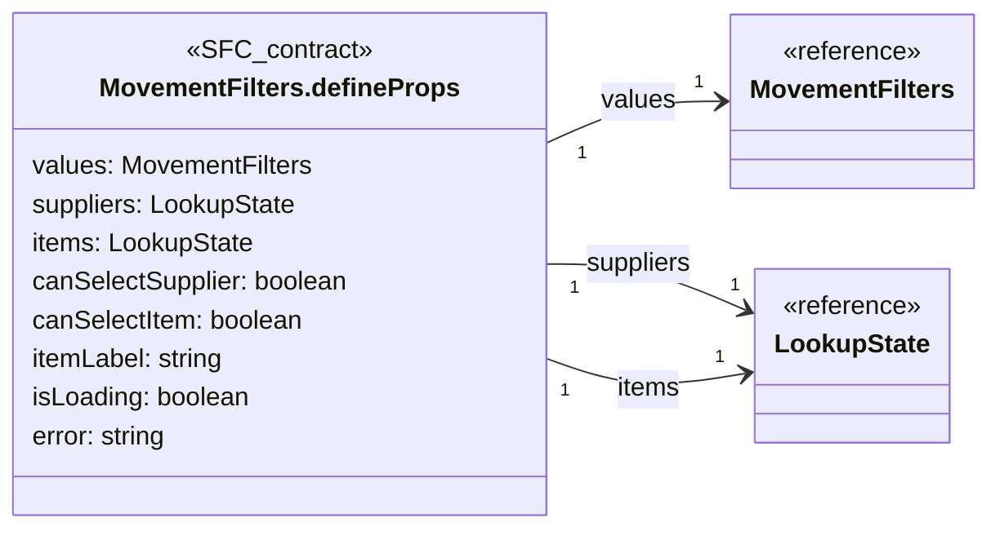

## MovementFilters.defineEmits

**Fuente:** [src/modules/movements/components/MovementFilters.vue](../../../../../src/modules/movements/components/MovementFilters.vue) · línea 22, columna 26. **Declaración:** SFC contract.

| Miembro | Firma completa |
| --- | --- |
| `update` | `update: [field: keyof MovementFilters, value: string];` |
| `searchOptions` | `searchOptions: [lookup: 'suppliers' \| 'items', value: string];` |
| `more` | `more: [lookup: 'suppliers' \| 'items'];` |
| `retry` | `retry: [lookup: 'suppliers' \| 'items'];` |
| `apply` | `apply: [];` |
| `clear` | `clear: [];` |
| `refresh` | `refresh: [];` |

| Relación | Destino | Origen de la referencia |
| --- | --- | --- |
| dependency | [MovementFilters](../../../../../src/modules/movements/movement.ts) | `update` |

**Figura:** `DIA-VUE-TS-MOVEMENTS-2-1`.

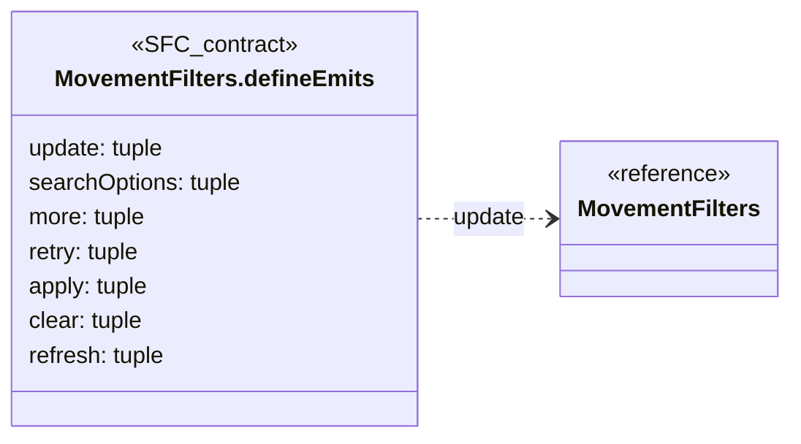

## MovementTable.defineProps

**Fuente:** [src/modules/movements/components/MovementTable.vue](../../../../../src/modules/movements/components/MovementTable.vue) · línea 9, columna 27. **Declaración:** SFC contract.

| Miembro | Firma completa |
| --- | --- |
| `resource` | `resource: MovementResource;` |
| `query` | `query: MovementQuery;` |
| `rows` | `rows: MovementRow[];` |
| `total` | `total: number;` |
| `isLoading` | `isLoading: boolean;` |

| Relación | Destino | Origen de la referencia |
| --- | --- | --- |
| dependency | [MovementResource](../../../../../src/modules/movements/movement.ts) | `resource` |
| dependency | [MovementQuery](../../../../../src/modules/movements/movement.ts) | `query` |
| association | [MovementRow](../../../../../src/modules/movements/movement.ts) | `rows` |

**Figura:** `DIA-VUE-TS-MOVEMENTS-3-1`.

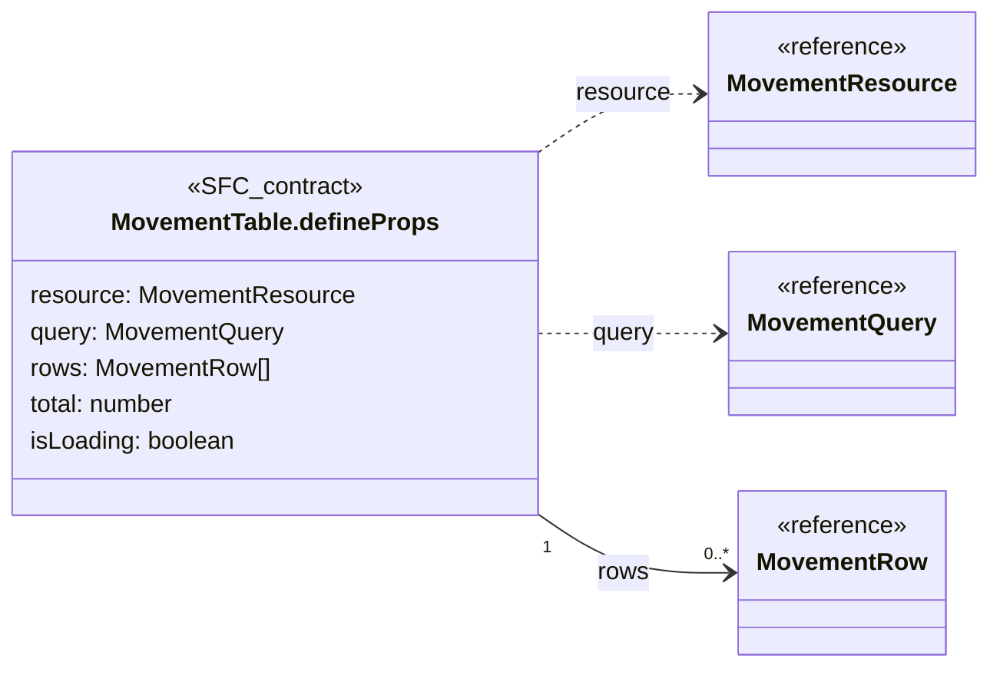

## MovementTable.defineEmits

**Fuente:** [src/modules/movements/components/MovementTable.vue](../../../../../src/modules/movements/components/MovementTable.vue) · línea 16, columna 26. **Declaración:** SFC contract.

| Miembro | Firma completa |
| --- | --- |
| `query` | `query: [changes: Partial<MovementQuery>]` |

| Relación | Destino | Origen de la referencia |
| --- | --- | --- |
| dependency | [MovementQuery](../../../../../src/modules/movements/movement.ts) | `query` |

**Figura:** `DIA-VUE-TS-MOVEMENTS-4-1`.

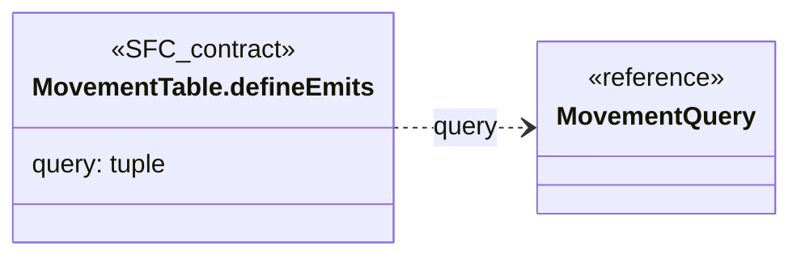

## MovementResource

**Fuente:** [src/modules/movements/movement.ts](../../../../../src/modules/movements/movement.ts) · línea 3, columna 1. **Declaración:** type.

**Definición completa:**

```typescript
'materials' | 'consumables' | 'wastes'
```

**Figura:** `DIA-VUE-TS-MOVEMENTS-5-1`.

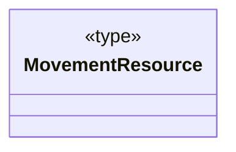

## MovementType

**Fuente:** [src/modules/movements/movement.ts](../../../../../src/modules/movements/movement.ts) · línea 4, columna 1. **Declaración:** type.

**Definición completa:**

```typescript
'' | 'ENTRY' | 'ISSUE' | 'ADJUSTMENT' | 'RETURN'
```

**Figura:** `DIA-VUE-TS-MOVEMENTS-6-1`.

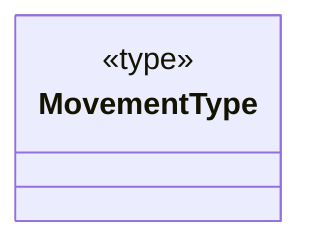

## MovementFilters

**Fuente:** [src/modules/movements/movement.ts](../../../../../src/modules/movements/movement.ts) · línea 6, columna 1. **Declaración:** interface.

| Miembro | Firma completa |
| --- | --- |
| `startDate` | `startDate: string;` |
| `endDate` | `endDate: string;` |
| `movementType` | `movementType: MovementType;` |
| `supplierId` | `supplierId: string;` |
| `itemId` | `itemId: string;` |

| Relación | Destino | Origen de la referencia |
| --- | --- | --- |
| dependency | [MovementType](../../../../../src/modules/movements/movement.ts) | `movementType` |

**Figura:** `DIA-VUE-TS-MOVEMENTS-7-1`.

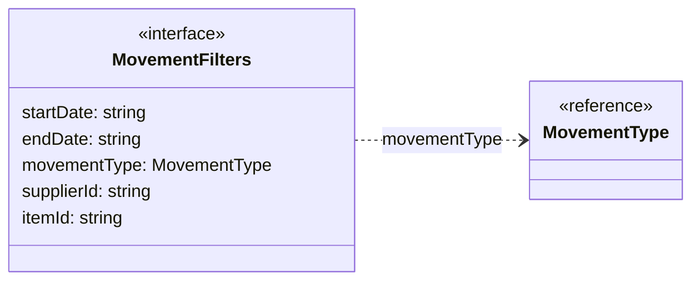

## MovementQuery

**Fuente:** [src/modules/movements/movement.ts](../../../../../src/modules/movements/movement.ts) · línea 13, columna 1. **Declaración:** type.

**Definición completa:**

```typescript
MovementFilters & RecordQuery
```

| Relación | Destino | Origen de la referencia |
| --- | --- | --- |
| dependency | [MovementFilters](../../../../../src/modules/movements/movement.ts) | `type` |
| dependency | [RecordQuery](../../../../../src/shared/list.ts) | `type` |

**Figura:** `DIA-VUE-TS-MOVEMENTS-8-1`.

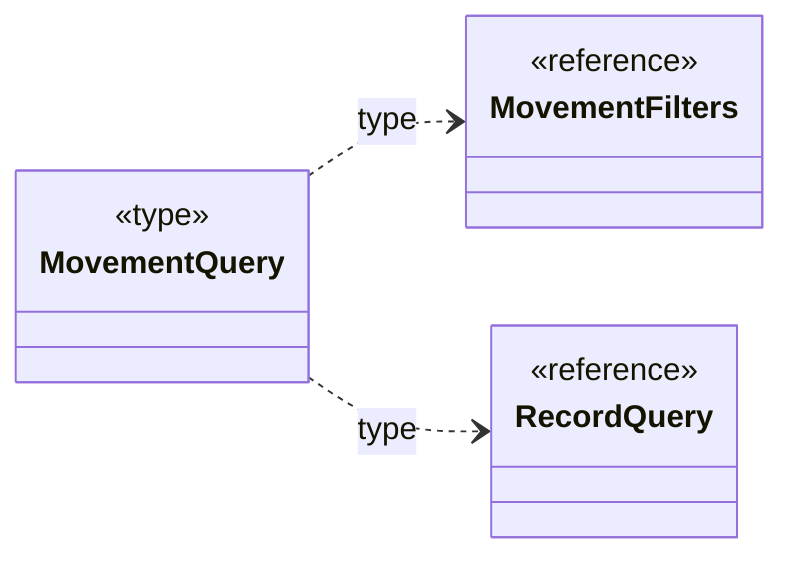

## MovementRow

**Fuente:** [src/modules/movements/movement.ts](../../../../../src/modules/movements/movement.ts) · línea 14, columna 1. **Declaración:** interface.

| Miembro | Firma completa |
| --- | --- |
| `id` | `id: string;` |
| `date` | `date: string;` |
| `type` | `type: string;` |
| `referenceNumber` | `referenceNumber: string;` |
| `materialName` | `materialName: string;` |
| `supplierName` | `supplierName: string;` |
| `materialBase` | `materialBase: string \| number \| null;` |
| `materialHeight` | `materialHeight: string \| number \| null;` |
| `previousStock` | `previousStock: string \| number \| null;` |
| `quantity` | `quantity: string \| number \| null;` |
| `newStock` | `newStock: string \| number \| null;` |

**Figura:** `DIA-VUE-TS-MOVEMENTS-9-1`.

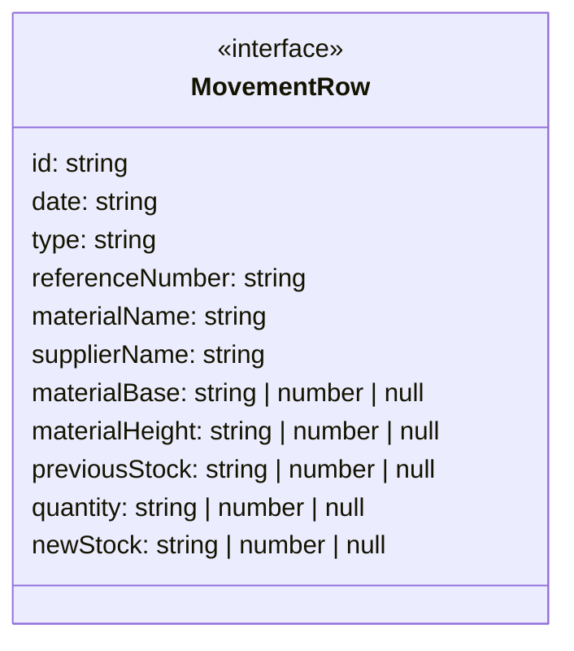

## MovementPage.defineProps

**Fuente:** [src/modules/movements/pages/MovementPage.vue](../../../../../src/modules/movements/pages/MovementPage.vue) · línea 21, columna 27. **Declaración:** SFC contract.

| Miembro | Firma completa |
| --- | --- |
| `resource` | `resource: MovementResource` |

| Relación | Destino | Origen de la referencia |
| --- | --- | --- |
| dependency | [MovementResource](../../../../../src/modules/movements/movement.ts) | `resource` |

**Figura:** `DIA-VUE-TS-MOVEMENTS-10-1`.

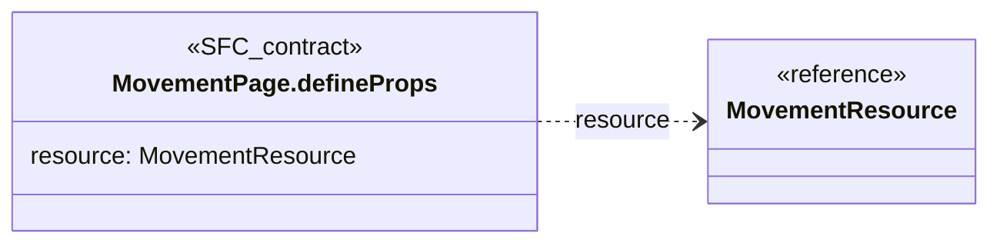

## useMovementFilters.return

**Fuente:** [src/modules/movements/composables/useMovementFilters.ts](../../../../../src/modules/movements/composables/useMovementFilters.ts) · línea 8, columna 35. **Declaración:** inferred return.

| Miembro | Firma completa |
| --- | --- |
| `values` | `"values": { startDate: string; endDate: string; movementType: MovementType; supplierId: string; itemId: string; };` |
| `update` | `"update": (field: keyof MovementFilters, value: string) => void;` |
| `clear` | `"clear": () => void;` |
| `suppliers` | `"suppliers": { state: ComputedRef<LookupState>; items: Ref<{ id: string; title: string; data: Record<string, unknown>; isDisabled?: boolean \| undefined; }[], LookupItem[] \| { id: string; title: string; data: Record<string, unknown>; isDisabled?: boolean \| undefined; }[]>; isLoading: Ref<boolean, boolean>; error: Ref<string, string>; search: Ref<string, string>; hasMore: Ref<boolean, boolean>; updateSearch: (value: string) => void; refresh: () => Promise<void>; loadMore: () => Promise<void> \| undefined; retry: () => Promise<void>; };` |
| `items` | `"items": { state: ComputedRef<LookupState>; items: Ref<{ id: string; title: string; data: Record<string, unknown>; isDisabled?: boolean \| undefined; }[], LookupItem[] \| { id: string; title: string; data: Record<string, unknown>; isDisabled?: boolean \| undefined; }[]>; isLoading: Ref<boolean, boolean>; error: Ref<string, string>; search: Ref<string, string>; hasMore: Ref<boolean, boolean>; updateSearch: (value: string) => void; refresh: () => Promise<void>; loadMore: () => Promise<void> \| undefined; retry: () => Promise<void>; };` |
| `canSelectSupplier` | `"canSelectSupplier": ComputedRef<boolean>;` |
| `canSelectItem` | `"canSelectItem": ComputedRef<boolean>;` |
| `supplierState` | `"supplierState": ComputedRef<LookupState>;` |
| `itemState` | `"itemState": ComputedRef<LookupState>;` |

| Relación | Destino | Origen de la referencia |
| --- | --- | --- |
| association | [useMovementFilters.return.values.shape1](../../../../../src/modules/movements/composables/useMovementFilters.ts) | `values` |
| dependency | [MovementFilters](../../../../../src/modules/movements/movement.ts) | `update` |
| dependency | [useMovementFilters.return.suppliers.shape2](../../../../../src/modules/movements/composables/useMovementFilters.ts) | `suppliers` |
| dependency | [useMovementFilters.return.items.shape5](../../../../../src/modules/movements/composables/useMovementFilters.ts) | `items` |

**Figura:** `DIA-VUE-TS-MOVEMENTS-11-1`.

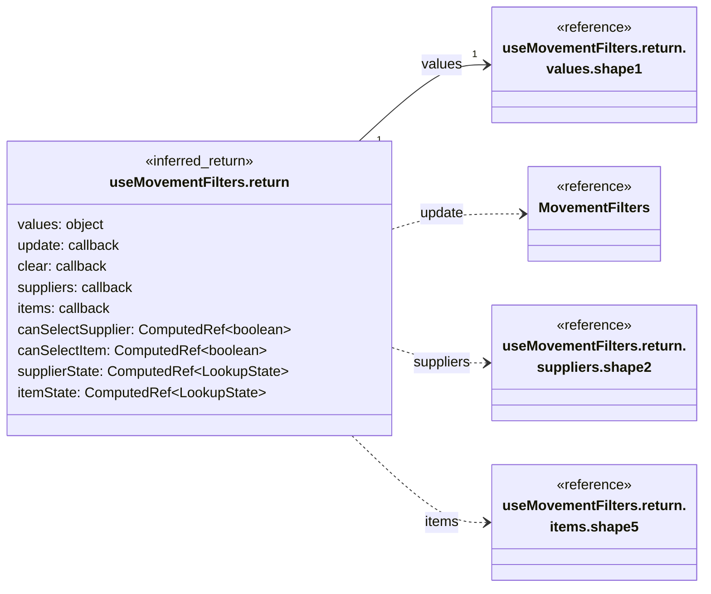

## useMovementFilters.return.values.shape1

**Fuente:** [src/modules/movements/composables/useMovementFilters.ts](../../../../../src/modules/movements/composables/useMovementFilters.ts) · línea 8, columna 35. **Declaración:** inferred object.

| Miembro | Firma completa |
| --- | --- |
| `startDate` | `startDate: string;` |
| `endDate` | `endDate: string;` |
| `movementType` | `movementType: MovementType;` |
| `supplierId` | `supplierId: string;` |
| `itemId` | `itemId: string;` |

| Relación | Destino | Origen de la referencia |
| --- | --- | --- |
| dependency | [MovementType](../../../../../src/modules/movements/movement.ts) | `movementType` |

**Figura:** `DIA-VUE-TS-MOVEMENTS-12-1`.

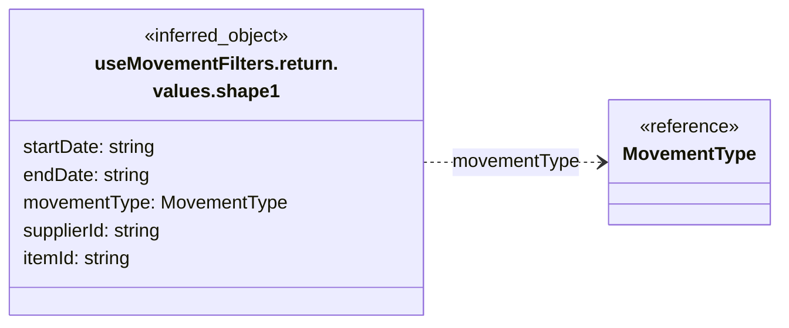

## useMovementFilters.return.suppliers.shape2

**Fuente:** [src/modules/movements/composables/useMovementFilters.ts](../../../../../src/modules/movements/composables/useMovementFilters.ts) · línea 8, columna 35. **Declaración:** inferred object.

| Miembro | Firma completa |
| --- | --- |
| `state` | `state: ComputedRef<LookupState>;` |
| `items` | `items: Ref<{ id: string; title: string; data: Record<string, unknown>; isDisabled?: boolean \| undefined; }[], LookupItem[] \| { id: string; title: string; data: Record<string, unknown>; isDisabled?: boolean \| undefined; }[]>;` |
| `isLoading` | `isLoading: Ref<boolean, boolean>;` |
| `error` | `error: Ref<string, string>;` |
| `search` | `search: Ref<string, string>;` |
| `hasMore` | `hasMore: Ref<boolean, boolean>;` |
| `updateSearch` | `updateSearch: (value: string) => void;` |
| `refresh` | `refresh: () => Promise<void>;` |
| `loadMore` | `loadMore: () => Promise<void> \| undefined;` |
| `retry` | `retry: () => Promise<void>;` |

| Relación | Destino | Origen de la referencia |
| --- | --- | --- |
| dependency | [useMovementFilters.return.suppliers.items.shape3](../../../../../src/modules/movements/composables/useMovementFilters.ts) | `items` |
| dependency | [useMovementFilters.return.suppliers.items.shape4](../../../../../src/modules/movements/composables/useMovementFilters.ts) | `items` |

**Figura:** `DIA-VUE-TS-MOVEMENTS-13-1`.

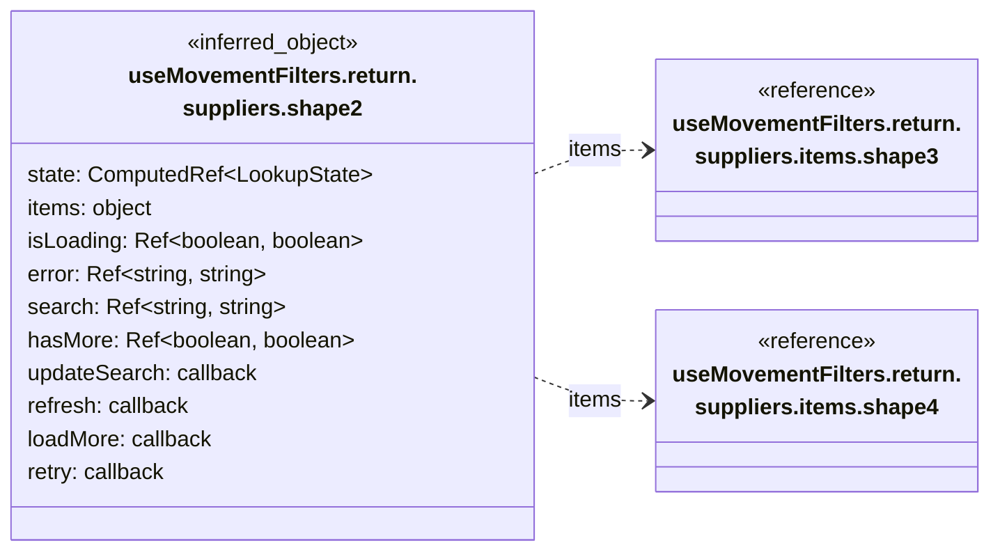

## useMovementFilters.return.suppliers.items.shape3

**Fuente:** [src/modules/movements/composables/useMovementFilters.ts](../../../../../src/modules/movements/composables/useMovementFilters.ts) · línea 8, columna 35. **Declaración:** inferred object.

| Miembro | Firma completa |
| --- | --- |
| `id` | `id: string;` |
| `title` | `title: string;` |
| `data` | `data: Record<string, unknown>;` |
| `isDisabled` | `isDisabled?: boolean \| undefined;` |

**Figura:** `DIA-VUE-TS-MOVEMENTS-14-1`.


## useMovementFilters.return.suppliers.items.shape4

**Fuente:** [src/modules/movements/composables/useMovementFilters.ts](../../../../../src/modules/movements/composables/useMovementFilters.ts) · línea 8, columna 35. **Declaración:** inferred object.

| Miembro | Firma completa |
| --- | --- |
| `id` | `id: string;` |
| `title` | `title: string;` |
| `data` | `data: Record<string, unknown>;` |
| `isDisabled` | `isDisabled?: boolean \| undefined;` |

**Figura:** `DIA-VUE-TS-MOVEMENTS-15-1`.

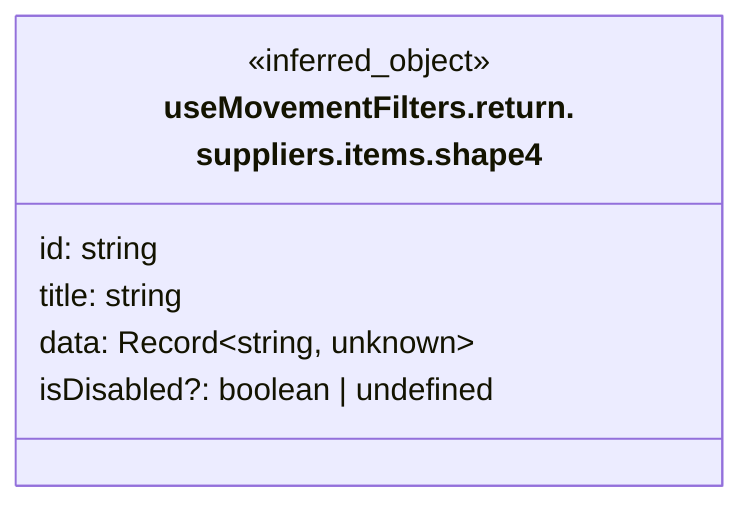

## useMovementFilters.return.items.shape5

**Fuente:** [src/modules/movements/composables/useMovementFilters.ts](../../../../../src/modules/movements/composables/useMovementFilters.ts) · línea 8, columna 35. **Declaración:** inferred object.

| Miembro | Firma completa |
| --- | --- |
| `state` | `state: ComputedRef<LookupState>;` |
| `items` | `items: Ref<{ id: string; title: string; data: Record<string, unknown>; isDisabled?: boolean \| undefined; }[], LookupItem[] \| { id: string; title: string; data: Record<string, unknown>; isDisabled?: boolean \| undefined; }[]>;` |
| `isLoading` | `isLoading: Ref<boolean, boolean>;` |
| `error` | `error: Ref<string, string>;` |
| `search` | `search: Ref<string, string>;` |
| `hasMore` | `hasMore: Ref<boolean, boolean>;` |
| `updateSearch` | `updateSearch: (value: string) => void;` |
| `refresh` | `refresh: () => Promise<void>;` |
| `loadMore` | `loadMore: () => Promise<void> \| undefined;` |
| `retry` | `retry: () => Promise<void>;` |

| Relación | Destino | Origen de la referencia |
| --- | --- | --- |
| dependency | [useMovementFilters.return.items.items.shape6](../../../../../src/modules/movements/composables/useMovementFilters.ts) | `items` |
| dependency | [useMovementFilters.return.items.items.shape7](../../../../../src/modules/movements/composables/useMovementFilters.ts) | `items` |

**Figura:** `DIA-VUE-TS-MOVEMENTS-16-1`.


## useMovementFilters.return.items.items.shape6

**Fuente:** [src/modules/movements/composables/useMovementFilters.ts](../../../../../src/modules/movements/composables/useMovementFilters.ts) · línea 8, columna 35. **Declaración:** inferred object.

| Miembro | Firma completa |
| --- | --- |
| `id` | `id: string;` |
| `title` | `title: string;` |
| `data` | `data: Record<string, unknown>;` |
| `isDisabled` | `isDisabled?: boolean \| undefined;` |

**Figura:** `DIA-VUE-TS-MOVEMENTS-17-1`.

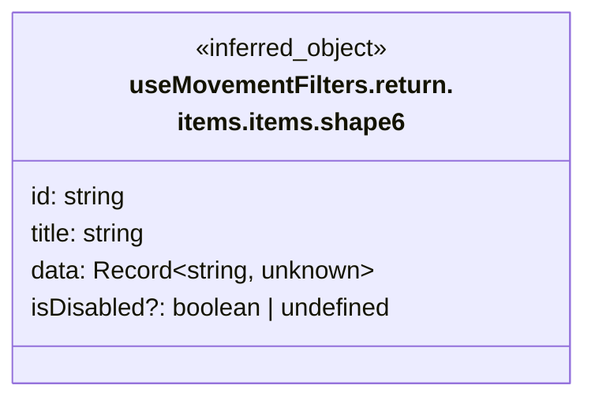

## useMovementFilters.return.items.items.shape7

**Fuente:** [src/modules/movements/composables/useMovementFilters.ts](../../../../../src/modules/movements/composables/useMovementFilters.ts) · línea 8, columna 35. **Declaración:** inferred object.

| Miembro | Firma completa |
| --- | --- |
| `id` | `id: string;` |
| `title` | `title: string;` |
| `data` | `data: Record<string, unknown>;` |
| `isDisabled` | `isDisabled?: boolean \| undefined;` |

**Figura:** `DIA-VUE-TS-MOVEMENTS-18-1`.

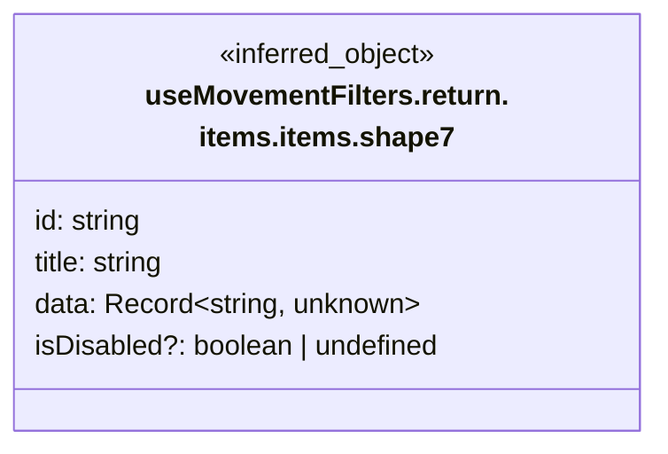

## MOVEMENT_CONFIG

**Fuente:** [src/modules/movements/movement.ts](../../../../../src/modules/movements/movement.ts) · línea 28, columna 14. **Declaración:** inferred export.

| Miembro | Firma completa |
| --- | --- |
| `materials` | `"materials": { readonly title: "Movimientos de materiales"; readonly label: "Materiales"; readonly itemLabel: "Material"; readonly path: "materiales"; };` |
| `consumables` | `"consumables": { readonly title: "Movimientos de consumibles"; readonly label: "Consumibles"; readonly itemLabel: "Consumible"; readonly path: "consumibles"; };` |
| `wastes` | `"wastes": { readonly title: "Movimientos de merma"; readonly label: "Mermas"; readonly itemLabel: "Merma"; readonly path: "mermas"; };` |

| Relación | Destino | Origen de la referencia |
| --- | --- | --- |
| association | [MOVEMENT_CONFIG.materials.shape1](../../../../../src/modules/movements/movement.ts) | `materials` |
| association | [MOVEMENT_CONFIG.consumables.shape2](../../../../../src/modules/movements/movement.ts) | `consumables` |
| association | [MOVEMENT_CONFIG.wastes.shape3](../../../../../src/modules/movements/movement.ts) | `wastes` |

**Figura:** `DIA-VUE-TS-MOVEMENTS-19-1`.

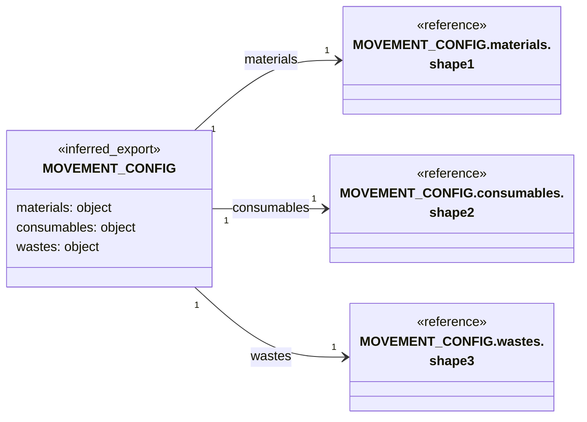

## MOVEMENT_CONFIG.materials.shape1

**Fuente:** [src/modules/movements/movement.ts](../../../../../src/modules/movements/movement.ts) · línea 28, columna 14. **Declaración:** inferred object.

| Miembro | Firma completa |
| --- | --- |
| `title` | `readonly title: "Movimientos de materiales";` |
| `label` | `readonly label: "Materiales";` |
| `itemLabel` | `readonly itemLabel: "Material";` |
| `path` | `readonly path: "materiales";` |

**Figura:** `DIA-VUE-TS-MOVEMENTS-20-1`.

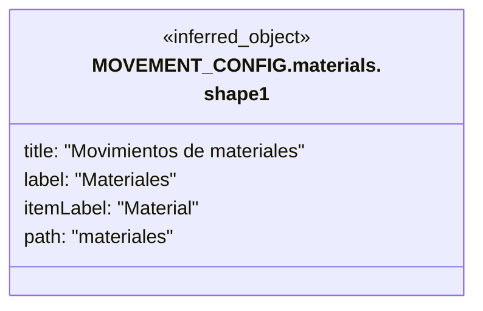

## MOVEMENT_CONFIG.consumables.shape2

**Fuente:** [src/modules/movements/movement.ts](../../../../../src/modules/movements/movement.ts) · línea 28, columna 14. **Declaración:** inferred object.

| Miembro | Firma completa |
| --- | --- |
| `title` | `readonly title: "Movimientos de consumibles";` |
| `label` | `readonly label: "Consumibles";` |
| `itemLabel` | `readonly itemLabel: "Consumible";` |
| `path` | `readonly path: "consumibles";` |

**Figura:** `DIA-VUE-TS-MOVEMENTS-21-1`.

```mermaid
classDiagram
    direction LR
    class Subject["MOVEMENT_CONFIG.consumables.<br/>shape2"] {
        <<inferred_object>>
        title: "Movimientos de consumibles"
        label: "Consumibles"
        itemLabel: "Consumible"
        path: "consumibles"
    }
```

## MOVEMENT_CONFIG.wastes.shape3

**Fuente:** [src/modules/movements/movement.ts](../../../../../src/modules/movements/movement.ts) · línea 28, columna 14. **Declaración:** inferred object.

| Miembro | Firma completa |
| --- | --- |
| `title` | `readonly title: "Movimientos de merma";` |
| `label` | `readonly label: "Mermas";` |
| `itemLabel` | `readonly itemLabel: "Merma";` |
| `path` | `readonly path: "mermas";` |

**Figura:** `DIA-VUE-TS-MOVEMENTS-22-1`.

```mermaid
classDiagram
    direction LR
    class Subject["MOVEMENT_CONFIG.wastes.<br/>shape3"] {
        <<inferred_object>>
        title: "Movimientos de merma"
        label: "Mermas"
        itemLabel: "Merma"
        path: "mermas"
    }
```

## emptyMovementFilters.return

**Fuente:** [src/modules/movements/movement.ts](../../../../../src/modules/movements/movement.ts) · línea 52, columna 37. **Declaración:** inferred return.

| Miembro | Firma completa |
| --- | --- |
| `startDate` | `"startDate": string;` |
| `endDate` | `"endDate": string;` |
| `movementType` | `"movementType": MovementType;` |
| `supplierId` | `"supplierId": string;` |
| `itemId` | `"itemId": string;` |

| Relación | Destino | Origen de la referencia |
| --- | --- | --- |
| dependency | [MovementType](../../../../../src/modules/movements/movement.ts) | `movementType` |

**Figura:** `DIA-VUE-TS-MOVEMENTS-23-1`.

```mermaid
classDiagram
    direction LR
    class Subject["emptyMovementFilters.return"] {
        <<inferred_return>>
        startDate: string
        endDate: string
        movementType: MovementType
        supplierId: string
        itemId: string
    }
    class R0["MovementType"] {
        <<reference>>
    }
    Subject ..> R0 : movementType
```

## movementService

**Fuente:** [src/modules/movements/services/movementService.ts](../../../../../src/modules/movements/services/movementService.ts) · línea 60, columna 14. **Declaración:** inferred export.

| Miembro | Firma completa |
| --- | --- |
| `list` | `"list": (resource: MovementResource, query: MovementQuery, signal: AbortSignal) => Promise<{ data: MovementRow[]; recordsFiltered: number; recordsTotal: number; }>;` |
| `export` | `"export": (resource: MovementResource, query: MovementQuery, report: ReportScope, signal: AbortSignal) => Promise<Blob>;` |
| `lookup` | `"lookup": (resource: MovementResource \| "suppliers", search: string, page: number, supplierId: string, signal: AbortSignal) => Promise<{ data: LookupItem[]; recordsFiltered: number; recordsTotal: number; }>;` |

| Relación | Destino | Origen de la referencia |
| --- | --- | --- |
| dependency | [MovementResource](../../../../../src/modules/movements/movement.ts) | `list` |
| dependency | [MovementQuery](../../../../../src/modules/movements/movement.ts) | `list` |
| dependency | [movementService.list.shape1](../../../../../src/modules/movements/services/movementService.ts) | `list` |
| dependency | [MovementResource](../../../../../src/modules/movements/movement.ts) | `export` |
| dependency | [MovementQuery](../../../../../src/modules/movements/movement.ts) | `export` |
| dependency | [ReportScope](../../../../../src/shared/report.ts) | `export` |
| dependency | [MovementResource](../../../../../src/modules/movements/movement.ts) | `lookup` |
| dependency | [movementService.lookup.shape2](../../../../../src/modules/movements/services/movementService.ts) | `lookup` |

**Figura:** `DIA-VUE-TS-MOVEMENTS-24-1`. Parte 1/2.

```mermaid
classDiagram
    direction LR
    class Subject["movementService"] {
        <<inferred_export>>
        list: callback
        export: callback
        lookup: callback
    }
    class R0["MovementResource"] {
        <<reference>>
    }
    class R1["MovementQuery"] {
        <<reference>>
    }
    class R2["movementService.list.shape1"] {
        <<reference>>
    }
    class R3["ReportScope"] {
        <<reference>>
    }
    Subject ..> R0 : list
    Subject ..> R1 : list
    Subject ..> R2 : list
    Subject ..> R0 : export
    Subject ..> R1 : export
    Subject ..> R3 : export
    Subject ..> R0 : lookup
```

**Figura:** `DIA-VUE-TS-MOVEMENTS-24-2`. Parte 2/2.

```mermaid
classDiagram
    direction LR
    class Subject["movementService"] {
        <<inferred_export>>
        lookup: callback
    }
    class R0["movementService.lookup.<br/>shape2"] {
        <<reference>>
    }
    Subject ..> R0 : lookup
```

## movementService.list.shape1

**Fuente:** [src/modules/movements/services/movementService.ts](../../../../../src/modules/movements/services/movementService.ts) · línea 60, columna 14. **Declaración:** inferred object.

| Miembro | Firma completa |
| --- | --- |
| `data` | `data: MovementRow[];` |
| `recordsFiltered` | `recordsFiltered: number;` |
| `recordsTotal` | `recordsTotal: number;` |

| Relación | Destino | Origen de la referencia |
| --- | --- | --- |
| association | [MovementRow](../../../../../src/modules/movements/movement.ts) | `data` |

**Figura:** `DIA-VUE-TS-MOVEMENTS-25-1`.

```mermaid
classDiagram
    direction LR
    class Subject["movementService.list.shape1"] {
        <<inferred_object>>
        data: MovementRow[]
        recordsFiltered: number
        recordsTotal: number
    }
    class R0["MovementRow"] {
        <<reference>>
    }
    Subject "1" --> "0..*" R0 : data
```

## movementService.lookup.shape2

**Fuente:** [src/modules/movements/services/movementService.ts](../../../../../src/modules/movements/services/movementService.ts) · línea 60, columna 14. **Declaración:** inferred object.

| Miembro | Firma completa |
| --- | --- |
| `data` | `data: LookupItem[];` |
| `recordsFiltered` | `recordsFiltered: number;` |
| `recordsTotal` | `recordsTotal: number;` |

| Relación | Destino | Origen de la referencia |
| --- | --- | --- |
| association | [LookupItem](../../../../../src/shared/lookup.ts) | `data` |

**Figura:** `DIA-VUE-TS-MOVEMENTS-26-1`.

```mermaid
classDiagram
    direction LR
    class Subject["movementService.lookup.<br/>shape2"] {
        <<inferred_object>>
        data: LookupItem[]
        recordsFiltered: number
        recordsTotal: number
    }
    class R0["LookupItem"] {
        <<reference>>
    }
    Subject "1" --> "0..*" R0 : data
```
