# Contratos TypeScript: purchases

Generado con `npm run docs:generate`. No editar manualmente.

[Alcance y notación](index.md#alcance-y-notación).

## PurchaseCorrectionForm.defineProps

**Fuente:** [src/modules/purchases/components/PurchaseCorrectionForm.vue](../../../../../src/modules/purchases/components/PurchaseCorrectionForm.vue) · línea 6, columna 13. **Declaración:** SFC contract.

| Miembro | Firma completa |
| --- | --- |
| `context` | `context: string;` |
| `totals` | `totals: { quantity: number; net: number; gross: number } \| null;` |
| `values` | `values: { quantity: string; costPerUnitType: string };` |
| `errors` | `errors: Partial<Record<'quantity' \| 'costPerUnitType', string>>;` |
| `message` | `message: string;` |
| `isSubmitting` | `isSubmitting: boolean;` |
| `isConflicted` | `isConflicted: boolean;` |

| Relación | Destino | Origen de la referencia |
| --- | --- | --- |
| association | [PurchaseCorrectionForm.totals@8:13](../../../../../src/modules/purchases/components/PurchaseCorrectionForm.vue) | `totals` |
| association | [PurchaseCorrectionForm.values@9:13](../../../../../src/modules/purchases/components/PurchaseCorrectionForm.vue) | `values` |

**Figura:** `DIA-VUE-TS-PURCHASES-1-1`.

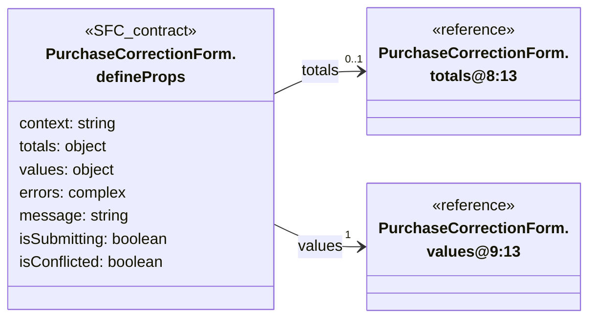

## PurchaseCorrectionForm.totals@8:13

**Fuente:** [src/modules/purchases/components/PurchaseCorrectionForm.vue](../../../../../src/modules/purchases/components/PurchaseCorrectionForm.vue) · línea 8, columna 13. **Declaración:** inline object.

| Miembro | Firma completa |
| --- | --- |
| `quantity` | `quantity: number;` |
| `net` | `net: number;` |
| `gross` | `gross: number` |

**Figura:** `DIA-VUE-TS-PURCHASES-2-1`.

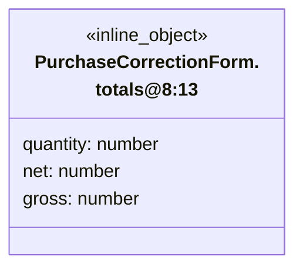

## PurchaseCorrectionForm.values@9:13

**Fuente:** [src/modules/purchases/components/PurchaseCorrectionForm.vue](../../../../../src/modules/purchases/components/PurchaseCorrectionForm.vue) · línea 9, columna 13. **Declaración:** inline object.

| Miembro | Firma completa |
| --- | --- |
| `quantity` | `quantity: string;` |
| `costPerUnitType` | `costPerUnitType: string` |

**Figura:** `DIA-VUE-TS-PURCHASES-3-1`.

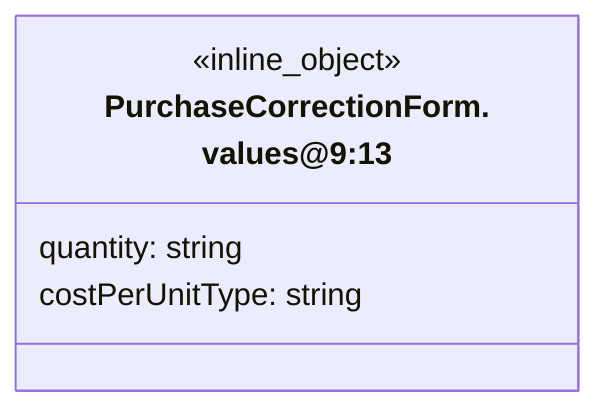

## PurchaseCorrectionForm.defineEmits

**Fuente:** [src/modules/purchases/components/PurchaseCorrectionForm.vue](../../../../../src/modules/purchases/components/PurchaseCorrectionForm.vue) · línea 15, columna 26. **Declaración:** SFC contract.

| Miembro | Firma completa |
| --- | --- |
| `update` | `update: [field: 'quantity' \| 'costPerUnitType', value: string];` |
| `blur` | `blur: [field: 'quantity' \| 'costPerUnitType'];` |
| `submit` | `submit: [];` |
| `close` | `close: [];` |
| `reload` | `reload: [];` |

**Figura:** `DIA-VUE-TS-PURCHASES-4-1`.

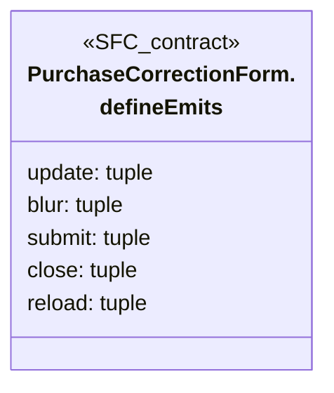

## PurchaseDetailsTable.defineProps

**Fuente:** [src/modules/purchases/components/PurchaseDetailsTable.vue](../../../../../src/modules/purchases/components/PurchaseDetailsTable.vue) · línea 9, columna 13. **Declaración:** SFC contract.

| Miembro | Firma completa |
| --- | --- |
| `rows` | `rows: PurchaseDetail[];` |
| `canChange` | `canChange: boolean;` |
| `canRemove` | `canRemove: boolean;` |
| `isDisabled` | `isDisabled: boolean;` |

| Relación | Destino | Origen de la referencia |
| --- | --- | --- |
| association | [PurchaseDetail](../../../../../src/modules/purchases/purchase.ts) | `rows` |

**Figura:** `DIA-VUE-TS-PURCHASES-5-1`.

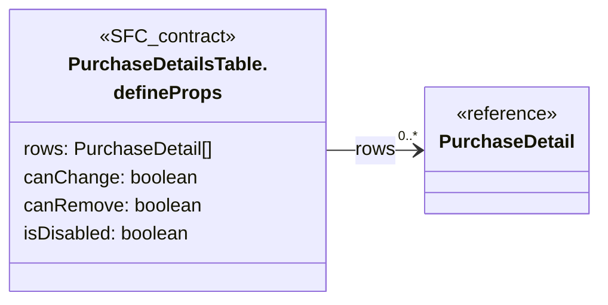

## PurchaseDetailsTable.defineEmits

**Fuente:** [src/modules/purchases/components/PurchaseDetailsTable.vue](../../../../../src/modules/purchases/components/PurchaseDetailsTable.vue) · línea 15, columna 26. **Declaración:** SFC contract.

| Miembro | Firma completa |
| --- | --- |
| `remove` | `remove: [id: string];` |
| `correct` | `correct: [row: PurchaseDetail];` |
| `cancel` | `cancel: [row: PurchaseDetail];` |

| Relación | Destino | Origen de la referencia |
| --- | --- | --- |
| dependency | [PurchaseDetail](../../../../../src/modules/purchases/purchase.ts) | `correct` |
| dependency | [PurchaseDetail](../../../../../src/modules/purchases/purchase.ts) | `cancel` |

**Figura:** `DIA-VUE-TS-PURCHASES-6-1`.

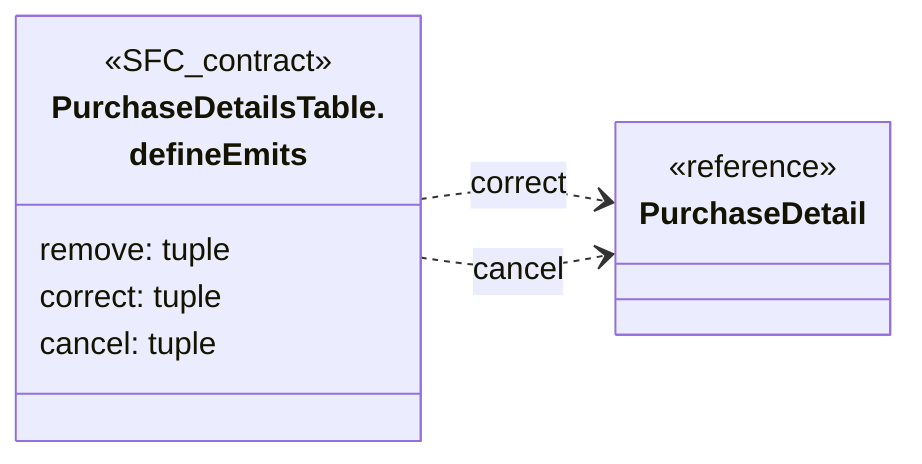

## PurchaseEditor.defineProps

**Fuente:** [src/modules/purchases/components/PurchaseEditor.vue](../../../../../src/modules/purchases/components/PurchaseEditor.vue) · línea 16, columna 13. **Declaración:** SFC contract.

| Miembro | Firma completa |
| --- | --- |
| `title` | `title: string;` |
| `values` | `values: PurchaseValues;` |
| `errors` | `errors: Partial<Record<PurchaseField, string>>;` |
| `message` | `message: string;` |
| `isSubmitting` | `isSubmitting: boolean;` |
| `isConflicted` | `isConflicted: boolean;` |
| `isReadOnly` | `isReadOnly: boolean;` |
| `isChanging` | `isChanging: boolean;` |
| `isEditing` | `isEditing: boolean;` |
| `canChangeDetails` | `canChangeDetails: boolean;` |
| `canCreateSupplier` | `canCreateSupplier: boolean;` |
| `canSuppliers` | `canSuppliers: boolean;` |
| `canPersons` | `canPersons: boolean;` |
| `suppliers` | `suppliers: LookupState;` |
| `persons` | `persons: LookupState;` |
| `supplier` | `supplier?: LookupItem;` |
| `receiver` | `receiver?: LookupItem;` |
| `details` | `details: PurchaseDetail[];` |
| `totals` | `totals: { quantity: number; net: number; gross: number };` |

| Relación | Destino | Origen de la referencia |
| --- | --- | --- |
| association | [PurchaseValues](../../../../../src/modules/purchases/purchase.ts) | `values` |
| dependency | [PurchaseField](../../../../../src/modules/purchases/purchase.ts) | `errors` |
| association | [LookupState](../../../../../src/shared/lookup.ts) | `suppliers` |
| association | [LookupState](../../../../../src/shared/lookup.ts) | `persons` |
| association | [LookupItem](../../../../../src/shared/lookup.ts) | `supplier` |
| association | [LookupItem](../../../../../src/shared/lookup.ts) | `receiver` |
| association | [PurchaseDetail](../../../../../src/modules/purchases/purchase.ts) | `details` |
| association | [PurchaseEditor.totals@35:13](../../../../../src/modules/purchases/components/PurchaseEditor.vue) | `totals` |

**Figura:** `DIA-VUE-TS-PURCHASES-7-1`. Parte 1/2.

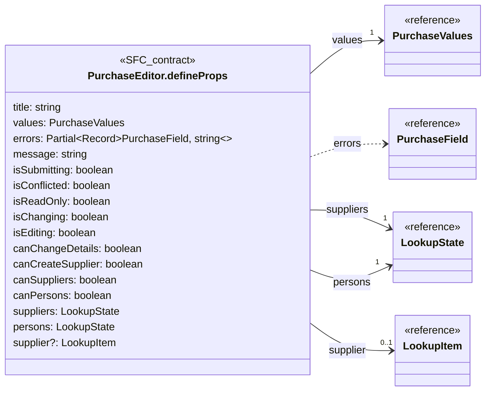

**Figura:** `DIA-VUE-TS-PURCHASES-7-2`. Parte 2/2.

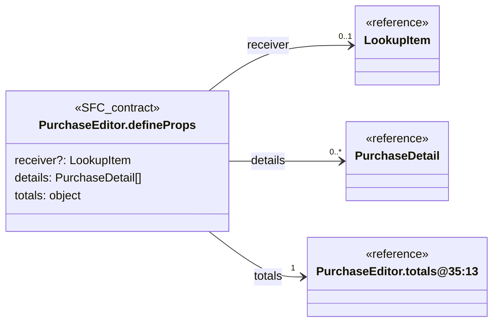

## PurchaseEditor.totals@35:13

**Fuente:** [src/modules/purchases/components/PurchaseEditor.vue](../../../../../src/modules/purchases/components/PurchaseEditor.vue) · línea 35, columna 13. **Declaración:** inline object.

| Miembro | Firma completa |
| --- | --- |
| `quantity` | `quantity: number;` |
| `net` | `net: number;` |
| `gross` | `gross: number` |

**Figura:** `DIA-VUE-TS-PURCHASES-8-1`.

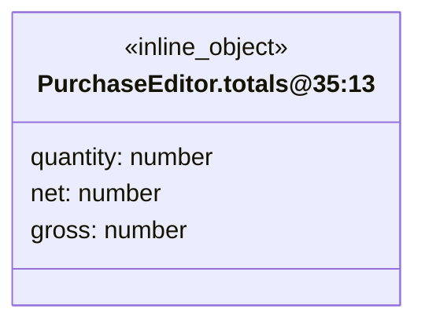

## PurchaseEditor.defineEmits

**Fuente:** [src/modules/purchases/components/PurchaseEditor.vue](../../../../../src/modules/purchases/components/PurchaseEditor.vue) · línea 37, columna 26. **Declaración:** SFC contract.

| Miembro | Firma completa |
| --- | --- |
| `update` | `update: [field: PurchaseField, value: string \| boolean];` |
| `blur` | `blur: [field: PurchaseField];` |
| `search` | `search: [kind: 'suppliers' \| 'persons', value: string];` |
| `more` | `more: [kind: 'suppliers' \| 'persons'];` |
| `retry` | `retry: [kind: 'suppliers' \| 'persons'];` |
| `createSupplier` | `createSupplier: [search: string];` |
| `remove` | `remove: [id: string];` |
| `correct` | `correct: [detail: PurchaseDetail];` |
| `cancel` | `cancel: [detail: PurchaseDetail];` |
| `submit` | `submit: [];` |
| `close` | `close: [];` |
| `reload` | `reload: [];` |

| Relación | Destino | Origen de la referencia |
| --- | --- | --- |
| dependency | [PurchaseField](../../../../../src/modules/purchases/purchase.ts) | `update` |
| dependency | [PurchaseField](../../../../../src/modules/purchases/purchase.ts) | `blur` |
| dependency | [PurchaseDetail](../../../../../src/modules/purchases/purchase.ts) | `correct` |
| dependency | [PurchaseDetail](../../../../../src/modules/purchases/purchase.ts) | `cancel` |

**Figura:** `DIA-VUE-TS-PURCHASES-9-1`.

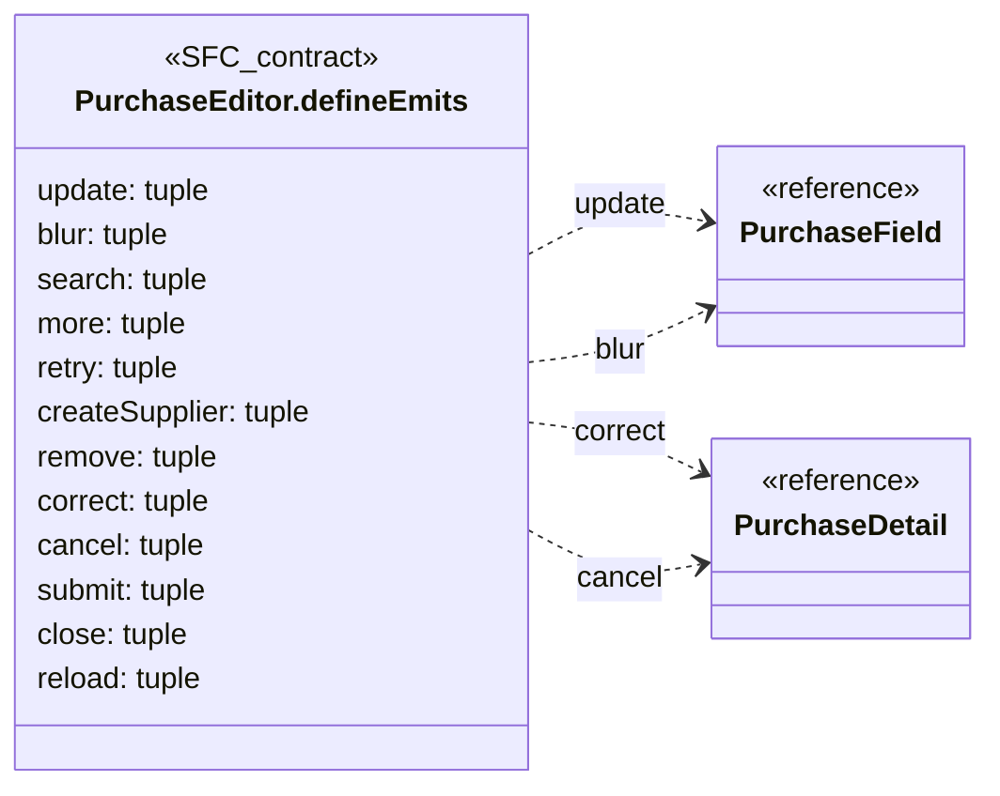

## PurchaseFilters.defineProps

**Fuente:** [src/modules/purchases/components/PurchaseFilters.vue](../../../../../src/modules/purchases/components/PurchaseFilters.vue) · línea 10, columna 13. **Declaración:** SFC contract.

| Miembro | Firma completa |
| --- | --- |
| `values` | `values: PurchaseFilters;` |
| `suppliers` | `suppliers: LookupState;` |
| `persons` | `persons: LookupState;` |
| `canSuppliers` | `canSuppliers: boolean;` |
| `canPersons` | `canPersons: boolean;` |
| `isLoading` | `isLoading: boolean;` |
| `error` | `error: string;` |

| Relación | Destino | Origen de la referencia |
| --- | --- | --- |
| association | [PurchaseFilters](../../../../../src/modules/purchases/purchase.ts) | `values` |
| association | [LookupState](../../../../../src/shared/lookup.ts) | `suppliers` |
| association | [LookupState](../../../../../src/shared/lookup.ts) | `persons` |

**Figura:** `DIA-VUE-TS-PURCHASES-10-1`.

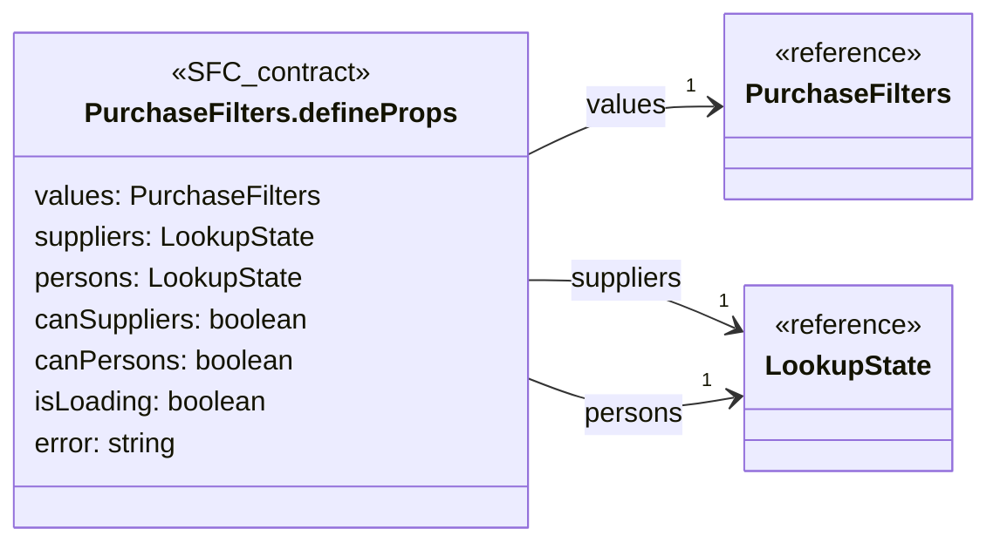

## PurchaseFilters.defineEmits

**Fuente:** [src/modules/purchases/components/PurchaseFilters.vue](../../../../../src/modules/purchases/components/PurchaseFilters.vue) · línea 19, columna 26. **Declaración:** SFC contract.

| Miembro | Firma completa |
| --- | --- |
| `update` | `update: [field: keyof PurchaseFilters, value: string];` |
| `apply` | `apply: [];` |
| `clear` | `clear: [];` |
| `refresh` | `refresh: [];` |
| `searchOptions` | `searchOptions: [kind: 'suppliers' \| 'persons', value: string];` |
| `more` | `more: [kind: 'suppliers' \| 'persons'];` |
| `retry` | `retry: [kind: 'suppliers' \| 'persons'];` |

| Relación | Destino | Origen de la referencia |
| --- | --- | --- |
| dependency | [PurchaseFilters](../../../../../src/modules/purchases/purchase.ts) | `update` |

**Figura:** `DIA-VUE-TS-PURCHASES-11-1`.

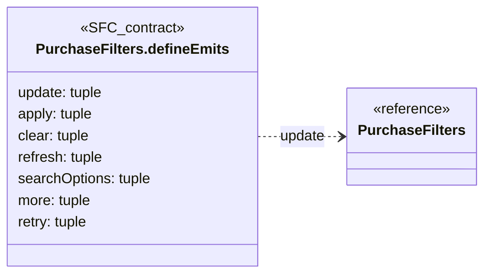

## PurchaseLineEntryForm.defineProps

**Fuente:** [src/modules/purchases/components/PurchaseLineEntryForm.vue](../../../../../src/modules/purchases/components/PurchaseLineEntryForm.vue) · línea 8, columna 13. **Declaración:** SFC contract.

| Miembro | Firma completa |
| --- | --- |
| `itemLabel` | `itemLabel: string;` |
| `values` | `values: { materialId: string; quantity: string; costPerUnitType: string };` |
| `errors` | `errors: Partial<Record<'materialId' \| 'quantity' \| 'costPerUnitType', string>>;` |
| `items` | `items: LookupState;` |
| `selected` | `selected?: LookupItem;` |
| `isDisabled` | `isDisabled: boolean;` |
| `canRead` | `canRead: boolean;` |
| `canCreate` | `canCreate: boolean;` |

| Relación | Destino | Origen de la referencia |
| --- | --- | --- |
| association | [PurchaseLineEntryForm.values@10:13](../../../../../src/modules/purchases/components/PurchaseLineEntryForm.vue) | `values` |
| association | [LookupState](../../../../../src/shared/lookup.ts) | `items` |
| association | [LookupItem](../../../../../src/shared/lookup.ts) | `selected` |

**Figura:** `DIA-VUE-TS-PURCHASES-12-1`.

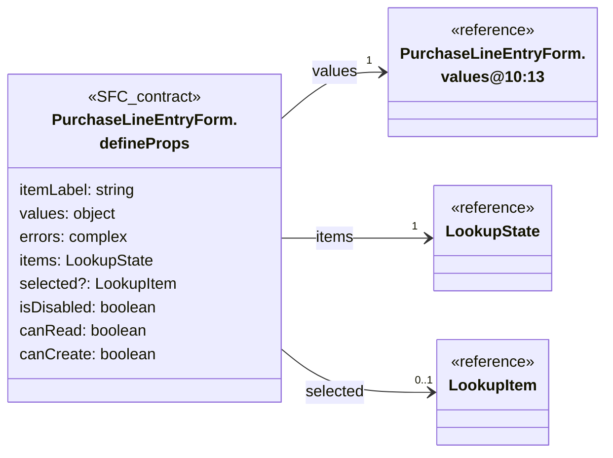

## PurchaseLineEntryForm.values@10:13

**Fuente:** [src/modules/purchases/components/PurchaseLineEntryForm.vue](../../../../../src/modules/purchases/components/PurchaseLineEntryForm.vue) · línea 10, columna 13. **Declaración:** inline object.

| Miembro | Firma completa |
| --- | --- |
| `materialId` | `materialId: string;` |
| `quantity` | `quantity: string;` |
| `costPerUnitType` | `costPerUnitType: string` |

**Figura:** `DIA-VUE-TS-PURCHASES-13-1`.

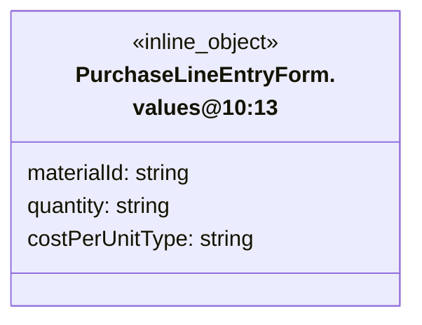

## PurchaseLineEntryForm.defineEmits

**Fuente:** [src/modules/purchases/components/PurchaseLineEntryForm.vue](../../../../../src/modules/purchases/components/PurchaseLineEntryForm.vue) · línea 18, columna 26. **Declaración:** SFC contract.

| Miembro | Firma completa |
| --- | --- |
| `update` | `update: [field: 'materialId' \| 'quantity' \| 'costPerUnitType', value: string];` |
| `blur` | `blur: [field: 'materialId' \| 'quantity' \| 'costPerUnitType'];` |
| `search` | `search: [value: string];` |
| `more` | `more: [];` |
| `retry` | `retry: [];` |
| `create` | `create: [search: string];` |
| `add` | `add: [];` |

**Figura:** `DIA-VUE-TS-PURCHASES-14-1`.

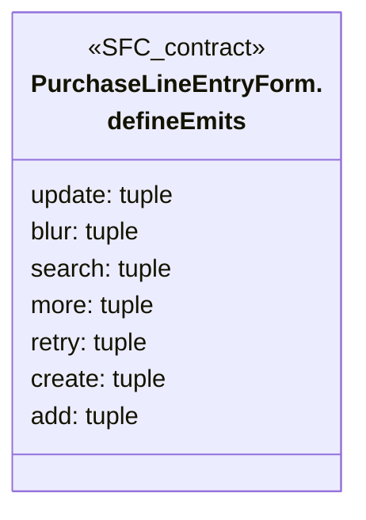

## PurchaseTable.defineProps

**Fuente:** [src/modules/purchases/components/PurchaseTable.vue](../../../../../src/modules/purchases/components/PurchaseTable.vue) · línea 11, columna 27. **Declaración:** SFC contract.

| Miembro | Firma completa |
| --- | --- |
| `rows` | `rows: PurchaseRow[];` |
| `query` | `query: PurchaseQuery;` |
| `total` | `total: number;` |
| `isLoading` | `isLoading: boolean;` |
| `isReading` | `isReading: boolean;` |

| Relación | Destino | Origen de la referencia |
| --- | --- | --- |
| association | [PurchaseRow](../../../../../src/modules/purchases/purchase.ts) | `rows` |
| dependency | [PurchaseQuery](../../../../../src/modules/purchases/purchase.ts) | `query` |

**Figura:** `DIA-VUE-TS-PURCHASES-15-1`.

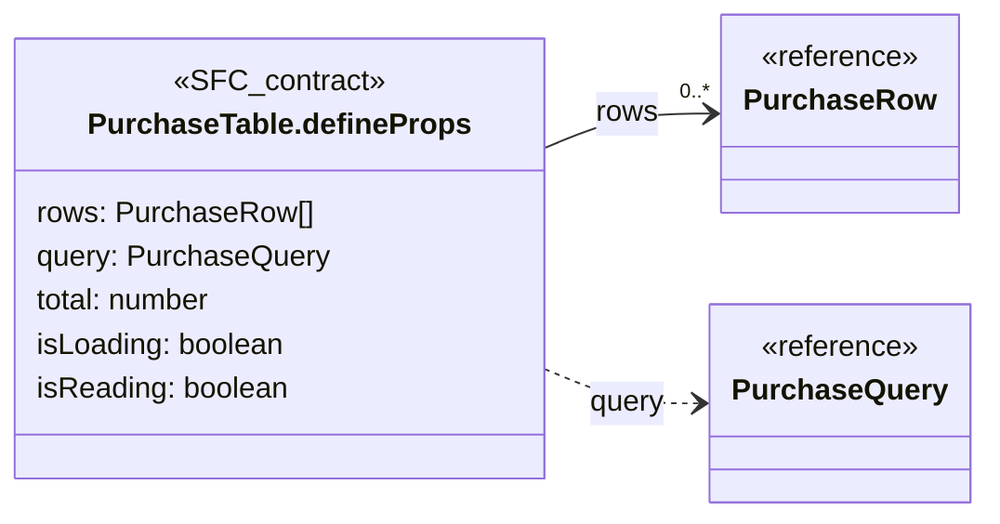

## PurchaseTable.defineEmits

**Fuente:** [src/modules/purchases/components/PurchaseTable.vue](../../../../../src/modules/purchases/components/PurchaseTable.vue) · línea 18, columna 26. **Declaración:** SFC contract.

| Miembro | Firma completa |
| --- | --- |
| `query` | `query: [changes: Partial<PurchaseQuery>];` |
| `open` | `open: [row: PurchaseRow, action: 'view' \| 'edit'];` |

| Relación | Destino | Origen de la referencia |
| --- | --- | --- |
| dependency | [PurchaseQuery](../../../../../src/modules/purchases/purchase.ts) | `query` |
| dependency | [PurchaseRow](../../../../../src/modules/purchases/purchase.ts) | `open` |

**Figura:** `DIA-VUE-TS-PURCHASES-16-1`.

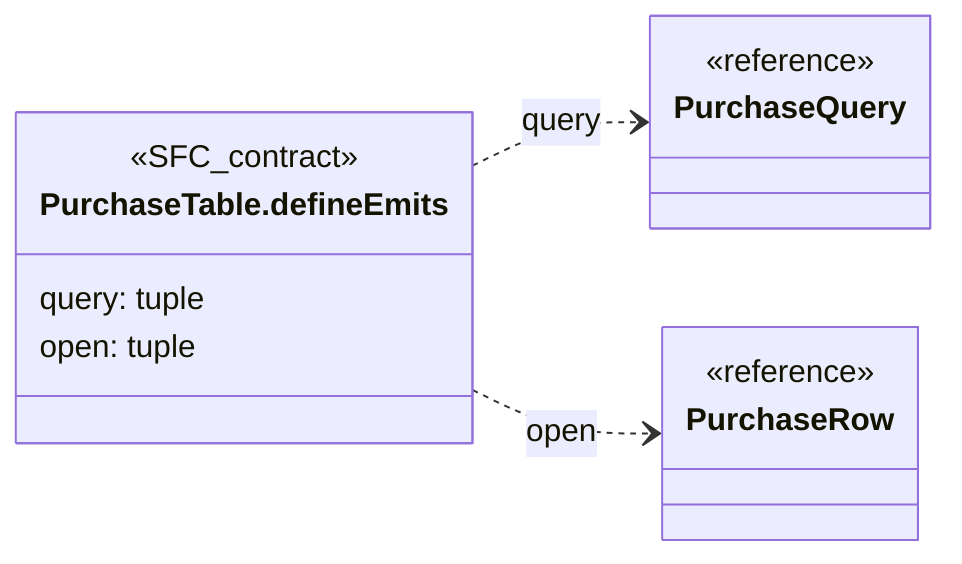

## PurchaseTotals.defineProps

**Fuente:** [src/modules/purchases/components/PurchaseTotals.vue](../../../../../src/modules/purchases/components/PurchaseTotals.vue) · línea 5, columna 17. **Declaración:** SFC contract.

| Miembro | Firma completa |
| --- | --- |
| `totals` | `totals: { quantity: number; net: number; gross: number } \| null;` |
| `isCorrection` | `isCorrection?: boolean;` |

| Relación | Destino | Origen de la referencia |
| --- | --- | --- |
| association | [PurchaseTotals.totals@6:17](../../../../../src/modules/purchases/components/PurchaseTotals.vue) | `totals` |

**Figura:** `DIA-VUE-TS-PURCHASES-17-1`.

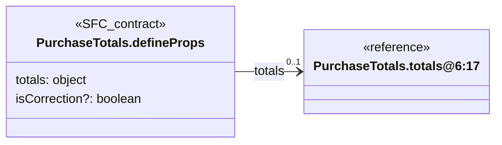

## PurchaseTotals.totals@6:17

**Fuente:** [src/modules/purchases/components/PurchaseTotals.vue](../../../../../src/modules/purchases/components/PurchaseTotals.vue) · línea 6, columna 17. **Declaración:** inline object.

| Miembro | Firma completa |
| --- | --- |
| `quantity` | `quantity: number;` |
| `net` | `net: number;` |
| `gross` | `gross: number` |

**Figura:** `DIA-VUE-TS-PURCHASES-18-1`.

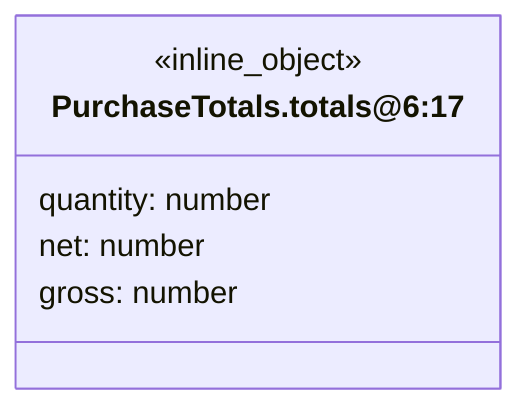

## usePurchaseActions.options@10:45

**Fuente:** [src/modules/purchases/composables/usePurchaseActions.ts](../../../../../src/modules/purchases/composables/usePurchaseActions.ts) · línea 10, columna 45. **Declaración:** inline object.

| Miembro | Firma completa |
| --- | --- |
| `resource` | `resource: PurchaseResource;` |
| `canManage` | `canManage: () => boolean;` |
| `reload` | `reload: () => unknown;` |
| `onError` | `onError: (cause: unknown) => void;` |

| Relación | Destino | Origen de la referencia |
| --- | --- | --- |
| dependency | [PurchaseResource](../../../../../src/modules/purchases/purchase.ts) | `resource` |

**Figura:** `DIA-VUE-TS-PURCHASES-19-1`.

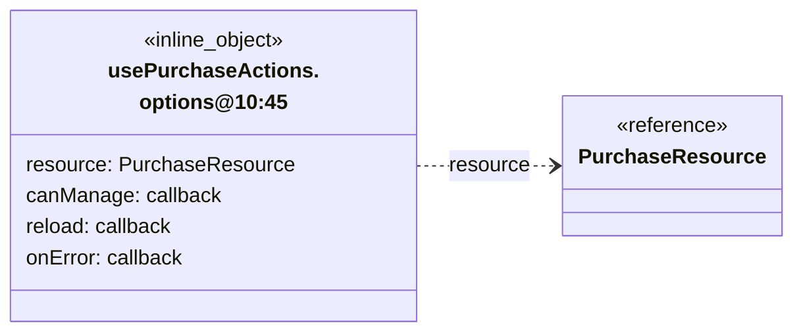

## lastOpen@26:19

**Fuente:** [src/modules/purchases/composables/usePurchaseActions.ts](../../../../../src/modules/purchases/composables/usePurchaseActions.ts) · línea 26, columna 19. **Declaración:** inline object.

| Miembro | Firma completa |
| --- | --- |
| `row` | `row: PurchaseRow;` |
| `action` | `action: 'view' \| 'edit'` |

| Relación | Destino | Origen de la referencia |
| --- | --- | --- |
| association | [PurchaseRow](../../../../../src/modules/purchases/purchase.ts) | `row` |

**Figura:** `DIA-VUE-TS-PURCHASES-20-1`.

```mermaid
classDiagram
    direction LR
    class Subject["lastOpen@26:19"] {
        <<inline_object>>
        row: PurchaseRow
        action: 'view' | 'edit'
    }
    class R0["PurchaseRow"] {
        <<reference>>
    }
    Subject --> "1" R0 : row
```

## usePurchaseCorrection.options@12:48

**Fuente:** [src/modules/purchases/composables/usePurchaseCorrection.ts](../../../../../src/modules/purchases/composables/usePurchaseCorrection.ts) · línea 12, columna 48. **Declaración:** inline object.

| Miembro | Firma completa |
| --- | --- |
| `resource` | `resource: PurchaseResource;` |
| `document` | `document: PurchaseDocument;` |
| `detail` | `detail: PurchaseDetail;` |
| `onSaved` | `onSaved: (confirmation: MutationConfirmation) => void;` |
| `onDenied` | `onDenied: (status: number) => void;` |

| Relación | Destino | Origen de la referencia |
| --- | --- | --- |
| dependency | [PurchaseResource](../../../../../src/modules/purchases/purchase.ts) | `resource` |
| association | [PurchaseDocument](../../../../../src/modules/purchases/purchase.ts) | `document` |
| association | [PurchaseDetail](../../../../../src/modules/purchases/purchase.ts) | `detail` |
| dependency | [MutationConfirmation](../../../../../src/shared/http/recordContract.ts) | `onSaved` |

**Figura:** `DIA-VUE-TS-PURCHASES-21-1`.

```mermaid
classDiagram
    direction LR
    class Subject["usePurchaseCorrection.<br/>options@12:48"] {
        <<inline_object>>
        resource: PurchaseResource
        document: PurchaseDocument
        detail: PurchaseDetail
        onSaved: callback
        onDenied: callback
    }
    class R0["PurchaseResource"] {
        <<reference>>
    }
    class R1["PurchaseDocument"] {
        <<reference>>
    }
    class R2["PurchaseDetail"] {
        <<reference>>
    }
    class R3["MutationConfirmation"] {
        <<reference>>
    }
    Subject ..> R0 : resource
    Subject --> "1" R1 : document
    Subject --> "1" R2 : detail
    Subject ..> R3 : onSaved
```

## Field

**Fuente:** [src/modules/purchases/composables/usePurchaseCorrection.ts](../../../../../src/modules/purchases/composables/usePurchaseCorrection.ts) · línea 19, columna 5. **Declaración:** type.

**Definición completa:**

```typescript
'quantity' | 'costPerUnitType'
```

## usePurchaseEditor.options@23:44

**Fuente:** [src/modules/purchases/composables/usePurchaseEditor.ts](../../../../../src/modules/purchases/composables/usePurchaseEditor.ts) · línea 23, columna 44. **Declaración:** inline object.

| Miembro | Firma completa |
| --- | --- |
| `resource` | `resource: PurchaseResource;` |
| `target` | `target: PurchaseTarget;` |
| `has` | `has: (permission: string) => boolean;` |
| `onSaved` | `onSaved: (confirmation: MutationConfirmation) => void;` |
| `onDenied` | `onDenied: (status: number) => void;` |

| Relación | Destino | Origen de la referencia |
| --- | --- | --- |
| dependency | [PurchaseResource](../../../../../src/modules/purchases/purchase.ts) | `resource` |
| dependency | [PurchaseTarget](../../../../../src/modules/purchases/purchase.ts) | `target` |
| dependency | [MutationConfirmation](../../../../../src/shared/http/recordContract.ts) | `onSaved` |

**Figura:** `DIA-VUE-TS-PURCHASES-23-1`.

```mermaid
classDiagram
    direction LR
    class Subject["usePurchaseEditor.<br/>options@23:44"] {
        <<inline_object>>
        resource: PurchaseResource
        target: PurchaseTarget
        has: callback
        onSaved: callback
        onDenied: callback
    }
    class R0["PurchaseResource"] {
        <<reference>>
    }
    class R1["PurchaseTarget"] {
        <<reference>>
    }
    class R2["MutationConfirmation"] {
        <<reference>>
    }
    Subject ..> R0 : resource
    Subject ..> R1 : target
    Subject ..> R2 : onSaved
```

## usePurchaseLineEntry.options@12:47

**Fuente:** [src/modules/purchases/composables/usePurchaseLineEntry.ts](../../../../../src/modules/purchases/composables/usePurchaseLineEntry.ts) · línea 12, columna 47. **Declaración:** inline object.

| Miembro | Firma completa |
| --- | --- |
| `resource` | `resource: PurchaseResource;` |
| `supplier` | `supplier: LookupItem;` |
| `canRead` | `canRead: boolean;` |
| `isDisabled` | `isDisabled: () => boolean;` |
| `onAdded` | `onAdded: (line: PurchaseDetail) => void;` |

| Relación | Destino | Origen de la referencia |
| --- | --- | --- |
| dependency | [PurchaseResource](../../../../../src/modules/purchases/purchase.ts) | `resource` |
| association | [LookupItem](../../../../../src/shared/lookup.ts) | `supplier` |
| dependency | [PurchaseDetail](../../../../../src/modules/purchases/purchase.ts) | `onAdded` |

**Figura:** `DIA-VUE-TS-PURCHASES-24-1`.

```mermaid
classDiagram
    direction LR
    class Subject["usePurchaseLineEntry.<br/>options@12:47"] {
        <<inline_object>>
        resource: PurchaseResource
        supplier: LookupItem
        canRead: boolean
        isDisabled: callback
        onAdded: callback
    }
    class R0["PurchaseResource"] {
        <<reference>>
    }
    class R1["LookupItem"] {
        <<reference>>
    }
    class R2["PurchaseDetail"] {
        <<reference>>
    }
    Subject ..> R0 : resource
    Subject --> "1" R1 : supplier
    Subject ..> R2 : onAdded
```

## Field

**Fuente:** [src/modules/purchases/composables/usePurchaseLineEntry.ts](../../../../../src/modules/purchases/composables/usePurchaseLineEntry.ts) · línea 19, columna 5. **Declaración:** type.

**Definición completa:**

```typescript
'materialId' | 'quantity' | 'costPerUnitType'
```

## PurchaseCorrectionPage.defineProps

**Fuente:** [src/modules/purchases/pages/PurchaseCorrectionPage.vue](../../../../../src/modules/purchases/pages/PurchaseCorrectionPage.vue) · línea 8, columna 27. **Declaración:** SFC contract.

| Miembro | Firma completa |
| --- | --- |
| `resource` | `resource: PurchaseResource;` |
| `document` | `document: PurchaseDocument;` |
| `detail` | `detail: PurchaseDetail;` |

| Relación | Destino | Origen de la referencia |
| --- | --- | --- |
| dependency | [PurchaseResource](../../../../../src/modules/purchases/purchase.ts) | `resource` |
| association | [PurchaseDocument](../../../../../src/modules/purchases/purchase.ts) | `document` |
| association | [PurchaseDetail](../../../../../src/modules/purchases/purchase.ts) | `detail` |

**Figura:** `DIA-VUE-TS-PURCHASES-26-1`.

```mermaid
classDiagram
    direction LR
    class Subject["PurchaseCorrectionPage.<br/>defineProps"] {
        <<SFC_contract>>
        resource: PurchaseResource
        document: PurchaseDocument
        detail: PurchaseDetail
    }
    class R0["PurchaseResource"] {
        <<reference>>
    }
    class R1["PurchaseDocument"] {
        <<reference>>
    }
    class R2["PurchaseDetail"] {
        <<reference>>
    }
    Subject ..> R0 : resource
    Subject --> "1" R1 : document
    Subject --> "1" R2 : detail
```

## PurchaseCorrectionPage.defineEmits

**Fuente:** [src/modules/purchases/pages/PurchaseCorrectionPage.vue](../../../../../src/modules/purchases/pages/PurchaseCorrectionPage.vue) · línea 13, columna 26. **Declaración:** SFC contract.

| Miembro | Firma completa |
| --- | --- |
| `saved` | `saved: [confirmation: MutationConfirmation];` |
| `close` | `close: [];` |
| `reload` | `reload: []` |

| Relación | Destino | Origen de la referencia |
| --- | --- | --- |
| dependency | [MutationConfirmation](../../../../../src/shared/http/recordContract.ts) | `saved` |

**Figura:** `DIA-VUE-TS-PURCHASES-27-1`.

```mermaid
classDiagram
    direction LR
    class Subject["PurchaseCorrectionPage.<br/>defineEmits"] {
        <<SFC_contract>>
        saved: tuple
        close: tuple
        reload: tuple
    }
    class R0["MutationConfirmation"] {
        <<reference>>
    }
    Subject ..> R0 : saved
```

## PurchaseEditorPage.defineProps

**Fuente:** [src/modules/purchases/pages/PurchaseEditorPage.vue](../../../../../src/modules/purchases/pages/PurchaseEditorPage.vue) · línea 18, columna 27. **Declaración:** SFC contract.

| Miembro | Firma completa |
| --- | --- |
| `resource` | `resource: PurchaseResource;` |
| `target` | `target: PurchaseTarget;` |
| `canChangeDetails` | `canChangeDetails: boolean;` |
| `isChanging` | `isChanging: boolean;` |
| `readError` | `readError: string;` |

| Relación | Destino | Origen de la referencia |
| --- | --- | --- |
| dependency | [PurchaseResource](../../../../../src/modules/purchases/purchase.ts) | `resource` |
| dependency | [PurchaseTarget](../../../../../src/modules/purchases/purchase.ts) | `target` |

**Figura:** `DIA-VUE-TS-PURCHASES-28-1`.

```mermaid
classDiagram
    direction LR
    class Subject["PurchaseEditorPage.<br/>defineProps"] {
        <<SFC_contract>>
        resource: PurchaseResource
        target: PurchaseTarget
        canChangeDetails: boolean
        isChanging: boolean
        readError: string
    }
    class R0["PurchaseResource"] {
        <<reference>>
    }
    class R1["PurchaseTarget"] {
        <<reference>>
    }
    Subject ..> R0 : resource
    Subject ..> R1 : target
```

## PurchaseEditorPage.defineEmits

**Fuente:** [src/modules/purchases/pages/PurchaseEditorPage.vue](../../../../../src/modules/purchases/pages/PurchaseEditorPage.vue) · línea 25, columna 26. **Declaración:** SFC contract.

| Miembro | Firma completa |
| --- | --- |
| `saved` | `saved: [confirmation: MutationConfirmation];` |
| `close` | `close: [];` |
| `reload` | `reload: [];` |
| `correct` | `correct: [detail: PurchaseDetail];` |
| `cancel` | `cancel: [detail: PurchaseDetail];` |
| `createSupplier` | `createSupplier: [request: LookupCreation];` |
| `createItem` | `createItem: [request: ItemCreation];` |

| Relación | Destino | Origen de la referencia |
| --- | --- | --- |
| dependency | [MutationConfirmation](../../../../../src/shared/http/recordContract.ts) | `saved` |
| dependency | [PurchaseDetail](../../../../../src/modules/purchases/purchase.ts) | `correct` |
| dependency | [PurchaseDetail](../../../../../src/modules/purchases/purchase.ts) | `cancel` |
| dependency | [LookupCreation](../../../../../src/shared/lookup.ts) | `createSupplier` |
| dependency | [ItemCreation](../../../../../src/modules/purchases/purchase.ts) | `createItem` |

**Figura:** `DIA-VUE-TS-PURCHASES-29-1`.

```mermaid
classDiagram
    direction LR
    class Subject["PurchaseEditorPage.<br/>defineEmits"] {
        <<SFC_contract>>
        saved: tuple
        close: tuple
        reload: tuple
        correct: tuple
        cancel: tuple
        createSupplier: tuple
        createItem: tuple
    }
    class R0["MutationConfirmation"] {
        <<reference>>
    }
    class R1["PurchaseDetail"] {
        <<reference>>
    }
    class R2["LookupCreation"] {
        <<reference>>
    }
    class R3["ItemCreation"] {
        <<reference>>
    }
    Subject ..> R0 : saved
    Subject ..> R1 : correct
    Subject ..> R1 : cancel
    Subject ..> R2 : createSupplier
    Subject ..> R3 : createItem
```

## PurchaseLineEntryPage.defineProps

**Fuente:** [src/modules/purchases/pages/PurchaseLineEntryPage.vue](../../../../../src/modules/purchases/pages/PurchaseLineEntryPage.vue) · línea 8, columna 27. **Declaración:** SFC contract.

| Miembro | Firma completa |
| --- | --- |
| `resource` | `resource: PurchaseResource;` |
| `supplier` | `supplier: LookupItem;` |
| `isDisabled` | `isDisabled: boolean;` |
| `canRead` | `canRead: boolean;` |
| `canCreate` | `canCreate: boolean;` |

| Relación | Destino | Origen de la referencia |
| --- | --- | --- |
| dependency | [PurchaseResource](../../../../../src/modules/purchases/purchase.ts) | `resource` |
| association | [LookupItem](../../../../../src/shared/lookup.ts) | `supplier` |

**Figura:** `DIA-VUE-TS-PURCHASES-30-1`.

```mermaid
classDiagram
    direction LR
    class Subject["PurchaseLineEntryPage.<br/>defineProps"] {
        <<SFC_contract>>
        resource: PurchaseResource
        supplier: LookupItem
        isDisabled: boolean
        canRead: boolean
        canCreate: boolean
    }
    class R0["PurchaseResource"] {
        <<reference>>
    }
    class R1["LookupItem"] {
        <<reference>>
    }
    Subject ..> R0 : resource
    Subject --> "1" R1 : supplier
```

## PurchaseLineEntryPage.defineEmits

**Fuente:** [src/modules/purchases/pages/PurchaseLineEntryPage.vue](../../../../../src/modules/purchases/pages/PurchaseLineEntryPage.vue) · línea 15, columna 26. **Declaración:** SFC contract.

| Miembro | Firma completa |
| --- | --- |
| `add` | `add: [line: PurchaseDetail];` |
| `create` | `create: [request: ItemCreation]` |

| Relación | Destino | Origen de la referencia |
| --- | --- | --- |
| dependency | [PurchaseDetail](../../../../../src/modules/purchases/purchase.ts) | `add` |
| dependency | [ItemCreation](../../../../../src/modules/purchases/purchase.ts) | `create` |

**Figura:** `DIA-VUE-TS-PURCHASES-31-1`.

```mermaid
classDiagram
    direction LR
    class Subject["PurchaseLineEntryPage.<br/>defineEmits"] {
        <<SFC_contract>>
        add: tuple
        create: tuple
    }
    class R0["PurchaseDetail"] {
        <<reference>>
    }
    class R1["ItemCreation"] {
        <<reference>>
    }
    Subject ..> R0 : add
    Subject ..> R1 : create
```

## PurchasePage.defineProps

**Fuente:** [src/modules/purchases/pages/PurchasePage.vue](../../../../../src/modules/purchases/pages/PurchasePage.vue) · línea 27, columna 27. **Declaración:** SFC contract.

| Miembro | Firma completa |
| --- | --- |
| `resource` | `resource: PurchaseResource` |

| Relación | Destino | Origen de la referencia |
| --- | --- | --- |
| dependency | [PurchaseResource](../../../../../src/modules/purchases/purchase.ts) | `resource` |

**Figura:** `DIA-VUE-TS-PURCHASES-32-1`.

```mermaid
classDiagram
    direction LR
    class Subject["PurchasePage.defineProps"] {
        <<SFC_contract>>
        resource: PurchaseResource
    }
    class R0["PurchaseResource"] {
        <<reference>>
    }
    Subject ..> R0 : resource
```

## PurchasePage.defineEmits

**Fuente:** [src/modules/purchases/pages/PurchasePage.vue](../../../../../src/modules/purchases/pages/PurchasePage.vue) · línea 28, columna 26. **Declaración:** SFC contract.

| Miembro | Firma completa |
| --- | --- |
| `createSupplier` | `createSupplier: [request: LookupCreation];` |
| `createItem` | `createItem: [request: ItemCreation];` |

| Relación | Destino | Origen de la referencia |
| --- | --- | --- |
| dependency | [LookupCreation](../../../../../src/shared/lookup.ts) | `createSupplier` |
| dependency | [ItemCreation](../../../../../src/modules/purchases/purchase.ts) | `createItem` |

**Figura:** `DIA-VUE-TS-PURCHASES-33-1`.

```mermaid
classDiagram
    direction LR
    class Subject["PurchasePage.defineEmits"] {
        <<SFC_contract>>
        createSupplier: tuple
        createItem: tuple
    }
    class R0["LookupCreation"] {
        <<reference>>
    }
    class R1["ItemCreation"] {
        <<reference>>
    }
    Subject ..> R0 : createSupplier
    Subject ..> R1 : createItem
```

## PurchaseResource

**Fuente:** [src/modules/purchases/purchase.ts](../../../../../src/modules/purchases/purchase.ts) · línea 4, columna 1. **Declaración:** type.

**Definición completa:**

```typescript
'materials' | 'consumables'
```

## Decimal

**Fuente:** [src/modules/purchases/purchase.ts](../../../../../src/modules/purchases/purchase.ts) · línea 5, columna 1. **Declaración:** type.

**Definición completa:**

```typescript
string | number
```

## PurchaseFilters

**Fuente:** [src/modules/purchases/purchase.ts](../../../../../src/modules/purchases/purchase.ts) · línea 6, columna 1. **Declaración:** interface.

| Miembro | Firma completa |
| --- | --- |
| `startDate` | `startDate: string;` |
| `endDate` | `endDate: string;` |
| `supplierId` | `supplierId: string;` |
| `personId` | `personId: string;` |

**Figura:** `DIA-VUE-TS-PURCHASES-36-1`.

```mermaid
classDiagram
    direction LR
    class Subject["PurchaseFilters"] {
        <<interface>>
        startDate: string
        endDate: string
        supplierId: string
        personId: string
    }
```

## PurchaseQuery

**Fuente:** [src/modules/purchases/purchase.ts](../../../../../src/modules/purchases/purchase.ts) · línea 12, columna 1. **Declaración:** type.

**Definición completa:**

```typescript
RecordQuery & PurchaseFilters
```

| Relación | Destino | Origen de la referencia |
| --- | --- | --- |
| dependency | [RecordQuery](../../../../../src/shared/list.ts) | `type` |
| dependency | [PurchaseFilters](../../../../../src/modules/purchases/purchase.ts) | `type` |

**Figura:** `DIA-VUE-TS-PURCHASES-37-1`.

```mermaid
classDiagram
    direction LR
    class Subject["PurchaseQuery"] {
        <<type>>
    }
    class R0["RecordQuery"] {
        <<reference>>
    }
    class R1["PurchaseFilters"] {
        <<reference>>
    }
    Subject ..> R0 : type
    Subject ..> R1 : type
```

## PurchaseRow

**Fuente:** [src/modules/purchases/purchase.ts](../../../../../src/modules/purchases/purchase.ts) · línea 13, columna 1. **Declaración:** interface.

| Miembro | Firma completa |
| --- | --- |
| `id` | `id: string;` |
| `referenceNumber` | `referenceNumber: string;` |
| `receptionDate` | `receptionDate: string;` |
| `supplierId` | `supplierId: string;` |
| `supplierName` | `supplierName: string;` |
| `receivedById` | `receivedById: string;` |
| `receivedByName` | `receivedByName: string;` |
| `isInvoiced` | `isInvoiced: boolean;` |
| `invoice` | `invoice: string;` |
| `status` | `status: string;` |
| `totalQuantity` | `totalQuantity: Decimal;` |
| `totalNetPurchaseAmount` | `totalNetPurchaseAmount: Decimal;` |
| `totalGrossPurchaseAmount` | `totalGrossPurchaseAmount: Decimal;` |

| Relación | Destino | Origen de la referencia |
| --- | --- | --- |
| dependency | [Decimal](../../../../../src/modules/purchases/purchase.ts) | `totalQuantity` |
| dependency | [Decimal](../../../../../src/modules/purchases/purchase.ts) | `totalNetPurchaseAmount` |
| dependency | [Decimal](../../../../../src/modules/purchases/purchase.ts) | `totalGrossPurchaseAmount` |

**Figura:** `DIA-VUE-TS-PURCHASES-38-1`.

```mermaid
classDiagram
    direction LR
    class Subject["PurchaseRow"] {
        <<interface>>
        id: string
        referenceNumber: string
        receptionDate: string
        supplierId: string
        supplierName: string
        receivedById: string
        receivedByName: string
        isInvoiced: boolean
        invoice: string
        status: string
        totalQuantity: Decimal
        totalNetPurchaseAmount: Decimal
        totalGrossPurchaseAmount: Decimal
    }
    class R0["Decimal"] {
        <<reference>>
    }
    Subject ..> R0 : totalQuantity
    Subject ..> R0 : totalNetPurchaseAmount
    Subject ..> R0 : totalGrossPurchaseAmount
```

## PurchaseDetail

**Fuente:** [src/modules/purchases/purchase.ts](../../../../../src/modules/purchases/purchase.ts) · línea 28, columna 1. **Declaración:** interface.

| Miembro | Firma completa |
| --- | --- |
| `id` | `id: string;` |
| `materialId` | `materialId: string;` |
| `name` | `name: string;` |
| `base` | `base: Decimal \| null;` |
| `height` | `height: Decimal \| null;` |
| `presentation` | `presentation: string;` |
| `unitMeasure` | `unitMeasure: string;` |
| `quantity` | `quantity: Decimal;` |
| `convertedQuantity` | `convertedQuantity: Decimal;` |
| `costPerUnitType` | `costPerUnitType: Decimal;` |
| `conversionUnitCost` | `conversionUnitCost: Decimal;` |
| `netPurchaseAmount` | `netPurchaseAmount: Decimal;` |
| `grossPurchaseAmount` | `grossPurchaseAmount: Decimal;` |
| `status` | `status: 'ACTIVE' \| 'CANCELED';` |
| `isNew` | `isNew: boolean;` |

| Relación | Destino | Origen de la referencia |
| --- | --- | --- |
| dependency | [Decimal](../../../../../src/modules/purchases/purchase.ts) | `base` |
| dependency | [Decimal](../../../../../src/modules/purchases/purchase.ts) | `height` |
| dependency | [Decimal](../../../../../src/modules/purchases/purchase.ts) | `quantity` |
| dependency | [Decimal](../../../../../src/modules/purchases/purchase.ts) | `convertedQuantity` |
| dependency | [Decimal](../../../../../src/modules/purchases/purchase.ts) | `costPerUnitType` |
| dependency | [Decimal](../../../../../src/modules/purchases/purchase.ts) | `conversionUnitCost` |
| dependency | [Decimal](../../../../../src/modules/purchases/purchase.ts) | `netPurchaseAmount` |
| dependency | [Decimal](../../../../../src/modules/purchases/purchase.ts) | `grossPurchaseAmount` |

**Figura:** `DIA-VUE-TS-PURCHASES-39-1`.

```mermaid
classDiagram
    direction LR
    class Subject["PurchaseDetail"] {
        <<interface>>
        id: string
        materialId: string
        name: string
        base: Decimal | null
        height: Decimal | null
        presentation: string
        unitMeasure: string
        quantity: Decimal
        convertedQuantity: Decimal
        costPerUnitType: Decimal
        conversionUnitCost: Decimal
        netPurchaseAmount: Decimal
        grossPurchaseAmount: Decimal
        status: 'ACTIVE' | 'CANCELED'
        isNew: boolean
    }
    class R0["Decimal"] {
        <<reference>>
    }
    Subject ..> R0 : base
    Subject ..> R0 : height
    Subject ..> R0 : quantity
    Subject ..> R0 : convertedQuantity
    Subject ..> R0 : costPerUnitType
    Subject ..> R0 : conversionUnitCost
    Subject ..> R0 : netPurchaseAmount
    Subject ..> R0 : grossPurchaseAmount
```

## PurchaseDocument

**Fuente:** [src/modules/purchases/purchase.ts](../../../../../src/modules/purchases/purchase.ts) · línea 45, columna 1. **Declaración:** interface.

**Extensión/implementación:** `extends PurchaseRow`.

| Miembro | Firma completa |
| --- | --- |
| `observations` | `observations: string;` |
| `details` | `details: PurchaseDetail[];` |

| Relación | Destino | Origen de la referencia |
| --- | --- | --- |
| inheritance | [PurchaseRow](../../../../../src/modules/purchases/purchase.ts) | `extends` |
| association | [PurchaseDetail](../../../../../src/modules/purchases/purchase.ts) | `details` |

**Figura:** `DIA-VUE-TS-PURCHASES-40-1`.

```mermaid
classDiagram
    direction LR
    class Subject["PurchaseDocument"] {
        <<interface>>
        observations: string
        details: PurchaseDetail[]
    }
    class R0["PurchaseRow"] {
        <<reference>>
    }
    class R1["PurchaseDetail"] {
        <<reference>>
    }
    R0 <|-- Subject : extends
    Subject --> "0..*" R1 : details
```

## PurchaseValues

**Fuente:** [src/modules/purchases/purchase.ts](../../../../../src/modules/purchases/purchase.ts) · línea 49, columna 1. **Declaración:** interface.

| Miembro | Firma completa |
| --- | --- |
| `supplierId` | `supplierId: string;` |
| `receivedById` | `receivedById: string;` |
| `isInvoiced` | `isInvoiced: boolean;` |
| `invoice` | `invoice: string;` |
| `receptionDate` | `receptionDate: string;` |
| `observations` | `observations: string;` |
| `details` | `details: PurchaseDetail[];` |

| Relación | Destino | Origen de la referencia |
| --- | --- | --- |
| association | [PurchaseDetail](../../../../../src/modules/purchases/purchase.ts) | `details` |

**Figura:** `DIA-VUE-TS-PURCHASES-41-1`.

```mermaid
classDiagram
    direction LR
    class Subject["PurchaseValues"] {
        <<interface>>
        supplierId: string
        receivedById: string
        isInvoiced: boolean
        invoice: string
        receptionDate: string
        observations: string
        details: PurchaseDetail[]
    }
    class R0["PurchaseDetail"] {
        <<reference>>
    }
    Subject --> "0..*" R0 : details
```

## PurchaseField

**Fuente:** [src/modules/purchases/purchase.ts](../../../../../src/modules/purchases/purchase.ts) · línea 58, columna 1. **Declaración:** type.

**Definición completa:**

```typescript
keyof PurchaseValues
```

| Relación | Destino | Origen de la referencia |
| --- | --- | --- |
| dependency | [PurchaseValues](../../../../../src/modules/purchases/purchase.ts) | `type` |

**Figura:** `DIA-VUE-TS-PURCHASES-42-1`.

```mermaid
classDiagram
    direction LR
    class Subject["PurchaseField"] {
        <<type>>
    }
    class R0["PurchaseValues"] {
        <<reference>>
    }
    Subject ..> R0 : type
```

## PurchaseTarget

**Fuente:** [src/modules/purchases/purchase.ts](../../../../../src/modules/purchases/purchase.ts) · línea 59, columna 1. **Declaración:** type.

**Definición completa:**

```typescript
| { action: 'create' }
    | { action: 'edit'; document: PurchaseDocument }
    | { action: 'view'; document: PurchaseDocument }
```

| Relación | Destino | Origen de la referencia |
| --- | --- | --- |
| dependency | [PurchaseTarget@60:7](../../../../../src/modules/purchases/purchase.ts) | `type` |
| dependency | [PurchaseTarget@61:7](../../../../../src/modules/purchases/purchase.ts) | `type` |
| dependency | [PurchaseTarget@62:7](../../../../../src/modules/purchases/purchase.ts) | `type` |

**Figura:** `DIA-VUE-TS-PURCHASES-43-1`.

```mermaid
classDiagram
    direction LR
    class Subject["PurchaseTarget"] {
        <<type>>
    }
    class R0["PurchaseTarget@60:7"] {
        <<reference>>
    }
    class R1["PurchaseTarget@61:7"] {
        <<reference>>
    }
    class R2["PurchaseTarget@62:7"] {
        <<reference>>
    }
    Subject ..> R0 : type
    Subject ..> R1 : type
    Subject ..> R2 : type
```

## PurchaseTarget@60:7

**Fuente:** [src/modules/purchases/purchase.ts](../../../../../src/modules/purchases/purchase.ts) · línea 60, columna 7. **Declaración:** inline object.

| Miembro | Firma completa |
| --- | --- |
| `action` | `action: 'create'` |

**Figura:** `DIA-VUE-TS-PURCHASES-44-1`.

```mermaid
classDiagram
    direction LR
    class Subject["PurchaseTarget@60:7"] {
        <<inline_object>>
        action: 'create'
    }
```

## PurchaseTarget@61:7

**Fuente:** [src/modules/purchases/purchase.ts](../../../../../src/modules/purchases/purchase.ts) · línea 61, columna 7. **Declaración:** inline object.

| Miembro | Firma completa |
| --- | --- |
| `action` | `action: 'edit';` |
| `document` | `document: PurchaseDocument` |

| Relación | Destino | Origen de la referencia |
| --- | --- | --- |
| association | [PurchaseDocument](../../../../../src/modules/purchases/purchase.ts) | `document` |

**Figura:** `DIA-VUE-TS-PURCHASES-45-1`.

```mermaid
classDiagram
    direction LR
    class Subject["PurchaseTarget@61:7"] {
        <<inline_object>>
        action: 'edit'
        document: PurchaseDocument
    }
    class R0["PurchaseDocument"] {
        <<reference>>
    }
    Subject --> "1" R0 : document
```

## PurchaseTarget@62:7

**Fuente:** [src/modules/purchases/purchase.ts](../../../../../src/modules/purchases/purchase.ts) · línea 62, columna 7. **Declaración:** inline object.

| Miembro | Firma completa |
| --- | --- |
| `action` | `action: 'view';` |
| `document` | `document: PurchaseDocument` |

| Relación | Destino | Origen de la referencia |
| --- | --- | --- |
| association | [PurchaseDocument](../../../../../src/modules/purchases/purchase.ts) | `document` |

**Figura:** `DIA-VUE-TS-PURCHASES-46-1`.

```mermaid
classDiagram
    direction LR
    class Subject["PurchaseTarget@62:7"] {
        <<inline_object>>
        action: 'view'
        document: PurchaseDocument
    }
    class R0["PurchaseDocument"] {
        <<reference>>
    }
    Subject --> "1" R0 : document
```

## PurchaseWriteTarget

**Fuente:** [src/modules/purchases/purchase.ts](../../../../../src/modules/purchases/purchase.ts) · línea 63, columna 1. **Declaración:** type.

**Definición completa:**

```typescript
Exclude<PurchaseTarget, { action: 'view' }>
```

| Relación | Destino | Origen de la referencia |
| --- | --- | --- |
| dependency | [PurchaseTarget](../../../../../src/modules/purchases/purchase.ts) | `type` |
| dependency | [PurchaseWriteTarget@63:59](../../../../../src/modules/purchases/purchase.ts) | `type` |

**Figura:** `DIA-VUE-TS-PURCHASES-47-1`.

```mermaid
classDiagram
    direction LR
    class Subject["PurchaseWriteTarget"] {
        <<type>>
    }
    class R0["PurchaseTarget"] {
        <<reference>>
    }
    class R1["PurchaseWriteTarget@63:59"] {
        <<reference>>
    }
    Subject ..> R0 : type
    Subject ..> R1 : type
```

## PurchaseWriteTarget@63:59

**Fuente:** [src/modules/purchases/purchase.ts](../../../../../src/modules/purchases/purchase.ts) · línea 63, columna 59. **Declaración:** inline object.

| Miembro | Firma completa |
| --- | --- |
| `action` | `action: 'view'` |

**Figura:** `DIA-VUE-TS-PURCHASES-48-1`.

```mermaid
classDiagram
    direction LR
    class Subject["PurchaseWriteTarget@63:59"] {
        <<inline_object>>
        action: 'view'
    }
```

## PurchaseDetailChange

**Fuente:** [src/modules/purchases/purchase.ts](../../../../../src/modules/purchases/purchase.ts) · línea 64, columna 1. **Declaración:** type.

**Definición completa:**

```typescript
{ action: 'correct'; quantity: number; costPerUnitType: number } | { action: 'cancel' }
```

| Relación | Destino | Origen de la referencia |
| --- | --- | --- |
| dependency | [PurchaseDetailChange@65:5](../../../../../src/modules/purchases/purchase.ts) | `type` |
| dependency | [PurchaseDetailChange@65:72](../../../../../src/modules/purchases/purchase.ts) | `type` |

**Figura:** `DIA-VUE-TS-PURCHASES-49-1`.

```mermaid
classDiagram
    direction LR
    class Subject["PurchaseDetailChange"] {
        <<type>>
    }
    class R0["PurchaseDetailChange@65:5"] {
        <<reference>>
    }
    class R1["PurchaseDetailChange@65:72"] {
        <<reference>>
    }
    Subject ..> R0 : type
    Subject ..> R1 : type
```

## PurchaseDetailChange@65:5

**Fuente:** [src/modules/purchases/purchase.ts](../../../../../src/modules/purchases/purchase.ts) · línea 65, columna 5. **Declaración:** inline object.

| Miembro | Firma completa |
| --- | --- |
| `action` | `action: 'correct';` |
| `quantity` | `quantity: number;` |
| `costPerUnitType` | `costPerUnitType: number` |

**Figura:** `DIA-VUE-TS-PURCHASES-50-1`.

```mermaid
classDiagram
    direction LR
    class Subject["PurchaseDetailChange@65:5"] {
        <<inline_object>>
        action: 'correct'
        quantity: number
        costPerUnitType: number
    }
```

## PurchaseDetailChange@65:72

**Fuente:** [src/modules/purchases/purchase.ts](../../../../../src/modules/purchases/purchase.ts) · línea 65, columna 72. **Declaración:** inline object.

| Miembro | Firma completa |
| --- | --- |
| `action` | `action: 'cancel'` |

**Figura:** `DIA-VUE-TS-PURCHASES-51-1`.

```mermaid
classDiagram
    direction LR
    class Subject["PurchaseDetailChange@65:72"] {
        <<inline_object>>
        action: 'cancel'
    }
```

## ItemCreation

**Fuente:** [src/modules/purchases/purchase.ts](../../../../../src/modules/purchases/purchase.ts) · línea 66, columna 1. **Declaración:** interface.

**Extensión/implementación:** `extends LookupCreation`.

| Miembro | Firma completa |
| --- | --- |
| `supplier` | `supplier: LookupItem;` |

| Relación | Destino | Origen de la referencia |
| --- | --- | --- |
| inheritance | [LookupCreation](../../../../../src/shared/lookup.ts) | `extends` |
| association | [LookupItem](../../../../../src/shared/lookup.ts) | `supplier` |

**Figura:** `DIA-VUE-TS-PURCHASES-52-1`.

```mermaid
classDiagram
    direction LR
    class Subject["ItemCreation"] {
        <<interface>>
        supplier: LookupItem
    }
    class R0["LookupCreation"] {
        <<reference>>
    }
    class R1["LookupItem"] {
        <<reference>>
    }
    R0 <|-- Subject : extends
    Subject --> "1" R1 : supplier
```

## calculatePurchaseCorrectionTotals.values@19:13

**Fuente:** [src/modules/purchases/purchaseCalculations.ts](../../../../../src/modules/purchases/purchaseCalculations.ts) · línea 19, columna 13. **Declaración:** inline object.

| Miembro | Firma completa |
| --- | --- |
| `quantity` | `quantity: string;` |
| `costPerUnitType` | `costPerUnitType: string` |

**Figura:** `DIA-VUE-TS-PURCHASES-53-1`.

```mermaid
classDiagram
    direction LR
    class Subject["calculatePurchaseCorrectionT<br/>otals.values@19:13"] {
        <<inline_object>>
        quantity: string
        costPerUnitType: string
    }
```

## purchaseLookupService.options@14:18

**Fuente:** [src/modules/purchases/services/purchaseLookupService.ts](../../../../../src/modules/purchases/services/purchaseLookupService.ts) · línea 14, columna 18. **Declaración:** inline object.

| Miembro | Firma completa |
| --- | --- |
| `supplierId` | `supplierId?: string;` |
| `capture` | `capture?: boolean` |

**Figura:** `DIA-VUE-TS-PURCHASES-54-1`.

```mermaid
classDiagram
    direction LR
    class Subject["purchaseLookupService.<br/>options@14:18"] {
        <<inline_object>>
        supplierId?: string
        capture?: boolean
    }
```

## apiClient.request@39:48

**Fuente:** [src/modules/purchases/services/purchaseService.ts](../../../../../src/modules/purchases/services/purchaseService.ts) · línea 39, columna 48. **Declaración:** inline object.

| Miembro | Firma completa |
| --- | --- |
| `goodsReceipt` | `goodsReceipt: unknown` |

**Figura:** `DIA-VUE-TS-PURCHASES-55-1`.

```mermaid
classDiagram
    direction LR
    class Subject["apiClient.request@39:48"] {
        <<inline_object>>
        goodsReceipt: unknown
    }
```

## purchaseService.options@49:25

**Fuente:** [src/modules/purchases/services/purchaseService.ts](../../../../../src/modules/purchases/services/purchaseService.ts) · línea 49, columna 25. **Declaración:** inline object.

| Miembro | Firma completa |
| --- | --- |
| `resource` | `resource: PurchaseResource;` |
| `target` | `target: PurchaseWriteTarget;` |
| `payload` | `payload: Record<string, unknown>;` |
| `signal` | `signal: AbortSignal;` |

| Relación | Destino | Origen de la referencia |
| --- | --- | --- |
| dependency | [PurchaseResource](../../../../../src/modules/purchases/purchase.ts) | `resource` |
| dependency | [PurchaseWriteTarget](../../../../../src/modules/purchases/purchase.ts) | `target` |

**Figura:** `DIA-VUE-TS-PURCHASES-56-1`.

```mermaid
classDiagram
    direction LR
    class Subject["purchaseService.<br/>options@49:25"] {
        <<inline_object>>
        resource: PurchaseResource
        target: PurchaseWriteTarget
        payload: Record~string, unknown~
        signal: AbortSignal
    }
    class R0["PurchaseResource"] {
        <<reference>>
    }
    class R1["PurchaseWriteTarget"] {
        <<reference>>
    }
    Subject ..> R0 : resource
    Subject ..> R1 : target
```

## purchaseService.options@69:33

**Fuente:** [src/modules/purchases/services/purchaseService.ts](../../../../../src/modules/purchases/services/purchaseService.ts) · línea 69, columna 33. **Declaración:** inline object.

| Miembro | Firma completa |
| --- | --- |
| `resource` | `resource: PurchaseResource;` |
| `documentId` | `documentId: string;` |
| `detailId` | `detailId: string;` |
| `change` | `change: PurchaseDetailChange;` |
| `signal` | `signal: AbortSignal;` |

| Relación | Destino | Origen de la referencia |
| --- | --- | --- |
| dependency | [PurchaseResource](../../../../../src/modules/purchases/purchase.ts) | `resource` |
| dependency | [PurchaseDetailChange](../../../../../src/modules/purchases/purchase.ts) | `change` |

**Figura:** `DIA-VUE-TS-PURCHASES-57-1`.

```mermaid
classDiagram
    direction LR
    class Subject["purchaseService.<br/>options@69:33"] {
        <<inline_object>>
        resource: PurchaseResource
        documentId: string
        detailId: string
        change: PurchaseDetailChange
        signal: AbortSignal
    }
    class R0["PurchaseResource"] {
        <<reference>>
    }
    class R1["PurchaseDetailChange"] {
        <<reference>>
    }
    Subject ..> R0 : resource
    Subject ..> R1 : change
```

## usePurchaseActions.return

**Fuente:** [src/modules/purchases/composables/usePurchaseActions.ts](../../../../../src/modules/purchases/composables/usePurchaseActions.ts) · línea 10, columna 35. **Declaración:** inferred return.

| Miembro | Firma completa |
| --- | --- |
| `editor` | `"editor": ShallowRef<PurchaseTarget \| null, PurchaseTarget \| null>;` |
| `editorKey` | `"editorKey": Ref<number, number>;` |
| `correction` | `"correction": ShallowRef<PurchaseDetail \| undefined, PurchaseDetail \| undefined>;` |
| `isChanging` | `"isChanging": Ref<boolean, boolean>;` |
| `needsReload` | `"needsReload": Ref<boolean, boolean>;` |
| `open` | `"open": (row: PurchaseRow, action: "view" \| "edit") => Promise<void>;` |
| `create` | `"create": () => void;` |
| `close` | `"close": () => void;` |
| `reload` | `"reload": () => Promise<void> \| undefined;` |
| `retry` | `"retry": () => Promise<void> \| undefined;` |
| `handleSaved` | `"handleSaved": (confirmation: MutationConfirmation) => void;` |
| `correct` | `"correct": (line: PurchaseDetail) => void;` |
| `cancel` | `"cancel": (line: PurchaseDetail) => Promise<void>;` |
| `handleDetailSaved` | `"handleDetailSaved": (confirmation: MutationConfirmation) => Promise<void>;` |
| `document` | `"document": ShallowRef<PurchaseDocument \| undefined, PurchaseDocument \| undefined>;` |
| `isReading` | `"isReading": Ref<boolean, boolean>;` |
| `readError` | `"readError": Ref<string, string>;` |
| `load` | `"load": (id?: string) => Promise<PurchaseDocument \| undefined>;` |

| Relación | Destino | Origen de la referencia |
| --- | --- | --- |
| dependency | [PurchaseTarget](../../../../../src/modules/purchases/purchase.ts) | `editor` |
| dependency | [PurchaseDetail](../../../../../src/modules/purchases/purchase.ts) | `correction` |
| dependency | [PurchaseRow](../../../../../src/modules/purchases/purchase.ts) | `open` |
| dependency | [MutationConfirmation](../../../../../src/shared/http/recordContract.ts) | `handleSaved` |
| dependency | [PurchaseDetail](../../../../../src/modules/purchases/purchase.ts) | `correct` |
| dependency | [PurchaseDetail](../../../../../src/modules/purchases/purchase.ts) | `cancel` |
| dependency | [MutationConfirmation](../../../../../src/shared/http/recordContract.ts) | `handleDetailSaved` |

**Figura:** `DIA-VUE-TS-PURCHASES-58-1`. Parte 1/2.

```mermaid
classDiagram
    direction LR
    class Subject["usePurchaseActions.return"] {
        <<inferred_return>>
        editor: complex
        editorKey: Ref~number, number~
        correction: complex
        isChanging: Ref~boolean, boolean~
        needsReload: Ref~boolean, boolean~
        open: callback
        create: callback
        close: callback
        reload: callback
        retry: callback
        handleSaved: callback
        correct: callback
        cancel: callback
        handleDetailSaved: callback
        document: complex
        isReading: Ref~boolean, boolean~
    }
    class R0["PurchaseTarget"] {
        <<reference>>
    }
    class R1["PurchaseDetail"] {
        <<reference>>
    }
    class R2["PurchaseRow"] {
        <<reference>>
    }
    class R3["MutationConfirmation"] {
        <<reference>>
    }
    Subject ..> R0 : editor
    Subject ..> R1 : correction
    Subject ..> R2 : open
    Subject ..> R3 : handleSaved
    Subject ..> R1 : correct
    Subject ..> R1 : cancel
    Subject ..> R3 : handleDetailSaved
```

**Figura:** `DIA-VUE-TS-PURCHASES-58-2`. Parte 2/2.

```mermaid
classDiagram
    direction LR
    class Subject["usePurchaseActions.return"] {
        <<inferred_return>>
        readError: Ref~string, string~
        load: callback
    }
```

## usePurchaseCorrection.return

**Fuente:** [src/modules/purchases/composables/usePurchaseCorrection.ts](../../../../../src/modules/purchases/composables/usePurchaseCorrection.ts) · línea 12, columna 38. **Declaración:** inferred return.

| Miembro | Firma completa |
| --- | --- |
| `values` | `"values": Record<Field, string>;` |
| `totals` | `"totals": ComputedRef<{ quantity: number; net: number; gross: number; } \| null>;` |
| `errors` | `"errors": ComputedRef<Partial<Record<"" \| "quantity" \| "costPerUnitType", string \| undefined>>>;` |
| `isSubmitting` | `"isSubmitting": ComputedRef<boolean>;` |
| `submit` | `"submit": () => Promise<Promise<void> \| undefined> \| undefined;` |
| `update` | `"update": (field: Field, value: string) => void;` |
| `blur` | `"blur": (field: Field) => Promise<unknown> \| undefined;` |
| `message` | `"message": Ref<string, string>;` |
| `isConflicted` | `"isConflicted": Ref<boolean, boolean>;` |
| `execute` | `"execute": (operation: (signal: AbortSignal) => Promise<MutationConfirmation>) => Promise<void>;` |
| `signal` | `"signal": AbortSignal;` |
| `isDisposed` | `"isDisposed": () => boolean;` |

| Relación | Destino | Origen de la referencia |
| --- | --- | --- |
| dependency | [Field](../../../../../src/modules/purchases/composables/usePurchaseCorrection.ts) | `values` |
| dependency | [usePurchaseCorrection.return.totals.shape1](../../../../../src/modules/purchases/composables/usePurchaseCorrection.ts) | `totals` |
| dependency | [Field](../../../../../src/modules/purchases/composables/usePurchaseCorrection.ts) | `update` |
| dependency | [Field](../../../../../src/modules/purchases/composables/usePurchaseCorrection.ts) | `blur` |
| dependency | [MutationConfirmation](../../../../../src/shared/http/recordContract.ts) | `execute` |

**Figura:** `DIA-VUE-TS-PURCHASES-59-1`.

```mermaid
classDiagram
    direction LR
    class Subject["usePurchaseCorrection.return"] {
        <<inferred_return>>
        values: Record~Field, string~
        totals: object
        errors: complex
        isSubmitting: ComputedRef~boolean~
        submit: callback
        update: callback
        blur: callback
        message: Ref~string, string~
        isConflicted: Ref~boolean, boolean~
        execute: callback
        signal: AbortSignal
        isDisposed: callback
    }
    class R0["Field"] {
        <<reference>>
    }
    class R1["usePurchaseCorrection.return.<br/>totals.shape1"] {
        <<reference>>
    }
    class R2["MutationConfirmation"] {
        <<reference>>
    }
    Subject ..> R0 : values
    Subject ..> R1 : totals
    Subject ..> R0 : update
    Subject ..> R0 : blur
    Subject ..> R2 : execute
```

## usePurchaseCorrection.return.totals.shape1

**Fuente:** [src/modules/purchases/composables/usePurchaseCorrection.ts](../../../../../src/modules/purchases/composables/usePurchaseCorrection.ts) · línea 12, columna 38. **Declaración:** inferred object.

| Miembro | Firma completa |
| --- | --- |
| `quantity` | `quantity: number;` |
| `net` | `net: number;` |
| `gross` | `gross: number;` |

**Figura:** `DIA-VUE-TS-PURCHASES-60-1`.

```mermaid
classDiagram
    direction LR
    class Subject["usePurchaseCorrection.return.<br/>totals.shape1"] {
        <<inferred_object>>
        quantity: number
        net: number
        gross: number
    }
```

## usePurchaseEditor.return

**Fuente:** [src/modules/purchases/composables/usePurchaseEditor.ts](../../../../../src/modules/purchases/composables/usePurchaseEditor.ts) · línea 23, columna 34. **Declaración:** inferred return.

| Miembro | Firma completa |
| --- | --- |
| `values` | `"values": PurchaseValues;` |
| `errors` | `"errors": ComputedRef<Partial<Record<"" \| "observations" \| "details" \| "supplierId" \| details[${number}] \| details[${number}].id \| details[${number}].name \| details[${number}].base \| details[${number}].height \| details[${number}].presentation \| details[${number}].unitMeasure \| details[${number}].quantity \| details[${number}].convertedQuantity \| "receivedById" \| "isInvoiced" \| "invoice" \| "receptionDate" \| details[${number}].costPerUnitType \| details[${number}].materialId \| details[${number}].conversionUnitCost \| details[${number}].netPurchaseAmount \| details[${number}].grossPurchaseAmount \| details[${number}].status \| details[${number}].isNew, string \| undefined>>>;` |
| `isSubmitting` | `"isSubmitting": ComputedRef<boolean>;` |
| `isReadOnly` | `"isReadOnly": boolean;` |
| `suppliers` | `"suppliers": { state: ComputedRef<LookupState>; items: Ref<{ id: string; title: string; data: Record<string, unknown>; isDisabled?: boolean \| undefined; }[], LookupItem[] \| { id: string; title: string; data: Record<string, unknown>; isDisabled?: boolean \| undefined; }[]>; isLoading: Ref<boolean, boolean>; error: Ref<string, string>; search: Ref<string, string>; hasMore: Ref<boolean, boolean>; updateSearch: (value: string) => void; refresh: () => Promise<void>; loadMore: () => Promise<void> \| undefined; retry: () => Promise<void>; };` |
| `persons` | `"persons": { state: ComputedRef<LookupState>; items: Ref<{ id: string; title: string; data: Record<string, unknown>; isDisabled?: boolean \| undefined; }[], LookupItem[] \| { id: string; title: string; data: Record<string, unknown>; isDisabled?: boolean \| undefined; }[]>; isLoading: Ref<boolean, boolean>; error: Ref<string, string>; search: Ref<string, string>; hasMore: Ref<boolean, boolean>; updateSearch: (value: string) => void; refresh: () => Promise<void>; loadMore: () => Promise<void> \| undefined; retry: () => Promise<void>; };` |
| `supplier` | `"supplier": ShallowRef<LookupItem \| undefined, LookupItem \| undefined>;` |
| `receiverSeed` | `"receiverSeed": { id: string; title: string; data: {}; } \| undefined;` |
| `canSuppliers` | `"canSuppliers": ComputedRef<boolean>;` |
| `canPersons` | `"canPersons": ComputedRef<boolean>;` |
| `selectCreatedSupplier` | `"selectCreatedSupplier": (item: LookupItem) => void;` |
| `addDetail` | `"addDetail": (line: PurchaseDetail) => void;` |
| `removeDetail` | `"removeDetail": (id: string) => void;` |
| `totals` | `"totals": ComputedRef<{ quantity: number; net: number; gross: number; }>;` |
| `submit` | `"submit": () => Promise<Promise<void> \| undefined> \| undefined;` |
| `update` | `"update": (field: keyof PurchaseValues, value: string \| boolean \| PurchaseDetail[]) => void;` |
| `blur` | `"blur": (field: keyof PurchaseValues) => Promise<unknown> \| undefined;` |
| `message` | `"message": Ref<string, string>;` |
| `isConflicted` | `"isConflicted": Ref<boolean, boolean>;` |
| `execute` | `"execute": (operation: (signal: AbortSignal) => Promise<MutationConfirmation>) => Promise<void>;` |
| `signal` | `"signal": AbortSignal;` |
| `isDisposed` | `"isDisposed": () => boolean;` |

| Relación | Destino | Origen de la referencia |
| --- | --- | --- |
| association | [PurchaseValues](../../../../../src/modules/purchases/purchase.ts) | `values` |
| dependency | [usePurchaseEditor.return.suppliers.shape1](../../../../../src/modules/purchases/composables/usePurchaseEditor.ts) | `suppliers` |
| dependency | [usePurchaseEditor.return.persons.shape4](../../../../../src/modules/purchases/composables/usePurchaseEditor.ts) | `persons` |
| dependency | [LookupItem](../../../../../src/shared/lookup.ts) | `supplier` |
| association | [usePurchaseEditor.return.receiverSeed.shape7](../../../../../src/modules/purchases/composables/usePurchaseEditor.ts) | `receiverSeed` |
| dependency | [LookupItem](../../../../../src/shared/lookup.ts) | `selectCreatedSupplier` |
| dependency | [PurchaseDetail](../../../../../src/modules/purchases/purchase.ts) | `addDetail` |
| dependency | [usePurchaseEditor.return.totals.shape9](../../../../../src/modules/purchases/composables/usePurchaseEditor.ts) | `totals` |
| dependency | [PurchaseValues](../../../../../src/modules/purchases/purchase.ts) | `update` |
| dependency | [PurchaseDetail](../../../../../src/modules/purchases/purchase.ts) | `update` |
| dependency | [PurchaseValues](../../../../../src/modules/purchases/purchase.ts) | `blur` |
| dependency | [MutationConfirmation](../../../../../src/shared/http/recordContract.ts) | `execute` |

**Figura:** `DIA-VUE-TS-PURCHASES-61-1`. Parte 1/3.

```mermaid
classDiagram
    direction LR
    class Subject["usePurchaseEditor.return"] {
        <<inferred_return>>
        values: PurchaseValues
        errors: object
        isSubmitting: ComputedRef~boolean~
        isReadOnly: boolean
        suppliers: callback
        persons: callback
        supplier: complex
        canSuppliers: ComputedRef~boolean~
        canPersons: ComputedRef~boolean~
        selectCreatedSupplier: callback
        removeDetail: callback
        submit: callback
        update: callback
    }
    class R0["PurchaseValues"] {
        <<reference>>
    }
    class R1["usePurchaseEditor.return.<br/>suppliers.shape1"] {
        <<reference>>
    }
    class R2["usePurchaseEditor.return.<br/>persons.shape4"] {
        <<reference>>
    }
    class R3["LookupItem"] {
        <<reference>>
    }
    Subject --> "1" R0 : values
    Subject ..> R1 : suppliers
    Subject ..> R2 : persons
    Subject ..> R3 : supplier
    Subject ..> R3 : selectCreatedSupplier
    Subject ..> R0 : update
```

**Figura:** `DIA-VUE-TS-PURCHASES-61-2`. Parte 2/3.

```mermaid
classDiagram
    direction LR
    class Subject["usePurchaseEditor.return"] {
        <<inferred_return>>
        receiverSeed: object
        addDetail: callback
        totals: object
        update: callback
    }
    class R0["usePurchaseEditor.return.<br/>receiverSeed.shape7"] {
        <<reference>>
    }
    class R1["PurchaseDetail"] {
        <<reference>>
    }
    class R2["usePurchaseEditor.return.<br/>totals.shape9"] {
        <<reference>>
    }
    Subject --> "0..1" R0 : receiverSeed
    Subject ..> R1 : addDetail
    Subject ..> R2 : totals
    Subject ..> R1 : update
```

**Figura:** `DIA-VUE-TS-PURCHASES-61-3`. Parte 3/3.

```mermaid
classDiagram
    direction LR
    class Subject["usePurchaseEditor.return"] {
        <<inferred_return>>
        blur: callback
        message: Ref~string, string~
        isConflicted: Ref~boolean, boolean~
        execute: callback
        signal: AbortSignal
        isDisposed: callback
    }
    class R0["PurchaseValues"] {
        <<reference>>
    }
    class R1["MutationConfirmation"] {
        <<reference>>
    }
    Subject ..> R0 : blur
    Subject ..> R1 : execute
```

## usePurchaseEditor.return.suppliers.shape1

**Fuente:** [src/modules/purchases/composables/usePurchaseEditor.ts](../../../../../src/modules/purchases/composables/usePurchaseEditor.ts) · línea 23, columna 34. **Declaración:** inferred object.

| Miembro | Firma completa |
| --- | --- |
| `state` | `state: ComputedRef<LookupState>;` |
| `items` | `items: Ref<{ id: string; title: string; data: Record<string, unknown>; isDisabled?: boolean \| undefined; }[], LookupItem[] \| { id: string; title: string; data: Record<string, unknown>; isDisabled?: boolean \| undefined; }[]>;` |
| `isLoading` | `isLoading: Ref<boolean, boolean>;` |
| `error` | `error: Ref<string, string>;` |
| `search` | `search: Ref<string, string>;` |
| `hasMore` | `hasMore: Ref<boolean, boolean>;` |
| `updateSearch` | `updateSearch: (value: string) => void;` |
| `refresh` | `refresh: () => Promise<void>;` |
| `loadMore` | `loadMore: () => Promise<void> \| undefined;` |
| `retry` | `retry: () => Promise<void>;` |

| Relación | Destino | Origen de la referencia |
| --- | --- | --- |
| dependency | [usePurchaseEditor.return.suppliers.items.shape2](../../../../../src/modules/purchases/composables/usePurchaseEditor.ts) | `items` |
| dependency | [LookupItem](../../../../../src/shared/lookup.ts) | `items` |
| dependency | [usePurchaseEditor.return.suppliers.items.shape3](../../../../../src/modules/purchases/composables/usePurchaseEditor.ts) | `items` |

**Figura:** `DIA-VUE-TS-PURCHASES-62-1`.

```mermaid
classDiagram
    direction LR
    class Subject["usePurchaseEditor.return.<br/>suppliers.shape1"] {
        <<inferred_object>>
        state: ComputedRef~LookupState~
        items: object
        isLoading: Ref~boolean, boolean~
        error: Ref~string, string~
        search: Ref~string, string~
        hasMore: Ref~boolean, boolean~
        updateSearch: callback
        refresh: callback
        loadMore: callback
        retry: callback
    }
    class R0["usePurchaseEditor.return.<br/>suppliers.items.shape2"] {
        <<reference>>
    }
    class R1["LookupItem"] {
        <<reference>>
    }
    class R2["usePurchaseEditor.return.<br/>suppliers.items.shape3"] {
        <<reference>>
    }
    Subject ..> R0 : items
    Subject ..> R1 : items
    Subject ..> R2 : items
```

## usePurchaseEditor.return.suppliers.items.shape2

**Fuente:** [src/modules/purchases/composables/usePurchaseEditor.ts](../../../../../src/modules/purchases/composables/usePurchaseEditor.ts) · línea 23, columna 34. **Declaración:** inferred object.

| Miembro | Firma completa |
| --- | --- |
| `id` | `id: string;` |
| `title` | `title: string;` |
| `data` | `data: Record<string, unknown>;` |
| `isDisabled` | `isDisabled?: boolean \| undefined;` |

**Figura:** `DIA-VUE-TS-PURCHASES-63-1`.

```mermaid
classDiagram
    direction LR
    class Subject["usePurchaseEditor.return.<br/>suppliers.items.shape2"] {
        <<inferred_object>>
        id: string
        title: string
        data: Record~string, unknown~
        isDisabled?: boolean | undefined
    }
```

## usePurchaseEditor.return.suppliers.items.shape3

**Fuente:** [src/modules/purchases/composables/usePurchaseEditor.ts](../../../../../src/modules/purchases/composables/usePurchaseEditor.ts) · línea 23, columna 34. **Declaración:** inferred object.

| Miembro | Firma completa |
| --- | --- |
| `id` | `id: string;` |
| `title` | `title: string;` |
| `data` | `data: Record<string, unknown>;` |
| `isDisabled` | `isDisabled?: boolean \| undefined;` |

**Figura:** `DIA-VUE-TS-PURCHASES-64-1`.

```mermaid
classDiagram
    direction LR
    class Subject["usePurchaseEditor.return.<br/>suppliers.items.shape3"] {
        <<inferred_object>>
        id: string
        title: string
        data: Record~string, unknown~
        isDisabled?: boolean | undefined
    }
```

## usePurchaseEditor.return.persons.shape4

**Fuente:** [src/modules/purchases/composables/usePurchaseEditor.ts](../../../../../src/modules/purchases/composables/usePurchaseEditor.ts) · línea 23, columna 34. **Declaración:** inferred object.

| Miembro | Firma completa |
| --- | --- |
| `state` | `state: ComputedRef<LookupState>;` |
| `items` | `items: Ref<{ id: string; title: string; data: Record<string, unknown>; isDisabled?: boolean \| undefined; }[], LookupItem[] \| { id: string; title: string; data: Record<string, unknown>; isDisabled?: boolean \| undefined; }[]>;` |
| `isLoading` | `isLoading: Ref<boolean, boolean>;` |
| `error` | `error: Ref<string, string>;` |
| `search` | `search: Ref<string, string>;` |
| `hasMore` | `hasMore: Ref<boolean, boolean>;` |
| `updateSearch` | `updateSearch: (value: string) => void;` |
| `refresh` | `refresh: () => Promise<void>;` |
| `loadMore` | `loadMore: () => Promise<void> \| undefined;` |
| `retry` | `retry: () => Promise<void>;` |

| Relación | Destino | Origen de la referencia |
| --- | --- | --- |
| dependency | [usePurchaseEditor.return.persons.items.shape5](../../../../../src/modules/purchases/composables/usePurchaseEditor.ts) | `items` |
| dependency | [LookupItem](../../../../../src/shared/lookup.ts) | `items` |
| dependency | [usePurchaseEditor.return.persons.items.shape6](../../../../../src/modules/purchases/composables/usePurchaseEditor.ts) | `items` |

**Figura:** `DIA-VUE-TS-PURCHASES-65-1`.

```mermaid
classDiagram
    direction LR
    class Subject["usePurchaseEditor.return.<br/>persons.shape4"] {
        <<inferred_object>>
        state: ComputedRef~LookupState~
        items: object
        isLoading: Ref~boolean, boolean~
        error: Ref~string, string~
        search: Ref~string, string~
        hasMore: Ref~boolean, boolean~
        updateSearch: callback
        refresh: callback
        loadMore: callback
        retry: callback
    }
    class R0["usePurchaseEditor.return.<br/>persons.items.shape5"] {
        <<reference>>
    }
    class R1["LookupItem"] {
        <<reference>>
    }
    class R2["usePurchaseEditor.return.<br/>persons.items.shape6"] {
        <<reference>>
    }
    Subject ..> R0 : items
    Subject ..> R1 : items
    Subject ..> R2 : items
```

## usePurchaseEditor.return.persons.items.shape5

**Fuente:** [src/modules/purchases/composables/usePurchaseEditor.ts](../../../../../src/modules/purchases/composables/usePurchaseEditor.ts) · línea 23, columna 34. **Declaración:** inferred object.

| Miembro | Firma completa |
| --- | --- |
| `id` | `id: string;` |
| `title` | `title: string;` |
| `data` | `data: Record<string, unknown>;` |
| `isDisabled` | `isDisabled?: boolean \| undefined;` |

**Figura:** `DIA-VUE-TS-PURCHASES-66-1`.

```mermaid
classDiagram
    direction LR
    class Subject["usePurchaseEditor.return.<br/>persons.items.shape5"] {
        <<inferred_object>>
        id: string
        title: string
        data: Record~string, unknown~
        isDisabled?: boolean | undefined
    }
```

## usePurchaseEditor.return.persons.items.shape6

**Fuente:** [src/modules/purchases/composables/usePurchaseEditor.ts](../../../../../src/modules/purchases/composables/usePurchaseEditor.ts) · línea 23, columna 34. **Declaración:** inferred object.

| Miembro | Firma completa |
| --- | --- |
| `id` | `id: string;` |
| `title` | `title: string;` |
| `data` | `data: Record<string, unknown>;` |
| `isDisabled` | `isDisabled?: boolean \| undefined;` |

**Figura:** `DIA-VUE-TS-PURCHASES-67-1`.

```mermaid
classDiagram
    direction LR
    class Subject["usePurchaseEditor.return.<br/>persons.items.shape6"] {
        <<inferred_object>>
        id: string
        title: string
        data: Record~string, unknown~
        isDisabled?: boolean | undefined
    }
```

## usePurchaseEditor.return.receiverSeed.shape7

**Fuente:** [src/modules/purchases/composables/usePurchaseEditor.ts](../../../../../src/modules/purchases/composables/usePurchaseEditor.ts) · línea 23, columna 34. **Declaración:** inferred object.

| Miembro | Firma completa |
| --- | --- |
| `id` | `id: string;` |
| `title` | `title: string;` |
| `data` | `data: {};` |

| Relación | Destino | Origen de la referencia |
| --- | --- | --- |
| association | [usePurchaseEditor.return.receiverSeed.data.shape8](../../../../../src/modules/purchases/composables/usePurchaseEditor.ts) | `data` |

**Figura:** `DIA-VUE-TS-PURCHASES-68-1`.

```mermaid
classDiagram
    direction LR
    class Subject["usePurchaseEditor.return.<br/>receiverSeed.shape7"] {
        <<inferred_object>>
        id: string
        title: string
        data: object
    }
    class R0["usePurchaseEditor.return.<br/>receiverSeed.data.shape8"] {
        <<reference>>
    }
    Subject --> "1" R0 : data
```

## usePurchaseEditor.return.receiverSeed.data.shape8

**Fuente:** [src/modules/purchases/composables/usePurchaseEditor.ts](../../../../../src/modules/purchases/composables/usePurchaseEditor.ts) · línea 23, columna 34. **Declaración:** inferred object.

**Definición completa:**

```typescript
{}
```

**Figura:** `DIA-VUE-TS-PURCHASES-69-1`.

```mermaid
classDiagram
    direction LR
    class Subject["usePurchaseEditor.return.<br/>receiverSeed.data.shape8"] {
        <<inferred_object>>
    }
```

## usePurchaseEditor.return.totals.shape9

**Fuente:** [src/modules/purchases/composables/usePurchaseEditor.ts](../../../../../src/modules/purchases/composables/usePurchaseEditor.ts) · línea 23, columna 34. **Declaración:** inferred object.

| Miembro | Firma completa |
| --- | --- |
| `quantity` | `quantity: number;` |
| `net` | `net: number;` |
| `gross` | `gross: number;` |

**Figura:** `DIA-VUE-TS-PURCHASES-70-1`.

```mermaid
classDiagram
    direction LR
    class Subject["usePurchaseEditor.return.<br/>totals.shape9"] {
        <<inferred_object>>
        quantity: number
        net: number
        gross: number
    }
```

## usePurchaseFilters.return

**Fuente:** [src/modules/purchases/composables/usePurchaseFilters.ts](../../../../../src/modules/purchases/composables/usePurchaseFilters.ts) · línea 8, columna 35. **Declaración:** inferred return.

| Miembro | Firma completa |
| --- | --- |
| `values` | `"values": { startDate: string; endDate: string; supplierId: string; personId: string; };` |
| `suppliers` | `"suppliers": { state: ComputedRef<LookupState>; items: Ref<{ id: string; title: string; data: Record<string, unknown>; isDisabled?: boolean \| undefined; }[], LookupItem[] \| { id: string; title: string; data: Record<string, unknown>; isDisabled?: boolean \| undefined; }[]>; isLoading: Ref<boolean, boolean>; error: Ref<string, string>; search: Ref<string, string>; hasMore: Ref<boolean, boolean>; updateSearch: (value: string) => void; refresh: () => Promise<void>; loadMore: () => Promise<void> \| undefined; retry: () => Promise<void>; };` |
| `persons` | `"persons": { state: ComputedRef<LookupState>; items: Ref<{ id: string; title: string; data: Record<string, unknown>; isDisabled?: boolean \| undefined; }[], LookupItem[] \| { id: string; title: string; data: Record<string, unknown>; isDisabled?: boolean \| undefined; }[]>; isLoading: Ref<boolean, boolean>; error: Ref<string, string>; search: Ref<string, string>; hasMore: Ref<boolean, boolean>; updateSearch: (value: string) => void; refresh: () => Promise<void>; loadMore: () => Promise<void> \| undefined; retry: () => Promise<void>; };` |
| `canSuppliers` | `"canSuppliers": ComputedRef<boolean>;` |
| `canPersons` | `"canPersons": ComputedRef<boolean>;` |
| `clear` | `"clear": () => void;` |

| Relación | Destino | Origen de la referencia |
| --- | --- | --- |
| association | [usePurchaseFilters.return.values.shape1](../../../../../src/modules/purchases/composables/usePurchaseFilters.ts) | `values` |
| dependency | [usePurchaseFilters.return.suppliers.shape2](../../../../../src/modules/purchases/composables/usePurchaseFilters.ts) | `suppliers` |
| dependency | [usePurchaseFilters.return.persons.shape5](../../../../../src/modules/purchases/composables/usePurchaseFilters.ts) | `persons` |

**Figura:** `DIA-VUE-TS-PURCHASES-71-1`.

```mermaid
classDiagram
    direction LR
    class Subject["usePurchaseFilters.return"] {
        <<inferred_return>>
        values: object
        suppliers: callback
        persons: callback
        canSuppliers: ComputedRef~boolean~
        canPersons: ComputedRef~boolean~
        clear: callback
    }
    class R0["usePurchaseFilters.return.<br/>values.shape1"] {
        <<reference>>
    }
    class R1["usePurchaseFilters.return.<br/>suppliers.shape2"] {
        <<reference>>
    }
    class R2["usePurchaseFilters.return.<br/>persons.shape5"] {
        <<reference>>
    }
    Subject --> "1" R0 : values
    Subject ..> R1 : suppliers
    Subject ..> R2 : persons
```

## usePurchaseFilters.return.values.shape1

**Fuente:** [src/modules/purchases/composables/usePurchaseFilters.ts](../../../../../src/modules/purchases/composables/usePurchaseFilters.ts) · línea 8, columna 35. **Declaración:** inferred object.

| Miembro | Firma completa |
| --- | --- |
| `startDate` | `startDate: string;` |
| `endDate` | `endDate: string;` |
| `supplierId` | `supplierId: string;` |
| `personId` | `personId: string;` |

**Figura:** `DIA-VUE-TS-PURCHASES-72-1`.

```mermaid
classDiagram
    direction LR
    class Subject["usePurchaseFilters.return.<br/>values.shape1"] {
        <<inferred_object>>
        startDate: string
        endDate: string
        supplierId: string
        personId: string
    }
```

## usePurchaseFilters.return.suppliers.shape2

**Fuente:** [src/modules/purchases/composables/usePurchaseFilters.ts](../../../../../src/modules/purchases/composables/usePurchaseFilters.ts) · línea 8, columna 35. **Declaración:** inferred object.

| Miembro | Firma completa |
| --- | --- |
| `state` | `state: ComputedRef<LookupState>;` |
| `items` | `items: Ref<{ id: string; title: string; data: Record<string, unknown>; isDisabled?: boolean \| undefined; }[], LookupItem[] \| { id: string; title: string; data: Record<string, unknown>; isDisabled?: boolean \| undefined; }[]>;` |
| `isLoading` | `isLoading: Ref<boolean, boolean>;` |
| `error` | `error: Ref<string, string>;` |
| `search` | `search: Ref<string, string>;` |
| `hasMore` | `hasMore: Ref<boolean, boolean>;` |
| `updateSearch` | `updateSearch: (value: string) => void;` |
| `refresh` | `refresh: () => Promise<void>;` |
| `loadMore` | `loadMore: () => Promise<void> \| undefined;` |
| `retry` | `retry: () => Promise<void>;` |

| Relación | Destino | Origen de la referencia |
| --- | --- | --- |
| dependency | [usePurchaseFilters.return.suppliers.items.shape3](../../../../../src/modules/purchases/composables/usePurchaseFilters.ts) | `items` |
| dependency | [usePurchaseFilters.return.suppliers.items.shape4](../../../../../src/modules/purchases/composables/usePurchaseFilters.ts) | `items` |

**Figura:** `DIA-VUE-TS-PURCHASES-73-1`.

```mermaid
classDiagram
    direction LR
    class Subject["usePurchaseFilters.return.<br/>suppliers.shape2"] {
        <<inferred_object>>
        state: ComputedRef~LookupState~
        items: object
        isLoading: Ref~boolean, boolean~
        error: Ref~string, string~
        search: Ref~string, string~
        hasMore: Ref~boolean, boolean~
        updateSearch: callback
        refresh: callback
        loadMore: callback
        retry: callback
    }
    class R0["usePurchaseFilters.return.<br/>suppliers.items.shape3"] {
        <<reference>>
    }
    class R1["usePurchaseFilters.return.<br/>suppliers.items.shape4"] {
        <<reference>>
    }
    Subject ..> R0 : items
    Subject ..> R1 : items
```

## usePurchaseFilters.return.suppliers.items.shape3

**Fuente:** [src/modules/purchases/composables/usePurchaseFilters.ts](../../../../../src/modules/purchases/composables/usePurchaseFilters.ts) · línea 8, columna 35. **Declaración:** inferred object.

| Miembro | Firma completa |
| --- | --- |
| `id` | `id: string;` |
| `title` | `title: string;` |
| `data` | `data: Record<string, unknown>;` |
| `isDisabled` | `isDisabled?: boolean \| undefined;` |

**Figura:** `DIA-VUE-TS-PURCHASES-74-1`.

```mermaid
classDiagram
    direction LR
    class Subject["usePurchaseFilters.return.<br/>suppliers.items.shape3"] {
        <<inferred_object>>
        id: string
        title: string
        data: Record~string, unknown~
        isDisabled?: boolean | undefined
    }
```

## usePurchaseFilters.return.suppliers.items.shape4

**Fuente:** [src/modules/purchases/composables/usePurchaseFilters.ts](../../../../../src/modules/purchases/composables/usePurchaseFilters.ts) · línea 8, columna 35. **Declaración:** inferred object.

| Miembro | Firma completa |
| --- | --- |
| `id` | `id: string;` |
| `title` | `title: string;` |
| `data` | `data: Record<string, unknown>;` |
| `isDisabled` | `isDisabled?: boolean \| undefined;` |

**Figura:** `DIA-VUE-TS-PURCHASES-75-1`.

```mermaid
classDiagram
    direction LR
    class Subject["usePurchaseFilters.return.<br/>suppliers.items.shape4"] {
        <<inferred_object>>
        id: string
        title: string
        data: Record~string, unknown~
        isDisabled?: boolean | undefined
    }
```

## usePurchaseFilters.return.persons.shape5

**Fuente:** [src/modules/purchases/composables/usePurchaseFilters.ts](../../../../../src/modules/purchases/composables/usePurchaseFilters.ts) · línea 8, columna 35. **Declaración:** inferred object.

| Miembro | Firma completa |
| --- | --- |
| `state` | `state: ComputedRef<LookupState>;` |
| `items` | `items: Ref<{ id: string; title: string; data: Record<string, unknown>; isDisabled?: boolean \| undefined; }[], LookupItem[] \| { id: string; title: string; data: Record<string, unknown>; isDisabled?: boolean \| undefined; }[]>;` |
| `isLoading` | `isLoading: Ref<boolean, boolean>;` |
| `error` | `error: Ref<string, string>;` |
| `search` | `search: Ref<string, string>;` |
| `hasMore` | `hasMore: Ref<boolean, boolean>;` |
| `updateSearch` | `updateSearch: (value: string) => void;` |
| `refresh` | `refresh: () => Promise<void>;` |
| `loadMore` | `loadMore: () => Promise<void> \| undefined;` |
| `retry` | `retry: () => Promise<void>;` |

| Relación | Destino | Origen de la referencia |
| --- | --- | --- |
| dependency | [usePurchaseFilters.return.persons.items.shape6](../../../../../src/modules/purchases/composables/usePurchaseFilters.ts) | `items` |
| dependency | [usePurchaseFilters.return.persons.items.shape7](../../../../../src/modules/purchases/composables/usePurchaseFilters.ts) | `items` |

**Figura:** `DIA-VUE-TS-PURCHASES-76-1`.

```mermaid
classDiagram
    direction LR
    class Subject["usePurchaseFilters.return.<br/>persons.shape5"] {
        <<inferred_object>>
        state: ComputedRef~LookupState~
        items: object
        isLoading: Ref~boolean, boolean~
        error: Ref~string, string~
        search: Ref~string, string~
        hasMore: Ref~boolean, boolean~
        updateSearch: callback
        refresh: callback
        loadMore: callback
        retry: callback
    }
    class R0["usePurchaseFilters.return.<br/>persons.items.shape6"] {
        <<reference>>
    }
    class R1["usePurchaseFilters.return.<br/>persons.items.shape7"] {
        <<reference>>
    }
    Subject ..> R0 : items
    Subject ..> R1 : items
```

## usePurchaseFilters.return.persons.items.shape6

**Fuente:** [src/modules/purchases/composables/usePurchaseFilters.ts](../../../../../src/modules/purchases/composables/usePurchaseFilters.ts) · línea 8, columna 35. **Declaración:** inferred object.

| Miembro | Firma completa |
| --- | --- |
| `id` | `id: string;` |
| `title` | `title: string;` |
| `data` | `data: Record<string, unknown>;` |
| `isDisabled` | `isDisabled?: boolean \| undefined;` |

**Figura:** `DIA-VUE-TS-PURCHASES-77-1`.

```mermaid
classDiagram
    direction LR
    class Subject["usePurchaseFilters.return.<br/>persons.items.shape6"] {
        <<inferred_object>>
        id: string
        title: string
        data: Record~string, unknown~
        isDisabled?: boolean | undefined
    }
```

## usePurchaseFilters.return.persons.items.shape7

**Fuente:** [src/modules/purchases/composables/usePurchaseFilters.ts](../../../../../src/modules/purchases/composables/usePurchaseFilters.ts) · línea 8, columna 35. **Declaración:** inferred object.

| Miembro | Firma completa |
| --- | --- |
| `id` | `id: string;` |
| `title` | `title: string;` |
| `data` | `data: Record<string, unknown>;` |
| `isDisabled` | `isDisabled?: boolean \| undefined;` |

**Figura:** `DIA-VUE-TS-PURCHASES-78-1`.

```mermaid
classDiagram
    direction LR
    class Subject["usePurchaseFilters.return.<br/>persons.items.shape7"] {
        <<inferred_object>>
        id: string
        title: string
        data: Record~string, unknown~
        isDisabled?: boolean | undefined
    }
```

## usePurchaseLineEntry.return

**Fuente:** [src/modules/purchases/composables/usePurchaseLineEntry.ts](../../../../../src/modules/purchases/composables/usePurchaseLineEntry.ts) · línea 12, columna 37. **Declaración:** inferred return.

| Miembro | Firma completa |
| --- | --- |
| `values` | `"values": Record<Field, string>;` |
| `errors` | `"errors": ComputedRef<Partial<Record<"" \| "quantity" \| "costPerUnitType" \| "materialId", string \| undefined>>>;` |
| `items` | `"items": { state: ComputedRef<LookupState>; items: Ref<{ id: string; title: string; data: Record<string, unknown>; isDisabled?: boolean \| undefined; }[], LookupItem[] \| { id: string; title: string; data: Record<string, unknown>; isDisabled?: boolean \| undefined; }[]>; isLoading: Ref<boolean, boolean>; error: Ref<string, string>; search: Ref<string, string>; hasMore: Ref<boolean, boolean>; updateSearch: (value: string) => void; refresh: () => Promise<void>; loadMore: () => Promise<void> \| undefined; retry: () => Promise<void>; };` |
| `item` | `"item": ShallowRef<LookupItem \| undefined, LookupItem \| undefined>;` |
| `selectCreatedItem` | `"selectCreatedItem": (created: LookupItem) => void;` |
| `add` | `"add": () => Promise<void \| undefined> \| undefined;` |
| `update` | `"update": (field: Field, value: string) => void;` |
| `blur` | `"blur": (field: Field) => Promise<unknown> \| undefined;` |

| Relación | Destino | Origen de la referencia |
| --- | --- | --- |
| dependency | [Field](../../../../../src/modules/purchases/composables/usePurchaseLineEntry.ts) | `values` |
| dependency | [usePurchaseLineEntry.return.items.shape1](../../../../../src/modules/purchases/composables/usePurchaseLineEntry.ts) | `items` |
| dependency | [LookupItem](../../../../../src/shared/lookup.ts) | `item` |
| dependency | [LookupItem](../../../../../src/shared/lookup.ts) | `selectCreatedItem` |
| dependency | [Field](../../../../../src/modules/purchases/composables/usePurchaseLineEntry.ts) | `update` |
| dependency | [Field](../../../../../src/modules/purchases/composables/usePurchaseLineEntry.ts) | `blur` |

**Figura:** `DIA-VUE-TS-PURCHASES-79-1`.

```mermaid
classDiagram
    direction LR
    class Subject["usePurchaseLineEntry.return"] {
        <<inferred_return>>
        values: Record~Field, string~
        errors: complex
        items: callback
        item: complex
        selectCreatedItem: callback
        add: callback
        update: callback
        blur: callback
    }
    class R0["Field"] {
        <<reference>>
    }
    class R1["usePurchaseLineEntry.return.<br/>items.shape1"] {
        <<reference>>
    }
    class R2["LookupItem"] {
        <<reference>>
    }
    Subject ..> R0 : values
    Subject ..> R1 : items
    Subject ..> R2 : item
    Subject ..> R2 : selectCreatedItem
    Subject ..> R0 : update
    Subject ..> R0 : blur
```

## usePurchaseLineEntry.return.items.shape1

**Fuente:** [src/modules/purchases/composables/usePurchaseLineEntry.ts](../../../../../src/modules/purchases/composables/usePurchaseLineEntry.ts) · línea 12, columna 37. **Declaración:** inferred object.

| Miembro | Firma completa |
| --- | --- |
| `state` | `state: ComputedRef<LookupState>;` |
| `items` | `items: Ref<{ id: string; title: string; data: Record<string, unknown>; isDisabled?: boolean \| undefined; }[], LookupItem[] \| { id: string; title: string; data: Record<string, unknown>; isDisabled?: boolean \| undefined; }[]>;` |
| `isLoading` | `isLoading: Ref<boolean, boolean>;` |
| `error` | `error: Ref<string, string>;` |
| `search` | `search: Ref<string, string>;` |
| `hasMore` | `hasMore: Ref<boolean, boolean>;` |
| `updateSearch` | `updateSearch: (value: string) => void;` |
| `refresh` | `refresh: () => Promise<void>;` |
| `loadMore` | `loadMore: () => Promise<void> \| undefined;` |
| `retry` | `retry: () => Promise<void>;` |

| Relación | Destino | Origen de la referencia |
| --- | --- | --- |
| dependency | [usePurchaseLineEntry.return.items.items.shape2](../../../../../src/modules/purchases/composables/usePurchaseLineEntry.ts) | `items` |
| dependency | [LookupItem](../../../../../src/shared/lookup.ts) | `items` |
| dependency | [usePurchaseLineEntry.return.items.items.shape3](../../../../../src/modules/purchases/composables/usePurchaseLineEntry.ts) | `items` |

**Figura:** `DIA-VUE-TS-PURCHASES-80-1`.

```mermaid
classDiagram
    direction LR
    class Subject["usePurchaseLineEntry.return.<br/>items.shape1"] {
        <<inferred_object>>
        state: ComputedRef~LookupState~
        items: object
        isLoading: Ref~boolean, boolean~
        error: Ref~string, string~
        search: Ref~string, string~
        hasMore: Ref~boolean, boolean~
        updateSearch: callback
        refresh: callback
        loadMore: callback
        retry: callback
    }
    class R0["usePurchaseLineEntry.return.<br/>items.items.shape2"] {
        <<reference>>
    }
    class R1["LookupItem"] {
        <<reference>>
    }
    class R2["usePurchaseLineEntry.return.<br/>items.items.shape3"] {
        <<reference>>
    }
    Subject ..> R0 : items
    Subject ..> R1 : items
    Subject ..> R2 : items
```

## usePurchaseLineEntry.return.items.items.shape2

**Fuente:** [src/modules/purchases/composables/usePurchaseLineEntry.ts](../../../../../src/modules/purchases/composables/usePurchaseLineEntry.ts) · línea 12, columna 37. **Declaración:** inferred object.

| Miembro | Firma completa |
| --- | --- |
| `id` | `id: string;` |
| `title` | `title: string;` |
| `data` | `data: Record<string, unknown>;` |
| `isDisabled` | `isDisabled?: boolean \| undefined;` |

**Figura:** `DIA-VUE-TS-PURCHASES-81-1`.

```mermaid
classDiagram
    direction LR
    class Subject["usePurchaseLineEntry.return.<br/>items.items.shape2"] {
        <<inferred_object>>
        id: string
        title: string
        data: Record~string, unknown~
        isDisabled?: boolean | undefined
    }
```

## usePurchaseLineEntry.return.items.items.shape3

**Fuente:** [src/modules/purchases/composables/usePurchaseLineEntry.ts](../../../../../src/modules/purchases/composables/usePurchaseLineEntry.ts) · línea 12, columna 37. **Declaración:** inferred object.

| Miembro | Firma completa |
| --- | --- |
| `id` | `id: string;` |
| `title` | `title: string;` |
| `data` | `data: Record<string, unknown>;` |
| `isDisabled` | `isDisabled?: boolean \| undefined;` |

**Figura:** `DIA-VUE-TS-PURCHASES-82-1`.

```mermaid
classDiagram
    direction LR
    class Subject["usePurchaseLineEntry.return.<br/>items.items.shape3"] {
        <<inferred_object>>
        id: string
        title: string
        data: Record~string, unknown~
        isDisabled?: boolean | undefined
    }
```

## normalizePurchaseRow.return

**Fuente:** [src/modules/purchases/mappers/purchaseResponseMapper.ts](../../../../../src/modules/purchases/mappers/purchaseResponseMapper.ts) · línea 32, columna 37. **Declaración:** inferred return.

| Miembro | Firma completa |
| --- | --- |
| `id` | `"id": string;` |
| `referenceNumber` | `"referenceNumber": string;` |
| `receptionDate` | `"receptionDate": string;` |
| `supplierId` | `"supplierId": string;` |
| `supplierName` | `"supplierName": string;` |
| `receivedById` | `"receivedById": string;` |
| `receivedByName` | `"receivedByName": string;` |
| `isInvoiced` | `"isInvoiced": boolean;` |
| `invoice` | `"invoice": string;` |
| `status` | `"status": string;` |
| `totalQuantity` | `"totalQuantity": Decimal;` |
| `totalNetPurchaseAmount` | `"totalNetPurchaseAmount": Decimal;` |
| `totalGrossPurchaseAmount` | `"totalGrossPurchaseAmount": Decimal;` |

| Relación | Destino | Origen de la referencia |
| --- | --- | --- |
| dependency | [Decimal](../../../../../src/modules/purchases/purchase.ts) | `totalQuantity` |
| dependency | [Decimal](../../../../../src/modules/purchases/purchase.ts) | `totalNetPurchaseAmount` |
| dependency | [Decimal](../../../../../src/modules/purchases/purchase.ts) | `totalGrossPurchaseAmount` |

**Figura:** `DIA-VUE-TS-PURCHASES-83-1`.

```mermaid
classDiagram
    direction LR
    class Subject["normalizePurchaseRow.return"] {
        <<inferred_return>>
        id: string
        referenceNumber: string
        receptionDate: string
        supplierId: string
        supplierName: string
        receivedById: string
        receivedByName: string
        isInvoiced: boolean
        invoice: string
        status: string
        totalQuantity: Decimal
        totalNetPurchaseAmount: Decimal
        totalGrossPurchaseAmount: Decimal
    }
    class R0["Decimal"] {
        <<reference>>
    }
    Subject ..> R0 : totalQuantity
    Subject ..> R0 : totalNetPurchaseAmount
    Subject ..> R0 : totalGrossPurchaseAmount
```

## normalizePurchaseDocument.return

**Fuente:** [src/modules/purchases/mappers/purchaseResponseMapper.ts](../../../../../src/modules/purchases/mappers/purchaseResponseMapper.ts) · línea 96, columna 42. **Declaración:** inferred return.

| Miembro | Firma completa |
| --- | --- |
| `observations` | `"observations": string;` |
| `details` | `"details": PurchaseDetail[];` |
| `id` | `"id": string;` |
| `referenceNumber` | `"referenceNumber": string;` |
| `receptionDate` | `"receptionDate": string;` |
| `supplierId` | `"supplierId": string;` |
| `supplierName` | `"supplierName": string;` |
| `receivedById` | `"receivedById": string;` |
| `receivedByName` | `"receivedByName": string;` |
| `isInvoiced` | `"isInvoiced": boolean;` |
| `invoice` | `"invoice": string;` |
| `status` | `"status": string;` |
| `totalQuantity` | `"totalQuantity": Decimal;` |
| `totalNetPurchaseAmount` | `"totalNetPurchaseAmount": Decimal;` |
| `totalGrossPurchaseAmount` | `"totalGrossPurchaseAmount": Decimal;` |

| Relación | Destino | Origen de la referencia |
| --- | --- | --- |
| association | [PurchaseDetail](../../../../../src/modules/purchases/purchase.ts) | `details` |
| dependency | [Decimal](../../../../../src/modules/purchases/purchase.ts) | `totalQuantity` |
| dependency | [Decimal](../../../../../src/modules/purchases/purchase.ts) | `totalNetPurchaseAmount` |
| dependency | [Decimal](../../../../../src/modules/purchases/purchase.ts) | `totalGrossPurchaseAmount` |

**Figura:** `DIA-VUE-TS-PURCHASES-84-1`.

```mermaid
classDiagram
    direction LR
    class Subject["normalizePurchaseDocument.<br/>return"] {
        <<inferred_return>>
        observations: string
        details: PurchaseDetail[]
        id: string
        referenceNumber: string
        receptionDate: string
        supplierId: string
        supplierName: string
        receivedById: string
        receivedByName: string
        isInvoiced: boolean
        invoice: string
        status: string
        totalQuantity: Decimal
        totalNetPurchaseAmount: Decimal
        totalGrossPurchaseAmount: Decimal
    }
    class R0["PurchaseDetail"] {
        <<reference>>
    }
    class R1["Decimal"] {
        <<reference>>
    }
    Subject --> "0..*" R0 : details
    Subject ..> R1 : totalQuantity
    Subject ..> R1 : totalNetPurchaseAmount
    Subject ..> R1 : totalGrossPurchaseAmount
```

## mapPurchaseItemOption.return

**Fuente:** [src/modules/purchases/mappers/purchaseResponseMapper.ts](../../../../../src/modules/purchases/mappers/purchaseResponseMapper.ts) · línea 119, columna 38. **Declaración:** inferred return.

| Miembro | Firma completa |
| --- | --- |
| `id` | `"id": string;` |
| `title` | `"title": string;` |
| `data` | `"data": Record<string, unknown>;` |
| `isDisabled` | `"isDisabled"?: boolean \| undefined;` |

**Figura:** `DIA-VUE-TS-PURCHASES-85-1`.

```mermaid
classDiagram
    direction LR
    class Subject["mapPurchaseItemOption.return"] {
        <<inferred_return>>
        id: string
        title: string
        data: Record~string, unknown~
        isDisabled?: boolean | undefined
    }
```

## calculatePurchaseTotals.return

**Fuente:** [src/modules/purchases/purchaseCalculations.ts](../../../../../src/modules/purchases/purchaseCalculations.ts) · línea 4, columna 40. **Declaración:** inferred return.

| Miembro | Firma completa |
| --- | --- |
| `quantity` | `"quantity": number;` |
| `net` | `"net": number;` |
| `gross` | `"gross": number;` |

**Figura:** `DIA-VUE-TS-PURCHASES-86-1`.

```mermaid
classDiagram
    direction LR
    class Subject["calculatePurchaseTotals.<br/>return"] {
        <<inferred_return>>
        quantity: number
        net: number
        gross: number
    }
```

## calculatePurchaseCorrectionTotals.return.variant2

**Fuente:** [src/modules/purchases/purchaseCalculations.ts](../../../../../src/modules/purchases/purchaseCalculations.ts) · línea 16, columna 50. **Declaración:** inferred return.

| Miembro | Firma completa |
| --- | --- |
| `quantity` | `"quantity": number;` |
| `net` | `"net": number;` |
| `gross` | `"gross": number;` |

**Figura:** `DIA-VUE-TS-PURCHASES-87-1`.

```mermaid
classDiagram
    direction LR
    class Subject["calculatePurchaseCorrectionT<br/>otals.return.variant2"] {
        <<inferred_return>>
        quantity: number
        net: number
        gross: number
    }
```

## PURCHASE_CONFIG

**Fuente:** [src/modules/purchases/purchaseConfig.ts](../../../../../src/modules/purchases/purchaseConfig.ts) · línea 1, columna 14. **Declaración:** inferred export.

| Miembro | Firma completa |
| --- | --- |
| `materials` | `"materials": { readonly title: "Compras de Materiales"; readonly label: "Materiales"; readonly item: "Material"; readonly path: "materiales"; readonly type: "MATERIAL"; };` |
| `consumables` | `"consumables": { readonly title: "Compras de Consumibles"; readonly label: "Consumibles"; readonly item: "Consumible"; readonly path: "consumibles"; readonly type: "CONSUMABLE"; };` |

| Relación | Destino | Origen de la referencia |
| --- | --- | --- |
| association | [PURCHASE_CONFIG.materials.shape1](../../../../../src/modules/purchases/purchaseConfig.ts) | `materials` |
| association | [PURCHASE_CONFIG.consumables.shape2](../../../../../src/modules/purchases/purchaseConfig.ts) | `consumables` |

**Figura:** `DIA-VUE-TS-PURCHASES-88-1`.

```mermaid
classDiagram
    direction LR
    class Subject["PURCHASE_CONFIG"] {
        <<inferred_export>>
        materials: object
        consumables: object
    }
    class R0["PURCHASE_CONFIG.materials.<br/>shape1"] {
        <<reference>>
    }
    class R1["PURCHASE_CONFIG.consumables.<br/>shape2"] {
        <<reference>>
    }
    Subject --> "1" R0 : materials
    Subject --> "1" R1 : consumables
```

## PURCHASE_CONFIG.materials.shape1

**Fuente:** [src/modules/purchases/purchaseConfig.ts](../../../../../src/modules/purchases/purchaseConfig.ts) · línea 1, columna 14. **Declaración:** inferred object.

| Miembro | Firma completa |
| --- | --- |
| `title` | `readonly title: "Compras de Materiales";` |
| `label` | `readonly label: "Materiales";` |
| `item` | `readonly item: "Material";` |
| `path` | `readonly path: "materiales";` |
| `type` | `readonly type: "MATERIAL";` |

**Figura:** `DIA-VUE-TS-PURCHASES-89-1`.

```mermaid
classDiagram
    direction LR
    class Subject["PURCHASE_CONFIG.materials.<br/>shape1"] {
        <<inferred_object>>
        title: "Compras de Materiales"
        label: "Materiales"
        item: "Material"
        path: "materiales"
        type: "MATERIAL"
    }
```

## PURCHASE_CONFIG.consumables.shape2

**Fuente:** [src/modules/purchases/purchaseConfig.ts](../../../../../src/modules/purchases/purchaseConfig.ts) · línea 1, columna 14. **Declaración:** inferred object.

| Miembro | Firma completa |
| --- | --- |
| `title` | `readonly title: "Compras de Consumibles";` |
| `label` | `readonly label: "Consumibles";` |
| `item` | `readonly item: "Consumible";` |
| `path` | `readonly path: "consumibles";` |
| `type` | `readonly type: "CONSUMABLE";` |

**Figura:** `DIA-VUE-TS-PURCHASES-90-1`.

```mermaid
classDiagram
    direction LR
    class Subject["PURCHASE_CONFIG.consumables.<br/>shape2"] {
        <<inferred_object>>
        title: "Compras de Consumibles"
        label: "Consumibles"
        item: "Consumible"
        path: "consumibles"
        type: "CONSUMABLE"
    }
```

## createPurchaseDetailDraft.return

**Fuente:** [src/modules/purchases/purchaseDetails.ts](../../../../../src/modules/purchases/purchaseDetails.ts) · línea 6, columna 42. **Declaración:** inferred return.

| Miembro | Firma completa |
| --- | --- |
| `id` | `"id": string;` |
| `materialId` | `"materialId": string;` |
| `name` | `"name": string;` |
| `base` | `"base": Decimal \| null;` |
| `height` | `"height": Decimal \| null;` |
| `presentation` | `"presentation": string;` |
| `unitMeasure` | `"unitMeasure": string;` |
| `quantity` | `"quantity": Decimal;` |
| `convertedQuantity` | `"convertedQuantity": Decimal;` |
| `costPerUnitType` | `"costPerUnitType": Decimal;` |
| `conversionUnitCost` | `"conversionUnitCost": Decimal;` |
| `netPurchaseAmount` | `"netPurchaseAmount": Decimal;` |
| `grossPurchaseAmount` | `"grossPurchaseAmount": Decimal;` |
| `status` | `"status": "ACTIVE" \| "CANCELED";` |
| `isNew` | `"isNew": boolean;` |

**Figura:** `DIA-VUE-TS-PURCHASES-91-1`.

```mermaid
classDiagram
    direction LR
    class Subject["createPurchaseDetailDraft.<br/>return"] {
        <<inferred_return>>
        id: string
        materialId: string
        name: string
        base: Decimal | null
        height: Decimal | null
        presentation: string
        unitMeasure: string
        quantity: Decimal
        convertedQuantity: Decimal
        costPerUnitType: Decimal
        conversionUnitCost: Decimal
        netPurchaseAmount: Decimal
        grossPurchaseAmount: Decimal
        status: "ACTIVE" | "CANCELED"
        isNew: boolean
    }
```

## createInitialPurchaseValues.return

**Fuente:** [src/modules/purchases/purchaseForm.ts](../../../../../src/modules/purchases/purchaseForm.ts) · línea 6, columna 44. **Declaración:** inferred return.

| Miembro | Firma completa |
| --- | --- |
| `supplierId` | `"supplierId": string;` |
| `receivedById` | `"receivedById": string;` |
| `isInvoiced` | `"isInvoiced": boolean;` |
| `invoice` | `"invoice": string;` |
| `receptionDate` | `"receptionDate": string;` |
| `observations` | `"observations": string;` |
| `details` | `"details": PurchaseDetail[];` |

**Figura:** `DIA-VUE-TS-PURCHASES-92-1`.

```mermaid
classDiagram
    direction LR
    class Subject["createInitialPurchaseValues.<br/>return"] {
        <<inferred_return>>
        supplierId: string
        receivedById: string
        isInvoiced: boolean
        invoice: string
        receptionDate: string
        observations: string
        details: PurchaseDetail[]
    }
```

## emptyPurchaseFilters.return

**Fuente:** [src/modules/purchases/purchaseForm.ts](../../../../../src/modules/purchases/purchaseForm.ts) · línea 18, columna 37. **Declaración:** inferred return.

| Miembro | Firma completa |
| --- | --- |
| `startDate` | `"startDate": string;` |
| `endDate` | `"endDate": string;` |
| `supplierId` | `"supplierId": string;` |
| `personId` | `"personId": string;` |

**Figura:** `DIA-VUE-TS-PURCHASES-93-1`.

```mermaid
classDiagram
    direction LR
    class Subject["emptyPurchaseFilters.return"] {
        <<inferred_return>>
        startDate: string
        endDate: string
        supplierId: string
        personId: string
    }
```

## purchaseLookupService

**Fuente:** [src/modules/purchases/services/purchaseLookupService.ts](../../../../../src/modules/purchases/services/purchaseLookupService.ts) · línea 7, columna 14. **Declaración:** inferred export.

| Miembro | Firma completa |
| --- | --- |
| `list` | `"list": (kind: "suppliers" \| "persons" \| "items", resource: PurchaseResource, search: string, page: number, signal: AbortSignal, options?: { supplierId?: string; capture?: boolean; }) => Promise<{ data: LookupItem[]; recordsFiltered: number; recordsTotal: number; }>;` |

| Relación | Destino | Origen de la referencia |
| --- | --- | --- |
| dependency | [PurchaseResource](../../../../../src/modules/purchases/purchase.ts) | `list` |
| dependency | [purchaseLookupService.list.options.shape1](../../../../../src/modules/purchases/services/purchaseLookupService.ts) | `list` |
| dependency | [purchaseLookupService.list.shape2](../../../../../src/modules/purchases/services/purchaseLookupService.ts) | `list` |

**Figura:** `DIA-VUE-TS-PURCHASES-94-1`.

```mermaid
classDiagram
    direction LR
    class Subject["purchaseLookupService"] {
        <<inferred_export>>
        list: callback
    }
    class R0["PurchaseResource"] {
        <<reference>>
    }
    class R1["purchaseLookupService.list.<br/>options.shape1"] {
        <<reference>>
    }
    class R2["purchaseLookupService.list.<br/>shape2"] {
        <<reference>>
    }
    Subject ..> R0 : list
    Subject ..> R1 : list
    Subject ..> R2 : list
```

## purchaseLookupService.list.options.shape1

**Fuente:** [src/modules/purchases/services/purchaseLookupService.ts](../../../../../src/modules/purchases/services/purchaseLookupService.ts) · línea 7, columna 14. **Declaración:** inferred object.

| Miembro | Firma completa |
| --- | --- |
| `supplierId` | `supplierId?: string;` |
| `capture` | `capture?: boolean;` |

**Figura:** `DIA-VUE-TS-PURCHASES-95-1`.

```mermaid
classDiagram
    direction LR
    class Subject["purchaseLookupService.list.<br/>options.shape1"] {
        <<inferred_object>>
        supplierId?: string
        capture?: boolean
    }
```

## purchaseLookupService.list.shape2

**Fuente:** [src/modules/purchases/services/purchaseLookupService.ts](../../../../../src/modules/purchases/services/purchaseLookupService.ts) · línea 7, columna 14. **Declaración:** inferred object.

| Miembro | Firma completa |
| --- | --- |
| `data` | `data: LookupItem[];` |
| `recordsFiltered` | `recordsFiltered: number;` |
| `recordsTotal` | `recordsTotal: number;` |

| Relación | Destino | Origen de la referencia |
| --- | --- | --- |
| association | [LookupItem](../../../../../src/shared/lookup.ts) | `data` |

**Figura:** `DIA-VUE-TS-PURCHASES-96-1`.

```mermaid
classDiagram
    direction LR
    class Subject["purchaseLookupService.list.<br/>shape2"] {
        <<inferred_object>>
        data: LookupItem[]
        recordsFiltered: number
        recordsTotal: number
    }
    class R0["LookupItem"] {
        <<reference>>
    }
    Subject --> "0..*" R0 : data
```

## purchaseService

**Fuente:** [src/modules/purchases/services/purchaseService.ts](../../../../../src/modules/purchases/services/purchaseService.ts) · línea 30, columna 14. **Declaración:** inferred export.

| Miembro | Firma completa |
| --- | --- |
| `list` | `"list": (resource: PurchaseResource, query: PurchaseQuery, signal: AbortSignal) => Promise<{ data: PurchaseRow[]; recordsFiltered: number; recordsTotal: number; }>;` |
| `get` | `"get": (resource: PurchaseResource, id: string, signal: AbortSignal) => Promise<PurchaseDocument>;` |
| `save` | `"save": (options: { resource: PurchaseResource; target: PurchaseWriteTarget; payload: Record<string, unknown>; signal: AbortSignal; }) => Promise<MutationConfirmation>;` |
| `changeDetail` | `"changeDetail": (options: { resource: PurchaseResource; documentId: string; detailId: string; change: PurchaseDetailChange; signal: AbortSignal; }) => Promise<MutationConfirmation>;` |
| `export` | `"export": (resource: PurchaseResource, query: PurchaseQuery, scope: ReportScope, signal: AbortSignal) => Promise<Blob>;` |

| Relación | Destino | Origen de la referencia |
| --- | --- | --- |
| dependency | [PurchaseResource](../../../../../src/modules/purchases/purchase.ts) | `list` |
| dependency | [PurchaseQuery](../../../../../src/modules/purchases/purchase.ts) | `list` |
| dependency | [purchaseService.list.shape1](../../../../../src/modules/purchases/services/purchaseService.ts) | `list` |
| dependency | [PurchaseResource](../../../../../src/modules/purchases/purchase.ts) | `get` |
| dependency | [purchaseService.save.options.shape2](../../../../../src/modules/purchases/services/purchaseService.ts) | `save` |
| dependency | [purchaseService.changeDetail.options.shape3](../../../../../src/modules/purchases/services/purchaseService.ts) | `changeDetail` |
| dependency | [PurchaseResource](../../../../../src/modules/purchases/purchase.ts) | `export` |
| dependency | [PurchaseQuery](../../../../../src/modules/purchases/purchase.ts) | `export` |
| dependency | [ReportScope](../../../../../src/shared/report.ts) | `export` |

**Figura:** `DIA-VUE-TS-PURCHASES-97-1`. Parte 1/2.

```mermaid
classDiagram
    direction LR
    class Subject["purchaseService"] {
        <<inferred_export>>
        list: callback
        get: callback
        save: callback
        export: callback
    }
    class R0["PurchaseResource"] {
        <<reference>>
    }
    class R1["PurchaseQuery"] {
        <<reference>>
    }
    class R2["purchaseService.list.shape1"] {
        <<reference>>
    }
    class R3["purchaseService.save.options.<br/>shape2"] {
        <<reference>>
    }
    Subject ..> R0 : list
    Subject ..> R1 : list
    Subject ..> R2 : list
    Subject ..> R0 : get
    Subject ..> R3 : save
    Subject ..> R0 : export
    Subject ..> R1 : export
```

**Figura:** `DIA-VUE-TS-PURCHASES-97-2`. Parte 2/2.

```mermaid
classDiagram
    direction LR
    class Subject["purchaseService"] {
        <<inferred_export>>
        changeDetail: callback
        export: callback
    }
    class R0["purchaseService.changeDetail.<br/>options.shape3"] {
        <<reference>>
    }
    class R1["ReportScope"] {
        <<reference>>
    }
    Subject ..> R0 : changeDetail
    Subject ..> R1 : export
```

## purchaseService.list.shape1

**Fuente:** [src/modules/purchases/services/purchaseService.ts](../../../../../src/modules/purchases/services/purchaseService.ts) · línea 30, columna 14. **Declaración:** inferred object.

| Miembro | Firma completa |
| --- | --- |
| `data` | `data: PurchaseRow[];` |
| `recordsFiltered` | `recordsFiltered: number;` |
| `recordsTotal` | `recordsTotal: number;` |

**Figura:** `DIA-VUE-TS-PURCHASES-98-1`.

```mermaid
classDiagram
    direction LR
    class Subject["purchaseService.list.shape1"] {
        <<inferred_object>>
        data: PurchaseRow[]
        recordsFiltered: number
        recordsTotal: number
    }
```

## purchaseService.save.options.shape2

**Fuente:** [src/modules/purchases/services/purchaseService.ts](../../../../../src/modules/purchases/services/purchaseService.ts) · línea 30, columna 14. **Declaración:** inferred object.

| Miembro | Firma completa |
| --- | --- |
| `resource` | `resource: PurchaseResource;` |
| `target` | `target: PurchaseWriteTarget;` |
| `payload` | `payload: Record<string, unknown>;` |
| `signal` | `signal: AbortSignal;` |

| Relación | Destino | Origen de la referencia |
| --- | --- | --- |
| dependency | [PurchaseResource](../../../../../src/modules/purchases/purchase.ts) | `resource` |
| dependency | [PurchaseWriteTarget](../../../../../src/modules/purchases/purchase.ts) | `target` |

**Figura:** `DIA-VUE-TS-PURCHASES-99-1`.

```mermaid
classDiagram
    direction LR
    class Subject["purchaseService.save.options.<br/>shape2"] {
        <<inferred_object>>
        resource: PurchaseResource
        target: PurchaseWriteTarget
        payload: Record~string, unknown~
        signal: AbortSignal
    }
    class R0["PurchaseResource"] {
        <<reference>>
    }
    class R1["PurchaseWriteTarget"] {
        <<reference>>
    }
    Subject ..> R0 : resource
    Subject ..> R1 : target
```

## purchaseService.changeDetail.options.shape3

**Fuente:** [src/modules/purchases/services/purchaseService.ts](../../../../../src/modules/purchases/services/purchaseService.ts) · línea 30, columna 14. **Declaración:** inferred object.

| Miembro | Firma completa |
| --- | --- |
| `resource` | `resource: PurchaseResource;` |
| `documentId` | `documentId: string;` |
| `detailId` | `detailId: string;` |
| `change` | `change: PurchaseDetailChange;` |
| `signal` | `signal: AbortSignal;` |

| Relación | Destino | Origen de la referencia |
| --- | --- | --- |
| dependency | [PurchaseResource](../../../../../src/modules/purchases/purchase.ts) | `resource` |
| dependency | [PurchaseDetailChange](../../../../../src/modules/purchases/purchase.ts) | `change` |

**Figura:** `DIA-VUE-TS-PURCHASES-100-1`.

```mermaid
classDiagram
    direction LR
    class Subject["purchaseService.changeDetail.<br/>options.shape3"] {
        <<inferred_object>>
        resource: PurchaseResource
        documentId: string
        detailId: string
        change: PurchaseDetailChange
        signal: AbortSignal
    }
    class R0["PurchaseResource"] {
        <<reference>>
    }
    class R1["PurchaseDetailChange"] {
        <<reference>>
    }
    Subject ..> R0 : resource
    Subject ..> R1 : change
```
