# Contratos TypeScript: shared

Generado con `npm run docs:generate`. No editar manualmente.

Cada figura incluye hasta ocho miembros y dos relaciones; las partes reúnen el contrato completo.
Los destinos sin atributos son referencias: su definición completa aparece en su propia ficha.
Los objetos inline declarados muestran contexto, línea y columna. Las formas inferidas usan shapeN dentro del contrato padre; su fuente apunta al export o función original. No son clases instanciadas.

[Lectura y cobertura](index.md).

## EditorDialog.defineProps

**Fuente:** [src/shared/components/EditorDialog.vue](../../../../../src/shared/components/EditorDialog.vue) · línea 11, columna 17. **Declaración:** SFC contract.

| Miembro | Firma completa |
| --- | --- |
| `title` | `title: string;` |
| `eyebrow` | `eyebrow?: string;` |
| `context` | `context?: string;` |
| `maxWidth` | `maxWidth?: number;` |
| `isSubmitting` | `isSubmitting: boolean;` |
| `isSubmitDisabled` | `isSubmitDisabled?: boolean;` |
| `submitLabel` | `submitLabel?: string;` |
| `note` | `note?: string;` |
| `showSubmit` | `showSubmit?: boolean;` |
| `closeLabel` | `closeLabel?: string;` |
| `retainFocus` | `retainFocus?: boolean;` |

**Figura:** `DIA-VUE-TS-SHARED-1-1`. Parte 1/2.

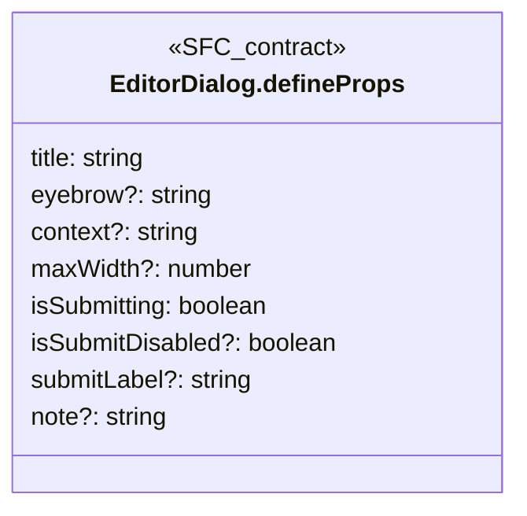

**Figura:** `DIA-VUE-TS-SHARED-1-2`. Parte 2/2.

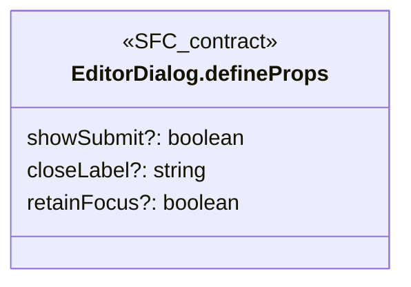

## EditorDialog.defineEmits

**Fuente:** [src/shared/components/EditorDialog.vue](../../../../../src/shared/components/EditorDialog.vue) · línea 35, columna 26. **Declaración:** SFC contract.

| Miembro | Firma completa |
| --- | --- |
| `close` | `close: [];` |
| `submit` | `submit: []` |

**Figura:** `DIA-VUE-TS-SHARED-2-1`. Parte 1/1.

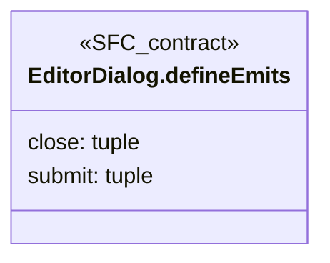

## FilterActions.defineProps

**Fuente:** [src/shared/components/FilterActions.vue](../../../../../src/shared/components/FilterActions.vue) · línea 4, columna 13. **Declaración:** SFC contract.

| Miembro | Firma completa |
| --- | --- |
| `isLoading` | `isLoading: boolean` |

**Figura:** `DIA-VUE-TS-SHARED-3-1`. Parte 1/1.

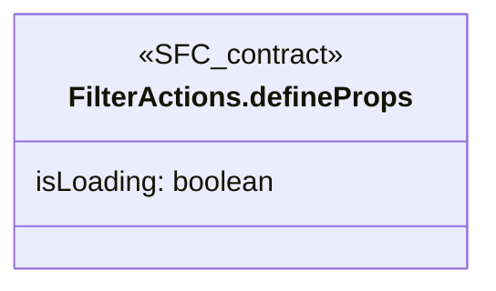

## FilterActions.defineEmits

**Fuente:** [src/shared/components/FilterActions.vue](../../../../../src/shared/components/FilterActions.vue) · línea 5, columna 26. **Declaración:** SFC contract.

| Miembro | Firma completa |
| --- | --- |
| `refresh` | `refresh: [];` |
| `clear` | `clear: []` |

**Figura:** `DIA-VUE-TS-SHARED-4-1`. Parte 1/1.

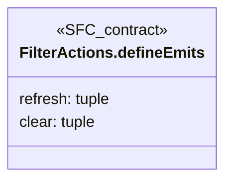

## ListFilters.defineProps

**Fuente:** [src/shared/components/ListFilters.vue](../../../../../src/shared/components/ListFilters.vue) · línea 14, columna 17. **Declaración:** SFC contract.

| Miembro | Firma completa |
| --- | --- |
| `isLoading` | `isLoading: boolean;` |
| `hasExtraFilters` | `hasExtraFilters: boolean;` |
| `hasActiveFilters` | `hasActiveFilters: boolean;` |
| `searchLabel` | `searchLabel?: string;` |

**Figura:** `DIA-VUE-TS-SHARED-5-1`. Parte 1/1.

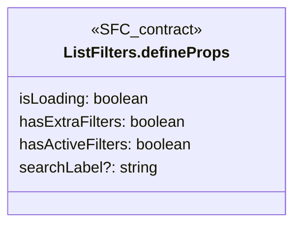

## ListFilters.defineEmits

**Fuente:** [src/shared/components/ListFilters.vue](../../../../../src/shared/components/ListFilters.vue) · línea 22, columna 26. **Declaración:** SFC contract.

| Miembro | Firma completa |
| --- | --- |
| `apply` | `apply: [];` |
| `clear` | `clear: [];` |
| `refresh` | `refresh: []` |

**Figura:** `DIA-VUE-TS-SHARED-6-1`. Parte 1/1.

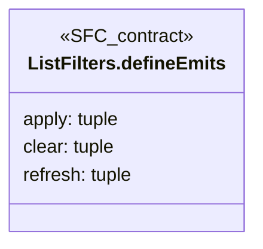

## OrganizationFields.defineProps

**Fuente:** [src/shared/components/OrganizationFields.vue](../../../../../src/shared/components/OrganizationFields.vue) · línea 5, columna 13. **Declaración:** SFC contract.

| Miembro | Firma completa |
| --- | --- |
| `departmentId` | `departmentId: string;` |
| `roleId` | `roleId: string;` |
| `options` | `options: OrganizationState;` |
| `isDisabled` | `isDisabled: boolean;` |
| `errors` | `errors?: { departmentId?: string; roleId?: string };` |
| `initialDepartment` | `initialDepartment?: LookupItem;` |
| `initialRole` | `initialRole?: LookupItem;` |

| Relación | Destino | Origen de la referencia |
| --- | --- | --- |
| dependency | [OrganizationState](../../../../../src/shared/lookup.ts) | `options` |
| association | [OrganizationFields.errors@10:14](../../../../../src/shared/components/OrganizationFields.vue) | `errors` |
| association | [LookupItem](../../../../../src/shared/lookup.ts) | `initialDepartment` |
| association | [LookupItem](../../../../../src/shared/lookup.ts) | `initialRole` |

**Figura:** `DIA-VUE-TS-SHARED-7-1`. Parte 1/2.

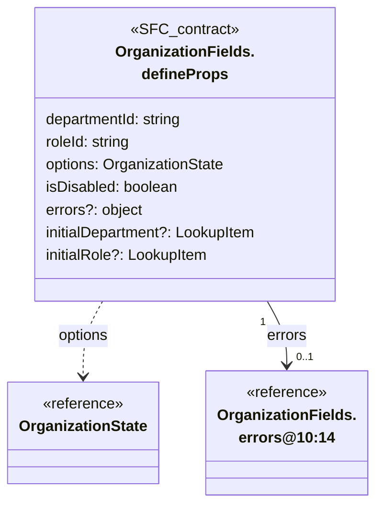

**Figura:** `DIA-VUE-TS-SHARED-7-2`. Parte 2/2.

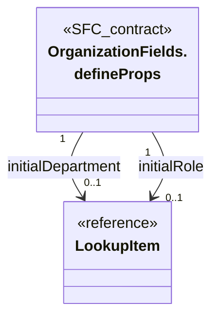

## OrganizationFields.errors@10:14

**Fuente:** [src/shared/components/OrganizationFields.vue](../../../../../src/shared/components/OrganizationFields.vue) · línea 10, columna 14. **Declaración:** inline object.

| Miembro | Firma completa |
| --- | --- |
| `departmentId` | `departmentId?: string;` |
| `roleId` | `roleId?: string` |

**Figura:** `DIA-VUE-TS-SHARED-8-1`. Parte 1/1.

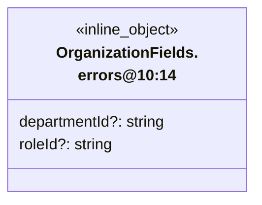

## OrganizationFields.defineEmits

**Fuente:** [src/shared/components/OrganizationFields.vue](../../../../../src/shared/components/OrganizationFields.vue) · línea 14, columna 26. **Declaración:** SFC contract.

| Miembro | Firma completa |
| --- | --- |
| `update` | `update: [field: 'departmentId' \| 'roleId', value: string];` |
| `blur` | `blur: [field: 'departmentId' \| 'roleId'];` |
| `search` | `search: [resource: OrganizationResource, value: string];` |
| `more` | `more: [resource: OrganizationResource];` |
| `retry` | `retry: [resource: OrganizationResource];` |

| Relación | Destino | Origen de la referencia |
| --- | --- | --- |
| dependency | [OrganizationResource](../../../../../src/shared/lookup.ts) | `search` |
| dependency | [OrganizationResource](../../../../../src/shared/lookup.ts) | `more` |
| dependency | [OrganizationResource](../../../../../src/shared/lookup.ts) | `retry` |

**Figura:** `DIA-VUE-TS-SHARED-9-1`. Parte 1/2.

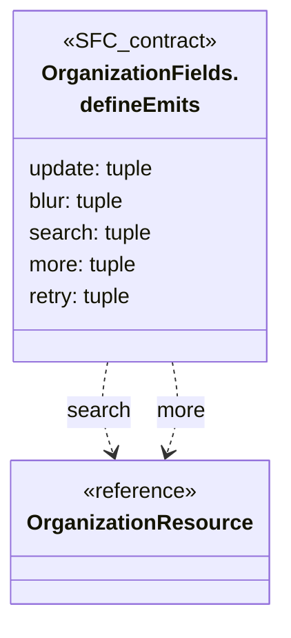

**Figura:** `DIA-VUE-TS-SHARED-9-2`. Parte 2/2.

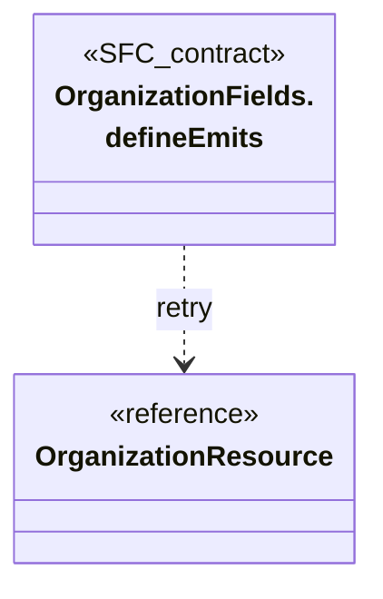

## RecordEditorDialog.defineProps

**Fuente:** [src/shared/components/RecordEditorDialog.vue](../../../../../src/shared/components/RecordEditorDialog.vue) · línea 7, columna 17. **Declaración:** SFC contract.

| Miembro | Firma completa |
| --- | --- |
| `title` | `title: string;` |
| `eyebrow` | `eyebrow: string;` |
| `message` | `message: string;` |
| `isSubmitting` | `isSubmitting: boolean;` |
| `isConflicted` | `isConflicted: boolean;` |
| `submitLabel` | `submitLabel?: string;` |
| `maxWidth` | `maxWidth?: number;` |
| `context` | `context?: string;` |
| `note` | `note?: string;` |
| `reloadLabel` | `reloadLabel?: string;` |
| `showSubmit` | `showSubmit?: boolean;` |
| `closeLabel` | `closeLabel?: string;` |
| `retainFocus` | `retainFocus?: boolean;` |

**Figura:** `DIA-VUE-TS-SHARED-10-1`. Parte 1/2.

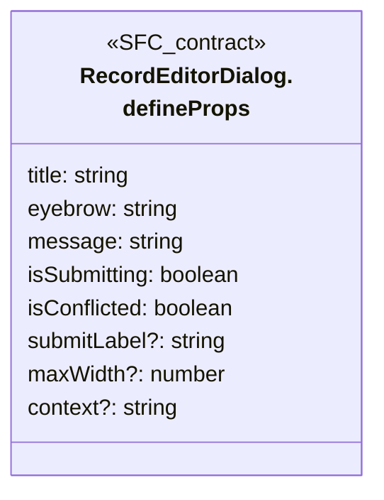

**Figura:** `DIA-VUE-TS-SHARED-10-2`. Parte 2/2.

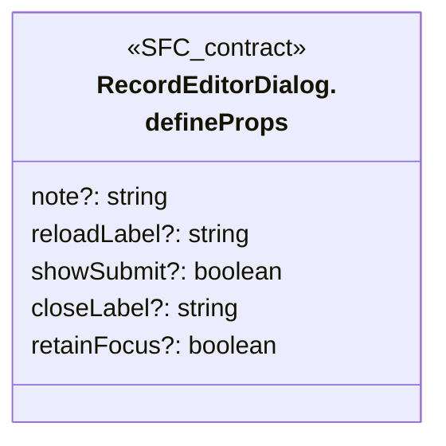

## RecordEditorDialog.defineEmits

**Fuente:** [src/shared/components/RecordEditorDialog.vue](../../../../../src/shared/components/RecordEditorDialog.vue) · línea 33, columna 26. **Declaración:** SFC contract.

| Miembro | Firma completa |
| --- | --- |
| `close` | `close: [];` |
| `submit` | `submit: [];` |
| `reload` | `reload: []` |

**Figura:** `DIA-VUE-TS-SHARED-11-1`. Parte 1/1.

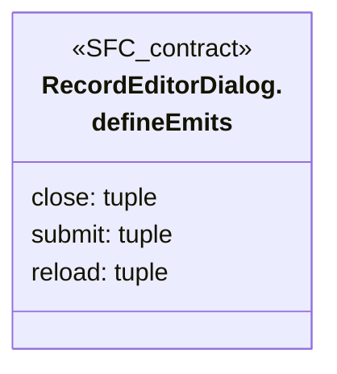

## RecordListPanel.defineProps

**Fuente:** [src/shared/components/RecordListPanel.vue](../../../../../src/shared/components/RecordListPanel.vue) · línea 8, columna 17. **Declaración:** SFC contract.

| Miembro | Firma completa |
| --- | --- |
| `title` | `title: string;` |
| `titleId` | `titleId: string;` |
| `total` | `total: number;` |
| `isLoading` | `isLoading: boolean;` |
| `error` | `error: string;` |
| `loadingLabel` | `loadingLabel?: string;` |
| `titlePrefix` | `titlePrefix?: string;` |
| `hideSearch` | `hideSearch?: boolean;` |
| `hasActiveFilters` | `hasActiveFilters?: boolean;` |
| `showCount` | `showCount?: boolean;` |
| `isRefreshing` | `isRefreshing?: boolean;` |

**Figura:** `DIA-VUE-TS-SHARED-12-1`. Parte 1/2.

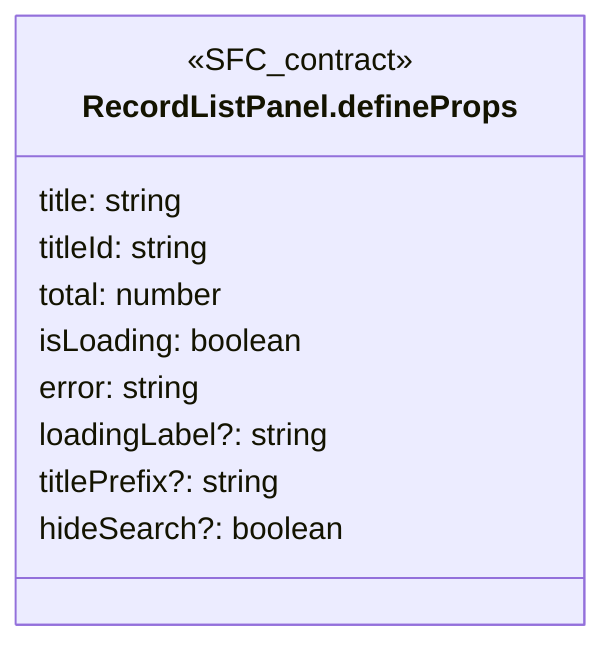

**Figura:** `DIA-VUE-TS-SHARED-12-2`. Parte 2/2.

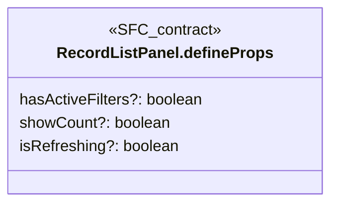

## RecordListPanel.defineEmits

**Fuente:** [src/shared/components/RecordListPanel.vue](../../../../../src/shared/components/RecordListPanel.vue) · línea 30, columna 26. **Declaración:** SFC contract.

| Miembro | Firma completa |
| --- | --- |
| `search` | `search: [];` |
| `clear` | `clear: [];` |
| `refresh` | `refresh: []` |

**Figura:** `DIA-VUE-TS-SHARED-13-1`. Parte 1/1.

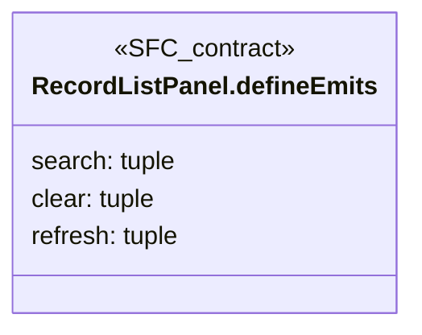

## RemoteSelect.defineProps

**Fuente:** [src/shared/components/RemoteSelect.vue](../../../../../src/shared/components/RemoteSelect.vue) · línea 10, columna 27. **Declaración:** SFC contract.

| Miembro | Firma completa |
| --- | --- |
| `label` | `label: string;` |
| `modelValue` | `modelValue: string;` |
| `items` | `items: LookupItem[];` |
| `isLoading` | `isLoading: boolean;` |
| `error` | `error?: string;` |
| `loadError` | `loadError?: string;` |
| `hasMore` | `hasMore?: boolean;` |
| `isDisabled` | `isDisabled?: boolean;` |
| `hint` | `hint?: string;` |
| `initialOption` | `initialOption?: LookupItem;` |
| `createLabel` | `createLabel?: string;` |

| Relación | Destino | Origen de la referencia |
| --- | --- | --- |
| association | [LookupItem](../../../../../src/shared/lookup.ts) | `items` |
| association | [LookupItem](../../../../../src/shared/lookup.ts) | `initialOption` |

**Figura:** `DIA-VUE-TS-SHARED-14-1`. Parte 1/2.

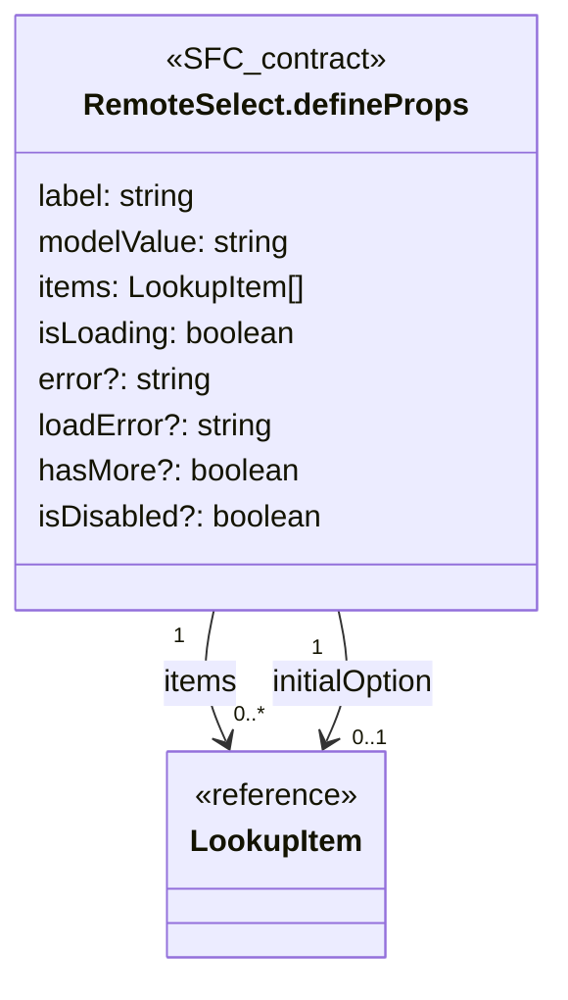

**Figura:** `DIA-VUE-TS-SHARED-14-2`. Parte 2/2.

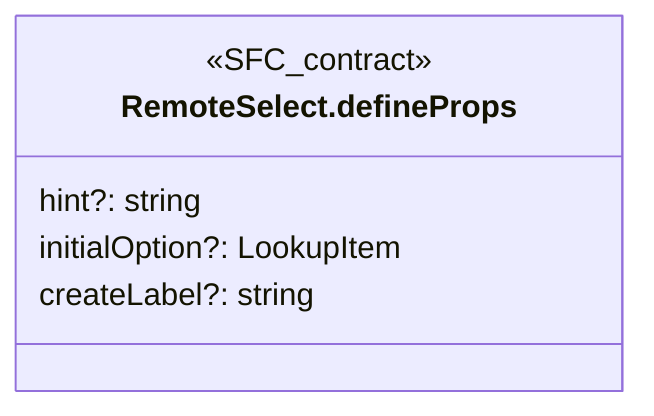

## RemoteSelect.defineEmits

**Fuente:** [src/shared/components/RemoteSelect.vue](../../../../../src/shared/components/RemoteSelect.vue) · línea 23, columna 26. **Declaración:** SFC contract.

| Miembro | Firma completa |
| --- | --- |
| `update:modelValue` | `'update:modelValue': [value: string];` |
| `search` | `search: [value: string];` |
| `more` | `more: [];` |
| `retry` | `retry: [];` |
| `blur` | `blur: [];` |
| `create` | `create: [search: string];` |

**Figura:** `DIA-VUE-TS-SHARED-15-1`. Parte 1/1.

```mermaid
classDiagram
    direction TB
    class Subject["RemoteSelect.defineEmits"] {
        <<SFC_contract>>
        update:modelValue: tuple
        search: tuple
        more: tuple
        retry: tuple
        blur: tuple
        create: tuple
    }
```

## ReportScopeDialog.defineProps

**Fuente:** [src/shared/components/ReportScopeDialog.vue](../../../../../src/shared/components/ReportScopeDialog.vue) · línea 9, columna 17. **Declaración:** SFC contract.

| Miembro | Firma completa |
| --- | --- |
| `values` | `values: ReportScope;` |
| `isSubmitting` | `isSubmitting: boolean;` |
| `error` | `error: string;` |
| `eyebrow` | `eyebrow?: string;` |
| `subject` | `subject?: string;` |

| Relación | Destino | Origen de la referencia |
| --- | --- | --- |
| association | [ReportScope](../../../../../src/shared/report.ts) | `values` |

**Figura:** `DIA-VUE-TS-SHARED-16-1`. Parte 1/1.

```mermaid
classDiagram
    direction TB
    class Subject["ReportScopeDialog.<br/>defineProps"] {
        <<SFC_contract>>
        values: ReportScope
        isSubmitting: boolean
        error: string
        eyebrow?: string
        subject?: string
    }
    class R0["ReportScope"] {
        <<reference>>
    }
    Subject "1" --> "1" R0 : values
```

## ReportScopeDialog.defineEmits

**Fuente:** [src/shared/components/ReportScopeDialog.vue](../../../../../src/shared/components/ReportScopeDialog.vue) · línea 18, columna 26. **Declaración:** SFC contract.

| Miembro | Firma completa |
| --- | --- |
| `mode` | `mode: [value: ReportScope['mode']];` |
| `month` | `month: [value: string];` |
| `submit` | `submit: [];` |
| `close` | `close: [];` |

| Relación | Destino | Origen de la referencia |
| --- | --- | --- |
| dependency | [ReportScope](../../../../../src/shared/report.ts) | `mode` |

**Figura:** `DIA-VUE-TS-SHARED-17-1`. Parte 1/1.

```mermaid
classDiagram
    direction TB
    class Subject["ReportScopeDialog.<br/>defineEmits"] {
        <<SFC_contract>>
        mode: tuple
        month: tuple
        submit: tuple
        close: tuple
    }
    class R0["ReportScope"] {
        <<reference>>
    }
    Subject ..> R0 : mode
```

## ServerTable.defineProps

**Fuente:** [src/shared/components/ServerTable.vue](../../../../../src/shared/components/ServerTable.vue) · línea 8, columna 17. **Declaración:** SFC contract.

| Miembro | Firma completa |
| --- | --- |
| `headers` | `headers: DataTableHeader<Row>[];` |
| `rows` | `rows: Row[];` |
| `total` | `total: number;` |
| `page` | `page: number;` |
| `pageSize` | `pageSize: number;` |
| `isLoading` | `isLoading: boolean;` |
| `sortBy` | `sortBy?: DataTableSortItem[];` |
| `mustSort` | `mustSort?: boolean;` |
| `rowProps` | `rowProps?: (data: { item: Row }) => { class: string };` |

| Relación | Destino | Origen de la referencia |
| --- | --- | --- |
| dependency | `DataTableHeader` | `headers` |
| dependency | `Row` | `headers` |
| dependency | `Row` | `rows` |
| dependency | `DataTableSortItem` | `sortBy` |
| dependency | [ServerTable.rowProps.data@17:27](../../../../../src/shared/components/ServerTable.vue) | `rowProps` |
| dependency | [ServerTable.rowProps@17:45](../../../../../src/shared/components/ServerTable.vue) | `rowProps` |

**Figura:** `DIA-VUE-TS-SHARED-18-1`. Parte 1/3.

```mermaid
classDiagram
    direction TB
    class Subject["ServerTable.defineProps"] {
        <<SFC_contract>>
        headers: DataTableHeader~Row~[]
        rows: Row[]
        total: number
        page: number
        pageSize: number
        isLoading: boolean
        sortBy?: DataTableSortItem[]
        mustSort?: boolean
    }
    class R0["DataTableHeader"] {
        <<reference>>
    }
    class R1["Row"] {
        <<reference>>
    }
    Subject ..> R0 : headers
    Subject ..> R1 : headers
```

**Figura:** `DIA-VUE-TS-SHARED-18-2`. Parte 2/3.

```mermaid
classDiagram
    direction TB
    class Subject["ServerTable.defineProps"] {
        <<SFC_contract>>
        rowProps?: callback
    }
    class R0["Row"] {
        <<reference>>
    }
    class R1["DataTableSortItem"] {
        <<reference>>
    }
    Subject ..> R0 : rows
    Subject ..> R1 : sortBy
```

**Figura:** `DIA-VUE-TS-SHARED-18-3`. Parte 3/3.

```mermaid
classDiagram
    direction TB
    class Subject["ServerTable.defineProps"] {
        <<SFC_contract>>
    }
    class R0["ServerTable.rowProps.<br/>data@17:27"] {
        <<reference>>
    }
    class R1["ServerTable.rowProps@17:45"] {
        <<reference>>
    }
    Subject ..> R0 : rowProps
    Subject ..> R1 : rowProps
```

## ServerTable.rowProps.data@17:27

**Fuente:** [src/shared/components/ServerTable.vue](../../../../../src/shared/components/ServerTable.vue) · línea 17, columna 27. **Declaración:** inline object.

| Miembro | Firma completa |
| --- | --- |
| `item` | `item: Row` |

| Relación | Destino | Origen de la referencia |
| --- | --- | --- |
| dependency | `Row` | `item` |

**Figura:** `DIA-VUE-TS-SHARED-19-1`. Parte 1/1.

```mermaid
classDiagram
    direction TB
    class Subject["ServerTable.rowProps.<br/>data@17:27"] {
        <<inline_object>>
        item: Row
    }
    class R0["Row"] {
        <<reference>>
    }
    Subject ..> R0 : item
```

## ServerTable.rowProps@17:45

**Fuente:** [src/shared/components/ServerTable.vue](../../../../../src/shared/components/ServerTable.vue) · línea 17, columna 45. **Declaración:** inline object.

| Miembro | Firma completa |
| --- | --- |
| `class` | `class: string` |

**Figura:** `DIA-VUE-TS-SHARED-20-1`. Parte 1/1.

```mermaid
classDiagram
    direction TB
    class Subject["ServerTable.rowProps@17:45"] {
        <<inline_object>>
        class: string
    }
```

## ServerTable.defineEmits

**Fuente:** [src/shared/components/ServerTable.vue](../../../../../src/shared/components/ServerTable.vue) · línea 21, columna 26. **Declaración:** SFC contract.

| Miembro | Firma completa |
| --- | --- |
| `options` | `options: [options: TableOptions];` |

| Relación | Destino | Origen de la referencia |
| --- | --- | --- |
| dependency | [TableOptions](../../../../../src/shared/composables/useTableQuery.ts) | `options` |

**Figura:** `DIA-VUE-TS-SHARED-21-1`. Parte 1/1.

```mermaid
classDiagram
    direction TB
    class Subject["ServerTable.defineEmits"] {
        <<SFC_contract>>
        options: tuple
    }
    class R0["TableOptions"] {
        <<reference>>
    }
    Subject ..> R0 : options
```

## StateBadge.defineProps

**Fuente:** [src/shared/components/StateBadge.vue](../../../../../src/shared/components/StateBadge.vue) · línea 4, columna 13. **Declaración:** SFC contract.

| Miembro | Firma completa |
| --- | --- |
| `isActive` | `isActive: boolean` |

**Figura:** `DIA-VUE-TS-SHARED-22-1`. Parte 1/1.

```mermaid
classDiagram
    direction TB
    class Subject["StateBadge.defineProps"] {
        <<SFC_contract>>
        isActive: boolean
    }
```

## TableAction.defineProps

**Fuente:** [src/shared/components/TableAction.vue](../../../../../src/shared/components/TableAction.vue) · línea 6, columna 26. **Declaración:** SFC contract.

| Miembro | Firma completa |
| --- | --- |
| `label` | `label: string;` |
| `icon` | `icon: string;` |
| `color` | `color?: string;` |
| `isDisabled` | `isDisabled?: boolean` |

**Figura:** `DIA-VUE-TS-SHARED-23-1`. Parte 1/1.

```mermaid
classDiagram
    direction TB
    class Subject["TableAction.defineProps"] {
        <<SFC_contract>>
        label: string
        icon: string
        color?: string
        isDisabled?: boolean
    }
```

## TableAction.defineEmits

**Fuente:** [src/shared/components/TableAction.vue](../../../../../src/shared/components/TableAction.vue) · línea 10, columna 26. **Declaración:** SFC contract.

| Miembro | Firma completa |
| --- | --- |
| `click` | `click: []` |

**Figura:** `DIA-VUE-TS-SHARED-24-1`. Parte 1/1.

```mermaid
classDiagram
    direction TB
    class Subject["TableAction.defineEmits"] {
        <<SFC_contract>>
        click: tuple
    }
```

## TableFrame.defineProps

**Fuente:** [src/shared/components/TableFrame.vue](../../../../../src/shared/components/TableFrame.vue) · línea 2, columna 26. **Declaración:** SFC contract.

| Miembro | Firma completa |
| --- | --- |
| `isLoading` | `isLoading?: boolean` |

**Figura:** `DIA-VUE-TS-SHARED-25-1`. Parte 1/1.

```mermaid
classDiagram
    direction TB
    class Subject["TableFrame.defineProps"] {
        <<SFC_contract>>
        isLoading?: boolean
    }
```

## useDocumentRead.options@3:52

**Fuente:** [src/shared/composables/useDocumentRead.ts](../../../../../src/shared/composables/useDocumentRead.ts) · línea 3, columna 52. **Declaración:** inline object.

| Miembro | Firma completa |
| --- | --- |
| `request` | `request: (id: string, signal: AbortSignal) => Promise<Document>;` |
| `onError` | `onError: (cause: unknown) => void;` |
| `errorMessage` | `errorMessage: string;` |

| Relación | Destino | Origen de la referencia |
| --- | --- | --- |
| dependency | `AbortSignal` | `request` |
| dependency | `Promise` | `request` |
| dependency | `Document` | `request` |

**Figura:** `DIA-VUE-TS-SHARED-26-1`. Parte 1/2.

```mermaid
classDiagram
    direction TB
    class Subject["useDocumentRead.options@3:52"] {
        <<inline_object>>
        request: callback
        onError: callback
        errorMessage: string
    }
    class R0["AbortSignal"] {
        <<reference>>
    }
    class R1["Promise"] {
        <<reference>>
    }
    Subject ..> R0 : request
    Subject ..> R1 : request
```

**Figura:** `DIA-VUE-TS-SHARED-26-2`. Parte 2/2.

```mermaid
classDiagram
    direction TB
    class Subject["useDocumentRead.options@3:52"] {
        <<inline_object>>
    }
    class R0["Document"] {
        <<reference>>
    }
    Subject ..> R0 : request
```

## FileExportOptions

**Fuente:** [src/shared/composables/useFileExport.ts](../../../../../src/shared/composables/useFileExport.ts) · línea 4, columna 1. **Declaración:** interface.

**Parámetros:** `Scope`.

| Miembro | Firma completa |
| --- | --- |
| `canExport` | `canExport: () => boolean;` |
| `request` | `request: (scope: Scope, signal: AbortSignal) => Promise<Blob>;` |
| `filename` | `filename: string;` |
| `onDenied` | `onDenied: (status: number) => void;` |

| Relación | Destino | Origen de la referencia |
| --- | --- | --- |
| dependency | `Scope` | `request` |
| dependency | `AbortSignal` | `request` |
| dependency | `Promise` | `request` |
| dependency | `Blob` | `request` |

**Figura:** `DIA-VUE-TS-SHARED-27-1`. Parte 1/2.

```mermaid
classDiagram
    direction TB
    class Subject["FileExportOptions"] {
        <<interface>>
        canExport: callback
        request: callback
        filename: string
        onDenied: callback
    }
    class R0["Scope"] {
        <<reference>>
    }
    class R1["AbortSignal"] {
        <<reference>>
    }
    Subject ..> R0 : request
    Subject ..> R1 : request
```

**Figura:** `DIA-VUE-TS-SHARED-27-2`. Parte 2/2.

```mermaid
classDiagram
    direction TB
    class Subject["FileExportOptions"] {
        <<interface>>
    }
    class R0["Promise"] {
        <<reference>>
    }
    class R1["Blob"] {
        <<reference>>
    }
    Subject ..> R0 : request
    Subject ..> R1 : request
```

## InteractiveForm

**Fuente:** [src/shared/composables/useFormInteraction.ts](../../../../../src/shared/composables/useFormInteraction.ts) · línea 3, columna 1. **Declaración:** interface.

**Parámetros:** `Field extends string, Value`.

| Miembro | Firma completa |
| --- | --- |
| `values` | `values: Record<Field, Value>;` |
| `submitCount` | `submitCount: Ref<number>;` |
| `setFieldValue` | `setFieldValue: (field: Field, value: Value, shouldValidate: boolean) => void;` |
| `setFieldError` | `setFieldError: (field: Field, message: undefined) => void;` |
| `validateField` | `validateField: (field: Field) => Promise<unknown>;` |

| Relación | Destino | Origen de la referencia |
| --- | --- | --- |
| dependency | `Record` | `values` |
| dependency | `Field` | `values` |
| dependency | `Value` | `values` |
| dependency | `Ref` | `submitCount` |
| dependency | `Field` | `setFieldValue` |
| dependency | `Value` | `setFieldValue` |
| dependency | `Field` | `setFieldError` |
| dependency | `Field` | `validateField` |
| dependency | `Promise` | `validateField` |

**Figura:** `DIA-VUE-TS-SHARED-28-1`. Parte 1/5.

```mermaid
classDiagram
    direction TB
    class Subject["InteractiveForm"] {
        <<interface>>
        values: Record~Field, Value~
        submitCount: Ref~number~
        setFieldValue: callback
        setFieldError: callback
        validateField: callback
    }
    class R0["Record"] {
        <<reference>>
    }
    class R1["Field"] {
        <<reference>>
    }
    Subject ..> R0 : values
    Subject ..> R1 : values
```

**Figura:** `DIA-VUE-TS-SHARED-28-2`. Parte 2/5.

```mermaid
classDiagram
    direction TB
    class Subject["InteractiveForm"] {
        <<interface>>
    }
    class R0["Value"] {
        <<reference>>
    }
    class R1["Ref"] {
        <<reference>>
    }
    Subject ..> R0 : values
    Subject ..> R1 : submitCount
```

**Figura:** `DIA-VUE-TS-SHARED-28-3`. Parte 3/5.

```mermaid
classDiagram
    direction TB
    class Subject["InteractiveForm"] {
        <<interface>>
    }
    class R0["Field"] {
        <<reference>>
    }
    class R1["Value"] {
        <<reference>>
    }
    Subject ..> R0 : setFieldValue
    Subject ..> R1 : setFieldValue
```

**Figura:** `DIA-VUE-TS-SHARED-28-4`. Parte 4/5.

```mermaid
classDiagram
    direction TB
    class Subject["InteractiveForm"] {
        <<interface>>
    }
    class R0["Field"] {
        <<reference>>
    }
    Subject ..> R0 : setFieldError
    Subject ..> R0 : validateField
```

**Figura:** `DIA-VUE-TS-SHARED-28-5`. Parte 5/5.

```mermaid
classDiagram
    direction TB
    class Subject["InteractiveForm"] {
        <<interface>>
    }
    class R0["Promise"] {
        <<reference>>
    }
    Subject ..> R0 : validateField
```

## useFormInteraction.options@13:14

**Fuente:** [src/shared/composables/useFormInteraction.ts](../../../../../src/shared/composables/useFormInteraction.ts) · línea 13, columna 14. **Declaración:** inline object.

| Miembro | Firma completa |
| --- | --- |
| `isDisabled` | `isDisabled: () => boolean;` |
| `onChange` | `onChange: () => void` |

**Figura:** `DIA-VUE-TS-SHARED-29-1`. Parte 1/1.

```mermaid
classDiagram
    direction TB
    class Subject["useFormInteraction.<br/>options@13:14"] {
        <<inline_object>>
        isDisabled: callback
        onChange: callback
    }
```

## useListEditor.options@4:48

**Fuente:** [src/shared/composables/useListEditor.ts](../../../../../src/shared/composables/useListEditor.ts) · línea 4, columna 48. **Declaración:** inline object.

| Miembro | Firma completa |
| --- | --- |
| `canOpen` | `canOpen: (target: Target) => boolean;` |
| `reload` | `reload: () => unknown;` |
| `savedMessage` | `savedMessage?: string;` |

| Relación | Destino | Origen de la referencia |
| --- | --- | --- |
| dependency | `Target` | `canOpen` |

**Figura:** `DIA-VUE-TS-SHARED-30-1`. Parte 1/1.

```mermaid
classDiagram
    direction TB
    class Subject["useListEditor.options@4:48"] {
        <<inline_object>>
        canOpen: callback
        reload: callback
        savedMessage?: string
    }
    class R0["Target"] {
        <<reference>>
    }
    Subject ..> R0 : canOpen
```

## SearchQuery

**Fuente:** [src/shared/composables/useListSearch.ts](../../../../../src/shared/composables/useListSearch.ts) · línea 3, columna 1. **Declaración:** interface.

| Miembro | Firma completa |
| --- | --- |
| `page` | `page: number;` |
| `search` | `search: string;` |

**Figura:** `DIA-VUE-TS-SHARED-31-1`. Parte 1/1.

```mermaid
classDiagram
    direction TB
    class Subject["SearchQuery"] {
        <<interface>>
        page: number
        search: string
    }
```

## useListSearch.list@9:11

**Fuente:** [src/shared/composables/useListSearch.ts](../../../../../src/shared/composables/useListSearch.ts) · línea 9, columna 11. **Declaración:** inline object.

| Miembro | Firma completa |
| --- | --- |
| `query` | `query: Query;` |
| `load` | `load: () => unknown;` |
| `applyQuery` | `applyQuery: (changes: Partial<Query>) => unknown;` |

| Relación | Destino | Origen de la referencia |
| --- | --- | --- |
| dependency | `Query` | `query` |
| dependency | `Partial` | `applyQuery` |
| dependency | `Query` | `applyQuery` |

**Figura:** `DIA-VUE-TS-SHARED-32-1`. Parte 1/2.

```mermaid
classDiagram
    direction TB
    class Subject["useListSearch.list@9:11"] {
        <<inline_object>>
        query: Query
        load: callback
        applyQuery: callback
    }
    class R0["Query"] {
        <<reference>>
    }
    class R1["Partial"] {
        <<reference>>
    }
    Subject ..> R0 : query
    Subject ..> R1 : applyQuery
```

**Figura:** `DIA-VUE-TS-SHARED-32-2`. Parte 2/2.

```mermaid
classDiagram
    direction TB
    class Subject["useListSearch.list@9:11"] {
        <<inline_object>>
    }
    class R0["Query"] {
        <<reference>>
    }
    Subject ..> R0 : applyQuery
```

## PageQuery

**Fuente:** [src/shared/composables/usePagedList.ts](../../../../../src/shared/composables/usePagedList.ts) · línea 4, columna 1. **Declaración:** interface.

| Miembro | Firma completa |
| --- | --- |
| `page` | `page: number;` |
| `length` | `length: number;` |

**Figura:** `DIA-VUE-TS-SHARED-33-1`. Parte 1/1.

```mermaid
classDiagram
    direction TB
    class Subject["PageQuery"] {
        <<interface>>
        page: number
        length: number
    }
```

## usePagedList.options@9:69

**Fuente:** [src/shared/composables/usePagedList.ts](../../../../../src/shared/composables/usePagedList.ts) · línea 9, columna 69. **Declaración:** inline object.

| Miembro | Firma completa |
| --- | --- |
| `initialQuery` | `initialQuery: Query;` |
| `request` | `request: (query: Query, signal: AbortSignal) => Promise<PageResult<Row>>;` |
| `errorMessage` | `errorMessage: string;` |
| `canLoad` | `canLoad?: () => boolean;` |
| `onError` | `onError: (cause: unknown) => void;` |

| Relación | Destino | Origen de la referencia |
| --- | --- | --- |
| dependency | `Query` | `initialQuery` |
| dependency | `Query` | `request` |
| dependency | `AbortSignal` | `request` |
| dependency | `Promise` | `request` |
| dependency | [PageResult](../../../../../src/shared/http/pageRequest.ts) | `request` |
| dependency | `Row` | `request` |

**Figura:** `DIA-VUE-TS-SHARED-34-1`. Parte 1/3.

```mermaid
classDiagram
    direction TB
    class Subject["usePagedList.options@9:69"] {
        <<inline_object>>
        initialQuery: Query
        request: callback
        errorMessage: string
        canLoad?: callback
        onError: callback
    }
    class R0["Query"] {
        <<reference>>
    }
    Subject ..> R0 : initialQuery
    Subject ..> R0 : request
```

**Figura:** `DIA-VUE-TS-SHARED-34-2`. Parte 2/3.

```mermaid
classDiagram
    direction TB
    class Subject["usePagedList.options@9:69"] {
        <<inline_object>>
    }
    class R0["AbortSignal"] {
        <<reference>>
    }
    class R1["Promise"] {
        <<reference>>
    }
    Subject ..> R0 : request
    Subject ..> R1 : request
```

**Figura:** `DIA-VUE-TS-SHARED-34-3`. Parte 3/3.

```mermaid
classDiagram
    direction TB
    class Subject["usePagedList.options@9:69"] {
        <<inline_object>>
    }
    class R0["PageResult"] {
        <<reference>>
    }
    class R1["Row"] {
        <<reference>>
    }
    Subject ..> R0 : request
    Subject ..> R1 : request
```

## useRecordSave.options@4:58

**Fuente:** [src/shared/composables/useRecordSave.ts](../../../../../src/shared/composables/useRecordSave.ts) · línea 4, columna 58. **Declaración:** inline object.

| Miembro | Firma completa |
| --- | --- |
| `setErrors` | `setErrors: (errors: Record<string, string>) => void;` |
| `onSaved` | `onSaved: (result: Result) => void;` |
| `onDenied` | `onDenied: (status: number) => void;` |
| `errorMessage` | `errorMessage?: string;` |

| Relación | Destino | Origen de la referencia |
| --- | --- | --- |
| dependency | `Record` | `setErrors` |
| dependency | `Result` | `onSaved` |

**Figura:** `DIA-VUE-TS-SHARED-35-1`. Parte 1/1.

```mermaid
classDiagram
    direction TB
    class Subject["useRecordSave.options@4:58"] {
        <<inline_object>>
        setErrors: callback
        onSaved: callback
        onDenied: callback
        errorMessage?: string
    }
    class R0["Record"] {
        <<reference>>
    }
    class R1["Result"] {
        <<reference>>
    }
    Subject ..> R0 : setErrors
    Subject ..> R1 : onSaved
```

## TableOptions

**Fuente:** [src/shared/composables/useTableQuery.ts](../../../../../src/shared/composables/useTableQuery.ts) · línea 5, columna 1. **Declaración:** interface.

| Miembro | Firma completa |
| --- | --- |
| `page` | `page: number;` |
| `itemsPerPage` | `itemsPerPage: number;` |
| `sortBy` | `sortBy: DataTableSortItem[];` |

| Relación | Destino | Origen de la referencia |
| --- | --- | --- |
| dependency | `DataTableSortItem` | `sortBy` |

**Figura:** `DIA-VUE-TS-SHARED-36-1`. Parte 1/1.

```mermaid
classDiagram
    direction TB
    class Subject["TableOptions"] {
        <<interface>>
        page: number
        itemsPerPage: number
        sortBy: DataTableSortItem[]
    }
    class R0["DataTableSortItem"] {
        <<reference>>
    }
    Subject ..> R0 : sortBy
```

## TableQuery

**Fuente:** [src/shared/composables/useTableQuery.ts](../../../../../src/shared/composables/useTableQuery.ts) · línea 11, columna 1. **Declaración:** type.

**Definición completa:**

```typescript
Pick<RecordQuery, 'direction'> & { orderColumn?: number }
```

| Relación | Destino | Origen de la referencia |
| --- | --- | --- |
| dependency | `Pick` | `type` |
| dependency | [RecordQuery](../../../../../src/shared/list.ts) | `type` |
| dependency | [TableQuery@11:52](../../../../../src/shared/composables/useTableQuery.ts) | `type` |

**Figura:** `DIA-VUE-TS-SHARED-37-1`. Parte 1/2.

```mermaid
classDiagram
    direction TB
    class Subject["TableQuery"] {
        <<type>>
    }
    class R0["Pick"] {
        <<reference>>
    }
    class R1["RecordQuery"] {
        <<reference>>
    }
    Subject ..> R0 : type
    Subject ..> R1 : type
```

**Figura:** `DIA-VUE-TS-SHARED-37-2`. Parte 2/2.

```mermaid
classDiagram
    direction TB
    class Subject["TableQuery"] {
        <<type>>
    }
    class R0["TableQuery@11:52"] {
        <<reference>>
    }
    Subject ..> R0 : type
```

## TableQuery@11:52

**Fuente:** [src/shared/composables/useTableQuery.ts](../../../../../src/shared/composables/useTableQuery.ts) · línea 11, columna 52. **Declaración:** inline object.

| Miembro | Firma completa |
| --- | --- |
| `orderColumn` | `orderColumn?: number` |

**Figura:** `DIA-VUE-TS-SHARED-38-1`. Parte 1/1.

```mermaid
classDiagram
    direction TB
    class Subject["TableQuery@11:52"] {
        <<inline_object>>
        orderColumn?: number
    }
```

## useVisibleRefresh.options@3:44

**Fuente:** [src/shared/composables/useVisibleRefresh.ts](../../../../../src/shared/composables/useVisibleRefresh.ts) · línea 3, columna 44. **Declaración:** inline object.

| Miembro | Firma completa |
| --- | --- |
| `refresh` | `refresh: () => unknown;` |
| `canRefresh` | `canRefresh: () => boolean;` |
| `lastAttemptAt` | `lastAttemptAt: () => number;` |
| `intervalMs` | `intervalMs?: number;` |

**Figura:** `DIA-VUE-TS-SHARED-39-1`. Parte 1/1.

```mermaid
classDiagram
    direction TB
    class Subject["useVisibleRefresh.<br/>options@3:44"] {
        <<inline_object>>
        refresh: callback
        canRefresh: callback
        lastAttemptAt: callback
        intervalMs?: number
    }
```

## ApiRequestConfig

**Fuente:** [src/shared/http/apiClient.ts](../../../../../src/shared/http/apiClient.ts) · línea 6, columna 1. **Declaración:** interface.

**Extensión/implementación:** `extends AxiosRequestConfig`.

| Miembro | Firma completa |
| --- | --- |
| `requiresAuth` | `requiresAuth?: boolean;` |

| Relación | Destino | Origen de la referencia |
| --- | --- | --- |
| inheritance | `AxiosRequestConfig` | `extends` |

**Figura:** `DIA-VUE-TS-SHARED-40-1`. Parte 1/1.

```mermaid
classDiagram
    direction TB
    class Subject["ApiRequestConfig"] {
        <<interface>>
        requiresAuth?: boolean
    }
    class R0["AxiosRequestConfig"] {
        <<reference>>
    }
    R0 <|-- Subject : extends
```

## RetriableRequest

**Fuente:** [src/shared/http/apiClient.ts](../../../../../src/shared/http/apiClient.ts) · línea 9, columna 1. **Declaración:** interface.

**Extensión/implementación:** `extends InternalAxiosRequestConfig`.

| Miembro | Firma completa |
| --- | --- |
| `requiresAuth` | `requiresAuth?: boolean;` |
| `hasRetried` | `hasRetried?: boolean;` |

| Relación | Destino | Origen de la referencia |
| --- | --- | --- |
| inheritance | `InternalAxiosRequestConfig` | `extends` |

**Figura:** `DIA-VUE-TS-SHARED-41-1`. Parte 1/1.

```mermaid
classDiagram
    direction TB
    class Subject["RetriableRequest"] {
        <<interface>>
        requiresAuth?: boolean
        hasRetried?: boolean
    }
    class R0["InternalAxiosRequestConfig"] {
        <<reference>>
    }
    R0 <|-- Subject : extends
```

## ApiError

**Fuente:** [src/shared/http/apiError.ts](../../../../../src/shared/http/apiError.ts) · línea 5, columna 1. **Declaración:** class.

**Extensión/implementación:** `extends Error`.

| Miembro | Firma completa |
| --- | --- |
| `constructor` | `constructor( message: string, public status = 0, public code = '', public fieldErrors: Record<string, string> = {}, public meta: Record<string, unknown> = {}, )` |
| `status` | `public status = 0` |
| `code` | `public code = ''` |
| `fieldErrors` | `public fieldErrors: Record<string, string> = {}` |
| `meta` | `public meta: Record<string, unknown> = {}` |

| Relación | Destino | Origen de la referencia |
| --- | --- | --- |
| inheritance | `Error` | `extends` |
| dependency | `Record` | `constructor.fieldErrors` |
| dependency | `Record` | `constructor.meta` |
| dependency | `Record` | `fieldErrors` |
| dependency | `Record` | `meta` |

**Figura:** `DIA-VUE-TS-SHARED-42-1`. Parte 1/3.

```mermaid
classDiagram
    direction TB
    class Subject["ApiError"] {
        <<class>>
        constructor(...)
        status: inferred
        code: inferred
        fieldErrors: Record~string, string~
        meta: Record~string, unknown~
    }
    class R0["Error"] {
        <<reference>>
    }
    class R1["Record"] {
        <<reference>>
    }
    R0 <|-- Subject : extends
    Subject ..> R1 : constructor.fieldErrors
```

**Figura:** `DIA-VUE-TS-SHARED-42-2`. Parte 2/3.

```mermaid
classDiagram
    direction TB
    class Subject["ApiError"] {
        <<class>>
    }
    class R0["Record"] {
        <<reference>>
    }
    Subject ..> R0 : constructor.meta
    Subject ..> R0 : fieldErrors
```

**Figura:** `DIA-VUE-TS-SHARED-42-3`. Parte 3/3.

```mermaid
classDiagram
    direction TB
    class Subject["ApiError"] {
        <<class>>
    }
    class R0["Record"] {
        <<reference>>
    }
    Subject ..> R0 : meta
```

## PageResult

**Fuente:** [src/shared/http/pageRequest.ts](../../../../../src/shared/http/pageRequest.ts) · línea 5, columna 1. **Declaración:** interface.

**Parámetros:** `T`.

| Miembro | Firma completa |
| --- | --- |
| `data` | `data: T[];` |
| `recordsFiltered` | `recordsFiltered: number;` |
| `recordsTotal` | `recordsTotal: number;` |

| Relación | Destino | Origen de la referencia |
| --- | --- | --- |
| dependency | `T` | `data` |

**Figura:** `DIA-VUE-TS-SHARED-43-1`. Parte 1/1.

```mermaid
classDiagram
    direction TB
    class Subject["PageResult"] {
        <<interface>>
        data: T[]
        recordsFiltered: number
        recordsTotal: number
    }
    class R0["T"] {
        <<reference>>
    }
    Subject ..> R0 : data
```

## readRecord@7:30

**Fuente:** [src/shared/http/recordContract.ts](../../../../../src/shared/http/recordContract.ts) · línea 7, columna 30. **Declaración:** inline object.

| Miembro | Firma completa |
| --- | --- |
| `id` | `id: string;` |
| `version` | `version: number` |

**Figura:** `DIA-VUE-TS-SHARED-44-1`. Parte 1/1.

```mermaid
classDiagram
    direction TB
    class Subject["readRecord@7:30"] {
        <<inline_object>>
        id: string
        version: number
    }
```

## MutationConfirmation

**Fuente:** [src/shared/http/recordContract.ts](../../../../../src/shared/http/recordContract.ts) · línea 35, columna 1. **Declaración:** interface.

| Miembro | Firma completa |
| --- | --- |
| `code` | `code: string;` |
| `message` | `message: string;` |

**Figura:** `DIA-VUE-TS-SHARED-45-1`. Parte 1/1.

```mermaid
classDiagram
    direction TB
    class Subject["MutationConfirmation"] {
        <<interface>>
        code: string
        message: string
    }
```

## RecordQuery

**Fuente:** [src/shared/list.ts](../../../../../src/shared/list.ts) · línea 1, columna 1. **Declaración:** interface.

| Miembro | Firma completa |
| --- | --- |
| `page` | `page: number;` |
| `length` | `length: number;` |
| `search` | `search: string;` |
| `orderColumn` | `orderColumn: number;` |
| `direction` | `direction: 'asc' \| 'desc';` |

**Figura:** `DIA-VUE-TS-SHARED-46-1`. Parte 1/1.

```mermaid
classDiagram
    direction TB
    class Subject["RecordQuery"] {
        <<interface>>
        page: number
        length: number
        search: string
        orderColumn: number
        direction: 'asc' | 'desc'
    }
```

## LookupItem

**Fuente:** [src/shared/lookup.ts](../../../../../src/shared/lookup.ts) · línea 1, columna 1. **Declaración:** interface.

| Miembro | Firma completa |
| --- | --- |
| `id` | `id: string;` |
| `title` | `title: string;` |
| `data` | `data: Record<string, unknown>;` |
| `isDisabled` | `isDisabled?: boolean;` |

| Relación | Destino | Origen de la referencia |
| --- | --- | --- |
| dependency | `Record` | `data` |

**Figura:** `DIA-VUE-TS-SHARED-47-1`. Parte 1/1.

```mermaid
classDiagram
    direction TB
    class Subject["LookupItem"] {
        <<interface>>
        id: string
        title: string
        data: Record~string, unknown~
        isDisabled?: boolean
    }
    class R0["Record"] {
        <<reference>>
    }
    Subject ..> R0 : data
```

## LookupState

**Fuente:** [src/shared/lookup.ts](../../../../../src/shared/lookup.ts) · línea 8, columna 1. **Declaración:** interface.

| Miembro | Firma completa |
| --- | --- |
| `items` | `items: LookupItem[];` |
| `isLoading` | `isLoading: boolean;` |
| `error` | `error: string;` |
| `hasMore` | `hasMore: boolean;` |

| Relación | Destino | Origen de la referencia |
| --- | --- | --- |
| association | [LookupItem](../../../../../src/shared/lookup.ts) | `items` |

**Figura:** `DIA-VUE-TS-SHARED-48-1`. Parte 1/1.

```mermaid
classDiagram
    direction TB
    class Subject["LookupState"] {
        <<interface>>
        items: LookupItem[]
        isLoading: boolean
        error: string
        hasMore: boolean
    }
    class R0["LookupItem"] {
        <<reference>>
    }
    Subject "1" --> "0..*" R0 : items
```

## LookupCreation

**Fuente:** [src/shared/lookup.ts](../../../../../src/shared/lookup.ts) · línea 14, columna 1. **Declaración:** interface.

| Miembro | Firma completa |
| --- | --- |
| `search` | `search: string;` |
| `onCreated` | `onCreated: (item: LookupItem) => void;` |

| Relación | Destino | Origen de la referencia |
| --- | --- | --- |
| dependency | [LookupItem](../../../../../src/shared/lookup.ts) | `onCreated` |

**Figura:** `DIA-VUE-TS-SHARED-49-1`. Parte 1/1.

```mermaid
classDiagram
    direction TB
    class Subject["LookupCreation"] {
        <<interface>>
        search: string
        onCreated: callback
    }
    class R0["LookupItem"] {
        <<reference>>
    }
    Subject ..> R0 : onCreated
```

## OrganizationResource

**Fuente:** [src/shared/lookup.ts](../../../../../src/shared/lookup.ts) · línea 18, columna 1. **Declaración:** type.

**Definición completa:**

```typescript
'departments' | 'roles'
```

**Figura:** `DIA-VUE-TS-SHARED-50-1`. Parte 1/1.

```mermaid
classDiagram
    direction TB
    class Subject["OrganizationResource"] {
        <<type>>
    }
```

## OrganizationState

**Fuente:** [src/shared/lookup.ts](../../../../../src/shared/lookup.ts) · línea 19, columna 1. **Declaración:** type.

**Definición completa:**

```typescript
Record<OrganizationResource, LookupState>
```

| Relación | Destino | Origen de la referencia |
| --- | --- | --- |
| dependency | [OrganizationState.expanded](../../../../../src/shared/lookup.ts) | `evaluated structure` |
| dependency | `Record` | `type` |
| dependency | [OrganizationResource](../../../../../src/shared/lookup.ts) | `type` |
| dependency | [LookupState](../../../../../src/shared/lookup.ts) | `type` |

**Figura:** `DIA-VUE-TS-SHARED-51-1`. Parte 1/2.

```mermaid
classDiagram
    direction TB
    class Subject["OrganizationState"] {
        <<type>>
    }
    class R0["OrganizationState.expanded"] {
        <<reference>>
    }
    class R1["Record"] {
        <<reference>>
    }
    Subject ..> R0 : evaluated structure
    Subject ..> R1 : type
```

**Figura:** `DIA-VUE-TS-SHARED-51-2`. Parte 2/2.

```mermaid
classDiagram
    direction TB
    class Subject["OrganizationState"] {
        <<type>>
    }
    class R0["OrganizationResource"] {
        <<reference>>
    }
    class R1["LookupState"] {
        <<reference>>
    }
    Subject ..> R0 : type
    Subject ..> R1 : type
```

## ReportScope

**Fuente:** [src/shared/report.ts](../../../../../src/shared/report.ts) · línea 1, columna 1. **Declaración:** interface.

| Miembro | Firma completa |
| --- | --- |
| `mode` | `mode: 'filtered' \| 'current-month' \| 'specific-month';` |
| `month` | `month: string;` |

**Figura:** `DIA-VUE-TS-SHARED-52-1`. Parte 1/1.

```mermaid
classDiagram
    direction TB
    class Subject["ReportScope"] {
        <<interface>>
        mode: complex
        month: string
    }
```

## dateRangeError.filters@21:41

**Fuente:** [src/shared/report.ts](../../../../../src/shared/report.ts) · línea 21, columna 41. **Declaración:** inline object.

| Miembro | Firma completa |
| --- | --- |
| `startDate` | `startDate: string;` |
| `endDate` | `endDate: string` |

**Figura:** `DIA-VUE-TS-SHARED-53-1`. Parte 1/1.

```mermaid
classDiagram
    direction TB
    class Subject["dateRangeError.filters@21:41"] {
        <<inline_object>>
        startDate: string
        endDate: string
    }
```

## confirmAction.options@27:46

**Fuente:** [src/shared/ui/feedback.ts](../../../../../src/shared/ui/feedback.ts) · línea 27, columna 46. **Declaración:** inline object.

| Miembro | Firma completa |
| --- | --- |
| `title` | `title: string;` |
| `description` | `description: string;` |
| `signal` | `signal: AbortSignal;` |
| `submit` | `submit?: () => Promise<void>;` |
| `confirmLabel` | `confirmLabel?: string;` |
| `failureMessage` | `failureMessage?: string;` |

| Relación | Destino | Origen de la referencia |
| --- | --- | --- |
| dependency | `AbortSignal` | `signal` |
| dependency | `Promise` | `submit` |

**Figura:** `DIA-VUE-TS-SHARED-54-1`. Parte 1/1.

```mermaid
classDiagram
    direction TB
    class Subject["confirmAction.options@27:46"] {
        <<inline_object>>
        title: string
        description: string
        signal: AbortSignal
        submit?: callback
        confirmLabel?: string
        failureMessage?: string
    }
    class R0["AbortSignal"] {
        <<reference>>
    }
    class R1["Promise"] {
        <<reference>>
    }
    Subject ..> R0 : signal
    Subject ..> R1 : submit
```

## useDocumentRead.return

**Fuente:** [src/shared/composables/useDocumentRead.ts](../../../../../src/shared/composables/useDocumentRead.ts) · línea 3, columna 32. **Declaración:** inferred return.

| Miembro | Firma completa |
| --- | --- |
| `document` | `"document": ShallowRef<Document \| undefined, Document \| undefined>;` |
| `isReading` | `"isReading": Ref<boolean, boolean>;` |
| `readError` | `"readError": Ref<string, string>;` |
| `load` | `"load": (id?: string) => Promise<Document \| undefined>;` |
| `close` | `"close": () => void;` |

| Relación | Destino | Origen de la referencia |
| --- | --- | --- |
| dependency | `ShallowRef` | `document` |
| dependency | `Document` | `document` |
| dependency | `Ref` | `isReading` |
| dependency | `Ref` | `readError` |
| dependency | `Promise` | `load` |
| dependency | `Document` | `load` |

**Figura:** `DIA-VUE-TS-SHARED-55-1`. Parte 1/3.

```mermaid
classDiagram
    direction TB
    class Subject["useDocumentRead.return"] {
        <<inferred_return>>
        document: complex
        isReading: Ref~boolean, boolean~
        readError: Ref~string, string~
        load: callback
        close: callback
    }
    class R0["ShallowRef"] {
        <<reference>>
    }
    class R1["Document"] {
        <<reference>>
    }
    Subject ..> R0 : document
    Subject ..> R1 : document
```

**Figura:** `DIA-VUE-TS-SHARED-55-2`. Parte 2/3.

```mermaid
classDiagram
    direction TB
    class Subject["useDocumentRead.return"] {
        <<inferred_return>>
    }
    class R0["Ref"] {
        <<reference>>
    }
    Subject ..> R0 : isReading
    Subject ..> R0 : readError
```

**Figura:** `DIA-VUE-TS-SHARED-55-3`. Parte 3/3.

```mermaid
classDiagram
    direction TB
    class Subject["useDocumentRead.return"] {
        <<inferred_return>>
    }
    class R0["Promise"] {
        <<reference>>
    }
    class R1["Document"] {
        <<reference>>
    }
    Subject ..> R0 : load
    Subject ..> R1 : load
```

## useFileExport.return

**Fuente:** [src/shared/composables/useFileExport.ts](../../../../../src/shared/composables/useFileExport.ts) · línea 11, columna 30. **Declaración:** inferred return.

| Miembro | Firma completa |
| --- | --- |
| `isExporting` | `"isExporting": Ref<boolean, boolean>;` |
| `exportError` | `"exportError": Ref<string, string>;` |
| `exportReport` | `"exportReport": (scope: Scope) => Promise<void>;` |

| Relación | Destino | Origen de la referencia |
| --- | --- | --- |
| dependency | `Ref` | `isExporting` |
| dependency | `Ref` | `exportError` |
| dependency | `Scope` | `exportReport` |
| dependency | `Promise` | `exportReport` |

**Figura:** `DIA-VUE-TS-SHARED-56-1`. Parte 1/2.

```mermaid
classDiagram
    direction TB
    class Subject["useFileExport.return"] {
        <<inferred_return>>
        isExporting: Ref~boolean, boolean~
        exportError: Ref~string, string~
        exportReport: callback
    }
    class R0["Ref"] {
        <<reference>>
    }
    Subject ..> R0 : isExporting
    Subject ..> R0 : exportError
```

**Figura:** `DIA-VUE-TS-SHARED-56-2`. Parte 2/2.

```mermaid
classDiagram
    direction TB
    class Subject["useFileExport.return"] {
        <<inferred_return>>
    }
    class R0["Scope"] {
        <<reference>>
    }
    class R1["Promise"] {
        <<reference>>
    }
    Subject ..> R0 : exportReport
    Subject ..> R1 : exportReport
```

## useFormInteraction.return

**Fuente:** [src/shared/composables/useFormInteraction.ts](../../../../../src/shared/composables/useFormInteraction.ts) · línea 11, columna 35. **Declaración:** inferred return.

| Miembro | Firma completa |
| --- | --- |
| `update` | `"update": (field: Field, value: Value) => void;` |
| `blur` | `"blur": (field: Field) => Promise<unknown> \| undefined;` |

| Relación | Destino | Origen de la referencia |
| --- | --- | --- |
| dependency | `Field` | `update` |
| dependency | `Value` | `update` |
| dependency | `Field` | `blur` |
| dependency | `Promise` | `blur` |

**Figura:** `DIA-VUE-TS-SHARED-57-1`. Parte 1/2.

```mermaid
classDiagram
    direction TB
    class Subject["useFormInteraction.return"] {
        <<inferred_return>>
        update: callback
        blur: callback
    }
    class R0["Field"] {
        <<reference>>
    }
    class R1["Value"] {
        <<reference>>
    }
    Subject ..> R0 : update
    Subject ..> R1 : update
```

**Figura:** `DIA-VUE-TS-SHARED-57-2`. Parte 2/2.

```mermaid
classDiagram
    direction TB
    class Subject["useFormInteraction.return"] {
        <<inferred_return>>
    }
    class R0["Field"] {
        <<reference>>
    }
    class R1["Promise"] {
        <<reference>>
    }
    Subject ..> R0 : blur
    Subject ..> R1 : blur
```

## useListEditor.return

**Fuente:** [src/shared/composables/useListEditor.ts](../../../../../src/shared/composables/useListEditor.ts) · línea 4, columna 30. **Declaración:** inferred return.

| Miembro | Firma completa |
| --- | --- |
| `editor` | `"editor": Ref<any, any> extends Target \| null ? ShallowRef<null, null> \| (Target extends Target & Ref<any, any> ? IfAny<Target, ShallowRef<Target, Target>, Target> : ShallowRef<Target, Target>) : ShallowRef<Target \| null, Target \| null>;` |
| `openEditor` | `"openEditor": (target: Target) => void;` |
| `closeEditor` | `"closeEditor": () => void;` |
| `reloadEditor` | `"reloadEditor": () => void;` |
| `onSaved` | `"onSaved": () => void;` |

| Relación | Destino | Origen de la referencia |
| --- | --- | --- |
| dependency | `Ref` | `editor` |
| dependency | `Target` | `editor` |
| dependency | `ShallowRef` | `editor` |
| dependency | `IfAny` | `editor` |
| dependency | `Target` | `openEditor` |

**Figura:** `DIA-VUE-TS-SHARED-58-1`. Parte 1/3.

```mermaid
classDiagram
    direction TB
    class Subject["useListEditor.return"] {
        <<inferred_return>>
        editor: complex
        openEditor: callback
        closeEditor: callback
        reloadEditor: callback
        onSaved: callback
    }
    class R0["Ref"] {
        <<reference>>
    }
    class R1["Target"] {
        <<reference>>
    }
    Subject ..> R0 : editor
    Subject ..> R1 : editor
```

**Figura:** `DIA-VUE-TS-SHARED-58-2`. Parte 2/3.

```mermaid
classDiagram
    direction TB
    class Subject["useListEditor.return"] {
        <<inferred_return>>
    }
    class R0["ShallowRef"] {
        <<reference>>
    }
    class R1["IfAny"] {
        <<reference>>
    }
    Subject ..> R0 : editor
    Subject ..> R1 : editor
```

**Figura:** `DIA-VUE-TS-SHARED-58-3`. Parte 3/3.

```mermaid
classDiagram
    direction TB
    class Subject["useListEditor.return"] {
        <<inferred_return>>
    }
    class R0["Target"] {
        <<reference>>
    }
    Subject ..> R0 : openEditor
```

## useListSearch.return

**Fuente:** [src/shared/composables/useListSearch.ts](../../../../../src/shared/composables/useListSearch.ts) · línea 8, columna 30. **Declaración:** inferred return.

| Miembro | Firma completa |
| --- | --- |
| `search` | `"search": Ref<string, string>;` |
| `applySearch` | `"applySearch": () => void;` |
| `clearSearch` | `"clearSearch": (filters?: Partial<Query>) => void;` |

| Relación | Destino | Origen de la referencia |
| --- | --- | --- |
| dependency | `Ref` | `search` |
| dependency | `Partial` | `clearSearch` |
| dependency | `Query` | `clearSearch` |

**Figura:** `DIA-VUE-TS-SHARED-59-1`. Parte 1/2.

```mermaid
classDiagram
    direction TB
    class Subject["useListSearch.return"] {
        <<inferred_return>>
        search: Ref~string, string~
        applySearch: callback
        clearSearch: callback
    }
    class R0["Ref"] {
        <<reference>>
    }
    class R1["Partial"] {
        <<reference>>
    }
    Subject ..> R0 : search
    Subject ..> R1 : clearSearch
```

**Figura:** `DIA-VUE-TS-SHARED-59-2`. Parte 2/2.

```mermaid
classDiagram
    direction TB
    class Subject["useListSearch.return"] {
        <<inferred_return>>
    }
    class R0["Query"] {
        <<reference>>
    }
    Subject ..> R0 : clearSearch
```

## useOrganizationOptions.return

**Fuente:** [src/shared/composables/useOrganizationOptions.ts](../../../../../src/shared/composables/useOrganizationOptions.ts) · línea 7, columna 39. **Declaración:** inferred return.

| Miembro | Firma completa |
| --- | --- |
| `departments` | `"departments": { state: ComputedRef<LookupState>; items: Ref<{ id: string; title: string; data: Record<string, unknown>; isDisabled?: boolean \| undefined; }[], LookupItem[] \| { id: string; title: string; data: Record<string, unknown>; isDisabled?: boolean \| undefined; }[]>; isLoading: Ref<boolean, boolean>; error: Ref<string, string>; search: Ref<string, string>; hasMore: Ref<boolean, boolean>; updateSearch: (value: string) => void; refresh: () => Promise<void>; loadMore: () => Promise<void> \| undefined; retry: () => Promise<void>; };` |
| `roles` | `"roles": { state: ComputedRef<LookupState>; items: Ref<{ id: string; title: string; data: Record<string, unknown>; isDisabled?: boolean \| undefined; }[], LookupItem[] \| { id: string; title: string; data: Record<string, unknown>; isDisabled?: boolean \| undefined; }[]>; isLoading: Ref<boolean, boolean>; error: Ref<string, string>; search: Ref<string, string>; hasMore: Ref<boolean, boolean>; updateSearch: (value: string) => void; refresh: () => Promise<void>; loadMore: () => Promise<void> \| undefined; retry: () => Promise<void>; };` |
| `state` | `"state": ComputedRef<OrganizationState>;` |

| Relación | Destino | Origen de la referencia |
| --- | --- | --- |
| dependency | [useOrganizationOptions.return.departments.shape1](../../../../../src/shared/composables/useOrganizationOptions.ts) | `departments` |
| dependency | [useOrganizationOptions.return.roles.shape4](../../../../../src/shared/composables/useOrganizationOptions.ts) | `roles` |
| dependency | `ComputedRef` | `state` |
| dependency | [OrganizationState](../../../../../src/shared/lookup.ts) | `state` |

**Figura:** `DIA-VUE-TS-SHARED-60-1`. Parte 1/2.

```mermaid
classDiagram
    direction TB
    class Subject["useOrganizationOptions.<br/>return"] {
        <<inferred_return>>
        departments: callback
        roles: callback
        state: ComputedRef~OrganizationState~
    }
    class R0["useOrganizationOptions.<br/>return.departments.shape1"] {
        <<reference>>
    }
    class R1["useOrganizationOptions.<br/>return.roles.shape4"] {
        <<reference>>
    }
    Subject ..> R0 : departments
    Subject ..> R1 : roles
```

**Figura:** `DIA-VUE-TS-SHARED-60-2`. Parte 2/2.

```mermaid
classDiagram
    direction TB
    class Subject["useOrganizationOptions.<br/>return"] {
        <<inferred_return>>
    }
    class R0["ComputedRef"] {
        <<reference>>
    }
    class R1["OrganizationState"] {
        <<reference>>
    }
    Subject ..> R0 : state
    Subject ..> R1 : state
```

## useOrganizationOptions.return.departments.shape1

**Fuente:** [src/shared/composables/useOrganizationOptions.ts](../../../../../src/shared/composables/useOrganizationOptions.ts) · línea 7, columna 39. **Declaración:** inferred object.

| Miembro | Firma completa |
| --- | --- |
| `state` | `state: ComputedRef<LookupState>;` |
| `items` | `items: Ref<{ id: string; title: string; data: Record<string, unknown>; isDisabled?: boolean \| undefined; }[], LookupItem[] \| { id: string; title: string; data: Record<string, unknown>; isDisabled?: boolean \| undefined; }[]>;` |
| `isLoading` | `isLoading: Ref<boolean, boolean>;` |
| `error` | `error: Ref<string, string>;` |
| `search` | `search: Ref<string, string>;` |
| `hasMore` | `hasMore: Ref<boolean, boolean>;` |
| `updateSearch` | `updateSearch: (value: string) => void;` |
| `refresh` | `refresh: () => Promise<void>;` |
| `loadMore` | `loadMore: () => Promise<void> \| undefined;` |
| `retry` | `retry: () => Promise<void>;` |

| Relación | Destino | Origen de la referencia |
| --- | --- | --- |
| dependency | `ComputedRef` | `state` |
| dependency | `LookupState` | `state` |
| dependency | `Ref` | `items` |
| dependency | [useOrganizationOptions.return.departments.items.shape2](../../../../../src/shared/composables/useOrganizationOptions.ts) | `items` |
| dependency | `LookupItem` | `items` |
| dependency | [useOrganizationOptions.return.departments.items.shape3](../../../../../src/shared/composables/useOrganizationOptions.ts) | `items` |
| dependency | `Ref` | `isLoading` |
| dependency | `Ref` | `error` |
| dependency | `Ref` | `search` |
| dependency | `Ref` | `hasMore` |
| dependency | `Promise` | `refresh` |
| dependency | `Promise` | `loadMore` |
| dependency | `Promise` | `retry` |

**Figura:** `DIA-VUE-TS-SHARED-61-1`. Parte 1/7.

```mermaid
classDiagram
    direction TB
    class Subject["useOrganizationOptions.<br/>return.departments.shape1"] {
        <<inferred_object>>
        state: ComputedRef~LookupState~
        items: object
        isLoading: Ref~boolean, boolean~
        error: Ref~string, string~
        search: Ref~string, string~
        hasMore: Ref~boolean, boolean~
        updateSearch: callback
        refresh: callback
    }
    class R0["ComputedRef"] {
        <<reference>>
    }
    class R1["LookupState"] {
        <<reference>>
    }
    Subject ..> R0 : state
    Subject ..> R1 : state
```

**Figura:** `DIA-VUE-TS-SHARED-61-2`. Parte 2/7.

```mermaid
classDiagram
    direction TB
    class Subject["useOrganizationOptions.<br/>return.departments.shape1"] {
        <<inferred_object>>
        loadMore: callback
        retry: callback
    }
    class R0["Ref"] {
        <<reference>>
    }
    class R1["useOrganizationOptions.<br/>return.departments.items.<br/>shape2"] {
        <<reference>>
    }
    Subject ..> R0 : items
    Subject ..> R1 : items
```

**Figura:** `DIA-VUE-TS-SHARED-61-3`. Parte 3/7.

```mermaid
classDiagram
    direction TB
    class Subject["useOrganizationOptions.<br/>return.departments.shape1"] {
        <<inferred_object>>
    }
    class R0["LookupItem"] {
        <<reference>>
    }
    class R1["useOrganizationOptions.<br/>return.departments.items.<br/>shape3"] {
        <<reference>>
    }
    Subject ..> R0 : items
    Subject ..> R1 : items
```

**Figura:** `DIA-VUE-TS-SHARED-61-4`. Parte 4/7.

```mermaid
classDiagram
    direction TB
    class Subject["useOrganizationOptions.<br/>return.departments.shape1"] {
        <<inferred_object>>
    }
    class R0["Ref"] {
        <<reference>>
    }
    Subject ..> R0 : isLoading
    Subject ..> R0 : error
```

**Figura:** `DIA-VUE-TS-SHARED-61-5`. Parte 5/7.

```mermaid
classDiagram
    direction TB
    class Subject["useOrganizationOptions.<br/>return.departments.shape1"] {
        <<inferred_object>>
    }
    class R0["Ref"] {
        <<reference>>
    }
    Subject ..> R0 : search
    Subject ..> R0 : hasMore
```

**Figura:** `DIA-VUE-TS-SHARED-61-6`. Parte 6/7.

```mermaid
classDiagram
    direction TB
    class Subject["useOrganizationOptions.<br/>return.departments.shape1"] {
        <<inferred_object>>
    }
    class R0["Promise"] {
        <<reference>>
    }
    Subject ..> R0 : refresh
    Subject ..> R0 : loadMore
```

**Figura:** `DIA-VUE-TS-SHARED-61-7`. Parte 7/7.

```mermaid
classDiagram
    direction TB
    class Subject["useOrganizationOptions.<br/>return.departments.shape1"] {
        <<inferred_object>>
    }
    class R0["Promise"] {
        <<reference>>
    }
    Subject ..> R0 : retry
```

## useOrganizationOptions.return.departments.items.shape2

**Fuente:** [src/shared/composables/useOrganizationOptions.ts](../../../../../src/shared/composables/useOrganizationOptions.ts) · línea 7, columna 39. **Declaración:** inferred object.

| Miembro | Firma completa |
| --- | --- |
| `id` | `id: string;` |
| `title` | `title: string;` |
| `data` | `data: Record<string, unknown>;` |
| `isDisabled` | `isDisabled?: boolean \| undefined;` |

| Relación | Destino | Origen de la referencia |
| --- | --- | --- |
| dependency | `Record` | `data` |

**Figura:** `DIA-VUE-TS-SHARED-62-1`. Parte 1/1.

```mermaid
classDiagram
    direction TB
    class Subject["useOrganizationOptions.<br/>return.departments.items.<br/>shape2"] {
        <<inferred_object>>
        id: string
        title: string
        data: Record~string, unknown~
        isDisabled?: boolean | undefined
    }
    class R0["Record"] {
        <<reference>>
    }
    Subject ..> R0 : data
```

## useOrganizationOptions.return.departments.items.shape3

**Fuente:** [src/shared/composables/useOrganizationOptions.ts](../../../../../src/shared/composables/useOrganizationOptions.ts) · línea 7, columna 39. **Declaración:** inferred object.

| Miembro | Firma completa |
| --- | --- |
| `id` | `id: string;` |
| `title` | `title: string;` |
| `data` | `data: Record<string, unknown>;` |
| `isDisabled` | `isDisabled?: boolean \| undefined;` |

| Relación | Destino | Origen de la referencia |
| --- | --- | --- |
| dependency | `Record` | `data` |

**Figura:** `DIA-VUE-TS-SHARED-63-1`. Parte 1/1.

```mermaid
classDiagram
    direction TB
    class Subject["useOrganizationOptions.<br/>return.departments.items.<br/>shape3"] {
        <<inferred_object>>
        id: string
        title: string
        data: Record~string, unknown~
        isDisabled?: boolean | undefined
    }
    class R0["Record"] {
        <<reference>>
    }
    Subject ..> R0 : data
```

## useOrganizationOptions.return.roles.shape4

**Fuente:** [src/shared/composables/useOrganizationOptions.ts](../../../../../src/shared/composables/useOrganizationOptions.ts) · línea 7, columna 39. **Declaración:** inferred object.

| Miembro | Firma completa |
| --- | --- |
| `state` | `state: ComputedRef<LookupState>;` |
| `items` | `items: Ref<{ id: string; title: string; data: Record<string, unknown>; isDisabled?: boolean \| undefined; }[], LookupItem[] \| { id: string; title: string; data: Record<string, unknown>; isDisabled?: boolean \| undefined; }[]>;` |
| `isLoading` | `isLoading: Ref<boolean, boolean>;` |
| `error` | `error: Ref<string, string>;` |
| `search` | `search: Ref<string, string>;` |
| `hasMore` | `hasMore: Ref<boolean, boolean>;` |
| `updateSearch` | `updateSearch: (value: string) => void;` |
| `refresh` | `refresh: () => Promise<void>;` |
| `loadMore` | `loadMore: () => Promise<void> \| undefined;` |
| `retry` | `retry: () => Promise<void>;` |

| Relación | Destino | Origen de la referencia |
| --- | --- | --- |
| dependency | `ComputedRef` | `state` |
| dependency | `LookupState` | `state` |
| dependency | `Ref` | `items` |
| dependency | [useOrganizationOptions.return.roles.items.shape5](../../../../../src/shared/composables/useOrganizationOptions.ts) | `items` |
| dependency | `LookupItem` | `items` |
| dependency | [useOrganizationOptions.return.roles.items.shape6](../../../../../src/shared/composables/useOrganizationOptions.ts) | `items` |
| dependency | `Ref` | `isLoading` |
| dependency | `Ref` | `error` |
| dependency | `Ref` | `search` |
| dependency | `Ref` | `hasMore` |
| dependency | `Promise` | `refresh` |
| dependency | `Promise` | `loadMore` |
| dependency | `Promise` | `retry` |

**Figura:** `DIA-VUE-TS-SHARED-64-1`. Parte 1/7.

```mermaid
classDiagram
    direction TB
    class Subject["useOrganizationOptions.<br/>return.roles.shape4"] {
        <<inferred_object>>
        state: ComputedRef~LookupState~
        items: object
        isLoading: Ref~boolean, boolean~
        error: Ref~string, string~
        search: Ref~string, string~
        hasMore: Ref~boolean, boolean~
        updateSearch: callback
        refresh: callback
    }
    class R0["ComputedRef"] {
        <<reference>>
    }
    class R1["LookupState"] {
        <<reference>>
    }
    Subject ..> R0 : state
    Subject ..> R1 : state
```

**Figura:** `DIA-VUE-TS-SHARED-64-2`. Parte 2/7.

```mermaid
classDiagram
    direction TB
    class Subject["useOrganizationOptions.<br/>return.roles.shape4"] {
        <<inferred_object>>
        loadMore: callback
        retry: callback
    }
    class R0["Ref"] {
        <<reference>>
    }
    class R1["useOrganizationOptions.<br/>return.roles.items.shape5"] {
        <<reference>>
    }
    Subject ..> R0 : items
    Subject ..> R1 : items
```

**Figura:** `DIA-VUE-TS-SHARED-64-3`. Parte 3/7.

```mermaid
classDiagram
    direction TB
    class Subject["useOrganizationOptions.<br/>return.roles.shape4"] {
        <<inferred_object>>
    }
    class R0["LookupItem"] {
        <<reference>>
    }
    class R1["useOrganizationOptions.<br/>return.roles.items.shape6"] {
        <<reference>>
    }
    Subject ..> R0 : items
    Subject ..> R1 : items
```

**Figura:** `DIA-VUE-TS-SHARED-64-4`. Parte 4/7.

```mermaid
classDiagram
    direction TB
    class Subject["useOrganizationOptions.<br/>return.roles.shape4"] {
        <<inferred_object>>
    }
    class R0["Ref"] {
        <<reference>>
    }
    Subject ..> R0 : isLoading
    Subject ..> R0 : error
```

**Figura:** `DIA-VUE-TS-SHARED-64-5`. Parte 5/7.

```mermaid
classDiagram
    direction TB
    class Subject["useOrganizationOptions.<br/>return.roles.shape4"] {
        <<inferred_object>>
    }
    class R0["Ref"] {
        <<reference>>
    }
    Subject ..> R0 : search
    Subject ..> R0 : hasMore
```

**Figura:** `DIA-VUE-TS-SHARED-64-6`. Parte 6/7.

```mermaid
classDiagram
    direction TB
    class Subject["useOrganizationOptions.<br/>return.roles.shape4"] {
        <<inferred_object>>
    }
    class R0["Promise"] {
        <<reference>>
    }
    Subject ..> R0 : refresh
    Subject ..> R0 : loadMore
```

**Figura:** `DIA-VUE-TS-SHARED-64-7`. Parte 7/7.

```mermaid
classDiagram
    direction TB
    class Subject["useOrganizationOptions.<br/>return.roles.shape4"] {
        <<inferred_object>>
    }
    class R0["Promise"] {
        <<reference>>
    }
    Subject ..> R0 : retry
```

## useOrganizationOptions.return.roles.items.shape5

**Fuente:** [src/shared/composables/useOrganizationOptions.ts](../../../../../src/shared/composables/useOrganizationOptions.ts) · línea 7, columna 39. **Declaración:** inferred object.

| Miembro | Firma completa |
| --- | --- |
| `id` | `id: string;` |
| `title` | `title: string;` |
| `data` | `data: Record<string, unknown>;` |
| `isDisabled` | `isDisabled?: boolean \| undefined;` |

| Relación | Destino | Origen de la referencia |
| --- | --- | --- |
| dependency | `Record` | `data` |

**Figura:** `DIA-VUE-TS-SHARED-65-1`. Parte 1/1.

```mermaid
classDiagram
    direction TB
    class Subject["useOrganizationOptions.<br/>return.roles.items.shape5"] {
        <<inferred_object>>
        id: string
        title: string
        data: Record~string, unknown~
        isDisabled?: boolean | undefined
    }
    class R0["Record"] {
        <<reference>>
    }
    Subject ..> R0 : data
```

## useOrganizationOptions.return.roles.items.shape6

**Fuente:** [src/shared/composables/useOrganizationOptions.ts](../../../../../src/shared/composables/useOrganizationOptions.ts) · línea 7, columna 39. **Declaración:** inferred object.

| Miembro | Firma completa |
| --- | --- |
| `id` | `id: string;` |
| `title` | `title: string;` |
| `data` | `data: Record<string, unknown>;` |
| `isDisabled` | `isDisabled?: boolean \| undefined;` |

| Relación | Destino | Origen de la referencia |
| --- | --- | --- |
| dependency | `Record` | `data` |

**Figura:** `DIA-VUE-TS-SHARED-66-1`. Parte 1/1.

```mermaid
classDiagram
    direction TB
    class Subject["useOrganizationOptions.<br/>return.roles.items.shape6"] {
        <<inferred_object>>
        id: string
        title: string
        data: Record~string, unknown~
        isDisabled?: boolean | undefined
    }
    class R0["Record"] {
        <<reference>>
    }
    Subject ..> R0 : data
```

## usePagedList.return

**Fuente:** [src/shared/composables/usePagedList.ts](../../../../../src/shared/composables/usePagedList.ts) · línea 9, columna 29. **Declaración:** inferred return.

| Miembro | Firma completa |
| --- | --- |
| `query` | `"query": ShallowReactive<Query>;` |
| `rows` | `"rows": ShallowRef<Row[], Row[]>;` |
| `total` | `"total": Ref<number, number>;` |
| `isLoading` | `"isLoading": Ref<boolean, boolean>;` |
| `isRefreshing` | `"isRefreshing": Ref<boolean, boolean>;` |
| `error` | `"error": Ref<string, string>;` |
| `load` | `"load": () => Promise<void>;` |
| `refresh` | `"refresh": () => Promise<void>;` |
| `applyQuery` | `"applyQuery": (changes: Partial<Query>) => void;` |

| Relación | Destino | Origen de la referencia |
| --- | --- | --- |
| dependency | `ShallowReactive` | `query` |
| dependency | `Query` | `query` |
| dependency | `ShallowRef` | `rows` |
| dependency | `Row` | `rows` |
| dependency | `Ref` | `total` |
| dependency | `Ref` | `isLoading` |
| dependency | `Ref` | `isRefreshing` |
| dependency | `Ref` | `error` |
| dependency | `Promise` | `load` |
| dependency | `Promise` | `refresh` |
| dependency | `Partial` | `applyQuery` |
| dependency | `Query` | `applyQuery` |

**Figura:** `DIA-VUE-TS-SHARED-67-1`. Parte 1/6.

```mermaid
classDiagram
    direction TB
    class Subject["usePagedList.return"] {
        <<inferred_return>>
        query: ShallowReactive~Query~
        rows: ShallowRef~Row[], Row[]~
        total: Ref~number, number~
        isLoading: Ref~boolean, boolean~
        isRefreshing: Ref~boolean, boolean~
        error: Ref~string, string~
        load: callback
        refresh: callback
    }
    class R0["ShallowReactive"] {
        <<reference>>
    }
    class R1["Query"] {
        <<reference>>
    }
    Subject ..> R0 : query
    Subject ..> R1 : query
```

**Figura:** `DIA-VUE-TS-SHARED-67-2`. Parte 2/6.

```mermaid
classDiagram
    direction TB
    class Subject["usePagedList.return"] {
        <<inferred_return>>
        applyQuery: callback
    }
    class R0["ShallowRef"] {
        <<reference>>
    }
    class R1["Row"] {
        <<reference>>
    }
    Subject ..> R0 : rows
    Subject ..> R1 : rows
```

**Figura:** `DIA-VUE-TS-SHARED-67-3`. Parte 3/6.

```mermaid
classDiagram
    direction TB
    class Subject["usePagedList.return"] {
        <<inferred_return>>
    }
    class R0["Ref"] {
        <<reference>>
    }
    Subject ..> R0 : total
    Subject ..> R0 : isLoading
```

**Figura:** `DIA-VUE-TS-SHARED-67-4`. Parte 4/6.

```mermaid
classDiagram
    direction TB
    class Subject["usePagedList.return"] {
        <<inferred_return>>
    }
    class R0["Ref"] {
        <<reference>>
    }
    Subject ..> R0 : isRefreshing
    Subject ..> R0 : error
```

**Figura:** `DIA-VUE-TS-SHARED-67-5`. Parte 5/6.

```mermaid
classDiagram
    direction TB
    class Subject["usePagedList.return"] {
        <<inferred_return>>
    }
    class R0["Promise"] {
        <<reference>>
    }
    Subject ..> R0 : load
    Subject ..> R0 : refresh
```

**Figura:** `DIA-VUE-TS-SHARED-67-6`. Parte 6/6.

```mermaid
classDiagram
    direction TB
    class Subject["usePagedList.return"] {
        <<inferred_return>>
    }
    class R0["Partial"] {
        <<reference>>
    }
    class R1["Query"] {
        <<reference>>
    }
    Subject ..> R0 : applyQuery
    Subject ..> R1 : applyQuery
```

## useRecordSave.return

**Fuente:** [src/shared/composables/useRecordSave.ts](../../../../../src/shared/composables/useRecordSave.ts) · línea 4, columna 30. **Declaración:** inferred return.

| Miembro | Firma completa |
| --- | --- |
| `message` | `"message": Ref<string, string>;` |
| `isSubmitting` | `"isSubmitting": Ref<boolean, boolean>;` |
| `isConflicted` | `"isConflicted": Ref<boolean, boolean>;` |
| `execute` | `"execute": (operation: (signal: AbortSignal) => Promise<Result>) => Promise<void>;` |
| `signal` | `"signal": AbortSignal;` |
| `isDisposed` | `"isDisposed": () => boolean;` |

| Relación | Destino | Origen de la referencia |
| --- | --- | --- |
| dependency | `Ref` | `message` |
| dependency | `Ref` | `isSubmitting` |
| dependency | `Ref` | `isConflicted` |
| dependency | `AbortSignal` | `execute` |
| dependency | `Promise` | `execute` |
| dependency | `Result` | `execute` |
| dependency | `AbortSignal` | `signal` |

**Figura:** `DIA-VUE-TS-SHARED-68-1`. Parte 1/4.

```mermaid
classDiagram
    direction TB
    class Subject["useRecordSave.return"] {
        <<inferred_return>>
        message: Ref~string, string~
        isSubmitting: Ref~boolean, boolean~
        isConflicted: Ref~boolean, boolean~
        execute: callback
        signal: AbortSignal
        isDisposed: callback
    }
    class R0["Ref"] {
        <<reference>>
    }
    Subject ..> R0 : message
    Subject ..> R0 : isSubmitting
```

**Figura:** `DIA-VUE-TS-SHARED-68-2`. Parte 2/4.

```mermaid
classDiagram
    direction TB
    class Subject["useRecordSave.return"] {
        <<inferred_return>>
    }
    class R0["Ref"] {
        <<reference>>
    }
    class R1["AbortSignal"] {
        <<reference>>
    }
    Subject ..> R0 : isConflicted
    Subject ..> R1 : execute
```

**Figura:** `DIA-VUE-TS-SHARED-68-3`. Parte 3/4.

```mermaid
classDiagram
    direction TB
    class Subject["useRecordSave.return"] {
        <<inferred_return>>
    }
    class R0["Promise"] {
        <<reference>>
    }
    class R1["Result"] {
        <<reference>>
    }
    Subject ..> R0 : execute
    Subject ..> R1 : execute
```

**Figura:** `DIA-VUE-TS-SHARED-68-4`. Parte 4/4.

```mermaid
classDiagram
    direction TB
    class Subject["useRecordSave.return"] {
        <<inferred_return>>
    }
    class R0["AbortSignal"] {
        <<reference>>
    }
    Subject ..> R0 : signal
```

## useRemoteLookup.return

**Fuente:** [src/shared/composables/useRemoteLookup.ts](../../../../../src/shared/composables/useRemoteLookup.ts) · línea 6, columna 32. **Declaración:** inferred return.

| Miembro | Firma completa |
| --- | --- |
| `state` | `"state": ComputedRef<LookupState>;` |
| `items` | `"items": Ref<{ id: string; title: string; data: Record<string, unknown>; isDisabled?: boolean \| undefined; }[], LookupItem[] \| { id: string; title: string; data: Record<string, unknown>; isDisabled?: boolean \| undefined; }[]>;` |
| `isLoading` | `"isLoading": Ref<boolean, boolean>;` |
| `error` | `"error": Ref<string, string>;` |
| `search` | `"search": Ref<string, string>;` |
| `hasMore` | `"hasMore": Ref<boolean, boolean>;` |
| `updateSearch` | `"updateSearch": (value: string) => void;` |
| `refresh` | `"refresh": () => Promise<void>;` |
| `loadMore` | `"loadMore": () => Promise<void> \| undefined;` |
| `retry` | `"retry": () => Promise<void>;` |

| Relación | Destino | Origen de la referencia |
| --- | --- | --- |
| dependency | `ComputedRef` | `state` |
| dependency | [LookupState](../../../../../src/shared/lookup.ts) | `state` |
| dependency | `Ref` | `items` |
| dependency | [useRemoteLookup.return.items.shape1](../../../../../src/shared/composables/useRemoteLookup.ts) | `items` |
| dependency | [LookupItem](../../../../../src/shared/lookup.ts) | `items` |
| dependency | [useRemoteLookup.return.items.shape2](../../../../../src/shared/composables/useRemoteLookup.ts) | `items` |
| dependency | `Ref` | `isLoading` |
| dependency | `Ref` | `error` |
| dependency | `Ref` | `search` |
| dependency | `Ref` | `hasMore` |
| dependency | `Promise` | `refresh` |
| dependency | `Promise` | `loadMore` |
| dependency | `Promise` | `retry` |

**Figura:** `DIA-VUE-TS-SHARED-69-1`. Parte 1/7.

```mermaid
classDiagram
    direction TB
    class Subject["useRemoteLookup.return"] {
        <<inferred_return>>
        state: ComputedRef~LookupState~
        items: object
        isLoading: Ref~boolean, boolean~
        error: Ref~string, string~
        search: Ref~string, string~
        hasMore: Ref~boolean, boolean~
        updateSearch: callback
        refresh: callback
    }
    class R0["ComputedRef"] {
        <<reference>>
    }
    class R1["LookupState"] {
        <<reference>>
    }
    Subject ..> R0 : state
    Subject ..> R1 : state
```

**Figura:** `DIA-VUE-TS-SHARED-69-2`. Parte 2/7.

```mermaid
classDiagram
    direction TB
    class Subject["useRemoteLookup.return"] {
        <<inferred_return>>
        loadMore: callback
        retry: callback
    }
    class R0["Ref"] {
        <<reference>>
    }
    class R1["useRemoteLookup.return.items.<br/>shape1"] {
        <<reference>>
    }
    Subject ..> R0 : items
    Subject ..> R1 : items
```

**Figura:** `DIA-VUE-TS-SHARED-69-3`. Parte 3/7.

```mermaid
classDiagram
    direction TB
    class Subject["useRemoteLookup.return"] {
        <<inferred_return>>
    }
    class R0["LookupItem"] {
        <<reference>>
    }
    class R1["useRemoteLookup.return.items.<br/>shape2"] {
        <<reference>>
    }
    Subject ..> R0 : items
    Subject ..> R1 : items
```

**Figura:** `DIA-VUE-TS-SHARED-69-4`. Parte 4/7.

```mermaid
classDiagram
    direction TB
    class Subject["useRemoteLookup.return"] {
        <<inferred_return>>
    }
    class R0["Ref"] {
        <<reference>>
    }
    Subject ..> R0 : isLoading
    Subject ..> R0 : error
```

**Figura:** `DIA-VUE-TS-SHARED-69-5`. Parte 5/7.

```mermaid
classDiagram
    direction TB
    class Subject["useRemoteLookup.return"] {
        <<inferred_return>>
    }
    class R0["Ref"] {
        <<reference>>
    }
    Subject ..> R0 : search
    Subject ..> R0 : hasMore
```

**Figura:** `DIA-VUE-TS-SHARED-69-6`. Parte 6/7.

```mermaid
classDiagram
    direction TB
    class Subject["useRemoteLookup.return"] {
        <<inferred_return>>
    }
    class R0["Promise"] {
        <<reference>>
    }
    Subject ..> R0 : refresh
    Subject ..> R0 : loadMore
```

**Figura:** `DIA-VUE-TS-SHARED-69-7`. Parte 7/7.

```mermaid
classDiagram
    direction TB
    class Subject["useRemoteLookup.return"] {
        <<inferred_return>>
    }
    class R0["Promise"] {
        <<reference>>
    }
    Subject ..> R0 : retry
```

## useRemoteLookup.return.items.shape1

**Fuente:** [src/shared/composables/useRemoteLookup.ts](../../../../../src/shared/composables/useRemoteLookup.ts) · línea 6, columna 32. **Declaración:** inferred object.

| Miembro | Firma completa |
| --- | --- |
| `id` | `id: string;` |
| `title` | `title: string;` |
| `data` | `data: Record<string, unknown>;` |
| `isDisabled` | `isDisabled?: boolean \| undefined;` |

| Relación | Destino | Origen de la referencia |
| --- | --- | --- |
| dependency | `Record` | `data` |

**Figura:** `DIA-VUE-TS-SHARED-70-1`. Parte 1/1.

```mermaid
classDiagram
    direction TB
    class Subject["useRemoteLookup.return.items.<br/>shape1"] {
        <<inferred_object>>
        id: string
        title: string
        data: Record~string, unknown~
        isDisabled?: boolean | undefined
    }
    class R0["Record"] {
        <<reference>>
    }
    Subject ..> R0 : data
```

## useRemoteLookup.return.items.shape2

**Fuente:** [src/shared/composables/useRemoteLookup.ts](../../../../../src/shared/composables/useRemoteLookup.ts) · línea 6, columna 32. **Declaración:** inferred object.

| Miembro | Firma completa |
| --- | --- |
| `id` | `id: string;` |
| `title` | `title: string;` |
| `data` | `data: Record<string, unknown>;` |
| `isDisabled` | `isDisabled?: boolean \| undefined;` |

| Relación | Destino | Origen de la referencia |
| --- | --- | --- |
| dependency | `Record` | `data` |

**Figura:** `DIA-VUE-TS-SHARED-71-1`. Parte 1/1.

```mermaid
classDiagram
    direction TB
    class Subject["useRemoteLookup.return.items.<br/>shape2"] {
        <<inferred_object>>
        id: string
        title: string
        data: Record~string, unknown~
        isDisabled?: boolean | undefined
    }
    class R0["Record"] {
        <<reference>>
    }
    Subject ..> R0 : data
```

## useReportScope.return

**Fuente:** [src/shared/composables/useReportScope.ts](../../../../../src/shared/composables/useReportScope.ts) · línea 7, columna 31. **Declaración:** inferred return.

| Miembro | Firma completa |
| --- | --- |
| `isReportOpen` | `"isReportOpen": Ref<boolean, boolean>;` |
| `reportValues` | `"reportValues": { mode: "filtered" \| "current-month" \| "specific-month"; month: string; };` |
| `reportFormError` | `"reportFormError": Ref<string, string>;` |
| `openReport` | `"openReport": () => void;` |
| `exportReport` | `"exportReport": () => Promise<void>;` |
| `setReportMode` | `"setReportMode": (value: ReportScope["mode"]) => void;` |
| `setReportMonth` | `"setReportMonth": (value: string) => void;` |
| `isExporting` | `"isExporting": Ref<boolean, boolean>;` |
| `exportError` | `"exportError": Ref<string, string>;` |

| Relación | Destino | Origen de la referencia |
| --- | --- | --- |
| dependency | `Ref` | `isReportOpen` |
| association | [useReportScope.return.reportValues.shape1](../../../../../src/shared/composables/useReportScope.ts) | `reportValues` |
| dependency | `Ref` | `reportFormError` |
| dependency | `Promise` | `exportReport` |
| dependency | [ReportScope](../../../../../src/shared/report.ts) | `setReportMode` |
| dependency | `Ref` | `isExporting` |
| dependency | `Ref` | `exportError` |

**Figura:** `DIA-VUE-TS-SHARED-72-1`. Parte 1/4.

```mermaid
classDiagram
    direction TB
    class Subject["useReportScope.return"] {
        <<inferred_return>>
        isReportOpen: Ref~boolean, boolean~
        reportValues: object
        reportFormError: Ref~string, string~
        openReport: callback
        exportReport: callback
        setReportMode: callback
        setReportMonth: callback
        isExporting: Ref~boolean, boolean~
    }
    class R0["Ref"] {
        <<reference>>
    }
    class R1["useReportScope.return.<br/>reportValues.shape1"] {
        <<reference>>
    }
    Subject ..> R0 : isReportOpen
    Subject "1" --> "1" R1 : reportValues
```

**Figura:** `DIA-VUE-TS-SHARED-72-2`. Parte 2/4.

```mermaid
classDiagram
    direction TB
    class Subject["useReportScope.return"] {
        <<inferred_return>>
        exportError: Ref~string, string~
    }
    class R0["Ref"] {
        <<reference>>
    }
    class R1["Promise"] {
        <<reference>>
    }
    Subject ..> R0 : reportFormError
    Subject ..> R1 : exportReport
```

**Figura:** `DIA-VUE-TS-SHARED-72-3`. Parte 3/4.

```mermaid
classDiagram
    direction TB
    class Subject["useReportScope.return"] {
        <<inferred_return>>
    }
    class R0["ReportScope"] {
        <<reference>>
    }
    class R1["Ref"] {
        <<reference>>
    }
    Subject ..> R0 : setReportMode
    Subject ..> R1 : isExporting
```

**Figura:** `DIA-VUE-TS-SHARED-72-4`. Parte 4/4.

```mermaid
classDiagram
    direction TB
    class Subject["useReportScope.return"] {
        <<inferred_return>>
    }
    class R0["Ref"] {
        <<reference>>
    }
    Subject ..> R0 : exportError
```

## useReportScope.return.reportValues.shape1

**Fuente:** [src/shared/composables/useReportScope.ts](../../../../../src/shared/composables/useReportScope.ts) · línea 7, columna 31. **Declaración:** inferred object.

| Miembro | Firma completa |
| --- | --- |
| `mode` | `mode: "filtered" \| "current-month" \| "specific-month";` |
| `month` | `month: string;` |

**Figura:** `DIA-VUE-TS-SHARED-73-1`. Parte 1/1.

```mermaid
classDiagram
    direction TB
    class Subject["useReportScope.return.<br/>reportValues.shape1"] {
        <<inferred_object>>
        mode: complex
        month: string
    }
```

## useSelectedOption.return

**Fuente:** [src/shared/composables/useSelectedOption.ts](../../../../../src/shared/composables/useSelectedOption.ts) · línea 6, columna 34. **Declaración:** inferred return.

| Miembro | Firma completa |
| --- | --- |
| `value` | `"value": LookupItem \| undefined;` |
| `__@RefSymbol@164` | `"__@RefSymbol@164": true;` |
| `__@ShallowRefMarker@171` | `"__@ShallowRefMarker@171"?: true \| undefined;` |

| Relación | Destino | Origen de la referencia |
| --- | --- | --- |
| association | [LookupItem](../../../../../src/shared/lookup.ts) | `value` |

**Figura:** `DIA-VUE-TS-SHARED-74-1`. Parte 1/1.

```mermaid
classDiagram
    direction TB
    class Subject["useSelectedOption.return"] {
        <<inferred_return>>
        value: LookupItem | undefined
        __@RefSymbol@164: true
        __@ShallowRefMarker@171?: true | undefined
    }
    class R0["LookupItem"] {
        <<reference>>
    }
    Subject "1" --> "0..1" R0 : value
```

## useTableQuery.return

**Fuente:** [src/shared/composables/useTableQuery.ts](../../../../../src/shared/composables/useTableQuery.ts) · línea 14, columna 30. **Declaración:** inferred return.

| Miembro | Firma completa |
| --- | --- |
| `sortBy` | `"sortBy": ComputedRef<DataTableSortItem[]>;` |
| `changesFromOptions` | `"changesFromOptions": (options: TableOptions) => Omit<RecordQuery, "search">;` |

| Relación | Destino | Origen de la referencia |
| --- | --- | --- |
| dependency | `ComputedRef` | `sortBy` |
| dependency | `DataTableSortItem` | `sortBy` |
| dependency | [TableOptions](../../../../../src/shared/composables/useTableQuery.ts) | `changesFromOptions` |
| dependency | `Omit` | `changesFromOptions` |
| dependency | [RecordQuery](../../../../../src/shared/list.ts) | `changesFromOptions` |

**Figura:** `DIA-VUE-TS-SHARED-75-1`. Parte 1/3.

```mermaid
classDiagram
    direction TB
    class Subject["useTableQuery.return"] {
        <<inferred_return>>
        sortBy: ComputedRef~DataTableSortItem[]~
        changesFromOptions: callback
    }
    class R0["ComputedRef"] {
        <<reference>>
    }
    class R1["DataTableSortItem"] {
        <<reference>>
    }
    Subject ..> R0 : sortBy
    Subject ..> R1 : sortBy
```

**Figura:** `DIA-VUE-TS-SHARED-75-2`. Parte 2/3.

```mermaid
classDiagram
    direction TB
    class Subject["useTableQuery.return"] {
        <<inferred_return>>
    }
    class R0["TableOptions"] {
        <<reference>>
    }
    class R1["Omit"] {
        <<reference>>
    }
    Subject ..> R0 : changesFromOptions
    Subject ..> R1 : changesFromOptions
```

**Figura:** `DIA-VUE-TS-SHARED-75-3`. Parte 3/3.

```mermaid
classDiagram
    direction TB
    class Subject["useTableQuery.return"] {
        <<inferred_return>>
    }
    class R0["RecordQuery"] {
        <<reference>>
    }
    Subject ..> R0 : changesFromOptions
```

## createApiClient.return

**Fuente:** [src/shared/http/apiClient.ts](../../../../../src/shared/http/apiClient.ts) · línea 14, columna 32. **Declaración:** inferred return.

| Miembro | Firma completa |
| --- | --- |
| `request` | `"request": <T>(url: string, options?: ApiRequestConfig) => Promise<T>;` |
| `http` | `"http": AxiosInstance;` |

| Relación | Destino | Origen de la referencia |
| --- | --- | --- |
| dependency | [ApiRequestConfig](../../../../../src/shared/http/apiClient.ts) | `request` |
| dependency | `Promise` | `request` |
| dependency | `T` | `request` |
| dependency | `AxiosInstance` | `http` |

**Figura:** `DIA-VUE-TS-SHARED-76-1`. Parte 1/2.

```mermaid
classDiagram
    direction TB
    class Subject["createApiClient.return"] {
        <<inferred_return>>
        request: callback
        http: AxiosInstance
    }
    class R0["ApiRequestConfig"] {
        <<reference>>
    }
    class R1["Promise"] {
        <<reference>>
    }
    Subject ..> R0 : request
    Subject ..> R1 : request
```

**Figura:** `DIA-VUE-TS-SHARED-76-2`. Parte 2/2.

```mermaid
classDiagram
    direction TB
    class Subject["createApiClient.return"] {
        <<inferred_return>>
    }
    class R0["T"] {
        <<reference>>
    }
    class R1["AxiosInstance"] {
        <<reference>>
    }
    Subject ..> R0 : request
    Subject ..> R1 : http
```

## normalizeApiError.return

**Fuente:** [src/shared/http/apiError.ts](../../../../../src/shared/http/apiError.ts) · línea 23, columna 34. **Declaración:** inferred return.

| Miembro | Firma completa |
| --- | --- |
| `status` | `"status": number;` |
| `code` | `"code": string;` |
| `fieldErrors` | `"fieldErrors": Record<string, string>;` |
| `meta` | `"meta": Record<string, unknown>;` |
| `name` | `"name": string;` |
| `message` | `"message": string;` |
| `stack` | `"stack"?: string \| undefined;` |
| `cause` | `"cause"?: unknown;` |

| Relación | Destino | Origen de la referencia |
| --- | --- | --- |
| dependency | `Record` | `fieldErrors` |
| dependency | `Record` | `meta` |

**Figura:** `DIA-VUE-TS-SHARED-77-1`. Parte 1/1.

```mermaid
classDiagram
    direction TB
    class Subject["normalizeApiError.return"] {
        <<inferred_return>>
        status: number
        code: string
        fieldErrors: Record~string, string~
        meta: Record~string, unknown~
        name: string
        message: string
        stack?: string | undefined
        cause?: unknown
    }
    class R0["Record"] {
        <<reference>>
    }
    Subject ..> R0 : fieldErrors
    Subject ..> R0 : meta
```

## requestPage.return

**Fuente:** [src/shared/http/pageRequest.ts](../../../../../src/shared/http/pageRequest.ts) · línea 11, columna 28. **Declaración:** inferred return.

| Miembro | Firma completa |
| --- | --- |
| `data` | `"data": Record<string, unknown>[];` |
| `recordsFiltered` | `"recordsFiltered": number;` |
| `recordsTotal` | `"recordsTotal": number;` |

| Relación | Destino | Origen de la referencia |
| --- | --- | --- |
| dependency | `Record` | `data` |

**Figura:** `DIA-VUE-TS-SHARED-78-1`. Parte 1/1.

```mermaid
classDiagram
    direction TB
    class Subject["requestPage.return"] {
        <<inferred_return>>
        data: Record~string, unknown~[]
        recordsFiltered: number
        recordsTotal: number
    }
    class R0["Record"] {
        <<reference>>
    }
    Subject ..> R0 : data
```

## readRecord.return

**Fuente:** [src/shared/http/recordContract.ts](../../../../../src/shared/http/recordContract.ts) · línea 5, columna 27. **Declaración:** inferred return.

| Miembro | Firma completa |
| --- | --- |
| `id` | `"id": string;` |
| `version` | `"version": number;` |

**Figura:** `DIA-VUE-TS-SHARED-79-1`. Parte 1/1.

```mermaid
classDiagram
    direction TB
    class Subject["readRecord.return"] {
        <<inferred_return>>
        id: string
        version: number
    }
```

## confirmMutation.return

**Fuente:** [src/shared/http/recordContract.ts](../../../../../src/shared/http/recordContract.ts) · línea 40, columna 32. **Declaración:** inferred return.

| Miembro | Firma completa |
| --- | --- |
| `code` | `"code": string;` |
| `message` | `"message": string;` |

**Figura:** `DIA-VUE-TS-SHARED-80-1`. Parte 1/1.

```mermaid
classDiagram
    direction TB
    class Subject["confirmMutation.return"] {
        <<inferred_return>>
        code: string
        message: string
    }
```

## recordParams.return

**Fuente:** [src/shared/http/recordParams.ts](../../../../../src/shared/http/recordParams.ts) · línea 3, columna 29. **Declaración:** inferred return.

| Miembro | Firma completa |
| --- | --- |
| `size` | `"size": number;` |
| `append` | `"append": (name: string, value: string) => void;` |
| `delete` | `"delete": (name: string, value?: string) => void;` |
| `get` | `"get": (name: string) => string \| null;` |
| `getAll` | `"getAll": (name: string) => string[];` |
| `has` | `"has": (name: string, value?: string) => boolean;` |
| `set` | `"set": (name: string, value: string) => void;` |
| `sort` | `"sort": () => void;` |
| `toString` | `"toString": () => string;` |
| `forEach` | `"forEach": (callbackfn: (value: string, key: string, parent: URLSearchParams) => void, thisArg?: any) => void;` |
| `entries` | `"entries": () => URLSearchParamsIterator<[string, string]>;` |
| `keys` | `"keys": () => URLSearchParamsIterator<string>;` |
| `values` | `"values": () => URLSearchParamsIterator<string>;` |
| `__@iterator@308` | `"__@iterator@308": () => URLSearchParamsIterator<[string, string]>;` |

| Relación | Destino | Origen de la referencia |
| --- | --- | --- |
| dependency | `URLSearchParams` | `forEach` |
| dependency | `URLSearchParamsIterator` | `entries` |
| dependency | `URLSearchParamsIterator` | `keys` |
| dependency | `URLSearchParamsIterator` | `values` |
| dependency | `URLSearchParamsIterator` | `__@iterator@308` |

**Figura:** `DIA-VUE-TS-SHARED-81-1`. Parte 1/3.

```mermaid
classDiagram
    direction TB
    class Subject["recordParams.return"] {
        <<inferred_return>>
        size: number
        append: callback
        delete: callback
        get: callback
        getAll: callback
        has: callback
        set: callback
        sort: callback
    }
    class R0["URLSearchParams"] {
        <<reference>>
    }
    class R1["URLSearchParamsIterator"] {
        <<reference>>
    }
    Subject ..> R0 : forEach
    Subject ..> R1 : entries
```

**Figura:** `DIA-VUE-TS-SHARED-81-2`. Parte 2/3.

```mermaid
classDiagram
    direction TB
    class Subject["recordParams.return"] {
        <<inferred_return>>
        toString: callback
        forEach: callback
        entries: callback
        keys: callback
        values: callback
        __@iterator@308: callback
    }
    class R0["URLSearchParamsIterator"] {
        <<reference>>
    }
    Subject ..> R0 : keys
    Subject ..> R0 : values
```

**Figura:** `DIA-VUE-TS-SHARED-81-3`. Parte 3/3.

```mermaid
classDiagram
    direction TB
    class Subject["recordParams.return"] {
        <<inferred_return>>
    }
    class R0["URLSearchParamsIterator"] {
        <<reference>>
    }
    Subject ..> R0 : __@iterator@308
```

## requestExcel.return

**Fuente:** [src/shared/http/requestExcel.ts](../../../../../src/shared/http/requestExcel.ts) · línea 3, columna 29. **Declaración:** inferred return.

| Miembro | Firma completa |
| --- | --- |
| `size` | `"size": number;` |
| `type` | `"type": string;` |
| `arrayBuffer` | `"arrayBuffer": () => Promise<ArrayBuffer>;` |
| `bytes` | `"bytes": () => Promise<Uint8Array<ArrayBuffer>>;` |
| `slice` | `"slice": (start?: number, end?: number, contentType?: string) => Blob;` |
| `stream` | `"stream": () => ReadableStream<Uint8Array<ArrayBuffer>>;` |
| `text` | `"text": () => Promise<string>;` |

| Relación | Destino | Origen de la referencia |
| --- | --- | --- |
| dependency | `Promise` | `arrayBuffer` |
| dependency | `ArrayBuffer` | `arrayBuffer` |
| dependency | `Promise` | `bytes` |
| dependency | `Uint8Array` | `bytes` |
| dependency | `ArrayBuffer` | `bytes` |
| dependency | `Blob` | `slice` |
| dependency | `ReadableStream` | `stream` |
| dependency | `Uint8Array` | `stream` |
| dependency | `ArrayBuffer` | `stream` |
| dependency | `Promise` | `text` |

**Figura:** `DIA-VUE-TS-SHARED-82-1`. Parte 1/5.

```mermaid
classDiagram
    direction TB
    class Subject["requestExcel.return"] {
        <<inferred_return>>
        size: number
        type: string
        arrayBuffer: callback
        bytes: callback
        slice: callback
        stream: callback
        text: callback
    }
    class R0["Promise"] {
        <<reference>>
    }
    class R1["ArrayBuffer"] {
        <<reference>>
    }
    Subject ..> R0 : arrayBuffer
    Subject ..> R1 : arrayBuffer
```

**Figura:** `DIA-VUE-TS-SHARED-82-2`. Parte 2/5.

```mermaid
classDiagram
    direction TB
    class Subject["requestExcel.return"] {
        <<inferred_return>>
    }
    class R0["Promise"] {
        <<reference>>
    }
    class R1["Uint8Array"] {
        <<reference>>
    }
    Subject ..> R0 : bytes
    Subject ..> R1 : bytes
```

**Figura:** `DIA-VUE-TS-SHARED-82-3`. Parte 3/5.

```mermaid
classDiagram
    direction TB
    class Subject["requestExcel.return"] {
        <<inferred_return>>
    }
    class R0["ArrayBuffer"] {
        <<reference>>
    }
    class R1["Blob"] {
        <<reference>>
    }
    Subject ..> R0 : bytes
    Subject ..> R1 : slice
```

**Figura:** `DIA-VUE-TS-SHARED-82-4`. Parte 4/5.

```mermaid
classDiagram
    direction TB
    class Subject["requestExcel.return"] {
        <<inferred_return>>
    }
    class R0["ReadableStream"] {
        <<reference>>
    }
    class R1["Uint8Array"] {
        <<reference>>
    }
    Subject ..> R0 : stream
    Subject ..> R1 : stream
```

**Figura:** `DIA-VUE-TS-SHARED-82-5`. Parte 5/5.

```mermaid
classDiagram
    direction TB
    class Subject["requestExcel.return"] {
        <<inferred_return>>
    }
    class R0["ArrayBuffer"] {
        <<reference>>
    }
    class R1["Promise"] {
        <<reference>>
    }
    Subject ..> R0 : stream
    Subject ..> R1 : text
```

## initialRecordQuery.return

**Fuente:** [src/shared/list.ts](../../../../../src/shared/list.ts) · línea 9, columna 35. **Declaración:** inferred return.

| Miembro | Firma completa |
| --- | --- |
| `page` | `"page": number;` |
| `length` | `"length": number;` |
| `search` | `"search": string;` |
| `orderColumn` | `"orderColumn": number;` |
| `direction` | `"direction": "asc" \| "desc";` |

**Figura:** `DIA-VUE-TS-SHARED-83-1`. Parte 1/1.

```mermaid
classDiagram
    direction TB
    class Subject["initialRecordQuery.return"] {
        <<inferred_return>>
        page: number
        length: number
        search: string
        orderColumn: number
        direction: "asc" | "desc"
    }
```

## OrganizationState.expanded

**Fuente:** [src/shared/lookup.ts](../../../../../src/shared/lookup.ts) · línea 19, columna 1. **Declaración:** evaluated alias.

| Miembro | Firma completa |
| --- | --- |
| `departments` | `"departments": LookupState;` |
| `roles` | `"roles": LookupState;` |

| Relación | Destino | Origen de la referencia |
| --- | --- | --- |
| association | [LookupState](../../../../../src/shared/lookup.ts) | `departments` |
| association | [LookupState](../../../../../src/shared/lookup.ts) | `roles` |

**Figura:** `DIA-VUE-TS-SHARED-84-1`. Parte 1/1.

```mermaid
classDiagram
    direction TB
    class Subject["OrganizationState.expanded"] {
        <<evaluated_alias>>
        departments: LookupState
        roles: LookupState
    }
    class R0["LookupState"] {
        <<reference>>
    }
    Subject "1" --> "1" R0 : departments
    Subject "1" --> "1" R0 : roles
```

## organizationService

**Fuente:** [src/shared/services/organizationService.ts](../../../../../src/shared/services/organizationService.ts) · línea 5, columna 14. **Declaración:** inferred export.

| Miembro | Firma completa |
| --- | --- |
| `options` | `"options": (resource: "departments" \| "roles", search: string, page: number, signal: AbortSignal) => Promise<{ data: LookupItem[]; recordsFiltered: number; recordsTotal: number; }>;` |

| Relación | Destino | Origen de la referencia |
| --- | --- | --- |
| dependency | `AbortSignal` | `options` |
| dependency | `Promise` | `options` |
| dependency | [organizationService.options.shape1](../../../../../src/shared/services/organizationService.ts) | `options` |

**Figura:** `DIA-VUE-TS-SHARED-85-1`. Parte 1/2.

```mermaid
classDiagram
    direction TB
    class Subject["organizationService"] {
        <<inferred_export>>
        options: callback
    }
    class R0["AbortSignal"] {
        <<reference>>
    }
    class R1["Promise"] {
        <<reference>>
    }
    Subject ..> R0 : options
    Subject ..> R1 : options
```

**Figura:** `DIA-VUE-TS-SHARED-85-2`. Parte 2/2.

```mermaid
classDiagram
    direction TB
    class Subject["organizationService"] {
        <<inferred_export>>
    }
    class R0["organizationService.options.<br/>shape1"] {
        <<reference>>
    }
    Subject ..> R0 : options
```

## organizationService.options.shape1

**Fuente:** [src/shared/services/organizationService.ts](../../../../../src/shared/services/organizationService.ts) · línea 5, columna 14. **Declaración:** inferred object.

| Miembro | Firma completa |
| --- | --- |
| `data` | `data: LookupItem[];` |
| `recordsFiltered` | `recordsFiltered: number;` |
| `recordsTotal` | `recordsTotal: number;` |

| Relación | Destino | Origen de la referencia |
| --- | --- | --- |
| association | [LookupItem](../../../../../src/shared/lookup.ts) | `data` |

**Figura:** `DIA-VUE-TS-SHARED-86-1`. Parte 1/1.

```mermaid
classDiagram
    direction TB
    class Subject["organizationService.options.<br/>shape1"] {
        <<inferred_object>>
        data: LookupItem[]
        recordsFiltered: number
        recordsTotal: number
    }
    class R0["LookupItem"] {
        <<reference>>
    }
    Subject "1" --> "0..*" R0 : data
```

## controlDefaults

**Fuente:** [src/shared/ui/controlDefaults.ts](../../../../../src/shared/ui/controlDefaults.ts) · línea 2, columna 14. **Declaración:** inferred export.

| Miembro | Firma completa |
| --- | --- |
| `VBtn` | `"VBtn": { class: string; rounded: string; elevation: number; };` |
| `VTextField` | `"VTextField": { class: string; variant: string; density: string; rounded: string; color: string; hideDetails: string; };` |
| `VTextarea` | `"VTextarea": { class: string; variant: string; density: string; rounded: string; color: string; hideDetails: string; };` |
| `VAutocomplete` | `"VAutocomplete": { class: string; variant: string; density: string; rounded: string; color: string; hideDetails: string; };` |
| `VSelect` | `"VSelect": { class: string; variant: string; density: string; rounded: string; color: string; hideDetails: string; };` |
| `VCheckbox` | `"VCheckbox": { density: string; color: string; hideDetails: string; };` |
| `VDataTableServer` | `"VDataTableServer": { density: string; hover: boolean; };` |
| `VTooltip` | `"VTooltip": { contentClass: string; };` |

| Relación | Destino | Origen de la referencia |
| --- | --- | --- |
| association | [controlDefaults.VBtn.shape1](../../../../../src/shared/ui/controlDefaults.ts) | `VBtn` |
| association | [controlDefaults.VTextField.shape2](../../../../../src/shared/ui/controlDefaults.ts) | `VTextField` |
| association | [controlDefaults.VTextarea.shape3](../../../../../src/shared/ui/controlDefaults.ts) | `VTextarea` |
| association | [controlDefaults.VAutocomplete.shape4](../../../../../src/shared/ui/controlDefaults.ts) | `VAutocomplete` |
| association | [controlDefaults.VSelect.shape5](../../../../../src/shared/ui/controlDefaults.ts) | `VSelect` |
| association | [controlDefaults.VCheckbox.shape6](../../../../../src/shared/ui/controlDefaults.ts) | `VCheckbox` |
| association | [controlDefaults.VDataTableServer.shape7](../../../../../src/shared/ui/controlDefaults.ts) | `VDataTableServer` |
| association | [controlDefaults.VTooltip.shape8](../../../../../src/shared/ui/controlDefaults.ts) | `VTooltip` |

**Figura:** `DIA-VUE-TS-SHARED-87-1`. Parte 1/4.

```mermaid
classDiagram
    direction TB
    class Subject["controlDefaults"] {
        <<inferred_export>>
        VBtn: object
        VTextField: object
        VTextarea: object
        VAutocomplete: object
        VSelect: object
        VCheckbox: object
        VDataTableServer: object
        VTooltip: object
    }
    class R0["controlDefaults.VBtn.shape1"] {
        <<reference>>
    }
    class R1["controlDefaults.VTextField.<br/>shape2"] {
        <<reference>>
    }
    Subject "1" --> "1" R0 : VBtn
    Subject "1" --> "1" R1 : VTextField
```

**Figura:** `DIA-VUE-TS-SHARED-87-2`. Parte 2/4.

```mermaid
classDiagram
    direction TB
    class Subject["controlDefaults"] {
        <<inferred_export>>
    }
    class R0["controlDefaults.VTextarea.<br/>shape3"] {
        <<reference>>
    }
    class R1["controlDefaults.<br/>VAutocomplete.shape4"] {
        <<reference>>
    }
    Subject "1" --> "1" R0 : VTextarea
    Subject "1" --> "1" R1 : VAutocomplete
```

**Figura:** `DIA-VUE-TS-SHARED-87-3`. Parte 3/4.

```mermaid
classDiagram
    direction TB
    class Subject["controlDefaults"] {
        <<inferred_export>>
    }
    class R0["controlDefaults.VSelect.<br/>shape5"] {
        <<reference>>
    }
    class R1["controlDefaults.VCheckbox.<br/>shape6"] {
        <<reference>>
    }
    Subject "1" --> "1" R0 : VSelect
    Subject "1" --> "1" R1 : VCheckbox
```

**Figura:** `DIA-VUE-TS-SHARED-87-4`. Parte 4/4.

```mermaid
classDiagram
    direction TB
    class Subject["controlDefaults"] {
        <<inferred_export>>
    }
    class R0["controlDefaults.<br/>VDataTableServer.shape7"] {
        <<reference>>
    }
    class R1["controlDefaults.VTooltip.<br/>shape8"] {
        <<reference>>
    }
    Subject "1" --> "1" R0 : VDataTableServer
    Subject "1" --> "1" R1 : VTooltip
```

## controlDefaults.VBtn.shape1

**Fuente:** [src/shared/ui/controlDefaults.ts](../../../../../src/shared/ui/controlDefaults.ts) · línea 2, columna 14. **Declaración:** inferred object.

| Miembro | Firma completa |
| --- | --- |
| `class` | `class: string;` |
| `rounded` | `rounded: string;` |
| `elevation` | `elevation: number;` |

**Figura:** `DIA-VUE-TS-SHARED-88-1`. Parte 1/1.

```mermaid
classDiagram
    direction TB
    class Subject["controlDefaults.VBtn.shape1"] {
        <<inferred_object>>
        class: string
        rounded: string
        elevation: number
    }
```

## controlDefaults.VTextField.shape2

**Fuente:** [src/shared/ui/controlDefaults.ts](../../../../../src/shared/ui/controlDefaults.ts) · línea 2, columna 14. **Declaración:** inferred object.

| Miembro | Firma completa |
| --- | --- |
| `class` | `class: string;` |
| `variant` | `variant: string;` |
| `density` | `density: string;` |
| `rounded` | `rounded: string;` |
| `color` | `color: string;` |
| `hideDetails` | `hideDetails: string;` |

**Figura:** `DIA-VUE-TS-SHARED-89-1`. Parte 1/1.

```mermaid
classDiagram
    direction TB
    class Subject["controlDefaults.VTextField.<br/>shape2"] {
        <<inferred_object>>
        class: string
        variant: string
        density: string
        rounded: string
        color: string
        hideDetails: string
    }
```

## controlDefaults.VTextarea.shape3

**Fuente:** [src/shared/ui/controlDefaults.ts](../../../../../src/shared/ui/controlDefaults.ts) · línea 2, columna 14. **Declaración:** inferred object.

| Miembro | Firma completa |
| --- | --- |
| `class` | `class: string;` |
| `variant` | `variant: string;` |
| `density` | `density: string;` |
| `rounded` | `rounded: string;` |
| `color` | `color: string;` |
| `hideDetails` | `hideDetails: string;` |

**Figura:** `DIA-VUE-TS-SHARED-90-1`. Parte 1/1.

```mermaid
classDiagram
    direction TB
    class Subject["controlDefaults.VTextarea.<br/>shape3"] {
        <<inferred_object>>
        class: string
        variant: string
        density: string
        rounded: string
        color: string
        hideDetails: string
    }
```

## controlDefaults.VAutocomplete.shape4

**Fuente:** [src/shared/ui/controlDefaults.ts](../../../../../src/shared/ui/controlDefaults.ts) · línea 2, columna 14. **Declaración:** inferred object.

| Miembro | Firma completa |
| --- | --- |
| `class` | `class: string;` |
| `variant` | `variant: string;` |
| `density` | `density: string;` |
| `rounded` | `rounded: string;` |
| `color` | `color: string;` |
| `hideDetails` | `hideDetails: string;` |

**Figura:** `DIA-VUE-TS-SHARED-91-1`. Parte 1/1.

```mermaid
classDiagram
    direction TB
    class Subject["controlDefaults.<br/>VAutocomplete.shape4"] {
        <<inferred_object>>
        class: string
        variant: string
        density: string
        rounded: string
        color: string
        hideDetails: string
    }
```

## controlDefaults.VSelect.shape5

**Fuente:** [src/shared/ui/controlDefaults.ts](../../../../../src/shared/ui/controlDefaults.ts) · línea 2, columna 14. **Declaración:** inferred object.

| Miembro | Firma completa |
| --- | --- |
| `class` | `class: string;` |
| `variant` | `variant: string;` |
| `density` | `density: string;` |
| `rounded` | `rounded: string;` |
| `color` | `color: string;` |
| `hideDetails` | `hideDetails: string;` |

**Figura:** `DIA-VUE-TS-SHARED-92-1`. Parte 1/1.

```mermaid
classDiagram
    direction TB
    class Subject["controlDefaults.VSelect.<br/>shape5"] {
        <<inferred_object>>
        class: string
        variant: string
        density: string
        rounded: string
        color: string
        hideDetails: string
    }
```

## controlDefaults.VCheckbox.shape6

**Fuente:** [src/shared/ui/controlDefaults.ts](../../../../../src/shared/ui/controlDefaults.ts) · línea 2, columna 14. **Declaración:** inferred object.

| Miembro | Firma completa |
| --- | --- |
| `density` | `density: string;` |
| `color` | `color: string;` |
| `hideDetails` | `hideDetails: string;` |

**Figura:** `DIA-VUE-TS-SHARED-93-1`. Parte 1/1.

```mermaid
classDiagram
    direction TB
    class Subject["controlDefaults.VCheckbox.<br/>shape6"] {
        <<inferred_object>>
        density: string
        color: string
        hideDetails: string
    }
```

## controlDefaults.VDataTableServer.shape7

**Fuente:** [src/shared/ui/controlDefaults.ts](../../../../../src/shared/ui/controlDefaults.ts) · línea 2, columna 14. **Declaración:** inferred object.

| Miembro | Firma completa |
| --- | --- |
| `density` | `density: string;` |
| `hover` | `hover: boolean;` |

**Figura:** `DIA-VUE-TS-SHARED-94-1`. Parte 1/1.

```mermaid
classDiagram
    direction TB
    class Subject["controlDefaults.<br/>VDataTableServer.shape7"] {
        <<inferred_object>>
        density: string
        hover: boolean
    }
```

## controlDefaults.VTooltip.shape8

**Fuente:** [src/shared/ui/controlDefaults.ts](../../../../../src/shared/ui/controlDefaults.ts) · línea 2, columna 14. **Declaración:** inferred object.

| Miembro | Firma completa |
| --- | --- |
| `contentClass` | `contentClass: string;` |

**Figura:** `DIA-VUE-TS-SHARED-95-1`. Parte 1/1.

```mermaid
classDiagram
    direction TB
    class Subject["controlDefaults.VTooltip.<br/>shape8"] {
        <<inferred_object>>
        contentClass: string
    }
```

## showSuccess.return

**Fuente:** [src/shared/ui/feedback.ts](../../../../../src/shared/ui/feedback.ts) · línea 16, columna 28. **Declaración:** inferred return.

| Miembro | Firma completa |
| --- | --- |
| `isConfirmed` | `"isConfirmed": boolean;` |
| `isDenied` | `"isDenied": boolean;` |
| `isDismissed` | `"isDismissed": boolean;` |
| `value` | `"value"?: any;` |
| `dismiss` | `"dismiss"?: DismissReason \| undefined;` |

| Relación | Destino | Origen de la referencia |
| --- | --- | --- |
| dependency | `DismissReason` | `dismiss` |

**Figura:** `DIA-VUE-TS-SHARED-96-1`. Parte 1/1.

```mermaid
classDiagram
    direction TB
    class Subject["showSuccess.return"] {
        <<inferred_return>>
        isConfirmed: boolean
        isDenied: boolean
        isDismissed: boolean
        value?: any
        dismiss?: DismissReason | undefined
    }
    class R0["DismissReason"] {
        <<reference>>
    }
    Subject ..> R0 : dismiss
```

## confirmAction.return.variant1

**Fuente:** [src/shared/ui/feedback.ts](../../../../../src/shared/ui/feedback.ts) · línea 27, columna 30. **Declaración:** inferred return.

| Miembro | Firma completa |
| --- | --- |
| `valueOf` | `"valueOf": () => boolean;` |

**Figura:** `DIA-VUE-TS-SHARED-97-1`. Parte 1/1.

```mermaid
classDiagram
    direction TB
    class Subject["confirmAction.return.<br/>variant1"] {
        <<inferred_return>>
        valueOf: callback
    }
```

## confirmAction.return.variant2

**Fuente:** [src/shared/ui/feedback.ts](../../../../../src/shared/ui/feedback.ts) · línea 27, columna 30. **Declaración:** inferred return.

| Miembro | Firma completa |
| --- | --- |
| `valueOf` | `"valueOf": () => boolean;` |

**Figura:** `DIA-VUE-TS-SHARED-98-1`. Parte 1/1.

```mermaid
classDiagram
    direction TB
    class Subject["confirmAction.return.<br/>variant2"] {
        <<inferred_return>>
        valueOf: callback
    }
```

## numberText.return

**Fuente:** [src/shared/utils/formatNumbers.ts](../../../../../src/shared/utils/formatNumbers.ts) · línea 1, columna 27. **Declaración:** inferred return.

| Miembro | Firma completa |
| --- | --- |
| `toString` | `"toString": () => string;` |
| `charAt` | `"charAt": (pos: number) => string;` |
| `charCodeAt` | `"charCodeAt": (index: number) => number;` |
| `concat` | `"concat": (...strings: string[]) => string;` |
| `indexOf` | `"indexOf": (searchString: string, position?: number) => number;` |
| `lastIndexOf` | `"lastIndexOf": (searchString: string, position?: number) => number;` |
| `localeCompare` | `"localeCompare": { (that: string): number; (that: string, locales?: string \| string[], options?: Intl.CollatorOptions): number; (that: string, locales?: Intl.LocalesArgument, options?: Intl.CollatorOptions): number; };` |
| `match` | `"match": { (regexp: string \| RegExp): RegExpMatchArray \| null; (matcher: { [Symbol.match](string: string): RegExpMatchArray \| null; }): RegExpMatchArray \| null; };` |
| `replace` | `"replace": { (searchValue: string \| RegExp, replaceValue: string): string; (searchValue: string \| RegExp, replacer: (substring: string, ...args: any[]) => string): string; (searchValue: { [Symbol.replace](string: string, replaceValue: string): string; }, replaceValue: string): string; (searchValue: { [Symbol.replace](string: string, replacer: (substring: string, ...args: any[]) => string): string; }, replacer: (substring: string, ...args: any[]) => string): string; };` |
| `search` | `"search": { (regexp: string \| RegExp): number; (searcher: { [Symbol.search](string: string): number; }): number; };` |
| `slice` | `"slice": (start?: number, end?: number) => string;` |
| `split` | `"split": { (separator: string \| RegExp, limit?: number): string[]; (splitter: { [Symbol.split](string: string, limit?: number): string[]; }, limit?: number): string[]; };` |
| `substring` | `"substring": (start: number, end?: number) => string;` |
| `toLowerCase` | `"toLowerCase": () => string;` |
| `toLocaleLowerCase` | `"toLocaleLowerCase": { (locales?: string \| string[]): string; (locales?: Intl.LocalesArgument): string; };` |
| `toUpperCase` | `"toUpperCase": () => string;` |
| `toLocaleUpperCase` | `"toLocaleUpperCase": { (locales?: string \| string[]): string; (locales?: Intl.LocalesArgument): string; };` |
| `trim` | `"trim": () => string;` |
| `length` | `"length": number;` |
| `substr` | `"substr": (from: number, length?: number) => string;` |
| `valueOf` | `"valueOf": () => string;` |
| `codePointAt` | `"codePointAt": (pos: number) => number \| undefined;` |
| `includes` | `"includes": (searchString: string, position?: number) => boolean;` |
| `endsWith` | `"endsWith": (searchString: string, endPosition?: number) => boolean;` |
| `normalize` | `"normalize": { (form: "NFC" \| "NFD" \| "NFKC" \| "NFKD"): string; (form?: string): string; };` |
| `repeat` | `"repeat": (count: number) => string;` |
| `startsWith` | `"startsWith": (searchString: string, position?: number) => boolean;` |
| `anchor` | `"anchor": (name: string) => string;` |
| `big` | `"big": () => string;` |
| `blink` | `"blink": () => string;` |
| `bold` | `"bold": () => string;` |
| `fixed` | `"fixed": () => string;` |
| `fontcolor` | `"fontcolor": (color: string) => string;` |
| `fontsize` | `"fontsize": { (size: number): string; (size: string): string; };` |
| `italics` | `"italics": () => string;` |
| `link` | `"link": (url: string) => string;` |
| `small` | `"small": () => string;` |
| `strike` | `"strike": () => string;` |
| `sub` | `"sub": () => string;` |
| `sup` | `"sup": () => string;` |
| `padStart` | `"padStart": (maxLength: number, fillString?: string) => string;` |
| `padEnd` | `"padEnd": (maxLength: number, fillString?: string) => string;` |
| `trimEnd` | `"trimEnd": () => string;` |
| `trimStart` | `"trimStart": () => string;` |
| `trimLeft` | `"trimLeft": () => string;` |
| `trimRight` | `"trimRight": () => string;` |
| `matchAll` | `"matchAll": (regexp: RegExp) => RegExpStringIterator<RegExpExecArray>;` |
| `replaceAll` | `"replaceAll": { (searchValue: string \| RegExp, replaceValue: string): string; (searchValue: string \| RegExp, replacer: (substring: string, ...args: any[]) => string): string; };` |
| `at` | `"at": (index: number) => string \| undefined;` |
| `__@iterator@308` | `"__@iterator@308": () => StringIterator<string>;` |

| Relación | Destino | Origen de la referencia |
| --- | --- | --- |
| association | [numberText.return.localeCompare.shape1](../../../../../src/shared/utils/formatNumbers.ts) | `localeCompare` |
| association | [numberText.return.match.shape2](../../../../../src/shared/utils/formatNumbers.ts) | `match` |
| dependency | [numberText.return.replace.shape4](../../../../../src/shared/utils/formatNumbers.ts) | `replace` |
| association | [numberText.return.search.shape7](../../../../../src/shared/utils/formatNumbers.ts) | `search` |
| association | [numberText.return.split.shape9](../../../../../src/shared/utils/formatNumbers.ts) | `split` |
| association | [numberText.return.toLocaleLowerCase.shape11](../../../../../src/shared/utils/formatNumbers.ts) | `toLocaleLowerCase` |
| association | [numberText.return.toLocaleUpperCase.shape12](../../../../../src/shared/utils/formatNumbers.ts) | `toLocaleUpperCase` |
| association | [numberText.return.normalize.shape13](../../../../../src/shared/utils/formatNumbers.ts) | `normalize` |
| association | [numberText.return.fontsize.shape14](../../../../../src/shared/utils/formatNumbers.ts) | `fontsize` |
| dependency | `RegExp` | `matchAll` |
| dependency | `RegExpStringIterator` | `matchAll` |
| dependency | `RegExpExecArray` | `matchAll` |
| dependency | [numberText.return.replaceAll.shape15](../../../../../src/shared/utils/formatNumbers.ts) | `replaceAll` |
| dependency | `StringIterator` | `__@iterator@308` |

**Figura:** `DIA-VUE-TS-SHARED-99-1`. Parte 1/7.

```mermaid
classDiagram
    direction TB
    class Subject["numberText.return"] {
        <<inferred_return>>
        toString: callback
        charAt: callback
        charCodeAt: callback
        concat: callback
        indexOf: callback
        lastIndexOf: callback
        localeCompare: object
        match: object
    }
    class R0["numberText.return.<br/>localeCompare.shape1"] {
        <<reference>>
    }
    class R1["numberText.return.match.<br/>shape2"] {
        <<reference>>
    }
    Subject "1" --> "1" R0 : localeCompare
    Subject "1" --> "0..1" R1 : match
```

**Figura:** `DIA-VUE-TS-SHARED-99-2`. Parte 2/7.

```mermaid
classDiagram
    direction TB
    class Subject["numberText.return"] {
        <<inferred_return>>
        replace: callback
        search: object
        slice: callback
        split: object
        substring: callback
        toLowerCase: callback
        toLocaleLowerCase: object
        toUpperCase: callback
    }
    class R0["numberText.return.replace.<br/>shape4"] {
        <<reference>>
    }
    class R1["numberText.return.search.<br/>shape7"] {
        <<reference>>
    }
    Subject ..> R0 : replace
    Subject "1" --> "1" R1 : search
```

**Figura:** `DIA-VUE-TS-SHARED-99-3`. Parte 3/7.

```mermaid
classDiagram
    direction TB
    class Subject["numberText.return"] {
        <<inferred_return>>
        toLocaleUpperCase: object
        trim: callback
        length: number
        substr: callback
        valueOf: callback
        codePointAt: callback
        includes: callback
        endsWith: callback
    }
    class R0["numberText.return.split.<br/>shape9"] {
        <<reference>>
    }
    class R1["numberText.return.<br/>toLocaleLowerCase.shape11"] {
        <<reference>>
    }
    Subject "1" --> "1" R0 : split
    Subject "1" --> "1" R1 : toLocaleLowerCase
```

**Figura:** `DIA-VUE-TS-SHARED-99-4`. Parte 4/7.

```mermaid
classDiagram
    direction TB
    class Subject["numberText.return"] {
        <<inferred_return>>
        normalize: object
        repeat: callback
        startsWith: callback
        anchor: callback
        big: callback
        blink: callback
        bold: callback
        fixed: callback
    }
    class R0["numberText.return.<br/>toLocaleUpperCase.shape12"] {
        <<reference>>
    }
    class R1["numberText.return.normalize.<br/>shape13"] {
        <<reference>>
    }
    Subject "1" --> "1" R0 : toLocaleUpperCase
    Subject "1" --> "1" R1 : normalize
```

**Figura:** `DIA-VUE-TS-SHARED-99-5`. Parte 5/7.

```mermaid
classDiagram
    direction TB
    class Subject["numberText.return"] {
        <<inferred_return>>
        fontcolor: callback
        fontsize: object
        italics: callback
        link: callback
        small: callback
        strike: callback
        sub: callback
        sup: callback
    }
    class R0["numberText.return.fontsize.<br/>shape14"] {
        <<reference>>
    }
    class R1["RegExp"] {
        <<reference>>
    }
    Subject "1" --> "1" R0 : fontsize
    Subject ..> R1 : matchAll
```

**Figura:** `DIA-VUE-TS-SHARED-99-6`. Parte 6/7.

```mermaid
classDiagram
    direction TB
    class Subject["numberText.return"] {
        <<inferred_return>>
        padStart: callback
        padEnd: callback
        trimEnd: callback
        trimStart: callback
        trimLeft: callback
        trimRight: callback
        matchAll: callback
        replaceAll: callback
    }
    class R0["RegExpStringIterator"] {
        <<reference>>
    }
    class R1["RegExpExecArray"] {
        <<reference>>
    }
    Subject ..> R0 : matchAll
    Subject ..> R1 : matchAll
```

**Figura:** `DIA-VUE-TS-SHARED-99-7`. Parte 7/7.

```mermaid
classDiagram
    direction TB
    class Subject["numberText.return"] {
        <<inferred_return>>
        at: callback
        __@iterator@308: callback
    }
    class R0["numberText.return.replaceAll.<br/>shape15"] {
        <<reference>>
    }
    class R1["StringIterator"] {
        <<reference>>
    }
    Subject ..> R0 : replaceAll
    Subject ..> R1 : __@iterator@308
```

## numberText.return.localeCompare.shape1

**Fuente:** [src/shared/utils/formatNumbers.ts](../../../../../src/shared/utils/formatNumbers.ts) · línea 1, columna 27. **Declaración:** inferred object.

| Miembro | Firma completa |
| --- | --- |
| `signature` | `(that: string): number;` |
| `signature` | `(that: string, locales?: string \| string[], options?: Intl.CollatorOptions): number;` |
| `signature` | `(that: string, locales?: Intl.LocalesArgument, options?: Intl.CollatorOptions): number;` |

| Relación | Destino | Origen de la referencia |
| --- | --- | --- |
| dependency | `Intl.CollatorOptions` | `signature.options` |
| dependency | `Intl.LocalesArgument` | `signature.locales` |

**Figura:** `DIA-VUE-TS-SHARED-100-1`. Parte 1/1.

```mermaid
classDiagram
    direction TB
    class Subject["numberText.return.<br/>localeCompare.shape1"] {
        <<inferred_object>>
        signature: number
        signature: number
        signature: number
    }
    class R0["Intl.CollatorOptions"] {
        <<reference>>
    }
    class R1["Intl.LocalesArgument"] {
        <<reference>>
    }
    Subject ..> R0 : signature.options
    Subject ..> R1 : signature.locales
```

## numberText.return.match.shape2

**Fuente:** [src/shared/utils/formatNumbers.ts](../../../../../src/shared/utils/formatNumbers.ts) · línea 1, columna 27. **Declaración:** inferred object.

| Miembro | Firma completa |
| --- | --- |
| `signature` | `(regexp: string \| RegExp): RegExpMatchArray \| null;` |
| `signature` | `(matcher: { [Symbol.match](string: string): RegExpMatchArray \| null; }): RegExpMatchArray \| null;` |

| Relación | Destino | Origen de la referencia |
| --- | --- | --- |
| dependency | `RegExpMatchArray` | `signature` |
| dependency | `RegExp` | `signature.regexp` |
| dependency | [numberText.return.match.matcher.shape3](../../../../../src/shared/utils/formatNumbers.ts) | `signature.matcher` |

**Figura:** `DIA-VUE-TS-SHARED-101-1`. Parte 1/2.

```mermaid
classDiagram
    direction TB
    class Subject["numberText.return.match.<br/>shape2"] {
        <<inferred_object>>
        signature: RegExpMatchArray | null
        signature: RegExpMatchArray | null
    }
    class R0["RegExpMatchArray"] {
        <<reference>>
    }
    class R1["RegExp"] {
        <<reference>>
    }
    Subject ..> R0 : signature
    Subject ..> R1 : signature.regexp
```

**Figura:** `DIA-VUE-TS-SHARED-101-2`. Parte 2/2.

```mermaid
classDiagram
    direction TB
    class Subject["numberText.return.match.<br/>shape2"] {
        <<inferred_object>>
    }
    class R0["numberText.return.match.<br/>matcher.shape3"] {
        <<reference>>
    }
    Subject ..> R0 : signature.matcher
```

## numberText.return.match.matcher.shape3

**Fuente:** [src/shared/utils/formatNumbers.ts](../../../../../src/shared/utils/formatNumbers.ts) · línea 1, columna 27. **Declaración:** inferred object.

| Miembro | Firma completa |
| --- | --- |
| `[Symbol.match]` | `[Symbol.match](string: string): RegExpMatchArray \| null;` |

| Relación | Destino | Origen de la referencia |
| --- | --- | --- |
| dependency | `RegExpMatchArray` | `[Symbol.match]` |

**Figura:** `DIA-VUE-TS-SHARED-102-1`. Parte 1/1.

```mermaid
classDiagram
    direction TB
    class Subject["numberText.return.match.<br/>matcher.shape3"] {
        <<inferred_object>>
        [Symbol.match](...)
    }
    class R0["RegExpMatchArray"] {
        <<reference>>
    }
    Subject ..> R0 : Symbol.match
```

## numberText.return.replace.shape4

**Fuente:** [src/shared/utils/formatNumbers.ts](../../../../../src/shared/utils/formatNumbers.ts) · línea 1, columna 27. **Declaración:** inferred object.

| Miembro | Firma completa |
| --- | --- |
| `signature` | `(searchValue: string \| RegExp, replaceValue: string): string;` |
| `signature` | `(searchValue: string \| RegExp, replacer: (substring: string, ...args: any[]) => string): string;` |
| `signature` | `(searchValue: { [Symbol.replace](string: string, replaceValue: string): string; }, replaceValue: string): string;` |
| `signature` | `(searchValue: { [Symbol.replace](string: string, replacer: (substring: string, ...args: any[]) => string): string; }, replacer: (substring: string, ...args: any[]) => string): string;` |

| Relación | Destino | Origen de la referencia |
| --- | --- | --- |
| dependency | `RegExp` | `signature.searchValue` |
| dependency | [numberText.return.replace.searchValue.shape5](../../../../../src/shared/utils/formatNumbers.ts) | `signature.searchValue` |
| dependency | [numberText.return.replace.searchValue.shape6](../../../../../src/shared/utils/formatNumbers.ts) | `signature.searchValue` |

**Figura:** `DIA-VUE-TS-SHARED-103-1`. Parte 1/2.

```mermaid
classDiagram
    direction TB
    class Subject["numberText.return.replace.<br/>shape4"] {
        <<inferred_object>>
        signature: string
        signature: string
        signature: string
        signature: string
    }
    class R0["RegExp"] {
        <<reference>>
    }
    class R1["numberText.return.replace.<br/>searchValue.shape5"] {
        <<reference>>
    }
    Subject ..> R0 : signature.searchValue
    Subject ..> R1 : signature.searchValue
```

**Figura:** `DIA-VUE-TS-SHARED-103-2`. Parte 2/2.

```mermaid
classDiagram
    direction TB
    class Subject["numberText.return.replace.<br/>shape4"] {
        <<inferred_object>>
    }
    class R0["numberText.return.replace.<br/>searchValue.shape6"] {
        <<reference>>
    }
    Subject ..> R0 : signature.searchValue
```

## numberText.return.replace.searchValue.shape5

**Fuente:** [src/shared/utils/formatNumbers.ts](../../../../../src/shared/utils/formatNumbers.ts) · línea 1, columna 27. **Declaración:** inferred object.

| Miembro | Firma completa |
| --- | --- |
| `[Symbol.replace]` | `[Symbol.replace](string: string, replaceValue: string): string;` |

**Figura:** `DIA-VUE-TS-SHARED-104-1`. Parte 1/1.

```mermaid
classDiagram
    direction TB
    class Subject["numberText.return.replace.<br/>searchValue.shape5"] {
        <<inferred_object>>
        [Symbol.replace](...)
    }
```

## numberText.return.replace.searchValue.shape6

**Fuente:** [src/shared/utils/formatNumbers.ts](../../../../../src/shared/utils/formatNumbers.ts) · línea 1, columna 27. **Declaración:** inferred object.

| Miembro | Firma completa |
| --- | --- |
| `[Symbol.replace]` | `[Symbol.replace](string: string, replacer: (substring: string, ...args: any[]) => string): string;` |

**Figura:** `DIA-VUE-TS-SHARED-105-1`. Parte 1/1.

```mermaid
classDiagram
    direction TB
    class Subject["numberText.return.replace.<br/>searchValue.shape6"] {
        <<inferred_object>>
        [Symbol.replace](...)
    }
```

## numberText.return.search.shape7

**Fuente:** [src/shared/utils/formatNumbers.ts](../../../../../src/shared/utils/formatNumbers.ts) · línea 1, columna 27. **Declaración:** inferred object.

| Miembro | Firma completa |
| --- | --- |
| `signature` | `(regexp: string \| RegExp): number;` |
| `signature` | `(searcher: { [Symbol.search](string: string): number; }): number;` |

| Relación | Destino | Origen de la referencia |
| --- | --- | --- |
| dependency | `RegExp` | `signature.regexp` |
| dependency | [numberText.return.search.searcher.shape8](../../../../../src/shared/utils/formatNumbers.ts) | `signature.searcher` |

**Figura:** `DIA-VUE-TS-SHARED-106-1`. Parte 1/1.

```mermaid
classDiagram
    direction TB
    class Subject["numberText.return.search.<br/>shape7"] {
        <<inferred_object>>
        signature: number
        signature: number
    }
    class R0["RegExp"] {
        <<reference>>
    }
    class R1["numberText.return.search.<br/>searcher.shape8"] {
        <<reference>>
    }
    Subject ..> R0 : signature.regexp
    Subject ..> R1 : signature.searcher
```

## numberText.return.search.searcher.shape8

**Fuente:** [src/shared/utils/formatNumbers.ts](../../../../../src/shared/utils/formatNumbers.ts) · línea 1, columna 27. **Declaración:** inferred object.

| Miembro | Firma completa |
| --- | --- |
| `[Symbol.search]` | `[Symbol.search](string: string): number;` |

**Figura:** `DIA-VUE-TS-SHARED-107-1`. Parte 1/1.

```mermaid
classDiagram
    direction TB
    class Subject["numberText.return.search.<br/>searcher.shape8"] {
        <<inferred_object>>
        [Symbol.search](...)
    }
```

## numberText.return.split.shape9

**Fuente:** [src/shared/utils/formatNumbers.ts](../../../../../src/shared/utils/formatNumbers.ts) · línea 1, columna 27. **Declaración:** inferred object.

| Miembro | Firma completa |
| --- | --- |
| `signature` | `(separator: string \| RegExp, limit?: number): string[];` |
| `signature` | `(splitter: { [Symbol.split](string: string, limit?: number): string[]; }, limit?: number): string[];` |

| Relación | Destino | Origen de la referencia |
| --- | --- | --- |
| dependency | `RegExp` | `signature.separator` |
| dependency | [numberText.return.split.splitter.shape10](../../../../../src/shared/utils/formatNumbers.ts) | `signature.splitter` |

**Figura:** `DIA-VUE-TS-SHARED-108-1`. Parte 1/1.

```mermaid
classDiagram
    direction TB
    class Subject["numberText.return.split.<br/>shape9"] {
        <<inferred_object>>
        signature: string[]
        signature: string[]
    }
    class R0["RegExp"] {
        <<reference>>
    }
    class R1["numberText.return.split.<br/>splitter.shape10"] {
        <<reference>>
    }
    Subject ..> R0 : signature.separator
    Subject ..> R1 : signature.splitter
```

## numberText.return.split.splitter.shape10

**Fuente:** [src/shared/utils/formatNumbers.ts](../../../../../src/shared/utils/formatNumbers.ts) · línea 1, columna 27. **Declaración:** inferred object.

| Miembro | Firma completa |
| --- | --- |
| `[Symbol.split]` | `[Symbol.split](string: string, limit?: number): string[];` |

**Figura:** `DIA-VUE-TS-SHARED-109-1`. Parte 1/1.

```mermaid
classDiagram
    direction TB
    class Subject["numberText.return.split.<br/>splitter.shape10"] {
        <<inferred_object>>
        [Symbol.split](...)
    }
```

## numberText.return.toLocaleLowerCase.shape11

**Fuente:** [src/shared/utils/formatNumbers.ts](../../../../../src/shared/utils/formatNumbers.ts) · línea 1, columna 27. **Declaración:** inferred object.

| Miembro | Firma completa |
| --- | --- |
| `signature` | `(locales?: string \| string[]): string;` |
| `signature` | `(locales?: Intl.LocalesArgument): string;` |

| Relación | Destino | Origen de la referencia |
| --- | --- | --- |
| dependency | `Intl.LocalesArgument` | `signature.locales` |

**Figura:** `DIA-VUE-TS-SHARED-110-1`. Parte 1/1.

```mermaid
classDiagram
    direction TB
    class Subject["numberText.return.<br/>toLocaleLowerCase.shape11"] {
        <<inferred_object>>
        signature: string
        signature: string
    }
    class R0["Intl.LocalesArgument"] {
        <<reference>>
    }
    Subject ..> R0 : signature.locales
```

## numberText.return.toLocaleUpperCase.shape12

**Fuente:** [src/shared/utils/formatNumbers.ts](../../../../../src/shared/utils/formatNumbers.ts) · línea 1, columna 27. **Declaración:** inferred object.

| Miembro | Firma completa |
| --- | --- |
| `signature` | `(locales?: string \| string[]): string;` |
| `signature` | `(locales?: Intl.LocalesArgument): string;` |

| Relación | Destino | Origen de la referencia |
| --- | --- | --- |
| dependency | `Intl.LocalesArgument` | `signature.locales` |

**Figura:** `DIA-VUE-TS-SHARED-111-1`. Parte 1/1.

```mermaid
classDiagram
    direction TB
    class Subject["numberText.return.<br/>toLocaleUpperCase.shape12"] {
        <<inferred_object>>
        signature: string
        signature: string
    }
    class R0["Intl.LocalesArgument"] {
        <<reference>>
    }
    Subject ..> R0 : signature.locales
```

## numberText.return.normalize.shape13

**Fuente:** [src/shared/utils/formatNumbers.ts](../../../../../src/shared/utils/formatNumbers.ts) · línea 1, columna 27. **Declaración:** inferred object.

| Miembro | Firma completa |
| --- | --- |
| `signature` | `(form: "NFC" \| "NFD" \| "NFKC" \| "NFKD"): string;` |
| `signature` | `(form?: string): string;` |

**Figura:** `DIA-VUE-TS-SHARED-112-1`. Parte 1/1.

```mermaid
classDiagram
    direction TB
    class Subject["numberText.return.normalize.<br/>shape13"] {
        <<inferred_object>>
        signature: string
        signature: string
    }
```

## numberText.return.fontsize.shape14

**Fuente:** [src/shared/utils/formatNumbers.ts](../../../../../src/shared/utils/formatNumbers.ts) · línea 1, columna 27. **Declaración:** inferred object.

| Miembro | Firma completa |
| --- | --- |
| `signature` | `(size: number): string;` |
| `signature` | `(size: string): string;` |

**Figura:** `DIA-VUE-TS-SHARED-113-1`. Parte 1/1.

```mermaid
classDiagram
    direction TB
    class Subject["numberText.return.fontsize.<br/>shape14"] {
        <<inferred_object>>
        signature: string
        signature: string
    }
```

## numberText.return.replaceAll.shape15

**Fuente:** [src/shared/utils/formatNumbers.ts](../../../../../src/shared/utils/formatNumbers.ts) · línea 1, columna 27. **Declaración:** inferred object.

| Miembro | Firma completa |
| --- | --- |
| `signature` | `(searchValue: string \| RegExp, replaceValue: string): string;` |
| `signature` | `(searchValue: string \| RegExp, replacer: (substring: string, ...args: any[]) => string): string;` |

| Relación | Destino | Origen de la referencia |
| --- | --- | --- |
| dependency | `RegExp` | `signature.searchValue` |

**Figura:** `DIA-VUE-TS-SHARED-114-1`. Parte 1/1.

```mermaid
classDiagram
    direction TB
    class Subject["numberText.return.replaceAll.<br/>shape15"] {
        <<inferred_object>>
        signature: string
        signature: string
    }
    class R0["RegExp"] {
        <<reference>>
    }
    Subject ..> R0 : signature.searchValue
```

## currencyText.return

**Fuente:** [src/shared/utils/formatNumbers.ts](../../../../../src/shared/utils/formatNumbers.ts) · línea 4, columna 29. **Declaración:** inferred return.

| Miembro | Firma completa |
| --- | --- |
| `toString` | `"toString": () => string;` |
| `charAt` | `"charAt": (pos: number) => string;` |
| `charCodeAt` | `"charCodeAt": (index: number) => number;` |
| `concat` | `"concat": (...strings: string[]) => string;` |
| `indexOf` | `"indexOf": (searchString: string, position?: number) => number;` |
| `lastIndexOf` | `"lastIndexOf": (searchString: string, position?: number) => number;` |
| `localeCompare` | `"localeCompare": { (that: string): number; (that: string, locales?: string \| string[], options?: Intl.CollatorOptions): number; (that: string, locales?: Intl.LocalesArgument, options?: Intl.CollatorOptions): number; };` |
| `match` | `"match": { (regexp: string \| RegExp): RegExpMatchArray \| null; (matcher: { [Symbol.match](string: string): RegExpMatchArray \| null; }): RegExpMatchArray \| null; };` |
| `replace` | `"replace": { (searchValue: string \| RegExp, replaceValue: string): string; (searchValue: string \| RegExp, replacer: (substring: string, ...args: any[]) => string): string; (searchValue: { [Symbol.replace](string: string, replaceValue: string): string; }, replaceValue: string): string; (searchValue: { [Symbol.replace](string: string, replacer: (substring: string, ...args: any[]) => string): string; }, replacer: (substring: string, ...args: any[]) => string): string; };` |
| `search` | `"search": { (regexp: string \| RegExp): number; (searcher: { [Symbol.search](string: string): number; }): number; };` |
| `slice` | `"slice": (start?: number, end?: number) => string;` |
| `split` | `"split": { (separator: string \| RegExp, limit?: number): string[]; (splitter: { [Symbol.split](string: string, limit?: number): string[]; }, limit?: number): string[]; };` |
| `substring` | `"substring": (start: number, end?: number) => string;` |
| `toLowerCase` | `"toLowerCase": () => string;` |
| `toLocaleLowerCase` | `"toLocaleLowerCase": { (locales?: string \| string[]): string; (locales?: Intl.LocalesArgument): string; };` |
| `toUpperCase` | `"toUpperCase": () => string;` |
| `toLocaleUpperCase` | `"toLocaleUpperCase": { (locales?: string \| string[]): string; (locales?: Intl.LocalesArgument): string; };` |
| `trim` | `"trim": () => string;` |
| `length` | `"length": number;` |
| `substr` | `"substr": (from: number, length?: number) => string;` |
| `valueOf` | `"valueOf": () => string;` |
| `codePointAt` | `"codePointAt": (pos: number) => number \| undefined;` |
| `includes` | `"includes": (searchString: string, position?: number) => boolean;` |
| `endsWith` | `"endsWith": (searchString: string, endPosition?: number) => boolean;` |
| `normalize` | `"normalize": { (form: "NFC" \| "NFD" \| "NFKC" \| "NFKD"): string; (form?: string): string; };` |
| `repeat` | `"repeat": (count: number) => string;` |
| `startsWith` | `"startsWith": (searchString: string, position?: number) => boolean;` |
| `anchor` | `"anchor": (name: string) => string;` |
| `big` | `"big": () => string;` |
| `blink` | `"blink": () => string;` |
| `bold` | `"bold": () => string;` |
| `fixed` | `"fixed": () => string;` |
| `fontcolor` | `"fontcolor": (color: string) => string;` |
| `fontsize` | `"fontsize": { (size: number): string; (size: string): string; };` |
| `italics` | `"italics": () => string;` |
| `link` | `"link": (url: string) => string;` |
| `small` | `"small": () => string;` |
| `strike` | `"strike": () => string;` |
| `sub` | `"sub": () => string;` |
| `sup` | `"sup": () => string;` |
| `padStart` | `"padStart": (maxLength: number, fillString?: string) => string;` |
| `padEnd` | `"padEnd": (maxLength: number, fillString?: string) => string;` |
| `trimEnd` | `"trimEnd": () => string;` |
| `trimStart` | `"trimStart": () => string;` |
| `trimLeft` | `"trimLeft": () => string;` |
| `trimRight` | `"trimRight": () => string;` |
| `matchAll` | `"matchAll": (regexp: RegExp) => RegExpStringIterator<RegExpExecArray>;` |
| `replaceAll` | `"replaceAll": { (searchValue: string \| RegExp, replaceValue: string): string; (searchValue: string \| RegExp, replacer: (substring: string, ...args: any[]) => string): string; };` |
| `at` | `"at": (index: number) => string \| undefined;` |
| `__@iterator@308` | `"__@iterator@308": () => StringIterator<string>;` |

| Relación | Destino | Origen de la referencia |
| --- | --- | --- |
| association | [currencyText.return.localeCompare.shape1](../../../../../src/shared/utils/formatNumbers.ts) | `localeCompare` |
| association | [currencyText.return.match.shape2](../../../../../src/shared/utils/formatNumbers.ts) | `match` |
| dependency | [currencyText.return.replace.shape4](../../../../../src/shared/utils/formatNumbers.ts) | `replace` |
| association | [currencyText.return.search.shape7](../../../../../src/shared/utils/formatNumbers.ts) | `search` |
| association | [currencyText.return.split.shape9](../../../../../src/shared/utils/formatNumbers.ts) | `split` |
| association | [currencyText.return.toLocaleLowerCase.shape11](../../../../../src/shared/utils/formatNumbers.ts) | `toLocaleLowerCase` |
| association | [currencyText.return.toLocaleUpperCase.shape12](../../../../../src/shared/utils/formatNumbers.ts) | `toLocaleUpperCase` |
| association | [currencyText.return.normalize.shape13](../../../../../src/shared/utils/formatNumbers.ts) | `normalize` |
| association | [currencyText.return.fontsize.shape14](../../../../../src/shared/utils/formatNumbers.ts) | `fontsize` |
| dependency | `RegExp` | `matchAll` |
| dependency | `RegExpStringIterator` | `matchAll` |
| dependency | `RegExpExecArray` | `matchAll` |
| dependency | [currencyText.return.replaceAll.shape15](../../../../../src/shared/utils/formatNumbers.ts) | `replaceAll` |
| dependency | `StringIterator` | `__@iterator@308` |

**Figura:** `DIA-VUE-TS-SHARED-115-1`. Parte 1/7.

```mermaid
classDiagram
    direction TB
    class Subject["currencyText.return"] {
        <<inferred_return>>
        toString: callback
        charAt: callback
        charCodeAt: callback
        concat: callback
        indexOf: callback
        lastIndexOf: callback
        localeCompare: object
        match: object
    }
    class R0["currencyText.return.<br/>localeCompare.shape1"] {
        <<reference>>
    }
    class R1["currencyText.return.match.<br/>shape2"] {
        <<reference>>
    }
    Subject "1" --> "1" R0 : localeCompare
    Subject "1" --> "0..1" R1 : match
```

**Figura:** `DIA-VUE-TS-SHARED-115-2`. Parte 2/7.

```mermaid
classDiagram
    direction TB
    class Subject["currencyText.return"] {
        <<inferred_return>>
        replace: callback
        search: object
        slice: callback
        split: object
        substring: callback
        toLowerCase: callback
        toLocaleLowerCase: object
        toUpperCase: callback
    }
    class R0["currencyText.return.replace.<br/>shape4"] {
        <<reference>>
    }
    class R1["currencyText.return.search.<br/>shape7"] {
        <<reference>>
    }
    Subject ..> R0 : replace
    Subject "1" --> "1" R1 : search
```

**Figura:** `DIA-VUE-TS-SHARED-115-3`. Parte 3/7.

```mermaid
classDiagram
    direction TB
    class Subject["currencyText.return"] {
        <<inferred_return>>
        toLocaleUpperCase: object
        trim: callback
        length: number
        substr: callback
        valueOf: callback
        codePointAt: callback
        includes: callback
        endsWith: callback
    }
    class R0["currencyText.return.split.<br/>shape9"] {
        <<reference>>
    }
    class R1["currencyText.return.<br/>toLocaleLowerCase.shape11"] {
        <<reference>>
    }
    Subject "1" --> "1" R0 : split
    Subject "1" --> "1" R1 : toLocaleLowerCase
```

**Figura:** `DIA-VUE-TS-SHARED-115-4`. Parte 4/7.

```mermaid
classDiagram
    direction TB
    class Subject["currencyText.return"] {
        <<inferred_return>>
        normalize: object
        repeat: callback
        startsWith: callback
        anchor: callback
        big: callback
        blink: callback
        bold: callback
        fixed: callback
    }
    class R0["currencyText.return.<br/>toLocaleUpperCase.shape12"] {
        <<reference>>
    }
    class R1["currencyText.return.<br/>normalize.shape13"] {
        <<reference>>
    }
    Subject "1" --> "1" R0 : toLocaleUpperCase
    Subject "1" --> "1" R1 : normalize
```

**Figura:** `DIA-VUE-TS-SHARED-115-5`. Parte 5/7.

```mermaid
classDiagram
    direction TB
    class Subject["currencyText.return"] {
        <<inferred_return>>
        fontcolor: callback
        fontsize: object
        italics: callback
        link: callback
        small: callback
        strike: callback
        sub: callback
        sup: callback
    }
    class R0["currencyText.return.fontsize.<br/>shape14"] {
        <<reference>>
    }
    class R1["RegExp"] {
        <<reference>>
    }
    Subject "1" --> "1" R0 : fontsize
    Subject ..> R1 : matchAll
```

**Figura:** `DIA-VUE-TS-SHARED-115-6`. Parte 6/7.

```mermaid
classDiagram
    direction TB
    class Subject["currencyText.return"] {
        <<inferred_return>>
        padStart: callback
        padEnd: callback
        trimEnd: callback
        trimStart: callback
        trimLeft: callback
        trimRight: callback
        matchAll: callback
        replaceAll: callback
    }
    class R0["RegExpStringIterator"] {
        <<reference>>
    }
    class R1["RegExpExecArray"] {
        <<reference>>
    }
    Subject ..> R0 : matchAll
    Subject ..> R1 : matchAll
```

**Figura:** `DIA-VUE-TS-SHARED-115-7`. Parte 7/7.

```mermaid
classDiagram
    direction TB
    class Subject["currencyText.return"] {
        <<inferred_return>>
        at: callback
        __@iterator@308: callback
    }
    class R0["currencyText.return.<br/>replaceAll.shape15"] {
        <<reference>>
    }
    class R1["StringIterator"] {
        <<reference>>
    }
    Subject ..> R0 : replaceAll
    Subject ..> R1 : __@iterator@308
```

## currencyText.return.localeCompare.shape1

**Fuente:** [src/shared/utils/formatNumbers.ts](../../../../../src/shared/utils/formatNumbers.ts) · línea 4, columna 29. **Declaración:** inferred object.

| Miembro | Firma completa |
| --- | --- |
| `signature` | `(that: string): number;` |
| `signature` | `(that: string, locales?: string \| string[], options?: Intl.CollatorOptions): number;` |
| `signature` | `(that: string, locales?: Intl.LocalesArgument, options?: Intl.CollatorOptions): number;` |

| Relación | Destino | Origen de la referencia |
| --- | --- | --- |
| dependency | `Intl.CollatorOptions` | `signature.options` |
| dependency | `Intl.LocalesArgument` | `signature.locales` |

**Figura:** `DIA-VUE-TS-SHARED-116-1`. Parte 1/1.

```mermaid
classDiagram
    direction TB
    class Subject["currencyText.return.<br/>localeCompare.shape1"] {
        <<inferred_object>>
        signature: number
        signature: number
        signature: number
    }
    class R0["Intl.CollatorOptions"] {
        <<reference>>
    }
    class R1["Intl.LocalesArgument"] {
        <<reference>>
    }
    Subject ..> R0 : signature.options
    Subject ..> R1 : signature.locales
```

## currencyText.return.match.shape2

**Fuente:** [src/shared/utils/formatNumbers.ts](../../../../../src/shared/utils/formatNumbers.ts) · línea 4, columna 29. **Declaración:** inferred object.

| Miembro | Firma completa |
| --- | --- |
| `signature` | `(regexp: string \| RegExp): RegExpMatchArray \| null;` |
| `signature` | `(matcher: { [Symbol.match](string: string): RegExpMatchArray \| null; }): RegExpMatchArray \| null;` |

| Relación | Destino | Origen de la referencia |
| --- | --- | --- |
| dependency | `RegExpMatchArray` | `signature` |
| dependency | `RegExp` | `signature.regexp` |
| dependency | [currencyText.return.match.matcher.shape3](../../../../../src/shared/utils/formatNumbers.ts) | `signature.matcher` |

**Figura:** `DIA-VUE-TS-SHARED-117-1`. Parte 1/2.

```mermaid
classDiagram
    direction TB
    class Subject["currencyText.return.match.<br/>shape2"] {
        <<inferred_object>>
        signature: RegExpMatchArray | null
        signature: RegExpMatchArray | null
    }
    class R0["RegExpMatchArray"] {
        <<reference>>
    }
    class R1["RegExp"] {
        <<reference>>
    }
    Subject ..> R0 : signature
    Subject ..> R1 : signature.regexp
```

**Figura:** `DIA-VUE-TS-SHARED-117-2`. Parte 2/2.

```mermaid
classDiagram
    direction TB
    class Subject["currencyText.return.match.<br/>shape2"] {
        <<inferred_object>>
    }
    class R0["currencyText.return.match.<br/>matcher.shape3"] {
        <<reference>>
    }
    Subject ..> R0 : signature.matcher
```

## currencyText.return.match.matcher.shape3

**Fuente:** [src/shared/utils/formatNumbers.ts](../../../../../src/shared/utils/formatNumbers.ts) · línea 4, columna 29. **Declaración:** inferred object.

| Miembro | Firma completa |
| --- | --- |
| `[Symbol.match]` | `[Symbol.match](string: string): RegExpMatchArray \| null;` |

| Relación | Destino | Origen de la referencia |
| --- | --- | --- |
| dependency | `RegExpMatchArray` | `[Symbol.match]` |

**Figura:** `DIA-VUE-TS-SHARED-118-1`. Parte 1/1.

```mermaid
classDiagram
    direction TB
    class Subject["currencyText.return.match.<br/>matcher.shape3"] {
        <<inferred_object>>
        [Symbol.match](...)
    }
    class R0["RegExpMatchArray"] {
        <<reference>>
    }
    Subject ..> R0 : Symbol.match
```

## currencyText.return.replace.shape4

**Fuente:** [src/shared/utils/formatNumbers.ts](../../../../../src/shared/utils/formatNumbers.ts) · línea 4, columna 29. **Declaración:** inferred object.

| Miembro | Firma completa |
| --- | --- |
| `signature` | `(searchValue: string \| RegExp, replaceValue: string): string;` |
| `signature` | `(searchValue: string \| RegExp, replacer: (substring: string, ...args: any[]) => string): string;` |
| `signature` | `(searchValue: { [Symbol.replace](string: string, replaceValue: string): string; }, replaceValue: string): string;` |
| `signature` | `(searchValue: { [Symbol.replace](string: string, replacer: (substring: string, ...args: any[]) => string): string; }, replacer: (substring: string, ...args: any[]) => string): string;` |

| Relación | Destino | Origen de la referencia |
| --- | --- | --- |
| dependency | `RegExp` | `signature.searchValue` |
| dependency | [currencyText.return.replace.searchValue.shape5](../../../../../src/shared/utils/formatNumbers.ts) | `signature.searchValue` |
| dependency | [currencyText.return.replace.searchValue.shape6](../../../../../src/shared/utils/formatNumbers.ts) | `signature.searchValue` |

**Figura:** `DIA-VUE-TS-SHARED-119-1`. Parte 1/2.

```mermaid
classDiagram
    direction TB
    class Subject["currencyText.return.replace.<br/>shape4"] {
        <<inferred_object>>
        signature: string
        signature: string
        signature: string
        signature: string
    }
    class R0["RegExp"] {
        <<reference>>
    }
    class R1["currencyText.return.replace.<br/>searchValue.shape5"] {
        <<reference>>
    }
    Subject ..> R0 : signature.searchValue
    Subject ..> R1 : signature.searchValue
```

**Figura:** `DIA-VUE-TS-SHARED-119-2`. Parte 2/2.

```mermaid
classDiagram
    direction TB
    class Subject["currencyText.return.replace.<br/>shape4"] {
        <<inferred_object>>
    }
    class R0["currencyText.return.replace.<br/>searchValue.shape6"] {
        <<reference>>
    }
    Subject ..> R0 : signature.searchValue
```

## currencyText.return.replace.searchValue.shape5

**Fuente:** [src/shared/utils/formatNumbers.ts](../../../../../src/shared/utils/formatNumbers.ts) · línea 4, columna 29. **Declaración:** inferred object.

| Miembro | Firma completa |
| --- | --- |
| `[Symbol.replace]` | `[Symbol.replace](string: string, replaceValue: string): string;` |

**Figura:** `DIA-VUE-TS-SHARED-120-1`. Parte 1/1.

```mermaid
classDiagram
    direction TB
    class Subject["currencyText.return.replace.<br/>searchValue.shape5"] {
        <<inferred_object>>
        [Symbol.replace](...)
    }
```

## currencyText.return.replace.searchValue.shape6

**Fuente:** [src/shared/utils/formatNumbers.ts](../../../../../src/shared/utils/formatNumbers.ts) · línea 4, columna 29. **Declaración:** inferred object.

| Miembro | Firma completa |
| --- | --- |
| `[Symbol.replace]` | `[Symbol.replace](string: string, replacer: (substring: string, ...args: any[]) => string): string;` |

**Figura:** `DIA-VUE-TS-SHARED-121-1`. Parte 1/1.

```mermaid
classDiagram
    direction TB
    class Subject["currencyText.return.replace.<br/>searchValue.shape6"] {
        <<inferred_object>>
        [Symbol.replace](...)
    }
```

## currencyText.return.search.shape7

**Fuente:** [src/shared/utils/formatNumbers.ts](../../../../../src/shared/utils/formatNumbers.ts) · línea 4, columna 29. **Declaración:** inferred object.

| Miembro | Firma completa |
| --- | --- |
| `signature` | `(regexp: string \| RegExp): number;` |
| `signature` | `(searcher: { [Symbol.search](string: string): number; }): number;` |

| Relación | Destino | Origen de la referencia |
| --- | --- | --- |
| dependency | `RegExp` | `signature.regexp` |
| dependency | [currencyText.return.search.searcher.shape8](../../../../../src/shared/utils/formatNumbers.ts) | `signature.searcher` |

**Figura:** `DIA-VUE-TS-SHARED-122-1`. Parte 1/1.

```mermaid
classDiagram
    direction TB
    class Subject["currencyText.return.search.<br/>shape7"] {
        <<inferred_object>>
        signature: number
        signature: number
    }
    class R0["RegExp"] {
        <<reference>>
    }
    class R1["currencyText.return.search.<br/>searcher.shape8"] {
        <<reference>>
    }
    Subject ..> R0 : signature.regexp
    Subject ..> R1 : signature.searcher
```

## currencyText.return.search.searcher.shape8

**Fuente:** [src/shared/utils/formatNumbers.ts](../../../../../src/shared/utils/formatNumbers.ts) · línea 4, columna 29. **Declaración:** inferred object.

| Miembro | Firma completa |
| --- | --- |
| `[Symbol.search]` | `[Symbol.search](string: string): number;` |

**Figura:** `DIA-VUE-TS-SHARED-123-1`. Parte 1/1.

```mermaid
classDiagram
    direction TB
    class Subject["currencyText.return.search.<br/>searcher.shape8"] {
        <<inferred_object>>
        [Symbol.search](...)
    }
```

## currencyText.return.split.shape9

**Fuente:** [src/shared/utils/formatNumbers.ts](../../../../../src/shared/utils/formatNumbers.ts) · línea 4, columna 29. **Declaración:** inferred object.

| Miembro | Firma completa |
| --- | --- |
| `signature` | `(separator: string \| RegExp, limit?: number): string[];` |
| `signature` | `(splitter: { [Symbol.split](string: string, limit?: number): string[]; }, limit?: number): string[];` |

| Relación | Destino | Origen de la referencia |
| --- | --- | --- |
| dependency | `RegExp` | `signature.separator` |
| dependency | [currencyText.return.split.splitter.shape10](../../../../../src/shared/utils/formatNumbers.ts) | `signature.splitter` |

**Figura:** `DIA-VUE-TS-SHARED-124-1`. Parte 1/1.

```mermaid
classDiagram
    direction TB
    class Subject["currencyText.return.split.<br/>shape9"] {
        <<inferred_object>>
        signature: string[]
        signature: string[]
    }
    class R0["RegExp"] {
        <<reference>>
    }
    class R1["currencyText.return.split.<br/>splitter.shape10"] {
        <<reference>>
    }
    Subject ..> R0 : signature.separator
    Subject ..> R1 : signature.splitter
```

## currencyText.return.split.splitter.shape10

**Fuente:** [src/shared/utils/formatNumbers.ts](../../../../../src/shared/utils/formatNumbers.ts) · línea 4, columna 29. **Declaración:** inferred object.

| Miembro | Firma completa |
| --- | --- |
| `[Symbol.split]` | `[Symbol.split](string: string, limit?: number): string[];` |

**Figura:** `DIA-VUE-TS-SHARED-125-1`. Parte 1/1.

```mermaid
classDiagram
    direction TB
    class Subject["currencyText.return.split.<br/>splitter.shape10"] {
        <<inferred_object>>
        [Symbol.split](...)
    }
```

## currencyText.return.toLocaleLowerCase.shape11

**Fuente:** [src/shared/utils/formatNumbers.ts](../../../../../src/shared/utils/formatNumbers.ts) · línea 4, columna 29. **Declaración:** inferred object.

| Miembro | Firma completa |
| --- | --- |
| `signature` | `(locales?: string \| string[]): string;` |
| `signature` | `(locales?: Intl.LocalesArgument): string;` |

| Relación | Destino | Origen de la referencia |
| --- | --- | --- |
| dependency | `Intl.LocalesArgument` | `signature.locales` |

**Figura:** `DIA-VUE-TS-SHARED-126-1`. Parte 1/1.

```mermaid
classDiagram
    direction TB
    class Subject["currencyText.return.<br/>toLocaleLowerCase.shape11"] {
        <<inferred_object>>
        signature: string
        signature: string
    }
    class R0["Intl.LocalesArgument"] {
        <<reference>>
    }
    Subject ..> R0 : signature.locales
```

## currencyText.return.toLocaleUpperCase.shape12

**Fuente:** [src/shared/utils/formatNumbers.ts](../../../../../src/shared/utils/formatNumbers.ts) · línea 4, columna 29. **Declaración:** inferred object.

| Miembro | Firma completa |
| --- | --- |
| `signature` | `(locales?: string \| string[]): string;` |
| `signature` | `(locales?: Intl.LocalesArgument): string;` |

| Relación | Destino | Origen de la referencia |
| --- | --- | --- |
| dependency | `Intl.LocalesArgument` | `signature.locales` |

**Figura:** `DIA-VUE-TS-SHARED-127-1`. Parte 1/1.

```mermaid
classDiagram
    direction TB
    class Subject["currencyText.return.<br/>toLocaleUpperCase.shape12"] {
        <<inferred_object>>
        signature: string
        signature: string
    }
    class R0["Intl.LocalesArgument"] {
        <<reference>>
    }
    Subject ..> R0 : signature.locales
```

## currencyText.return.normalize.shape13

**Fuente:** [src/shared/utils/formatNumbers.ts](../../../../../src/shared/utils/formatNumbers.ts) · línea 4, columna 29. **Declaración:** inferred object.

| Miembro | Firma completa |
| --- | --- |
| `signature` | `(form: "NFC" \| "NFD" \| "NFKC" \| "NFKD"): string;` |
| `signature` | `(form?: string): string;` |

**Figura:** `DIA-VUE-TS-SHARED-128-1`. Parte 1/1.

```mermaid
classDiagram
    direction TB
    class Subject["currencyText.return.<br/>normalize.shape13"] {
        <<inferred_object>>
        signature: string
        signature: string
    }
```

## currencyText.return.fontsize.shape14

**Fuente:** [src/shared/utils/formatNumbers.ts](../../../../../src/shared/utils/formatNumbers.ts) · línea 4, columna 29. **Declaración:** inferred object.

| Miembro | Firma completa |
| --- | --- |
| `signature` | `(size: number): string;` |
| `signature` | `(size: string): string;` |

**Figura:** `DIA-VUE-TS-SHARED-129-1`. Parte 1/1.

```mermaid
classDiagram
    direction TB
    class Subject["currencyText.return.fontsize.<br/>shape14"] {
        <<inferred_object>>
        signature: string
        signature: string
    }
```

## currencyText.return.replaceAll.shape15

**Fuente:** [src/shared/utils/formatNumbers.ts](../../../../../src/shared/utils/formatNumbers.ts) · línea 4, columna 29. **Declaración:** inferred object.

| Miembro | Firma completa |
| --- | --- |
| `signature` | `(searchValue: string \| RegExp, replaceValue: string): string;` |
| `signature` | `(searchValue: string \| RegExp, replacer: (substring: string, ...args: any[]) => string): string;` |

| Relación | Destino | Origen de la referencia |
| --- | --- | --- |
| dependency | `RegExp` | `signature.searchValue` |

**Figura:** `DIA-VUE-TS-SHARED-130-1`. Parte 1/1.

```mermaid
classDiagram
    direction TB
    class Subject["currencyText.return.<br/>replaceAll.shape15"] {
        <<inferred_object>>
        signature: string
        signature: string
    }
    class R0["RegExp"] {
        <<reference>>
    }
    Subject ..> R0 : signature.searchValue
```
