# Contratos TypeScript: warehouse

Generado con `npm run docs:generate`. No editar manualmente.

[Alcance y notación](index.md#alcance-y-notación).

## InventoryEditor.defineProps

**Fuente:** [src/modules/warehouse/components/InventoryEditor.vue](../../../../../src/modules/warehouse/components/InventoryEditor.vue) · línea 12, columna 13. **Declaración:** SFC contract.

| Miembro | Firma completa |
| --- | --- |
| `title` | `title: string;` |
| `context` | `context?: string;` |
| `sections` | `sections: InventoryFormSection[];` |
| `values` | `values: InventoryValues;` |
| `errors` | `errors: Partial<Record<InventoryField, string>>;` |
| `message` | `message: string;` |
| `isSubmitting` | `isSubmitting: boolean;` |
| `isPending` | `isPending: boolean;` |
| `isConflicted` | `isConflicted: boolean;` |
| `isConfirmingDuplicate` | `isConfirmingDuplicate?: boolean;` |
| `lookups` | `lookups: Record<string, LookupState>;` |
| `supplier` | `supplier?: LookupItem;` |
| `canCreateSupplier` | `canCreateSupplier?: boolean;` |

| Relación | Destino | Origen de la referencia |
| --- | --- | --- |
| association | [InventoryFormSection](../../../../../src/modules/warehouse/formFields.ts) | `sections` |
| dependency | [InventoryValues](../../../../../src/modules/warehouse/inventory.ts) | `values` |
| dependency | [InventoryField](../../../../../src/modules/warehouse/inventory.ts) | `errors` |
| dependency | [LookupState](../../../../../src/shared/lookup.ts) | `lookups` |
| association | [LookupItem](../../../../../src/shared/lookup.ts) | `supplier` |

**Figura:** `DIA-VUE-TS-WAREHOUSE-1-1`. Parte 1/2.

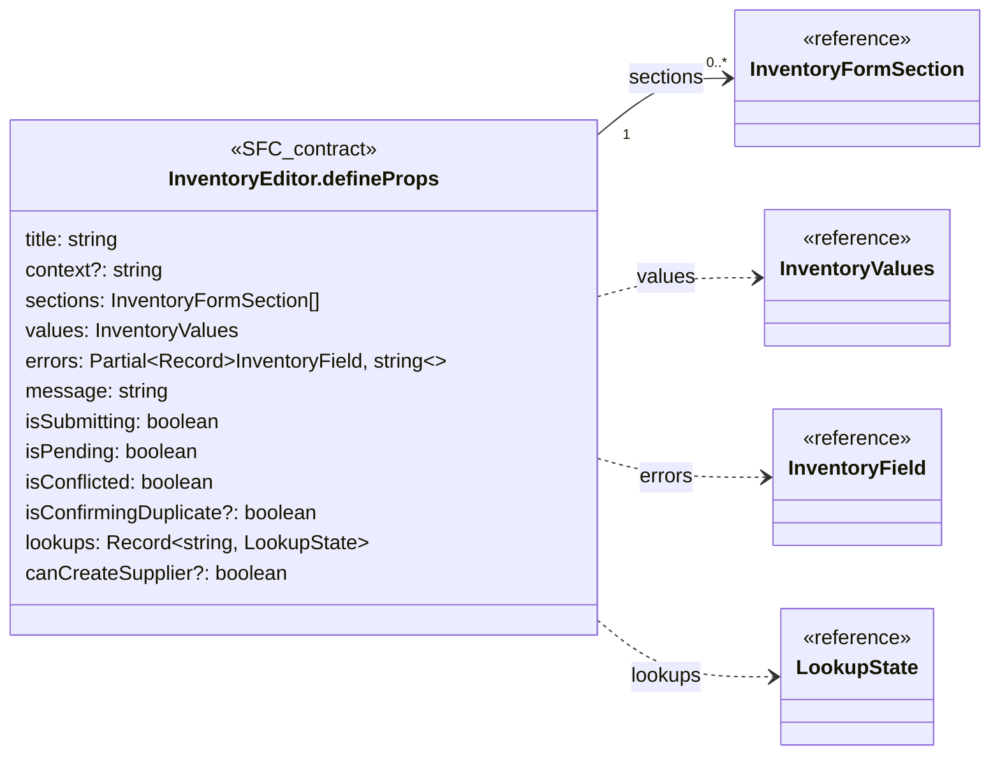

**Figura:** `DIA-VUE-TS-WAREHOUSE-1-2`. Parte 2/2.

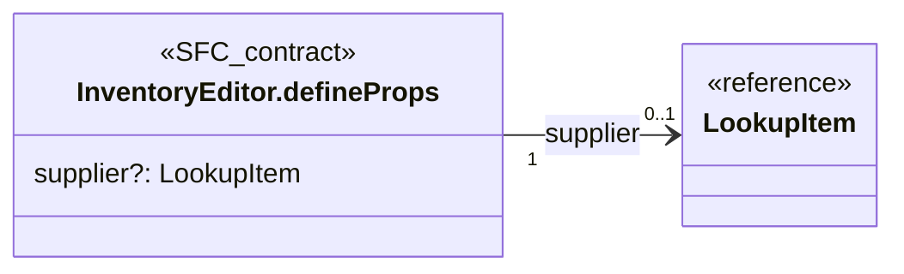

## InventoryEditor.defineEmits

**Fuente:** [src/modules/warehouse/components/InventoryEditor.vue](../../../../../src/modules/warehouse/components/InventoryEditor.vue) · línea 27, columna 26. **Declaración:** SFC contract.

| Miembro | Firma completa |
| --- | --- |
| `update` | `update: [field: InventoryField, value: string \| boolean];` |
| `blur` | `blur: [field: InventoryField];` |
| `search` | `search: [field: InventoryField, value: string];` |
| `more` | `more: [field: InventoryField];` |
| `retry` | `retry: [field: InventoryField];` |
| `submit` | `submit: [];` |
| `close` | `close: [];` |
| `reload` | `reload: [];` |
| `createSupplier` | `createSupplier: [search: string];` |

| Relación | Destino | Origen de la referencia |
| --- | --- | --- |
| dependency | [InventoryField](../../../../../src/modules/warehouse/inventory.ts) | `update` |
| dependency | [InventoryField](../../../../../src/modules/warehouse/inventory.ts) | `blur` |
| dependency | [InventoryField](../../../../../src/modules/warehouse/inventory.ts) | `search` |
| dependency | [InventoryField](../../../../../src/modules/warehouse/inventory.ts) | `more` |
| dependency | [InventoryField](../../../../../src/modules/warehouse/inventory.ts) | `retry` |

**Figura:** `DIA-VUE-TS-WAREHOUSE-2-1`.

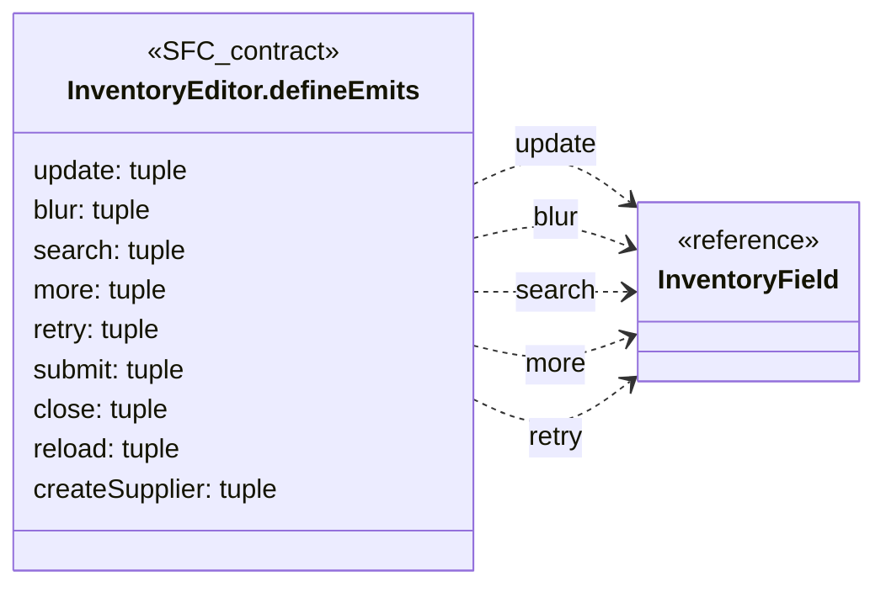

## InventoryFilters.defineProps

**Fuente:** [src/modules/warehouse/components/InventoryFilters.vue](../../../../../src/modules/warehouse/components/InventoryFilters.vue) · línea 7, columna 13. **Declaración:** SFC contract.

| Miembro | Firma completa |
| --- | --- |
| `supplierId` | `supplierId: string;` |
| `canFilterSupplier` | `canFilterSupplier: boolean;` |
| `isLoading` | `isLoading: boolean;` |
| `suppliers` | `suppliers: LookupState;` |

| Relación | Destino | Origen de la referencia |
| --- | --- | --- |
| association | [LookupState](../../../../../src/shared/lookup.ts) | `suppliers` |

**Figura:** `DIA-VUE-TS-WAREHOUSE-3-1`.

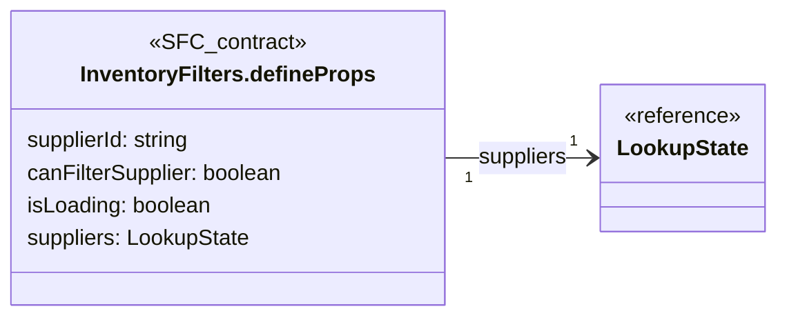

## InventoryFilters.defineEmits

**Fuente:** [src/modules/warehouse/components/InventoryFilters.vue](../../../../../src/modules/warehouse/components/InventoryFilters.vue) · línea 13, columna 26. **Declaración:** SFC contract.

| Miembro | Firma completa |
| --- | --- |
| `supplier` | `supplier: [value: string];` |
| `searchOptions` | `searchOptions: [value: string];` |
| `more` | `more: [];` |
| `retry` | `retry: [];` |
| `apply` | `apply: [];` |
| `clear` | `clear: [];` |
| `refresh` | `refresh: [];` |

**Figura:** `DIA-VUE-TS-WAREHOUSE-4-1`.

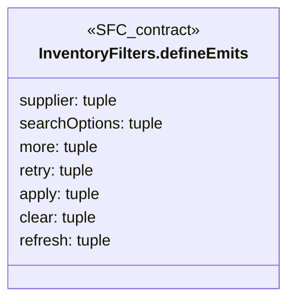

## InventoryFormField.defineProps

**Fuente:** [src/modules/warehouse/components/InventoryFormField.vue](../../../../../src/modules/warehouse/components/InventoryFormField.vue) · línea 9, columna 27. **Declaración:** SFC contract.

| Miembro | Firma completa |
| --- | --- |
| `field` | `field: InventoryFieldSpec;` |
| `value` | `value: string \| boolean;` |
| `error` | `error?: string;` |
| `isDisabled` | `isDisabled: boolean;` |
| `lookup` | `lookup?: LookupState;` |
| `initialOption` | `initialOption?: LookupItem;` |
| `createLabel` | `createLabel?: string;` |

| Relación | Destino | Origen de la referencia |
| --- | --- | --- |
| association | [InventoryFieldSpec](../../../../../src/modules/warehouse/formFields.ts) | `field` |
| association | [LookupState](../../../../../src/shared/lookup.ts) | `lookup` |
| association | [LookupItem](../../../../../src/shared/lookup.ts) | `initialOption` |

**Figura:** `DIA-VUE-TS-WAREHOUSE-5-1`.

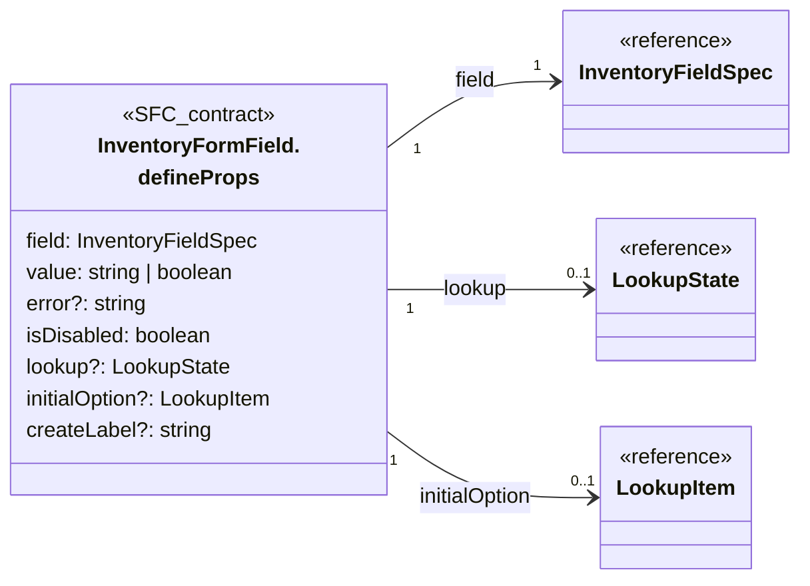

## InventoryFormField.defineEmits

**Fuente:** [src/modules/warehouse/components/InventoryFormField.vue](../../../../../src/modules/warehouse/components/InventoryFormField.vue) · línea 18, columna 26. **Declaración:** SFC contract.

| Miembro | Firma completa |
| --- | --- |
| `update` | `update: [value: string \| boolean];` |
| `blur` | `blur: [];` |
| `search` | `search: [value: string];` |
| `more` | `more: [];` |
| `retry` | `retry: [];` |
| `create` | `create: [search: string];` |

**Figura:** `DIA-VUE-TS-WAREHOUSE-6-1`.

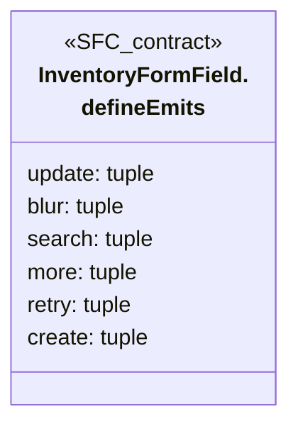

## InventoryReportToolbar.defineProps

**Fuente:** [src/modules/warehouse/components/InventoryReportToolbar.vue](../../../../../src/modules/warehouse/components/InventoryReportToolbar.vue) · línea 6, columna 13. **Declaración:** SFC contract.

| Miembro | Firma completa |
| --- | --- |
| `scope` | `scope: string;` |
| `hasSupplierFilter` | `hasSupplierFilter: boolean;` |
| `isExporting` | `isExporting: boolean;` |
| `error` | `error: string` |

**Figura:** `DIA-VUE-TS-WAREHOUSE-7-1`.

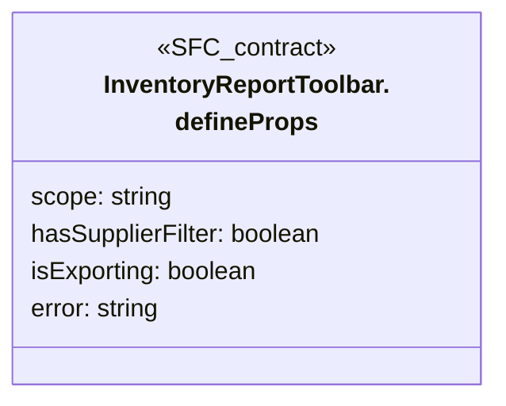

## InventoryReportToolbar.defineEmits

**Fuente:** [src/modules/warehouse/components/InventoryReportToolbar.vue](../../../../../src/modules/warehouse/components/InventoryReportToolbar.vue) · línea 7, columna 26. **Declaración:** SFC contract.

| Miembro | Firma completa |
| --- | --- |
| `update:scope` | `'update:scope': [scope: string];` |
| `export` | `export: []` |

**Figura:** `DIA-VUE-TS-WAREHOUSE-8-1`.

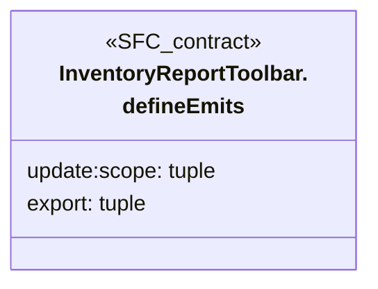

## InventoryRowActions.defineProps

**Fuente:** [src/modules/warehouse/components/InventoryRowActions.vue](../../../../../src/modules/warehouse/components/InventoryRowActions.vue) · línea 5, columna 13. **Declaración:** SFC contract.

| Miembro | Firma completa |
| --- | --- |
| `row` | `row: InventoryRow;` |
| `permissions` | `permissions: InventoryPermissions;` |
| `isWaste` | `isWaste: boolean` |

| Relación | Destino | Origen de la referencia |
| --- | --- | --- |
| association | [InventoryRow](../../../../../src/modules/warehouse/inventory.ts) | `row` |
| association | [InventoryPermissions](../../../../../src/modules/warehouse/inventory.ts) | `permissions` |

**Figura:** `DIA-VUE-TS-WAREHOUSE-9-1`.

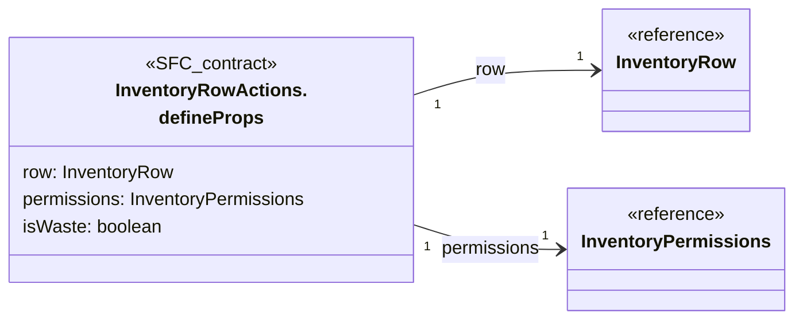

## InventoryRowActions.defineEmits

**Fuente:** [src/modules/warehouse/components/InventoryRowActions.vue](../../../../../src/modules/warehouse/components/InventoryRowActions.vue) · línea 6, columna 26. **Declaración:** SFC contract.

| Miembro | Firma completa |
| --- | --- |
| `action` | `action: [target: EditorTarget]` |

| Relación | Destino | Origen de la referencia |
| --- | --- | --- |
| dependency | [EditorTarget](../../../../../src/modules/warehouse/inventory.ts) | `action` |

**Figura:** `DIA-VUE-TS-WAREHOUSE-10-1`.

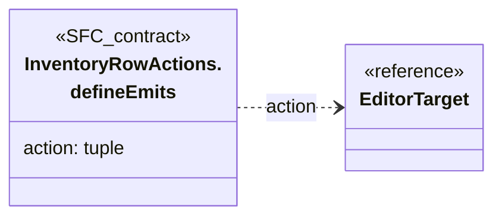

## InventoryTable.defineProps

**Fuente:** [src/modules/warehouse/components/InventoryTable.vue](../../../../../src/modules/warehouse/components/InventoryTable.vue) · línea 21, columna 27. **Declaración:** SFC contract.

| Miembro | Firma completa |
| --- | --- |
| `rows` | `rows: InventoryRow[];` |
| `permissions` | `permissions: InventoryPermissions;` |
| `resource` | `resource: InventoryResource;` |
| `isLoading` | `isLoading: boolean;` |
| `total` | `total: number;` |
| `query` | `query: InventoryQuery;` |

| Relación | Destino | Origen de la referencia |
| --- | --- | --- |
| association | [InventoryRow](../../../../../src/modules/warehouse/inventory.ts) | `rows` |
| association | [InventoryPermissions](../../../../../src/modules/warehouse/inventory.ts) | `permissions` |
| dependency | [InventoryResource](../../../../../src/modules/warehouse/inventory.ts) | `resource` |
| association | [InventoryQuery](../../../../../src/modules/warehouse/inventory.ts) | `query` |

**Figura:** `DIA-VUE-TS-WAREHOUSE-11-1`.

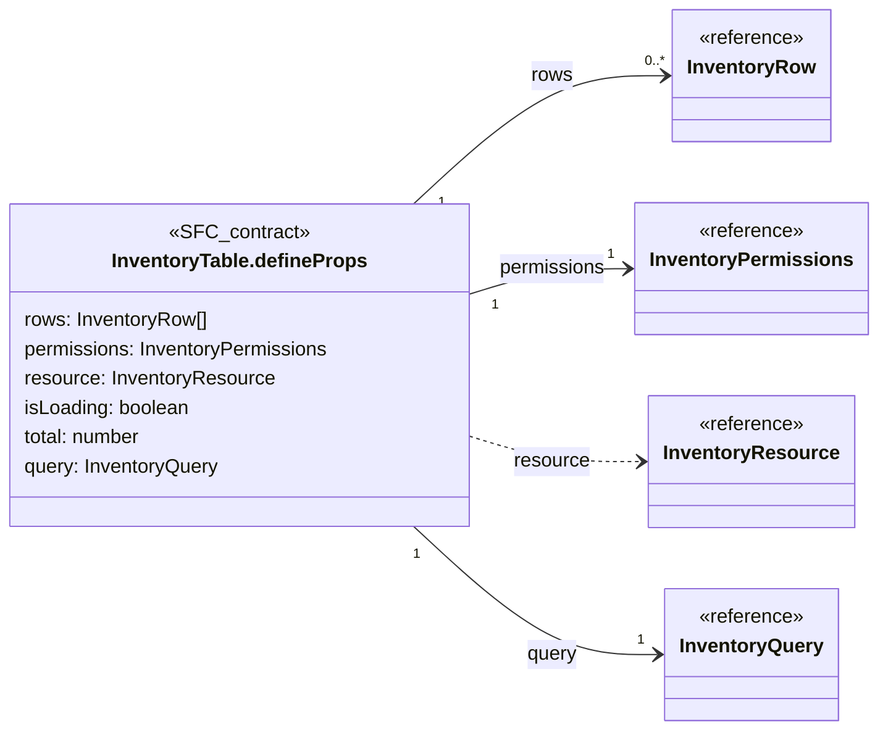

## InventoryTable.defineEmits

**Fuente:** [src/modules/warehouse/components/InventoryTable.vue](../../../../../src/modules/warehouse/components/InventoryTable.vue) · línea 29, columna 26. **Declaración:** SFC contract.

| Miembro | Firma completa |
| --- | --- |
| `action` | `action: [target: EditorTarget];` |
| `query` | `query: [query: Partial<InventoryQuery>];` |

| Relación | Destino | Origen de la referencia |
| --- | --- | --- |
| dependency | [EditorTarget](../../../../../src/modules/warehouse/inventory.ts) | `action` |
| dependency | [InventoryQuery](../../../../../src/modules/warehouse/inventory.ts) | `query` |

**Figura:** `DIA-VUE-TS-WAREHOUSE-12-1`.

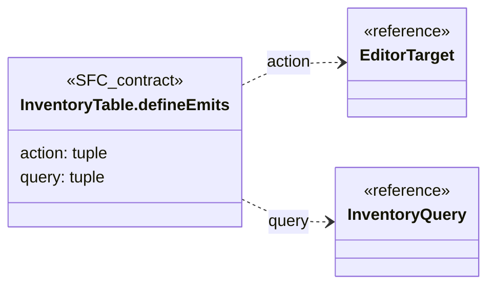

## rowProps.{ item }@40:29

**Fuente:** [src/modules/warehouse/components/InventoryTable.vue](../../../../../src/modules/warehouse/components/InventoryTable.vue) · línea 40, columna 29. **Declaración:** inline object.

| Miembro | Firma completa |
| --- | --- |
| `item` | `item: InventoryRow` |

| Relación | Destino | Origen de la referencia |
| --- | --- | --- |
| association | [InventoryRow](../../../../../src/modules/warehouse/inventory.ts) | `item` |

**Figura:** `DIA-VUE-TS-WAREHOUSE-13-1`.

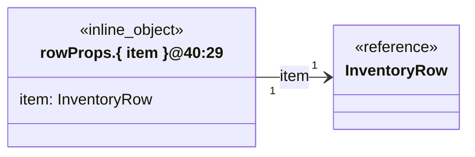

## useInventoryEditor.options@25:45

**Fuente:** [src/modules/warehouse/composables/useInventoryEditor.ts](../../../../../src/modules/warehouse/composables/useInventoryEditor.ts) · línea 25, columna 45. **Declaración:** inline object.

| Miembro | Firma completa |
| --- | --- |
| `resource` | `resource: InventoryResource;` |
| `target` | `target: EditorTarget;` |
| `userId` | `userId: string;` |
| `onSaved` | `onSaved: (created?: LookupItem) => void;` |
| `onUnauthorized` | `onUnauthorized: () => void;` |
| `creationContext` | `creationContext?: 'goodsReceipt';` |
| `initialSupplier` | `initialSupplier?: LookupItem;` |
| `canAddStock` | `canAddStock?: boolean;` |
| `onAddStock` | `onAddStock?: (target: StockAdditionTarget) => void;` |

| Relación | Destino | Origen de la referencia |
| --- | --- | --- |
| dependency | [InventoryResource](../../../../../src/modules/warehouse/inventory.ts) | `resource` |
| dependency | [EditorTarget](../../../../../src/modules/warehouse/inventory.ts) | `target` |
| dependency | [LookupItem](../../../../../src/shared/lookup.ts) | `onSaved` |
| association | [LookupItem](../../../../../src/shared/lookup.ts) | `initialSupplier` |
| dependency | [StockAdditionTarget](../../../../../src/modules/warehouse/inventory.ts) | `onAddStock` |

**Figura:** `DIA-VUE-TS-WAREHOUSE-14-1`.

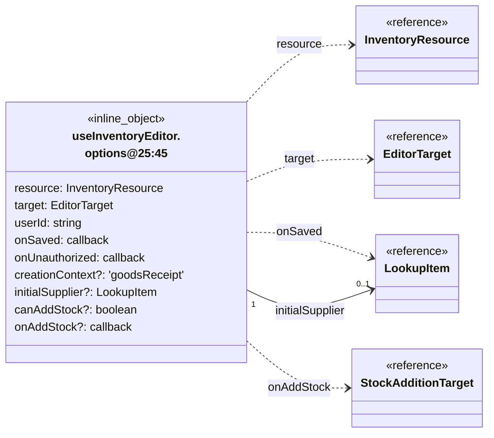

## useInventoryList.options@10:43

**Fuente:** [src/modules/warehouse/composables/useInventoryList.ts](../../../../../src/modules/warehouse/composables/useInventoryList.ts) · línea 10, columna 43. **Declaración:** inline object.

| Miembro | Firma completa |
| --- | --- |
| `resource` | `resource: InventoryResource;` |
| `canRead` | `canRead: boolean;` |
| `canReadSuppliers` | `canReadSuppliers: boolean;` |
| `isPaused` | `isPaused: Ref<boolean>;` |
| `onUnauthorized` | `onUnauthorized: () => void;` |

| Relación | Destino | Origen de la referencia |
| --- | --- | --- |
| dependency | [InventoryResource](../../../../../src/modules/warehouse/inventory.ts) | `resource` |

**Figura:** `DIA-VUE-TS-WAREHOUSE-15-1`.

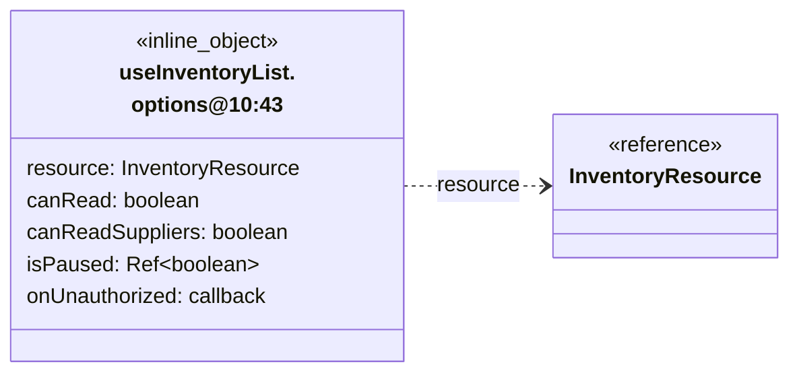

## useInventoryRemoval.options@8:46

**Fuente:** [src/modules/warehouse/composables/useInventoryRemoval.ts](../../../../../src/modules/warehouse/composables/useInventoryRemoval.ts) · línea 8, columna 46. **Declaración:** inline object.

| Miembro | Firma completa |
| --- | --- |
| `resource` | `resource: InventoryResource;` |
| `onSaved` | `onSaved: () => void;` |
| `onUnauthorized` | `onUnauthorized: () => void;` |

| Relación | Destino | Origen de la referencia |
| --- | --- | --- |
| dependency | [InventoryResource](../../../../../src/modules/warehouse/inventory.ts) | `resource` |

**Figura:** `DIA-VUE-TS-WAREHOUSE-16-1`.

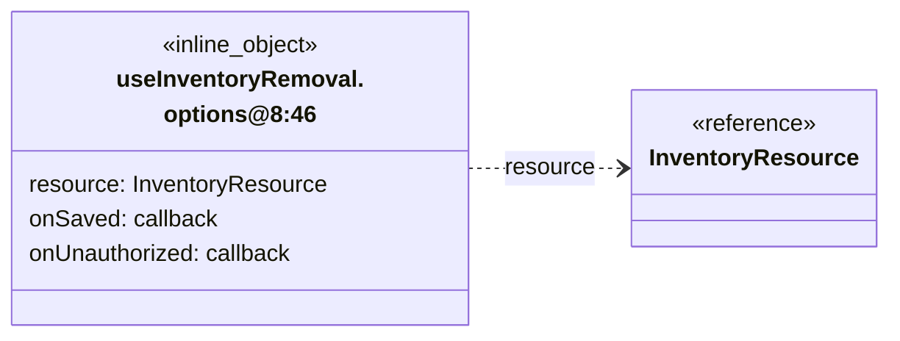

## useInventoryReport.options@5:45

**Fuente:** [src/modules/warehouse/composables/useInventoryReport.ts](../../../../../src/modules/warehouse/composables/useInventoryReport.ts) · línea 5, columna 45. **Declaración:** inline object.

| Miembro | Firma completa |
| --- | --- |
| `resource` | `resource: InventoryResource;` |
| `query` | `query: InventoryQuery;` |
| `canExport` | `canExport: boolean;` |
| `onUnauthorized` | `onUnauthorized: () => void;` |

| Relación | Destino | Origen de la referencia |
| --- | --- | --- |
| dependency | [InventoryResource](../../../../../src/modules/warehouse/inventory.ts) | `resource` |
| association | [InventoryQuery](../../../../../src/modules/warehouse/inventory.ts) | `query` |

**Figura:** `DIA-VUE-TS-WAREHOUSE-17-1`.

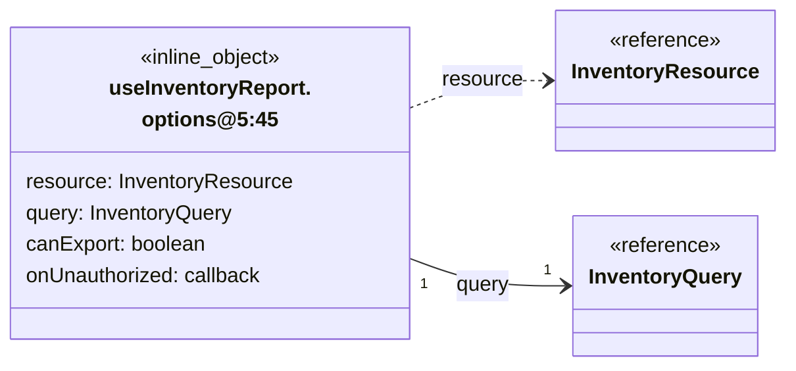

## useInventorySelection.options@14:48

**Fuente:** [src/modules/warehouse/composables/useInventorySelection.ts](../../../../../src/modules/warehouse/composables/useInventorySelection.ts) · línea 14, columna 48. **Declaración:** inline object.

| Miembro | Firma completa |
| --- | --- |
| `resource` | `resource: InventoryResource;` |
| `target` | `target: EditorTarget;` |
| `values` | `values: InventoryValues;` |
| `isPending` | `isPending: Ref<boolean>;` |
| `initialSupplier` | `initialSupplier?: LookupItem;` |
| `setValue` | `setValue: (field: InventoryField, value: string) => void;` |
| `clearError` | `clearError: (field: InventoryField) => void;` |

| Relación | Destino | Origen de la referencia |
| --- | --- | --- |
| dependency | [InventoryResource](../../../../../src/modules/warehouse/inventory.ts) | `resource` |
| dependency | [EditorTarget](../../../../../src/modules/warehouse/inventory.ts) | `target` |
| dependency | [InventoryValues](../../../../../src/modules/warehouse/inventory.ts) | `values` |
| association | [LookupItem](../../../../../src/shared/lookup.ts) | `initialSupplier` |
| dependency | [InventoryField](../../../../../src/modules/warehouse/inventory.ts) | `setValue` |
| dependency | [InventoryField](../../../../../src/modules/warehouse/inventory.ts) | `clearError` |

**Figura:** `DIA-VUE-TS-WAREHOUSE-18-1`. Parte 1/2.

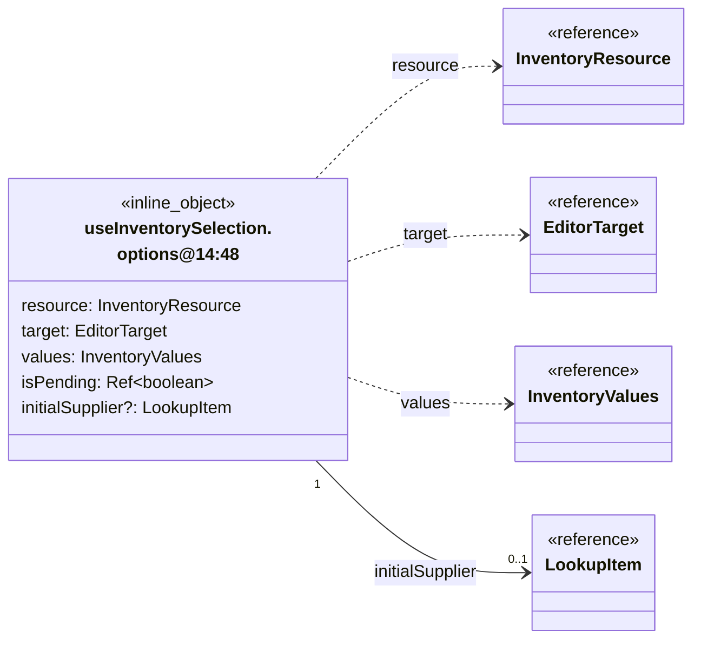

**Figura:** `DIA-VUE-TS-WAREHOUSE-18-2`. Parte 2/2.

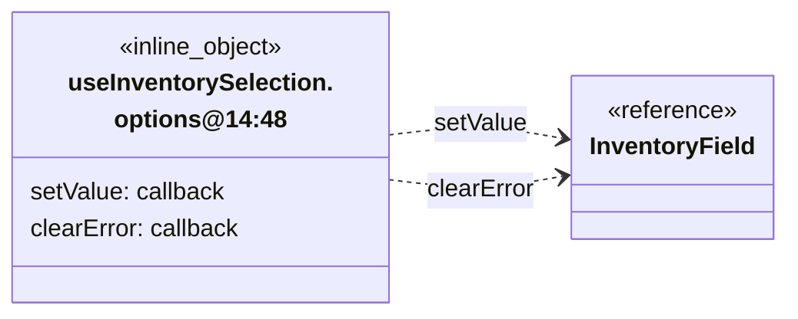

## useWasteDuplicateRecovery.options@7:52

**Fuente:** [src/modules/warehouse/composables/useWasteDuplicateRecovery.ts](../../../../../src/modules/warehouse/composables/useWasteDuplicateRecovery.ts) · línea 7, columna 52. **Declaración:** inline object.

| Miembro | Firma completa |
| --- | --- |
| `canAddStock` | `canAddStock: boolean;` |
| `signal` | `signal: AbortSignal;` |
| `onAddStock` | `onAddStock?: (target: StockAdditionTarget) => void;` |

| Relación | Destino | Origen de la referencia |
| --- | --- | --- |
| dependency | [StockAdditionTarget](../../../../../src/modules/warehouse/inventory.ts) | `onAddStock` |

**Figura:** `DIA-VUE-TS-WAREHOUSE-19-1`.

```mermaid
classDiagram
    direction LR
    class Subject["useWasteDuplicateRecovery.<br/>options@7:52"] {
        <<inline_object>>
        canAddStock: boolean
        signal: AbortSignal
        onAddStock?: callback
    }
    class R0["StockAdditionTarget"] {
        <<reference>>
    }
    Subject ..> R0 : onAddStock
```

## InventoryFieldSpec

**Fuente:** [src/modules/warehouse/formFields.ts](../../../../../src/modules/warehouse/formFields.ts) · línea 7, columna 1. **Declaración:** interface.

| Miembro | Firma completa |
| --- | --- |
| `name` | `name: InventoryField;` |
| `label` | `label: string;` |
| `type` | `type?: 'number' \| 'lookup' \| 'checkbox' \| 'textarea';` |
| `isReadOnly` | `isReadOnly?: boolean;` |
| `isDisabled` | `isDisabled?: boolean;` |
| `displayValue` | `displayValue?: string;` |
| `hint` | `hint?: string;` |
| `isWide` | `isWide?: boolean;` |

| Relación | Destino | Origen de la referencia |
| --- | --- | --- |
| dependency | [InventoryField](../../../../../src/modules/warehouse/inventory.ts) | `name` |

**Figura:** `DIA-VUE-TS-WAREHOUSE-20-1`.

```mermaid
classDiagram
    direction LR
    class Subject["InventoryFieldSpec"] {
        <<interface>>
        name: InventoryField
        label: string
        type?: 'number' | 'lookup' | 'checkbox' | 'textarea'
        isReadOnly?: boolean
        isDisabled?: boolean
        displayValue?: string
        hint?: string
        isWide?: boolean
    }
    class R0["InventoryField"] {
        <<reference>>
    }
    Subject ..> R0 : name
```

## InventorySummaryItem

**Fuente:** [src/modules/warehouse/formFields.ts](../../../../../src/modules/warehouse/formFields.ts) · línea 17, columna 1. **Declaración:** interface.

| Miembro | Firma completa |
| --- | --- |
| `label` | `label: string;` |
| `value` | `value: string;` |

**Figura:** `DIA-VUE-TS-WAREHOUSE-21-1`.

```mermaid
classDiagram
    direction LR
    class Subject["InventorySummaryItem"] {
        <<interface>>
        label: string
        value: string
    }
```

## InventoryFormSection

**Fuente:** [src/modules/warehouse/formFields.ts](../../../../../src/modules/warehouse/formFields.ts) · línea 21, columna 1. **Declaración:** interface.

| Miembro | Firma completa |
| --- | --- |
| `id` | `id: string;` |
| `title` | `title: string;` |
| `description` | `description?: string;` |
| `fields` | `fields: InventoryFieldSpec[];` |
| `summary` | `summary?: InventorySummaryItem[];` |

| Relación | Destino | Origen de la referencia |
| --- | --- | --- |
| association | [InventoryFieldSpec](../../../../../src/modules/warehouse/formFields.ts) | `fields` |
| association | [InventorySummaryItem](../../../../../src/modules/warehouse/formFields.ts) | `summary` |

**Figura:** `DIA-VUE-TS-WAREHOUSE-22-1`.

```mermaid
classDiagram
    direction LR
    class Subject["InventoryFormSection"] {
        <<interface>>
        id: string
        title: string
        description?: string
        fields: InventoryFieldSpec[]
        summary?: InventorySummaryItem[]
    }
    class R0["InventoryFieldSpec"] {
        <<reference>>
    }
    class R1["InventorySummaryItem"] {
        <<reference>>
    }
    Subject "1" --> "0..*" R0 : fields
    Subject "1" --> "0..*" R1 : summary
```

## inventorySections.options@33:14

**Fuente:** [src/modules/warehouse/formFields.ts](../../../../../src/modules/warehouse/formFields.ts) · línea 33, columna 14. **Declaración:** inline object.

| Miembro | Firma completa |
| --- | --- |
| `template` | `template?: LookupItem;` |
| `usesMeasurements` | `usesMeasurements: boolean;` |
| `hasSupplier` | `hasSupplier: boolean;` |
| `creationContext` | `creationContext?: 'goodsReceipt';` |
| `supplier` | `supplier?: LookupItem;` |

| Relación | Destino | Origen de la referencia |
| --- | --- | --- |
| association | [LookupItem](../../../../../src/shared/lookup.ts) | `template` |
| association | [LookupItem](../../../../../src/shared/lookup.ts) | `supplier` |

**Figura:** `DIA-VUE-TS-WAREHOUSE-23-1`.

```mermaid
classDiagram
    direction LR
    class Subject["inventorySections.<br/>options@33:14"] {
        <<inline_object>>
        template?: LookupItem
        usesMeasurements: boolean
        hasSupplier: boolean
        creationContext?: 'goodsReceipt'
        supplier?: LookupItem
    }
    class R0["LookupItem"] {
        <<reference>>
    }
    Subject "1" --> "0..1" R0 : template
    Subject "1" --> "0..1" R0 : supplier
```

## isRoll@56:46

**Fuente:** [src/modules/warehouse/formModel.ts](../../../../../src/modules/warehouse/formModel.ts) · línea 56, columna 46. **Declaración:** inline object.

| Miembro | Firma completa |
| --- | --- |
| `name` | `name?: string` |

**Figura:** `DIA-VUE-TS-WAREHOUSE-24-1`.

```mermaid
classDiagram
    direction LR
    class Subject["isRoll@56:46"] {
        <<inline_object>>
        name?: string
    }
```

## InventoryResource

**Fuente:** [src/modules/warehouse/inventory.ts](../../../../../src/modules/warehouse/inventory.ts) · línea 3, columna 1. **Declaración:** type.

**Definición completa:**

```typescript
'materials' | 'consumables' | 'wastes'
```

**Figura:** `DIA-VUE-TS-WAREHOUSE-25-1`.

```mermaid
classDiagram
    direction LR
    class Subject["InventoryResource"] {
        <<type>>
    }
```

## InventoryAction

**Fuente:** [src/modules/warehouse/inventory.ts](../../../../../src/modules/warehouse/inventory.ts) · línea 4, columna 1. **Declaración:** type.

**Definición completa:**

```typescript
'create' | 'edit' | 'stock' | 'add-stock' | 'delete'
```

**Figura:** `DIA-VUE-TS-WAREHOUSE-26-1`.

```mermaid
classDiagram
    direction LR
    class Subject["InventoryAction"] {
        <<type>>
    }
```

## Numeric

**Fuente:** [src/modules/warehouse/inventory.ts](../../../../../src/modules/warehouse/inventory.ts) · línea 5, columna 1. **Declaración:** type.

**Definición completa:**

```typescript
string | number | null
```

**Figura:** `DIA-VUE-TS-WAREHOUSE-27-1`.

```mermaid
classDiagram
    direction LR
    class Subject["Numeric"] {
        <<type>>
    }
```

## InventoryRow

**Fuente:** [src/modules/warehouse/inventory.ts](../../../../../src/modules/warehouse/inventory.ts) · línea 7, columna 1. **Declaración:** interface.

| Miembro | Firma completa |
| --- | --- |
| `id` | `id: string;` |
| `entityId` | `entityId: string;` |
| `version` | `version: number;` |
| `materialVersion` | `materialVersion?: number;` |
| `supplierId` | `supplierId: string;` |
| `supplierName` | `supplierName: string;` |
| `name` | `name: string;` |
| `presentationId` | `presentationId: string;` |
| `presentation` | `presentation: string;` |
| `unitMeasureId` | `unitMeasureId: string;` |
| `unitMeasure` | `unitMeasure: string;` |
| `base` | `base: Numeric;` |
| `height` | `height: Numeric;` |
| `currentStock` | `currentStock: Numeric;` |
| `convertedQuantity` | `convertedQuantity: Numeric;` |
| `minStock` | `minStock: Numeric;` |
| `maxUnitCost` | `maxUnitCost?: Numeric;` |
| `isActive` | `isActive: boolean;` |
| `canDelete` | `canDelete: boolean;` |
| `coneWeightKg` | `coneWeightKg: Numeric;` |
| `totalWeightKg` | `totalWeightKg: Numeric;` |
| `weightKg` | `weightKg: Numeric;` |
| `referenceRollTotalWeightKg` | `referenceRollTotalWeightKg: Numeric;` |
| `sampleLengthM` | `sampleLengthM: Numeric;` |
| `sampleNetWeightKg` | `sampleNetWeightKg: Numeric;` |

| Relación | Destino | Origen de la referencia |
| --- | --- | --- |
| dependency | [Numeric](../../../../../src/modules/warehouse/inventory.ts) | `base` |
| dependency | [Numeric](../../../../../src/modules/warehouse/inventory.ts) | `height` |
| dependency | [Numeric](../../../../../src/modules/warehouse/inventory.ts) | `currentStock` |
| dependency | [Numeric](../../../../../src/modules/warehouse/inventory.ts) | `convertedQuantity` |
| dependency | [Numeric](../../../../../src/modules/warehouse/inventory.ts) | `minStock` |
| dependency | [Numeric](../../../../../src/modules/warehouse/inventory.ts) | `maxUnitCost` |
| dependency | [Numeric](../../../../../src/modules/warehouse/inventory.ts) | `coneWeightKg` |
| dependency | [Numeric](../../../../../src/modules/warehouse/inventory.ts) | `totalWeightKg` |
| dependency | [Numeric](../../../../../src/modules/warehouse/inventory.ts) | `weightKg` |
| dependency | [Numeric](../../../../../src/modules/warehouse/inventory.ts) | `referenceRollTotalWeightKg` |
| dependency | [Numeric](../../../../../src/modules/warehouse/inventory.ts) | `sampleLengthM` |
| dependency | [Numeric](../../../../../src/modules/warehouse/inventory.ts) | `sampleNetWeightKg` |

**Figura:** `DIA-VUE-TS-WAREHOUSE-28-1`. Parte 1/2.

```mermaid
classDiagram
    direction LR
    class Subject["InventoryRow"] {
        <<interface>>
        id: string
        entityId: string
        version: number
        materialVersion?: number
        supplierId: string
        supplierName: string
        name: string
        presentationId: string
        presentation: string
        unitMeasureId: string
        unitMeasure: string
        base: Numeric
        height: Numeric
        currentStock: Numeric
        convertedQuantity: Numeric
        minStock: Numeric
    }
    class R0["Numeric"] {
        <<reference>>
    }
    Subject ..> R0 : base
    Subject ..> R0 : height
    Subject ..> R0 : currentStock
    Subject ..> R0 : convertedQuantity
    Subject ..> R0 : minStock
```

**Figura:** `DIA-VUE-TS-WAREHOUSE-28-2`. Parte 2/2.

```mermaid
classDiagram
    direction LR
    class Subject["InventoryRow"] {
        <<interface>>
        maxUnitCost?: Numeric
        isActive: boolean
        canDelete: boolean
        coneWeightKg: Numeric
        totalWeightKg: Numeric
        weightKg: Numeric
        referenceRollTotalWeightKg: Numeric
        sampleLengthM: Numeric
        sampleNetWeightKg: Numeric
    }
    class R0["Numeric"] {
        <<reference>>
    }
    Subject ..> R0 : maxUnitCost
    Subject ..> R0 : coneWeightKg
    Subject ..> R0 : totalWeightKg
    Subject ..> R0 : weightKg
    Subject ..> R0 : referenceRollTotalWeightKg
    Subject ..> R0 : sampleLengthM
    Subject ..> R0 : sampleNetWeightKg
```

## InventoryQuery

**Fuente:** [src/modules/warehouse/inventory.ts](../../../../../src/modules/warehouse/inventory.ts) · línea 35, columna 1. **Declaración:** interface.

| Miembro | Firma completa |
| --- | --- |
| `search` | `search: string;` |
| `supplierId` | `supplierId: string;` |
| `page` | `page: number;` |
| `length` | `length: number;` |
| `direction` | `direction: 'asc' \| 'desc';` |
| `orderColumn` | `orderColumn?: number;` |

**Figura:** `DIA-VUE-TS-WAREHOUSE-29-1`.

```mermaid
classDiagram
    direction LR
    class Subject["InventoryQuery"] {
        <<interface>>
        search: string
        supplierId: string
        page: number
        length: number
        direction: 'asc' | 'desc'
        orderColumn?: number
    }
```

## InventoryPermissions

**Fuente:** [src/modules/warehouse/inventory.ts](../../../../../src/modules/warehouse/inventory.ts) · línea 43, columna 1. **Declaración:** interface.

| Miembro | Firma completa |
| --- | --- |
| `canRead` | `canRead: boolean;` |
| `canWrite` | `canWrite: boolean;` |
| `canAdjust` | `canAdjust: boolean;` |
| `canAdd` | `canAdd: boolean;` |
| `canReadCosts` | `canReadCosts: boolean;` |
| `canReadState` | `canReadState: boolean;` |
| `canExport` | `canExport: boolean;` |

**Figura:** `DIA-VUE-TS-WAREHOUSE-30-1`.

```mermaid
classDiagram
    direction LR
    class Subject["InventoryPermissions"] {
        <<interface>>
        canRead: boolean
        canWrite: boolean
        canAdjust: boolean
        canAdd: boolean
        canReadCosts: boolean
        canReadState: boolean
        canExport: boolean
    }
```

## StockAdditionTarget

**Fuente:** [src/modules/warehouse/inventory.ts](../../../../../src/modules/warehouse/inventory.ts) · línea 52, columna 1. **Declaración:** interface.

| Miembro | Firma completa |
| --- | --- |
| `action` | `action: 'add-stock';` |
| `row` | `row: Partial<InventoryRow> & Pick<InventoryRow, 'id' \| 'entityId' \| 'name' \| 'supplierName' \| 'currentStock'>;` |
| `quantity` | `quantity?: string;` |
| `observations` | `observations?: string;` |

| Relación | Destino | Origen de la referencia |
| --- | --- | --- |
| dependency | [InventoryRow](../../../../../src/modules/warehouse/inventory.ts) | `row` |

**Figura:** `DIA-VUE-TS-WAREHOUSE-31-1`.

```mermaid
classDiagram
    direction LR
    class Subject["StockAdditionTarget"] {
        <<interface>>
        action: 'add-stock'
        row: complex
        quantity?: string
        observations?: string
    }
    class R0["InventoryRow"] {
        <<reference>>
    }
    Subject ..> R0 : row
```

## EditorTarget

**Fuente:** [src/modules/warehouse/inventory.ts](../../../../../src/modules/warehouse/inventory.ts) · línea 59, columna 1. **Declaración:** type.

**Definición completa:**

```typescript
| { action: Exclude<InventoryAction, 'add-stock'>; row?: InventoryRow; initialName?: string }
    | StockAdditionTarget
```

| Relación | Destino | Origen de la referencia |
| --- | --- | --- |
| dependency | [EditorTarget@60:7](../../../../../src/modules/warehouse/inventory.ts) | `type` |
| dependency | [StockAdditionTarget](../../../../../src/modules/warehouse/inventory.ts) | `type` |

**Figura:** `DIA-VUE-TS-WAREHOUSE-32-1`.

```mermaid
classDiagram
    direction LR
    class Subject["EditorTarget"] {
        <<type>>
    }
    class R0["EditorTarget@60:7"] {
        <<reference>>
    }
    class R1["StockAdditionTarget"] {
        <<reference>>
    }
    Subject ..> R0 : type
    Subject ..> R1 : type
```

## EditorTarget@60:7

**Fuente:** [src/modules/warehouse/inventory.ts](../../../../../src/modules/warehouse/inventory.ts) · línea 60, columna 7. **Declaración:** inline object.

| Miembro | Firma completa |
| --- | --- |
| `action` | `action: Exclude<InventoryAction, 'add-stock'>;` |
| `row` | `row?: InventoryRow;` |
| `initialName` | `initialName?: string` |

| Relación | Destino | Origen de la referencia |
| --- | --- | --- |
| dependency | [InventoryAction](../../../../../src/modules/warehouse/inventory.ts) | `action` |
| association | [InventoryRow](../../../../../src/modules/warehouse/inventory.ts) | `row` |

**Figura:** `DIA-VUE-TS-WAREHOUSE-33-1`.

```mermaid
classDiagram
    direction LR
    class Subject["EditorTarget@60:7"] {
        <<inline_object>>
        action: Exclude~InventoryAction, 'add-stock'~
        row?: InventoryRow
        initialName?: string
    }
    class R0["InventoryAction"] {
        <<reference>>
    }
    class R1["InventoryRow"] {
        <<reference>>
    }
    Subject ..> R0 : action
    Subject "1" --> "0..1" R1 : row
```

## InventoryField

**Fuente:** [src/modules/warehouse/inventory.ts](../../../../../src/modules/warehouse/inventory.ts) · línea 90, columna 1. **Declaración:** type.

**Definición completa:**

```typescript
| 'name'
    | 'supplierId'
    | 'presentationId'
    | 'unitMeasureId'
    | 'materialId'
    | 'base'
    | 'height'
    | 'minStock'
    | 'maxUnitCost'
    | 'isActive'
    | 'newStock'
    | 'initialQuantity'
    | 'quantity'
    | 'reasonId'
    | 'observations'
    | 'coneWeightKg'
    | 'totalWeightKg'
    | 'referenceRollTotalWeightKg'
```

**Figura:** `DIA-VUE-TS-WAREHOUSE-34-1`.

```mermaid
classDiagram
    direction LR
    class Subject["InventoryField"] {
        <<type>>
    }
```

## InventoryValues

**Fuente:** [src/modules/warehouse/inventory.ts](../../../../../src/modules/warehouse/inventory.ts) · línea 109, columna 1. **Declaración:** type.

**Definición completa:**

```typescript
Record<InventoryField, string | boolean>
```

| Relación | Destino | Origen de la referencia |
| --- | --- | --- |
| dependency | [InventoryValues.expanded](../../../../../src/modules/warehouse/inventory.ts) | `evaluated structure` |
| dependency | [InventoryField](../../../../../src/modules/warehouse/inventory.ts) | `type` |

**Figura:** `DIA-VUE-TS-WAREHOUSE-35-1`.

```mermaid
classDiagram
    direction LR
    class Subject["InventoryValues"] {
        <<type>>
    }
    class R0["InventoryValues.expanded"] {
        <<reference>>
    }
    class R1["InventoryField"] {
        <<reference>>
    }
    Subject ..> R0 : evaluated structure
    Subject ..> R1 : type
```

## InventoryPayload

**Fuente:** [src/modules/warehouse/inventory.ts](../../../../../src/modules/warehouse/inventory.ts) · línea 110, columna 1. **Declaración:** type.

**Definición completa:**

```typescript
Record<string, string | number | boolean | null>
```

**Figura:** `DIA-VUE-TS-WAREHOUSE-36-1`.

```mermaid
classDiagram
    direction LR
    class Subject["InventoryPayload"] {
        <<type>>
    }
```

## InventoryEditorPage.defineProps

**Fuente:** [src/modules/warehouse/pages/InventoryEditorPage.vue](../../../../../src/modules/warehouse/pages/InventoryEditorPage.vue) · línea 10, columna 27. **Declaración:** SFC contract.

| Miembro | Firma completa |
| --- | --- |
| `resource` | `resource: InventoryResource;` |
| `target` | `target: EditorTarget;` |
| `userId` | `userId: string;` |
| `creationContext` | `creationContext?: 'goodsReceipt';` |
| `initialSupplier` | `initialSupplier?: LookupItem;` |
| `canAddStock` | `canAddStock?: boolean;` |
| `canCreateSupplier` | `canCreateSupplier?: boolean;` |

| Relación | Destino | Origen de la referencia |
| --- | --- | --- |
| dependency | [InventoryResource](../../../../../src/modules/warehouse/inventory.ts) | `resource` |
| dependency | [EditorTarget](../../../../../src/modules/warehouse/inventory.ts) | `target` |
| association | [LookupItem](../../../../../src/shared/lookup.ts) | `initialSupplier` |

**Figura:** `DIA-VUE-TS-WAREHOUSE-37-1`.

```mermaid
classDiagram
    direction LR
    class Subject["InventoryEditorPage.<br/>defineProps"] {
        <<SFC_contract>>
        resource: InventoryResource
        target: EditorTarget
        userId: string
        creationContext?: 'goodsReceipt'
        initialSupplier?: LookupItem
        canAddStock?: boolean
        canCreateSupplier?: boolean
    }
    class R0["InventoryResource"] {
        <<reference>>
    }
    class R1["EditorTarget"] {
        <<reference>>
    }
    class R2["LookupItem"] {
        <<reference>>
    }
    Subject ..> R0 : resource
    Subject ..> R1 : target
    Subject "1" --> "0..1" R2 : initialSupplier
```

## InventoryEditorPage.defineEmits

**Fuente:** [src/modules/warehouse/pages/InventoryEditorPage.vue](../../../../../src/modules/warehouse/pages/InventoryEditorPage.vue) · línea 19, columna 26. **Declaración:** SFC contract.

| Miembro | Firma completa |
| --- | --- |
| `saved` | `saved: [created?: LookupItem];` |
| `close` | `close: [];` |
| `reload` | `reload: [];` |
| `unauthorized` | `unauthorized: [];` |
| `addStock` | `addStock: [target: StockAdditionTarget];` |
| `createSupplier` | `createSupplier: [request: LookupCreation];` |

| Relación | Destino | Origen de la referencia |
| --- | --- | --- |
| dependency | [LookupItem](../../../../../src/shared/lookup.ts) | `saved` |
| dependency | [StockAdditionTarget](../../../../../src/modules/warehouse/inventory.ts) | `addStock` |
| dependency | [LookupCreation](../../../../../src/shared/lookup.ts) | `createSupplier` |

**Figura:** `DIA-VUE-TS-WAREHOUSE-38-1`.

```mermaid
classDiagram
    direction LR
    class Subject["InventoryEditorPage.<br/>defineEmits"] {
        <<SFC_contract>>
        saved: tuple
        close: tuple
        reload: tuple
        unauthorized: tuple
        addStock: tuple
        createSupplier: tuple
    }
    class R0["LookupItem"] {
        <<reference>>
    }
    class R1["StockAdditionTarget"] {
        <<reference>>
    }
    class R2["LookupCreation"] {
        <<reference>>
    }
    Subject ..> R0 : saved
    Subject ..> R1 : addStock
    Subject ..> R2 : createSupplier
```

## InventoryPage.defineProps

**Fuente:** [src/modules/warehouse/pages/InventoryPage.vue](../../../../../src/modules/warehouse/pages/InventoryPage.vue) · línea 18, columna 27. **Declaración:** SFC contract.

| Miembro | Firma completa |
| --- | --- |
| `resource` | `resource: InventoryResource` |

| Relación | Destino | Origen de la referencia |
| --- | --- | --- |
| dependency | [InventoryResource](../../../../../src/modules/warehouse/inventory.ts) | `resource` |

**Figura:** `DIA-VUE-TS-WAREHOUSE-39-1`.

```mermaid
classDiagram
    direction LR
    class Subject["InventoryPage.defineProps"] {
        <<SFC_contract>>
        resource: InventoryResource
    }
    class R0["InventoryResource"] {
        <<reference>>
    }
    Subject ..> R0 : resource
```

## InventoryPage.defineEmits

**Fuente:** [src/modules/warehouse/pages/InventoryPage.vue](../../../../../src/modules/warehouse/pages/InventoryPage.vue) · línea 19, columna 26. **Declaración:** SFC contract.

| Miembro | Firma completa |
| --- | --- |
| `createSupplier` | `createSupplier: [request: LookupCreation]` |

| Relación | Destino | Origen de la referencia |
| --- | --- | --- |
| dependency | [LookupCreation](../../../../../src/shared/lookup.ts) | `createSupplier` |

**Figura:** `DIA-VUE-TS-WAREHOUSE-40-1`.

```mermaid
classDiagram
    direction LR
    class Subject["InventoryPage.defineEmits"] {
        <<SFC_contract>>
        createSupplier: tuple
    }
    class R0["LookupCreation"] {
        <<reference>>
    }
    Subject ..> R0 : createSupplier
```

## apiClient.request@42:48

**Fuente:** [src/modules/warehouse/services/inventoryService.ts](../../../../../src/modules/warehouse/services/inventoryService.ts) · línea 42, columna 48. **Declaración:** inline object.

| Miembro | Firma completa |
| --- | --- |
| `code` | `code: string;` |
| `material` | `material?: unknown` |

**Figura:** `DIA-VUE-TS-WAREHOUSE-41-1`.

```mermaid
classDiagram
    direction LR
    class Subject["apiClient.request@42:48"] {
        <<inline_object>>
        code: string
        material?: unknown
    }
```

## useInventory.return

**Fuente:** [src/modules/warehouse/composables/useInventory.ts](../../../../../src/modules/warehouse/composables/useInventory.ts) · línea 11, columna 29. **Declaración:** inferred return.

| Miembro | Firma completa |
| --- | --- |
| `openEditor` | `"openEditor": (target: EditorTarget) => void;` |
| `onSaved` | `"onSaved": () => void;` |
| `isExporting` | `"isExporting": Ref<boolean, boolean>;` |
| `exportError` | `"exportError": Ref<string, string>;` |
| `exportReport` | `"exportReport": (scope: string) => Promise<void>;` |
| `suppliers` | `"suppliers": { state: ComputedRef<LookupState>; items: Ref<{ id: string; title: string; data: Record<string, unknown>; isDisabled?: boolean \| undefined; }[], LookupItem[] \| { id: string; title: string; data: Record<string, unknown>; isDisabled?: boolean \| undefined; }[]>; isLoading: Ref<boolean, boolean>; error: Ref<string, string>; search: Ref<string, string>; hasMore: Ref<boolean, boolean>; updateSearch: (value: string) => void; refresh: () => Promise<void>; loadMore: () => Promise<void> \| undefined; retry: () => Promise<void>; };` |
| `query` | `"query": ShallowReactive<InventoryQuery>;` |
| `rows` | `"rows": ShallowRef<InventoryRow[], InventoryRow[]>;` |
| `total` | `"total": Ref<number, number>;` |
| `isLoading` | `"isLoading": Ref<boolean, boolean>;` |
| `isRefreshing` | `"isRefreshing": Ref<boolean, boolean>;` |
| `error` | `"error": Ref<string, string>;` |
| `load` | `"load": () => Promise<void>;` |
| `refresh` | `"refresh": () => Promise<void>;` |
| `applyQuery` | `"applyQuery": (changes: Partial<InventoryQuery>) => void;` |
| `config` | `"config": { readonly title: "Materiales"; readonly tableTitle: "Existencias"; readonly singular: "material"; readonly read: "materials:read"; readonly write: "materials:write"; readonly adjust: "materials:adjust-stock"; } \| { readonly title: "Consumibles"; readonly tableTitle: "Consumibles"; readonly singular: "consumible"; readonly read: "materials:read"; readonly write: "materials:write"; readonly adjust: "materials:adjust-stock"; } \| { readonly title: "Mermas"; readonly tableTitle: "Mermas"; readonly singular: "merma"; readonly read: "wastes:read"; readonly write: "wastes:write"; readonly adjust: "wastes:adjust-stock"; };` |
| `permissions` | `"permissions": { canRead: boolean; canWrite: boolean; canAdjust: boolean; canAdd: boolean; canReadCosts: boolean; canReadState: boolean; canExport: boolean; };` |
| `editor` | `"editor": ShallowRef<EditorTarget \| null, EditorTarget \| null>;` |

| Relación | Destino | Origen de la referencia |
| --- | --- | --- |
| dependency | [EditorTarget](../../../../../src/modules/warehouse/inventory.ts) | `openEditor` |
| dependency | [useInventory.return.suppliers.shape1](../../../../../src/modules/warehouse/composables/useInventory.ts) | `suppliers` |
| association | [useInventory.return.config.shape4](../../../../../src/modules/warehouse/composables/useInventory.ts) | `config` |
| association | [useInventory.return.config.shape5](../../../../../src/modules/warehouse/composables/useInventory.ts) | `config` |
| association | [useInventory.return.config.shape6](../../../../../src/modules/warehouse/composables/useInventory.ts) | `config` |
| association | [useInventory.return.permissions.shape7](../../../../../src/modules/warehouse/composables/useInventory.ts) | `permissions` |
| dependency | [EditorTarget](../../../../../src/modules/warehouse/inventory.ts) | `editor` |

**Figura:** `DIA-VUE-TS-WAREHOUSE-42-1`. Parte 1/3.

```mermaid
classDiagram
    direction LR
    class Subject["useInventory.return"] {
        <<inferred_return>>
        openEditor: callback
        onSaved: callback
        isExporting: Ref~boolean, boolean~
        exportError: Ref~string, string~
        exportReport: callback
        suppliers: callback
        query: ShallowReactive~InventoryQuery~
        rows: ShallowRef~InventoryRow[], InventoryRow[]~
        total: Ref~number, number~
        isLoading: Ref~boolean, boolean~
        isRefreshing: Ref~boolean, boolean~
        error: Ref~string, string~
        load: callback
        refresh: callback
        applyQuery: callback
        config: object
    }
    class R0["EditorTarget"] {
        <<reference>>
    }
    class R1["useInventory.return.<br/>suppliers.shape1"] {
        <<reference>>
    }
    class R2["useInventory.return.config.<br/>shape4"] {
        <<reference>>
    }
    class R3["useInventory.return.config.<br/>shape5"] {
        <<reference>>
    }
    Subject ..> R0 : openEditor
    Subject ..> R1 : suppliers
    Subject "1" --> "0..1" R2 : config
    Subject "1" --> "0..1" R3 : config
```

**Figura:** `DIA-VUE-TS-WAREHOUSE-42-2`. Parte 2/3.

```mermaid
classDiagram
    direction LR
    class Subject["useInventory.return"] {
        <<inferred_return>>
        config: object
    }
    class R0["useInventory.return.config.<br/>shape6"] {
        <<reference>>
    }
    Subject "1" --> "0..1" R0 : config
```

**Figura:** `DIA-VUE-TS-WAREHOUSE-42-3`. Parte 3/3.

```mermaid
classDiagram
    direction LR
    class Subject["useInventory.return"] {
        <<inferred_return>>
        permissions: object
        editor: complex
    }
    class R0["useInventory.return.<br/>permissions.shape7"] {
        <<reference>>
    }
    class R1["EditorTarget"] {
        <<reference>>
    }
    Subject "1" --> "1" R0 : permissions
    Subject ..> R1 : editor
```

## useInventory.return.suppliers.shape1

**Fuente:** [src/modules/warehouse/composables/useInventory.ts](../../../../../src/modules/warehouse/composables/useInventory.ts) · línea 11, columna 29. **Declaración:** inferred object.

| Miembro | Firma completa |
| --- | --- |
| `state` | `state: ComputedRef<LookupState>;` |
| `items` | `items: Ref<{ id: string; title: string; data: Record<string, unknown>; isDisabled?: boolean \| undefined; }[], LookupItem[] \| { id: string; title: string; data: Record<string, unknown>; isDisabled?: boolean \| undefined; }[]>;` |
| `isLoading` | `isLoading: Ref<boolean, boolean>;` |
| `error` | `error: Ref<string, string>;` |
| `search` | `search: Ref<string, string>;` |
| `hasMore` | `hasMore: Ref<boolean, boolean>;` |
| `updateSearch` | `updateSearch: (value: string) => void;` |
| `refresh` | `refresh: () => Promise<void>;` |
| `loadMore` | `loadMore: () => Promise<void> \| undefined;` |
| `retry` | `retry: () => Promise<void>;` |

| Relación | Destino | Origen de la referencia |
| --- | --- | --- |
| dependency | [useInventory.return.suppliers.items.shape2](../../../../../src/modules/warehouse/composables/useInventory.ts) | `items` |
| dependency | [useInventory.return.suppliers.items.shape3](../../../../../src/modules/warehouse/composables/useInventory.ts) | `items` |

**Figura:** `DIA-VUE-TS-WAREHOUSE-43-1`.

```mermaid
classDiagram
    direction LR
    class Subject["useInventory.return.<br/>suppliers.shape1"] {
        <<inferred_object>>
        state: ComputedRef~LookupState~
        items: object
        isLoading: Ref~boolean, boolean~
        error: Ref~string, string~
        search: Ref~string, string~
        hasMore: Ref~boolean, boolean~
        updateSearch: callback
        refresh: callback
        loadMore: callback
        retry: callback
    }
    class R0["useInventory.return.<br/>suppliers.items.shape2"] {
        <<reference>>
    }
    class R1["useInventory.return.<br/>suppliers.items.shape3"] {
        <<reference>>
    }
    Subject ..> R0 : items
    Subject ..> R1 : items
```

## useInventory.return.suppliers.items.shape2

**Fuente:** [src/modules/warehouse/composables/useInventory.ts](../../../../../src/modules/warehouse/composables/useInventory.ts) · línea 11, columna 29. **Declaración:** inferred object.

| Miembro | Firma completa |
| --- | --- |
| `id` | `id: string;` |
| `title` | `title: string;` |
| `data` | `data: Record<string, unknown>;` |
| `isDisabled` | `isDisabled?: boolean \| undefined;` |

**Figura:** `DIA-VUE-TS-WAREHOUSE-44-1`.

```mermaid
classDiagram
    direction LR
    class Subject["useInventory.return.<br/>suppliers.items.shape2"] {
        <<inferred_object>>
        id: string
        title: string
        data: Record~string, unknown~
        isDisabled?: boolean | undefined
    }
```

## useInventory.return.suppliers.items.shape3

**Fuente:** [src/modules/warehouse/composables/useInventory.ts](../../../../../src/modules/warehouse/composables/useInventory.ts) · línea 11, columna 29. **Declaración:** inferred object.

| Miembro | Firma completa |
| --- | --- |
| `id` | `id: string;` |
| `title` | `title: string;` |
| `data` | `data: Record<string, unknown>;` |
| `isDisabled` | `isDisabled?: boolean \| undefined;` |

**Figura:** `DIA-VUE-TS-WAREHOUSE-45-1`.

```mermaid
classDiagram
    direction LR
    class Subject["useInventory.return.<br/>suppliers.items.shape3"] {
        <<inferred_object>>
        id: string
        title: string
        data: Record~string, unknown~
        isDisabled?: boolean | undefined
    }
```

## useInventory.return.config.shape4

**Fuente:** [src/modules/warehouse/composables/useInventory.ts](../../../../../src/modules/warehouse/composables/useInventory.ts) · línea 11, columna 29. **Declaración:** inferred object.

| Miembro | Firma completa |
| --- | --- |
| `title` | `readonly title: "Materiales";` |
| `tableTitle` | `readonly tableTitle: "Existencias";` |
| `singular` | `readonly singular: "material";` |
| `read` | `readonly read: "materials:read";` |
| `write` | `readonly write: "materials:write";` |
| `adjust` | `readonly adjust: "materials:adjust-stock";` |

**Figura:** `DIA-VUE-TS-WAREHOUSE-46-1`.

```mermaid
classDiagram
    direction LR
    class Subject["useInventory.return.config.<br/>shape4"] {
        <<inferred_object>>
        title: "Materiales"
        tableTitle: "Existencias"
        singular: "material"
        read: "materials:read"
        write: "materials:write"
        adjust: "materials:adjust-stock"
    }
```

## useInventory.return.config.shape5

**Fuente:** [src/modules/warehouse/composables/useInventory.ts](../../../../../src/modules/warehouse/composables/useInventory.ts) · línea 11, columna 29. **Declaración:** inferred object.

| Miembro | Firma completa |
| --- | --- |
| `title` | `readonly title: "Consumibles";` |
| `tableTitle` | `readonly tableTitle: "Consumibles";` |
| `singular` | `readonly singular: "consumible";` |
| `read` | `readonly read: "materials:read";` |
| `write` | `readonly write: "materials:write";` |
| `adjust` | `readonly adjust: "materials:adjust-stock";` |

**Figura:** `DIA-VUE-TS-WAREHOUSE-47-1`.

```mermaid
classDiagram
    direction LR
    class Subject["useInventory.return.config.<br/>shape5"] {
        <<inferred_object>>
        title: "Consumibles"
        tableTitle: "Consumibles"
        singular: "consumible"
        read: "materials:read"
        write: "materials:write"
        adjust: "materials:adjust-stock"
    }
```

## useInventory.return.config.shape6

**Fuente:** [src/modules/warehouse/composables/useInventory.ts](../../../../../src/modules/warehouse/composables/useInventory.ts) · línea 11, columna 29. **Declaración:** inferred object.

| Miembro | Firma completa |
| --- | --- |
| `title` | `readonly title: "Mermas";` |
| `tableTitle` | `readonly tableTitle: "Mermas";` |
| `singular` | `readonly singular: "merma";` |
| `read` | `readonly read: "wastes:read";` |
| `write` | `readonly write: "wastes:write";` |
| `adjust` | `readonly adjust: "wastes:adjust-stock";` |

**Figura:** `DIA-VUE-TS-WAREHOUSE-48-1`.

```mermaid
classDiagram
    direction LR
    class Subject["useInventory.return.config.<br/>shape6"] {
        <<inferred_object>>
        title: "Mermas"
        tableTitle: "Mermas"
        singular: "merma"
        read: "wastes:read"
        write: "wastes:write"
        adjust: "wastes:adjust-stock"
    }
```

## useInventory.return.permissions.shape7

**Fuente:** [src/modules/warehouse/composables/useInventory.ts](../../../../../src/modules/warehouse/composables/useInventory.ts) · línea 11, columna 29. **Declaración:** inferred object.

| Miembro | Firma completa |
| --- | --- |
| `canRead` | `canRead: boolean;` |
| `canWrite` | `canWrite: boolean;` |
| `canAdjust` | `canAdjust: boolean;` |
| `canAdd` | `canAdd: boolean;` |
| `canReadCosts` | `canReadCosts: boolean;` |
| `canReadState` | `canReadState: boolean;` |
| `canExport` | `canExport: boolean;` |

**Figura:** `DIA-VUE-TS-WAREHOUSE-49-1`.

```mermaid
classDiagram
    direction LR
    class Subject["useInventory.return.<br/>permissions.shape7"] {
        <<inferred_object>>
        canRead: boolean
        canWrite: boolean
        canAdjust: boolean
        canAdd: boolean
        canReadCosts: boolean
        canReadState: boolean
        canExport: boolean
    }
```

## useInventoryEditor.return

**Fuente:** [src/modules/warehouse/composables/useInventoryEditor.ts](../../../../../src/modules/warehouse/composables/useInventoryEditor.ts) · línea 25, columna 35. **Declaración:** inferred return.

| Miembro | Firma completa |
| --- | --- |
| `values` | `"values": InventoryValues;` |
| `errors` | `"errors": ComputedRef<Partial<Record<"" \| "name" \| "isActive" \| "observations" \| "supplierId" \| "base" \| "height" \| "quantity" \| "maxUnitCost" \| "materialId" \| "presentationId" \| "unitMeasureId" \| "minStock" \| "newStock" \| "initialQuantity" \| "reasonId" \| "coneWeightKg" \| "totalWeightKg" \| "referenceRollTotalWeightKg", string \| undefined>>>;` |
| `message` | `"message": Ref<string, string>;` |
| `isSubmitting` | `"isSubmitting": Ref<boolean, boolean>;` |
| `isPending` | `"isPending": Ref<boolean, boolean>;` |
| `isConflicted` | `"isConflicted": Ref<boolean, boolean>;` |
| `isConfirmingDuplicate` | `"isConfirmingDuplicate": Ref<boolean, boolean>;` |
| `lookups` | `"lookups": ComputedRef<{ [k: string]: LookupState; }>;` |
| `preview` | `"preview": ComputedRef<{ isRoll: boolean; weightKg: number \| null; base: string \| number \| boolean \| null; height: string \| number \| boolean \| null; }>;` |
| `selectedTemplate` | `"selectedTemplate": ShallowRef<LookupItem \| undefined, LookupItem \| undefined>;` |
| `selectedSupplier` | `"selectedSupplier": ShallowRef<LookupItem \| undefined, LookupItem \| undefined>;` |
| `selectCreatedSupplier` | `"selectCreatedSupplier": (created: LookupItem) => void;` |
| `usesMeasurements` | `"usesMeasurements": ComputedRef<boolean>;` |
| `submit` | `"submit": () => Promise<void> \| Promise<Promise<void> \| undefined>;` |
| `update` | `"update": (field: InventoryField, value: string \| boolean) => void;` |
| `blur` | `"blur": (field: InventoryField) => Promise<unknown> \| undefined;` |
| `searchLookup` | `"searchLookup": (field: InventoryField, search: string) => void \| undefined;` |
| `loadMore` | `"loadMore": (field: InventoryField) => Promise<void> \| undefined;` |
| `retryLookup` | `"retryLookup": (field: InventoryField) => Promise<void> \| undefined;` |

| Relación | Destino | Origen de la referencia |
| --- | --- | --- |
| dependency | [InventoryValues](../../../../../src/modules/warehouse/inventory.ts) | `values` |
| dependency | [useInventoryEditor.return.lookups.shape1](../../../../../src/modules/warehouse/composables/useInventoryEditor.ts) | `lookups` |
| dependency | [useInventoryEditor.return.preview.shape2](../../../../../src/modules/warehouse/composables/useInventoryEditor.ts) | `preview` |
| dependency | [LookupItem](../../../../../src/shared/lookup.ts) | `selectedTemplate` |
| dependency | [LookupItem](../../../../../src/shared/lookup.ts) | `selectedSupplier` |
| dependency | [LookupItem](../../../../../src/shared/lookup.ts) | `selectCreatedSupplier` |
| dependency | [InventoryField](../../../../../src/modules/warehouse/inventory.ts) | `update` |
| dependency | [InventoryField](../../../../../src/modules/warehouse/inventory.ts) | `blur` |
| dependency | [InventoryField](../../../../../src/modules/warehouse/inventory.ts) | `searchLookup` |
| dependency | [InventoryField](../../../../../src/modules/warehouse/inventory.ts) | `loadMore` |
| dependency | [InventoryField](../../../../../src/modules/warehouse/inventory.ts) | `retryLookup` |

**Figura:** `DIA-VUE-TS-WAREHOUSE-50-1`. Parte 1/3.

```mermaid
classDiagram
    direction LR
    class Subject["useInventoryEditor.return"] {
        <<inferred_return>>
        values: InventoryValues
        errors: complex
        message: Ref~string, string~
        isSubmitting: Ref~boolean, boolean~
        isPending: Ref~boolean, boolean~
        isConflicted: Ref~boolean, boolean~
        isConfirmingDuplicate: Ref~boolean, boolean~
        lookups: object
        preview: object
        selectedTemplate: complex
        selectedSupplier: complex
        selectCreatedSupplier: callback
        usesMeasurements: ComputedRef~boolean~
        submit: callback
    }
    class R0["InventoryValues"] {
        <<reference>>
    }
    class R1["useInventoryEditor.return.<br/>lookups.shape1"] {
        <<reference>>
    }
    class R2["useInventoryEditor.return.<br/>preview.shape2"] {
        <<reference>>
    }
    class R3["LookupItem"] {
        <<reference>>
    }
    Subject ..> R0 : values
    Subject ..> R1 : lookups
    Subject ..> R2 : preview
    Subject ..> R3 : selectedTemplate
    Subject ..> R3 : selectedSupplier
    Subject ..> R3 : selectCreatedSupplier
```

**Figura:** `DIA-VUE-TS-WAREHOUSE-50-2`. Parte 2/3.

```mermaid
classDiagram
    direction LR
    class Subject["useInventoryEditor.return"] {
        <<inferred_return>>
        update: callback
        blur: callback
    }
    class R0["InventoryField"] {
        <<reference>>
    }
    Subject ..> R0 : update
    Subject ..> R0 : blur
```

**Figura:** `DIA-VUE-TS-WAREHOUSE-50-3`. Parte 3/3.

```mermaid
classDiagram
    direction LR
    class Subject["useInventoryEditor.return"] {
        <<inferred_return>>
        searchLookup: callback
        loadMore: callback
        retryLookup: callback
    }
    class R0["InventoryField"] {
        <<reference>>
    }
    Subject ..> R0 : searchLookup
    Subject ..> R0 : loadMore
    Subject ..> R0 : retryLookup
```

## useInventoryEditor.return.lookups.shape1

**Fuente:** [src/modules/warehouse/composables/useInventoryEditor.ts](../../../../../src/modules/warehouse/composables/useInventoryEditor.ts) · línea 25, columna 35. **Declaración:** inferred object.

| Miembro | Firma completa |
| --- | --- |
| `signature` | `[k: string]: LookupState;` |

**Figura:** `DIA-VUE-TS-WAREHOUSE-51-1`.

```mermaid
classDiagram
    direction LR
    class Subject["useInventoryEditor.return.<br/>lookups.shape1"] {
        <<inferred_object>>
        signature: LookupState
    }
```

## useInventoryEditor.return.preview.shape2

**Fuente:** [src/modules/warehouse/composables/useInventoryEditor.ts](../../../../../src/modules/warehouse/composables/useInventoryEditor.ts) · línea 25, columna 35. **Declaración:** inferred object.

| Miembro | Firma completa |
| --- | --- |
| `isRoll` | `isRoll: boolean;` |
| `weightKg` | `weightKg: number \| null;` |
| `base` | `base: string \| number \| boolean \| null;` |
| `height` | `height: string \| number \| boolean \| null;` |

**Figura:** `DIA-VUE-TS-WAREHOUSE-52-1`.

```mermaid
classDiagram
    direction LR
    class Subject["useInventoryEditor.return.<br/>preview.shape2"] {
        <<inferred_object>>
        isRoll: boolean
        weightKg: number | null
        base: string | number | boolean | null
        height: string | number | boolean | null
    }
```

## useInventoryList.return

**Fuente:** [src/modules/warehouse/composables/useInventoryList.ts](../../../../../src/modules/warehouse/composables/useInventoryList.ts) · línea 10, columna 33. **Declaración:** inferred return.

| Miembro | Firma completa |
| --- | --- |
| `suppliers` | `"suppliers": { state: ComputedRef<LookupState>; items: Ref<{ id: string; title: string; data: Record<string, unknown>; isDisabled?: boolean \| undefined; }[], LookupItem[] \| { id: string; title: string; data: Record<string, unknown>; isDisabled?: boolean \| undefined; }[]>; isLoading: Ref<boolean, boolean>; error: Ref<string, string>; search: Ref<string, string>; hasMore: Ref<boolean, boolean>; updateSearch: (value: string) => void; refresh: () => Promise<void>; loadMore: () => Promise<void> \| undefined; retry: () => Promise<void>; };` |
| `query` | `"query": ShallowReactive<InventoryQuery>;` |
| `rows` | `"rows": ShallowRef<InventoryRow[], InventoryRow[]>;` |
| `total` | `"total": Ref<number, number>;` |
| `isLoading` | `"isLoading": Ref<boolean, boolean>;` |
| `isRefreshing` | `"isRefreshing": Ref<boolean, boolean>;` |
| `error` | `"error": Ref<string, string>;` |
| `load` | `"load": () => Promise<void>;` |
| `refresh` | `"refresh": () => Promise<void>;` |
| `applyQuery` | `"applyQuery": (changes: Partial<InventoryQuery>) => void;` |

| Relación | Destino | Origen de la referencia |
| --- | --- | --- |
| dependency | [useInventoryList.return.suppliers.shape1](../../../../../src/modules/warehouse/composables/useInventoryList.ts) | `suppliers` |
| dependency | [InventoryQuery](../../../../../src/modules/warehouse/inventory.ts) | `query` |
| dependency | [InventoryRow](../../../../../src/modules/warehouse/inventory.ts) | `rows` |
| dependency | [InventoryQuery](../../../../../src/modules/warehouse/inventory.ts) | `applyQuery` |

**Figura:** `DIA-VUE-TS-WAREHOUSE-53-1`.

```mermaid
classDiagram
    direction LR
    class Subject["useInventoryList.return"] {
        <<inferred_return>>
        suppliers: callback
        query: ShallowReactive~InventoryQuery~
        rows: ShallowRef~InventoryRow[], InventoryRow[]~
        total: Ref~number, number~
        isLoading: Ref~boolean, boolean~
        isRefreshing: Ref~boolean, boolean~
        error: Ref~string, string~
        load: callback
        refresh: callback
        applyQuery: callback
    }
    class R0["useInventoryList.return.<br/>suppliers.shape1"] {
        <<reference>>
    }
    class R1["InventoryQuery"] {
        <<reference>>
    }
    class R2["InventoryRow"] {
        <<reference>>
    }
    Subject ..> R0 : suppliers
    Subject ..> R1 : query
    Subject ..> R2 : rows
    Subject ..> R1 : applyQuery
```

## useInventoryList.return.suppliers.shape1

**Fuente:** [src/modules/warehouse/composables/useInventoryList.ts](../../../../../src/modules/warehouse/composables/useInventoryList.ts) · línea 10, columna 33. **Declaración:** inferred object.

| Miembro | Firma completa |
| --- | --- |
| `state` | `state: ComputedRef<LookupState>;` |
| `items` | `items: Ref<{ id: string; title: string; data: Record<string, unknown>; isDisabled?: boolean \| undefined; }[], LookupItem[] \| { id: string; title: string; data: Record<string, unknown>; isDisabled?: boolean \| undefined; }[]>;` |
| `isLoading` | `isLoading: Ref<boolean, boolean>;` |
| `error` | `error: Ref<string, string>;` |
| `search` | `search: Ref<string, string>;` |
| `hasMore` | `hasMore: Ref<boolean, boolean>;` |
| `updateSearch` | `updateSearch: (value: string) => void;` |
| `refresh` | `refresh: () => Promise<void>;` |
| `loadMore` | `loadMore: () => Promise<void> \| undefined;` |
| `retry` | `retry: () => Promise<void>;` |

| Relación | Destino | Origen de la referencia |
| --- | --- | --- |
| dependency | [useInventoryList.return.suppliers.items.shape2](../../../../../src/modules/warehouse/composables/useInventoryList.ts) | `items` |
| dependency | [useInventoryList.return.suppliers.items.shape3](../../../../../src/modules/warehouse/composables/useInventoryList.ts) | `items` |

**Figura:** `DIA-VUE-TS-WAREHOUSE-54-1`.

```mermaid
classDiagram
    direction LR
    class Subject["useInventoryList.return.<br/>suppliers.shape1"] {
        <<inferred_object>>
        state: ComputedRef~LookupState~
        items: object
        isLoading: Ref~boolean, boolean~
        error: Ref~string, string~
        search: Ref~string, string~
        hasMore: Ref~boolean, boolean~
        updateSearch: callback
        refresh: callback
        loadMore: callback
        retry: callback
    }
    class R0["useInventoryList.return.<br/>suppliers.items.shape2"] {
        <<reference>>
    }
    class R1["useInventoryList.return.<br/>suppliers.items.shape3"] {
        <<reference>>
    }
    Subject ..> R0 : items
    Subject ..> R1 : items
```

## useInventoryList.return.suppliers.items.shape2

**Fuente:** [src/modules/warehouse/composables/useInventoryList.ts](../../../../../src/modules/warehouse/composables/useInventoryList.ts) · línea 10, columna 33. **Declaración:** inferred object.

| Miembro | Firma completa |
| --- | --- |
| `id` | `id: string;` |
| `title` | `title: string;` |
| `data` | `data: Record<string, unknown>;` |
| `isDisabled` | `isDisabled?: boolean \| undefined;` |

**Figura:** `DIA-VUE-TS-WAREHOUSE-55-1`.

```mermaid
classDiagram
    direction LR
    class Subject["useInventoryList.return.<br/>suppliers.items.shape2"] {
        <<inferred_object>>
        id: string
        title: string
        data: Record~string, unknown~
        isDisabled?: boolean | undefined
    }
```

## useInventoryList.return.suppliers.items.shape3

**Fuente:** [src/modules/warehouse/composables/useInventoryList.ts](../../../../../src/modules/warehouse/composables/useInventoryList.ts) · línea 10, columna 33. **Declaración:** inferred object.

| Miembro | Firma completa |
| --- | --- |
| `id` | `id: string;` |
| `title` | `title: string;` |
| `data` | `data: Record<string, unknown>;` |
| `isDisabled` | `isDisabled?: boolean \| undefined;` |

**Figura:** `DIA-VUE-TS-WAREHOUSE-56-1`.

```mermaid
classDiagram
    direction LR
    class Subject["useInventoryList.return.<br/>suppliers.items.shape3"] {
        <<inferred_object>>
        id: string
        title: string
        data: Record~string, unknown~
        isDisabled?: boolean | undefined
    }
```

## useInventoryRemoval.return

**Fuente:** [src/modules/warehouse/composables/useInventoryRemoval.ts](../../../../../src/modules/warehouse/composables/useInventoryRemoval.ts) · línea 8, columna 36. **Declaración:** inferred return.

| Miembro | Firma completa |
| --- | --- |
| `isConfirming` | `"isConfirming": Ref<boolean, boolean>;` |
| `remove` | `"remove": (row: InventoryRow) => Promise<void>;` |

| Relación | Destino | Origen de la referencia |
| --- | --- | --- |
| dependency | [InventoryRow](../../../../../src/modules/warehouse/inventory.ts) | `remove` |

**Figura:** `DIA-VUE-TS-WAREHOUSE-57-1`.

```mermaid
classDiagram
    direction LR
    class Subject["useInventoryRemoval.return"] {
        <<inferred_return>>
        isConfirming: Ref~boolean, boolean~
        remove: callback
    }
    class R0["InventoryRow"] {
        <<reference>>
    }
    Subject ..> R0 : remove
```

## useInventoryReport.return

**Fuente:** [src/modules/warehouse/composables/useInventoryReport.ts](../../../../../src/modules/warehouse/composables/useInventoryReport.ts) · línea 5, columna 35. **Declaración:** inferred return.

| Miembro | Firma completa |
| --- | --- |
| `isExporting` | `"isExporting": Ref<boolean, boolean>;` |
| `exportError` | `"exportError": Ref<string, string>;` |
| `exportReport` | `"exportReport": (scope: string) => Promise<void>;` |

**Figura:** `DIA-VUE-TS-WAREHOUSE-58-1`.

```mermaid
classDiagram
    direction LR
    class Subject["useInventoryReport.return"] {
        <<inferred_return>>
        isExporting: Ref~boolean, boolean~
        exportError: Ref~string, string~
        exportReport: callback
    }
```

## useInventorySelection.return

**Fuente:** [src/modules/warehouse/composables/useInventorySelection.ts](../../../../../src/modules/warehouse/composables/useInventorySelection.ts) · línea 14, columna 38. **Declaración:** inferred return.

| Miembro | Firma completa |
| --- | --- |
| `lookups` | `"lookups": ComputedRef<{ [k: string]: LookupState; }>;` |
| `selectedSupplier` | `"selectedSupplier": ShallowRef<LookupItem \| undefined, LookupItem \| undefined>;` |
| `selectedTemplate` | `"selectedTemplate": ShallowRef<LookupItem \| undefined, LookupItem \| undefined>;` |
| `usesMeasurements` | `"usesMeasurements": ComputedRef<boolean>;` |
| `refreshSuppliers` | `"refreshSuppliers": () => Promise<void>;` |
| `searchLookup` | `"searchLookup": (field: InventoryField, search: string) => void \| undefined;` |
| `loadMore` | `"loadMore": (field: InventoryField) => Promise<void> \| undefined;` |
| `retryLookup` | `"retryLookup": (field: InventoryField) => Promise<void> \| undefined;` |

| Relación | Destino | Origen de la referencia |
| --- | --- | --- |
| dependency | [useInventorySelection.return.lookups.shape1](../../../../../src/modules/warehouse/composables/useInventorySelection.ts) | `lookups` |
| dependency | [LookupItem](../../../../../src/shared/lookup.ts) | `selectedSupplier` |
| dependency | [LookupItem](../../../../../src/shared/lookup.ts) | `selectedTemplate` |
| dependency | [InventoryField](../../../../../src/modules/warehouse/inventory.ts) | `searchLookup` |
| dependency | [InventoryField](../../../../../src/modules/warehouse/inventory.ts) | `loadMore` |
| dependency | [InventoryField](../../../../../src/modules/warehouse/inventory.ts) | `retryLookup` |

**Figura:** `DIA-VUE-TS-WAREHOUSE-59-1`.

```mermaid
classDiagram
    direction LR
    class Subject["useInventorySelection.return"] {
        <<inferred_return>>
        lookups: object
        selectedSupplier: complex
        selectedTemplate: complex
        usesMeasurements: ComputedRef~boolean~
        refreshSuppliers: callback
        searchLookup: callback
        loadMore: callback
        retryLookup: callback
    }
    class R0["useInventorySelection.return.<br/>lookups.shape1"] {
        <<reference>>
    }
    class R1["LookupItem"] {
        <<reference>>
    }
    class R2["InventoryField"] {
        <<reference>>
    }
    Subject ..> R0 : lookups
    Subject ..> R1 : selectedSupplier
    Subject ..> R1 : selectedTemplate
    Subject ..> R2 : searchLookup
    Subject ..> R2 : loadMore
    Subject ..> R2 : retryLookup
```

## useInventorySelection.return.lookups.shape1

**Fuente:** [src/modules/warehouse/composables/useInventorySelection.ts](../../../../../src/modules/warehouse/composables/useInventorySelection.ts) · línea 14, columna 38. **Declaración:** inferred object.

| Miembro | Firma completa |
| --- | --- |
| `signature` | `[k: string]: LookupState;` |

**Figura:** `DIA-VUE-TS-WAREHOUSE-60-1`.

```mermaid
classDiagram
    direction LR
    class Subject["useInventorySelection.return.<br/>lookups.shape1"] {
        <<inferred_object>>
        signature: LookupState
    }
```

## useWasteDuplicateRecovery.return

**Fuente:** [src/modules/warehouse/composables/useWasteDuplicateRecovery.ts](../../../../../src/modules/warehouse/composables/useWasteDuplicateRecovery.ts) · línea 7, columna 42. **Declaración:** inferred return.

| Miembro | Firma completa |
| --- | --- |
| `isConfirming` | `"isConfirming": Ref<boolean, boolean>;` |
| `recover` | `"recover": (cause: unknown, capture: InventoryPayload) => Promise<boolean>;` |

| Relación | Destino | Origen de la referencia |
| --- | --- | --- |
| dependency | [InventoryPayload](../../../../../src/modules/warehouse/inventory.ts) | `recover` |

**Figura:** `DIA-VUE-TS-WAREHOUSE-61-1`.

```mermaid
classDiagram
    direction LR
    class Subject["useWasteDuplicateRecovery.<br/>return"] {
        <<inferred_return>>
        isConfirming: Ref~boolean, boolean~
        recover: callback
    }
    class R0["InventoryPayload"] {
        <<reference>>
    }
    Subject ..> R0 : recover
```

## inventorySections.return

**Fuente:** [src/modules/warehouse/formFields.ts](../../../../../src/modules/warehouse/formFields.ts) · línea 29, columna 34. **Declaración:** inferred return.

| Miembro | Firma completa |
| --- | --- |
| `length` | `"length": number;` |
| `toString` | `"toString": () => string;` |
| `toLocaleString` | `"toLocaleString": { (): string; (locales: string \| string[], options?: Intl.NumberFormatOptions & Intl.DateTimeFormatOptions): string; };` |
| `pop` | `"pop": () => InventoryFormSection \| undefined;` |
| `push` | `"push": (...items: InventoryFormSection[]) => number;` |
| `concat` | `"concat": { (...items: ConcatArray<InventoryFormSection>[]): InventoryFormSection[]; (...items: (InventoryFormSection \| ConcatArray<InventoryFormSection>)[]): InventoryFormSection[]; };` |
| `join` | `"join": (separator?: string) => string;` |
| `reverse` | `"reverse": () => InventoryFormSection[];` |
| `shift` | `"shift": () => InventoryFormSection \| undefined;` |
| `slice` | `"slice": (start?: number, end?: number) => InventoryFormSection[];` |
| `sort` | `"sort": (compareFn?: ((a: InventoryFormSection, b: InventoryFormSection) => number) \| undefined) => InventoryFormSection[];` |
| `splice` | `"splice": { (start: number, deleteCount?: number): InventoryFormSection[]; (start: number, deleteCount: number, ...items: InventoryFormSection[]): InventoryFormSection[]; };` |
| `unshift` | `"unshift": (...items: InventoryFormSection[]) => number;` |
| `indexOf` | `"indexOf": (searchElement: InventoryFormSection, fromIndex?: number) => number;` |
| `lastIndexOf` | `"lastIndexOf": (searchElement: InventoryFormSection, fromIndex?: number) => number;` |
| `every` | `"every": { <S extends InventoryFormSection>(predicate: (value: InventoryFormSection, index: number, array: InventoryFormSection[]) => value is S, thisArg?: any): this is S[]; (predicate: (value: InventoryFormSection, index: number, array: InventoryFormSection[]) => unknown, thisArg?: any): boolean; };` |
| `some` | `"some": (predicate: (value: InventoryFormSection, index: number, array: InventoryFormSection[]) => unknown, thisArg?: any) => boolean;` |
| `forEach` | `"forEach": (callbackfn: (value: InventoryFormSection, index: number, array: InventoryFormSection[]) => void, thisArg?: any) => void;` |
| `map` | `"map": <U>(callbackfn: (value: InventoryFormSection, index: number, array: InventoryFormSection[]) => U, thisArg?: any) => U[];` |
| `filter` | `"filter": { <S extends InventoryFormSection>(predicate: (value: InventoryFormSection, index: number, array: InventoryFormSection[]) => value is S, thisArg?: any): S[]; (predicate: (value: InventoryFormSection, index: number, array: InventoryFormSection[]) => unknown, thisArg?: any): InventoryFormSection[]; };` |
| `reduce` | `"reduce": { (callbackfn: (previousValue: InventoryFormSection, currentValue: InventoryFormSection, currentIndex: number, array: InventoryFormSection[]) => InventoryFormSection): InventoryFormSection; (callbackfn: (previousValue: InventoryFormSection, currentValue: InventoryFormSection, currentIndex: number, array: InventoryFormSection[]) => InventoryFormSection, initialValue: InventoryFormSection): InventoryFormSection; <U>(callbackfn: (previousValue: U, currentValue: InventoryFormSection, currentIndex: number, array: InventoryFormSection[]) => U, initialValue: U): U; };` |
| `reduceRight` | `"reduceRight": { (callbackfn: (previousValue: InventoryFormSection, currentValue: InventoryFormSection, currentIndex: number, array: InventoryFormSection[]) => InventoryFormSection): InventoryFormSection; (callbackfn: (previousValue: InventoryFormSection, currentValue: InventoryFormSection, currentIndex: number, array: InventoryFormSection[]) => InventoryFormSection, initialValue: InventoryFormSection): InventoryFormSection; <U>(callbackfn: (previousValue: U, currentValue: InventoryFormSection, currentIndex: number, array: InventoryFormSection[]) => U, initialValue: U): U; };` |
| `find` | `"find": { <S extends InventoryFormSection>(predicate: (value: InventoryFormSection, index: number, obj: InventoryFormSection[]) => value is S, thisArg?: any): S \| undefined; (predicate: (value: InventoryFormSection, index: number, obj: InventoryFormSection[]) => unknown, thisArg?: any): InventoryFormSection \| undefined; };` |
| `findIndex` | `"findIndex": (predicate: (value: InventoryFormSection, index: number, obj: InventoryFormSection[]) => unknown, thisArg?: any) => number;` |
| `fill` | `"fill": (value: InventoryFormSection, start?: number, end?: number) => InventoryFormSection[];` |
| `copyWithin` | `"copyWithin": (target: number, start: number, end?: number) => InventoryFormSection[];` |
| `entries` | `"entries": () => ArrayIterator<[number, InventoryFormSection]>;` |
| `keys` | `"keys": () => ArrayIterator<number>;` |
| `values` | `"values": () => ArrayIterator<InventoryFormSection>;` |
| `includes` | `"includes": (searchElement: InventoryFormSection, fromIndex?: number) => boolean;` |
| `flatMap` | `"flatMap": <U, This = undefined>(callback: (this: This, value: InventoryFormSection, index: number, array: InventoryFormSection[]) => U \| readonly U[], thisArg?: This \| undefined) => U[];` |
| `flat` | `"flat": <A, D extends number = 1>(this: A, depth?: D \| undefined) => FlatArray<A, D>[];` |
| `at` | `"at": (index: number) => InventoryFormSection \| undefined;` |
| `__@iterator@308` | `"__@iterator@308": () => ArrayIterator<InventoryFormSection>;` |
| `__@unscopables@432` | `"__@unscopables@432": { [x: number]: boolean \| undefined; length?: boolean \| undefined; toString?: boolean \| undefined; toLocaleString?: boolean \| undefined; pop?: boolean \| undefined; push?: boolean \| undefined; concat?: boolean \| undefined; join?: boolean \| undefined; reverse?: boolean \| undefined; shift?: boolean \| undefined; slice?: boolean \| undefined; sort?: boolean \| undefined; splice?: boolean \| undefined; unshift?: boolean \| undefined; indexOf?: boolean \| undefined; lastIndexOf?: boolean \| undefined; every?: boolean \| undefined; some?: boolean \| undefined; forEach?: boolean \| undefined; map?: boolean \| undefined; filter?: boolean \| undefined; reduce?: boolean \| undefined; reduceRight?: boolean \| undefined; find?: boolean \| undefined; findIndex?: boolean \| undefined; fill?: boolean \| undefined; copyWithin?: boolean \| undefined; entries?: boolean \| undefined; keys?: boolean \| undefined; values?: boolean \| undefined; includes?: boolean \| undefined; flatMap?: boolean \| undefined; flat?: boolean \| undefined; at?: boolean \| undefined; [Symbol.iterator]?: boolean \| undefined; readonly [Symbol.unscopables]?: boolean \| undefined; };` |

| Relación | Destino | Origen de la referencia |
| --- | --- | --- |
| association | [inventorySections.return.toLocaleString.shape1](../../../../../src/modules/warehouse/formFields.ts) | `toLocaleString` |
| dependency | [InventoryFormSection](../../../../../src/modules/warehouse/formFields.ts) | `pop` |
| dependency | [InventoryFormSection](../../../../../src/modules/warehouse/formFields.ts) | `push` |
| association | [inventorySections.return.concat.shape2](../../../../../src/modules/warehouse/formFields.ts) | `concat` |
| dependency | [InventoryFormSection](../../../../../src/modules/warehouse/formFields.ts) | `reverse` |
| dependency | [InventoryFormSection](../../../../../src/modules/warehouse/formFields.ts) | `shift` |
| dependency | [InventoryFormSection](../../../../../src/modules/warehouse/formFields.ts) | `slice` |
| dependency | [InventoryFormSection](../../../../../src/modules/warehouse/formFields.ts) | `sort` |
| association | [inventorySections.return.splice.shape3](../../../../../src/modules/warehouse/formFields.ts) | `splice` |
| dependency | [InventoryFormSection](../../../../../src/modules/warehouse/formFields.ts) | `unshift` |
| dependency | [InventoryFormSection](../../../../../src/modules/warehouse/formFields.ts) | `indexOf` |
| dependency | [InventoryFormSection](../../../../../src/modules/warehouse/formFields.ts) | `lastIndexOf` |
| dependency | [inventorySections.return.every.shape4](../../../../../src/modules/warehouse/formFields.ts) | `every` |
| dependency | [InventoryFormSection](../../../../../src/modules/warehouse/formFields.ts) | `some` |
| dependency | [InventoryFormSection](../../../../../src/modules/warehouse/formFields.ts) | `forEach` |
| dependency | [InventoryFormSection](../../../../../src/modules/warehouse/formFields.ts) | `map` |
| dependency | [inventorySections.return.filter.shape5](../../../../../src/modules/warehouse/formFields.ts) | `filter` |
| dependency | [inventorySections.return.reduce.shape6](../../../../../src/modules/warehouse/formFields.ts) | `reduce` |
| dependency | [inventorySections.return.reduceRight.shape7](../../../../../src/modules/warehouse/formFields.ts) | `reduceRight` |
| dependency | [inventorySections.return.find.shape8](../../../../../src/modules/warehouse/formFields.ts) | `find` |
| dependency | [InventoryFormSection](../../../../../src/modules/warehouse/formFields.ts) | `findIndex` |
| dependency | [InventoryFormSection](../../../../../src/modules/warehouse/formFields.ts) | `fill` |
| dependency | [InventoryFormSection](../../../../../src/modules/warehouse/formFields.ts) | `copyWithin` |
| dependency | [InventoryFormSection](../../../../../src/modules/warehouse/formFields.ts) | `entries` |
| dependency | [InventoryFormSection](../../../../../src/modules/warehouse/formFields.ts) | `values` |
| dependency | [InventoryFormSection](../../../../../src/modules/warehouse/formFields.ts) | `includes` |
| dependency | [InventoryFormSection](../../../../../src/modules/warehouse/formFields.ts) | `flatMap` |
| dependency | [InventoryFormSection](../../../../../src/modules/warehouse/formFields.ts) | `at` |
| dependency | [InventoryFormSection](../../../../../src/modules/warehouse/formFields.ts) | `__@iterator@308` |
| association | [inventorySections.return.__@unscopables@432.shape9](../../../../../src/modules/warehouse/formFields.ts) | `__@unscopables@432` |

**Figura:** `DIA-VUE-TS-WAREHOUSE-62-1`. Parte 1/5.

```mermaid
classDiagram
    direction LR
    class Subject["inventorySections.return"] {
        <<inferred_return>>
        length: number
        toString: callback
        toLocaleString: object
        pop: callback
        push: callback
        concat: object
        join: callback
        reverse: callback
        shift: callback
        slice: callback
        sort: callback
        splice: object
        unshift: callback
        indexOf: callback
        lastIndexOf: callback
    }
    class R0["inventorySections.return.<br/>toLocaleString.shape1"] {
        <<reference>>
    }
    class R1["InventoryFormSection"] {
        <<reference>>
    }
    class R2["inventorySections.return.<br/>concat.shape2"] {
        <<reference>>
    }
    class R3["inventorySections.return.<br/>splice.shape3"] {
        <<reference>>
    }
    Subject "1" --> "1" R0 : toLocaleString
    Subject ..> R1 : pop
    Subject ..> R1 : push
    Subject "1" --> "1" R2 : concat
    Subject ..> R1 : reverse
    Subject ..> R1 : shift
    Subject ..> R1 : slice
    Subject ..> R1 : sort
    Subject "1" --> "1" R3 : splice
    Subject ..> R1 : unshift
    Subject ..> R1 : indexOf
    Subject ..> R1 : lastIndexOf
```

**Figura:** `DIA-VUE-TS-WAREHOUSE-62-2`. Parte 2/5.

```mermaid
classDiagram
    direction LR
    class Subject["inventorySections.return"] {
        <<inferred_return>>
        every: callback
    }
    class R0["inventorySections.return.<br/>every.shape4"] {
        <<reference>>
    }
    Subject ..> R0 : every
```

**Figura:** `DIA-VUE-TS-WAREHOUSE-62-3`. Parte 3/5.

```mermaid
classDiagram
    direction LR
    class Subject["inventorySections.return"] {
        <<inferred_return>>
        some: callback
        forEach: callback
        map: callback
        filter: callback
        reduce: callback
        reduceRight: callback
        findIndex: callback
        fill: callback
        copyWithin: callback
        entries: callback
        keys: callback
        values: callback
        includes: callback
        flatMap: callback
        flat: callback
    }
    class R0["InventoryFormSection"] {
        <<reference>>
    }
    class R1["inventorySections.return.<br/>filter.shape5"] {
        <<reference>>
    }
    class R2["inventorySections.return.<br/>reduce.shape6"] {
        <<reference>>
    }
    class R3["inventorySections.return.<br/>reduceRight.shape7"] {
        <<reference>>
    }
    Subject ..> R0 : some
    Subject ..> R0 : forEach
    Subject ..> R0 : map
    Subject ..> R1 : filter
    Subject ..> R2 : reduce
    Subject ..> R3 : reduceRight
    Subject ..> R0 : findIndex
    Subject ..> R0 : fill
    Subject ..> R0 : copyWithin
    Subject ..> R0 : entries
    Subject ..> R0 : values
    Subject ..> R0 : includes
    Subject ..> R0 : flatMap
```

**Figura:** `DIA-VUE-TS-WAREHOUSE-62-4`. Parte 4/5.

```mermaid
classDiagram
    direction LR
    class Subject["inventorySections.return"] {
        <<inferred_return>>
        find: callback
    }
    class R0["inventorySections.return.<br/>find.shape8"] {
        <<reference>>
    }
    Subject ..> R0 : find
```

**Figura:** `DIA-VUE-TS-WAREHOUSE-62-5`. Parte 5/5.

```mermaid
classDiagram
    direction LR
    class Subject["inventorySections.return"] {
        <<inferred_return>>
        at: callback
        __@iterator@308: callback
        __@unscopables@432: object
    }
    class R0["InventoryFormSection"] {
        <<reference>>
    }
    class R1["inventorySections.return.<br/>__@unscopables@432.shape9"] {
        <<reference>>
    }
    Subject ..> R0 : at
    Subject ..> R0 : __@iterator@308
    Subject "1" --> "0..1" R1 : __@unscopables@432
```

## inventorySections.return.toLocaleString.shape1

**Fuente:** [src/modules/warehouse/formFields.ts](../../../../../src/modules/warehouse/formFields.ts) · línea 29, columna 34. **Declaración:** inferred object.

| Miembro | Firma completa |
| --- | --- |
| `signature` | `(): string;` |
| `signature` | `(locales: string \| string[], options?: Intl.NumberFormatOptions & Intl.DateTimeFormatOptions): string;` |

**Figura:** `DIA-VUE-TS-WAREHOUSE-63-1`.

```mermaid
classDiagram
    direction LR
    class Subject["inventorySections.return.<br/>toLocaleString.shape1"] {
        <<inferred_object>>
        signature: string
        signature: string
    }
```

## inventorySections.return.concat.shape2

**Fuente:** [src/modules/warehouse/formFields.ts](../../../../../src/modules/warehouse/formFields.ts) · línea 29, columna 34. **Declaración:** inferred object.

| Miembro | Firma completa |
| --- | --- |
| `signature` | `(...items: ConcatArray<InventoryFormSection>[]): InventoryFormSection[];` |
| `signature` | `(...items: (InventoryFormSection \| ConcatArray<InventoryFormSection>)[]): InventoryFormSection[];` |

| Relación | Destino | Origen de la referencia |
| --- | --- | --- |
| association | [InventoryFormSection](../../../../../src/modules/warehouse/formFields.ts) | `signature` |
| dependency | [InventoryFormSection](../../../../../src/modules/warehouse/formFields.ts) | `signature.items` |

**Figura:** `DIA-VUE-TS-WAREHOUSE-64-1`.

```mermaid
classDiagram
    direction LR
    class Subject["inventorySections.return.<br/>concat.shape2"] {
        <<inferred_object>>
        signature: InventoryFormSection[]
        signature: InventoryFormSection[]
    }
    class R0["InventoryFormSection"] {
        <<reference>>
    }
    Subject "1" --> "0..*" R0 : signature
    Subject ..> R0 : signature.items
```

## inventorySections.return.splice.shape3

**Fuente:** [src/modules/warehouse/formFields.ts](../../../../../src/modules/warehouse/formFields.ts) · línea 29, columna 34. **Declaración:** inferred object.

| Miembro | Firma completa |
| --- | --- |
| `signature` | `(start: number, deleteCount?: number): InventoryFormSection[];` |
| `signature` | `(start: number, deleteCount: number, ...items: InventoryFormSection[]): InventoryFormSection[];` |

| Relación | Destino | Origen de la referencia |
| --- | --- | --- |
| association | [InventoryFormSection](../../../../../src/modules/warehouse/formFields.ts) | `signature` |
| dependency | [InventoryFormSection](../../../../../src/modules/warehouse/formFields.ts) | `signature.items` |

**Figura:** `DIA-VUE-TS-WAREHOUSE-65-1`.

```mermaid
classDiagram
    direction LR
    class Subject["inventorySections.return.<br/>splice.shape3"] {
        <<inferred_object>>
        signature: InventoryFormSection[]
        signature: InventoryFormSection[]
    }
    class R0["InventoryFormSection"] {
        <<reference>>
    }
    Subject "1" --> "0..*" R0 : signature
    Subject ..> R0 : signature.items
```

## inventorySections.return.every.shape4

**Fuente:** [src/modules/warehouse/formFields.ts](../../../../../src/modules/warehouse/formFields.ts) · línea 29, columna 34. **Declaración:** inferred object.

| Miembro | Firma completa |
| --- | --- |
| `signature` | `<S extends InventoryFormSection>(predicate: (value: InventoryFormSection, index: number, array: InventoryFormSection[]) => value is S, thisArg?: any): this is S[];` |
| `signature` | `(predicate: (value: InventoryFormSection, index: number, array: InventoryFormSection[]) => unknown, thisArg?: any): boolean;` |

| Relación | Destino | Origen de la referencia |
| --- | --- | --- |
| dependency | [InventoryFormSection](../../../../../src/modules/warehouse/formFields.ts) | `signature.predicate` |

**Figura:** `DIA-VUE-TS-WAREHOUSE-66-1`.

```mermaid
classDiagram
    direction LR
    class Subject["inventorySections.return.<br/>every.shape4"] {
        <<inferred_object>>
        signature: this is S[]
        signature: boolean
    }
    class R0["InventoryFormSection"] {
        <<reference>>
    }
    Subject ..> R0 : signature.predicate
```

## inventorySections.return.filter.shape5

**Fuente:** [src/modules/warehouse/formFields.ts](../../../../../src/modules/warehouse/formFields.ts) · línea 29, columna 34. **Declaración:** inferred object.

| Miembro | Firma completa |
| --- | --- |
| `signature` | `<S extends InventoryFormSection>(predicate: (value: InventoryFormSection, index: number, array: InventoryFormSection[]) => value is S, thisArg?: any): S[];` |
| `signature` | `(predicate: (value: InventoryFormSection, index: number, array: InventoryFormSection[]) => unknown, thisArg?: any): InventoryFormSection[];` |

| Relación | Destino | Origen de la referencia |
| --- | --- | --- |
| dependency | [InventoryFormSection](../../../../../src/modules/warehouse/formFields.ts) | `signature.predicate` |
| association | [InventoryFormSection](../../../../../src/modules/warehouse/formFields.ts) | `signature` |

**Figura:** `DIA-VUE-TS-WAREHOUSE-67-1`.

```mermaid
classDiagram
    direction LR
    class Subject["inventorySections.return.<br/>filter.shape5"] {
        <<inferred_object>>
        signature: S[]
        signature: InventoryFormSection[]
    }
    class R0["InventoryFormSection"] {
        <<reference>>
    }
    Subject ..> R0 : signature.predicate
    Subject "1" --> "0..*" R0 : signature
```

## inventorySections.return.reduce.shape6

**Fuente:** [src/modules/warehouse/formFields.ts](../../../../../src/modules/warehouse/formFields.ts) · línea 29, columna 34. **Declaración:** inferred object.

| Miembro | Firma completa |
| --- | --- |
| `signature` | `(callbackfn: (previousValue: InventoryFormSection, currentValue: InventoryFormSection, currentIndex: number, array: InventoryFormSection[]) => InventoryFormSection): InventoryFormSection;` |
| `signature` | `(callbackfn: (previousValue: InventoryFormSection, currentValue: InventoryFormSection, currentIndex: number, array: InventoryFormSection[]) => InventoryFormSection, initialValue: InventoryFormSection): InventoryFormSection;` |
| `signature` | `<U>(callbackfn: (previousValue: U, currentValue: InventoryFormSection, currentIndex: number, array: InventoryFormSection[]) => U, initialValue: U): U;` |

| Relación | Destino | Origen de la referencia |
| --- | --- | --- |
| association | [InventoryFormSection](../../../../../src/modules/warehouse/formFields.ts) | `signature` |
| dependency | [InventoryFormSection](../../../../../src/modules/warehouse/formFields.ts) | `signature.callbackfn` |
| dependency | [InventoryFormSection](../../../../../src/modules/warehouse/formFields.ts) | `signature.initialValue` |

**Figura:** `DIA-VUE-TS-WAREHOUSE-68-1`.

```mermaid
classDiagram
    direction LR
    class Subject["inventorySections.return.<br/>reduce.shape6"] {
        <<inferred_object>>
        signature: InventoryFormSection
        signature: InventoryFormSection
        signature: U
    }
    class R0["InventoryFormSection"] {
        <<reference>>
    }
    Subject "1" --> "1" R0 : signature
    Subject ..> R0 : signature.callbackfn
    Subject ..> R0 : signature.initialValue
```

## inventorySections.return.reduceRight.shape7

**Fuente:** [src/modules/warehouse/formFields.ts](../../../../../src/modules/warehouse/formFields.ts) · línea 29, columna 34. **Declaración:** inferred object.

| Miembro | Firma completa |
| --- | --- |
| `signature` | `(callbackfn: (previousValue: InventoryFormSection, currentValue: InventoryFormSection, currentIndex: number, array: InventoryFormSection[]) => InventoryFormSection): InventoryFormSection;` |
| `signature` | `(callbackfn: (previousValue: InventoryFormSection, currentValue: InventoryFormSection, currentIndex: number, array: InventoryFormSection[]) => InventoryFormSection, initialValue: InventoryFormSection): InventoryFormSection;` |
| `signature` | `<U>(callbackfn: (previousValue: U, currentValue: InventoryFormSection, currentIndex: number, array: InventoryFormSection[]) => U, initialValue: U): U;` |

| Relación | Destino | Origen de la referencia |
| --- | --- | --- |
| association | [InventoryFormSection](../../../../../src/modules/warehouse/formFields.ts) | `signature` |
| dependency | [InventoryFormSection](../../../../../src/modules/warehouse/formFields.ts) | `signature.callbackfn` |
| dependency | [InventoryFormSection](../../../../../src/modules/warehouse/formFields.ts) | `signature.initialValue` |

**Figura:** `DIA-VUE-TS-WAREHOUSE-69-1`.

```mermaid
classDiagram
    direction LR
    class Subject["inventorySections.return.<br/>reduceRight.shape7"] {
        <<inferred_object>>
        signature: InventoryFormSection
        signature: InventoryFormSection
        signature: U
    }
    class R0["InventoryFormSection"] {
        <<reference>>
    }
    Subject "1" --> "1" R0 : signature
    Subject ..> R0 : signature.callbackfn
    Subject ..> R0 : signature.initialValue
```

## inventorySections.return.find.shape8

**Fuente:** [src/modules/warehouse/formFields.ts](../../../../../src/modules/warehouse/formFields.ts) · línea 29, columna 34. **Declaración:** inferred object.

| Miembro | Firma completa |
| --- | --- |
| `signature` | `<S extends InventoryFormSection>(predicate: (value: InventoryFormSection, index: number, obj: InventoryFormSection[]) => value is S, thisArg?: any): S \| undefined;` |
| `signature` | `(predicate: (value: InventoryFormSection, index: number, obj: InventoryFormSection[]) => unknown, thisArg?: any): InventoryFormSection \| undefined;` |

| Relación | Destino | Origen de la referencia |
| --- | --- | --- |
| dependency | [InventoryFormSection](../../../../../src/modules/warehouse/formFields.ts) | `signature.predicate` |
| association | [InventoryFormSection](../../../../../src/modules/warehouse/formFields.ts) | `signature` |

**Figura:** `DIA-VUE-TS-WAREHOUSE-70-1`.

```mermaid
classDiagram
    direction LR
    class Subject["inventorySections.return.<br/>find.shape8"] {
        <<inferred_object>>
        signature: S | undefined
        signature: InventoryFormSection | undefined
    }
    class R0["InventoryFormSection"] {
        <<reference>>
    }
    Subject ..> R0 : signature.predicate
    Subject "1" --> "0..1" R0 : signature
```

## inventorySections.return.__@unscopables@432.shape9

**Fuente:** [src/modules/warehouse/formFields.ts](../../../../../src/modules/warehouse/formFields.ts) · línea 29, columna 34. **Declaración:** inferred object.

| Miembro | Firma completa |
| --- | --- |
| `signature` | `[x: number]: boolean \| undefined;` |
| `length` | `length?: boolean \| undefined;` |
| `toString` | `toString?: boolean \| undefined;` |
| `toLocaleString` | `toLocaleString?: boolean \| undefined;` |
| `pop` | `pop?: boolean \| undefined;` |
| `push` | `push?: boolean \| undefined;` |
| `concat` | `concat?: boolean \| undefined;` |
| `join` | `join?: boolean \| undefined;` |
| `reverse` | `reverse?: boolean \| undefined;` |
| `shift` | `shift?: boolean \| undefined;` |
| `slice` | `slice?: boolean \| undefined;` |
| `sort` | `sort?: boolean \| undefined;` |
| `splice` | `splice?: boolean \| undefined;` |
| `unshift` | `unshift?: boolean \| undefined;` |
| `indexOf` | `indexOf?: boolean \| undefined;` |
| `lastIndexOf` | `lastIndexOf?: boolean \| undefined;` |
| `every` | `every?: boolean \| undefined;` |
| `some` | `some?: boolean \| undefined;` |
| `forEach` | `forEach?: boolean \| undefined;` |
| `map` | `map?: boolean \| undefined;` |
| `filter` | `filter?: boolean \| undefined;` |
| `reduce` | `reduce?: boolean \| undefined;` |
| `reduceRight` | `reduceRight?: boolean \| undefined;` |
| `find` | `find?: boolean \| undefined;` |
| `findIndex` | `findIndex?: boolean \| undefined;` |
| `fill` | `fill?: boolean \| undefined;` |
| `copyWithin` | `copyWithin?: boolean \| undefined;` |
| `entries` | `entries?: boolean \| undefined;` |
| `keys` | `keys?: boolean \| undefined;` |
| `values` | `values?: boolean \| undefined;` |
| `includes` | `includes?: boolean \| undefined;` |
| `flatMap` | `flatMap?: boolean \| undefined;` |
| `flat` | `flat?: boolean \| undefined;` |
| `at` | `at?: boolean \| undefined;` |
| `[Symbol.iterator]` | `[Symbol.iterator]?: boolean \| undefined;` |
| `[Symbol.unscopables]` | `readonly [Symbol.unscopables]?: boolean \| undefined;` |

**Figura:** `DIA-VUE-TS-WAREHOUSE-71-1`. Parte 1/3.

```mermaid
classDiagram
    direction LR
    class Subject["inventorySections.return.<br/>__@unscopables@432.shape9"] {
        <<inferred_object>>
        signature: boolean | undefined
        length?: boolean | undefined
        toString?: boolean | undefined
        toLocaleString?: boolean | undefined
        pop?: boolean | undefined
        push?: boolean | undefined
        concat?: boolean | undefined
        join?: boolean | undefined
        reverse?: boolean | undefined
        shift?: boolean | undefined
        slice?: boolean | undefined
        sort?: boolean | undefined
        splice?: boolean | undefined
        unshift?: boolean | undefined
        indexOf?: boolean | undefined
        lastIndexOf?: boolean | undefined
    }
```

**Figura:** `DIA-VUE-TS-WAREHOUSE-71-2`. Parte 2/3.

```mermaid
classDiagram
    direction LR
    class Subject["inventorySections.return.<br/>__@unscopables@432.shape9"] {
        <<inferred_object>>
        every?: boolean | undefined
        some?: boolean | undefined
        forEach?: boolean | undefined
        map?: boolean | undefined
        filter?: boolean | undefined
        reduce?: boolean | undefined
        reduceRight?: boolean | undefined
        find?: boolean | undefined
        findIndex?: boolean | undefined
        fill?: boolean | undefined
        copyWithin?: boolean | undefined
        entries?: boolean | undefined
        keys?: boolean | undefined
        values?: boolean | undefined
        includes?: boolean | undefined
        flatMap?: boolean | undefined
    }
```

**Figura:** `DIA-VUE-TS-WAREHOUSE-71-3`. Parte 3/3.

```mermaid
classDiagram
    direction LR
    class Subject["inventorySections.return.<br/>__@unscopables@432.shape9"] {
        <<inferred_object>>
        flat?: boolean | undefined
        at?: boolean | undefined
        [Symbol.iterator]?: boolean | undefined
        [Symbol.unscopables]?: boolean | undefined
    }
```

## initialInventoryValues.return

**Fuente:** [src/modules/warehouse/formModel.ts](../../../../../src/modules/warehouse/formModel.ts) · línea 25, columna 39. **Declaración:** inferred return.

| Miembro | Firma completa |
| --- | --- |
| `name` | `"name": string \| boolean;` |
| `isActive` | `"isActive": string \| boolean;` |
| `observations` | `"observations": string \| boolean;` |
| `supplierId` | `"supplierId": string \| boolean;` |
| `base` | `"base": string \| boolean;` |
| `height` | `"height": string \| boolean;` |
| `quantity` | `"quantity": string \| boolean;` |
| `maxUnitCost` | `"maxUnitCost": string \| boolean;` |
| `materialId` | `"materialId": string \| boolean;` |
| `presentationId` | `"presentationId": string \| boolean;` |
| `unitMeasureId` | `"unitMeasureId": string \| boolean;` |
| `minStock` | `"minStock": string \| boolean;` |
| `newStock` | `"newStock": string \| boolean;` |
| `initialQuantity` | `"initialQuantity": string \| boolean;` |
| `reasonId` | `"reasonId": string \| boolean;` |
| `coneWeightKg` | `"coneWeightKg": string \| boolean;` |
| `totalWeightKg` | `"totalWeightKg": string \| boolean;` |
| `referenceRollTotalWeightKg` | `"referenceRollTotalWeightKg": string \| boolean;` |

**Figura:** `DIA-VUE-TS-WAREHOUSE-72-1`. Parte 1/2.

```mermaid
classDiagram
    direction LR
    class Subject["initialInventoryValues.<br/>return"] {
        <<inferred_return>>
        name: string | boolean
        isActive: string | boolean
        observations: string | boolean
        supplierId: string | boolean
        base: string | boolean
        height: string | boolean
        quantity: string | boolean
        maxUnitCost: string | boolean
        materialId: string | boolean
        presentationId: string | boolean
        unitMeasureId: string | boolean
        minStock: string | boolean
        newStock: string | boolean
        initialQuantity: string | boolean
        reasonId: string | boolean
        coneWeightKg: string | boolean
    }
```

**Figura:** `DIA-VUE-TS-WAREHOUSE-72-2`. Parte 2/2.

```mermaid
classDiagram
    direction LR
    class Subject["initialInventoryValues.<br/>return"] {
        <<inferred_return>>
        totalWeightKg: string | boolean
        referenceRollTotalWeightKg: string | boolean
    }
```

## previewWaste.return

**Fuente:** [src/modules/warehouse/formModel.ts](../../../../../src/modules/warehouse/formModel.ts) · línea 53, columna 29. **Declaración:** inferred return.

| Miembro | Firma completa |
| --- | --- |
| `isRoll` | `"isRoll": boolean;` |
| `weightKg` | `"weightKg": number \| null;` |
| `base` | `"base": string \| number \| boolean \| null;` |
| `height` | `"height": string \| number \| boolean \| null;` |

**Figura:** `DIA-VUE-TS-WAREHOUSE-73-1`.

```mermaid
classDiagram
    direction LR
    class Subject["previewWaste.return"] {
        <<inferred_return>>
        isRoll: boolean
        weightKg: number | null
        base: string | number | boolean | null
        height: string | number | boolean | null
    }
```

## INVENTORY_CONFIG

**Fuente:** [src/modules/warehouse/inventory.ts](../../../../../src/modules/warehouse/inventory.ts) · línea 63, columna 14. **Declaración:** inferred export.

| Miembro | Firma completa |
| --- | --- |
| `materials` | `"materials": { readonly title: "Materiales"; readonly tableTitle: "Existencias"; readonly singular: "material"; readonly read: "materials:read"; readonly write: "materials:write"; readonly adjust: "materials:adjust-stock"; };` |
| `consumables` | `"consumables": { readonly title: "Consumibles"; readonly tableTitle: "Consumibles"; readonly singular: "consumible"; readonly read: "materials:read"; readonly write: "materials:write"; readonly adjust: "materials:adjust-stock"; };` |
| `wastes` | `"wastes": { readonly title: "Mermas"; readonly tableTitle: "Mermas"; readonly singular: "merma"; readonly read: "wastes:read"; readonly write: "wastes:write"; readonly adjust: "wastes:adjust-stock"; };` |

| Relación | Destino | Origen de la referencia |
| --- | --- | --- |
| association | [INVENTORY_CONFIG.materials.shape1](../../../../../src/modules/warehouse/inventory.ts) | `materials` |
| association | [INVENTORY_CONFIG.consumables.shape2](../../../../../src/modules/warehouse/inventory.ts) | `consumables` |
| association | [INVENTORY_CONFIG.wastes.shape3](../../../../../src/modules/warehouse/inventory.ts) | `wastes` |

**Figura:** `DIA-VUE-TS-WAREHOUSE-74-1`.

```mermaid
classDiagram
    direction LR
    class Subject["INVENTORY_CONFIG"] {
        <<inferred_export>>
        materials: object
        consumables: object
        wastes: object
    }
    class R0["INVENTORY_CONFIG.materials.<br/>shape1"] {
        <<reference>>
    }
    class R1["INVENTORY_CONFIG.consumables.<br/>shape2"] {
        <<reference>>
    }
    class R2["INVENTORY_CONFIG.wastes.<br/>shape3"] {
        <<reference>>
    }
    Subject "1" --> "1" R0 : materials
    Subject "1" --> "1" R1 : consumables
    Subject "1" --> "1" R2 : wastes
```

## INVENTORY_CONFIG.materials.shape1

**Fuente:** [src/modules/warehouse/inventory.ts](../../../../../src/modules/warehouse/inventory.ts) · línea 63, columna 14. **Declaración:** inferred object.

| Miembro | Firma completa |
| --- | --- |
| `title` | `readonly title: "Materiales";` |
| `tableTitle` | `readonly tableTitle: "Existencias";` |
| `singular` | `readonly singular: "material";` |
| `read` | `readonly read: "materials:read";` |
| `write` | `readonly write: "materials:write";` |
| `adjust` | `readonly adjust: "materials:adjust-stock";` |

**Figura:** `DIA-VUE-TS-WAREHOUSE-75-1`.

```mermaid
classDiagram
    direction LR
    class Subject["INVENTORY_CONFIG.materials.<br/>shape1"] {
        <<inferred_object>>
        title: "Materiales"
        tableTitle: "Existencias"
        singular: "material"
        read: "materials:read"
        write: "materials:write"
        adjust: "materials:adjust-stock"
    }
```

## INVENTORY_CONFIG.consumables.shape2

**Fuente:** [src/modules/warehouse/inventory.ts](../../../../../src/modules/warehouse/inventory.ts) · línea 63, columna 14. **Declaración:** inferred object.

| Miembro | Firma completa |
| --- | --- |
| `title` | `readonly title: "Consumibles";` |
| `tableTitle` | `readonly tableTitle: "Consumibles";` |
| `singular` | `readonly singular: "consumible";` |
| `read` | `readonly read: "materials:read";` |
| `write` | `readonly write: "materials:write";` |
| `adjust` | `readonly adjust: "materials:adjust-stock";` |

**Figura:** `DIA-VUE-TS-WAREHOUSE-76-1`.

```mermaid
classDiagram
    direction LR
    class Subject["INVENTORY_CONFIG.consumables.<br/>shape2"] {
        <<inferred_object>>
        title: "Consumibles"
        tableTitle: "Consumibles"
        singular: "consumible"
        read: "materials:read"
        write: "materials:write"
        adjust: "materials:adjust-stock"
    }
```

## INVENTORY_CONFIG.wastes.shape3

**Fuente:** [src/modules/warehouse/inventory.ts](../../../../../src/modules/warehouse/inventory.ts) · línea 63, columna 14. **Declaración:** inferred object.

| Miembro | Firma completa |
| --- | --- |
| `title` | `readonly title: "Mermas";` |
| `tableTitle` | `readonly tableTitle: "Mermas";` |
| `singular` | `readonly singular: "merma";` |
| `read` | `readonly read: "wastes:read";` |
| `write` | `readonly write: "wastes:write";` |
| `adjust` | `readonly adjust: "wastes:adjust-stock";` |

**Figura:** `DIA-VUE-TS-WAREHOUSE-77-1`.

```mermaid
classDiagram
    direction LR
    class Subject["INVENTORY_CONFIG.wastes.<br/>shape3"] {
        <<inferred_object>>
        title: "Mermas"
        tableTitle: "Mermas"
        singular: "merma"
        read: "wastes:read"
        write: "wastes:write"
        adjust: "wastes:adjust-stock"
    }
```

## InventoryValues.expanded

**Fuente:** [src/modules/warehouse/inventory.ts](../../../../../src/modules/warehouse/inventory.ts) · línea 109, columna 1. **Declaración:** evaluated alias.

| Miembro | Firma completa |
| --- | --- |
| `name` | `"name": string \| boolean;` |
| `isActive` | `"isActive": string \| boolean;` |
| `observations` | `"observations": string \| boolean;` |
| `supplierId` | `"supplierId": string \| boolean;` |
| `base` | `"base": string \| boolean;` |
| `height` | `"height": string \| boolean;` |
| `quantity` | `"quantity": string \| boolean;` |
| `maxUnitCost` | `"maxUnitCost": string \| boolean;` |
| `materialId` | `"materialId": string \| boolean;` |
| `presentationId` | `"presentationId": string \| boolean;` |
| `unitMeasureId` | `"unitMeasureId": string \| boolean;` |
| `minStock` | `"minStock": string \| boolean;` |
| `newStock` | `"newStock": string \| boolean;` |
| `initialQuantity` | `"initialQuantity": string \| boolean;` |
| `reasonId` | `"reasonId": string \| boolean;` |
| `coneWeightKg` | `"coneWeightKg": string \| boolean;` |
| `totalWeightKg` | `"totalWeightKg": string \| boolean;` |
| `referenceRollTotalWeightKg` | `"referenceRollTotalWeightKg": string \| boolean;` |

**Figura:** `DIA-VUE-TS-WAREHOUSE-78-1`. Parte 1/2.

```mermaid
classDiagram
    direction LR
    class Subject["InventoryValues.expanded"] {
        <<evaluated_alias>>
        name: string | boolean
        isActive: string | boolean
        observations: string | boolean
        supplierId: string | boolean
        base: string | boolean
        height: string | boolean
        quantity: string | boolean
        maxUnitCost: string | boolean
        materialId: string | boolean
        presentationId: string | boolean
        unitMeasureId: string | boolean
        minStock: string | boolean
        newStock: string | boolean
        initialQuantity: string | boolean
        reasonId: string | boolean
        coneWeightKg: string | boolean
    }
```

**Figura:** `DIA-VUE-TS-WAREHOUSE-78-2`. Parte 2/2.

```mermaid
classDiagram
    direction LR
    class Subject["InventoryValues.expanded"] {
        <<evaluated_alias>>
        totalWeightKg: string | boolean
        referenceRollTotalWeightKg: string | boolean
    }
```

## inventoryHeaders.return

**Fuente:** [src/modules/warehouse/inventoryTable.ts](../../../../../src/modules/warehouse/inventoryTable.ts) · línea 11, columna 33. **Declaración:** inferred return.

| Miembro | Firma completa |
| --- | --- |
| `length` | `"length": number;` |
| `toString` | `"toString": () => string;` |
| `toLocaleString` | `"toLocaleString": { (): string; (locales: string \| string[], options?: Intl.NumberFormatOptions & Intl.DateTimeFormatOptions): string; };` |
| `pop` | `"pop": () => DataTableHeader<InventoryRow> \| undefined;` |
| `push` | `"push": (...items: DataTableHeader<InventoryRow>[]) => number;` |
| `concat` | `"concat": { (...items: ConcatArray<DataTableHeader<InventoryRow>>[]): DataTableHeader<InventoryRow>[]; (...items: (DataTableHeader<InventoryRow> \| ConcatArray<DataTableHeader<InventoryRow>>)[]): DataTableHeader<InventoryRow>[]; };` |
| `join` | `"join": (separator?: string) => string;` |
| `reverse` | `"reverse": () => DataTableHeader<InventoryRow>[];` |
| `shift` | `"shift": () => DataTableHeader<InventoryRow> \| undefined;` |
| `slice` | `"slice": (start?: number, end?: number) => DataTableHeader<InventoryRow>[];` |
| `sort` | `"sort": (compareFn?: ((a: DataTableHeader<InventoryRow>, b: DataTableHeader<InventoryRow>) => number) \| undefined) => DataTableHeader<InventoryRow>[];` |
| `splice` | `"splice": { (start: number, deleteCount?: number): DataTableHeader<InventoryRow>[]; (start: number, deleteCount: number, ...items: DataTableHeader<InventoryRow>[]): DataTableHeader<InventoryRow>[]; };` |
| `unshift` | `"unshift": (...items: DataTableHeader<InventoryRow>[]) => number;` |
| `indexOf` | `"indexOf": (searchElement: DataTableHeader<InventoryRow>, fromIndex?: number) => number;` |
| `lastIndexOf` | `"lastIndexOf": (searchElement: DataTableHeader<InventoryRow>, fromIndex?: number) => number;` |
| `every` | `"every": { <S extends DataTableHeader<InventoryRow>>(predicate: (value: DataTableHeader<InventoryRow>, index: number, array: DataTableHeader<InventoryRow>[]) => value is S, thisArg?: any): this is S[]; (predicate: (value: DataTableHeader<InventoryRow>, index: number, array: DataTableHeader<InventoryRow>[]) => unknown, thisArg?: any): boolean; };` |
| `some` | `"some": (predicate: (value: DataTableHeader<InventoryRow>, index: number, array: DataTableHeader<InventoryRow>[]) => unknown, thisArg?: any) => boolean;` |
| `forEach` | `"forEach": (callbackfn: (value: DataTableHeader<InventoryRow>, index: number, array: DataTableHeader<InventoryRow>[]) => void, thisArg?: any) => void;` |
| `map` | `"map": <U>(callbackfn: (value: DataTableHeader<InventoryRow>, index: number, array: DataTableHeader<InventoryRow>[]) => U, thisArg?: any) => U[];` |
| `filter` | `"filter": { <S extends DataTableHeader<InventoryRow>>(predicate: (value: DataTableHeader<InventoryRow>, index: number, array: DataTableHeader<InventoryRow>[]) => value is S, thisArg?: any): S[]; (predicate: (value: DataTableHeader<InventoryRow>, index: number, array: DataTableHeader<InventoryRow>[]) => unknown, thisArg?: any): DataTableHeader<InventoryRow>[]; };` |
| `reduce` | `"reduce": { (callbackfn: (previousValue: DataTableHeader<InventoryRow>, currentValue: DataTableHeader<InventoryRow>, currentIndex: number, array: DataTableHeader<InventoryRow>[]) => DataTableHeader<InventoryRow>): DataTableHeader<InventoryRow>; (callbackfn: (previousValue: DataTableHeader<InventoryRow>, currentValue: DataTableHeader<InventoryRow>, currentIndex: number, array: DataTableHeader<InventoryRow>[]) => DataTableHeader<InventoryRow>, initialValue: DataTableHeader<InventoryRow>): DataTableHeader<InventoryRow>; <U>(callbackfn: (previousValue: U, currentValue: DataTableHeader<InventoryRow>, currentIndex: number, array: DataTableHeader<InventoryRow>[]) => U, initialValue: U): U; };` |
| `reduceRight` | `"reduceRight": { (callbackfn: (previousValue: DataTableHeader<InventoryRow>, currentValue: DataTableHeader<InventoryRow>, currentIndex: number, array: DataTableHeader<InventoryRow>[]) => DataTableHeader<InventoryRow>): DataTableHeader<InventoryRow>; (callbackfn: (previousValue: DataTableHeader<InventoryRow>, currentValue: DataTableHeader<InventoryRow>, currentIndex: number, array: DataTableHeader<InventoryRow>[]) => DataTableHeader<InventoryRow>, initialValue: DataTableHeader<InventoryRow>): DataTableHeader<InventoryRow>; <U>(callbackfn: (previousValue: U, currentValue: DataTableHeader<InventoryRow>, currentIndex: number, array: DataTableHeader<InventoryRow>[]) => U, initialValue: U): U; };` |
| `find` | `"find": { <S extends DataTableHeader<InventoryRow>>(predicate: (value: DataTableHeader<InventoryRow>, index: number, obj: DataTableHeader<InventoryRow>[]) => value is S, thisArg?: any): S \| undefined; (predicate: (value: DataTableHeader<InventoryRow>, index: number, obj: DataTableHeader<InventoryRow>[]) => unknown, thisArg?: any): DataTableHeader<InventoryRow> \| undefined; };` |
| `findIndex` | `"findIndex": (predicate: (value: DataTableHeader<InventoryRow>, index: number, obj: DataTableHeader<InventoryRow>[]) => unknown, thisArg?: any) => number;` |
| `fill` | `"fill": (value: DataTableHeader<InventoryRow>, start?: number, end?: number) => DataTableHeader<InventoryRow>[];` |
| `copyWithin` | `"copyWithin": (target: number, start: number, end?: number) => DataTableHeader<InventoryRow>[];` |
| `entries` | `"entries": () => ArrayIterator<[number, DataTableHeader<InventoryRow>]>;` |
| `keys` | `"keys": () => ArrayIterator<number>;` |
| `values` | `"values": () => ArrayIterator<DataTableHeader<InventoryRow>>;` |
| `includes` | `"includes": (searchElement: DataTableHeader<InventoryRow>, fromIndex?: number) => boolean;` |
| `flatMap` | `"flatMap": <U, This = undefined>(callback: (this: This, value: DataTableHeader<InventoryRow>, index: number, array: DataTableHeader<InventoryRow>[]) => U \| readonly U[], thisArg?: This \| undefined) => U[];` |
| `flat` | `"flat": <A, D extends number = 1>(this: A, depth?: D \| undefined) => FlatArray<A, D>[];` |
| `at` | `"at": (index: number) => DataTableHeader<InventoryRow> \| undefined;` |
| `__@iterator@308` | `"__@iterator@308": () => ArrayIterator<DataTableHeader<InventoryRow>>;` |
| `__@unscopables@432` | `"__@unscopables@432": { [x: number]: boolean \| undefined; length?: boolean \| undefined; toString?: boolean \| undefined; toLocaleString?: boolean \| undefined; pop?: boolean \| undefined; push?: boolean \| undefined; concat?: boolean \| undefined; join?: boolean \| undefined; reverse?: boolean \| undefined; shift?: boolean \| undefined; slice?: boolean \| undefined; sort?: boolean \| undefined; splice?: boolean \| undefined; unshift?: boolean \| undefined; indexOf?: boolean \| undefined; lastIndexOf?: boolean \| undefined; every?: boolean \| undefined; some?: boolean \| undefined; forEach?: boolean \| undefined; map?: boolean \| undefined; filter?: boolean \| undefined; reduce?: boolean \| undefined; reduceRight?: boolean \| undefined; find?: boolean \| undefined; findIndex?: boolean \| undefined; fill?: boolean \| undefined; copyWithin?: boolean \| undefined; entries?: boolean \| undefined; keys?: boolean \| undefined; values?: boolean \| undefined; includes?: boolean \| undefined; flatMap?: boolean \| undefined; flat?: boolean \| undefined; at?: boolean \| undefined; [Symbol.iterator]?: boolean \| undefined; readonly [Symbol.unscopables]?: boolean \| undefined; };` |

| Relación | Destino | Origen de la referencia |
| --- | --- | --- |
| association | [inventoryHeaders.return.toLocaleString.shape1](../../../../../src/modules/warehouse/inventoryTable.ts) | `toLocaleString` |
| dependency | [InventoryRow](../../../../../src/modules/warehouse/inventory.ts) | `pop` |
| dependency | [InventoryRow](../../../../../src/modules/warehouse/inventory.ts) | `push` |
| association | [inventoryHeaders.return.concat.shape2](../../../../../src/modules/warehouse/inventoryTable.ts) | `concat` |
| dependency | [InventoryRow](../../../../../src/modules/warehouse/inventory.ts) | `reverse` |
| dependency | [InventoryRow](../../../../../src/modules/warehouse/inventory.ts) | `shift` |
| dependency | [InventoryRow](../../../../../src/modules/warehouse/inventory.ts) | `slice` |
| dependency | [InventoryRow](../../../../../src/modules/warehouse/inventory.ts) | `sort` |
| association | [inventoryHeaders.return.splice.shape3](../../../../../src/modules/warehouse/inventoryTable.ts) | `splice` |
| dependency | [InventoryRow](../../../../../src/modules/warehouse/inventory.ts) | `unshift` |
| dependency | [InventoryRow](../../../../../src/modules/warehouse/inventory.ts) | `indexOf` |
| dependency | [InventoryRow](../../../../../src/modules/warehouse/inventory.ts) | `lastIndexOf` |
| dependency | [inventoryHeaders.return.every.shape4](../../../../../src/modules/warehouse/inventoryTable.ts) | `every` |
| dependency | [InventoryRow](../../../../../src/modules/warehouse/inventory.ts) | `some` |
| dependency | [InventoryRow](../../../../../src/modules/warehouse/inventory.ts) | `forEach` |
| dependency | [InventoryRow](../../../../../src/modules/warehouse/inventory.ts) | `map` |
| dependency | [inventoryHeaders.return.filter.shape5](../../../../../src/modules/warehouse/inventoryTable.ts) | `filter` |
| dependency | [inventoryHeaders.return.reduce.shape6](../../../../../src/modules/warehouse/inventoryTable.ts) | `reduce` |
| dependency | [inventoryHeaders.return.reduceRight.shape7](../../../../../src/modules/warehouse/inventoryTable.ts) | `reduceRight` |
| dependency | [inventoryHeaders.return.find.shape8](../../../../../src/modules/warehouse/inventoryTable.ts) | `find` |
| dependency | [InventoryRow](../../../../../src/modules/warehouse/inventory.ts) | `findIndex` |
| dependency | [InventoryRow](../../../../../src/modules/warehouse/inventory.ts) | `fill` |
| dependency | [InventoryRow](../../../../../src/modules/warehouse/inventory.ts) | `copyWithin` |
| dependency | [InventoryRow](../../../../../src/modules/warehouse/inventory.ts) | `entries` |
| dependency | [InventoryRow](../../../../../src/modules/warehouse/inventory.ts) | `values` |
| dependency | [InventoryRow](../../../../../src/modules/warehouse/inventory.ts) | `includes` |
| dependency | [InventoryRow](../../../../../src/modules/warehouse/inventory.ts) | `flatMap` |
| dependency | [InventoryRow](../../../../../src/modules/warehouse/inventory.ts) | `at` |
| dependency | [InventoryRow](../../../../../src/modules/warehouse/inventory.ts) | `__@iterator@308` |
| association | [inventoryHeaders.return.__@unscopables@432.shape9](../../../../../src/modules/warehouse/inventoryTable.ts) | `__@unscopables@432` |

**Figura:** `DIA-VUE-TS-WAREHOUSE-79-1`. Parte 1/5.

```mermaid
classDiagram
    direction LR
    class Subject["inventoryHeaders.return"] {
        <<inferred_return>>
        length: number
        toString: callback
        toLocaleString: object
        pop: callback
        push: callback
        concat: object
        join: callback
        reverse: callback
        shift: callback
        slice: callback
        sort: callback
        splice: object
        unshift: callback
        indexOf: callback
        lastIndexOf: callback
    }
    class R0["inventoryHeaders.return.<br/>toLocaleString.shape1"] {
        <<reference>>
    }
    class R1["InventoryRow"] {
        <<reference>>
    }
    class R2["inventoryHeaders.return.<br/>concat.shape2"] {
        <<reference>>
    }
    class R3["inventoryHeaders.return.<br/>splice.shape3"] {
        <<reference>>
    }
    Subject "1" --> "1" R0 : toLocaleString
    Subject ..> R1 : pop
    Subject ..> R1 : push
    Subject "1" --> "1" R2 : concat
    Subject ..> R1 : reverse
    Subject ..> R1 : shift
    Subject ..> R1 : slice
    Subject ..> R1 : sort
    Subject "1" --> "1" R3 : splice
    Subject ..> R1 : unshift
    Subject ..> R1 : indexOf
    Subject ..> R1 : lastIndexOf
```

**Figura:** `DIA-VUE-TS-WAREHOUSE-79-2`. Parte 2/5.

```mermaid
classDiagram
    direction LR
    class Subject["inventoryHeaders.return"] {
        <<inferred_return>>
        every: callback
    }
    class R0["inventoryHeaders.return.<br/>every.shape4"] {
        <<reference>>
    }
    Subject ..> R0 : every
```

**Figura:** `DIA-VUE-TS-WAREHOUSE-79-3`. Parte 3/5.

```mermaid
classDiagram
    direction LR
    class Subject["inventoryHeaders.return"] {
        <<inferred_return>>
        some: callback
        forEach: callback
        map: callback
        filter: callback
        reduce: callback
        reduceRight: callback
        findIndex: callback
        fill: callback
        copyWithin: callback
        entries: callback
        keys: callback
        values: callback
        includes: callback
        flatMap: callback
        flat: callback
    }
    class R0["InventoryRow"] {
        <<reference>>
    }
    class R1["inventoryHeaders.return.<br/>filter.shape5"] {
        <<reference>>
    }
    class R2["inventoryHeaders.return.<br/>reduce.shape6"] {
        <<reference>>
    }
    class R3["inventoryHeaders.return.<br/>reduceRight.shape7"] {
        <<reference>>
    }
    Subject ..> R0 : some
    Subject ..> R0 : forEach
    Subject ..> R0 : map
    Subject ..> R1 : filter
    Subject ..> R2 : reduce
    Subject ..> R3 : reduceRight
    Subject ..> R0 : findIndex
    Subject ..> R0 : fill
    Subject ..> R0 : copyWithin
    Subject ..> R0 : entries
    Subject ..> R0 : values
    Subject ..> R0 : includes
    Subject ..> R0 : flatMap
```

**Figura:** `DIA-VUE-TS-WAREHOUSE-79-4`. Parte 4/5.

```mermaid
classDiagram
    direction LR
    class Subject["inventoryHeaders.return"] {
        <<inferred_return>>
        find: callback
    }
    class R0["inventoryHeaders.return.find.<br/>shape8"] {
        <<reference>>
    }
    Subject ..> R0 : find
```

**Figura:** `DIA-VUE-TS-WAREHOUSE-79-5`. Parte 5/5.

```mermaid
classDiagram
    direction LR
    class Subject["inventoryHeaders.return"] {
        <<inferred_return>>
        at: callback
        __@iterator@308: callback
        __@unscopables@432: object
    }
    class R0["InventoryRow"] {
        <<reference>>
    }
    class R1["inventoryHeaders.return.<br/>__@unscopables@432.shape9"] {
        <<reference>>
    }
    Subject ..> R0 : at
    Subject ..> R0 : __@iterator@308
    Subject "1" --> "0..1" R1 : __@unscopables@432
```

## inventoryHeaders.return.toLocaleString.shape1

**Fuente:** [src/modules/warehouse/inventoryTable.ts](../../../../../src/modules/warehouse/inventoryTable.ts) · línea 11, columna 33. **Declaración:** inferred object.

| Miembro | Firma completa |
| --- | --- |
| `signature` | `(): string;` |
| `signature` | `(locales: string \| string[], options?: Intl.NumberFormatOptions & Intl.DateTimeFormatOptions): string;` |

**Figura:** `DIA-VUE-TS-WAREHOUSE-80-1`.

```mermaid
classDiagram
    direction LR
    class Subject["inventoryHeaders.return.<br/>toLocaleString.shape1"] {
        <<inferred_object>>
        signature: string
        signature: string
    }
```

## inventoryHeaders.return.concat.shape2

**Fuente:** [src/modules/warehouse/inventoryTable.ts](../../../../../src/modules/warehouse/inventoryTable.ts) · línea 11, columna 33. **Declaración:** inferred object.

| Miembro | Firma completa |
| --- | --- |
| `signature` | `(...items: ConcatArray<DataTableHeader<InventoryRow>>[]): DataTableHeader<InventoryRow>[];` |
| `signature` | `(...items: (DataTableHeader<InventoryRow> \| ConcatArray<DataTableHeader<InventoryRow>>)[]): DataTableHeader<InventoryRow>[];` |

| Relación | Destino | Origen de la referencia |
| --- | --- | --- |
| dependency | [InventoryRow](../../../../../src/modules/warehouse/inventory.ts) | `signature` |
| dependency | [InventoryRow](../../../../../src/modules/warehouse/inventory.ts) | `signature.items` |

**Figura:** `DIA-VUE-TS-WAREHOUSE-81-1`.

```mermaid
classDiagram
    direction LR
    class Subject["inventoryHeaders.return.<br/>concat.shape2"] {
        <<inferred_object>>
        signature: DataTableHeader~InventoryRow~[]
        signature: DataTableHeader~InventoryRow~[]
    }
    class R0["InventoryRow"] {
        <<reference>>
    }
    Subject ..> R0 : signature
    Subject ..> R0 : signature.items
```

## inventoryHeaders.return.splice.shape3

**Fuente:** [src/modules/warehouse/inventoryTable.ts](../../../../../src/modules/warehouse/inventoryTable.ts) · línea 11, columna 33. **Declaración:** inferred object.

| Miembro | Firma completa |
| --- | --- |
| `signature` | `(start: number, deleteCount?: number): DataTableHeader<InventoryRow>[];` |
| `signature` | `(start: number, deleteCount: number, ...items: DataTableHeader<InventoryRow>[]): DataTableHeader<InventoryRow>[];` |

| Relación | Destino | Origen de la referencia |
| --- | --- | --- |
| dependency | [InventoryRow](../../../../../src/modules/warehouse/inventory.ts) | `signature` |
| dependency | [InventoryRow](../../../../../src/modules/warehouse/inventory.ts) | `signature.items` |

**Figura:** `DIA-VUE-TS-WAREHOUSE-82-1`.

```mermaid
classDiagram
    direction LR
    class Subject["inventoryHeaders.return.<br/>splice.shape3"] {
        <<inferred_object>>
        signature: DataTableHeader~InventoryRow~[]
        signature: DataTableHeader~InventoryRow~[]
    }
    class R0["InventoryRow"] {
        <<reference>>
    }
    Subject ..> R0 : signature
    Subject ..> R0 : signature.items
```

## inventoryHeaders.return.every.shape4

**Fuente:** [src/modules/warehouse/inventoryTable.ts](../../../../../src/modules/warehouse/inventoryTable.ts) · línea 11, columna 33. **Declaración:** inferred object.

| Miembro | Firma completa |
| --- | --- |
| `signature` | `<S extends DataTableHeader<InventoryRow>>(predicate: (value: DataTableHeader<InventoryRow>, index: number, array: DataTableHeader<InventoryRow>[]) => value is S, thisArg?: any): this is S[];` |
| `signature` | `(predicate: (value: DataTableHeader<InventoryRow>, index: number, array: DataTableHeader<InventoryRow>[]) => unknown, thisArg?: any): boolean;` |

| Relación | Destino | Origen de la referencia |
| --- | --- | --- |
| dependency | [InventoryRow](../../../../../src/modules/warehouse/inventory.ts) | `signature.predicate` |

**Figura:** `DIA-VUE-TS-WAREHOUSE-83-1`.

```mermaid
classDiagram
    direction LR
    class Subject["inventoryHeaders.return.<br/>every.shape4"] {
        <<inferred_object>>
        signature: this is S[]
        signature: boolean
    }
    class R0["InventoryRow"] {
        <<reference>>
    }
    Subject ..> R0 : signature.predicate
```

## inventoryHeaders.return.filter.shape5

**Fuente:** [src/modules/warehouse/inventoryTable.ts](../../../../../src/modules/warehouse/inventoryTable.ts) · línea 11, columna 33. **Declaración:** inferred object.

| Miembro | Firma completa |
| --- | --- |
| `signature` | `<S extends DataTableHeader<InventoryRow>>(predicate: (value: DataTableHeader<InventoryRow>, index: number, array: DataTableHeader<InventoryRow>[]) => value is S, thisArg?: any): S[];` |
| `signature` | `(predicate: (value: DataTableHeader<InventoryRow>, index: number, array: DataTableHeader<InventoryRow>[]) => unknown, thisArg?: any): DataTableHeader<InventoryRow>[];` |

| Relación | Destino | Origen de la referencia |
| --- | --- | --- |
| dependency | [InventoryRow](../../../../../src/modules/warehouse/inventory.ts) | `signature.predicate` |
| dependency | [InventoryRow](../../../../../src/modules/warehouse/inventory.ts) | `signature` |

**Figura:** `DIA-VUE-TS-WAREHOUSE-84-1`.

```mermaid
classDiagram
    direction LR
    class Subject["inventoryHeaders.return.<br/>filter.shape5"] {
        <<inferred_object>>
        signature: S[]
        signature: DataTableHeader~InventoryRow~[]
    }
    class R0["InventoryRow"] {
        <<reference>>
    }
    Subject ..> R0 : signature.predicate
    Subject ..> R0 : signature
```

## inventoryHeaders.return.reduce.shape6

**Fuente:** [src/modules/warehouse/inventoryTable.ts](../../../../../src/modules/warehouse/inventoryTable.ts) · línea 11, columna 33. **Declaración:** inferred object.

| Miembro | Firma completa |
| --- | --- |
| `signature` | `(callbackfn: (previousValue: DataTableHeader<InventoryRow>, currentValue: DataTableHeader<InventoryRow>, currentIndex: number, array: DataTableHeader<InventoryRow>[]) => DataTableHeader<InventoryRow>): DataTableHeader<InventoryRow>;` |
| `signature` | `(callbackfn: (previousValue: DataTableHeader<InventoryRow>, currentValue: DataTableHeader<InventoryRow>, currentIndex: number, array: DataTableHeader<InventoryRow>[]) => DataTableHeader<InventoryRow>, initialValue: DataTableHeader<InventoryRow>): DataTableHeader<InventoryRow>;` |
| `signature` | `<U>(callbackfn: (previousValue: U, currentValue: DataTableHeader<InventoryRow>, currentIndex: number, array: DataTableHeader<InventoryRow>[]) => U, initialValue: U): U;` |

| Relación | Destino | Origen de la referencia |
| --- | --- | --- |
| dependency | [InventoryRow](../../../../../src/modules/warehouse/inventory.ts) | `signature` |
| dependency | [InventoryRow](../../../../../src/modules/warehouse/inventory.ts) | `signature.callbackfn` |
| dependency | [InventoryRow](../../../../../src/modules/warehouse/inventory.ts) | `signature.initialValue` |

**Figura:** `DIA-VUE-TS-WAREHOUSE-85-1`.

```mermaid
classDiagram
    direction LR
    class Subject["inventoryHeaders.return.<br/>reduce.shape6"] {
        <<inferred_object>>
        signature: DataTableHeader~InventoryRow~
        signature: DataTableHeader~InventoryRow~
        signature: U
    }
    class R0["InventoryRow"] {
        <<reference>>
    }
    Subject ..> R0 : signature
    Subject ..> R0 : signature.callbackfn
    Subject ..> R0 : signature.initialValue
```

## inventoryHeaders.return.reduceRight.shape7

**Fuente:** [src/modules/warehouse/inventoryTable.ts](../../../../../src/modules/warehouse/inventoryTable.ts) · línea 11, columna 33. **Declaración:** inferred object.

| Miembro | Firma completa |
| --- | --- |
| `signature` | `(callbackfn: (previousValue: DataTableHeader<InventoryRow>, currentValue: DataTableHeader<InventoryRow>, currentIndex: number, array: DataTableHeader<InventoryRow>[]) => DataTableHeader<InventoryRow>): DataTableHeader<InventoryRow>;` |
| `signature` | `(callbackfn: (previousValue: DataTableHeader<InventoryRow>, currentValue: DataTableHeader<InventoryRow>, currentIndex: number, array: DataTableHeader<InventoryRow>[]) => DataTableHeader<InventoryRow>, initialValue: DataTableHeader<InventoryRow>): DataTableHeader<InventoryRow>;` |
| `signature` | `<U>(callbackfn: (previousValue: U, currentValue: DataTableHeader<InventoryRow>, currentIndex: number, array: DataTableHeader<InventoryRow>[]) => U, initialValue: U): U;` |

| Relación | Destino | Origen de la referencia |
| --- | --- | --- |
| dependency | [InventoryRow](../../../../../src/modules/warehouse/inventory.ts) | `signature` |
| dependency | [InventoryRow](../../../../../src/modules/warehouse/inventory.ts) | `signature.callbackfn` |
| dependency | [InventoryRow](../../../../../src/modules/warehouse/inventory.ts) | `signature.initialValue` |

**Figura:** `DIA-VUE-TS-WAREHOUSE-86-1`.

```mermaid
classDiagram
    direction LR
    class Subject["inventoryHeaders.return.<br/>reduceRight.shape7"] {
        <<inferred_object>>
        signature: DataTableHeader~InventoryRow~
        signature: DataTableHeader~InventoryRow~
        signature: U
    }
    class R0["InventoryRow"] {
        <<reference>>
    }
    Subject ..> R0 : signature
    Subject ..> R0 : signature.callbackfn
    Subject ..> R0 : signature.initialValue
```

## inventoryHeaders.return.find.shape8

**Fuente:** [src/modules/warehouse/inventoryTable.ts](../../../../../src/modules/warehouse/inventoryTable.ts) · línea 11, columna 33. **Declaración:** inferred object.

| Miembro | Firma completa |
| --- | --- |
| `signature` | `<S extends DataTableHeader<InventoryRow>>(predicate: (value: DataTableHeader<InventoryRow>, index: number, obj: DataTableHeader<InventoryRow>[]) => value is S, thisArg?: any): S \| undefined;` |
| `signature` | `(predicate: (value: DataTableHeader<InventoryRow>, index: number, obj: DataTableHeader<InventoryRow>[]) => unknown, thisArg?: any): DataTableHeader<InventoryRow> \| undefined;` |

| Relación | Destino | Origen de la referencia |
| --- | --- | --- |
| dependency | [InventoryRow](../../../../../src/modules/warehouse/inventory.ts) | `signature.predicate` |
| dependency | [InventoryRow](../../../../../src/modules/warehouse/inventory.ts) | `signature` |

**Figura:** `DIA-VUE-TS-WAREHOUSE-87-1`.

```mermaid
classDiagram
    direction LR
    class Subject["inventoryHeaders.return.find.<br/>shape8"] {
        <<inferred_object>>
        signature: S | undefined
        signature: DataTableHeader~InventoryRow~ | undefined
    }
    class R0["InventoryRow"] {
        <<reference>>
    }
    Subject ..> R0 : signature.predicate
    Subject ..> R0 : signature
```

## inventoryHeaders.return.__@unscopables@432.shape9

**Fuente:** [src/modules/warehouse/inventoryTable.ts](../../../../../src/modules/warehouse/inventoryTable.ts) · línea 11, columna 33. **Declaración:** inferred object.

| Miembro | Firma completa |
| --- | --- |
| `signature` | `[x: number]: boolean \| undefined;` |
| `length` | `length?: boolean \| undefined;` |
| `toString` | `toString?: boolean \| undefined;` |
| `toLocaleString` | `toLocaleString?: boolean \| undefined;` |
| `pop` | `pop?: boolean \| undefined;` |
| `push` | `push?: boolean \| undefined;` |
| `concat` | `concat?: boolean \| undefined;` |
| `join` | `join?: boolean \| undefined;` |
| `reverse` | `reverse?: boolean \| undefined;` |
| `shift` | `shift?: boolean \| undefined;` |
| `slice` | `slice?: boolean \| undefined;` |
| `sort` | `sort?: boolean \| undefined;` |
| `splice` | `splice?: boolean \| undefined;` |
| `unshift` | `unshift?: boolean \| undefined;` |
| `indexOf` | `indexOf?: boolean \| undefined;` |
| `lastIndexOf` | `lastIndexOf?: boolean \| undefined;` |
| `every` | `every?: boolean \| undefined;` |
| `some` | `some?: boolean \| undefined;` |
| `forEach` | `forEach?: boolean \| undefined;` |
| `map` | `map?: boolean \| undefined;` |
| `filter` | `filter?: boolean \| undefined;` |
| `reduce` | `reduce?: boolean \| undefined;` |
| `reduceRight` | `reduceRight?: boolean \| undefined;` |
| `find` | `find?: boolean \| undefined;` |
| `findIndex` | `findIndex?: boolean \| undefined;` |
| `fill` | `fill?: boolean \| undefined;` |
| `copyWithin` | `copyWithin?: boolean \| undefined;` |
| `entries` | `entries?: boolean \| undefined;` |
| `keys` | `keys?: boolean \| undefined;` |
| `values` | `values?: boolean \| undefined;` |
| `includes` | `includes?: boolean \| undefined;` |
| `flatMap` | `flatMap?: boolean \| undefined;` |
| `flat` | `flat?: boolean \| undefined;` |
| `at` | `at?: boolean \| undefined;` |
| `[Symbol.iterator]` | `[Symbol.iterator]?: boolean \| undefined;` |
| `[Symbol.unscopables]` | `readonly [Symbol.unscopables]?: boolean \| undefined;` |

**Figura:** `DIA-VUE-TS-WAREHOUSE-88-1`. Parte 1/3.

```mermaid
classDiagram
    direction LR
    class Subject["inventoryHeaders.return.<br/>__@unscopables@432.shape9"] {
        <<inferred_object>>
        signature: boolean | undefined
        length?: boolean | undefined
        toString?: boolean | undefined
        toLocaleString?: boolean | undefined
        pop?: boolean | undefined
        push?: boolean | undefined
        concat?: boolean | undefined
        join?: boolean | undefined
        reverse?: boolean | undefined
        shift?: boolean | undefined
        slice?: boolean | undefined
        sort?: boolean | undefined
        splice?: boolean | undefined
        unshift?: boolean | undefined
        indexOf?: boolean | undefined
        lastIndexOf?: boolean | undefined
    }
```

**Figura:** `DIA-VUE-TS-WAREHOUSE-88-2`. Parte 2/3.

```mermaid
classDiagram
    direction LR
    class Subject["inventoryHeaders.return.<br/>__@unscopables@432.shape9"] {
        <<inferred_object>>
        every?: boolean | undefined
        some?: boolean | undefined
        forEach?: boolean | undefined
        map?: boolean | undefined
        filter?: boolean | undefined
        reduce?: boolean | undefined
        reduceRight?: boolean | undefined
        find?: boolean | undefined
        findIndex?: boolean | undefined
        fill?: boolean | undefined
        copyWithin?: boolean | undefined
        entries?: boolean | undefined
        keys?: boolean | undefined
        values?: boolean | undefined
        includes?: boolean | undefined
        flatMap?: boolean | undefined
    }
```

**Figura:** `DIA-VUE-TS-WAREHOUSE-88-3`. Parte 3/3.

```mermaid
classDiagram
    direction LR
    class Subject["inventoryHeaders.return.<br/>__@unscopables@432.shape9"] {
        <<inferred_object>>
        flat?: boolean | undefined
        at?: boolean | undefined
        [Symbol.iterator]?: boolean | undefined
        [Symbol.unscopables]?: boolean | undefined
    }
```

## normalizeInventoryRow.return

**Fuente:** [src/modules/warehouse/mappers/inventoryMapper.ts](../../../../../src/modules/warehouse/mappers/inventoryMapper.ts) · línea 12, columna 38. **Declaración:** inferred return.

| Miembro | Firma completa |
| --- | --- |
| `id` | `"id": string;` |
| `entityId` | `"entityId": string;` |
| `version` | `"version": number;` |
| `materialVersion` | `"materialVersion"?: number \| undefined;` |
| `supplierId` | `"supplierId": string;` |
| `supplierName` | `"supplierName": string;` |
| `name` | `"name": string;` |
| `presentationId` | `"presentationId": string;` |
| `presentation` | `"presentation": string;` |
| `unitMeasureId` | `"unitMeasureId": string;` |
| `unitMeasure` | `"unitMeasure": string;` |
| `base` | `"base": Numeric;` |
| `height` | `"height": Numeric;` |
| `currentStock` | `"currentStock": Numeric;` |
| `convertedQuantity` | `"convertedQuantity": Numeric;` |
| `minStock` | `"minStock": Numeric;` |
| `maxUnitCost` | `"maxUnitCost"?: Numeric \| undefined;` |
| `isActive` | `"isActive": boolean;` |
| `canDelete` | `"canDelete": boolean;` |
| `coneWeightKg` | `"coneWeightKg": Numeric;` |
| `totalWeightKg` | `"totalWeightKg": Numeric;` |
| `weightKg` | `"weightKg": Numeric;` |
| `referenceRollTotalWeightKg` | `"referenceRollTotalWeightKg": Numeric;` |
| `sampleLengthM` | `"sampleLengthM": Numeric;` |
| `sampleNetWeightKg` | `"sampleNetWeightKg": Numeric;` |

| Relación | Destino | Origen de la referencia |
| --- | --- | --- |
| dependency | [Numeric](../../../../../src/modules/warehouse/inventory.ts) | `base` |
| dependency | [Numeric](../../../../../src/modules/warehouse/inventory.ts) | `height` |
| dependency | [Numeric](../../../../../src/modules/warehouse/inventory.ts) | `currentStock` |
| dependency | [Numeric](../../../../../src/modules/warehouse/inventory.ts) | `convertedQuantity` |
| dependency | [Numeric](../../../../../src/modules/warehouse/inventory.ts) | `minStock` |
| dependency | [Numeric](../../../../../src/modules/warehouse/inventory.ts) | `maxUnitCost` |
| dependency | [Numeric](../../../../../src/modules/warehouse/inventory.ts) | `coneWeightKg` |
| dependency | [Numeric](../../../../../src/modules/warehouse/inventory.ts) | `totalWeightKg` |
| dependency | [Numeric](../../../../../src/modules/warehouse/inventory.ts) | `weightKg` |
| dependency | [Numeric](../../../../../src/modules/warehouse/inventory.ts) | `referenceRollTotalWeightKg` |
| dependency | [Numeric](../../../../../src/modules/warehouse/inventory.ts) | `sampleLengthM` |
| dependency | [Numeric](../../../../../src/modules/warehouse/inventory.ts) | `sampleNetWeightKg` |

**Figura:** `DIA-VUE-TS-WAREHOUSE-89-1`. Parte 1/2.

```mermaid
classDiagram
    direction LR
    class Subject["normalizeInventoryRow.return"] {
        <<inferred_return>>
        id: string
        entityId: string
        version: number
        materialVersion?: number | undefined
        supplierId: string
        supplierName: string
        name: string
        presentationId: string
        presentation: string
        unitMeasureId: string
        unitMeasure: string
        base: Numeric
        height: Numeric
        currentStock: Numeric
        convertedQuantity: Numeric
        minStock: Numeric
    }
    class R0["Numeric"] {
        <<reference>>
    }
    Subject ..> R0 : base
    Subject ..> R0 : height
    Subject ..> R0 : currentStock
    Subject ..> R0 : convertedQuantity
    Subject ..> R0 : minStock
```

**Figura:** `DIA-VUE-TS-WAREHOUSE-89-2`. Parte 2/2.

```mermaid
classDiagram
    direction LR
    class Subject["normalizeInventoryRow.return"] {
        <<inferred_return>>
        maxUnitCost?: Numeric | undefined
        isActive: boolean
        canDelete: boolean
        coneWeightKg: Numeric
        totalWeightKg: Numeric
        weightKg: Numeric
        referenceRollTotalWeightKg: Numeric
        sampleLengthM: Numeric
        sampleNetWeightKg: Numeric
    }
    class R0["Numeric"] {
        <<reference>>
    }
    Subject ..> R0 : maxUnitCost
    Subject ..> R0 : coneWeightKg
    Subject ..> R0 : totalWeightKg
    Subject ..> R0 : weightKg
    Subject ..> R0 : referenceRollTotalWeightKg
    Subject ..> R0 : sampleLengthM
    Subject ..> R0 : sampleNetWeightKg
```

## mapWasteStockAddition.return.variant2

**Fuente:** [src/modules/warehouse/mappers/wasteStockAdditionMapper.ts](../../../../../src/modules/warehouse/mappers/wasteStockAdditionMapper.ts) · línea 5, columna 38. **Declaración:** inferred return.

| Miembro | Firma completa |
| --- | --- |
| `action` | `"action": "add-stock";` |
| `row` | `"row": Partial<InventoryRow> & Pick<InventoryRow, "id" \| "name" \| "entityId" \| "supplierName" \| "currentStock">;` |
| `quantity` | `"quantity"?: string \| undefined;` |
| `observations` | `"observations"?: string \| undefined;` |

**Figura:** `DIA-VUE-TS-WAREHOUSE-90-1`.

```mermaid
classDiagram
    direction LR
    class Subject["mapWasteStockAddition.return.<br/>variant2"] {
        <<inferred_return>>
        action: "add-stock"
        row: complex
        quantity?: string | undefined
        observations?: string | undefined
    }
```

## inventoryCatalogService

**Fuente:** [src/modules/warehouse/services/inventoryCatalogService.ts](../../../../../src/modules/warehouse/services/inventoryCatalogService.ts) · línea 10, columna 14. **Declaración:** inferred export.

| Miembro | Firma completa |
| --- | --- |
| `lookup` | `"lookup": (path: string, search?: string, page?: number, supplierId?: string, signal?: AbortSignal) => Promise<{ data: { id: string; title: string; data: Record<string, unknown>; }[]; recordsFiltered: number; recordsTotal: number; }>;` |

| Relación | Destino | Origen de la referencia |
| --- | --- | --- |
| dependency | [inventoryCatalogService.lookup.shape1](../../../../../src/modules/warehouse/services/inventoryCatalogService.ts) | `lookup` |

**Figura:** `DIA-VUE-TS-WAREHOUSE-91-1`.

```mermaid
classDiagram
    direction LR
    class Subject["inventoryCatalogService"] {
        <<inferred_export>>
        lookup: callback
    }
    class R0["inventoryCatalogService.<br/>lookup.shape1"] {
        <<reference>>
    }
    Subject ..> R0 : lookup
```

## inventoryCatalogService.lookup.shape1

**Fuente:** [src/modules/warehouse/services/inventoryCatalogService.ts](../../../../../src/modules/warehouse/services/inventoryCatalogService.ts) · línea 10, columna 14. **Declaración:** inferred object.

| Miembro | Firma completa |
| --- | --- |
| `data` | `data: { id: string; title: string; data: Record<string, unknown>; }[];` |
| `recordsFiltered` | `recordsFiltered: number;` |
| `recordsTotal` | `recordsTotal: number;` |

| Relación | Destino | Origen de la referencia |
| --- | --- | --- |
| association | [inventoryCatalogService.lookup.data.shape2](../../../../../src/modules/warehouse/services/inventoryCatalogService.ts) | `data` |

**Figura:** `DIA-VUE-TS-WAREHOUSE-92-1`.

```mermaid
classDiagram
    direction LR
    class Subject["inventoryCatalogService.<br/>lookup.shape1"] {
        <<inferred_object>>
        data: object
        recordsFiltered: number
        recordsTotal: number
    }
    class R0["inventoryCatalogService.<br/>lookup.data.shape2"] {
        <<reference>>
    }
    Subject "1" --> "0..*" R0 : data
```

## inventoryCatalogService.lookup.data.shape2

**Fuente:** [src/modules/warehouse/services/inventoryCatalogService.ts](../../../../../src/modules/warehouse/services/inventoryCatalogService.ts) · línea 10, columna 14. **Declaración:** inferred object.

| Miembro | Firma completa |
| --- | --- |
| `id` | `id: string;` |
| `title` | `title: string;` |
| `data` | `data: Record<string, unknown>;` |

**Figura:** `DIA-VUE-TS-WAREHOUSE-93-1`.

```mermaid
classDiagram
    direction LR
    class Subject["inventoryCatalogService.<br/>lookup.data.shape2"] {
        <<inferred_object>>
        id: string
        title: string
        data: Record~string, unknown~
    }
```

## inventoryParams.return

**Fuente:** [src/modules/warehouse/services/inventoryPageRequest.ts](../../../../../src/modules/warehouse/services/inventoryPageRequest.ts) · línea 3, columna 32. **Declaración:** inferred return.

| Miembro | Firma completa |
| --- | --- |
| `size` | `"size": number;` |
| `append` | `"append": (name: string, value: string) => void;` |
| `delete` | `"delete": (name: string, value?: string) => void;` |
| `get` | `"get": (name: string) => string \| null;` |
| `getAll` | `"getAll": (name: string) => string[];` |
| `has` | `"has": (name: string, value?: string) => boolean;` |
| `set` | `"set": (name: string, value: string) => void;` |
| `sort` | `"sort": () => void;` |
| `toString` | `"toString": () => string;` |
| `forEach` | `"forEach": (callbackfn: (value: string, key: string, parent: URLSearchParams) => void, thisArg?: any) => void;` |
| `entries` | `"entries": () => URLSearchParamsIterator<[string, string]>;` |
| `keys` | `"keys": () => URLSearchParamsIterator<string>;` |
| `values` | `"values": () => URLSearchParamsIterator<string>;` |
| `__@iterator@308` | `"__@iterator@308": () => URLSearchParamsIterator<[string, string]>;` |

**Figura:** `DIA-VUE-TS-WAREHOUSE-94-1`.

```mermaid
classDiagram
    direction LR
    class Subject["inventoryParams.return"] {
        <<inferred_return>>
        size: number
        append: callback
        delete: callback
        get: callback
        getAll: callback
        has: callback
        set: callback
        sort: callback
        toString: callback
        forEach: callback
        entries: callback
        keys: callback
        values: callback
        __@iterator@308: callback
    }
```

## inventoryReportService

**Fuente:** [src/modules/warehouse/services/inventoryReportService.ts](../../../../../src/modules/warehouse/services/inventoryReportService.ts) · línea 5, columna 14. **Declaración:** inferred export.

| Miembro | Firma completa |
| --- | --- |
| `export` | `"export": (resource: InventoryResource, query: InventoryQuery, inventoryScope: string, signal?: AbortSignal) => Promise<Blob>;` |

| Relación | Destino | Origen de la referencia |
| --- | --- | --- |
| dependency | [InventoryResource](../../../../../src/modules/warehouse/inventory.ts) | `export` |
| dependency | [InventoryQuery](../../../../../src/modules/warehouse/inventory.ts) | `export` |

**Figura:** `DIA-VUE-TS-WAREHOUSE-95-1`.

```mermaid
classDiagram
    direction LR
    class Subject["inventoryReportService"] {
        <<inferred_export>>
        export: callback
    }
    class R0["InventoryResource"] {
        <<reference>>
    }
    class R1["InventoryQuery"] {
        <<reference>>
    }
    Subject ..> R0 : export
    Subject ..> R1 : export
```

## inventoryService

**Fuente:** [src/modules/warehouse/services/inventoryService.ts](../../../../../src/modules/warehouse/services/inventoryService.ts) · línea 17, columna 14. **Declaración:** inferred export.

| Miembro | Firma completa |
| --- | --- |
| `list` | `"list": (resource: InventoryResource, query: InventoryQuery, signal?: AbortSignal) => Promise<{ data: InventoryRow[]; recordsFiltered: number; recordsTotal: number; }>;` |
| `mutate` | `"mutate": (resource: InventoryResource, action: InventoryAction, payload: InventoryPayload, id?: string, signal?: AbortSignal) => Promise<{ code: string; material?: unknown; }>;` |
| `createForPurchase` | `"createForPurchase": (resource: "materials" \| "consumables", payload: InventoryPayload, signal: AbortSignal) => Promise<LookupItem>;` |

| Relación | Destino | Origen de la referencia |
| --- | --- | --- |
| dependency | [InventoryResource](../../../../../src/modules/warehouse/inventory.ts) | `list` |
| dependency | [InventoryQuery](../../../../../src/modules/warehouse/inventory.ts) | `list` |
| dependency | [inventoryService.list.shape1](../../../../../src/modules/warehouse/services/inventoryService.ts) | `list` |
| dependency | [InventoryResource](../../../../../src/modules/warehouse/inventory.ts) | `mutate` |
| dependency | [InventoryAction](../../../../../src/modules/warehouse/inventory.ts) | `mutate` |
| dependency | [InventoryPayload](../../../../../src/modules/warehouse/inventory.ts) | `mutate` |
| dependency | [inventoryService.mutate.shape2](../../../../../src/modules/warehouse/services/inventoryService.ts) | `mutate` |
| dependency | [InventoryPayload](../../../../../src/modules/warehouse/inventory.ts) | `createForPurchase` |
| dependency | [LookupItem](../../../../../src/shared/lookup.ts) | `createForPurchase` |

**Figura:** `DIA-VUE-TS-WAREHOUSE-96-1`. Parte 1/2.

```mermaid
classDiagram
    direction LR
    class Subject["inventoryService"] {
        <<inferred_export>>
        list: callback
        mutate: callback
    }
    class R0["InventoryResource"] {
        <<reference>>
    }
    class R1["InventoryQuery"] {
        <<reference>>
    }
    class R2["inventoryService.list.shape1"] {
        <<reference>>
    }
    class R3["InventoryAction"] {
        <<reference>>
    }
    Subject ..> R0 : list
    Subject ..> R1 : list
    Subject ..> R2 : list
    Subject ..> R0 : mutate
    Subject ..> R3 : mutate
```

**Figura:** `DIA-VUE-TS-WAREHOUSE-96-2`. Parte 2/2.

```mermaid
classDiagram
    direction LR
    class Subject["inventoryService"] {
        <<inferred_export>>
        mutate: callback
        createForPurchase: callback
    }
    class R0["InventoryPayload"] {
        <<reference>>
    }
    class R1["inventoryService.mutate.<br/>shape2"] {
        <<reference>>
    }
    class R2["LookupItem"] {
        <<reference>>
    }
    Subject ..> R0 : mutate
    Subject ..> R1 : mutate
    Subject ..> R0 : createForPurchase
    Subject ..> R2 : createForPurchase
```

## inventoryService.list.shape1

**Fuente:** [src/modules/warehouse/services/inventoryService.ts](../../../../../src/modules/warehouse/services/inventoryService.ts) · línea 17, columna 14. **Declaración:** inferred object.

| Miembro | Firma completa |
| --- | --- |
| `data` | `data: InventoryRow[];` |
| `recordsFiltered` | `recordsFiltered: number;` |
| `recordsTotal` | `recordsTotal: number;` |

**Figura:** `DIA-VUE-TS-WAREHOUSE-97-1`.

```mermaid
classDiagram
    direction LR
    class Subject["inventoryService.list.shape1"] {
        <<inferred_object>>
        data: InventoryRow[]
        recordsFiltered: number
        recordsTotal: number
    }
```

## inventoryService.mutate.shape2

**Fuente:** [src/modules/warehouse/services/inventoryService.ts](../../../../../src/modules/warehouse/services/inventoryService.ts) · línea 17, columna 14. **Declaración:** inferred object.

| Miembro | Firma completa |
| --- | --- |
| `code` | `code: string;` |
| `material` | `material?: unknown;` |

**Figura:** `DIA-VUE-TS-WAREHOUSE-98-1`.

```mermaid
classDiagram
    direction LR
    class Subject["inventoryService.mutate.<br/>shape2"] {
        <<inferred_object>>
        code: string
        material?: unknown
    }
```

## createPendingWasteOperation.return

**Fuente:** [src/modules/warehouse/services/pendingWasteOperation.ts](../../../../../src/modules/warehouse/services/pendingWasteOperation.ts) · línea 5, columna 44. **Declaración:** inferred return.

| Miembro | Firma completa |
| --- | --- |
| `read` | `"read": () => InventoryPayload \| null;` |
| `save` | `"save": (payload: InventoryPayload) => InventoryPayload;` |
| `clear` | `"clear": () => void;` |
| `reject` | `"reject": (cause: unknown, wasPending: boolean) => void;` |

| Relación | Destino | Origen de la referencia |
| --- | --- | --- |
| dependency | [InventoryPayload](../../../../../src/modules/warehouse/inventory.ts) | `read` |
| dependency | [InventoryPayload](../../../../../src/modules/warehouse/inventory.ts) | `save` |

**Figura:** `DIA-VUE-TS-WAREHOUSE-99-1`.

```mermaid
classDiagram
    direction LR
    class Subject["createPendingWasteOperation.<br/>return"] {
        <<inferred_return>>
        read: callback
        save: callback
        clear: callback
        reject: callback
    }
    class R0["InventoryPayload"] {
        <<reference>>
    }
    Subject ..> R0 : read
    Subject ..> R0 : save
```
