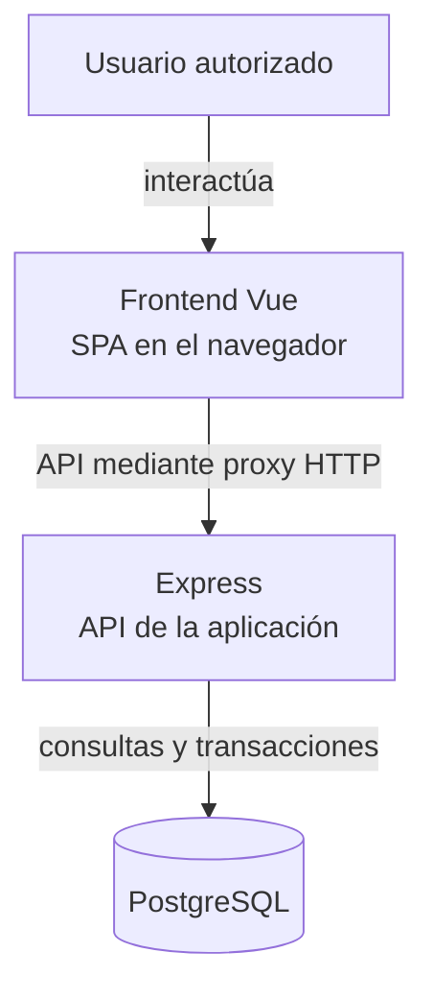
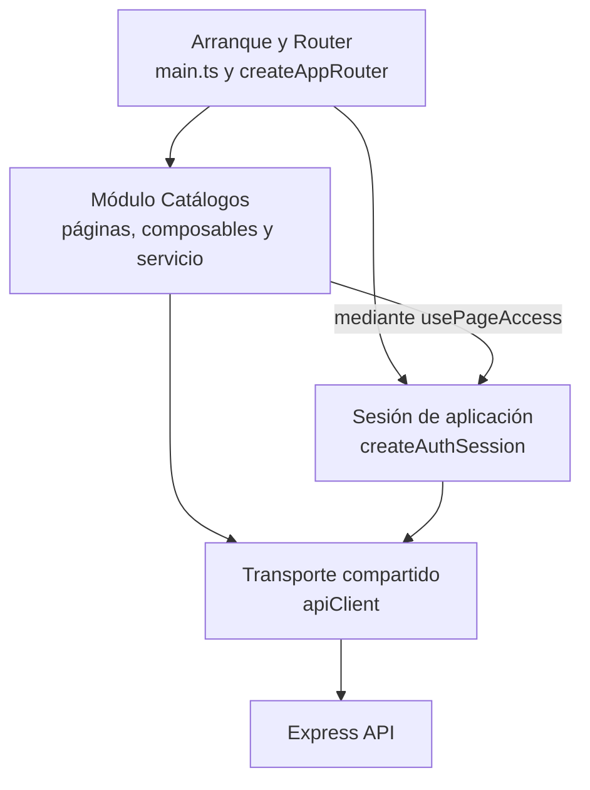

# Vista general de la arquitectura web

## Contexto y organización

La aplicación es una SPA cliente-servidor con dominios funcionales, componentes de
presentación, composables y adaptadores HTTP. La documentación se organiza en vistas
4+1. Los cortes C4 muestran límites y colaboradores; las secuencias describen mensajes
y decisiones; los estados describen modos y recuperación.

## Vista lógica de ejecución del cliente

**Identificador:** `DIA-VUE-ARQ-001`. **Pregunta:** ¿dónde se ejecuta Vue y qué
relación tiene con Express y PostgreSQL? **Fuente:** `main.ts`, Router,
`apiClient`, `vite.config.ts`, Dockerfiles y `back/src/lib/prisma.js`.
Vista inspirada en el nivel de contenedores C4 con cajas Mermaid: es una
aproximación, no notación C4 completa ni prueba de un proveedor desplegado.
Las flechas representan interacción o comunicación, no orden de arranque.

La SPA y la API son unidades de software con responsabilidades distintas. Un
«contenedor» C4 no equivale necesariamente a un contenedor Docker: Vue se ejecuta
en el navegador; Nginx u otro alojamiento entrega sus archivos estáticos.
El [Dockerfile frontend](../../../Dockerfile) compila `dist` y lo entrega con Nginx;
el [Dockerfile raíz](../../../../Dockerfile) prepara Express. No se necesita ejecutar
ambas aplicaciones en una misma imagen.

En desarrollo Vite sirve el cliente y deriva la API. En la imagen frontend,
[nginx.conf](../../../nginx.conf) configura el destino mediante `BACKEND_UPSTREAM`.
Las variantes de proveedor requieren su configuración de proxy/fallback y cookies;
el repositorio no acredita por sí solo cuál está desplegada. El navegador no
accede a Prisma, credenciales de PostgreSQL ni archivos privados del servidor.

## Vista de componentes: navegación y acceso a Catálogos

**Identificador:** `DIA-VUE-ARQ-002`. **Pregunta:** ¿qué componentes lógicos enlazan
navegación, sesión, módulo y transporte? **Fuente:** `main.ts`, `createAppRouter`,
`createAuthSession`, `usePageAccess`, `CatalogPage` y `catalogService`.
Corte de componentes inspirado en C4, representado con Mermaid; flechas = consumo
de un colaborador. No enumera todos los módulos ni representa unidades Docker.

La tabla de [fuentes propietarias](../../index.md#organización-y-fuentes-propietarias)
ubica los componentes. El [patrón contenedor/presentación](development/design-and-construction-patterns/02-container-and-presentation.md)
y los [composables configurados](development/design-and-construction-patterns/03-composables-and-callbacks.md)
amplían el interior del módulo; la [provisión de sesión](development/design-and-construction-patterns/06-session-provision.md)
explica que Router y páginas usan la misma instancia. Se evita repetir todo el
código de cada página en el diagrama arquitectónico.

## Cómo documentar una página o flujo web

C4 explica la estructura; una página necesita además su contrato de interacción.
Las guías de módulos mantienen esta información con el nivel de detalle útil:

| Información | Fuente o forma de comprobarla |
| --- | --- |
| Propósito y objetivo del usuario | Caso `CU-*` de la SRS, enlazado desde el módulo. |
| Ruta, contenedor y permiso de navegación | [Router](../../../src/app/router/index.ts) y configuración del recurso. No mantener otro catálogo manual exhaustivo que pueda divergir. |
| Estado y operaciones | Composable propietario y contrato de props/eventos; explicar carga, vacío, error, captura y confirmación cuando correspondan. |
| Entradas, salidas y errores | Esquema público, mapper y servicio del recurso; OpenAPI conserva el contrato HTTP normativo. |
| Reutilización y decisiones | Enlazar el patrón y su aplicación; justificar las variantes del módulo. |
| Evidencia y límites | Unitarias/componentes y recorrido Playwright representativo; distinguir API simulada de persistencia real. |

La estructura no exige una ficha ni todos los tipos de diagrama por cada ruta.
Por ejemplo, [Salidas](development/frontend-technical-documentation/07-issues.md) documenta modos y efectos visibles, mientras
[responsabilidades de documentos](development/design-and-construction-patterns/08-document-responsibilities.md) documenta la
colaboración interna. La [guía de inicio](../../development/01-getting-started.md) conserva el proceso
de preparación; una vista arquitectónica no sustituye instrucciones ejecutables.

## Referencias

- [Modelo C4](https://c4model.com/diagrams).
- [Vistas del cliente](index.md).
- [Criterios documentales](../../governance/03-standard-applicability.md).
