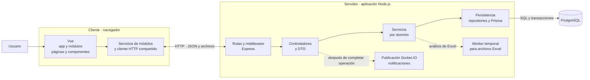
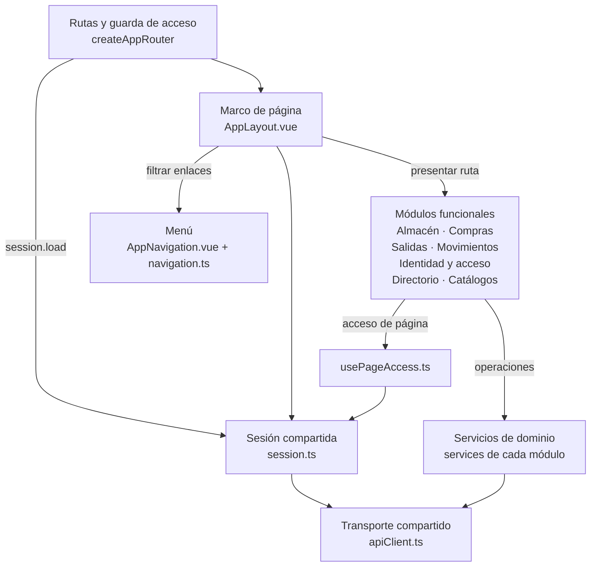

# Vista general de la arquitectura del sistema

## Contexto y organización

Nexus sigue un modelo cliente-servidor. Vue es una SPA organizada por módulos; la API
Express es un monolito modular organizado por dominios y capas. Las vistas 4+1 agrupan
la descripción: C4 muestra límites, y UML las dependencias y colaboraciones.

## Arquitectura general aplicada

**Identificador:** `DIA-SIS-ARQ-001`. **Pregunta:** ¿cómo colaboran el cliente web,
las capas de la API y la persistencia? **Fuentes:** módulos Vue, `apiClient.ts`,
`back/src/app.js`, `back/src/server.js`, servicios de dominio,
`back/src/lib/prisma.js` y `back/src/services/warehouse/imports/inventoryWorkbookService.js`.
Vista lógica de contexto y componentes con cajas Mermaid; no representa una topología
concreta de proveedores. Las flechas representan uso o comunicación, no orden de arranque.

**Lectura visual:** [formas, límites y flechas del mapa](diagram-reading.md#mapas-y-actividades).

Las capas de la API son responsabilidades dentro de la aplicación, no servicios
desplegados por separado. El worker se crea durante el procesamiento de Excel y no
es otro servicio. Socket.IO se muestra como publicación del backend; la versión actual
de Vue no se suscribe a ese canal. Para la distribución de procesos y alojamiento,
consulte la [vista física](physical/index.md); para detalles de la API, su
 [arquitectura backend](../../../../back/docs/architecture/index.md#capas-y-componentes-del-backend).

## Componentes de aplicación y módulos funcionales

**Identificador:** `DIA-VUE-ARQ-002`. **Pregunta:** ¿qué componentes comparten las
páginas funcionales y cómo se conectan al marco de navegación? **Fuente:** `main.ts`,
`app/router/index.ts`, `AppLayout`, `AppNavigation`, `app/navigation.ts`,
`usePageAccess`, `session.ts` y los servicios de cada módulo.
Mapa de componentes lógicos con Mermaid. Las flechas indican uso de un colaborador.
Los módulos y sus servicios se agrupan por responsabilidad; sus archivos y
dependencias internas se desarrollan en los mapas por capacidad.

La [provisión de
sesión](development/design-and-construction-patterns/06-session-provision.md) explica el
arranque. Login, recuperación y página no encontrada quedan fuera del marco protegido.
Consulte [Navegación](scenarios/navigation-and-screens.md) para rutas,
[Componentes](logical/components/index.md) para dependencias y
[Patrones](development/design-and-construction-patterns/index.md) para colaboraciones.

## Referencias

- [Modelo C4](https://c4model.com/diagrams).
- [Vistas del cliente](index.md).
- [ISO/IEC/IEEE 42010:2022](https://www.iso.org/standard/74393.html), como guía para organizar puntos de vista y modelos.
