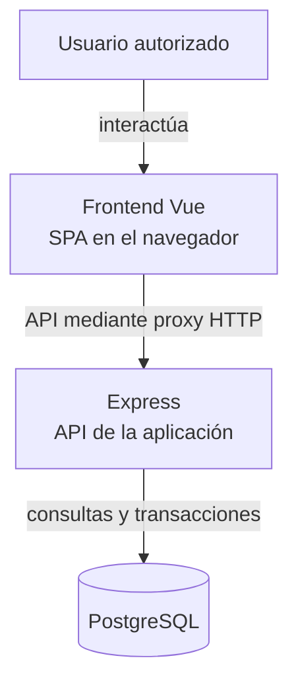
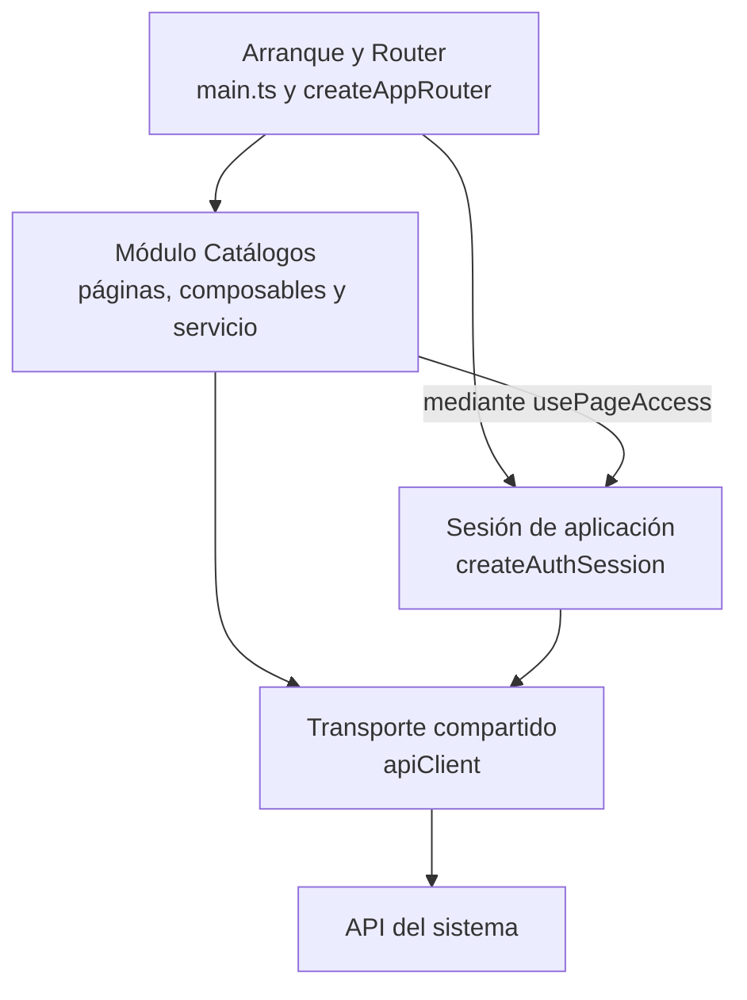

# Vista general de la arquitectura web

## Contexto y organización

La aplicación es una SPA cliente-servidor con dominios funcionales, componentes de
presentación, composables y adaptadores HTTP. La documentación se organiza en vistas
4+1. Los cortes C4 muestran límites y colaboradores; las secuencias describen mensajes
y decisiones; los estados describen modos y recuperación.

## Vista lógica de ejecución del cliente

**Identificador:** `DIA-VUE-ARQ-001`. **Pregunta:** ¿dónde se ejecuta Vue y qué
relación tiene con Express y PostgreSQL? **Fuente:** `main.ts`, Router,
`apiClient`, `vite.config.ts`, Dockerfiles y `back/src/lib/prisma.js`.
Vista inspirada en el nivel de contenedores C4 con cajas Mermaid: es una
aproximación, no notación C4 completa ni prueba de un proveedor desplegado.
Las flechas representan interacción o comunicación, no orden de arranque.

**Lectura visual:** [formas, límites y flechas del mapa](diagram-reading.md#mapas-y-actividades).

Un contenedor C4 es una unidad de software; no equivale a una imagen Docker.
La [vista física](physical/index.md) define alojamiento, proxy, cookies y variantes
de ejecución.

## Vista de componentes: navegación y acceso a Catálogos

**Identificador:** `DIA-VUE-ARQ-002`. **Pregunta:** ¿qué componentes lógicos enlazan
navegación, sesión, módulo y transporte? **Fuente:** `main.ts`, `createAppRouter`,
`createAuthSession`, `usePageAccess`, `CatalogPage` y `catalogService`.
Corte de componentes inspirado en C4, representado con Mermaid; flechas = consumo
de un colaborador. No enumera todos los módulos ni representa unidades Docker.

Detalle por capacidad: [componentes](logical/components/index.md). Mecanismos de
construcción: [patrones](development/design-and-construction-patterns/index.md).

## Referencias

- [Modelo C4](https://c4model.com/diagrams).
- [Vistas del cliente](index.md).
- [Criterios documentales](../../governance/03-standard-applicability.md).
