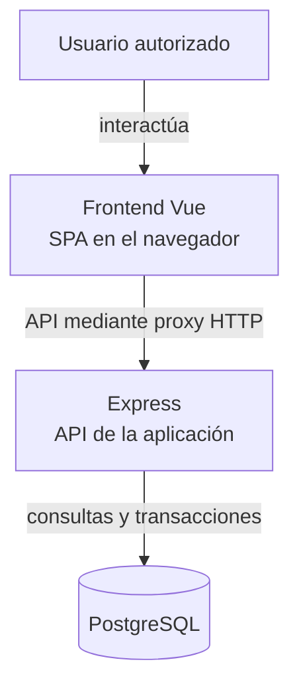
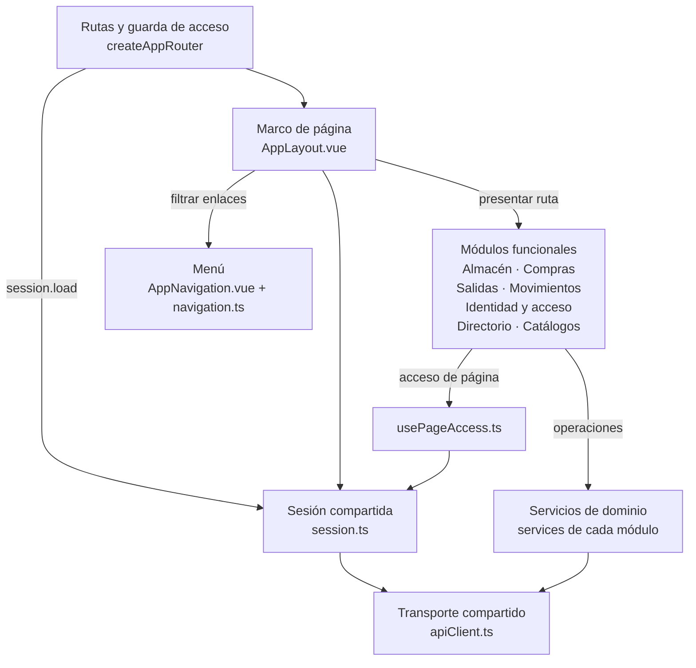

# Vista general de la arquitectura web

## Contexto y organización

La aplicación es una SPA cliente-servidor con dominios funcionales, componentes de
presentación, composables y adaptadores HTTP. La documentación se organiza en vistas
4+1. Los cortes C4 muestran límites y colaboradores; las secuencias describen mensajes
y decisiones; los estados describen modos y recuperación.

## Vista lógica de ejecución del cliente

**Identificador:** `DIA-VUE-ARQ-001`. **Pregunta:** ¿dónde se ejecuta Vue y qué
relación tiene con Express y PostgreSQL? **Fuente:** `main.ts`, Router,
`apiClient`, `vite.config.ts`, Dockerfiles y `back/src/lib/prisma.js`.
Vista inspirada en el nivel de contenedores C4 con cajas Mermaid: es una
aproximación, no notación C4 completa ni prueba de un proveedor desplegado.
Las flechas representan interacción o comunicación, no orden de arranque.

**Lectura visual:** [formas, límites y flechas del mapa](diagram-reading.md#mapas-y-actividades).

Un contenedor C4 es una unidad de software; no equivale a una imagen Docker.
La [vista física](physical/index.md) define alojamiento, proxy, cookies y variantes
de ejecución.

## Componentes de aplicación y módulos funcionales

**Identificador:** `DIA-VUE-ARQ-002`. **Pregunta:** ¿qué componentes comparten las
páginas funcionales y cómo se conectan al marco de navegación? **Fuente:** `main.ts`,
`app/router/index.ts`, `AppLayout`, `AppNavigation`, `app/navigation.ts`,
`usePageAccess`, `session.ts` y los servicios de cada módulo.
Mapa de componentes lógicos con Mermaid. Las flechas indican uso de un colaborador.
Los módulos y sus servicios se agrupan por responsabilidad; sus archivos y
dependencias internas se desarrollan en los mapas por capacidad.

La [provisión de sesión](development/design-and-construction-patterns/06-session-provision.md)
desarrolla el arranque en `main.ts`. Las rutas públicas de login, recuperación de acceso y página no encontrada están
fuera del marco protegido. El [catálogo de navegación](scenarios/navigation-and-screens.md)
identifica todas las rutas y sus entradas. Los [componentes por capacidad](logical/components/index.md)
desarrollan las dependencias internas; los [patrones](development/design-and-construction-patterns/index.md),
el proceso de colaboración.

## Referencias

- [Modelo C4](https://c4model.com/diagrams).
- [Vistas del cliente](index.md).
- [Criterios documentales](../../governance/03-standard-applicability.md).
