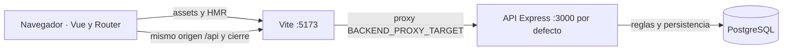
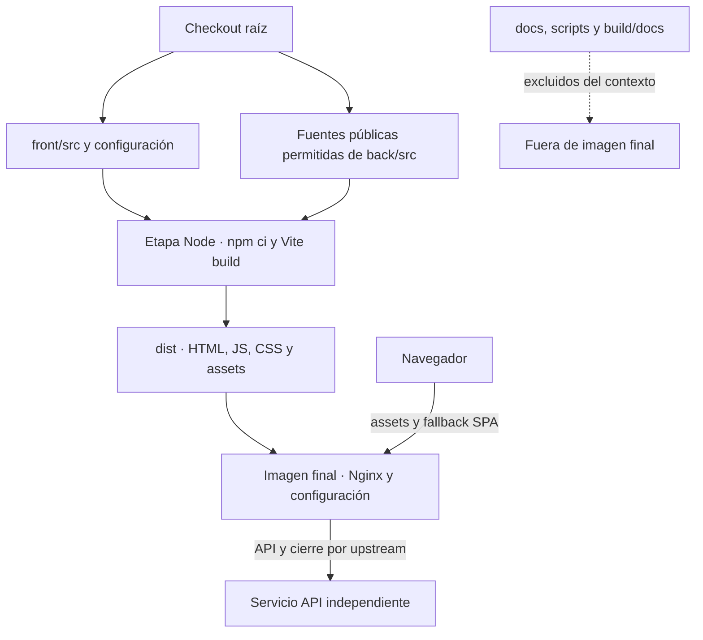

# Ejecución y frontera de construcción

**Identificador:** `DIA-VUE-FIS-001`. **Pregunta:** ¿Qué se ejecuta en desarrollo y por dónde pasa la API?

**Fuente:** vite.config.ts, main.ts y apiClient.ts. **Notación y alcance:** Topología de ejecución aproximada con Mermaid; conexiones HTTP y persistencia, no UML de despliegue completo.

**Identificador:** `DIA-VUE-FIS-002`. **Pregunta:** ¿Qué entra al build y qué llega a la imagen final?

**Fuente:** front/Dockerfile, Dockerfile.dockerignore y nginx.conf. **Notación y alcance:** Mapa de artefactos y ejecución; las etapas build y runtime se distinguen de procesos desplegados.

El [procedimiento de despliegue](../../../development/03-build-and-deployment.md) concreta comandos, variables, cookies y recuperación de fallos.
