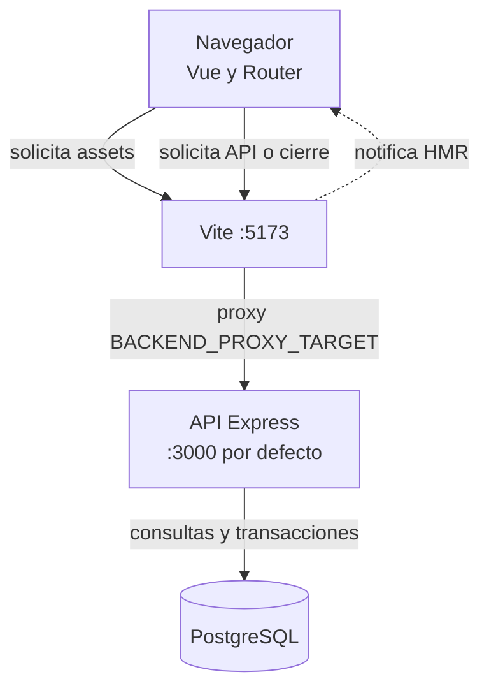
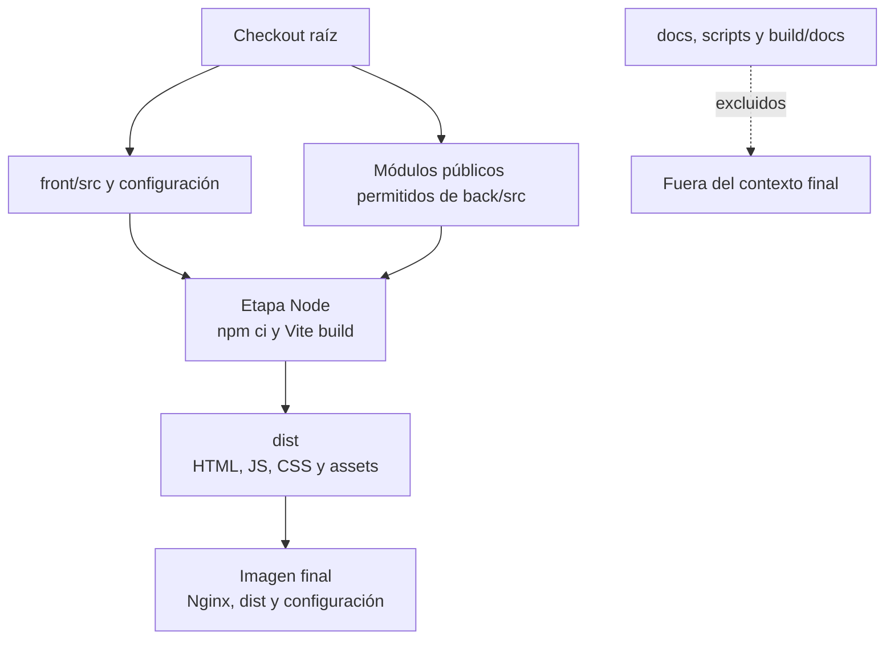
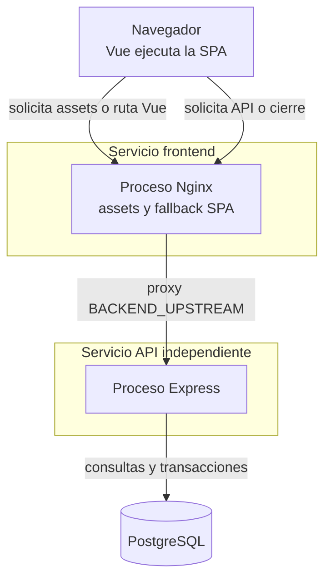

# Ejecución y frontera de construcción

## Desarrollo local

**Identificador:** `DIA-VUE-FIS-001`. **Pregunta:** ¿Qué solicita el navegador y qué
servicio atiende cada ruta? **Fuente:** `vite.config.ts`, `main.ts` y `apiClient.ts`.
Mapa de comunicación; las cajas son unidades de ejecución, sin notación UML de despliegue completa.

**Lectura visual:** [cajas, límites y conexiones](../diagram-reading.md#mapas-y-actividades).
Las flechas etiquetan solicitud, notificación o acceso a datos; no indican orden de arranque.

## Construcción de artefactos

**Identificador:** `DIA-VUE-FIS-002`. **Pregunta:** ¿Qué fuentes producen el cliente
y qué se incorpora a la imagen? **Fuente:** `front/Dockerfile`, `Dockerfile.dockerignore`
y configuración Vite. Mapa de transformación de artefactos; las flechas continuas
significan entrada/producto y la discontinua marca exclusión.

## Ejecución de la imagen frontend

**Identificador:** `DIA-VUE-FIS-003`. **Pregunta:** ¿Qué se ejecuta después de
construir y dónde se procesa cada solicitud? **Fuente:** `front/Dockerfile`, `nginx.conf`
y `apiClient.ts`. Topología de ejecución aproximada: las agrupaciones identifican
procesos/servicios, no paquetes de código ni contenedores C4 completos.

| Elemento | Responsabilidad y límite |
| --- | --- |
| Imagen final | Artefacto construido; su ejecución inicia Nginx. |
| Nginx | Entrega archivos/fallback y deriva API/cierre; no ejecuta la lógica Vue del navegador. |
| Navegador | Ejecuta Vue/Router y administra cookies de acuerdo con origen y atributos. |
| API | Autentica, autoriza, valida y persiste; no recibe las fuentes de documentación. |
| Alojamiento alternativo | Debe cubrir assets, fallback y la estrategia de API/cookies; no implica usar esta imagen Nginx. |

La [guía de despliegue](../../../development/03-build-and-deployment.md) conserva
comandos, variables y recuperación. Las reglas públicas se incorporan al compilar;
los assets resultantes no leen el filesystem del contenedor API en ejecución.
