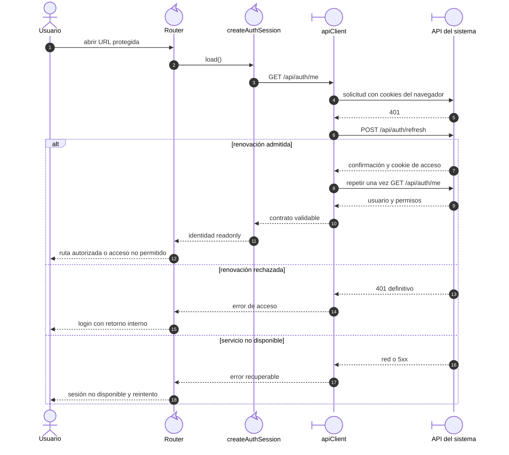

# 1. Arranque y acceso protegido

## Participantes y preparación

`main.ts` crea aplicación, carga Vuetify, crea sesión/Router, proporciona sesión,
instala Router, espera su resolución inicial y monta. Un fallo del arranque presenta
`StartupErrorPage`. La guarda de una ruta protegida usa la misma sesión que las páginas.
`createAuthSession` deduplica una carga pendiente y valida identidad/permisos recibidos.

## Secuencia de renovación

**ID:** `DIA-VUE-SEQ-001`. **Pregunta:** ¿cómo se recupera una URL protegida con access
vencido? **Fuente:** `main.ts`, Router, `modules/auth/session.ts` y `apiClient.ts`.
Participantes funcionales del cliente y API externa; flechas continuas = petición,
discontinuas = respuesta. El escenario supone cookie de renovación disponible.

**Lectura visual:** [líneas de vida, números y mensajes](../../diagram-reading.md#secuencias).

## Concurrencia y recuperación

El cliente mantiene una promesa de refresh para solicitudes protegidas concurrentes;
cada petición se reintenta como máximo una vez. Login y refresh desactivan esa
recuperación para evitar ciclos. La sesión descarta identidad al fallar la carga.
`AccessErrorPage` bloquea doble reintento, informa fallo/espera y vuelve al destino
preservado. La guarda vuelve a comprobar sus permisos.

## Evidencia

Casos `CU-AUT-01/02`, diseños de sesión, `apiClientTest.ts`, `routerTest.ts`,
`sessionRecovery.spec.ts` y el representante real de sistema. El registro de pruebas
separa renovación simulada de cookies/servidor reales.
