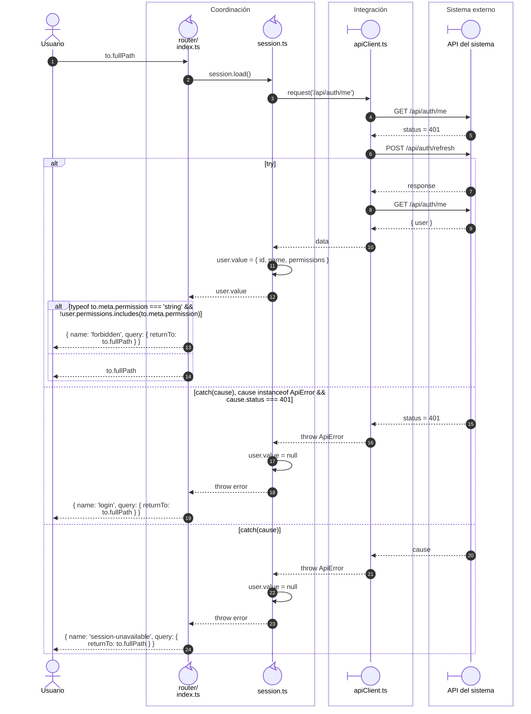
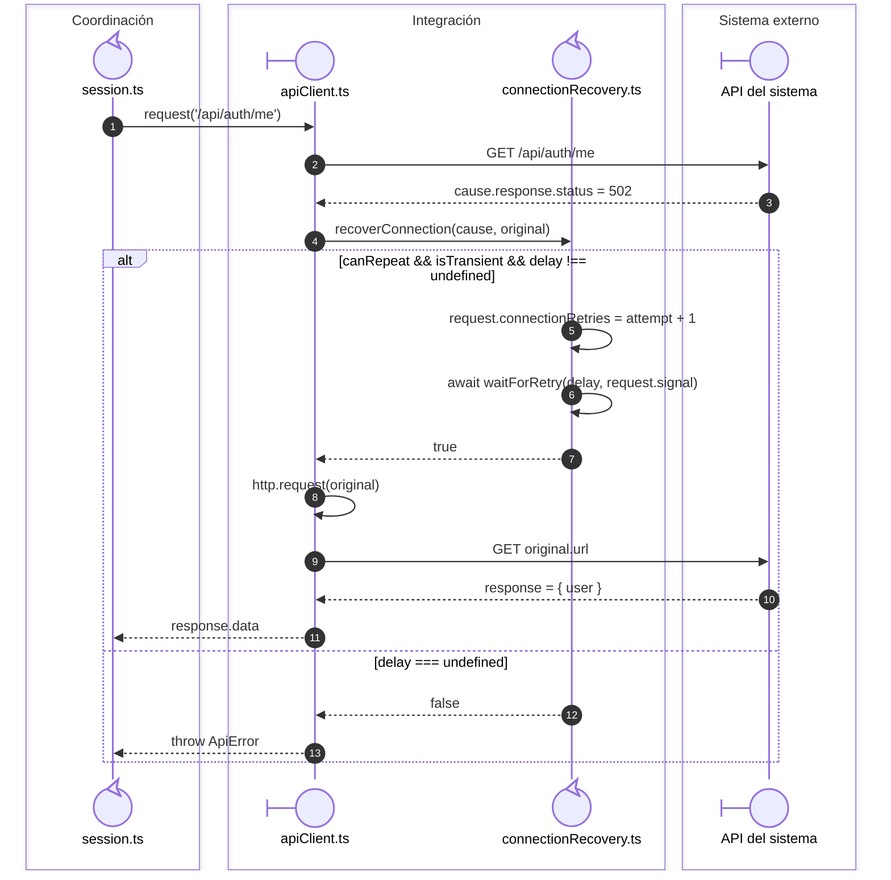

# 1. Arranque y acceso protegido

## Secuencia de renovación

**Identificador:** `DIA-VUE-SEQ-001`.

## Fuentes de los participantes

[index.ts](../../../../../src/app/router/index.ts),
[session.ts](../../../../../src/modules/auth/session.ts),
[apiClient.ts](../../../../../src/shared/http/apiClient.ts).

## Recuperación automática de conexión

**Identificador:** `DIA-VUE-SEQ-056`. Lectura que falla y cuyo siguiente intento
responde correctamente, o fallo cuyo presupuesto de recuperación ya terminó.
La [política HTTP](../../../contracts/client-contracts.md#sesión-y-errores) fija
los errores admitidos y el límite. Durante el arranque, `index.html` presenta
**Cargando Nexus…** hasta que el router resuelve el acceso.

Fuente de la política: [connectionRecovery.ts](../../../../../src/shared/http/connectionRecovery.ts).
