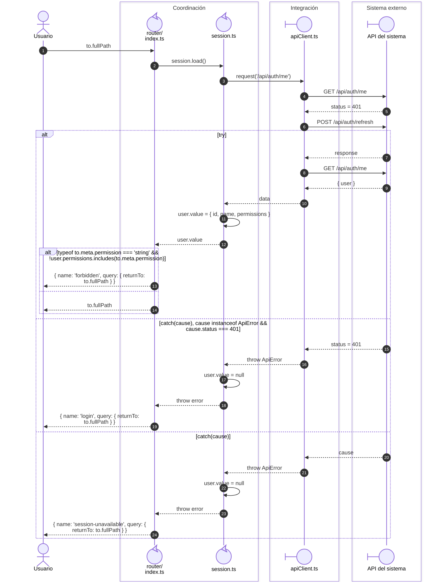

# 1. Arranque y acceso protegido

## Secuencia de renovación

**Identificador:** `DIA-VUE-SEQ-001`.

## Fuentes de los participantes

[index.ts](../../../../../src/app/router/index.ts),
[session.ts](../../../../../src/modules/auth/session.ts),
[apiClient.ts](../../../../../src/shared/http/apiClient.ts).
