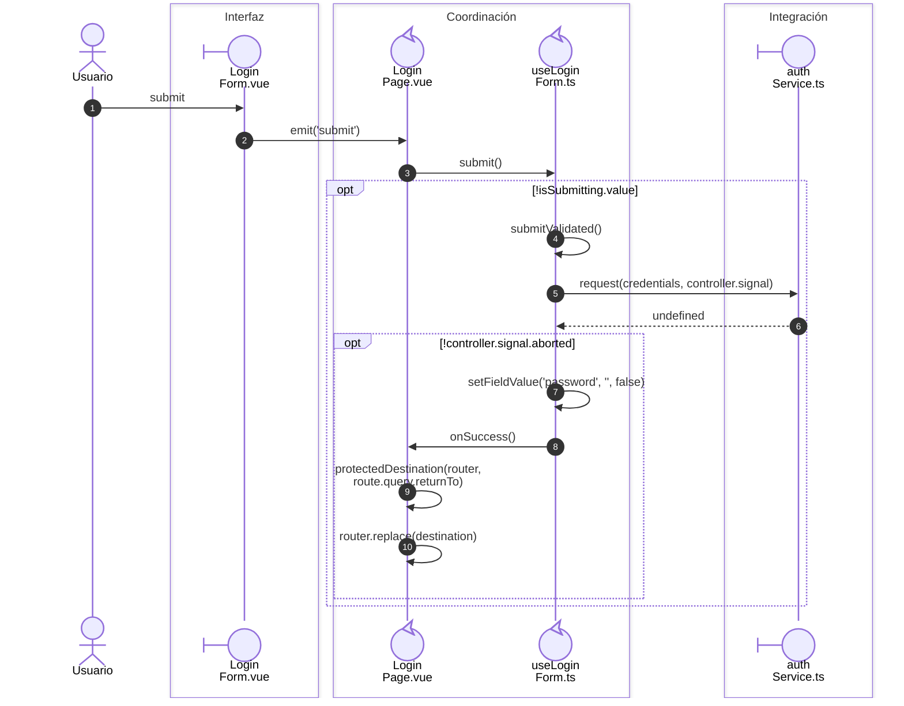
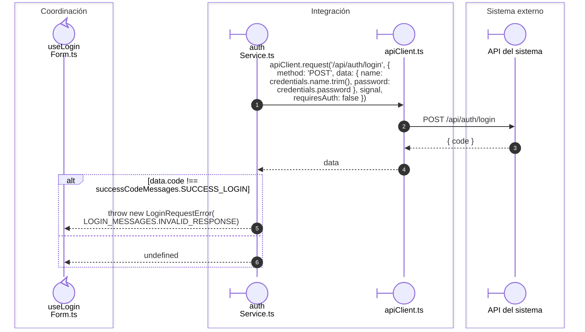
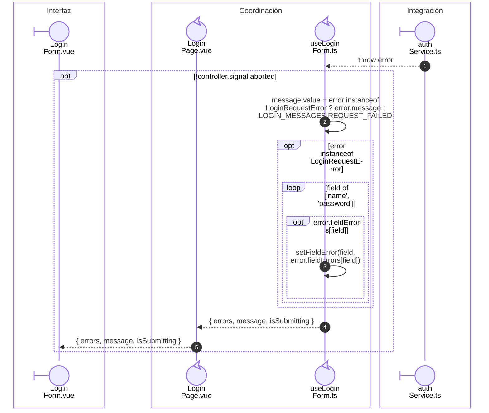
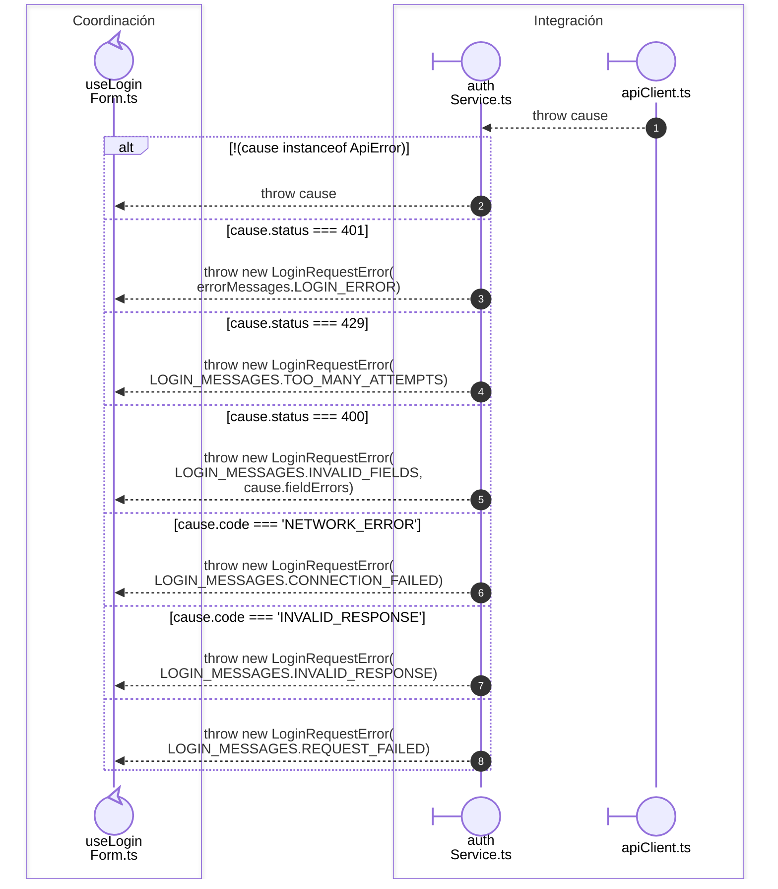

# Captura, login y navegación

**Casos relacionados:** CU-AUT-01.

## Secuencia aplicada

**Identificador:** `DIA-VUE-SEQ-003`.

## Petición y contrato de acceso

**Identificador:** `DIA-VUE-SEQ-047`.

## catch(error) en el formulario

**Identificador:** `DIA-VUE-SEQ-054`.

## catch(cause) en loginRequest

**Identificador:** `DIA-VUE-SEQ-055`.

## Fuentes de los participantes

[LoginForm.vue](../../../../../src/modules/auth/components/LoginForm.vue),
[LoginPage.vue](../../../../../src/modules/auth/pages/LoginPage.vue),
[useLoginForm.ts](../../../../../src/modules/auth/composables/useLoginForm.ts),
[authService.ts](../../../../../src/modules/auth/services/authService.ts),
[apiClient.ts](../../../../../src/shared/http/apiClient.ts).
