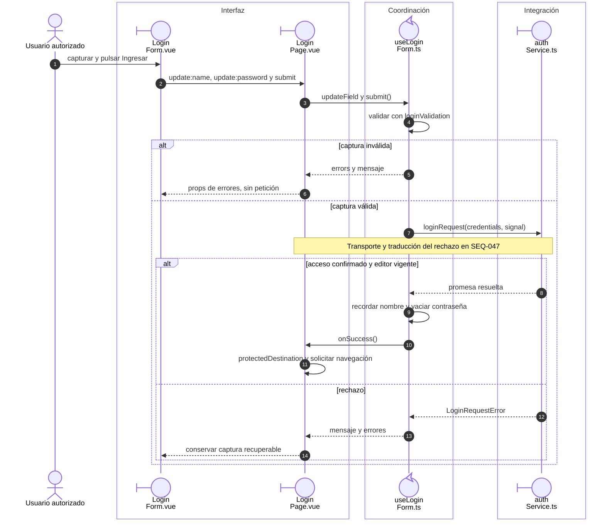
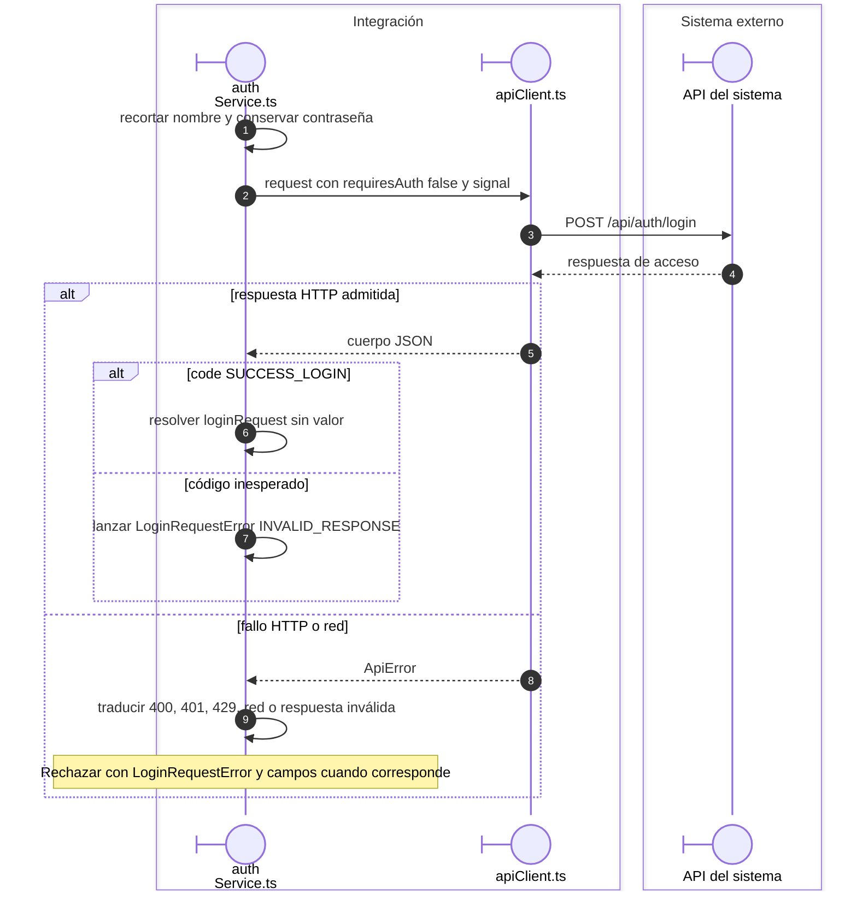

# Captura, login y navegación

## Escenario y contratos

**Casos relacionados:** CU-AUT-01.

## Secuencia aplicada

**Identificador:** `DIA-VUE-SEQ-003`.

**Lectura visual:** [líneas de vida, números y mensajes](../../diagram-reading.md#secuencias).

## Petición y contrato de acceso

**Identificador:** `DIA-VUE-SEQ-047`. Amplía `loginRequest` sin representar objetos internos de la biblioteca HTTP.

## Reglas y recuperación

Los espacios de contraseña se conservan; nombre se recorta al construir la solicitud. Un fallo de Storage no revoca un acceso ya confirmado. La [renovación y retorno](01-bootstrap-and-session.md) tienen secuencia propia.

## Evidencia

login.spec.ts, useLoginFormTest.ts y authServiceTest.ts. La [matriz por caso](../../../../testing/04-use-case-coverage.md) identifica alcance y límites, y el [registro CP](../../../../testing/03-test-cases.md) concreta datos y oráculos críticos.

## Fuentes de los participantes

[LoginForm.vue](../../../../../src/modules/auth/components/LoginForm.vue),
[LoginPage.vue](../../../../../src/modules/auth/pages/LoginPage.vue),
[useLoginForm.ts](../../../../../src/modules/auth/composables/useLoginForm.ts),
[authService.ts](../../../../../src/modules/auth/services/authService.ts),
[apiClient.ts](../../../../../src/shared/http/apiClient.ts).
