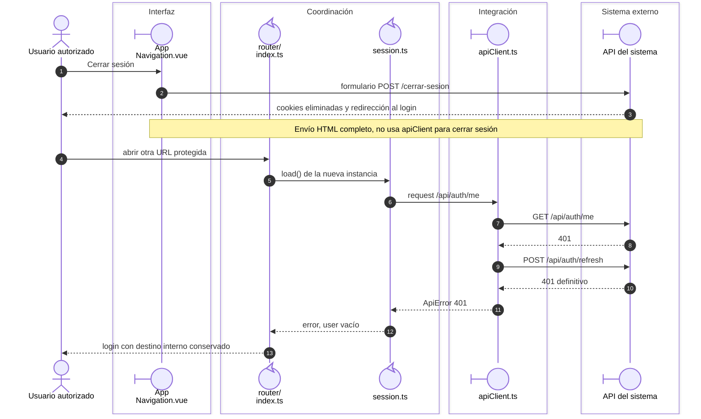

# Cierre de sesión y acceso posterior

## Escenario y contratos

**Casos relacionados:** CU-AUT-02.

## Secuencia aplicada

**Identificador:** `DIA-VUE-SEQ-020`.

**Lectura visual:** [líneas de vida, números y mensajes](../../diagram-reading.md#secuencias).

## Reglas y recuperación

El cierre elimina el acceso de ese navegador. No se afirma revocación central de cualquier copia previa del token. Una navegación completa recrea la instancia de sesión del cliente.

## Evidencia

sessionRecovery.spec.ts y application.spec.ts. La [matriz por caso](../../../../testing/04-use-case-coverage.md) identifica alcance y límites, y el [registro CP](../../../../testing/03-test-cases.md) concreta datos y oráculos críticos.

## Fuentes de los participantes

[AppNavigation.vue](../../../../../src/app/components/AppNavigation.vue),
[index.ts](../../../../../src/app/router/index.ts),
[session.ts](../../../../../src/modules/auth/session.ts),
[apiClient.ts](../../../../../src/shared/http/apiClient.ts).
