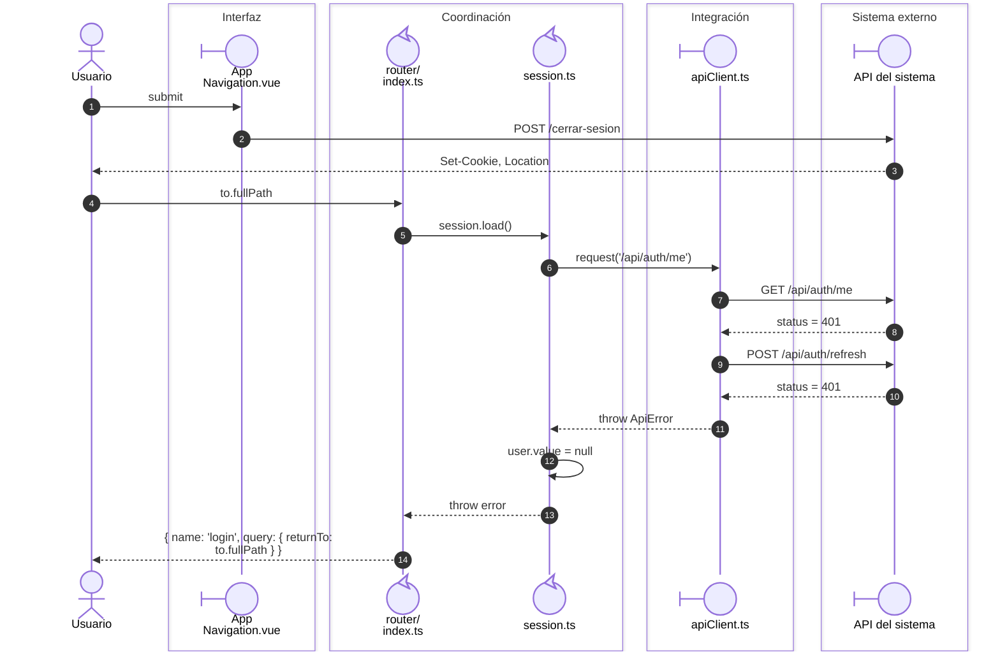

# Cierre de sesión y acceso posterior

**Casos relacionados:** CU-AUT-02.

## Secuencia aplicada

**Identificador:** `DIA-VUE-SEQ-020`.

## Fuentes de los participantes

[AppNavigation.vue](../../../../../src/app/components/AppNavigation.vue),
[index.ts](../../../../../src/app/router/index.ts),
[session.ts](../../../../../src/modules/auth/session.ts),
[apiClient.ts](../../../../../src/shared/http/apiClient.ts).
