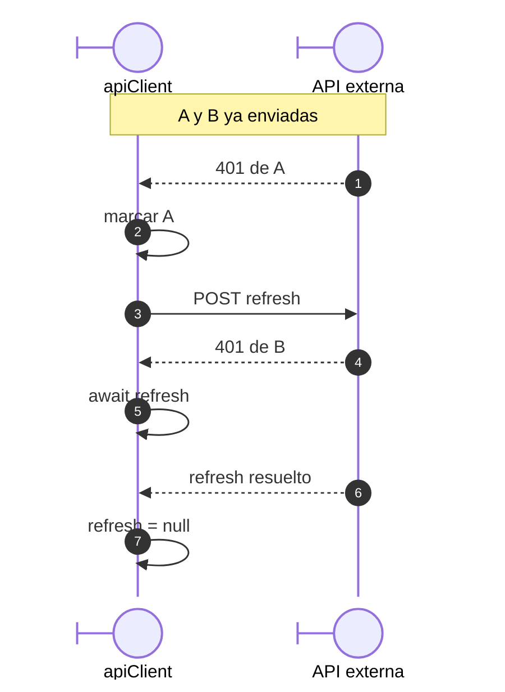
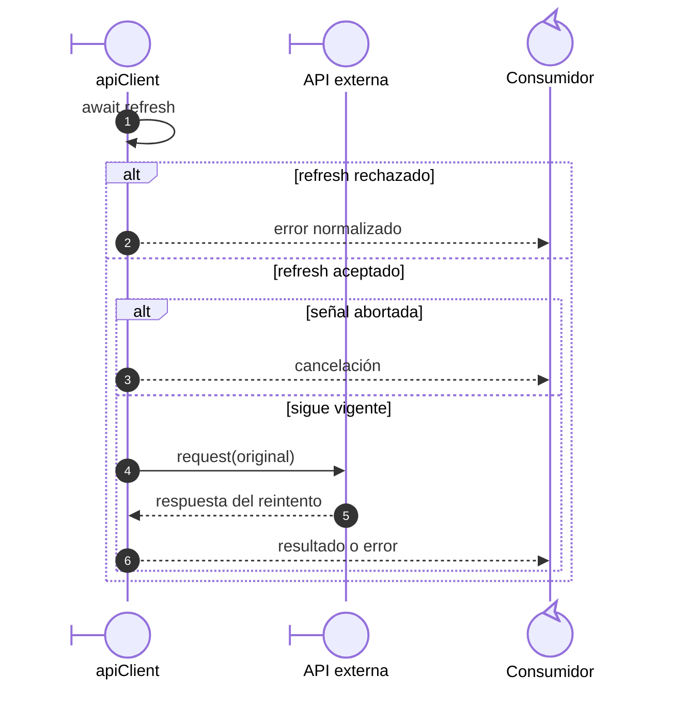

# Renovación compartida ante respuestas 401

## Escenario y contratos

**Identificador:** `DIA-VUE-SEQ-024`. **Pregunta:** ¿Cómo se evita renovar dos
veces cuando fallan varias peticiones autenticadas durante una misma renovación?
**Casos relacionados:** CU-AUT-01 y consultas autenticadas.
**Fuentes:** [apiClient.ts](../../../../../src/shared/http/apiClient.ts),
[session.ts](../../../../../src/modules/auth/session.ts),
[apiClientTest.ts](../../../../../tests/unit/shared/http/apiClientTest.ts).
**Notación:** secuencia UML con respuestas y ramas; A y B son solicitudes independientes
que reciben 401 mientras la misma promesa `refresh` está pendiente.

**Lectura visual:** [líneas de vida, números y mensajes](../../diagram-reading.md#secuencias).

## Continuación de cada petición original

**Identificador:** `DIA-VUE-SEQ-028`. **Pregunta:** ¿Cuándo se reenvía el original
y qué recibe su consumidor? **Fuente y notación:** mismo interceptor; secuencia de una
petición que esperaba la promesa anterior. Cada petición ejecuta su continuación.

El POST completo es `/api/auth/refresh` con `requiresAuth: false`. A y B conservan
`hasRetried: true`; la primera figura omite el envío inicial y representa sólo la
coincidencia de sus 401 durante la renovación. `finally` libera la promesa tanto si
se resuelve como si se rechaza. La segunda figura conserva la guarda de cancelación.

## Guardas y recuperación

El interceptor sólo renueva un 401 con configuración original, autenticación habilitada
y `hasRetried` falso. Un 403, un fallo de red/502 o una petición ya reintentada no abre
otra renovación. El propio refresh usa `requiresAuth: false`, evitando recursión.
La cancelación de una petición original no cancela la renovación que otras esperan.

Si la señal de un original fue cancelada, devuelve cancelación a ese consumidor y
omite su reenvío; los otros originales conservan su recorrido independiente.
Compartir promesa cubre respuestas concurrentes durante su vida; no convierte fallos
futuros en una renovación permanente ni repite escrituras arbitrariamente.

`createAuthSession.load` comparte otra promesa, `loading`, para lecturas simultáneas de
`/api/auth/me`. Esa deduplicación de sesión y la renovación HTTP pertenecen a capas
distintas. El [arranque y guarda](01-bootstrap-and-session.md) decide navegación tras
éxito, sesión terminada o servicio no disponible. Un reintento manual vuelve a comprobar
acceso; no anuncia autenticación sin respuesta válida.
