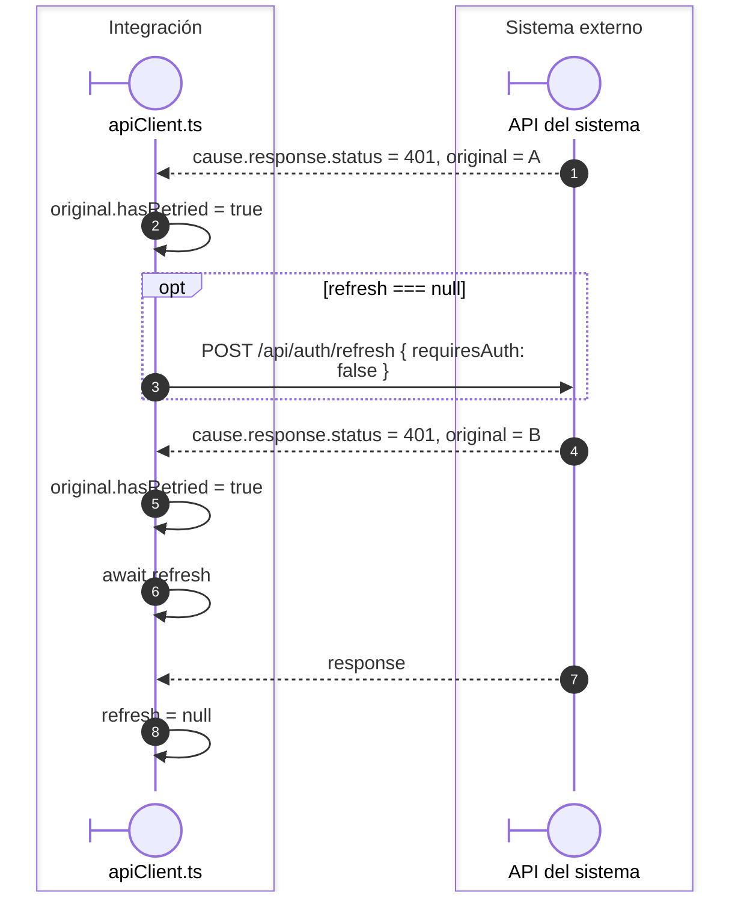
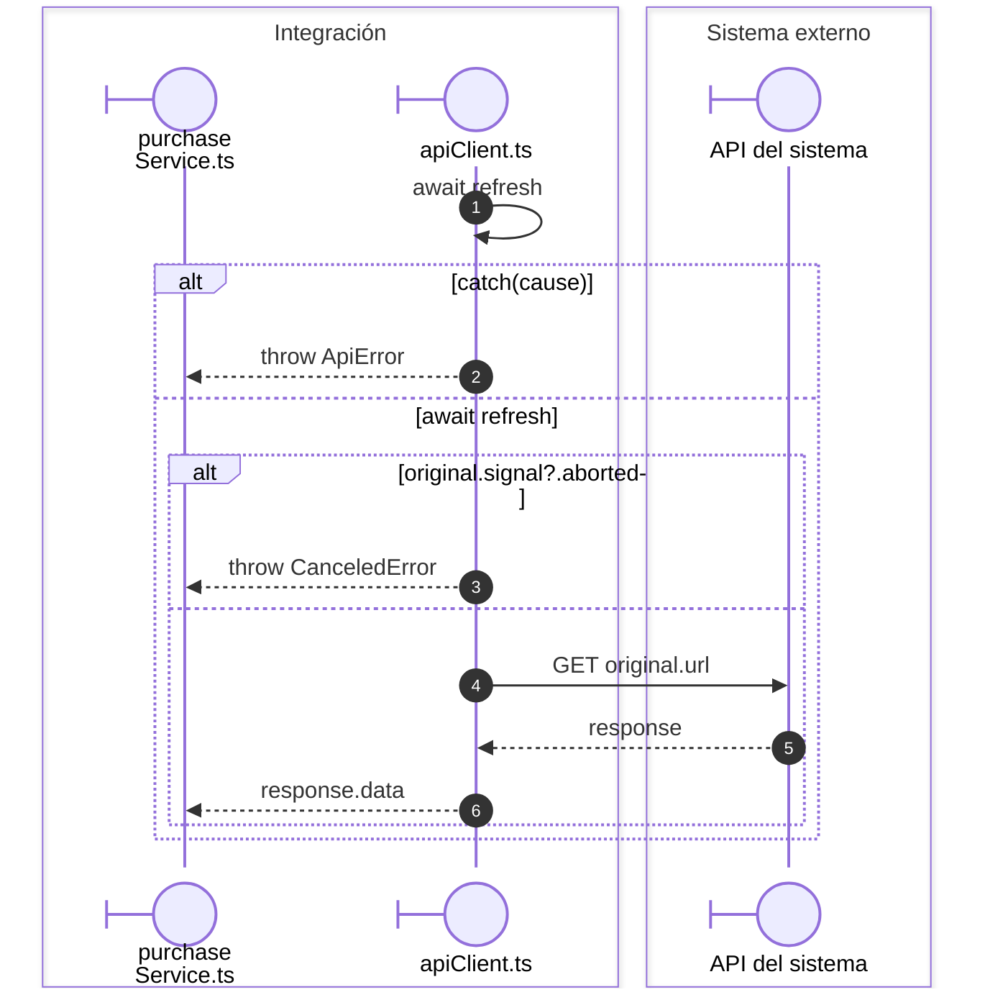

# Renovación compartida ante respuestas 401

**Casos relacionados:** CU-AUT-01 y consultas autenticadas.

## Escenario y contratos

**Identificador:** `DIA-VUE-SEQ-024`.

## Continuación de cada petición original

**Identificador:** `DIA-VUE-SEQ-028`.

## Fuentes de los participantes

[apiClient.ts](../../../../../src/shared/http/apiClient.ts),
[purchaseService.ts](../../../../../src/modules/purchases/services/purchaseService.ts).
