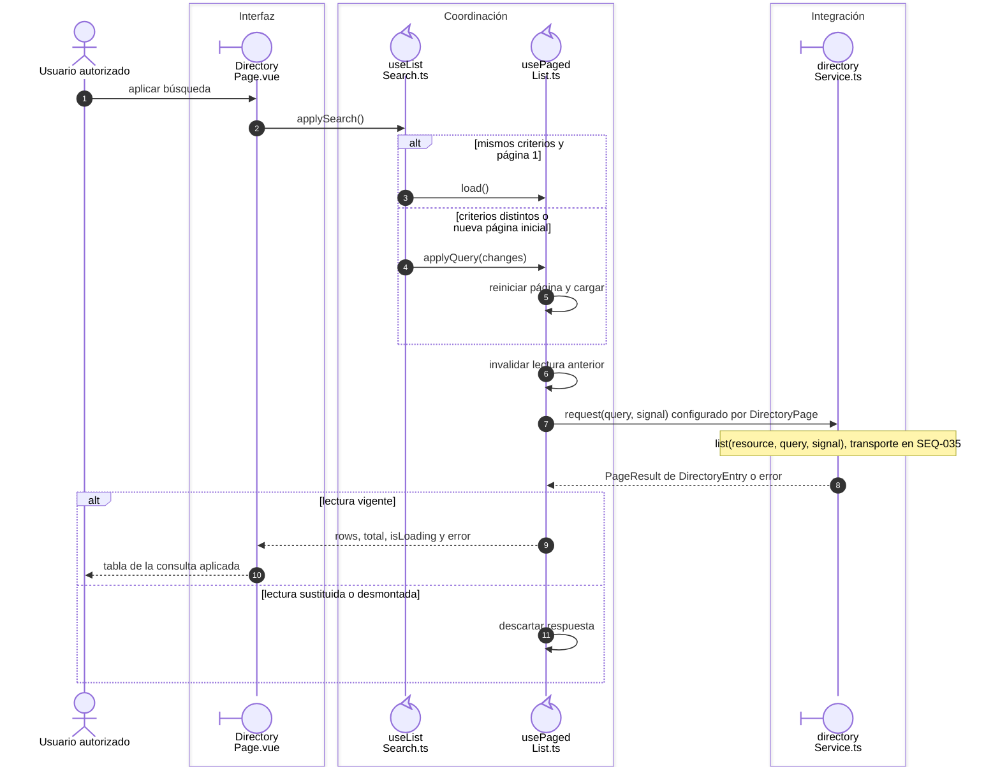

# 2. Consulta y guardado de registros

## Consulta remota

La página aporta recurso, permisos y operación al composable de lista. La búsqueda
borrador sólo cambia la query al aplicar. `useTableQuery` traduce orden/página a los
índices permitidos; el servicio valida conteos y filas del resultado. Una consulta
posterior invalida la anterior; desmontar impide publicar respuestas.

**ID:** `DIA-VUE-SEQ-002`. **Pregunta:** ¿qué cambia al aplicar búsqueda y cómo se
conserva el propietario de la tabla? **Fuente:** `useListSearch`, `usePagedList`,
`useTableQuery`, `DirectoryPage` y `directoryService`. La figura desarrolla la
búsqueda de Directorio; el transporte paginado se amplía en `SEQ-035`.

**Lectura visual:** [líneas de vida, números y mensajes](../../diagram-reading.md#secuencias).

## Guardado confirmado

La captura y esquema pertenecen al editor; el mapper arma el payload del modo y el
servicio valida su respuesta. `useRecordSave` administra pendiente, error y conflicto.
Un éxito contractual devuelve el resultado al contenedor para cerrar/recargar/avisar.
El [diagrama aplicado](../../development/design-and-construction-patterns/08-document-responsibilities.md#secuencia-de-guardado-confirmado)
muestra la colaboración completa y el [estado del coordinador](../../logical/state-and-lifecycle.md#ciclo-de-guardado)
identifica sus transiciones.

## Errores y ausencia de efectos

La captura inválida no llama al servicio. 400 coloca errores de campo; 409 de versión
conserva captura y exige lectura nueva. Una red fallida permite reintento explícito;
no anuncia éxito ni repite en bucle. Abrir/cancelar el modal no recarga como si hubiera
un guardado. Un callback de una instancia desmontada no cierra otra captura.

## Evidencia

Las pruebas de catálogo, directorio, identidad e inventario representan payload,
conflicto y cierre. Las pruebas de lista representan secuencia, búsqueda y recarga.
La [cobertura por CU](../../../../testing/04-use-case-coverage.md) conserva los límites por recurso.

## Fuentes de los participantes

[DirectoryPage.vue](../../../../../src/modules/directory/pages/DirectoryPage.vue),
[useListSearch.ts](../../../../../src/shared/composables/useListSearch.ts),
[usePagedList.ts](../../../../../src/shared/composables/usePagedList.ts),
[directoryService.ts](../../../../../src/modules/directory/services/directoryService.ts).
