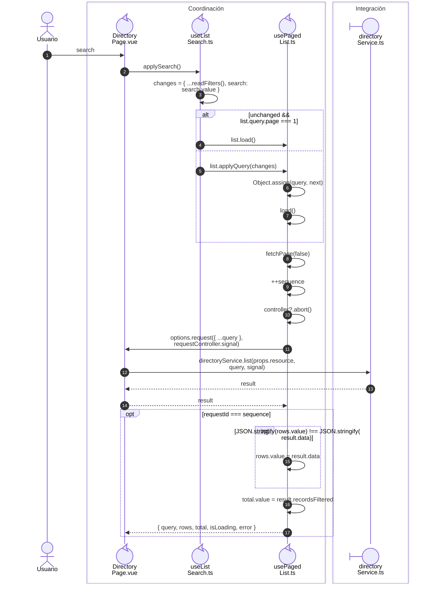

# 2. Consulta y guardado de registros

## Consulta remota

**Identificador:** `DIA-VUE-SEQ-002`.

## Fuentes de los participantes

[DirectoryPage.vue](../../../../../src/modules/directory/pages/DirectoryPage.vue),
[useListSearch.ts](../../../../../src/shared/composables/useListSearch.ts),
[usePagedList.ts](../../../../../src/shared/composables/usePagedList.ts),
[directoryService.ts](../../../../../src/modules/directory/services/directoryService.ts).

## Secuencias relacionadas

[DIA-VUE-SEQ-035](07-http-and-contracts.md#lectura-paginada-y-adaptación-de-filas).
