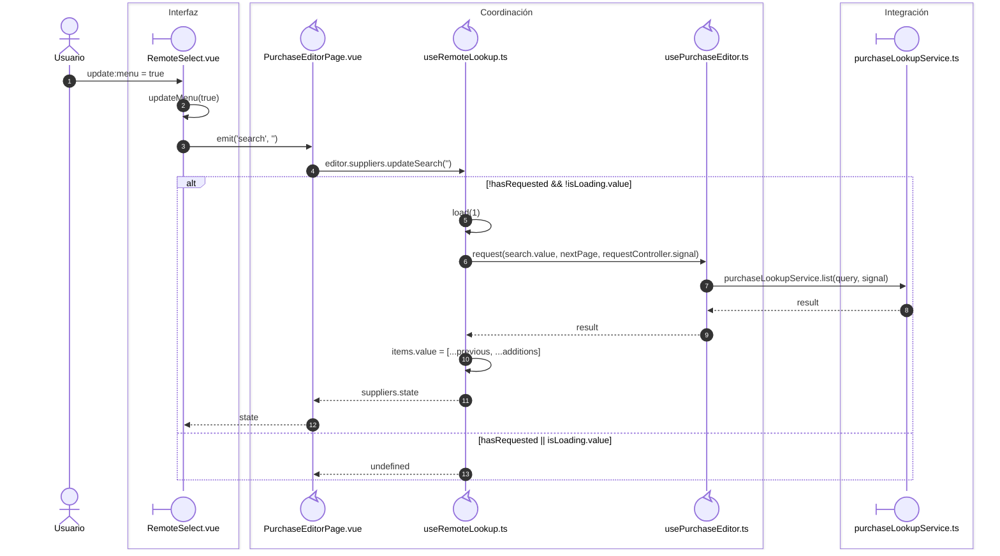
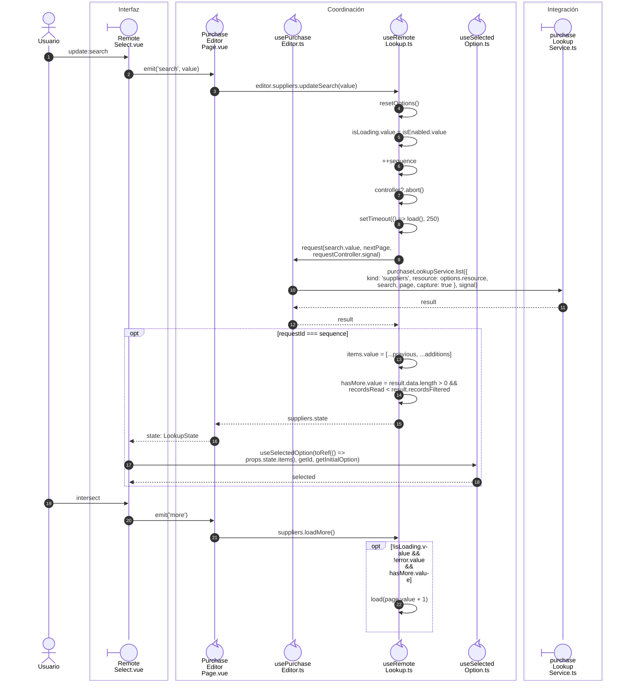

# Búsqueda, paginación y selección remota

**Casos relacionados:** RD-VUE-006; RN-VUE-003/005; soporte de captura.

## Primera apertura y reutilización

**Identificador:** `DIA-VUE-SEQ-058`. Apertura sin texto de búsqueda. La
[política de carga](../../../contracts/client-contracts.md#página-de-datos-y-selección-remota)
define la vida útil de las opciones y la precarga del área.

## Secuencia aplicada

**Identificador:** `DIA-VUE-SEQ-010`.

Si la lectura falla, `useRemoteLookup` publica `error` y calcula `canRetry` mediante
`isReadRetryable`. `RemoteSelect` emite `retry` sólo cuando ofrece ese botón;
la página llama `retry()`, que repite `load(requestedPage)` sin saltar de página.
La [presentación del error](../../../interface-standards.md#carga-y-recuperación)
no bloquea los otros campos del formulario.

## Fuentes de los participantes

[RemoteSelect.vue](../../../../../src/shared/components/RemoteSelect.vue),
[PurchaseEditorPage.vue](../../../../../src/modules/purchases/pages/PurchaseEditorPage.vue),
[usePurchaseEditor.ts](../../../../../src/modules/purchases/composables/usePurchaseEditor.ts),
[useRemoteLookup.ts](../../../../../src/shared/composables/useRemoteLookup.ts),
[useSelectedOption.ts](../../../../../src/shared/composables/useSelectedOption.ts),
[purchaseLookupService.ts](../../../../../src/modules/purchases/services/purchaseLookupService.ts).
