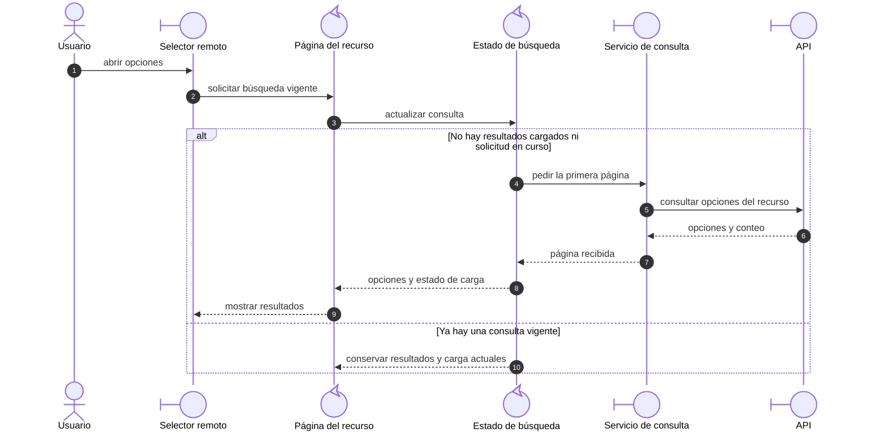
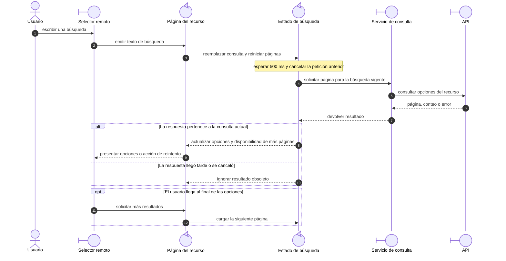

# Búsqueda, paginación y selección remota

**Pregunta:** ¿cómo se actualizan las opciones de un selector desde el servidor sin
mostrar resultados obsoletos? **Aplicaciones:** selectores de Compras, Salidas, Almacén
y Directorio.

## Apertura y primera carga

**Identificador:** `DIA-VUE-SEQ-058`. La página evita repetir una consulta ya solicitada o
que sigue en curso.

## Escritura, paginación y recuperación

**Identificador:** `DIA-VUE-SEQ-010`.

`RemoteSelect` conserva la selección por ID aunque la página visible de opciones cambie.
Un error de lectura recuperable habilita **Reintentar**; la nueva lectura usa la página
solicitada. `refresh` sirve a las altas contextuales para actualizar opciones después
de crear un registro.

## Fuentes

[RemoteSelect.vue](../../../../../src/shared/components/RemoteSelect.vue),
[useRemoteLookup.ts](../../../../../src/shared/composables/useRemoteLookup.ts),
[useSelectedOption.ts](../../../../../src/shared/composables/useSelectedOption.ts),
[purchaseLookupService.ts](../../../../../src/modules/purchases/services/purchaseLookupService.ts),
[issueLookupService.ts](../../../../../src/modules/issues/services/issueLookupService.ts),
[pageRequest.ts](../../../../../src/shared/http/pageRequest.ts),
[apiClient.ts](../../../../../src/shared/http/apiClient.ts).
