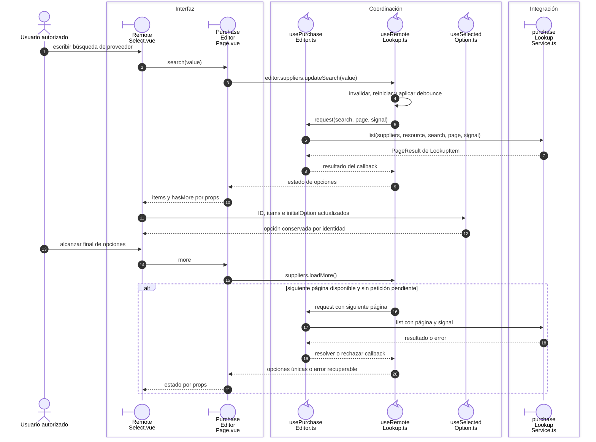

# Búsqueda, paginación y selección remota

## Escenario y contratos

**Casos relacionados:** RD-VUE-006; RN-VUE-003/005; soporte de captura.

## Secuencia aplicada

**Identificador:** `DIA-VUE-SEQ-010`.

**Lectura visual:** [líneas de vida, números y mensajes](../../diagram-reading.md#secuencias).

## Reglas y recuperación

Cambiar dependencia reinicia búsqueda/opciones; desmontar limpia timer y aborta/invalida. La selección pertenece al consumidor y no autoriza el registro ni fabrica su ID.

## Evidencia

remoteLookupTest.ts, selectedOptionTest.ts y selectCreation.spec.ts. La [matriz por caso](../../../../testing/04-use-case-coverage.md) identifica alcance y límites, y el [registro CP](../../../../testing/03-test-cases.md) concreta datos y oráculos críticos.

## Fuentes de los participantes

[RemoteSelect.vue](../../../../../src/shared/components/RemoteSelect.vue),
[PurchaseEditorPage.vue](../../../../../src/modules/purchases/pages/PurchaseEditorPage.vue),
[usePurchaseEditor.ts](../../../../../src/modules/purchases/composables/usePurchaseEditor.ts),
[useRemoteLookup.ts](../../../../../src/shared/composables/useRemoteLookup.ts),
[useSelectedOption.ts](../../../../../src/shared/composables/useSelectedOption.ts),
[purchaseLookupService.ts](../../../../../src/modules/purchases/services/purchaseLookupService.ts).
