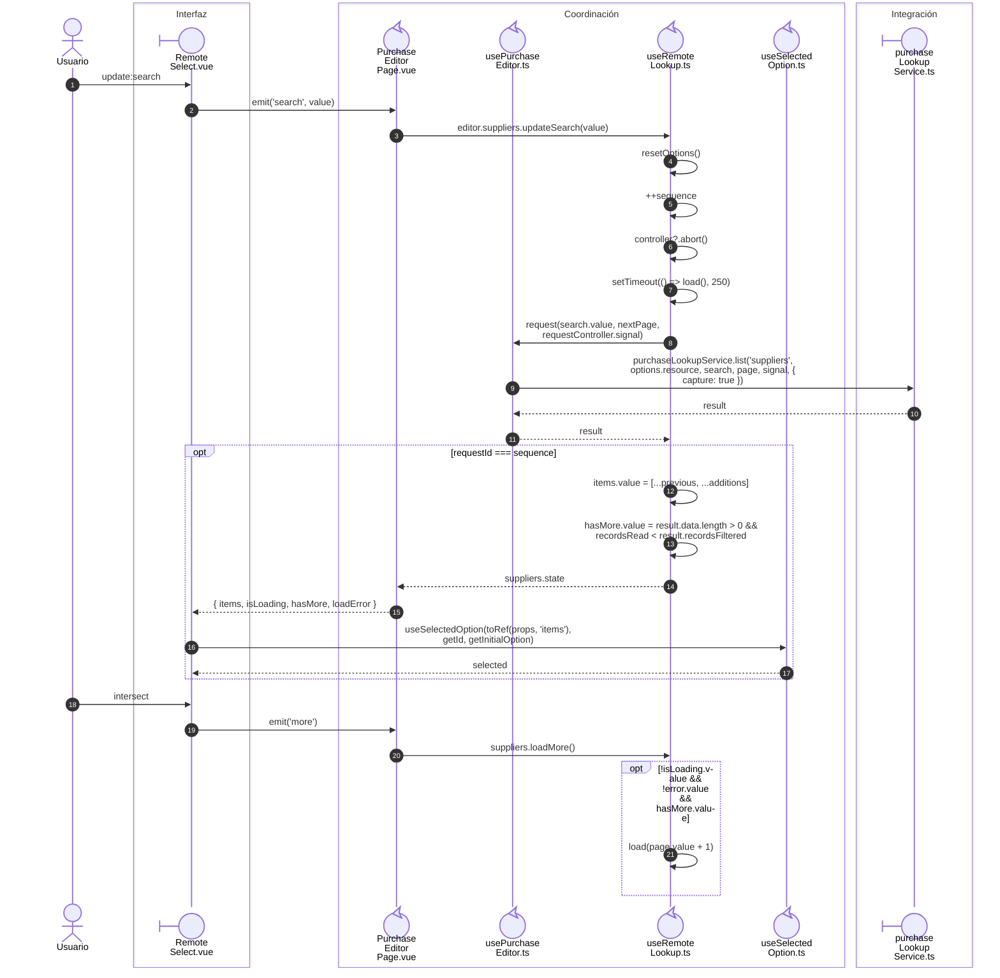

# Búsqueda, paginación y selección remota

**Casos relacionados:** RD-VUE-006; RN-VUE-003/005; soporte de captura.

## Secuencia aplicada

**Identificador:** `DIA-VUE-SEQ-010`.

## Fuentes de los participantes

[RemoteSelect.vue](../../../../../src/shared/components/RemoteSelect.vue),
[PurchaseEditorPage.vue](../../../../../src/modules/purchases/pages/PurchaseEditorPage.vue),
[usePurchaseEditor.ts](../../../../../src/modules/purchases/composables/usePurchaseEditor.ts),
[useRemoteLookup.ts](../../../../../src/shared/composables/useRemoteLookup.ts),
[useSelectedOption.ts](../../../../../src/shared/composables/useSelectedOption.ts),
[purchaseLookupService.ts](../../../../../src/modules/purchases/services/purchaseLookupService.ts).
