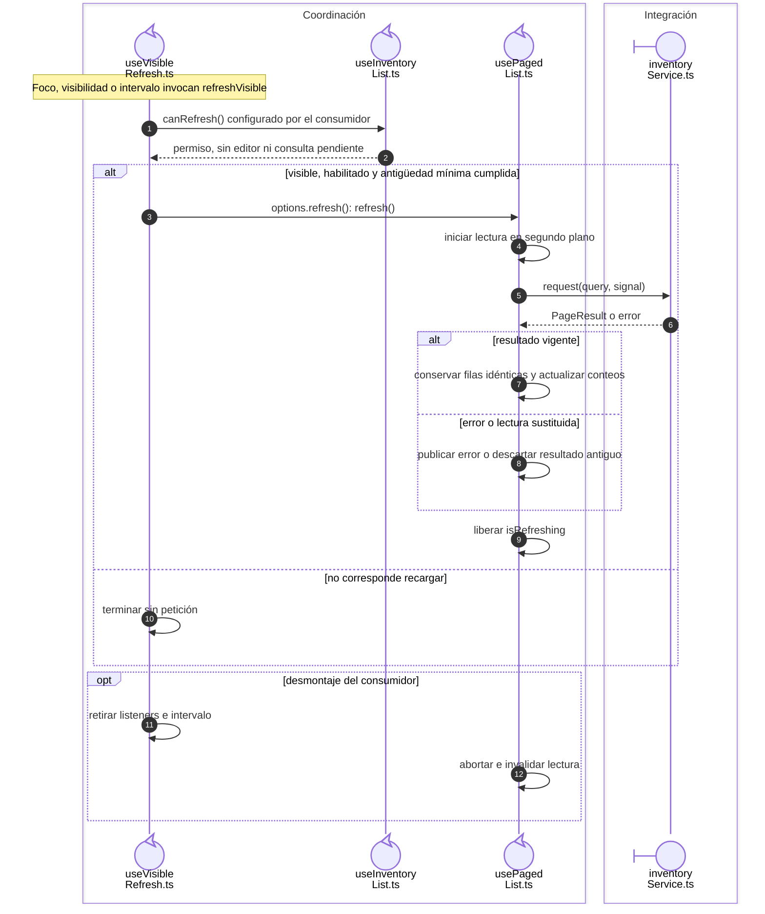

# Recarga visible sin solapamiento

## Escenario y contratos

**Casos relacionados:** RN-VUE-003/005/007; consultas de CU-ALM y listados.

## Secuencia aplicada

**Identificador:** `DIA-VUE-SEQ-019`.

**Lectura visual:** [líneas de vida, números y mensajes](../../diagram-reading.md#secuencias).

## Reglas y recuperación

El intervalo no determina por sí solo una carga periódica incondicional. Pausas, visibilidad, antigüedad y petición vigente pertenecen al contrato del consumidor.

## Evidencia

listInteractionTest.ts, inventoryListTest.ts y pruebas de recarga del navegador. La [matriz por caso](../../../../testing/04-use-case-coverage.md) identifica alcance y límites, y el [registro CP](../../../../testing/03-test-cases.md) concreta datos y oráculos críticos.

## Fuentes de los participantes

[useVisibleRefresh.ts](../../../../../src/shared/composables/useVisibleRefresh.ts),
[useInventoryList.ts](../../../../../src/modules/warehouse/composables/useInventoryList.ts),
[usePagedList.ts](../../../../../src/shared/composables/usePagedList.ts),
[inventoryService.ts](../../../../../src/modules/warehouse/services/inventoryService.ts).
