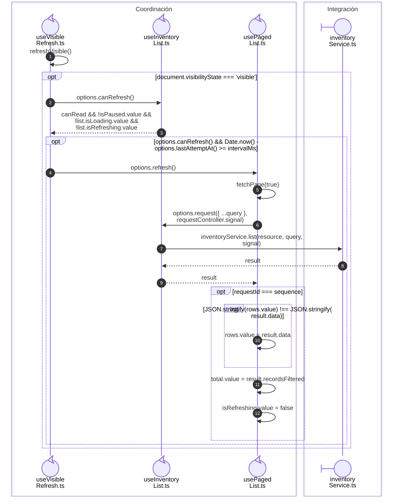

# Recarga visible sin solapamiento

**Casos relacionados:** RN-VUE-003/005/007; consultas de CU-ALM y listados.

## Secuencia aplicada

**Identificador:** `DIA-VUE-SEQ-019`.

## Fuentes de los participantes

[useVisibleRefresh.ts](../../../../../src/shared/composables/useVisibleRefresh.ts),
[useInventoryList.ts](../../../../../src/modules/warehouse/composables/useInventoryList.ts),
[usePagedList.ts](../../../../../src/shared/composables/usePagedList.ts),
[inventoryService.ts](../../../../../src/modules/warehouse/services/inventoryService.ts).
