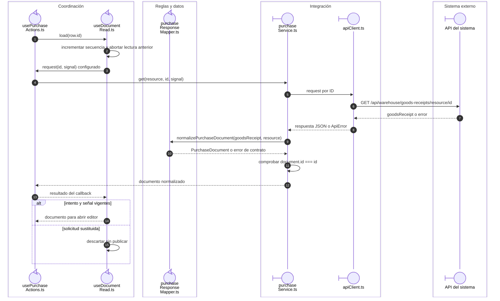
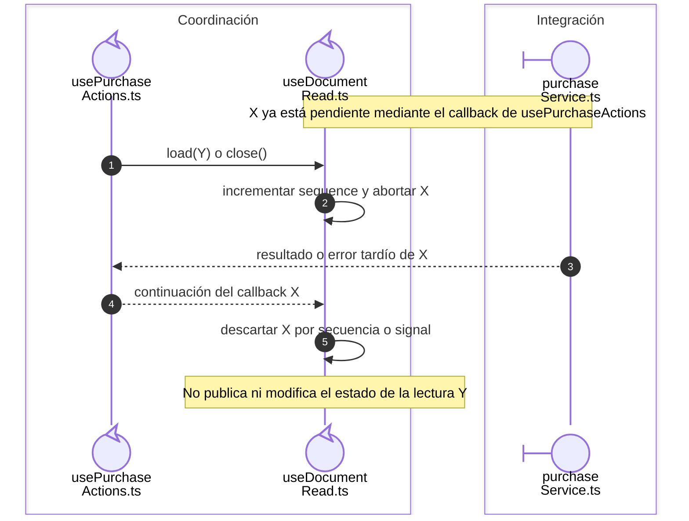

# Lectura de documento y descarte de respuestas sustituidas

## Escenario y contratos

**Identificador:** `DIA-VUE-SEQ-025`. **Pregunta:** ¿Cómo se impide que una lectura
lenta abra un documento que el usuario ya dejó de solicitar?
**Casos relacionados:** aperturas de compra y salida, CU-ENT y CU-SAL.
**Fuentes:** [useDocumentRead.ts](../../../../../src/shared/composables/useDocumentRead.ts),
[usePurchaseActions.ts](../../../../../src/modules/purchases/composables/usePurchaseActions.ts),
[useIssueActions.ts](../../../../../src/modules/issues/composables/useIssueActions.ts).
**Notación:** secuencia con guardas de vigencia y frontera HTTP externa.

**Lectura visual:** [líneas de vida, números y mensajes](../../diagram-reading.md#secuencias).

## Lectura sustituida y recuperación

**Identificador:** `DIA-VUE-SEQ-029`. **Pregunta:** ¿Qué sucede con la respuesta
anterior al cambiar de fila o cerrar? **Fuente:** `useDocumentRead.load/close` y
`Actions.retry`. **Notación:** secuencia de una lectura X ya pendiente.

| Condición de la lectura vigente | Resultado y recuperación |
| --- | --- |
| Documento normalizado e ID coincidente | Devuelve documento al coordinador, que resuelve el modo y abre. |
| Red rechazada, JSON inválido o ID distinto | Establece `readError`, llama `onError` y no retorna documento. |
| Intento sustituido o señal abortada | Descarta resultado/error sin modificar la lectura nueva. |
| Reintentar | El coordinador repite la última fila/modo y el lector crea un intento nuevo. |
| Cierre/desmontaje | Invalida y aborta; limpia documento/error. Desmontaje impide nuevas cargas. |

## Estado y límites

`requestedId` permite repetir lectura; el coordinador conserva además el modo y la fila
de la última apertura. `close` invalida, aborta y limpia documento/error. El desmontaje
marca `isDisposed` antes de cerrar para impedir otra carga. En `finally` sólo el intento
vigente modifica `isReading`; una respuesta vieja no oculta la carga nueva.

La normalización corresponde a `purchaseResponseMapper` y la comprobación del ID al
servicio. Salidas desarrolla sus propios colaboradores en [SEQ-042](../07-issues/05-issue-read-transport.md). Un fallo
de JSON o ID también se propaga como error vigente, aunque la red haya respondido 200.
Abortar no prueba reversión del servidor: aquí sólo se consulta y se protege el estado
del cliente. Las [secuencias de compra](../06-purchases/index.md) y
[salida](../07-issues/index.md) desarrollan la resolución específica del modo.

La evidencia de apertura, reintento y selección de documento se localiza en
[purchaseTest.ts](../../../../../tests/unit/modules/purchases/purchaseTest.ts),
[issueTest.ts](../../../../../tests/unit/modules/issues/issueTest.ts) y en la
[matriz de cobertura](../../../../testing/04-use-case-coverage.md).

## Fuentes de los participantes

[usePurchaseActions.ts](../../../../../src/modules/purchases/composables/usePurchaseActions.ts),
[useDocumentRead.ts](../../../../../src/shared/composables/useDocumentRead.ts),
[purchaseResponseMapper.ts](../../../../../src/modules/purchases/mappers/purchaseResponseMapper.ts),
[purchaseService.ts](../../../../../src/modules/purchases/services/purchaseService.ts),
[apiClient.ts](../../../../../src/shared/http/apiClient.ts).
