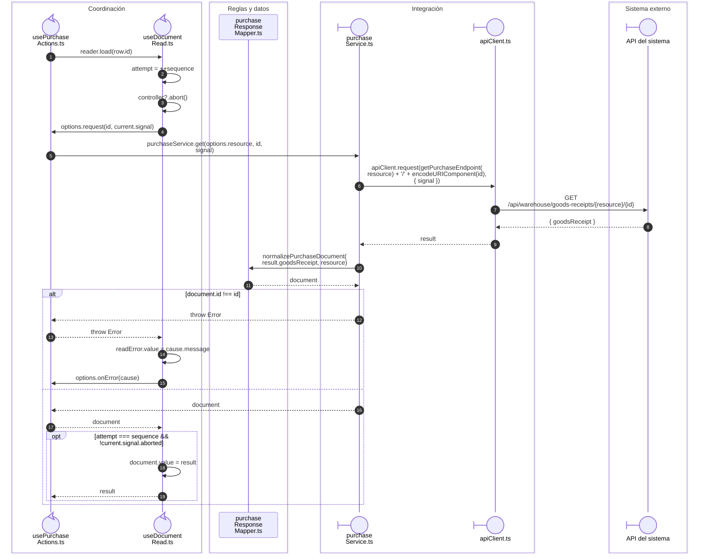
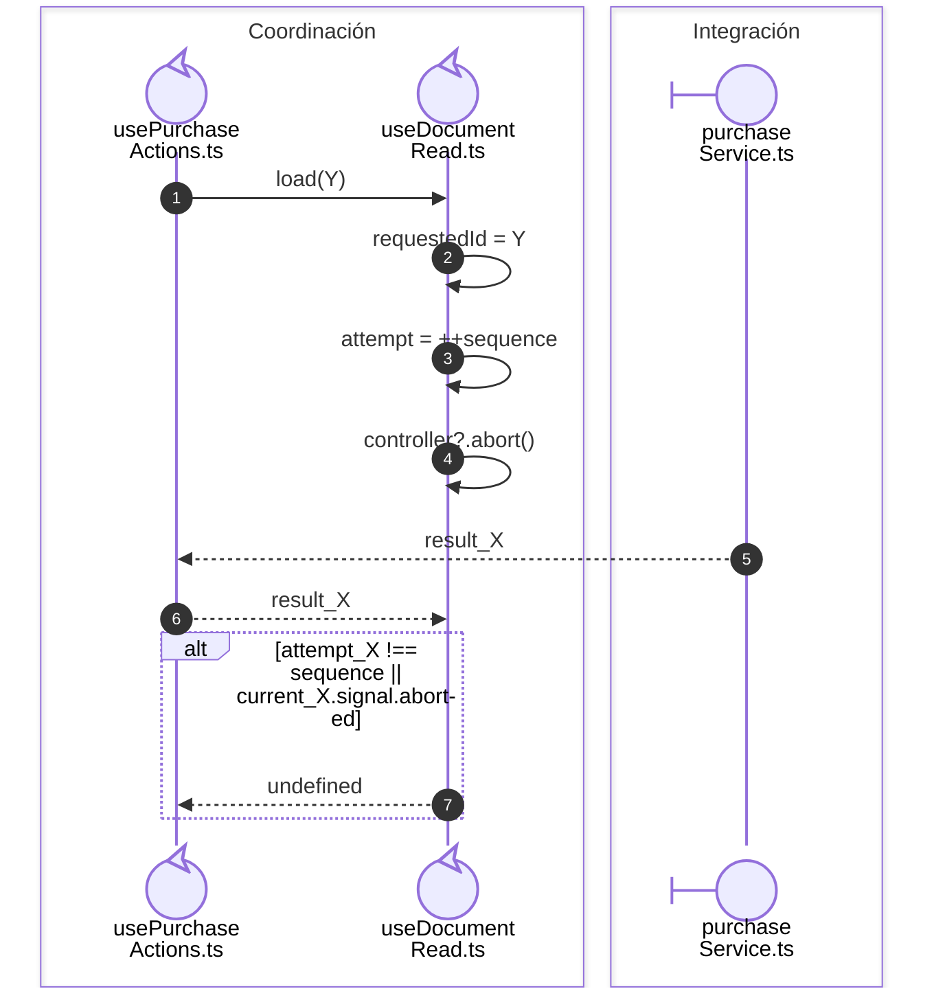

# Lectura de documento y descarte de respuestas sustituidas

**Casos relacionados:** aperturas de compra y salida, CU-ENT y CU-SAL.

## Escenario y contratos

**Identificador:** `DIA-VUE-SEQ-025`.

## Lectura sustituida y recuperación

**Identificador:** `DIA-VUE-SEQ-029`.

## Fuentes de los participantes

[usePurchaseActions.ts](../../../../../src/modules/purchases/composables/usePurchaseActions.ts),
[useDocumentRead.ts](../../../../../src/shared/composables/useDocumentRead.ts),
[purchaseResponseMapper.ts](../../../../../src/modules/purchases/mappers/purchaseResponseMapper.ts),
[purchaseService.ts](../../../../../src/modules/purchases/services/purchaseService.ts),
[apiClient.ts](../../../../../src/shared/http/apiClient.ts).

## Secuencias relacionadas

[DIA-VUE-SEQ-042](../07-issues/05-issue-read-transport.md#documento-solicitado-y-documento-recibido).
