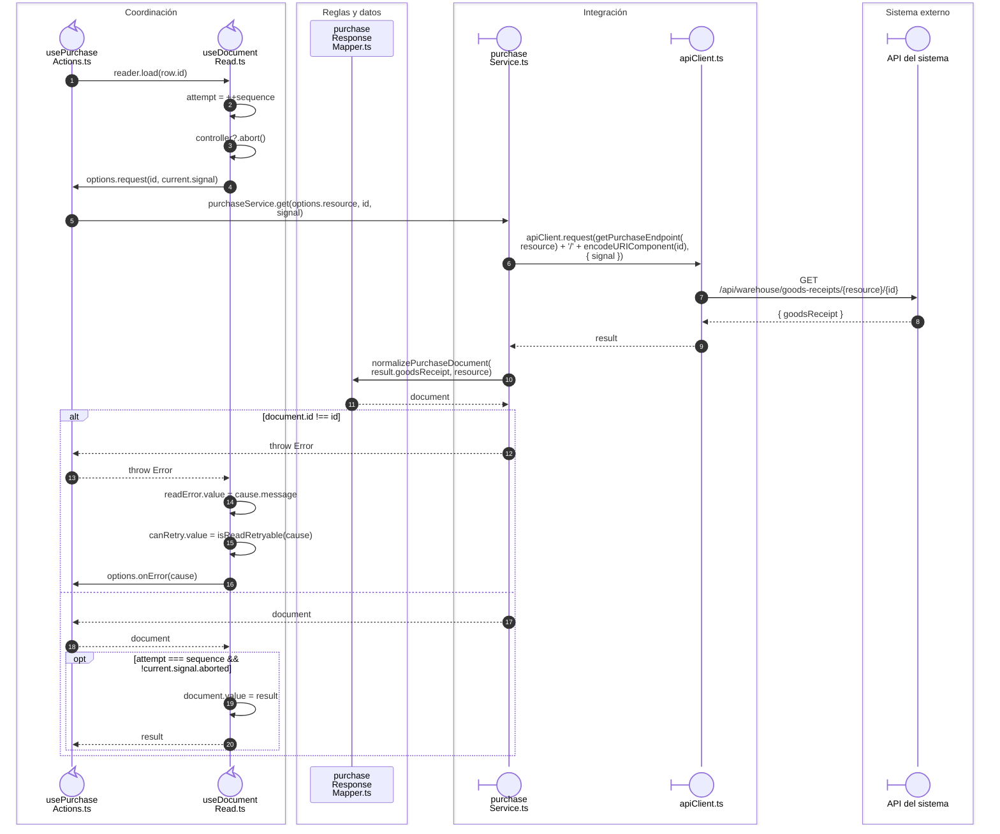
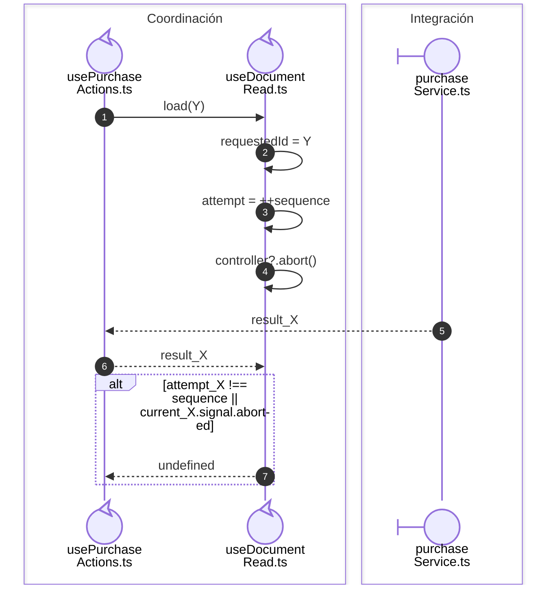
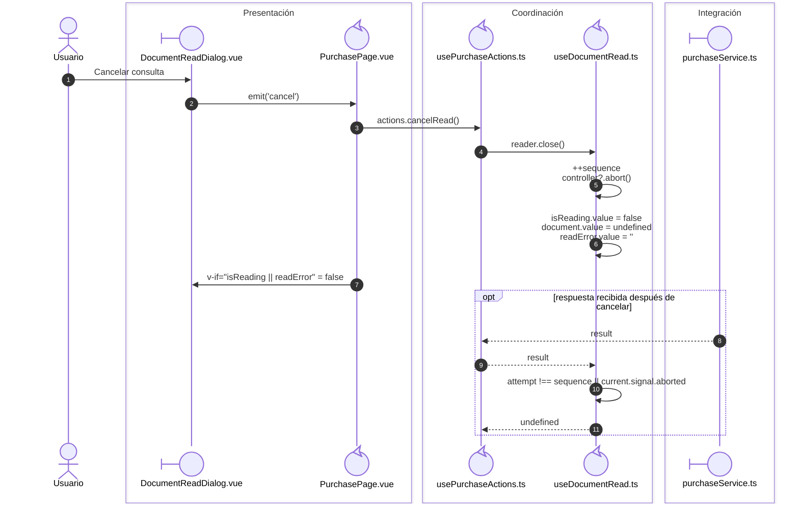

# Lectura de documento y descarte de respuestas sustituidas

**Casos relacionados:** aperturas de compra y salida, CU-ENT y CU-SAL.

## Escenario y contratos

**Identificador:** `DIA-VUE-SEQ-025`.

## Lectura sustituida y recuperación

**Identificador:** `DIA-VUE-SEQ-029`.

## Cancelación desde el diálogo de lectura

**Identificador:** `DIA-VUE-SEQ-057`. Consulta de compra en curso que el usuario
cancela antes de recibir la respuesta. Salidas compone el mismo lector y diálogo.

## Fuentes de los participantes

[usePurchaseActions.ts](../../../../../src/modules/purchases/composables/usePurchaseActions.ts),
[useDocumentRead.ts](../../../../../src/shared/composables/useDocumentRead.ts),
[purchaseResponseMapper.ts](../../../../../src/modules/purchases/mappers/purchaseResponseMapper.ts),
[purchaseService.ts](../../../../../src/modules/purchases/services/purchaseService.ts),
[apiClient.ts](../../../../../src/shared/http/apiClient.ts).

[DocumentReadDialog.vue](../../../../../src/shared/components/DocumentReadDialog.vue)
recibe el estado y emite `retry`/`cancel`; no consulta HTTP. La página conecta el
reintento y el aborto del lector. Los rechazos de escritura permanecen en su formulario.

## Secuencias relacionadas

[DIA-VUE-SEQ-042](../07-issues/05-issue-read-transport.md#documento-solicitado-y-documento-recibido).
